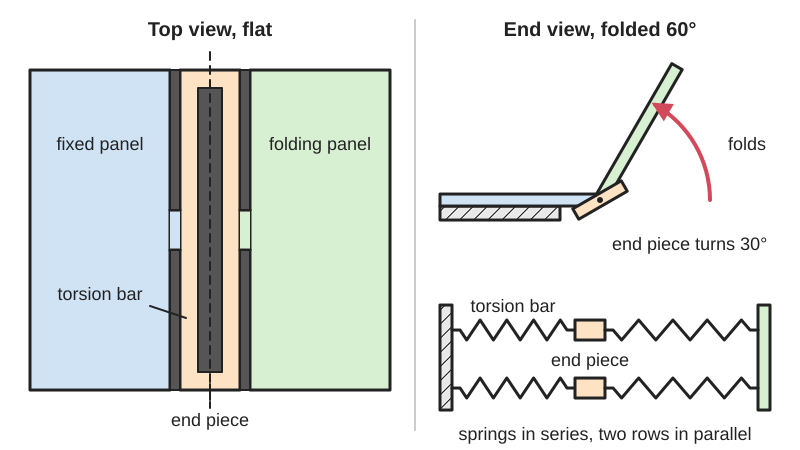

<figure class="eoc-pic eoc-pic-main"><picture><source media="(prefers-reduced-motion: reduce)" srcset="../media/drawn/lamina-emergent-torsional-joint.svg"></picture><figcaption><strong>Animation.</strong> Diagram drawn for the encyclopaedia from the research notes. ⚑ Needs confirming: a drawing can simplify or get details wrong; a real photo or a better diagram is welcome.</figcaption></figure>

A hinge made only by cutting slots in a flat sheet: the strips left between the slots twist like tiny [torsion](../glossary.md#torsion) springs, so one side of the sheet can rotate up out of the plane while the whole thing stays one piece and springs back toward flat.

**In plain words:** A pattern of long slots cut into a flat sheet so that thin strips between them can twist, letting one part of the sheet fold up out of the flat like a hinge, even in stiff stuff like plywood, acrylic or steel. **Proper term:** Lamina emergent torsional joint (LET joint).

**Also called:** LET joint, lamina emergent torsion joint (Jacobsen, Chen, Howell and Magleby 2009; US patent 9,157,497); outside LET joint (torsion bars on the outside, two connecting pieces at the ends) and inside LET joint (torsion bars on the inside, one connecting piece across the middle) (US 9,157,497); half LET joint (only two torsion bars, working side by side; US 9,157,497); M-LET, membrane-enhanced LET joint (a thin film added to stop unwanted stretching and twisting; Chen, Magleby and Howell 2018); triple-LET and outside-deployed LET joints (variants for a larger folding range; named in the M-LET paper); curved LET joint (cut into the wall of a tube; Seymour et al. 2021); LET array, lamina emergent array (LEA): many LET joints side by side so a whole sheet can fold or curve (BYU CMR Printables models; Nelson et al. 2016); surrogate fold (origami-engineering term for a compliant hinge standing in for a crease; M-LET paper); a building block of lamina emergent mechanisms (LEMs, 'pop-up mechanisms'): [compliant mechanisms](../glossary.md#compliant-mechanism) made from flat sheet whose motion emerges out of the plane (Wikipedia 'Lamina emergent mechanism'); torsional hinge (MEMS term; BYU Technology Transfer); related but not identical: lattice hinge, laser-cut [living hinge](../glossary.md#living-hinge), flex pattern (arrays of small twisting links; Deferred Procrastination).

## How it works

When one panel is turned out of the plane, each long torsion bar twists along its length like a wrung cloth, and the short connecting pieces bend a little; all these springy parts together act like one hinge with a built-in return spring (US 9,157,497). The bars are arranged in pairs side by side (springs in parallel) and one after another (springs in series), so each bar only twists through part of the total fold: in the basic outside joint each bar turns half the joint angle, which halves the stress for the same [stiffness](../glossary.md#stiffness) as one bar (US 9,157,497, eq. 4). Because stiff materials can twist much further than they can bend over the same thickness, the joint gives 'much greater [deflections](../glossary.md#deflection) than simple single-beam compliant [flexures](../glossary.md#flexure) of similar thickness' (Seymour et al. 2021) and turns wood, acrylic or steel sheet into a fold (BYU CMR). The cost is that it is fairly floppy in other directions: pushing, pulling or twisting it in the plane of the sheet bends the torsion bars and causes unwanted (parasitic) motion (Chen, Magleby and Howell 2018).

## Parts

Single piece: a cut pattern in one sheet made of long, thin torsion bars (the strips that twist), short connecting pieces that join the bars and bend a little, and the two panels (links) being hinged. An outside LET joint has four torsion bars and two connecting pieces; an inside LET joint has its torsion bars inside and one connecting piece across the middle (US 9,157,497; Chen, Magleby and Howell 2018).

## Everyday examples

- The BYU / Wasatch Design Collective 'Flex Chair' folded from a single sheet of Baltic birch plywood (Wasatch Design Collective; BYU CMR 'Mini Flex Chair' model)
- Laser-cut plywood or acrylic boxes and notebook covers with a flexible 'lattice hinge' panel, a close relative that also works by twisting small links (Deferred Procrastination)
- Printable fold-up ornaments, boxes and kaleidocycles from BYU's compliant mechanisms lab (BYU CMR Maker Resources)
- Tiny torsional hinges in MEMS chips, one of the target uses named by BYU (BYU Technology Transfer)

## When to use it

Use a LET joint when you want a hinge in a flat part made from one sheet, with no pins, no assembly and no rubbing, and need it to turn through a large angle in a material that won't bend much on its own, such as plywood, acrylic, sheet metal or a printed plate (BYU Technology Transfer; US 9,157,497). It suits flat-pack and fold-up furniture, pop-up and origami-inspired mechanisms, deployable structures, toys and demonstrators, and small or micro devices where pin hinges are impractical. It is a good choice when off-axis stiffness is 'not as critical' (Jacobsen et al. 2009 abstract); with an added membrane it can also locate more accurately, and an outside LET joint has been used for high-precision positioning in National Ignition Facility target shrouds (Chen, Magleby and Howell 2018).

## When not to use it

Avoid it where the hinge must carry large pushes, pulls or sideways loads, or must keep an exact pivot line (use a pin hinge, a flexure pivot such as a cross-axis pivot, or a membrane-enhanced LET), where it must hold a folded position without springing back (add a latch, [detent](../glossary.md#detent) or glue), where it must seal, or in a thin, flexible sheet that can simply bend (a plain living hinge or thin-web flexure is simpler). For a gentle curve rather than a sharp fold, a kerf-bending or lattice pattern spreads the bend better. If you plan to sell products using BYU's LET designs, check the patents first: US 9,157,497 covers the LET joint, and BYU's Printables files for its LET arrays are licensed for non-commercial use and state the design is protected under US patents 11852210 and 11549563.

## Details

- **What it does (jobs):**
  - let it move (turn, slide or bend): a hinge made from the sheet itself
  - store energy: the twisted bars act as a return spring that pulls the panel back toward flat (US 9,157,497)
- **Movement:** flex: bends out of the plane of the sheet like a hinge, through large angles; a spring-steel example was modelled to 20° and a curved aluminium one simulated to 35° (US 9,157,497; Seymour et al. 2021), and plywood and printed demonstrators fold to form chairs and boxes (Wasatch Design Collective; BYU CMR Printables) ⚑ [uncertain] (for maximum angles)
- **Directions it can move (degrees of freedom):** 1 intended: 'A LET joint primarily provides one rotational degree-of-freedom through the torsional deflections of the torsional segments' (Chen, Magleby and Howell 2018); in practice it also allows some unwanted stretching, squashing and in-plane twisting (parasitic motion), and its centre of rotation moves as it bends (Seymour et al. 2021)
- **Special behaviour:**
  - none of the listed behaviours in the basic joint: it simply bends like a hinge and springs back toward flat (US 9,157,497)
  - one-way (moves freely one way, locks the other): membrane-enhanced LET joints can be made as 'one-way joints that can ensure origami-based mechanisms emerge from their flat state ... into the desired configuration' (Chen, Magleby and Howell 2018)
- **How it holds:**
  - not a holding joint (it moves or passes on motion): it is a hinge; the sheet is one piece, so nothing needs holding together
- **Input and output:** not applicable
- **Power:** passive (no power needed)
- **Load:** light: it is designed to rotate easily, not to carry force. It is weakest against pushing or pulling along the sheet across the joint and against in-plane twisting, which bend the torsion bars; 'they are not suitable for high precision applications if these types of loads are applied' (Chen, Magleby and Howell 2018). Example: a 0.81 mm spring-steel outside LET joint needs about 0.60 N·m to turn it 20° (US 9,157,497). Folded structures such as the plywood LET chair get their strength from the overall folded shape rather than from the joints alone ⚑ [uncertain].
- **Play and precision:** No play or [backlash](../glossary.md#backlash) (nothing slides; it is one piece) and it returns to flat repeatably, but its centre of rotation shifts as it bends (Seymour et al. 2021) and it moves sideways, stretches or squashes under loads other than a pure turning moment (Chen, Magleby and Howell 2018). Adding a thin membrane 'increases the stiffnesses of the translation along the y-axis and the rotation around the z-axis by more than 5000 times, while only increasing the rotation stiffness around the x-axis about one time' (Chen, Magleby and Howell 2018).
- **Taking it apart:** permanent: the joint is part of the sheet and cannot be taken apart
- **How often it can be reused:** not taken apart at all; it can flex very many times if the twisting stress stays below the material's yield point, which gives 'much better [fatigue](../glossary.md#fatigue) properties' (Deferred Procrastination, lattice hinges); [brittle](../glossary.md#brittle--ductile) materials such as acrylic, or joints bent past their design angle, may crack after few cycles ⚑ [uncertain] (for cycle counts)
- **Sealing:** none: the slots go right through the sheet, so it leaks air, water and light
- **Adjustable:** no: stiffness and range are fixed by the cut pattern and the sheet thickness; change them by recutting with longer, thinner or more torsion bars
- **Access needed:** not applicable
- **Materials:** Any sheet that can take some twisting: spring steel (AISI 1095), polypropylene and polycrystalline silicon (MEMS) in the original work (US 9,157,497; Jacobsen et al. 2009 abstract); aluminium alloy 7075 and Nitinol in tube-wall versions (Seymour et al. 2021); Baltic birch plywood for a full-size chair (Wasatch Design Collective); wood or acrylic sheet (BYU CMR Printables 'LET Array'); printed PETG (Seymour et al. 2021) and other printed plastics (BYU CMR models); polypropylene with a metallic-glass membrane for M-LET joints (Chen, Magleby and Howell 2018). Brittle acrylic is possible but cracks easily (Deferred Procrastination); for laser-cut flexing patterns makers more often use wood, because it allows 'a significant degree of flex before the material fractures' (Ponoko).
- **Heat, cold, water and wear:** The joint only springs back fully while the twisting stress stays below the material's yield point; beyond it the joint takes a permanent set and fatigues quickly (Deferred Procrastination). Plastic (including printed) joints [creep](../glossary.md#creep) if held folded under load and slowly lose their springback ⚑ [uncertain]; acrylic is brittle, and the heat of laser cutting may change its properties (Deferred Procrastination, as a possible explanation for early breakage). Plywood joints may stiffen, loosen or crack with changes in humidity ⚑ [uncertain]. Metal and Nitinol joints are the most durable (Seymour et al. 2021; US 9,157,497).

## Making it

- **Ways to make or get it:**
  - laser cut: acrylic, plywood, polypropylene or thin sheet (BYU CMR 'LET Array'; Deferred Procrastination for the related lattice hinge)
  - CNC: routed plywood furniture such as the single-sheet LET chair (Wasatch Design Collective) ⚑ [uncertain] (for the exact cutting process)
  - 3D print (FDM): printed flat in one piece (BYU CMR Printables models; Seymour et al. 2021 printed PETG test joints)
  - sheet metal: spring-steel joints (US 9,157,497), cut by laser, water jet or stamping ⚑ [uncertain] (for water jet and stamping)
  - micro-fabrication (MEMS): polysilicon joints (US 9,157,497)
- **Printing it in one piece (print in place):** yes: the joint is just a pattern in a flat printed sheet, so it works straight off the bed with no assembly (BYU CMR 'Mini LET Joint Box' is 'all printed in one piece'); some folded models add a drop of glue to hold their final shape (BYU CMR 'Mini Flex Chair')
- **Tools:** To use: none. To make: a laser cutter, CNC router, water jet or stamping press for sheet, or a 3D printer; a few drops of glue if a folded model has to hold its shape (BYU CMR 'Mini Flex Chair' instructions) ⚑ [uncertain] (for water jet and stamping)
- **Difficulty:** moderate: cutting or printing the pattern is easy, but getting a joint that bends far enough without cracking takes a few test pieces, because stiffness and stress depend strongly on the bar thickness, width and length and on the material

### 3D printing tips

1) Print the sheet flat on the bed; it needs no supports and prints fast (BYU's Mini Flex Chair takes 'about an hour to print'). 2) The torsion bars are sized with their in-plane width w larger than the sheet thickness t, because the standard equations assume w > t (US 9,157,497); on an FDM printer make w a whole number of extrusion widths and t a whole number of layers ⚑ [uncertain]. 3) Stiffness rises with thickness cubed and falls with bar length (k = K·G/L with K roughly w·t³/3; US 9,157,497), so the quickest way to make a joint softer and less stressed is a slightly thinner sheet or longer bars; widening the bar mostly adds stiffness. 4) Research prints used PETG at 100% [infill](../glossary.md#infill) on a Prusa i3 MK2 and measured a bending modulus of about 1.4 GPa, lower than typical datasheet values for moulded plastic, so measure or test your own material (Seymour et al. 2021). 5) Prefer tough, springy filaments (PETG, nylon, polypropylene); stiff, brittle PLA is more likely to crack at the ends of the bars ⚑ [uncertain]. 6) Round the inside corners where slots end, since sharp corners concentrate stress ⚑ [uncertain]. 7) To fold further, spread the motion over more bars or several joints side by side, as in BYU's LET arrays and in lattice hinges, where more links in series each twist less (Deferred Procrastination). 8) Don't leave a printed plastic LET folded under load for long; plastics creep and it will take a set (Deferred Procrastination assumes 'no plastic creep for polymers') ⚑ [uncertain]. 9) Print a single test joint and fold it through the full angle a few dozen times before printing the whole project ⚑ [uncertain].

### Buying one (off-the-shelf parts)

None: it is a cut pattern, not a bought part. Related bought items: laser-cutting sheet stock (plywood, acrylic, polypropylene, spring-steel shim), and for membrane-enhanced joints a thin, strong film or tape bonded across the joint (the M-LET paper used metallic glass; the related lattice-hinge write-up suggests gluing 'a thinner material across the inside of the hinge to prevent expansion'; Deferred Procrastination) ⚑ [uncertain] (for suitable hobby films).

## Rules of thumb

- Joint stiffness: [torque](../glossary.md#torque) T = k_eq × angle (in radians). For a symmetric outside LET joint, k_eq = 2·kT·kB / (kT + 2·kB), where kT is one torsion bar's stiffness and kB one connecting piece's bending stiffness; if the connecting pieces are much stiffer, k_eq = kT, and each bar twists only half the joint angle, 'also reducing the stress by half' (US 9,157,497, eqs. 1-4).
- Inside LET joint: 1/k_eq = 1/(k1k5/(k1+k5) + k2k6/(k2+k6)) + 1/k9 + 1/(k3k7/(k3+k7) + k4k8/(k4+k8)); with rigid connecting pieces and equal bars it also reduces to k_eq = kT (US 9,157,497, eqs. 5-7; Seymour et al. 2021, eq. 1).
- One torsion bar: kT = K·G / L, with G the [shear](../glossary.md#peel-vs-shear) modulus, L the bar length and K = w·t³·[1/3 − 0.21·(t/w)·(1 − t⁴/(12·w⁴))]; valid only when the bar's width w is larger than the sheet thickness t (Roark and Young formula, quoted in US 9,157,497, eqs. 8 and 10). Connecting pieces: kB = E·I/L_B with I = w·t³/12 (eq. 13).
- Maximum twisting (shear) stress in a bar: τmax = T_bar / Q with Q = w²·t² / (3w + 1.8t); it occurs on the surface at the middle of the wide face (US 9,157,497, eqs. 14-15). Keep it below the material's shear yield stress.
- Worked example: an AISI 1095 spring-steel outside LET joint 0.81 mm thick, with torsion bars 27.7 mm long and 4.9 mm wide and connecting pieces 12.8 mm long and 5.0 mm wide, gives kT = 2.26 N·m/rad, kB = 3.56 N·m/rad and k_eq = 1.72 N·m/rad: 0.60 N·m at 20°, with 303 MPa shear stress in the bars and 547 MPa bending stress in the connecting pieces; tests 'correlated well' with the model (US 9,157,497, Table 1).
- The planar equations still work for LET joints cut into thin-walled tubes over a limited range of wall-thickness-to-radius ratio (Seymour et al. 2021).
- Related lattice (laser-cut living) hinges with square links: τmax ≈ 0.676·Θ·G·t / (n·l), so the minimum number of links in series is n = 0.676·Θ·G·t / (τyield·l); for a 90° bend in 3 mm acrylic this gives 22 links of 5 mm, 11 of 10 mm, 6 of 20 mm or 4 of 30 mm - but in tests only the 22-link acrylic sample reached 90°, so the author suggests designing to about 60% of torsional yield for repeated bending (Deferred Procrastination, 'Laser-cut Lattice Living Hinges').

## Common failures

Torsion bars crack or snap because they are too short, too thick or too few for the fold angle, or the material is brittle (Deferred Procrastination: acrylic test hinges broke before 90° except the one with the most links); fix by using longer or thinner bars, more bars in series, or a tougher material. The joint takes a permanent set after being over-bent or held folded (Deferred Procrastination) ⚑ [uncertain] (for printed plastics). The joint stretches, squashes or twists sideways under loads other than a pure turning moment (parasitic motion; Chen, Magleby and Howell 2018); fix with a membrane, better load paths or bracing. The hinge line wanders because the centre of rotation shifts as it bends (Seymour et al. 2021). Real stiffness differs from the model because printed or laser-cut material properties differ from datasheets and the laser [kerf](../glossary.md#kerf) is ignored (Seymour et al. 2021; Deferred Procrastination).

## Safety

A folded LET structure stores spring energy and snaps back toward flat when released (US 9,157,497), so keep fingers and faces clear when folding large or steel ones. Brittle sheets such as acrylic can snap during bending (Deferred Procrastination) and leave sharp edges; laser-cut or stamped steel edges are sharp. Otherwise none known.

## Related

- Living hinge: a thin web that bends instead of twisting; simpler, but needs a flexible material such as polypropylene, and 3D-printed living hinges are mostly for prototypes (Hubs: SLS ones 'typically last around 30-50 cycles')
- Kerf bending (laser-cut living hinge): arrays of cuts that let a whole panel curve; lattice versions also work by twisting small links
- Flexure hinge (notch, leaf-spring and cross-axis pivots): bending flexures that keep a better-defined pivot but usually move through smaller angles
- Origami mechanisms (waterbomb, Kresling, thick-panel origami): LET joints are often used as the fold lines (surrogate folds) in these
- Tape-spring hinge (measuring-tape fold): folds and snaps straight again, locking in the deployed position
- Rolling-contact joint (CORE, Jacob's-ladder hinge): large, low-friction rotation with a steadier pivot, but made of several parts
- Mechanical metamaterial mechanism (shear-cell hinge arrays): cell patterns that combine many small hinges
- Ortho-planar spring: another one-piece flat-sheet part whose motion comes out of the plane, but it moves straight up and down
- Torsional snap fit: also uses a twisting bar, but as a rocker for a snap hook
- [Print-in-place](../glossary.md#print-in-place) hinge and Knuckle hinge (butt hinge): pin hinges that rotate freely and carry more load but have [clearance](../glossary.md#clearance) and friction

## Make it yourself

- [Christmas Ornament - Compliant LET Joints (BYU CMR, Printables; linked from BYU CMR Maker Resources)](https://www.printables.com/model/581030-christmas-ornament-compliant-let-joints): A printable ornament whose LET joints curve around and connect to form a sphere; based on Nelson et al. 2016, 'Developable Lamina Emergent Arrays' *(licence: CC BY (Printables listing; BYU says files are for non-commercial use))*
- [Compact LET Joint Kaleidocycle 4th of July Firework (BYU CMR, Printables; linked from BYU CMR Maker Resources)](https://www.printables.com/model/1769704-compact-let-joint-kaleidocycle-4th-of-july-firewor): A kaleidocycle-style model with LET joints that rolls inwards or outwards on itself *(licence: CC0 / public domain (Printables: Creative Commons Public Domain))*
- [BYU CMR Mini Flex Chair (BYU CMR, Printables)](https://www.printables.com/model/569115-byu-cmr-mini-flex-chair): A scale model of the single-sheet plywood LET chair; prints flat in about an hour and is glued into its folded shape *(licence: CC BY-NC)*
- [LET (Lamina Emergent Torsion) Array (BYU CMR, Printables) (URL from Printables API, page not opened)](https://www.printables.com/model/1058700-let-lamina-emergent-torsion-array): A printable sheet of LET joints showing how torsion bars give large bending and stretching from a stiff sheet; notes the design is protected by US patents 11852210 and 11549563 *(licence: CC BY-NC (non-commercial use only))*
- [Mini LET Joint Box (BYU CMR, Printables) (URL from Printables API, page not opened)](https://www.printables.com/model/1207504-mini-let-joint-box): A palm-sized fold-up box printed in one piece using LET joints *(licence: CC BY-NC)*

## Pictures, videos and models

- [Lamina Emergent Torsional (LET) Joint (BYU Technology Transfer, ID 2009-101)](https://techtransfer.byu.edu/lamina-emergent-torsional-let-joint): Four images of LET joints and devices made with them, plus a plain description of the joint and its advantages *(licence: link only)*
- [Membrane-Enhanced Lamina Emergent Torsional Joints for Surrogate Folds (Chen, Magleby and Howell, J. Mech. Des. 2018; author manuscript on NSF PAR)](https://par.nsf.gov/servlets/purl/10092156): Drawings of outside and inside LET joints and their intended fold (Figs. 2-3), their unwanted stretching and in-plane twisting (Figs. 4-5), membrane-enhanced versions and a polypropylene prototype *(licence: link only (author manuscript; copyright ASME))*
- [US 9,157,497 B1: Lamina emergent torsional joint and related methods (Magleby, Jacobsen and Howell; Google Patents)](https://patents.google.com/patent/US9157497B1/en): Patent drawings of outside and inside LET joints, their spring diagrams, a spherical mechanism using nine LET joints, and the full stiffness and stress equations *(licence: link only (US patent document))*
- [LET Chair (Wasatch Design Collective)](https://www.wasatchdesigncollective.com/let-chair): Photos of a reversible chair folded from a single sheet of Baltic birch plywood using LET joints *(licence: link only)*
- [Laser-cut Lattice Living Hinges (Deferred Procrastination, 2011)](http://marksabino.com/defproc/blog/2011/laser-cut-lattice-living-hinges/): Diagrams of the related lattice hinge showing junctions and twisting 'spring connections' in tension, compression and bending, with stress calculations *(licence: link only (© Deferred Procrastination))*

## Needs confirming

⚑ marks something nobody has confirmed yet: a fact the research could not confirm from a source, a finder value that is a best guess, or an open point from the research notes. Corrections are welcome (see `research/needs-confirming.md`).

- ⚑ 15 sentences on this page marked [uncertain].
- ⚑ Finder value `clicks` = clicks (best guess): one-way or indexing, but neither clicking nor silent named; defaulted to clicks
- ⚑ Finder value `tools` = power tools, hand tools (source uncertain): `tools_needed` is marked ⚑ [uncertain] here: "…model has to hold its shape (BYU CMR 'Mini Flex Chair' instructions) ⚑ [uncertain] (for water jet and stamping)…"

## Sources

- <https://patents.google.com/patent/US9157497B1/en>
- <https://image-ppubs.uspto.gov/dirsearch-public/print/downloadPdf/9157497>
- <https://scholarsarchive.byu.edu/facpub/1560>
- <https://techtransfer.byu.edu/lamina-emergent-torsional-let-joint>
- <https://par.nsf.gov/servlets/purl/10284579>
- <https://par.nsf.gov/servlets/purl/10092156>
- <https://scholarsarchive.byu.edu/facpub/6497/>
- <https://en.wikipedia.org/wiki/Lamina_emergent_mechanism>
- <https://compliantmechanisms.byu.edu/maker-resources>
- <https://www.wasatchdesigncollective.com/let-chair>
- <http://marksabino.com/defproc/blog/2011/laser-cut-lattice-living-hinges/>
- <https://www.ponoko.com/blog/how-to-make/how-to-design-a-living-hinge/>
- <https://www.hubs.com/knowledge-base/how-design-living-hinges-3d-printing/>
- <https://api.printables.com/graphql/>
