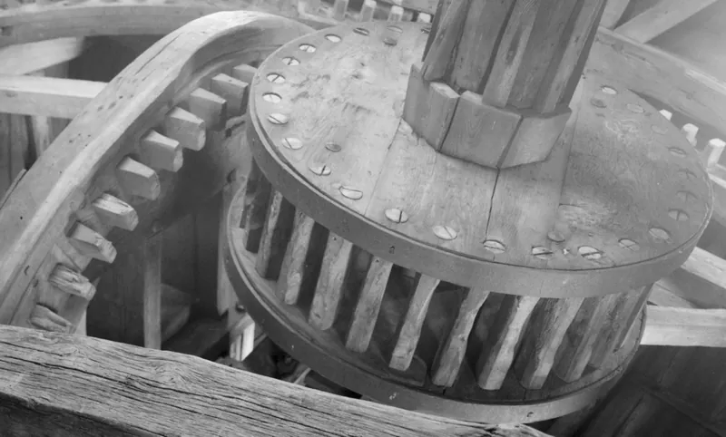
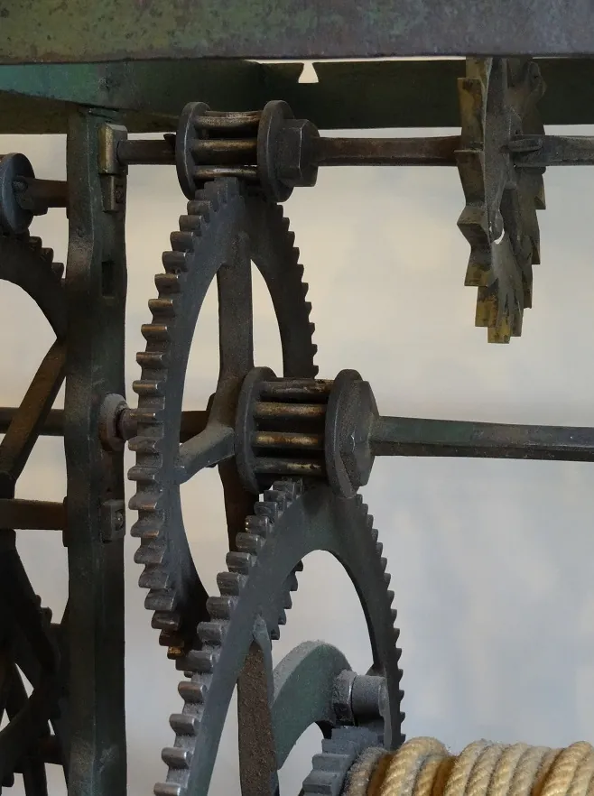

<figure class="eoc-pic eoc-pic-main"><figcaption><strong>Photo.</strong> <a href="https://commons.wikimedia.org/wiki/File:Cage_Gear.png">Cage Gear</a> by Interior_view_Pantigo_Windmill_East_Hampton_Suffolk_County_New_York.jpg: Historic American Buildings Survey, National Pa, Public domain, from Wikimedia Commons.</figcaption></figure>
<figure class="eoc-pic"><figcaption><strong>Photo.</strong> <a href="https://commons.wikimedia.org/wiki/File:Lantern_gear_-_Turret_clock_from_1608.jpg">Lantern gear - Turret clock from 1608</a> by Ezrdr, <a href="https://creativecommons.org/licenses/by-sa/3.0">CC BY-SA 3.0</a>, from Wikimedia Commons.</figcaption></figure>

A pinion whose 'teeth' are round pins set between two discs, driven by a wheel with specially shaped (cycloidal) teeth; it is easy to make by drilling holes and pushing in dowels or steel pins, and was used for centuries in mills and clocks.

**In plain words:** A gear made of a ring of round pins (like dowels) held between two discs, like the bars of a round birdcage, which meshes with a toothed wheel. **Proper term:** Lantern gear (lantern pinion, cage gear).

**Also called:** lantern pinion; cage gear; pin gear, pin wheel, pinwheel gear; trundle wheel, trundle gear (the pins are called trundles, staves or rungs); wallower (the lantern on a mill's upright shaft); lantern rack, pin rack (the straight version: a row of pins); roller pinion (a modern industrial version with pins on bearings; e.g. Nexen RPS, brand).

## How it works

The pins sit on the lantern's [pitch](../glossary.md#pitch) circle, and each tooth of the mating wheel pushes one pin at a time round, like a finger pushing the bars of a turning birdcage (Wikipedia 'Gear'). The wheel's tooth shape is the path the centre of a pin traces as the two pitch circles roll on each other (an epicycloid), moved inwards by the pin's radius, which gives smooth, steady motion (tec-science; Chief Delphi tutorial). Speed changes by the ratio of teeth to pins, as with any gear. Because each pin is held at both ends, even a lantern with very few pins is strong, and dirt can fall through between the pins instead of packing into tooth roots (Wikipedia; Chief Delphi). The mangle wheel is the round cousin of the mangle rack: it 'converts continuous rotary motion of pinion into [reciprocating](../glossary.md#reciprocating) rotary motion of wheel' (507 Mechanical Movements no. 36). In no. 194 the wheel carries a single ring of pins and a toothed pinion runs round the inside of the ring and then the outside, its shaft guided 'by a groove in the wheel' and fitted with a universal joint so it can swing, so the 'speed is equal in both directions'; in no. 192 the teeth and groove are set off-centre, so the 'speed varies in every part of a revolution' (507 Mechanical Movements nos. 192 and 194).

## Parts

A few parts: the lantern (two discs, a ring of pins or dowels between them, and a shaft or hub), and a mating wheel with teeth shaped for that exact number of pins (or a flat rack with such teeth). Optional: bushings or small bearings over the pins so they roll instead of slide

## Everyday examples

- Old windmills and watermills: the wallower on the upright shaft, driven by the pit wheel (Wikimedia Commons 'Cage Gear.png' from Pantigo Windmill; Pede's Mill)
- Old turret clocks and cheap American clock movements (Wikipedia 'Gear'; Wikimedia Commons turret clock of 1608)
- Pascal's mechanical calculator of 1642 (Wikimedia Commons file description)
- Traditional water-lifting irrigation wheels (photos in Wikimedia Commons category 'Lantern gears')

## When to use it

Use a lantern gear when you want a gear you can make with a drill and some dowels or pins, without a gear cutter: laser-cut or woodwork projects, wooden clocks and automata, school models, and robot mechanisms cut from plate (Chief Delphi; NAWCC forum). It suits slow, strong drives, dirty or dusty places (dirt falls through the pins), very few 'teeth' on the small gear, and designs where worn pins or teeth should be easy to replace (Wikipedia; Pede's Mill; tec-science). With bearings on the pins it gives smooth rolling contact.

## When not to use it

Avoid it for high speeds or precise positioning: it has a low contact ratio and usually some [backlash](../glossary.md#backlash) (tec-science); use involute spur or helical gears, or a timing belt. Avoid it where you want to swap in stock gears, because each wheel is designed for one pin count; use standard spur gears. For a long reach between shafts use a chain and sprocket. For very large reductions in a small space use a worm drive or planetary gearbox.

## Details

- **What it does (jobs):**
  - change speed or turning force: a wheel with many teeth and a lantern with few pins gives a big reduction or step-up in one stage
  - change the kind of motion: with a straight row of pins (pin rack) or a toothed rack it turns rotation into straight-line motion
- **Movement:** rotate: continuous rotation, unlimited range, as with ordinary gears; slide when a lantern pinion runs along a rack (or a toothed pinion along a pin rack)
- **Directions it can move (degrees of freedom):** 1: the output angle follows the input angle through the mesh
- **Special behaviour:**
  - motion conversion (rotary to linear): with a pin rack or toothed rack; 507 Mechanical Movements no. 199 uses a part-pinned lantern to push a frame back and forth (a mangle rack)
  - none of the other clever behaviours: it does not lock, slip or index by itself
- **How it holds:**
  - not a holding joint (it moves or passes on motion): it transmits rotation
  - shape (the parts interlock; [form-fit](../glossary.md#form-fit--force-fit--material-bond)): the wheel's teeth push the pins
- **Input and output:** Continuous rotation -> continuous rotation (or rotation -> straight-line motion with a rack). Ratio = number of teeth on the wheel / number of pins on the lantern. Shafts: parallel with a spur-type wheel; at right angles when a wheel with teeth on its face or rim drives the lantern, as with a mill's pit wheel driving the wallower on the upright shaft (Wikipedia 'Glossary of mill machinery'; Pede's Mill). Efficiency: ⚑ [uncertain] Wikipedia claims cage gears are more efficient than solid pinions but gives no source; pins that turn on bearings give rolling instead of sliding contact (osamutake), and an industrial rack-and-roller-pinion system is claimed at over 99% (Nexen, via Linear Motion Tips; vendor claim). Contact ratio is fairly low, because the pins mesh mostly on one side of the pitch point (tec-science). Back-drivable: yes, though clock tradition says the lantern should be the driven part, not the driver (Wikipedia 'Gear'; Malcolm Wild via Model Engineer forum); other clockmakers call this rule 'likely a myth'. Mangle wheel: continuous rotation of the pinion -> back-and-forth rotation of the wheel (507 Mechanical Movements nos. 36, 192 and 194).
- **Power:** passive (no power needed); it only passes on the power put into it. If the drive stops, nothing holds the output
- **Load:** Light to heavy depending on material: wooden lanterns drove millstones, and modern lantern pinions with low-friction pins drive heavy, slow loads such as large telescopes (tec-science). Each pin is held at both ends and loaded in [shear](../glossary.md#peel-vs-shear) rather than bent like a gear tooth, so a lantern can have fewer 'teeth' than an involute pinion (Chief Delphi, CHAOS 131). Strong in twist ([torque](../glossary.md#torque)); the pins' joint with the discs and the thin tips of the mating wheel's teeth are the weak points. Best at low speeds; tec-science says it is not suitable for high-precision drives
- **Play and precision:** Noticeable backlash is common: Hessmer's builder follows a British horological standard with [clearances](../glossary.md#clearance) that leave visible gaps, and the FRC tutorial notes that extra clearance prevents binding but adds backlash (Model Engineer forum; Chief Delphi). Speed is not perfectly smooth because of the low contact ratio (tec-science). Tolerant of depthing errors, wear and dirt, which is why it suited mills and turret clocks (NAWCC forum; Wikipedia), but the mating wheel's tooth shape only suits the pin count it was designed for (Chief Delphi, CHAOS 131)
- **Taking it apart:** removable: the lantern and wheel slide off their shafts; pins can be knocked out and replaced one at a time
- **How often it can be reused:** many times: the gears can be taken apart and refitted repeatedly, and worn pins (or worn wooden cogs on the mating wheel) can be replaced individually (Pede's Mill; NAWCC forum)
- **Sealing:** none: it is open, and deliberately lets dirt fall through between the pins (Wikipedia 'Gear')
- **Adjustable:** Partly: the centre distance (depthing) can be set by moving one shaft, and clockmakers correct it to bring the contact to the pitch point (AWCI). The ratio is fixed by the pin and tooth counts
- **Access needed:** end of a tube or shaft: the lantern and wheel slide onto shafts; individual pins can be driven out from the side
- **Materials:** Historically wood (staves or trundles in wooden discs) and later cast-iron pins, often meshing with wooden cogs so only the cheap, replaceable wooden cogs wear (Pede's Mill); brass or steel rod in clocks (Model Engineer forum). For makers: hardwood dowels, steel dowel pins or shoulder bolts, bushings or small bearings over pins; discs of plywood, MDF, acrylic, aluminium plate or 3D-printed plastic (Chief Delphi; osamutake)
- **Heat, cold, water and wear:** Very tolerant of dirt and dust; millers ran wooden cogs against iron pins with little grease because grease would cause problems in a dusty mill (Pede's Mill). Wooden parts swell and shrink with humidity, which changes the mesh ⚑ [uncertain]. Printed plastic parts: PLA softens above about 60 C and degrades in sunlight (Prusa). Pins pressed into plastic or wood can work loose under vibration.

## Making it

- **Ways to make or get it:**
  - laser cut (discs and mating wheel from plywood, MDF or acrylic)
  - woodwork (drilled discs with dowels; scroll-sawn mating wheel)
  - 3D print (FDM): discs and mating wheel, with printed or metal pins
  - CNC router or mill (aluminium or polycarbonate plate gears)
  - off-the-shelf part: dowels, dowel pins, shoulder bolts and bearings for the pins; industrial roller pinions
- **Printing it in one piece (print in place):** no: the lantern and its mating wheel are separate parts fitted on shafts. The lantern itself can be printed as one piece with its pins, but many makers press steel dowel pins, shoulder bolts or bearings into printed or cut discs instead (Chief Delphi)
- **Tools:** A drill (ideally a drill press with an indexing jig to space the pin holes evenly) and a saw, scroll saw, laser cutter or 3D printer for the discs and the mating wheel; a hammer or vice to press in pins; hex keys for [set screws](../glossary.md#set-screw). NAWCC clockmakers note a lantern needs no special gear cutter, only the indexing fixture used to drill the holes
- **Difficulty:** easy: the lantern is just two drilled discs and some dowels or pins, and free generators draw the mating wheel for laser cutting, CNC or printing; the only care needed is even hole spacing and the right centre distance

### 3D printing tips

1) Generate the mating wheel: Rainer Hessmer's free Lantern Gear Builder (MIT licence) outputs SVG for CAD or Inkscape (then DXF); the Chief Delphi tutorial shows how to draw it by hand in CAD (trace the pin centre's epicycloid path, offset it by the pin radius), and team CHAOS 131 shared an Onshape generator for lantern gears, ring gears, racks and pin wheels. 2) Design the wheel for the exact number of pins on its lantern; a wheel for a 5-pin lantern will not run with a 15-pin one (Chief Delphi). 3) Use metal pins where you can: printed discs with pressed-in steel dowel pins are far stronger than printed pins, and bushings or small bearings over the pins make the mesh roll smoothly (Chief Delphi; osamutake notes rotating pins give pure rolling contact). 4) Print discs and the mating wheel flat, with the shaft axis vertical, so each layer traces the full outline (Prusa's guidance on orienting for strength). 5) Clearance: osamutake's printed lantern set uses 0.15 mm [radial](../glossary.md#axial--radial) clearance on the shafts, well-dried PETG, 0.1 or 0.08 mm layers and a random seam; Prusa suggests starting at 0.3 mm between moving parts. The FRC tutorial adds a small extra offset to the tooth outline to prevent binding, at the cost of backlash. 6) Set the centre distance to the sum of the two pitch radii (AWCI) and check it by turning by hand. 7) Laser cutting: the [kerf](../glossary.md#kerf) changes the tooth fit, so compensate or test first (Hackaday). 8) PLA softens above about 60 C (Prusa); for loaded mechanisms use PETG, nylon or cut plate with steel pins.

### Buying one (off-the-shelf parts)

Hardwood dowels; steel dowel pins (e.g. 1/8 inch or 3 mm); shoulder bolts; flanged bushings or miniature ball bearings to slip over pins as rollers; retaining rings (e-clips); shafts with set-screw hubs. Industrial versions: roller pinions and matching racks (e.g. Nexen Roller Pinion System, brand), pin racks and pin gear drives. Search terms: 'lantern pinion', 'pin gear', 'pin rack', 'roller pinion', 'dowel pin'.

## Rules of thumb

- Pins sit on the lantern's pitch circle; the mating tooth outline is the epicycloid traced by a pin centre, offset inwards by the pin radius (tec-science; Chief Delphi tutorial).
- Pitch diameters: D = number of pins (or teeth) x module, or number x pitch / pi, exactly as for ordinary gears (Chief Delphi tutorial).
- Centre distance = sum of the two pitch radii; contact should cross the line of centres at the pitch point, and depthing that is too shallow or too deep gives rough running (AWCI clockmaking standard).
- Clock practice for cycloidal lantern pinions: pin diameter about 1.05 x module for 10 pins or fewer, and 1.25 x module for more than 10 pins (Malcolm Wild's book, after W.O. Davis, quoted on the Model Engineer forum).
- The mating wheel's tooth shape depends on the lantern's pin count, so design each pair together (Chief Delphi, CHAOS 131).
- For CNC routing, the pins must be larger than the end mill used to cut the wheel's tooth gaps, and choose a pitch that makes the wheel's teeth about as thick as the pins (Chief Delphi, CHAOS 131).
- Lantern gears have a relatively low contact ratio (tec-science), so keep speeds low and don't expect precision.
- Clock tradition: let the wheel drive the lantern, not the other way round (Wikipedia 'Gear'; Malcolm Wild via Model Engineer forum) ⚑ [uncertain] (other experienced clockmakers on the same forum call this 'likely a myth').
- A straight 'rack' of pins driving a gear gives involute-shaped teeth on the gear (tec-science).

## Common failures

1) Wrong centre distance (depthing): too shallow and the contact points never meet properly; too deep and the gears bind or run rough (AWCI). 2) Mating wheel designed for a different pin count: it jams or runs unevenly (Chief Delphi). 3) Pins loosening, bending or wearing grooves; use hard steel pins, support them at both ends, or fit bushings or bearings so they roll. 4) Wooden or plastic teeth wearing quickly; in mills the wooden cogs were meant to be the replaceable wearing part (Pede's Mill). 5) Uneven hole spacing: drill with an indexing jig or cut the holes by laser or CNC. 6) Laser kerf making teeth too thin or too fat (Hackaday). 7) Too much backlash from generous clearance; reduce the offset once the pair runs freely (Chief Delphi tutorial).

## Safety

Meshing gears form in-running nip points that can trap fingers, hair or clothing (OSHA machine guarding eTool); the open cage of pins adds more places to catch fingers. Guard powered drives. Small pins and dowels are a choking hazard for small children.

## Related

- Spur gear pair: involute teeth on both gears; smoother and interchangeable, but needs cut or generated teeth on both
- Cycloidal gearing: the lantern pinion is a special case of the cycloidal tooth form (tec-science)
- Chain and sprocket drive: a sprocket's teeth look like a lantern-mating wheel, but the chain wraps round it; a Chief Delphi user found #35 sprockets roughly compatible with a generated lantern gear
- Rack and pinion: a lantern pinion can run on a rack, or a toothed pinion on a pin rack (Chief Delphi; tec-science)
- Cycloidal drive: its fixed ring of pins or rollers works like an internal lantern gear
- Peg wheels (cog-and-rung gearing): pegs meshing with pegs or rungs; the oldest form of gear, tolerant but high-friction (NAWCC forum)
- Geneva drive: also uses pins, but to give stop-and-go motion
- Pin-wheel and slotted pinion (507 Mechanical Movements no. 208): pins on the face of a wheel drive a slotted pinion, giving three speeds by sliding the pinion between three circles of pins
- Roller pinion (e.g. Nexen RPS, brand): an industrial lantern pinion with rollers on bearings running on a special rack, with zero backlash (Linear Motion Tips)
- Intermittent gear: a part-toothed gear whose driven gear moves in steps with pauses; the mangle wheel and mangle rack (covered here) instead turn steady rotation into back-and-forth motion

## Make it yourself

- [Lantern Gear Builder (Dr Rainer Hessmer)](http://hessmer.org/gears/LanternGearBuilder.html): Free online tool that generates a lantern pinion and its mating gear by simulating the pins cutting into the wheel; downloads SVG for CAD, Inkscape, laser cutting or 3D printing *(licence: MIT)*
- [Educational Gear Examples 3 - Lantern (osamutake, Printables)](https://www.printables.com/model/1451958-educational-gear-examples-3-lantern): Printable demonstration set with four kinds of lantern gears (external, rack, internal), a chain and sprocket, and a multiple trammel gear, with explanations and print settings *(licence: CC BY)*
- [Lantern Gear Design Tutorial (Chief Delphi forum)](https://www.chiefdelphi.com/t/lantern-gear-design-tutorial/394915): Step-by-step CAD method for drawing a lantern pinion and its mating gear, with the pitch formulas and a worked example using 1/8 inch steel dowel pins *(licence: link only)*
- [Geometry Correct Lantern Gears - In Onshape! (Chief Delphi forum, CHAOS 131)](https://www.chiefdelphi.com/t/geometry-correct-lantern-gears-in-onshape/473561): Thread sharing an equation-driven Onshape generator for lantern gears, lantern ring gears, lantern racks and pin wheels, with design tips and a printed demo *(licence: link only ⚑ [uncertain] (Onshape document licence not checked))*

## Pictures, videos and models

- [Cage Gear.png (Wikimedia Commons, Historic American Buildings Survey)](https://commons.wikimedia.org/wiki/File:Cage_Gear.png): Photo of the wooden lantern (cage) gear inside Pantigo Windmill, Long Island *(licence: Public domain (US National Park Service work))*
- [Lantern gear - Turret clock from 1608.jpg (Wikimedia Commons, Ezrdr)](https://commons.wikimedia.org/wiki/File:Lantern_gear_-_Turret_clock_from_1608.jpg): Close-up of the lantern pinions in a turret clock of 1608 *(licence: CC BY-SA 3.0)*
- [Lantern pinion as a special case of cycloidal gear (tec-science)](https://www.tec-science.com/mechanical-power-transmission/cycloidal-gear/lantern-pinion/): Animations of a lantern pinion driving its wheel, how the wheel's tooth outline is constructed, the line of action, and a pin rack giving involute teeth *(licence: link only)*
- [507 Mechanical Movements no. 199: mangle-rack with lantern pinion](https://507movements.com/mm_199.html): Animated historic drawing of a part-pinned lantern pinion turning continuously and pushing a frame back and forth *(licence: Book public domain (1868); website animation link only)*
- [Category: Lantern gears (Wikimedia Commons)](https://commons.wikimedia.org/wiki/Category:Lantern_gears): 39 photos of lantern gears in windmills, watermills, clocks, irrigation wheels, a well pump and a mint *(licence: per file (Commons free licences))*

## Needs confirming

⚑ marks something nobody has confirmed yet: a fact the research could not confirm from a source, a finder value that is a best guess, or an open point from the research notes. Corrections are welcome (see `research/needs-confirming.md`).

- ⚑ 4 sentences on this page marked [uncertain].

## Sources

- <https://en.wikipedia.org/wiki/Lantern_gear>
- <https://en.wikipedia.org/w/index.php?title=Gear&action=raw>
- <https://en.wikipedia.org/wiki/Glossary_of_mill_machinery>
- <https://www.tec-science.com/mechanical-power-transmission/cycloidal-gear/lantern-pinion/>
- <http://www.hessmer.org/blog/2017/02/19/online-lantern-gear-builder/>
- <http://hessmer.org/gears/LanternGearBuilder.html>
- <https://www.chiefdelphi.com/t/lantern-gear-design-tutorial/394915>
- <https://www.chiefdelphi.com/t/geometry-correct-lantern-gears-in-onshape/473561>
- <https://www.awci.com/clockmaking-standard/lantern-pinion-depthing/>
- <https://www.model-engineer.co.uk/forums/topic/lantern-pinion/>
- <https://mb.nawcc.org/threads/use-a-lantern-gear-in-modern-clocks.3053/>
- <https://mb.nawcc.org/threads/wooden-peg-gear-clocks.1229/>
- <http://www.pedesmolen.com/en_the_pit_wheel.php>
- <https://507movements.com/mm_199.html>
- <https://507movements.com/mm_208.html>
- <https://507movements.com/toc.html>
- <https://commons.wikimedia.org/wiki/Category:Lantern_gears>
- <https://commons.wikimedia.org/wiki/File:Cage_Gear.png>
- <https://commons.wikimedia.org/wiki/File:Lantern_gear_-_Turret_clock_from_1608.jpg>
- <https://hackaday.com/2018/08/02/lasercut-gears-a-learning-experience/>
- <https://www.linearmotiontips.com/enhanced-roller-pinion-system-from-nexen/>
- <https://api.printables.com/graphql/>
- <https://help.prusa3d.com/article/modeling-with-3d-printing-in-mind_164135>
- <https://help.prusa3d.com/article/pla_2062>
- <https://www.osha.gov/etools/machine-guarding/introduction/hazardous-motions-actions>
- <https://507movements.com/mm_036.html>
- <https://507movements.com/mm_192.html>
- <https://507movements.com/mm_194.html>
