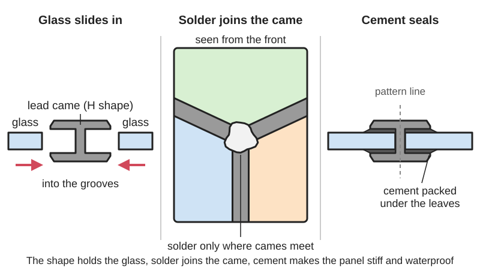
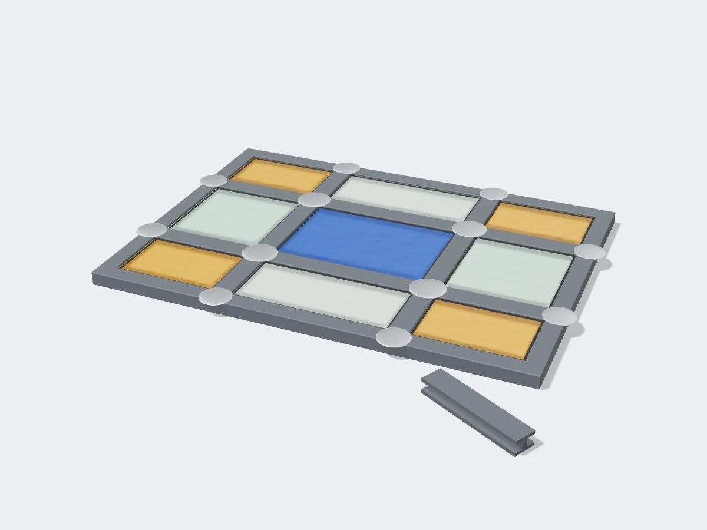

<figure class="eoc-pic eoc-pic-main"><figcaption>Diagram drawn for the encyclopaedia from the research notes. ⚑ Needs confirming: a drawing can simplify or get details wrong; a real photo or a better diagram is welcome.</figcaption></figure>
<figure class="eoc-pic"><figcaption><strong>Render.</strong> A 3D model made for the encyclopaedia, not a photo: a stand-in until a good real photo is found. ⚑ Needs confirming: a model can simplify or get details wrong; a real photo is welcome.</figcaption></figure>

A lead came joint holds pieces of glass in the channels of grooved metal strips (came), joins the strips by soldering only where they cross, and fills the gaps under the strips with an oily cement that sets to stiffen the panel and make it waterproof.

**In plain words:** Leaded glass: each piece of glass slides into the grooves of soft H-shaped lead strips, the strips are soldered together only where they meet, and a black putty is brushed under the strips so the whole panel goes stiff and keeps rain out, as in old leaded windows and glass cabinet doors. **Proper term:** Lead came joint (came glasswork, leaded glass or leadlight; zinc, brass and copper came).

**Also called:** came glasswork, leaded glass, lead light, leadlight, leadlighting, stained glass (when the glass is coloured or painted) (Wikipedia 'Came glasswork'); lead came, came, calms, leads, leading, leading up (Wikipedia 'Came glasswork'; Everything Stained Glass); H came, U came (U-channel, border came), C came, flat came, round (domed) came, Colonial came, high-heart or wide-heart lead, steel-cored lead, reinforced came (Everything Stained Glass; Wikipedia 'Came glasswork'); zinc came, brass came, copper came, brass-capped lead, restoration lead (Wikipedia 'Came glasswork'); leaded light cement, glazing cement, black cement, leaded-light putty, puttying (Everything Stained Glass; Wikipedia 'Came glasswork'); saddle bar, flat rebar, re-bar, Re-Strip, Strong Line, Flex-Bar (brands) reinforcing (Everything Stained Glass 'How to Reinforce Stained Glass Panels').

## How it works

Came is a metal strip with a central web (the heart) and two flat flanges (leaves), making channels on each side; a glass edge slides into each channel, so the glass is held by the shape of the came, not by glue (Everything Stained Glass 'Stained glass lead came'). The panel is built up piece by piece on a full-size pattern, then 'The joints where the came meet are soldered to bind the sections' (Wikipedia 'Came glasswork'), with a quick touch of the iron because lead melts at nearly the same temperature as solder (Stained Glass Club SCW). Finally a putty-like cement of linseed oil and whiting is brushed under the flanges on both faces, where it hardens, making the panel firm and waterproof (Wikipedia 'Came glasswork'; Everything Stained Glass 'Cementing Lead Came'). Zinc or rigid came round the edge, stretched lead, and steel strips or bars add [stiffness](../glossary.md#stiffness) so the soft lead doesn't sag (Wikipedia 'Came glasswork'; Fine Woodworking).

## Parts

A small assembly that acts as one unit: cut glass pieces, H-section lead came between the pieces, U- or flat-section came (lead or zinc) round the edge, solder at every joint where came meets came, leaded-light cement under the came flanges, and for bigger panels reinforcing strips or bars (Wikipedia 'Came glasswork'; Fine Woodworking; Everything Stained Glass).

## Everyday examples

- Diamond-pane leaded windows in old houses and pubs (Wikipedia 'Came glasswork')
- Church stained glass windows (Wikipedia 'Came glasswork', Canterbury Cathedral images)
- Glass doors of an Arts and Crafts display cabinet or bookcase (Fine Woodworking)
- Front-door and transom panels with clear bevelled glass in Victorian houses (Wikipedia 'Came glasswork')

## When to use it

Use lead came for flat panels with strong lines, larger pieces of glass and weather exposure: windows, door and cabinet panels, transoms (Everything Stained Glass; Fine Woodworking). Lead is easier to bend round curves; zinc suits straight-line and large designs and heavy bevelled glass (Wikipedia 'Came glasswork'). Hobby came is also used just as a neat border round copper-foiled suncatchers, fixed with a dab of glue rather than putty (Everything Stained Glass, reply to a reader).

## When not to use it

For small, intricate pieces, curved or 3D shapes (lampshades, boxes, suncatchers) use the Copper-foil joint instead: copper foil is 'particularly useful for small projects' and allows cylinders, cones and globes (Wikipedia 'Came glasswork'). To join glass to glass without metal lines, use Glass fusing or a UV-curing adhesive. To hold a single pane in a frame, use Glazing in a rebated frame. Avoid lead where children will handle the piece, or where food is involved; use zinc or brass came and lead-free solder, or a different method ⚑ [uncertain: lead-free substitute advice not on an opened came page].

## Details

- **What it does (jobs):**
  - join and hold: holds many cut pieces of glass together as one flat panel (Wikipedia 'Came glasswork')
  - glue or bond: the came strips are bonded to each other by soldering at each crossing (Wikipedia 'Came glasswork')
  - seal it, or pass cables or fluid through: cement brushed under the came makes the panel waterproof for windows and doors (Wikipedia 'Came glasswork'; Everything Stained Glass 'Cementing Lead Came')
- **Movement:** none
- **Directions it can move (degrees of freedom):** 0: once soldered and cemented the pieces can't move; before cementing the panel is 'a bit delicate and easily harmed', which is why it is cemented and, if large, reinforced (Everything Stained Glass 'Cementing Lead Came').
- **Special behaviour:**
  - none
- **How it holds:**
  - shape (the parts interlock; [form-fit](../glossary.md#form-fit--force-fit--material-bond)): the glass sits in the channels of the H-shaped came (Everything Stained Glass 'Stained glass lead came'; Wikipedia 'Came glasswork')
  - material bond (glue, solder or melting): the came strips are soldered together where they meet (Wikipedia 'Came glasswork')
  - friction or clamping (force-fit): the cement sets under the flanges and the flanges are pressed down onto the glass, locking the pieces tight (Everything Stained Glass 'Cementing Lead Came')
- **Input and output:** not applicable
- **Power:** passive (no power needed); a soldering iron is needed only to make it
- **Load:** Light: carries the weight of its own glass and wind on a window, set in a frame. Lead is soft, so large or moving panels sag or buckle unless reinforced; bevelled (thick) glass in lead came is 'much more likely to buckle or sag over time', so it is usually done in zinc (Wikipedia 'Came glasswork'). Strong in the plane of the panel once cemented, weak when bent or pushed sideways (Wikipedia 'Came glasswork' image 'Buckled lead came window').
- **Play and precision:** not applicable
- **Taking it apart:** semi-permanent: a broken piece can be replaced by cutting or opening the came round it, and old panels are taken apart for restoration, but this disturbs the cement and lead (Everything Stained Glass lesson 'Fixing a broken stained glass window'; Illinois DPH, 'dismantling of old stained glass pieces for restoration') ⚑ [uncertain: repair steps not read in detail].
- **How often it can be reused:** once: a panel is made to last; old lead can be re-soldered after thorough cleaning, but used came is hard to get clean enough to take solder (Everything Stained Glass 'Stained Glass Lead Soldering').
- **Sealing:** watertight: once cement or putty is worked under the came flanges on both faces it hardens and keeps out rain; uncemented panels are not waterproof (Wikipedia 'Came glasswork'; Everything Stained Glass 'Cementing Lead Came'). Old cement that crumbles and dissolves in water no longer seals, and needs re-cementing (Everything Stained Glass, reply to a reader).
- **Adjustable:** no
- **Access needed:** both sides: solder every joint on one face, turn the panel over and solder the other, and cement both faces (Everything Stained Glass 'Stained Glass Lead Soldering' and 'Cementing Lead Came').
- **Materials:** Came: lead (soft, cheap, easy to bend, ages to dark blue-grey), zinc (light, strong, rigid, for straight lines, borders and heavy bevelled glass), brass and copper (golden or copper colour, mainly about 1890-1920), brass-capped lead, and reinforced came with a brass or steel strip in the heart (Wikipedia 'Came glasswork'; Everything Stained Glass). Joins: pieces of sheet glass, including thick, irregular, plated or fused glass in high-heart lead (Everything Stained Glass 'Stained glass lead came'). Solder joins lead, zinc, brass and copper came; it does not stick to glass, which is held only by the came's shape (Wikipedia 'Came glasswork'). Cement: boiled linseed oil, whiting, lamp black and white spirit (Wikipedia 'Came glasswork'; Everything Stained Glass). Not a way to join plastics: the iron would melt acrylic or 3D prints ⚑ [uncertain].
- **Heat, cold, water and wear:** Soft lead sags and buckles over time in large, unreinforced or bevelled panels (Wikipedia 'Came glasswork'). Panels that are external, south-facing or that open and close need more reinforcing (Everything Stained Glass 'How to Reinforce Stained Glass Panels'). Old cement dries, crumbles and stops keeping water out (Everything Stained Glass, reply to a reader). Lead came oxidises in damp storage, forming a scale that stops [flux](../glossary.md#flux) and solder working; store it dry or with baking soda (Everything Stained Glass; Stained Glass Club SCW).

## Making it

- **Ways to make or get it:**
  - hand assembly: glass cutting, leading up on a pattern board, soldering with an iron, cementing and polishing (Fine Woodworking; Everything Stained Glass)
  - off-the-shelf part: lead, zinc and brass came, solder, flux, leaded-light cement, reinforcing strip (Everything Stained Glass)
  - woodwork: setting the finished panel into a rebate in a wooden door or window frame (Fine Woodworking; Everything Stained Glass 'How to Reinforce Stained Glass Panels')
  - 3D print (FDM): jigs and look-alike 'leaded glass' inserts only, not the joint itself (Printables 1468163, 678895) ⚑ [uncertain: printed jigs are made for copper-foil work]
- **Printing it in one piece (print in place):** no: the joint is metal and soldered; it can't be printed.
- **Tools:** Glass cutter and breaking pliers (grozier pliers), a lead knife, a lead vice or stretcher, horseshoe nails or pins to hold the pieces while leading up, a soldering iron (for lead about 360 °C, or a Weller tip marked 7 = 700 °F), solder (50/50 or 60/40), flux (or tallow), wire brush, scrubbing brushes, a fid or wooden stick for cement, whiting (Wikipedia 'Came glasswork' tool images; Everything Stained Glass 'Stained Glass Lead Soldering' and 'Cementing Lead Came'; Fine Woodworking). Zinc came is cut with a saw ⚑ [uncertain: mentioned only in a reader's question on Everything Stained Glass].
- **Difficulty:** moderate: few special tools, and the soldering is 'FAR easier than soldering copper foil' because each joint is a small spot, but cutting glass to size, stretching lead, cementing and handling lead safely take practice (Everything Stained Glass 'Stained Glass Lead Soldering'; Fine Woodworking).

### 3D printing tips

not applicable to the joint itself, because solder and a hot iron would melt printed plastic. Printing can help around it: angle jigs for laying out pieces (e.g. a 22.5° stained glass jig, Printables 1312183, GPL v3; a four-angle jig, Printables 1468163, BSD) ⚑ [uncertain: made for copper-foil work, use with came not tested], and a printed 'leaded glass' look-alike insert for a lantern where real glass isn't needed (Printables 678895, CC BY-NC-SA).

### Buying one (off-the-shelf parts)

Search terms: 'lead came' (H, U, flat, round, high heart, steel core), 'zinc came' (U-channel border), 'brass came', 'leaded light cement' or 'glazing cement', 'whiting', '50/50 solder' and '60/40 solder', 'stained glass flux' or 'tallow', 'lead knife', 'lead vice' or 'lead stretcher', 'horseshoe nails', 'saddle bar', 'Re-Strip', 'Strong Line', 'Flex-Bar' (brands) (Everything Stained Glass; Wikipedia 'Came glasswork'). Lead came comes in about 2 m (6 ft) lengths or on spools that must be unwound and stretched (Wikipedia 'Came glasswork'; Everything Stained Glass 'Stained glass lead came'). Choose came by its face width, heart height (glass thickness) and heart thickness from the supplier's profile table (Everything Stained Glass 'Stained glass lead came').

## Rules of thumb

- Allow for the heart: cut each piece of glass about 1/16 in (1.5 mm) inside the pattern line to make room for the 1/16 in thick rib inside the lead came, or the panel grows too large (Fine Woodworking).
- Edges: traditionally 1/2 in (12 mm) flat lead is used round the edge of a window, giving 3/16 in (5 mm) of leeway each side for fitting errors; a U-shaped zinc channel round the panel adds rigidity (Everything Stained Glass 'Stained glass lead came'; Fine Woodworking).
- Profiles: round (domed) lead is better for curves because flat lead puckers; high-heart lead takes thick, fused or uneven glass (Everything Stained Glass 'Stained glass lead came').
- Stretch soft lead before use to straighten it and make it stiffer, otherwise it stretches in the panel; pre-stretched and hard lead need little or none (Everything Stained Glass; Wikipedia 'Came glasswork'). The site author says stretching gives rigidity but not strength, while a reader who is an engineer says it work-hardens the lead; both agree not to overdo it.
- Solder: 50/50 is most used for lead came, 60/40 works if you work faster or turn the iron down (Everything Stained Glass); SCW club tips use 60/40 touched on quickly. An iron of about 360 °C (or a 700 °F Weller tip) suits lead; an 800 °F tip is too hot (Everything Stained Glass 'Stained Glass Lead Soldering').
- Don't heat the lead: 'Since lead melts at nearly the same temperature as solder, do not heat the lead'; touch the joint quickly, and let each joint cool undisturbed, because vibration while cooling weakens it (Stained Glass Club SCW).
- Cement: brush across the leads, not along them, sprinkle whiting to soak up the oil, clean it off before it hardens, and leave the panel about 2-3 days to set before polishing (Everything Stained Glass 'Cementing Lead Came').
- When to reinforce: a fixed panel with a perimeter over about 10 ft (some say 12 ft), or a moving door or window panel over about 8 ft, with reinforcement running right across the panel edge to edge about every 18 in (450 mm) (Everything Stained Glass 'How to Reinforce Stained Glass Panels'); one r/StainedGlass member reinforces anything over 24 x 24 in, depending on the design (Reddit r/StainedGlass). Sources differ, so treat these as starting points.
- Reinforce across a likely fold line, by the shortest distance edge to edge; use reinforced came, steel strip beside the heart, saddle bars tied with soldered copper wire, or flat bars soldered on the inside face (Everything Stained Glass 'How to Reinforce Stained Glass Panels'; Wikipedia 'Came glasswork').

## Common failures

Panel too big: glass cut on the pattern line without allowing for the came's heart (Fine Woodworking). Gaps at joints: came not butted tightly; fill with a sliver of came and drop on solder (Everything Stained Glass 'Stained Glass Lead Soldering'). Solder won't take: oxidised or dirty lead, so wire-brush or scrape to bright metal and flux it (Everything Stained Glass; Stained Glass Club SCW). Melted came: iron too hot or held too long (Everything Stained Glass; Stained Glass Club SCW). Weak, crystalline joints: panel moved while the solder cooled (Stained Glass Club SCW). Missed joints: check every joint on both faces (Everything Stained Glass). Sagging or bulging panel: lead not stretched, no reinforcement, or heavy glass in lead (Wikipedia 'Came glasswork'). Leaks and rattles: no cement, or old cement crumbling (Everything Stained Glass 'Cementing Lead Came').

## Safety

Lead: you are exposed 'when handling lead came or leaded solders and during dismantling of old stained glass pieces', and 'Soldering lead creates a poisonous vapor' (Illinois DPH). Wash hands after handling lead, because alcohol hand sanitisers 'do not remove lead from hands'; never eat, drink or smoke in the workspace; vacuum with a HEPA vacuum instead of sweeping; shower and wash your hair after heavy lead work; keep children and women of childbearing age away from the work area, since children absorb about 70% of lead they swallow against about 20% for adults (Illinois DPH). Wear gloves when handling lead came and ventilate the room when soldering (Everything Stained Glass). Fumes and burns: flux fumes and acid fluxes harm the lungs and skin, and a glass grinder makes harmful powdered glass (Illinois DPH; Wikipedia 'Came glasswork' note on flux). The soldering iron runs at about 360 °C, hot enough to burn skin and set paper or a pattern board alight; always rest it in a holder (Everything Stained Glass 'Stained Glass Lead Soldering' lists a holder) ⚑ [uncertain: fire risk inferred]. Cut glass edges cut hands. Taking apart old leaded panels exposes you to lead (Illinois DPH), so don't dry-scrape or sand old came, cement or putty ⚑ [uncertain: the no-sanding advice is from Illinois DPH's furniture section, applied here by analogy].

## Related

- Copper-foil joint (Tiffany method): each piece's edge is wrapped in copper tape and soldered along the whole seam; better for small, intricate and 3D work
- Soldered metal joint: the general soft-soldering technique used at each came joint
- Glazing in a rebated frame: how the finished panel, or a single pane, is held in its wooden frame
- Glass fusing: joins glass to glass by melting in a kiln, with no metal lines
- Housing and rebate joints: cutting the rebate in a door or window frame that the panel sits in
- Push-on edge trim (U-channel edging): a U-shaped edge strip that grips a sheet edge, like U came

## Make it yourself

- [Stained Glass Jig 22.5° angle (ispont, Printables) (URL from Printables API, page not opened)](https://www.printables.com/model/1312183-stained-glass-jig-225deg-angle): Printed angle jig to help lay out and solder pieces at set angles (made for stained glass work generally) *(licence: GNU General Public License v3.0)*
- [Stained Glass Jig (ABM, Printables) (URL from Printables API, page not opened)](https://www.printables.com/model/1468163-stained-glass-jig): Printed jig with four angles for stained glass assembly *(licence: BSD License)*
- ["Leaded Glass" for Classic Lantern (Nikki, Printables) (URL from Printables API, page not opened)](https://www.printables.com/model/678895-leaded-glass-for-classic-lantern): A printed insert that imitates the look of leaded glass, for a printed lantern *(licence: Creative Commons Attribution-NonCommercial-ShareAlike)*

## Pictures, videos and models

- [Lead came cross sections02.png (Wikimedia Commons, uploaded by Rickjpelleg)](https://commons.wikimedia.org/wiki/File:Lead_came_cross_sections02.png): Diagram of H- and U-shaped lead came cross sections with glass pieces in their channels *(licence: GFDL 1.2+, CC BY-SA 3.0 or CC BY 2.5 (choice))*
- [Lead came and Copper foil Glasswork Flowchart.png (Wikimedia Commons, uploaded by Rickjpelleg)](https://commons.wikimedia.org/wiki/File:Lead_came_and_Copper_foil_Glasswork_Flowchart.png): Flowchart of the shared first steps and the different later steps of lead came and copper-foil work *(licence: GFDL 1.2+, CC BY-SA 3.0 or CC BY 2.5 (choice))*
- [Buckled lead came window 01.jpg (Wikimedia Commons, by RickP / Rickjpelleg)](https://commons.wikimedia.org/wiki/File:Buckled_lead_came_window_01.jpg): Side view of a lead came window buckled for lack of reinforcement *(licence: GFDL 1.2+, CC BY-SA 3.0 or CC BY 2.5 (choice))*
- [Canterbury Cathedral 012 window showing leading and support.JPG (Wikimedia Commons)](https://commons.wikimedia.org/wiki/File:Canterbury_Cathedral_012_window_showing_leading_and_support.JPG): Close-up of lead cames with soldered joints, iron support rods and the copper wire ties *(licence: Public Domain Mark 1.0 (check US status on the file page))*
- [Stained glass lead came (Everything Stained Glass)](https://everythingstainedglass.com/stained-glass-lead): Labelled diagram of an H came (height, leaf, heart, heart thickness) and photos of profiles, stretching and storage *(licence: all rights reserved (link only))*

## Needs confirming

⚑ marks something nobody has confirmed yet: a fact the research could not confirm from a source, a finder value that is a best guess, or an open point from the research notes. Corrections are welcome (see `research/needs-confirming.md`).

- ⚑ 8 sentences on this page marked [uncertain].
- ⚑ Finder value `tools` = soldering iron, press or vice, hand tools (source uncertain): `tools_needed` is marked ⚑ [uncertain] here: "…'Cementing Lead Came'; Fine Woodworking). Zinc came is cut with a saw ⚑ [uncertain: mentioned only in a reader's…"
- ⚑ Research note: *Lead came joint* (445): reinforce fixed panels over about 10 ft perimeter and moving ones over about 8 ft, every 18 in (source in the entry) versus "over 24 x 24 in" (an r/StainedGlass member); solder 50/50 (Everything Stained Glass) versus 60/40 (SCW club).

## Sources

- <https://en.wikipedia.org/wiki/Came_glasswork>
- <https://finewoodworking.com/2010/02/11/leaded-glass-made-easy>
- <https://everythingstainedglass.com/making-stained-glass>
- <https://everythingstainedglass.com/stained-glass-lead>
- <https://everythingstainedglass.com/stained-glass-lead-soldering>
- <https://everythingstainedglass.com/how-to-stain-glass>
- <https://everythingstainedglass.com/reinforcing-glass-panels>
- <https://stainedglass.scwclubs.com/specialities-and-techniques/>
- <https://dph.Illinois.gov/content/dam/soi/en/web/idph/files/publications/lead-safety-hobbyists-041516.pdf>
- <https://www.reddit.com/r/StainedGlass/comments/mr4owi/lead_came_vs_copper_foil_strengths/ (read through https://arctic-shift.photon-reddit.com/api/comments/search?link_id=mr4owi&limit=20)>
- <https://commons.wikimedia.org/wiki/File:Lead_came_cross_sections02.png>
- <https://commons.wikimedia.org/wiki/File:Lead_came_and_Copper_foil_Glasswork_Flowchart.png>
- <https://commons.wikimedia.org/wiki/File:Buckled_lead_came_window_01.jpg>
- <https://commons.wikimedia.org/wiki/File:Canterbury_Cathedral_012_window_showing_leading_and_support.JPG>
- <https://api.printables.com/graphql/ (models 1312183, 1468163, 678895; no Printables pages opened)>
