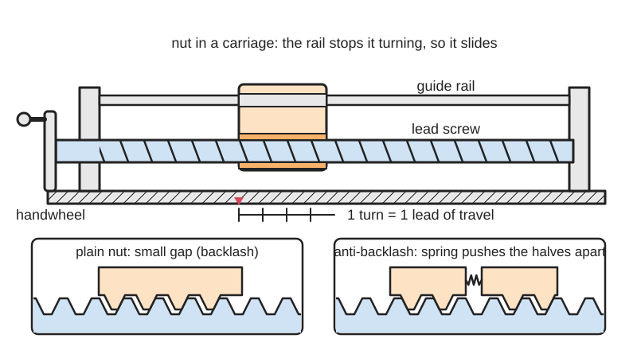
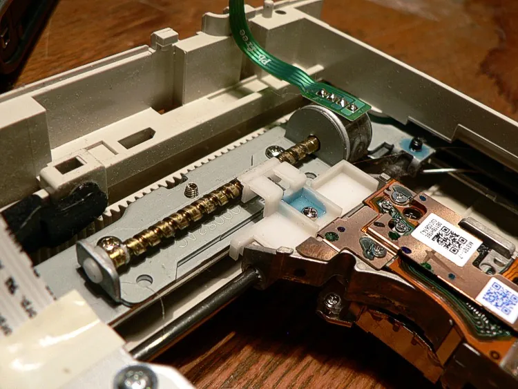
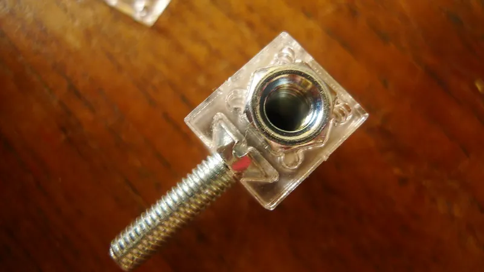

<figure class="eoc-pic eoc-pic-main"><picture><source media="(prefers-reduced-motion: reduce)" srcset="../media/drawn/lead-screw-and-nut.svg"></picture><figcaption><strong>Animation.</strong> Diagram drawn for the encyclopaedia from the research notes. ⚑ Needs confirming: a drawing can simplify or get details wrong; a real photo or a better diagram is welcome.</figcaption></figure>
<figure class="eoc-pic"><figcaption><strong>How it works.</strong> <a href="https://commons.wikimedia.org/wiki/File:Dvd_pohon_vozika_hlavy.jpg">Dvd pohon vozika hlavy</a> by Baran Ivo, Public domain, from Wikimedia Commons.</figcaption></figure>
<figure class="eoc-pic"><figcaption><strong>Photo.</strong> <a href="https://www.flickr.com/photos/49412427@N06/5761157145">Contrapteur lasercut lead nut mount</a> by wolf.arthur, <a href="https://creativecommons.org/licenses/by/2.0/">CC BY 2.0</a>, from Flickr via Openverse.</figcaption></figure>

Turning a threaded rod (the lead screw) moves a nut that is kept from spinning along the rod in a straight line, trading speed for a lot of pushing force; fine threads hold their place, and a spring-loaded anti-backlash nut removes the wobble when the direction changes.

**In plain words:** A long threaded rod that you (or a motor) turn so a nut riding on it moves in a straight line; with a gentle, fine thread it stays where it is when you let go. **Proper term:** Lead screw and nut (power screw, translation screw), including the anti-backlash nut.

**Also called:** leadscrew; power screw; translation screw; Acme screw / Acme thread (inch sizes); trapezoidal screw / Tr screw (metric), e.g. 'T8' or 'Tr8x8' lead screw on 3D printers; jackscrew / screw jack (when used for lifting); feed screw (machine tools); vice screw / bench screw; high-helix lead screw (steep, fast, back-drivable version); anti-backlash nut / zero-backlash nut / [preload](../glossary.md#preload) nut / spring-loaded nut; dryspin (igus brand of plastic lead screw nuts); OpenBuilds Anti-Backlash Nut Block (brand).

## How it works

The nut is held so it can't turn, so each turn of the screw moves it along by one lead (the distance one thread advances per turn = [pitch](../glossary.md#pitch) x number of starts). Because the threads slide on each other, friction is high: with a shallow thread (small lead angle) the friction is greater than the thread's slope, so pushing on the nut cannot spin the screw ([self-locking](../glossary.md#self-locking)), while steep, multi-start threads are efficient enough that a load can spin the screw backwards (back-drive). There is always a small gap between the nut's and screw's thread faces ([backlash](../glossary.md#backlash)), so the nut shifts a little when the direction reverses. An anti-backlash nut splits the nut in two and uses a spring to push the halves apart along the screw, or to squeeze springy fingers inward, so one part always presses on each thread face.

## Parts

A few parts: the threaded rod (screw), the nut (plastic, brass or bronze), bearings or supports at the rod's ends, a handwheel or a motor coupling, and a guide (rails or slides) that stops the nut and carriage from turning with the screw. An anti-backlash nut is a small assembly: two nut parts (or a nut with springy fingers) plus a compression or [torsion](../glossary.md#torsion) spring.

## Everyday examples

- A bench vice: turning the handle drives the jaw with great force, and it doesn't loosen by itself
- A car scissor jack: turning the [crank](../glossary.md#crank) winds a screw that lifts the car and holds it (a jackscrew)
- The Z axis of a 3D printer: motors turn T8 lead screws that raise the print head or lower the bed
- The laser head in a DVD drive or the head of an old floppy drive, moved along a tiny lead screw by a stepper motor

## When to use it

Use one when you need slow, strong, precise straight-line motion from a motor or a handwheel: lifting and holding (jacks, printer Z axes, robot hanging mechanisms), clamping (vices, presses), fine positioning (machine tool slides, CNC axes), or opening and closing things that must stay put with the power off. It is cheap, compact, quiet, works with plastic nuts that need no grease, and a fine lead holds position without a brake.

## When not to use it

Avoid it for fast or long moves (it is slow, and long screws whip at speed); use a belt, rack and pinion or linear motor. Avoid it for continuous high-duty or high-efficiency work (it wastes energy as heat and the nut wears); use a ball screw. Don't rely on its self-locking to hold heavy vertical loads safely; add a brake or counterweight. Don't use it where sideways loads would hit the nut; add linear guides. For quick coarse moves followed by fine clamping, add a half nut or use a quick-release mechanism.

## Details

- **What it does (jobs):**
  - change the kind of motion: rotation into straight-line motion (and back again if it is back-drivable)
  - change speed or turning force: a small turning force makes a large push, at slow speed
  - stop it moving back (one-way): fine-lead screws hold their position when you stop turning (self-locking); note it can still be driven both ways from the screw, and the hold is not guaranteed under vibration
- **Movement:** rotate+slide: the screw turns and the nut slides in a straight line; travel is limited by the length of the screw
- **Directions it can move (degrees of freedom):** 1: the nut's travel is locked to the screw's rotation (one lead per turn), so there is only one independent motion
- **Special behaviour:**
  - motion conversion (rotary to linear): the screw's rotation becomes a straight push or pull on the nut
  - self-locking (holds under load, won't back-drive): true only for fine leads (a rule of thumb is a lead under about 1/3 of the screw diameter, efficiency under 50%); vibration can let even these [creep](../glossary.md#creep), so add a brake for hanging loads
  - tensioning (takes up slack and holds), anti-backlash nut only: its spring keeps taking up the gap between the threads as the nut wears
- **How it holds:**
  - shape ([form-fit](../glossary.md#form-fit--force-fit--material-bond)): the nut's thread interlocks with the screw's thread, so the nut can't slide along the screw without turning it
  - friction or clamping (force-fit): thread friction is what makes a fine-lead screw self-locking
  - spring force: in anti-backlash nuts, a spring presses the nut parts against opposite thread faces
- **Input and output:** Rotation -> straight-line motion. Travel per turn = lead (e.g. a Tr8x8 3D-printer screw moves 8 mm per turn; a Tr8x2 moves 2 mm). Efficiency typically 20-80% (PBC Linear; linearmotiontips), 30-50% for jackscrews (Wikipedia); ball screws, by contrast, are about 90%. Shaft arrangement: in line (the nut travels along the screw's axis). Back-drivable: yes when the efficiency is 50% or more, e.g. a 10 mm screw with a 25 mm lead (83%); no when the lead is under about 1/3 of the diameter, e.g. a 10 mm screw with a 2 mm lead (41%) (PBC Linear); vibration can still make a self-locking screw move.
- **Power:** passive (no power needed); often motor-driven. If power is lost, a self-locking (fine-lead) screw keeps its last position, while a back-drivable (steep-lead) screw can let a vertical load, such as a 3D printer gantry or bed, drift or drop unless there is a brake or counterweight
- **Load:** Medium to heavy along the screw's axis in both push and pull (screw jacks lift cars and buildings). Weak against sideways loads and bending: the nut should ride on a separate guide, not carry side loads. Long, thin screws whip (vibrate like a skipping rope) at speed, so the safe speed limit falls as length increases.
- **Play and precision:** Plain nut: noticeable backlash (the gap between thread faces), which grows as the nut wears. Anti-backlash nut: small to none; Sienci Labs' spring-loaded POM nut takes up wear automatically. Fine leads give fine position steps, and [repeatability](../glossary.md#repeatability--accuracy) is best when the nut approaches a position from the same direction. It tolerates little [misalignment](../glossary.md#misalignment): a screw held by the motor coupler plus a nut on a guided carriage is over-constrained, so any bend or offset causes binding and wobble. Let the float happen in the nut mount or guides, not the screw (igus).
- **Taking it apart:** removable: the nut unscrews from the end of the screw, and the screw comes out of its end bearings and coupling
- **How often it can be reused:** many times: it can be dismantled and refitted repeatedly; the nut wears in use and is replaceable
- **Sealing:** none: the threads and nut are open to the air and dirt; nothing about the joint seals
- **Adjustable:** yes: the position can be set anywhere along the travel just by turning the screw. Anti-backlash nuts have their preload set by a spring (automatic, e.g. torsion-spring twin nuts) or an adjusting screw (e.g. the M5 screw on the OpenBuilds-style block, tightened until the play is gone but the screw still turns easily)
- **Access needed:** end of a tube or shaft: the nut is threaded on from an end of the screw, and the screw is fitted from its ends into end bearings and a motor coupling or handwheel
- **Materials:** Screw: steel or stainless steel (sometimes brass or aluminium). Nut: bronze (lowest friction of the metals), brass, cast iron, or plastics such as POM (Delrin/acetal) and igus iglide (brand). Thread friction coefficient ranges from about 0.04 to 0.25 depending on the pair and [lubrication](../glossary.md#lubrication) (Wikipedia). Printed nuts: PLA works, ABS is a bit worse, and Delrin would be ideal (KP's printable OpenBuilds block); nuts printed in nylon and POM were not as good as machined ones (0scar).
- **Heat, cold, water and wear:** Heat: sliding friction heats the nut, which is why plastic nuts are limited to about 50% duty and bronze to about 10% (linearmotiontips). iglidur plastic nuts are rated -20 to +150 °C (igus), but printed PLA nuts soften above about 60 °C (Prusa). ⚑ [uncertain] Dust and grit on an open screw wear the nut, and grease collects dirt; dry-running plastic nuts avoid the grease. Vibration can let a self-locking screw creep (Wikipedia; PBC Linear). Lubrication and wear matter over time: worn nut threads raise backlash, and in aircraft jackscrews poor maintenance has been fatal (Wikipedia 'Jackscrew', Alaska Airlines Flight 261).

## Making it

- **Ways to make or get it:**
  - off-the-shelf part (by far the most common: Acme or trapezoidal screws with brass, bronze or plastic nuts)
  - 3D print (FDM): nuts and nut blocks for metal screws, and coarse printed screws for jacks, vises and clamps
  - CNC: threads cut on a lathe (screw-cutting) or thread-milled
- **Printing it in one piece (print in place):** no: the screw and nut are printed separately and screwed together, or a printed nut is used on a metal screw
- **Tools:** Hex keys or screwdrivers for the nut-mounting screws, bearing clamps and coupler [set screws](../glossary.md#set-screw); grease for brass and bronze nuts (self-lubricating plastic nuts run dry); a tap (M5 in the OpenBuilds-style printable block) if you print your own nut block
- **Difficulty:** easy to fit if bought (T8 lead screw and brass nut sets are cheap 3D-printer parts); moderate to print: coarse trapezoidal or buttress threads for jacks and vises print well, but precise small nuts and anti-backlash nuts print worse than machined ones

### 3D printing tips

1) Usually buy the screw and print only the nut holder or nut: a metal Tr8 screw with a brass or POM nut beats a printed screw for precision. 2) Printable nut block (KP's printable version of the OpenBuilds anti-backlash block): 0.4 mm nozzle, 0.2 mm layers, 5 [perimeters](../glossary.md#perimeters), 5 solid top and bottom layers, no supports; screw the lead screw in and out a few times to loosen the fit, add grease, then tap the M5 adjusting hole and tighten it gently until the play is gone but the screw still turns easily. Use something hard, low-friction and slow-wearing: PLA works, ABS is a bit worse, Delrin would be ideal. 3) Fine layers make smoother threads: 0scar printed his OpenSCAD anti-backlash nut at 0.12 mm layers (it came out a bit tight) and found nylon and POM prints worse than machined nuts, so treat printed anti-backlash nuts as experiments. 4) For printed screws, a buttress-style profile with a flat load face and a 45-degree back face prints without support if the screw stands upright with the flat faces pointing up. Miloslav Brozek's parametric screw jack (Printables model 1724067, read via the Printables API) uses 0.16-0.2 mm layers, at least 3 walls, and about 0.5 mm radial and 0.4 mm [axial](../glossary.md#axial--radial) [clearance](../glossary.md#clearance) for a free-spinning fit that tightens up under load. 5) Generate threads with BOSL2's trapezoidal_threaded_rod()/trapezoidal_threaded_nut() or acme_threaded_rod()/acme_threaded_nut(); its $slop setting adds printer clearance to internal threads, and 'starts' sets multi-start leads. 6) Mount the nut so it can float slightly sideways, or it will fight the guide rails and bind (igus). 7) PLA softens above about 60 °C (Prusa), so keep printed nuts away from motors and heated beds, and don't lift anything dangerous with a printed jack (nightfox90's own warning).

### Buying one (off-the-shelf parts)

Lead screws and nuts in Acme, rounded Acme and metric trapezoidal threads, and 'precision lead screws and nuts' for motor-driven motion (McMaster-Carr); lead screw end supports and collars; T8 (Tr8x8 4-start, Tr8x2) lead screws with brass or POM flange nuts, sold as 3D-printer and CNC parts; anti-backlash nuts: spring-loaded split nuts, twin nuts with a torsion spring (igus zero-backlash and anti-backlash nuts), and adjustable anti-backlash nut blocks (OpenBuilds (brand)); self-lubricating plastic nuts and high-helix screws (igus dryspin (brand)); flexible shaft couplings for the motor; complete lead-screw linear [actuator](../glossary.md#actuator) kits (ServoCity (brand), popular in FTC robotics per Game Manual 0).

## Rules of thumb

- Travel per turn = lead = pitch x number of starts; a thread marked 'Tr 60x18(P9)' has an 18 mm lead, a 9 mm pitch and therefore 2 starts (Wikipedia 'Trapezoidal thread form'). So Tr8x8 (P2) is 4-start, moving 8 mm per turn.
- A screw is self-locking when the friction coefficient is greater than the tangent of the lead angle, but vibration can undo it (Wikipedia 'Leadscrew').
- Lead screws with 50% or more efficiency will back-drive; if the lead is less than 1/3 of the screw's diameter it won't (PBC Linear; linearmotiontips also gives the 1/3 rule). Example: 10 mm screw, 2 mm lead = 41% efficient (holds); 25 mm lead = 83% (back-drives) (PBC Linear).
- Efficiency: lead screws about 20-80%, ball screws about 90% (PBC Linear; linearmotiontips); a steeper lead angle is more efficient (Roton: 8 degrees gives 45% forward and -13% backward efficiency, i.e. self-locking; 20 degrees gives 65% forward and 52% backward).
- Duty cycle: plastic nuts about 50% under rated load, bronze nuts as low as 10% (linearmotiontips).
- Keep the running speed below about 80% of the screw's critical (whipping) speed, which falls with length and depends on the end supports (Wikipedia 'Leadscrew'). To [cure](../glossary.md#cure) whipping, use a thicker or shorter screw or a lower speed (igus).
- Support the screw ends firmly (bearings plus clamps); loose end support is only for slow, hand-driven screws; put any needed float in the guides or nut mount, not the screw (igus Engineer's Toolbox).
- Plastic nut limits: maximum surface pressure about 4 MPa for iglidur J, 5 MPa for W300 and 3.5 MPa for A180; iglidur nuts work from -20 to +150 °C (igus lead screw FAQ).

## Common failures

1) Nut wear, so backlash grows: use an anti-backlash nut, bronze or POM nuts, and grease metal nuts. 2) Binding and wobble from misalignment or [over-constraint](../glossary.md#over-constraint): align the screw with the guides and let the nut float slightly (igus). 3) Whipping and noise at high speed: use a shorter or thicker screw, better end supports or a lower speed (igus; Wikipedia). 4) Load dropping when unpowered with a steep lead: switch to a finer lead or add a brake. 5) Anti-backlash nut problems: over-adjusting or wrong assembly binds the screw, and uneven spring forces cause concentrated wear (Sienci Labs); springs that are too weak leave play. 6) Printed nuts coming out too tight: print finer and run the screw in and out to wear the nut in (KP; 0scar).

## Safety

A back-drivable (steep-lead or low-friction) screw can let a raised load, printer bed or gantry drop when the motor is switched off; use a fine lead, a brake or a counterweight (linearmotiontips). Screw jacks are only safe while the nut threads are in good condition and lubricated (Wikipedia 'Jackscrew'). Printed jacks and nuts have no rated safe load. ⚑ [uncertain] A motor-driven lead screw pushes hard and slowly, so the carriage can trap and crush fingers.

## Related

- Ball screw: balls roll between screw and nut, about 90% efficient, fast and precise, but back-drives easily (about 80% backward efficiency per Roton) and costs more
- Threadless ball screw (rolling-ring drive): tilted bearings on a smooth rod act as the nut; slips instead of jamming when overloaded
- Half nut (split nut): a nut that can be opened off the screw for quick free sliding, then closed to drive again
- Worm drive: the same screw friction, but the screw drives a gear wheel instead of a nut
- Rack and pinion: a gear on a toothed bar; faster, efficient and back-drivable, but doesn't hold position by itself
- Belt drive (timing belt): fast, long, cheap linear motion with lower force and no self-locking
- Differential screw: two threads of slightly different pitch for extremely fine adjustment
- Roller screw: threaded rollers instead of balls, for very high loads

## Make it yourself

- [Openbuilds anti-backlash nut block - printable version (KP, Printables)](https://www.printables.com/model/56496-openbuilds-anti-backlash-nut-block-printable-versi): Printable split nut block for a TR8x8 lead screw with an M5 screw that squeezes out the backlash; includes print and set-up instructions *(licence: GNU GPL v3.0)*
- [Anti Backlash Nut in OpenSCAD (0scar, Printables)](https://www.printables.com/model/832130-anti-backlash-nut-in-openscad): OpenSCAD spring-loaded two-part anti-backlash nut for Tr8 screws (needs a 10 mm ID x 20 mm spring); links to an improved version *(licence: CC BY-NC-SA)*
- [Screw Jack (nightfox90, Printables)](https://www.printables.com/model/870039-screw-jack): Fully printed screw jack in four sizes that shows a coarse lead screw lifting and holding; prints without supports *(licence: CC BY-ND)*
- [BOSL2 threading.scad: trapezoidal, Acme, buttress and square threaded rods and nuts (OpenSCAD library)](https://github.com/BelfrySCAD/BOSL2/wiki/threading.scad): Parametric lead-screw threads and matching nuts with a $slop clearance setting for 3D printing and multi-start leads *(licence: BSD 2-Clause)*

## Pictures, videos and models

- [Leadscrew (Wikipedia)](https://en.wikipedia.org/wiki/Leadscrew): Thread-type drawings (square, Acme, buttress), a lead-angle diagram, an efficiency-versus-lead-angle chart, and photos of lead screws in DVD and floppy drives *(licence: Text CC BY-SA 4.0; images per file on Commons)*
- [Dvd pohon vozika hlavy.jpg (Wikimedia Commons, by Baran Ivo)](https://commons.wikimedia.org/wiki/File:Dvd_pohon_vozika_hlavy.jpg): Photo of a DVD drive's optical head moved by a small lead screw and stepper motor *(licence: Public domain)*
- [Category:Leadscrews (Wikimedia Commons)](https://commons.wikimedia.org/wiki/Category:Leadscrews): 39 photos and diagrams of lead screws, Acme threads and uses in drives, machines and boat lifts *(licence: Per file (Commons free licences))*
- [How to assemble a zero or anti-backlash nut (igus Engineer's Toolbox, with video)](https://toolbox.igus.com/4496/how-to-assemble-a-zero-or-anti-backlash-nut): Video demonstration of a twin nut with a torsion spring that takes up the clearance *(licence: link only)*
- [HUANGYAN920 Mechanical: interactive animations (entries 'SCREW-NUT', 'ACME-SCREW', 'SCREW-JACK', 'FEED-SCREW')](https://huangyan920.github.io/Mechanical/): Adjustable browser animations of a screw driving a nut, a screw jack and a machine feed screw *(licence: MIT)*

## Needs confirming

⚑ marks something nobody has confirmed yet: a fact the research could not confirm from a source, a finder value that is a best guess, or an open point from the research notes. Corrections are welcome (see `research/needs-confirming.md`).

- ⚑ 2 sentences on this page marked [uncertain].
- ⚑ Finder value `made_of` = 3D prints, plastic sheet, tube or moulded parts, metal (best guess): proposed from the words in the research text (R37); not yet checked

## Sources

- <https://en.wikipedia.org/wiki/Leadscrew>
- <https://en.wikipedia.org/wiki/Trapezoidal_thread_form>
- <https://en.wikipedia.org/wiki/Jackscrew>
- <https://en.wikipedia.org/wiki/Lathe>
- <https://commons.wikimedia.org/wiki/Category:Leadscrews>
- <https://commons.wikimedia.org/wiki/File:Dvd_pohon_vozika_hlavy.jpg>
- <https://pbclinear.com/blogs/blog/what-is-lead-screw-efficiency-in-linear-motion>
- <https://www.linearmotiontips.com/dont-rule-out-lead-screws/>
- <https://www.linearmotiontips.com/how-to-determine-if-a-screw-will-back-drive/>
- <https://www.roton.com/screw-university/screw-actions/screw-backdriving-efficiency/>
- <https://www.igus.eu/threaded-rod/wiki>
- <https://toolbox.igus.com/10819/how-to-secure-a-lead-screw>
- <https://toolbox.igus.com/4496/how-to-assemble-a-zero-or-anti-backlash-nut>
- <https://www.youtube.com/watch?v=ev-_GomT2nc>
- <https://sienci.com/2023/08/16/everything-you-need-to-know-about-the-spring-loaded-anti-backlash-nut/>
- <https://sienci.com/2024/02/02/the-saga-of-the-spring-loaded-anti-backlash-nuts/>
- <https://gm0.org/en/latest/docs/common-mechanisms/linear-motion-guide/lead-screws.html>
- <https://www.mcmaster.com/products/lead-screws/>
- <https://www.mecapedia.uji.es/pages/irreversibilidad.html>
- <https://help.prusa3d.com/article/pla_2062>
- <https://github.com/BelfrySCAD/BOSL2/wiki/threading.scad>
- <https://raw.githubusercontent.com/BelfrySCAD/BOSL2/master/threading.scad>
- <https://raw.githubusercontent.com/BelfrySCAD/BOSL2/master/LICENSE>
- <https://huangyan920.github.io/Mechanical/>
- <https://www.printables.com/model/56496-openbuilds-anti-backlash-nut-block-printable-versi>
- <https://www.printables.com/model/832130-anti-backlash-nut-in-openscad>
- <https://www.printables.com/model/870039-screw-jack>
- <https://api.printables.com/graphql/>
