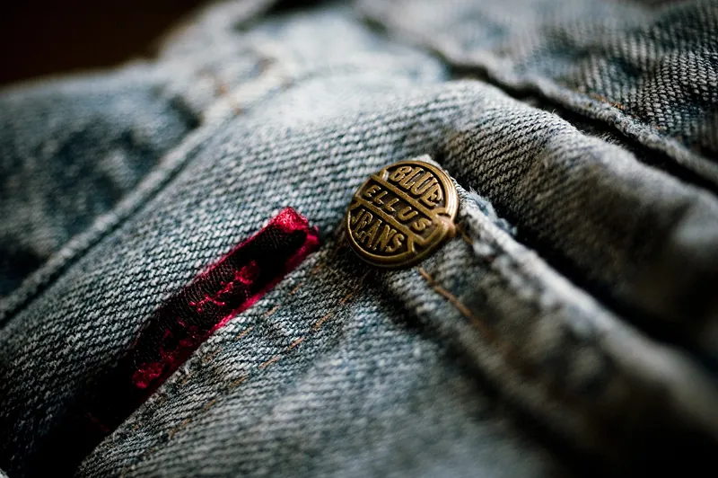

<figure class="eoc-pic eoc-pic-main"><figcaption><strong>Photo.</strong> <a href="https://commons.wikimedia.org/wiki/File:Closeup_of_copper_rivet_on_jeans.jpg">Closeup of copper rivet on jeans</a> by Marcos André, <a href="https://creativecommons.org/licenses/by/2.0">CC BY 2.0</a>, from Wikimedia Commons.</figcaption></figure>

A small two-part or hollow metal rivet pushed through a punched hole in leather, webbing or fabric and squashed with a setter against a hard anvil, so its two heads clamp the layers together permanently to fix straps, handles, tabs and buckles or to reinforce the corners of pockets and seams.

**In plain words:** Small metal studs, usually two halves pushed together through a punched hole and hit once with a hammer, that pin layers of leather, webbing or canvas together for good, like the little copper studs at the corners of jeans pockets. **Proper term:** Leather and textile rivets: double-cap (two-part compression) rivets, single-cap and rapid rivets, tubular (semi-tubular) rivets, split rivets, and solid copper or brass rivets with burrs.

**Also called:** double cap rivet, double-cap rivet: finished caps on both sides (Wikipedia 'Rivet', Compression rivets; Buckleguy; Tandy); compression rivet: 'male and female halves that press together, through a hole in the material' (Wikipedia 'Rivet'); rapid rivet, also called a compression rivet: a stem and a cap, set with a rivet press or setter (Montana Leather; Tandy 'Easy-To-Do Rivets & Setter Kit'); single cap rivet: a cap on one side only, 'the other side is low profile with a visible hole' (Wikipedia 'Rivet'; Montana Leather); tubular rivet, semi-tubular rivet: a rivet with a hollow tip that is rolled over (Wikipedia 'Rivet'; Weaver; Montana Leather); split rivet: a rivet with two prongs that are spread apart and hammered flat over a washer (Weaver); rivets and burrs, copper rivet and burr, copper burr rivet, solid copper rivet with washer: a solid post with a cup-shaped washer (burr) that is pushed on, trimmed and peened (Tandy; Sailrite; leatherworker.net); jeans rivet, pocket rivet: copper rivets that reinforce the pocket corners of jeans (Wikipedia 'Jeans').

## How it works

A hole is punched through every layer, the post is pushed through from the back, and the cap is pressed onto it until it snaps on; a mallet blow on a setter, with the other side resting on an anvil, then squashes and flares the hollow end of the post inside the cap, so the layers are trapped between the two heads (Tandy 'Setting Hardware'; Buckleguy). A tubular rivet's hollow end is rolled over against a washer with a peening tool, and a split rivet's two prongs are spread apart with a die and hammered flat onto a washer (Weaver). A rivet and burr works like a tiny nut and bolt that can't come undone: the burr is pressed down the solid post onto the material, the post is cut off leaving about 1/8 in, and that stub is hammered round over the burr (Tandy; Sailrite). It holds because the heads are bigger than the hole and because setting leaves the layers squeezed together; the post must suit the thickness of the stack, since 'If the post is too short, it may not form securely inside the cap. If the post is too long, it can bend, fold, or mushroom unevenly' (Buckleguy).

## Parts

A few parts. Double-cap, single-cap and rapid rivets: a post (the male half, with its own cap) and a matching cap (the female half). Tubular and split rivets: one rivet plus a washer behind. Rivets and burrs: a solid post and a cup-shaped washer (burr). Set with a hole punch, a setter (a steel punch with a shaped end), an anvil or metal block, and a mallet, or with a hand press and dies (Tandy; Weaver; Sailrite).

## Everyday examples

- Copper rivets at the corners of jeans pockets, patented by Jacob Davis and Levi Strauss in 1873 to reinforce 'the points of stress, such as pocket corners and at the bottom of the button fly' (Wikipedia 'Jeans')
- Dog collars and leashes, bag handles, belts and strap tabs fixed with double-cap rivets (Buckleguy)
- A suitcase wheel held on by a large tubular rivet that is also its axle (Weaver)
- Riveted leather cases and sheaths, such as a leather-covered mate gourd (Wikimedia Commons 'Riveted leather mate case.jpg')

## When to use it

Use rivets to fix a strap, tab, loop, handle or buckle end permanently, quickly and neatly, especially in thick or layered leather that is slow to hand-stitch, and to reinforce the ends of seams and pocket corners where stitching takes the most strain (Buckleguy; Sailrite; Wikipedia 'Jeans'). Choose double-cap rivets where both sides show, single-cap or rapid rivets where only one side shows, tubular or split rivets with a washer for heavier work or as a pivot, and copper rivets and burrs for the most strength (Montana Leather; Weaver; Sailrite). Rivets and stitching 'do different jobs': a rivet makes a fastened point, stitching a sewn line, and many goods use both (Buckleguy).

## When not to use it

Don't rivet parts you'll want to take apart, such as an interchangeable buckle: use a Chicago screw (Pet Hardware blog; Weaver). Don't rely on rivets alone in webbing or fabric that carries real load: sew it with a load-bearing stitch pattern, because rivets tend to loosen and pull through fabric (leatherworker.net). Never use home-set rivets in climbing harnesses, safety straps or anything that holds a person. For metal sheet or plastic panels, or where the back can't be reached, use a blind rivet; for an opening that must close and open again, use a press stud or buckle; to reinforce a hole for a cord, use an eyelet or grommet.

## Details

- **What it does (jobs):**
  - join and hold: permanently fixes straps, handles, tabs, loops, pockets, buckle ends and rings to leather, webbing or canvas, and reinforces stress points of sewn seams (Buckleguy; Sailrite; Wikipedia 'Jeans')
  - let it move (turn, slide or bend): a single rivet can act as a pivot, e.g. a heavy tubular rivet used as a luggage wheel's axle; tubular rivets 'are sometimes preferred for pivot points' (Weaver; Wikipedia 'Rivet')
- **Movement:** none for a clamped joint; rotate (a full turn) when a single rivet is used as a pivot, such as a luggage wheel axle (Weaver; Wikipedia 'Rivet').
- **Directions it can move (degrees of freedom):** 0 when set tight or when two or more rivets fix a strap; 1 (turning about the rivet) for a single rivet used as a pivot.
- **Special behaviour:**
  - none: it simply clamps the layers together
- **How it holds:**
  - shape (the parts interlock; [form-fit](../glossary.md#form-fit--force-fit--material-bond)): the two heads, or the head and the washer or burr, are bigger than the hole, so the layers can't slide off the post (Weaver; Sailrite)
  - friction or clamping (force-fit): setting squeezes the layers between the heads; a rivet that isn't squeezed tight can spin in its hole (Buckleguy)
- **Input and output:** not applicable
- **Power:** passive (no power needed)
- **Load:** Light to medium; no published strength tests were found for leather or textile rivets ⚑ [uncertain]. Strong in [shear](../glossary.md#peel-vs-shear) (a pull along the strap) and against peeling apart only as long as the heads can't pull through the material, so add a washer behind soft or thin material (Weaver). Side by side: 'Rivets and burrs are stronger than double-cap rivets and are often used to reinforce the edges of pockets where stress on thread stitching is the greatest' (Sailrite); on a forum, a maker who could work badly set double-cap rivets apart by hand was advised to use 'solid copper rivets with washer' for parts under heavy stress (leatherworker.net 'Brass Double Cap Rivet Failure And Danger'). In webbing and fabric, experienced makers prefer sewing, because rivets 'would eventually loosen up in fabric then they just pop through the hole' (leatherworker.net 'Strong rivet reinforcement for webbing'). Never for anything that holds a person.
- **Play and precision:** not applicable. A well-set rivet shouldn't spin or lean; if it does, the hole may be too large or the post not matched to the compressed thickness (Buckleguy).
- **Taking it apart:** permanent: unlike a Chicago screw, a rivet 'must be peened with a hammer and permanently fixes the connection' (Pet Hardware blog). A badly set rivet can be removed and replaced, using 'the appropriate tools to avoid damaging the material' (Montana Leather).
- **How often it can be reused:** once: each rivet is destroyed when removed and is replaced with a new one (Montana Leather).
- **Sealing:** none: a metal post in a punched hole, with no sealing element.
- **Adjustable:** no: position and clamping are fixed when the rivet is set.
- **Access needed:** both sides: the post goes in from one side and the cap, washer or burr from the other, and the work must rest on an anvil or block opposite the setter (Tandy; Weaver). On large or closed items it can be hard to get an anvil behind each rivet (leatherworker.net 'Setting rapid rivets'). Where only one side can be reached, use a blind rivet instead.
- **Materials:** Rivets are 'typically made of steel and aluminum, while some are made of plastic' (Montana Leather); also solid brass, which has excellent corrosion resistance, and plated base metals, which offer more finishes at lower cost (Buckleguy); rivets and burrs come in copper and brass (Sailrite). They join leather of any tannage, layered or folded straps, webbing, canvas, denim and other heavy fabric; double-cap rivets 'can be used with leather, fabric, and other materials', but 'Softer materials may need extra care or reinforcement' (Buckleguy). In PVC or nylon canvas and synthetic webbing the hole should be melted (singed) first, and in cotton canvas the material should be sewn round the rivet so it doesn't shred (leatherworker.net 'Strong rivet reinforcement for webbing'). Metal sheet is joined with other rivets (see Blind rivet).
- **Heat, cold, water and wear:** Corrosion: solid brass rivets have 'Excellent corrosion resistance', while plated rivets are 'commonly selected for fashion accessories and lighter-use products' (Buckleguy); stainless steel has 'Exceptional resistance to water' (Pet Hardware blog, said of screw posts, not checked for rivets) ⚑ [uncertain]. Wet or outdoor use (collars, leashes, tack) therefore calls for solid brass, copper or stainless hardware (Buckleguy). Leather compresses, and softer leather squeezes down more during setting, so rivets set in soft or thin material can loosen or spin (Buckleguy). In webbing and fabric, rivets tend to work loose over time (leatherworker.net).

## Making it

- **Ways to make or get it:**
  - off-the-shelf part: metal rivets set by hand with a setter and anvil, or with a hand press
  - 3D print (FDM): setting guides, anvils, setter holders and printed two-part rivets (see make_it_yourself)
- **Printing it in one piece (print in place):** no: rivets are separate parts fitted into punched holes; a printed two-part rivet is printed as two pieces and pushed together (Printables 606061).
- **Tools:** A hole punch (round drive punch or rotary punch) and a mallet or poly maul; a setter that matches the rivet cap plus an anvil (with a cupped side for domed caps) or a metal block; for rivets and burrs, a burr setter with a hole, cutting pliers or side cutters to trim the post, and a cupped rounding tool; for split rivets, a split-rivet die and a metal hammer; or a hand press with rivet dies instead of hammering (Tandy 'Setting Hardware'; Weaver; Sailrite; Buckleguy).
- **Difficulty:** easy: a starter kit (punch, setter, anvil and rivets) sets a rivet in seconds; the skills are choosing the right post length and setter and supporting the work on a hard base, so set a test piece on scrap first (Buckleguy).

### 3D printing tips

1) Printed setting aids: a guide that holds a cheap rivet setter straight is printed in PLA with tree supports, has 'very tight' [tolerances](../glossary.md#tolerance), and its rim is glued to the anvil insert (Printables 1407840); two-sided saddle rivet setters say 'Print with 100% [infill](../glossary.md#infill)!' (Printables 693590); a small hexagon riveting anvil for watch repairs is printed 'with high infill and extra top layers' (Printables 160131). Printed setters suit small, soft rivets; steel setters last far longer ⚑ [uncertain]. 2) Printed rivets: a two-part replacement rivet for a Crocs strap prints without supports, in PETG 'as it's got just a bit more flex', and has a ball-joint option so the strap can turn 'without unnecessarily stressing the rivet' (Printables 606061). 3) Riveting a leather or webbing strap to a printed part: a hammer blow can crack a [brittle](../glossary.md#brittle--ductile) print, so support the print fully on the anvil, put a metal washer under the cap on the print side, or squeeze the rivet in a press or vice instead of hammering ⚑ [uncertain]. For a removable joint use a Chicago screw, and for plastic-to-plastic joints consider heat staking ⚑ [uncertain].

### Buying one (off-the-shelf parts)

Double-cap rivets (sold by cap diameter and post length), single-cap and rapid (compression) rivets, tubular and semi-tubular rivets, split rivets, and copper or brass rivets and burrs (#9 and #12 heavy weight, #14 decorative), with matching rivet setters, anvils, burr setters, round drive or rotary hole punches, rivet cutting pliers and hand presses with dies (Sailrite 'Rivets & Burrs Copper'; Tandy 'Setting Hardware'; Buckleguy; Weaver). Search terms: 'double cap rivet', 'rapid rivet', 'semi-tubular rivet', 'copper rivets and burrs', 'rivet setter and anvil'.

## Rules of thumb

- How much post should stick out, side by side: Tandy says at least 1/16 in (1.6 mm) but no more than 1/8 in (3.2 mm) above the leather before the cap goes on (Tandy 'Setting Hardware'); Buckleguy says 'about 2-3mm of rivet post sticking through the material before setting'; Montana Leather says take the leather thickness and 'Add 1/8 inch (3 millimeters) for the post length'; a forum leatherworker recommends 1/16 in above the pieces (leatherworker.net).
- Measure the full stack at the exact rivet point after folding, gluing and lining, allow for leather compressing as it is set, and set a test rivet on scrap of the same layers (Buckleguy).
- Rivets and burrs: press the burr down until it meets the material, cut the post leaving 1/8 in, then round the stub over the burr with the cupped setter; 'The rivet must extend roughly 1/8" from the top surface of the material' (Tandy 'Setting Hardware'; Sailrite).
- Hole size: the post should pass through cleanly without looseness; too small distorts the leather, too large lets the rivet lean or spin (Buckleguy).
- Setting double caps: put the domed outer cap in the anvil's cup and set from the back of the rivet (Tandy); use a setter made for that cap shape, keep the post vertical, support the lower cap evenly, and 'More force rarely fixes bad alignment' (Buckleguy).
- Put a washer behind split and tubular rivets 'to keep it from pulling through the leather', and set them on a metal block or other hard surface (Weaver).
- Webbing and canvas: melt the hole with a hot nail or screwdriver the same size as the rivet so it doesn't fray and tear out (don't melt it with a lighter flame); singe holes in PVC or nylon canvas; sew round the rivet in cotton canvas (leatherworker.net 'Strong rivet reinforcement for webbing').
- Pick the type for the stress: rivets and burrs (#9 or #12) where strength and durability are needed, #14 as decoration (Sailrite); tubular rivets for 'heavy-duty applications or high-stress areas', double caps for backpacks, handles and tote straps, single caps for belts and flaps (Montana Leather).
- Cap size: smaller caps for wallets, card holders and thin straps; larger caps for bag handles, strap ends, collars and leashes (Buckleguy).
- A semi-tubular rivet needs about a quarter of the setting force of a solid rivet, which is why hollow rivets suit hand setting (Wikipedia 'Rivet').

## Common failures

Rivet spins after setting: post not matched to the compressed thickness, hole too large, or not compressed properly (Buckleguy). Cap sits crooked: setter misaligned, lower cap not supported, or post not vertical (Buckleguy). Leather puckers round the rivet: post too long, soft leather or too much force (Buckleguy). Cap flattened or marked: setter doesn't match the cap or the blow was too heavy (Buckleguy). Post bends while setting because it is too long, or doesn't flare because it is too short (leatherworker.net). Double caps that can be worked apart by hand: use the right post length or switch to rivets and burrs (leatherworker.net; Sailrite). Rivet pulls through soft leather: add a washer (Weaver). Webbing frays and tears out round a cut hole: melt the hole first (leatherworker.net).

## Safety

When trimming rivet posts with cutters, 'Place your hand over the pliers to stop the piece from flying out' (Tandy 'Setting Hardware'); wear eye protection when cutting and hammering ⚑ [uncertain]. Keep fingers clear of the mallet and the setter. A rivet that fails on a dog leash, spur strap or bag strap can drop or free what it holds, so set test pieces, use solid copper rivets and burrs on stress points, and check them (leatherworker.net 'Brass Double Cap Rivet Failure And Danger'). Never use home-set rivets in anything that holds a person, such as a climbing harness or safety strap. Small loose rivet parts can be swallowed by young children ⚑ [uncertain].

## Related

- Chicago screw (binding screw, sex bolt): looks similar but screws together, so it can be taken apart to change a buckle
- Blind rivet (pop rivet): set from one side only, for metal sheet and panels; solid and semi-tubular rivets for metal are noted there
- Press stud (snap fastener, popper): set with similar tools, but opens and closes
- Eyelets and grommets: set with similar punches and dies, but reinforce a hole rather than join layers
- Load-bearing stitch patterns for straps and webbing (bar tack, box-X stitch): the usual way to make strong webbing joints
- Sewn seams and hand stitches (saddle stitch): the sewn alternative in leather; often combined with rivets at stress points
- Heat staking (melted plastic rivet): a rivet formed from a printed plastic post
- Push-in plastic rivet (fir-tree clip, push rivet): a tool-free plastic rivet for panels
- Basic strap and garment closures (prong buckle, button, toggle and loop): buckles that are often fixed to the strap with rivets

## Make it yourself

- [Snap / rivet chinese setter kit guide (for leather or cloth) (bina, Printables) (URL from Printables API, page not opened)](https://www.printables.com/model/1407840-snap-rivet-chinese-setter-kit-guide-for-leather-or): Printed guide that holds a basic rivet or snap setter straight over its anvil *(licence: Creative Commons Public Domain)*
- [Saddle rivet setters (Daniel Kasprowicz, Printables) (URL from Printables API, page not opened)](https://www.printables.com/model/693590-saddle-rivet-setters): Pair of printed setters placed on both sides of a rivet and struck with a small hammer *(licence: Creative Commons Attribution-NonCommercial-ShareAlike)*
- [Hexagon riveting anvil (PrimoMemeo, Printables) (URL from Printables API, page not opened)](https://www.printables.com/model/160131-hexagon-riveting-anvil): Small printed riveting anvil made for watch-strap repairs *(licence: Creative Commons Public Domain)*
- [Replacement Rivet for Crocs (Or Your Other Riveting Needs) (Joshua Goodwin, Printables)](https://www.printables.com/model/606061-replacement-rivet-for-crocs-or-your-other-riveting): Parametric OpenSCAD two-part push-together strap rivet with washer, in fixed and swivelling versions *(licence: Creative Commons Attribution-ShareAlike)*

## Pictures, videos and models

- [Closeup of copper rivet on jeans.jpg (Wikimedia Commons, by Marcos André)](https://commons.wikimedia.org/wiki/File:Closeup_of_copper_rivet_on_jeans.jpg): Close-up of a copper rivet reinforcing the corner of a jeans pocket *(licence: CC BY 2.0)*
- [Strivet333.JPG (Wikimedia Commons, by Rivetpro)](https://commons.wikimedia.org/wiki/File:Strivet333.JPG): Line drawing of a semi-tubular rivet with its hollow tip *(licence: Public domain)*
- [Riveted leather mate case.jpg (Wikimedia Commons, by Misterneedlemouse)](https://commons.wikimedia.org/wiki/File:Riveted_leather_mate_case.jpg): Close-up of stamped leatherwork held together with rivets *(licence: CC BY 4.0)*
- [Tandy Skills: Setting Hardware (Tandy Leather)](https://tandyleather.com/blogs/tandy-blog/tandy-skills-setting-hardware): Step-by-step photos of setting rivets and burrs and double-cap rivets with setters, anvil and cutters *(licence: link only (© Tandy Leather))*
- [How to Set Split & Tubular Rivets (Weaver Leather Supply)](https://www.weaverleathersupply.com/blogs/leathercrafting/how-to-set-split-tubular-rivets): Photos and a video of setting split and tubular rivets with washers, dies and peening tools, including a luggage wheel axle *(licence: link only (© Weaver Leather Supply))*

## Needs confirming

⚑ marks something nobody has confirmed yet: a fact the research could not confirm from a source, a finder value that is a best guess, or an open point from the research notes. Corrections are welcome (see `research/needs-confirming.md`).

- ⚑ 7 sentences on this page marked [uncertain].
- ⚑ Research note: *Leather and textile rivets*: how much post should stick out differs (Tandy 1/16-1/8 in; Buckleguy 2-3 mm; Montana Leather leather thickness plus 3 mm; a forum leatherworker 1/16 in), all recorded; no strength tests found (`load` [uncertain]).

## Sources

- <https://en.wikipedia.org/wiki/Rivet>
- <https://en.wikipedia.org/wiki/Jeans>
- <https://en.wikipedia.org/wiki/Jacob_W._Davis>
- <https://tandyleather.com/blogs/tandy-blog/tandy-skills-setting-hardware>
- <https://tandyleather.com/collections/hardware/products/easy-to-do-rivets-setter>
- <https://www.weaverleathersupply.com/blogs/leathercrafting/how-to-set-split-tubular-rivets>
- <https://www.montanaleather.com/choosing-the-right-size-rivet-for-your-leather-craft/>
- <https://www.buckleguy.com/buckleguy-blog/leather-rivets-how-to-match-rivets-to-material-thickness/>
- <https://www.buckleguy.com/buckleguy-blog/double-cap-rivets-for-leathercraft-a-makers-guide/>
- <https://www.sailrite.com/Rivets-Burrs-Copper-50-pack>
- <https://blog.pethardware.com/en/how-to-choose-chicago-screws/>
- <https://leatherworker.net/forum/topic/64358-brass-double-cap-rivet-failure-and-danger>
- <https://leatherworker.net/forum/topic/88430-strong-rivet-reinforcement-for-webbing>
- <https://leatherworker.net/forum/topic/47596-setting-rapid-rivets>
- <https://commons.wikimedia.org/wiki/File:Closeup_of_copper_rivet_on_jeans.jpg>
- <https://commons.wikimedia.org/wiki/File:Strivet333.JPG>
- <https://commons.wikimedia.org/wiki/File:Riveted_leather_mate_case.jpg>
- <https://www.printables.com/model/606061-replacement-rivet-for-crocs-or-your-other-riveting>
- <https://api.printables.com/graphql/>
