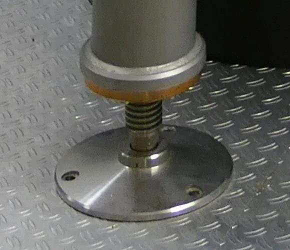

<figure class="eoc-pic eoc-pic-main"><figcaption><strong>Photo.</strong> <a href="https://commons.wikimedia.org/wiki/File:W7-X_gyrotron,_adjustable_foot.jpg">W7-X gyrotron, adjustable foot</a> by user:Bernd vdB, <a href="https://creativecommons.org/licenses/by-sa/3.0">CC BY-SA 3.0</a>, from Wikimedia Commons.</figcaption></figure>

A threaded stud with a foot pad that screws into the bottom of a leg, cabinet or machine; turning it in or out raises or lowers that corner so the piece stands steady and level, and the ball joint under many pads lets the pad lie flat on a sloping or uneven floor.

**In plain words:** A screw-in foot under a table leg, cabinet, appliance or machine that you turn to make that corner a little taller or shorter, so the piece stops rocking and stands level; many have their pad on a ball, so the pad lies flat even where the floor slopes. **Proper term:** Levelling foot (adjustable foot, leveling foot; swivel or ball-jointed levelling pad).

**Also called:** leveling foot / leveling feet (US spelling); adjustable foot / adjustable feet / adjustable levelling feet; levelling element / leveling mount / levelling mount (machine-building trade names, e.g. Elesa LV.F, brand); stud-mount levelling foot / threaded stud foot / screw foot (stud fixed in the base); untapped foot or female-thread foot (the base has a threaded socket or ball that screws onto a rod already in the leg; Carr Lane calls this the 'plain leveling foot'); ball-jointed levelling foot / swivel levelling pad / swivel foot / articulated foot (e.g. GN 638, Ganter brand); tilt foot / tilting adjustable foot / 'tilt glide machine feet' (Superior Glide, Keystone); jig foot / jig leveling foot (fixture trade, Carr Lane brand); machine foot, Stellfuss / Gerätefuss (German names seen in Printables model titles); levelling glide / table leveler / leg leveller (furniture); cabinet legs / plinth legs (kitchen base cabinets, Wikipedia 'Cabinetry'); bolt-down or ground-mounting levelling foot (base with fixing holes, e.g. Elesa LV.F); anti-slip or no-slip levelling foot / no-slip disk (rubber-faced base); threaded tube insert / square threaded insert / 'square tube leveling foot insert' (fits a foot into a hollow tube leg, Superior Glide); lock nut / clamp nut / jam nut (the nut that holds the setting, e.g. on washing machine feet).

## How it works

The stud is a screw, so each full turn moves the foot up or down by one thread [pitch](../glossary.md#pitch) (1.25 mm for an M8 foot, Superior Glide), and you wind each corner in or out until the piece stops rocking and is level. The weight pushes straight down the stud and the friction in the thread stops it turning by itself; a lock nut tightened up against the leg or cabinet stops vibration slowly unscrewing it (Samsung and Amana washing-machine guides; Superior Glide). On swivel feet the stud ends in a ball held in a socket in the pad (a ball joint), so the pad tilts to sit flat on a floor that slopes or is not square to the leg (about 20 degrees in total on Carr Lane and Keystone tilting feet, 9 degrees on Superior Glide tilt feet), and the stud can turn inside the pad without the pad scrubbing round on the floor (Ganter GN 638). A hollow tube leg first gets a press-in threaded insert whose ribs grip the tube walls and which carries a nut for the stud (Superior Glide).

## Parts

A few parts: a threaded stud (steel or stainless steel, often with a hex or spanner flats for adjusting), a base or pad (plastic, metal, often rubber-faced), usually joined to the stud by a ball held in a socket, a lock nut to hold the setting, and something threaded to screw into: a tapped leg or machine base, a screw-on or weld-on mount, a T-nut or nut trapped in wood or in a print, or a threaded insert pressed into the end of a hollow tube leg. Example: 'M8 stud with ball end, plastic pad with rubber disc, lock nut, square tube insert with nut'.

## Everyday examples

- the screw-in front feet of a washing machine, locked with a nut once level (Samsung; Amana)
- kitchen base cabinet legs, turned from inside the cabinet with a screwdriver so the cabinets need no shims (Wikipedia 'Cabinetry')
- the adjustable feet under workbenches, machines and conveyors (Carr Lane)
- screw-in feet under 3D printers, tables and shelving, often printed (Printables 367208, 1340235)

## When to use it

Whenever something stands on legs or a base on a floor that is not flat or level and must not rock: tables, benches, shelving and cabinets, washing machines and fridges, 3D printers and their tables, machine stands and extrusion frames, outdoor or camping tables. Choose swivel or ball-jointed pads for sloping or old floors and angled legs, anti-slip pads where the piece tends to [creep](../glossary.md#creep) or the floor is smooth, wide bases on soft floors, and bolt-down feet where a machine must also be fixed to the floor. Put a foot on every leg so you can always level to the floor wherever the piece is moved (Superior Glide).

## When not to use it

If it has to roll, use castors (or levelling castors that combine both). If it must stay put against vibration, use bolt-down feet or anchor it, and if vibration or noise must not reach the floor, use an anti-vibration (elastomer isolation) mount. To tilt or level a plate on its own base, such as a printer bed or mirror, use locking adjustment screws. For a one-off fix under something that never moves, a shim or spacer is enough, although shims creep out and compress over time (Superior Glide). For a large slope (beyond the stud's travel or the pad's tilt), use a packer under the whole side or a wedge. Levelling feet do not stop tall furniture tipping over: anchor bookcases, dressers and TVs to the wall (CPSC Anchor It!).

## Details

- **What it does (jobs):**
  - line parts up exactly: sets the height of each corner so a table, cabinet, appliance, machine or printer stands level and does not rock
  - join and hold: screws into the leg and carries the weight down to the floor; bolt-down versions also fix a machine to the floor
- **Movement:** none once set. While adjusting: slide (the stud screws in or out along its own axis; stems from 10 mm to 110 mm long are sold for M8 feet, Superior Glide) and, on swivel feet, the pad also rocks on its ball (rotate, about 20 degrees total tilt on Carr Lane and Keystone tilting feet, 9 degrees on Superior Glide tilt feet)
- **Directions it can move (degrees of freedom):** 0 once set and locked. While adjusting: 1 (height; turning and rising are tied together by the thread). A swivel pad adds small rotations between pad and stud (tilt in two directions and spin), but with the pad standing on the floor these only let the pad settle flat.
- **Special behaviour:**
  - self-aligning or self-centring: the ball-jointed pad tilts to sit flat on the floor; Ganter says the ball joint 'adapts to mounting surfaces that are uneven or not perpendicular to the screw axis' and 'prevents the clamping surface from rotating' while you turn the stud
  - [self-locking](../glossary.md#self-locking) (holds under load, won't back-drive): the weight on the thread does not turn the screw, so the foot keeps its height; vibration can slowly unscrew it unless a lock nut is tightened against the leg (Superior Glide)
- **How it holds:** shape (the parts interlock; [form-fit](../glossary.md#form-fit--force-fit--material-bond)): the screw thread carries the weight; friction or clamping (force-fit): thread friction plus a lock nut tightened against the leg hold the setting, a press-in tube insert holds by its ribs pressing on the tube walls (Superior Glide), and rubber or TPE pads grip the floor by friction
- **Input and output:** An adjuster, not a drive: turning the stud (or the base) -> the foot moves in or out by one thread pitch per turn (1.25 mm per turn for M8, so a quarter turn is about 0.3 mm). Shaft arrangement: in line. Back-drivable: no, the weight will not turn the screw; only vibration can, which a lock nut stops.
- **Power:** passive (no power needed)
- **Load:** Light to heavy, set by the thread size, the design and the maker's rating; figures differ a lot between makers, so use the rating of the foot you buy. Side by side: Superior Glide rates its furniture feet for static loads at 20 kg (M4), 60 kg (M6), 80 kg (M8), 120 kg (M10) and 150 kg (M12) per foot; Keystone rates tilting M10 feet at 75-250 kg per foot depending on base size; heavy-duty machine feet from fixture makers (Carr Lane, Ganter, Elesa) are made for machinery and conveyors and rated much higher, with Ganter calling its static load 'a guide value' to which a safety factor must be added. Strong when pushed straight down the stud (compression). Weak sideways: pushing or dragging the piece bends the stud and works the thread loose, more so the further it is wound out (Superior Glide: a fully extended stem 'becomes a lever'). Static ratings do not cover vibration, impact, or anything rolled or dragged (Superior Glide).
- **Play and precision:** Small: fine height steps (about 0.3 mm per quarter turn of an M8 foot) and no play once the weight and the lock nut load the thread; without a lock nut, vibration slowly turns the foot (Superior Glide). A ball-jointed pad can wobble slightly on its ball until it carries weight ⚑ [uncertain: not stated on an opened page]. Tolerates a floor that slopes or is out of square up to the pad's tilt range (about 20 degrees total, Carr Lane, Keystone; 9 degrees on tilt feet, Superior Glide); a rigid foot on a sloping floor stands on one edge of its base, which creeps until the piece rocks again (Superior Glide).
- **Taking it apart:** removable: the foot unscrews from its thread; a press-in tube insert or a weld-on mount stays in the leg
- **How often it can be reused:** many times: a steel stud in a steel nut, insert or tapped hole can be re-adjusted and swapped again and again; a thread printed in plastic wears faster
- **Sealing:** none (a press-in tube insert also closes off the open end of the tube, Superior Glide)
- **Adjustable:** yes, that is its purpose: loosen the lock nut, turn the stud or base to raise or lower that corner, check with a level, then tighten the lock nut against the leg or cabinet (Samsung; Amana)
- **Access needed:** one side only (blind): the foot is screwed in from underneath, and some kinds are adjusted from above (kitchen cabinet legs through a hole in the cabinet floor, Wikipedia 'Cabinetry'; Carr Lane jig feet from the stud end). Fitting a press-in tube insert needs the open end of the tube (end of a tube or shaft).
- **Materials:** Stud: zinc-plated or galvanised steel, or stainless steel for damp, washdown or corrosive places (Superior Glide; Carr Lane; Ganter GN 638-NI and NV use AISI 303 stainless, and its steel stud is property class 5.8). Base or pad: glass-fibre-reinforced polyamide (PA) or acetal (POM) plastic, steel or stainless steel (Elesa LV.F; Ganter; Superior Glide); white acetal (Delrin, brand) pads don't mark floors but have the lowest load capacity (Carr Lane). Floor face: NBR rubber or TPE anti-slip disc, or a PA6 pad for sealed hard floors (Elesa LV.F-AS; Superior Glide). Tube inserts: ribbed polyamide body holding a zinc-plated steel nut, for tube walls 1-2 mm thick (Superior Glide). Printed feet: PETG, PLA, ABS or ASA bodies with TPU pads, or whole feet in TPU (Printables models in make_it_yourself).
- **Heat, cold, water and wear:** Heat: Ganter's plastic (POM) thrust pads are for up to 80 degC, its stainless pads with an FPM [O-ring](../glossary.md#o-ring) up to 200 degC. Water and corrosion: the plated steel stem is the part that fails first anywhere wet, so use stainless stems in damp rooms, washdown areas and coastal air (Superior Glide; Carr Lane recommends 300-series stainless for corrosive places). Vibration (washing machines, compressors, tables leaned on rhythmically) slowly unscrews feet that have no lock nut (Superior Glide), and an unlevelled washing machine is noisy and vibrates (Samsung). Floors: hard plastic bases can mark sealed hard floors and narrow bases dent soft floors, so use pad faces or wide bases (Superior Glide). Printed feet: PLA starts to give at about 60 degC (CNC Kitchen), and printed spacers under constant load slowly get thinner (creep, filamentspecs); use PETG, ASA or TPU, and ASA outdoors for UV (Printables 198880 designer's advice).

## Making it

- **Ways to make or get it:**
  - off-the-shelf part: levelling feet, swivel and bolt-down machine feet, tube inserts, weld-on or screw-on mounts, T-nuts and lock nuts
  - 3D print (FDM): TPU feet and pads, caps and adapters that hold a nut for a standard bolt, printed-thread feet, ball-jointed pads, and corner brackets that take a foot in an aluminium extrusion frame
  - woodwork: drilling a wooden leg for a T-nut or a threaded insert so a foot can screw in
  - CNC or drill and tap: threaded holes in metal machine bases and frames
- **Printing it in one piece (print in place):** no: printed feet are printed as separate parts (threaded body, foot, ball, pad) and screwed, snapped or glued together, usually around a metal bolt and nut (Printables 1340235, 1318189, 198880, 1343635)
- **Tools:** fingers for small furniture feet; a spanner on the stud's hex or flats (Samsung says its washing machines may come with a spanner of about 14 mm) and a second spanner for the lock nut; a hex key for feet adjusted from the stud end (Carr Lane jig feet have a hex socket) or a screwdriver for kitchen cabinet legs turned from inside the cabinet (Wikipedia 'Cabinetry'); a spirit level or phone level to check; a drill and tap, a T-nut or a threaded insert to give a leg a thread; a rubber mallet to press in tube inserts (Superior Glide)
- **Difficulty:** easy: buy a foot and give the leg a thread (tap it, fit a T-nut or threaded insert, or trap a nut in a printed cap), or print a foot around a standard bolt and nut; moderate if you print the screw thread itself, which needs tuned [clearances](../glossary.md#clearance)

### 3D printing tips

Easiest and strongest: let a metal bolt and nut carry the load and print only the parts around them. Printables 1318189 is a printed block that screws under a leg and holds an M8 nut for an M8 bolt; Printables 174610 is a cap for a 20 x 30 mm rectangular tube with a nut put in during a pause at a dummy filament change, glued in with a little silicone. Hubs rates printed threads as 'not suited for small threads (less than M5)' and asks for a wall around any threaded hole at least as thick as the fastener's diameter (5 mm for M5). If you print the thread itself, use a large, coarse thread with extra clearance: Printables 1340235 now offers 0.2, 0.4 and 0.6 mm thread [tolerance](../glossary.md#tolerance) gaps and says the larger gap 'is a safer bet for your first print'; Printables 196277 uses a 0.8 mm thread offset so the bolt turns smoothly at 0.2 mm layers. Small printed threads can be cleaned up with a tap (Printables 198880 recommends finishing its M5 thread with a tap). Keep plenty of thread engaged: Printables 196277 marks a minimum engagement of 21 mm on its printed glide, Superior Glide keeps at least two-thirds of the stem inside the insert, and even metal threads need at least 1 x the diameter engaged in steel and 2 x in aluminium (Nord-Lock), more in plastic. [Layer lines](../glossary.md#layer-lines) are the weak direction: CNC Kitchen's hooks printed standing broke at 46-55% of the load of hooks printed lying flat, and Printables 1340235 v1.1 lengthened its screw channels because over-tightened screws cracked the bracket along layer lines, so do not over-tighten mounting screws in printed brackets. Material: PLA starts to give at about 60 degC (CNC Kitchen) and plastic spacers under a constant load slowly get thinner (creep, filamentspecs), so use PETG or ASA for feet under heavy, warm or outdoor loads (the designer of Printables 198880 suggests ASA for UV and heat on a windowsill) and keep the plastic in compression over a large area. Floor grip: glue a TPU pad into the foot with CA or hot glue (Printables 1340235), print the washer under a ball-jointed pad in TPU for friction (Printables 198880), or print the whole foot in TPU (Printables 367208, 15% gyroid [infill](../glossary.md#infill); its thicker 18 mm version gives more thread engagement). Ball-jointed pads: Printables 198880 prints ball and socket in PETG with no supports and snaps the socket over the ball; in Printables 1343635 the M8 bolt press-fits into a printed ball that presses into the foot; moving printed parts generally need a gap of at least 0.3 mm (Prusa 'Modeling with 3D printing in mind'). Give the foot something to turn it by once the weight is on it: Printables 1340235 adds a 3/8 in square socket for a [ratchet](../glossary.md#ratchet) and includes printed wrenches. For aluminium extrusion frames, a printed corner bracket can hold an M8 foot with its lock nut (Printables 446009, 2020 I-type extrusion, printed without supports).

### Buying one (off-the-shelf parts)

Search terms: 'levelling foot' or 'leveling feet' plus the thread (M4, M6, M8, M10, M12, 1/4-20 or 5/16-18; Superior Glide gives a thread chart, and M8 is the common furniture size), 'stud mount leveling foot', 'swivel leveling foot' or 'ball jointed leveling feet' (e.g. GN 638, Ganter brand), 'tilting adjustable feet', 'levelling feet for ground mounting' (bolt-down, e.g. LV.F, Elesa brand), 'anti-slip levelling foot' or 'no-slip disk', 'jig feet' and 'machine leveling feet' (e.g. Carr Lane, brand), 'mounts for leveling feet' (e.g. GN 349, Ganter brand), 'square threaded insert', 'round threaded tube insert' or 'threaded tube insert' for hollow legs (match the tube's outside size and wall thickness), 'tee nut' or 'threaded insert for wood' for wooden legs, 'hex jam nut' or 'lock nut', 'kitchen cabinet legs' or 'plinth legs', and 'anti-vibration levelling mount' (rubber-cushioned; see Elastomer isolation mount). Link to a catalogue for sizes rather than copying tables, e.g. https://www.keystonecastors.co.uk/levelling-feet-and-inserts/page/2/.

## Rules of thumb

- Steady first, level second: wind every foot fully in, find the two diagonal legs the piece rocks across, wind out one foot under a corner that lifts until the rocking just stops, then raise whole sides together to make it level; chasing level first means adjusting four feet against each other (Superior Glide 'Adjustable Leveling Feet Guide', https://superiorglide.com/product-guides/adjustable-leveling-feet-guide/).
- Three points define a plane, so a three-legged stand never rocks, while four or more legs need all but three adjusted to the floor (Rehorst, https://drmrehorst.blogspot.com/2017/07/3-point-print-bed-leveling-vs-4-point.html; Superior Glide: a four-legged piece 'pivots across two diagonal legs').
- Size by load per foot: divide the total weight by the number of feet and stay inside the maker's static rating with a margin; Ganter calls its static load 'a guide value' to which a safety factor must be added (https://www.elesa-ganter.in/en/ind/Levelling-elements--Ball-Jointed-Leveling-Feet--GN638-ST), and Superior Glide's static ratings exclude vibration, impact and rolling or dragging. Ratings differ between makers: 80 kg per M8 furniture foot (Superior Glide) against 75-250 kg per M10 tilting foot (Keystone, https://www.keystonecastors.co.uk/levelling-feet-and-inserts/page/2/).
- Don't wind a foot right out: keep at least two-thirds of the stem inside the insert (Superior Glide); in a tapped metal hole engage at least about 1 x the thread diameter in steel and 2 x in aluminium (Nord-Lock, https://www.nord-lock.com/learnings/bolting-tips/2015/the-experts-thread-engagement-in-a-tapped-hole/). If one corner needs more lift than that, use a tilt base or a packer under the whole side (Superior Glide).
- Lock the setting: after levelling, tighten the lock nut up against the cabinet or leg (Amana, https://producthelp.amana.com/Laundry/Washers/Washer_Installation_Support/Leveling_a_Top_Load_washer; Samsung, https://www.samsung.com/au/support/home-appliances/how-do-i-level-my-washing-machine/).
- Pad tilt range: about 20 degrees total on standard ball-jointed machine feet (Carr Lane, https://www.carrlane.com/engineering-resources/technical-information/jig-fixture-design/how-to-use-leveling-feet; Keystone lists a maximum tilt angle of 20 degrees for its tilting feet), 9 degrees on Superior Glide tilt feet; rigid feet are for floors that are flat and square to the leg.
- Tube inserts: match the tube's outside size and its wall thickness (1-2 mm walls for Superior Glide's square inserts, sizes 20 x 20 to 50 x 50 mm, M8 to M12), line the insert's corners up with the tube's corners and press it in by hand or with a rubber mallet (https://superiorglide.com/product/square-threaded-inserts/).
- Check the thread before forcing it: M8 (1.25 mm pitch) and 5/16-18 (about 1.41 mm pitch) look alike and each will start in the other's thread, then bind and strip the insert; stop if it gets stiff after two turns (Superior Glide).
- Printed threads: avoid printing threads smaller than M5, and give a threaded hole a wall at least as thick as the thread diameter (Hubs, https://www.hubs.com/knowledge-base/how-assemble-3d-printed-parts-threaded-fasteners/).

## Common failures

(1) The piece rocks again a week later because the feet were levelled before the rock was taken out, or a rigid base stands on one edge on a sloping floor and creeps; take out the rock with one foot first, and use tilt or ball-jointed feet on slopes (Superior Glide). (2) Feet slowly unscrew from vibration: wind a lock nut onto the stem and tighten it against the leg (Superior Glide; Samsung). (3) A near-miss thread (M8 versus 5/16-18) forced in and the insert stripped (Superior Glide). (4) Stem wound out too far, so side loads lever it and work the thread loose; keep two-thirds of the stem engaged (Superior Glide). (5) Worn or hard pads scratching the floor; replace pads or use pad-faced feet (Superior Glide). (6) Paint on the thread seizing it (Superior Glide). (7) Printed threads too tight or too loose; print with a larger tolerance gap first (Printables 1340235) or use a metal bolt and nut. (8) Printed brackets cracking along layer lines when their screws are over-tightened (Printables 1340235). (9) Printed PLA feet sagging under constant weight or in heat (filamentspecs; CNC Kitchen).

## Safety

A levelling foot is not an anti-tip device: the US CPSC's Anchor It! campaign says to 'anchor TVs and furniture, such as bookcases and dressers, securely to the wall'. Respect the maker's static load rating and add a safety factor (Ganter); a stem wound out too far can bend or strip and let a corner drop (Superior Glide). Before reaching under a heavy machine or appliance to adjust a foot, support it securely so it cannot drop on hands or feet ⚑ [uncertain: general workshop caution, not from an opened page]. Make sure appliance feet do not press on the power cord (Samsung). Never force a mismatched thread (Superior Glide).

## Related

- Shims, spacers and standoffs: fixed packing under a corner; free and quick, but it creeps out and compresses, while a foot can be re-set wherever the piece is moved (Superior Glide)
- Locking adjustment screws (push-pull screws, spring-loaded levelling screws): set the tilt or height of a plate on its own base, rather than a whole piece on the floor
- Castor (swivel castor, fixed castor, locking castor): lets the piece roll; 'levelling castors' combine a castor with a foot
- Ball caster (ball transfer unit): a ball that rolls in every direction, used where a levelling foot would be the fixed alternative
- Ball-and-socket joint: the same ball-in-cup joint that lets a swivel pad tilt, used to hold an angle
- Internal tube anchors (star nut, expansion plug, ribbed threaded insert): how to put a thread inside a hollow tube leg so a foot can screw in
- Elastomer isolation mount (rubber bobbin mount): a rubber-cushioned mount, some with a levelling screw, that also stops vibration reaching the floor
- Printed screw thread: for printing the foot's thread itself
- Threaded rod and studs: the plain threaded stem a foot is built on
- Heat-set threaded insert and Screw-in threaded insert: give a printed or wooden leg a durable metal thread for the foot
- Self-locking wedge: wedge levelling mounts set height by sliding a wedge instead of turning a screw
- Thread-locking hardware (nylon-insert nut, lock washer): alternatives to a plain lock nut for holding the setting

## Make it yourself

- [Cabinet Leveling Foot - Small (Printables 1340235; URL from Printables API, page not opened)](https://www.printables.com/model/1340235-cabinet-leveling-foot-small): Printed screw-thread levelling foot for light furniture, with a glued-in TPU pad, a choice of 0.2/0.4/0.6 mm thread tolerance gaps, a 3/8 in square drive socket and printed wrenches; Fusion 360 source with a tolerance parameter *(licence: Creative Commons Public Domain)*
- [Screw in leveling feet using an M8 bolt (Printables 1318189; URL from Printables API, page not opened)](https://www.printables.com/model/1318189-screw-in-leveling-feet-using-an-m8-bolt): Printed block that screws to the bottom of a leg and holds an M8 nut, so an M8 bolt becomes the adjustable foot; OpenSCAD source included *(licence: Creative Commons Attribution (CC BY))*
- [Ball joint leveling feet (M5) / tilting adjustable foot (Printables 198880; URL from Printables API, page not opened)](https://www.printables.com/model/198880-ball-joint-leveling-feet-m5-tilting-adjustable-foo): Parametric OpenSCAD ball-jointed foot: PETG ball with an M5 thread snapped into a socket, with a TPU friction washer, for sloping surfaces *(licence: Creative Commons Attribution-ShareAlike (CC BY-SA))*
- [Leveled Table Top - Leveling Foot (Printables 196277; URL from Printables API, page not opened)](https://www.printables.com/model/196277-leveled-table-top-leveling-foot): Fully printed screw-and-nut levelling glide (40 mm base, 56-64 mm adjustable height) with the minimum thread engagement marked in a second colour *(licence: Creative Commons Attribution-ShareAlike (CC BY-SA))*
- [I-Type 2020 Extrusion (5mm Slot) Leveling Foot Bracket (Printables 446009; URL from Printables API, page not opened)](https://www.printables.com/model/446009-i-type-2020-extrusion-5mm-slot-leveling-foot-brack): Corner bracket that mounts a bought M8 levelling foot with lock nut into a 2020 aluminium extrusion frame using M4 screws and slot nuts *(licence: Creative Commons Attribution-ShareAlike (CC BY-SA))*
- [BOSL2 threading.scad (OpenSCAD library source)](https://raw.githubusercontent.com/BelfrySCAD/BOSL2/master/threading.scad): Parametric threaded_rod() and threaded_nut() modules with a printer 'slop' clearance setting, for designing your own printed levelling foot thread *(licence: BSD 2-Clause)*

## Pictures, videos and models

- [GN 638 Ball Jointed Leveling Feet (Elesa+Ganter product page)](https://www.elesa-ganter.in/en/ind/Levelling-elements--Ball-Jointed-Leveling-Feet--GN638-ST): Photos and dimension drawings of a threaded stud with a ball end that presses into a plastic or stainless thrust pad, with text on how the ball joint adapts to uneven or angled surfaces *(licence: link only (manufacturer page))*
- [How to Use Leveling Feet (Carr Lane Mfg.)](https://www.carrlane.com/engineering-resources/technical-information/jig-fixture-design/how-to-use-leveling-feet): Photos of standard, stud and jig leveling feet with large swivel balls (20 degrees total swivel), materials, and load-rating graphs *(licence: link only (manufacturer page))*
- [LV.F Levelling feet for ground mounting (Elesa)](https://www.elesa.com/en/elesab2bstoreuk/Levelling-feet-and-supports--Levelling-feet-for-ground-mounting--LVF): Photos and drawings of a plastic levelling foot with an articulated steel stem, optional rubber no-slip disc, and two covered holes for bolting it to the floor *(licence: link only (Elesa: 'Always mention the source when reproducing our drawings and photos'))*
- [Adjustable Leveling Feet Guide (Superior Glide)](https://superiorglide.com/product-guides/adjustable-leveling-feet-guide/): Illustrated guide to thread sizes, base types (standard, low profile, wide, tilt, ball-joint), load per foot, and the step-by-step method for taking the rock out of a piece of furniture *(licence: link only (vendor guide))*
- [W7-X gyrotron, adjustable foot.jpg (Wikimedia Commons, 2008)](https://commons.wikimedia.org/wiki/File:W7-X_gyrotron,_adjustable_foot.jpg): Photo of an 'adjustable machine leg' (the file's description) under a large laboratory machine *(licence: CC BY-SA 3.0 (reuse with credit))*

## Needs confirming

⚑ marks something nobody has confirmed yet: a fact the research could not confirm from a source, a finder value that is a best guess, or an open point from the research notes. Corrections are welcome (see `research/needs-confirming.md`).

- ⚑ 2 sentences on this page marked [uncertain].
- ⚑ Finder value `connects` = any solid parts (best guess): joins parts, but no specific kind of part found; set to any solid parts
- ⚑ Finder value `motion_in` = steady turning (best guess): could not read both sides of `input_output`: "An adjuster, not a drive: turning the stud (or the base) -> the foot moves in or out by on..."
- ⚑ Finder value `motion_out` = not applicable (best guess): could not read both sides of `input_output`: "An adjuster, not a drive: turning the stud (or the base) -> the foot moves in or out by on..."
- ⚑ Finder value `shaft_layout` = not applicable (best guess): could not read both sides of `input_output`: "An adjuster, not a drive: turning the stud (or the base) -> the foot moves in or out by on..."
- ⚑ Research note: *Levelling foot*: load ratings differ widely between makers (Superior Glide 80 kg per M8 furniture foot; Keystone 75-250 kg per M10 tilting foot; Ganter calls its static load 'a guide value' needing a safety factor), and tilt ranges differ (about 20° Carr Lane and Keystone; 9° Superior Glide), all recorded.

## Sources

- <https://www.elesa-ganter.in/en/ind/Levelling-elements--Ball-Jointed-Leveling-Feet--GN638-ST>
- <https://www.carrlane.com/engineering-resources/technical-information/jig-fixture-design/how-to-use-leveling-feet>
- <https://www.elesa.com/en/elesab2bstoreuk/Levelling-feet-and-supports--Levelling-feet-for-ground-mounting--LVF>
- <https://superiorglide.com/product-guides/adjustable-leveling-feet-guide/>
- <https://superiorglide.com/product/square-threaded-inserts/>
- <https://www.keystonecastors.co.uk/levelling-feet-and-inserts/page/2/>
- <https://www.samsung.com/au/support/home-appliances/how-do-i-level-my-washing-machine/>
- <https://producthelp.amana.com/Laundry/Washers/Washer_Installation_Support/Leveling_a_Top_Load_washer>
- <https://en.wikipedia.org/wiki/Cabinetry>
- <https://drmrehorst.blogspot.com/2017/07/3-point-print-bed-leveling-vs-4-point.html>
- <https://www.nord-lock.com/learnings/bolting-tips/2015/the-experts-thread-engagement-in-a-tapped-hole/>
- <https://www.hubs.com/knowledge-base/how-assemble-3d-printed-parts-threaded-fasteners/>
- <https://www.cnckitchen.com/blog/comparing-pla-petg-amp-asa-feat-prusament>
- <https://filamentspecs.com/creep-resistance-3d-printed-parts/>
- <https://help.prusa3d.com/article/modeling-with-3d-printing-in-mind_164135>
- <https://www.anchorit.gov/2025/07/28/cpsc-anchor-it-campaign-marks-10-years-fewer-furniture-tip-overs-lead-to-safer-american-households/>
- <https://commons.wikimedia.org/wiki/File:W7-X_gyrotron,_adjustable_foot.jpg>
- <https://raw.githubusercontent.com/BelfrySCAD/BOSL2/master/threading.scad>
- <https://raw.githubusercontent.com/BelfrySCAD/BOSL2/master/LICENSE>
- <https://api.printables.com/graphql/ (Printables API: models 1340235, 1318189, 198880, 196277, 446009, 174610, 367208, 1343635)>
