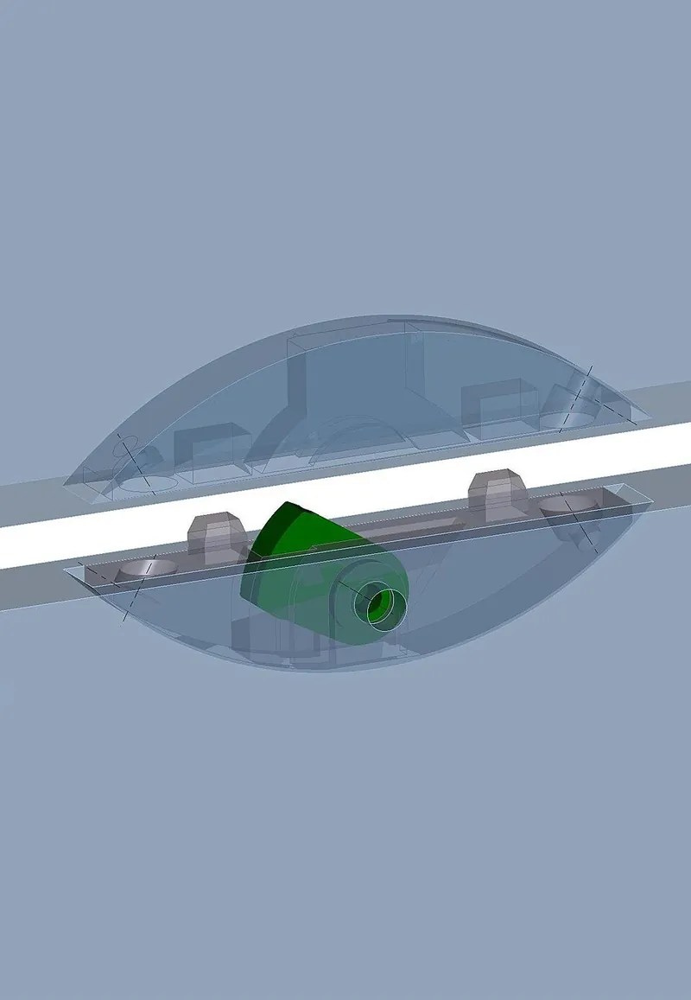

*Picture: [Clamex offen.jpg](https://commons.wikimedia.org/wiki/File:Clamex_offen.jpg) by böhringer friedrich, [CC BY-SA 2.5](https://creativecommons.org/licenses/by-sa/2.5), from Wikimedia Commons.*

A pair of biscuit-shaped fittings pushed into matching [undercut](../glossary.md#undercut) slots in two panels; a cam lever turned with an Allen key through a 6 mm hole (or built-in springs) hooks the halves together and pulls the joint tight, invisibly and at almost any angle.

**In plain words:** A hidden two-part plastic fitting, set into matching slots in the edges of two wooden boards, that locks the boards tightly together when you turn a small Allen key through a tiny hole (or that snaps and pulls itself shut as the boards are pushed together), so furniture can be put together without screws showing and, for the key-operated kind, taken apart again. **Proper term:** Lever-cam panel connector (detachable lever connector); the spring kind is a self-clamping connector.

**Also called:** Clamex P, Clamex P-14, Clamex P-10 (Lamello, brand): the lever-operated, detachable version (Lamello); Tenso P-14, Tenso P-10 (Lamello, brand): the self-clamping spring version, used with glue as a built-in clamp (Lamello); Divario P-18 (Lamello, brand): a self-clamping slide-in version for shelves and dividers (Lamello); Clamex S-20, Clamex S-18 (Lamello, brand): lever connectors screwed into an ordinary 4 mm biscuit slot (Lamello catalogue); P-System connector, P-System groove, profile-groove connector (Lamello's name for the undercut slot these clip into) (Lamello); cam-lock biscuit, snap-in biscuit (Woodshop News, 'Hidden Fasteners', 2021); detachable furniture connector, knock-down fitting, invisible or concealed furniture connector, hidden connector (Lamello; Woodshop News); similar hidden click or key connectors from other makers: Knapp Quick-Set (brand, self-tightening locking dowel), OVVO (brand, push-in connectors with releasable options), Häfele Ixconnect SC 8/60 (brand, tightened with an Allen key), Lockdowel (brand, one-piece barbed click connector) (Woodshop News 2020 and 2021).

## How it works

Each half is pushed by hand into a slot whose inside is undercut (cut wider at the bottom), so ribs on the fitting hook into it and it cannot be pulled straight out; it has to be rotated back out along the curve of the slot (Lamello 'form-locking P-System groove'; Woodshop News 2021). In the lever type (Clamex P) you bring the panels together and turn an Allen key through a small 6 mm hole: this swings a metal lever out of one half into a pocket in the other, and its cam-shaped edge draws the two halves, and so the panels, tightly together; turning it back releases the joint (Fine Woodworking 2011; Lamello). In the self-clamping type (Tenso P) springs in one half snap over the other half as the panels are pushed together and keep pulling the joint closed while glue sets, so no clamps are needed (Lamello Tenso P-14). Positioning pins stop the panels twisting or sliding out of flush (Lamello).

## Parts

A small assembly that acts as one unit, in two halves: a fibreglass-reinforced plastic body in each panel, one with a zinc die-cast lever (lever type) or with steel tension springs (self-clamping type), plus positioning pins that line the halves up. Needs a special undercut groove in each panel and, for the lever type, a 6 mm access hole; optional plastic cover caps hide the hole (Lamello P-System brochure and catalogue).

## Everyday examples

- High-end flat-pack or shipped furniture where a small round cap (about 6 mm) on an inside face hides the key hole of a lever connector (Lamello cover caps) ⚑ [uncertain]
- Mitred shelves, wine racks and bookshelves joined at unusual angles (Lamello applications)
- Built-in wardrobes under sloping roofs and tall kitchen cupboards assembled on site (Lamello applications)
- Shelves slid into an already built bookcase and clamped tight by hidden slide-in connectors (Lamello Divario P-18)

## When to use it

Choose it when wooden or board furniture must look seamless with no screws showing, be joined at awkward angles such as mitres (22.5 to 180 degrees) and, for the lever type, be taken apart again for moving or shipping and put back together many times (Lamello). It is good for large pieces that are made in the workshop and assembled on site, for joining wide panels invisibly, and as a built-in clamp for mitres and odd angles that are hard to clamp with ordinary clamps (Lamello; Sawmill Creek users). The self-clamping type lets you glue up a piece one joint at a time without waiting for glue to dry (Lamello Tenso P-14).

## When not to use it

Avoid it if you don't have the special slotting tool and only need a few joints: the cost of the Zeta P2 and connectors is high for hobbyists (Fine Woodworking 2011); a screw-in Clamex S in an ordinary biscuit slot, a knock-down cam-lock and cross-dowel fitting, or a plain screw is cheaper. Don't use it in panels thinner than about 12-15 mm, in plastic, metal or 3D-printed parts, or outdoors (Lamello: indoor use only). For heavy structural loads, choose bolted joints or traditional joinery; for joints that never need to come apart, glue with biscuits, dowels or the self-clamping type is enough. If you want tool-free assembly, look at wedge dowels or snap-in connectors instead.

## Details

- **What it does (jobs):**
  - join and hold: joins wooden or board panels at butt, corner, mitre and T joints, from 22.5 to 180 degrees (Lamello)
  - lock, and release by hand: the lever type can be opened and closed again and again with an Allen key (Lamello Clamex P)
  - tighten and hold tension: the cam lever or springs pull the joint closed with a clamping force (about 80 kg for Clamex P, about 15 kg for Tenso P, per Lamello)
  - line parts up exactly: positioning pins give flush, untwisted panels (Lamello)
  - glue or bond: the self-clamping type is a built-in clamp for glued joints, especially awkward mitres (Lamello Tenso P)
- **Movement:** none: once closed the panels do not move. The lever turns inside the fitting only while you lock or unlock it.
- **Directions it can move (degrees of freedom):** 0 when locked. Before the lever is turned the halves can still slide about 1 mm along or across each other (the installation [tolerance](../glossary.md#tolerance)), which lets you push the panels flush before tightening (Lamello Clamex P-14 technical data).
- **Special behaviour:**
  - hand-release only (locks under load, releases when a person operates it): the Clamex lever stays locked until someone turns it back with the key (Lamello: 'Open the connection time and time again with the rotating lever')
  - tensioning (takes up slack and holds): the cam lever or the springs pull the joint closed rather than just holding it, like a built-in clamp (Lamello)
  - self-aligning or self-centring: positioning pins and a sideways (lateral) tolerance bring both panels flush and stop them twisting (Lamello P-System: 'Perfect, flush alignment of both workpieces'; 'The positioning pins prevent twisting')
  - The self-clamping Tenso and slide-in Divario versions simply snap or wedge shut as the parts go together, with no lever to turn (Lamello)
- **How it holds:**
  - shape (the parts interlock; [form-fit](../glossary.md#form-fit--force-fit--material-bond)): the fittings are hooked into undercut slots, and the lever hooks the two halves together (Lamello 'form-locking anchorage')
  - friction or clamping (force-fit): the cam lever draws the halves tight, pressing the panel faces together (Fine Woodworking 2011; Lamello)
  - spring force (a spring or springy part presses it in place): in Tenso P, tension springs pull the joint shut (Lamello Tenso P-14)
  - material bond (glue, solvent or melting): Tenso P is always used with glue; the connector is only the clamp (Tenso P-14 operating instructions)
- **Input and output:** not applicable
- **Power:** passive (no power needed)
- **Load:** Medium. Lamello's figures per connector for Clamex P-14: pull-apart (tensile) strength about 1070 N in particle board, 1210 N in MDF and 1870 N in solid beech; [shear](../glossary.md#peel-vs-shear) strength 490 N, 600 N and 2940 N; clamping force about 80 kg (170 lb). An older Lamello data sheet gives lower pull-apart values of about 800-1000 N. The smaller Clamex P-10 manages about 540-900 N in tension. The spring-clamping Tenso P-14 pulls with 150 N and holds with 250 N until the glue sets; the final strength then depends on the glue. Strongest in shear along the joint in hardwood; weakest pulled straight apart in particle board (Lamello product pages and operating instructions).
- **Play and precision:** No play once locked. Installation tolerance about plus or minus 1 mm along and across the slot for Clamex P-14 (plus or minus 0.5 mm for Clamex P-10), so small slot position errors don't matter. The CNC and Flexus versions have 0 mm lengthwise tolerance for exact positioning. Positioning pins make the faces flush and return the parts to the same place each time they are reassembled (Lamello technical data).
- **Taking it apart:** removable for the lever type (Clamex P and Clamex S): turn the key back and the panels come apart; the fittings can also be taken out of their slots by hand, rotating them out (Lamello; Woodshop News 2021). Permanent for the self-clamping Tenso type, because it is glued (Lamello). The slide-in Divario P-18 is sold as a 'detachable' connector (Lamello).
- **How often it can be reused:** many times for the lever type (Lamello: 'time and time again'; a US retailer calls it a 'practically wear-free knock-down fitting' (CSAW)); once for the glued self-clamping type.
- **Sealing:** none
- **Adjustable:** no: position is set by where the slots are cut, and the clamping force is set by the lever. Before locking, the halves can be shifted by about 1 mm to get the panels flush (Lamello).
- **Access needed:** one side only (blind): the lever type needs a small 6 mm hole drilled into the face of one panel to reach the lever, which can be hidden by a cover cap; the self-clamping and slide-in types need no access hole at all and are fully hidden once assembled (Lamello).
- **Materials:** Connector bodies are fibreglass-reinforced plastic; the Clamex lever is zinc die-cast (Lamello brochure). Joins particle board, MDF, plywood, softwood and hardwood; Clamex S also joins HPL (laminate) worktops. Panel thickness roughly 12 mm and up: Clamex P-14 butt joints from 15 mm and mitres from 18 mm, Clamex P-10 butt joints from 12 mm and mitres from 15 mm (Lamello). Not made for plastic, metal or 3D-printed panels ⚑ [uncertain].
- **Heat, cold, water and wear:** Made for indoor use in a normal room climate; Lamello warns that 'corrosion can occur in humid, corrosive environments or outdoor applications' (Lamello catalogue, 'Technical notes'). Holding strength depends heavily on the board: about 1070 N in particle board against 1870 N in beech for Clamex P-14 (Lamello), and particle board and MDF weaken if they get damp ⚑ [uncertain]. The glued self-clamping type is only as heat- and water-resistant as the glue used.

## Making it

- **Ways to make or get it:**
  - woodwork: slots cut with a biscuit joiner (Zeta P2 for P-System; any biscuit joiner for Clamex S), 6 mm access hole drilled with a jig
  - CNC: P-System grooves cut with a 100.4 x 7 mm disc cutter on an angle head or a special shaft cutter (Lamello)
  - off-the-shelf part: the connectors themselves are always bought
- **Printing it in one piece (print in place):** no: the connector is a bought metal-and-plastic fitting, and the slot is cut into wood panels.
- **Tools:** To make the slots: Lamello's Zeta P2 biscuit joiner or a CNC router with the P-System disc cutter (100.4 mm across, 7 mm thick); the Clamex S version needs only an ordinary biscuit joiner cutting a 4 mm slot, plus two 3 x 12 mm screws per half. For the lever type: a 6 mm drill and drill jig for the access hole, and an Allen (hex) key to lock and unlock. Fittings are pressed in by hand or with an installation tool. The self-clamping type needs only glue and hand pressure (Lamello catalogue; Fine Woodworking 2011).
- **Difficulty:** moderate: the connectors just push in and lock with a key, but the undercut slot needs Lamello's Zeta P2 (about US$1,400 in 2011, with connectors about US$170 for 80 pairs, which Fine Woodworking called 'severely offset by the cost') or a CNC router with the special cutter; the Clamex S version works with any ordinary biscuit joiner (Fine Woodworking 2011; Lamello catalogue).

### 3D printing tips

Not applicable for the connector itself: it is a bought fitting for wood and board panels. Makers do 3D-print helpers for it: drill jigs for the 6 mm access hole of Clamex S (one uses an M4 heat-set nut and a 6 mm inside / 10 mm outside tube melted into the print; Printables 'Clamex-S Bohrschablone') and a pusher for seating P-System connectors, printed in PETG with 5-6 [perimeters](../glossary.md#perimeters) and 50% [infill](../glossary.md#infill) (Printables 'Lamello P-System dowel pusher'). For joining 3D-printed panels, use a cam latch, a snap fit or a bolt in a [captive nut](../glossary.md#captive-nut) instead ⚑ [uncertain].

### Buying one (off-the-shelf parts)

Lever type: Lamello Clamex P-14, Clamex P-10, Clamex P-14/10 Medius (centre panels), Clamex P-14/10 Flexus (springy positioning pins), Clamex P-14 CNC, Clamex S-20 and S-18 (screw-in, for 4 mm biscuit slots); cover caps (45 and 90 degree), Clamex P drill jig with 6 mm drill, installation tool, Allen key. Self-clamping type: Tenso P-14 and P-10 (with optional [preload](../glossary.md#preload) clip), Divario P-18 slide-in connector; Bisco P plastic alignment biscuit for dry test fits. Groove tools: Lamello Zeta P2 (mains or cordless) or P-System CNC disc cutter 100.4 x 7 mm (Lamello catalogue). Other brands with hidden click or key connectors: Knapp Quick-Set, OVVO, Häfele Ixconnect SC 8/60, Lockdowel (Woodshop News). Search terms: 'detachable furniture connector', 'P-System connector', 'invisible panel connector'.

## Rules of thumb

- Minimum panel thickness for Clamex P-14: 15 mm for butt joints and 18 mm for mitres, 12 mm for edge cuts, 29 mm for centre-panel (T) joints; minimum panel width 75 mm; Clamex P-10 allows butt joints from 12 mm and mitres from 15 mm (Lamello Clamex P-14 and P-10 product pages).
- Access hole 6 mm across; P-System groove cut with a 100.4 mm diameter, 7 mm thick cutter, 14 mm deep for P-14 connectors and 10 mm deep for P-10 connectors (Lamello Clamex P-14 operating instructions; Lamello catalogue depth table).
- Installation tolerance: plus or minus 1 mm lengthwise and across for Clamex P-14 and Tenso P-14, plus or minus 0.5 mm for Clamex P-10 (Lamello technical data).
- Tenso P-14 must always be used with glue; extra glue in the fitting raises its tensile strength by 30%; it pulls with 150 N and holds with 250 N (Tenso P-14 operating instructions).
- Clamex S-20 fits a symmetric 4 mm biscuit slot cut by any biscuit joiner, is fixed with 3 x 12 mm screws, and has clamping force up to about 490-680 N depending on the board (Lamello catalogue, Clamex S-20).
- Lamello's strength values are empirical load limits from tests to DIN 68501:2016-11 and are not guaranteed in use; check your own material and assembly (Lamello catalogue, 'Technical notes').
- Connector spacing up to about 300 mm apart, and at least about 37 mm from the panel end ⚑ [uncertain] (read from dimension labels in the Lamello P-System connector overview drawings, not from a stated rule).

## Common failures

Slot too shallow or cut at the wrong depth setting, so the halves don't meet and the lever can't reach its pocket; Lamello uses different depth settings for P-14 and P-10 and says to use sharp cutters (Lamello operating instructions). Panels too thin for the connector, so the slot or access hole breaks through: follow the minimum thicknesses (Lamello). Pulling-out in particle board under heavy load, because the board is much weaker than hardwood (Lamello strength table). Self-clamping Tenso joints made without glue come apart, because the springs are only meant to clamp while glue sets (Tenso P-14 operating instructions). Misaligned slots on long panels: use the positioning pins and the connectors' 1 mm tolerance, or the Flexus version with springy pins when parts must slide into place (Lamello). Access hole in the wrong place so the key can't reach the lever: use the drill jig ⚑ [uncertain].

## Safety

The Zeta P2 and other biscuit joiners use a spinning cutter about 100 mm across; use the usual power-tool precautions and keep hands clear ⚑ [uncertain]. The self-clamping versions snap shut with springs, so keep fingers out of the joint as the panels close ⚑ [uncertain]. Otherwise none known.

## Related

- Knock-down cam-lock and cross-dowel connectors: a turning cam grabs a bolt head, or a barrel nut takes a bolt; cheap and common in flat-pack furniture, but the fittings are bigger and more visible
- Wedge dowel (click-in grooved dowel): a ribbed dowel that clicks into a groove with no tools; releasable only by sliding the panels apart
- Cam latch (quarter-turn cam lock): a cam turned by a key or handle that hooks behind a panel, used for doors and access panels rather than hidden panel joints
- Biscuits, dowels and Domino tenons (plain loose tenons): line up and strengthen glued joints but don't lock or pull the joint closed
- Sliding dovetail: slides panels together along a groove; Divario P-18 does the same job with hidden fittings
- Snap-lock sheet joint (barbed or spring finger): the same click-shut idea cut into sheet material itself
- Hang-on mounts (keyhole slot, French cleat): hang panels and cabinets on a hidden hook but don't pull them tight
- [Over-centre](../glossary.md#over-centre) toggle clamp: another lever that pulls parts together, but visible and on the outside

## Make it yourself

- [Clamex P-14 connector pair, STEP CAD file (Lamello)](https://lamello.com/fileadmin/products/Clamex_P-14_connector_pair.stp): Free manufacturer 3D CAD model of the connector pair to place in your own furniture design; matching machining drawings (DWG, DXF, STEP) are linked from the Clamex P-14 product page *(licence: ⚑ [uncertain] (free download; no licence stated))*
- [P-System Configurator (Lamello)](https://lamello.com/solutions/lamello-expertise/p-system-configurator): Online tool to choose the right P-System connector and its position for a given joint angle and panel *(licence: link only)*
- [Clamex-S Bohrschablone (drill jig) (Cyber Man, Printables) (URL from Printables API, page not opened)](https://www.printables.com/model/512908-clamex-s-bohrschablone): 3D-printable drill jig for the 6 mm access hole of Clamex S lever connectors, with an M4 heat-set nut and a short 6/10 mm tube melted in as a drill bush. Read through the Printables public API. *(licence: CC BY-NC (Creative Commons Attribution-NonCommercial))*
- [Lamello P-System dowel pusher (woelpi, Printables) (URL from Printables API, page not opened)](https://www.printables.com/model/1030604-lamello-p-system-dowel-pusher): 3D-printable PETG tool that helps push P-System connectors into their grooves. Read through the Printables public API. *(licence: CC BY-NC-ND (Creative Commons Attribution-NonCommercial-NoDerivatives))*

## Pictures, videos and models

- [Clamex offen.jpg (Wikimedia Commons, by Böhringer Friedrich, 2008)](https://commons.wikimedia.org/wiki/File:Clamex_offen.jpg): See-through 3D drawing of a lever connector's two biscuit-shaped halves apart, with the green lever folded down inside one half and its hex socket visible *(licence: CC BY-SA 2.5)*
- [Clamex geschlossen.jpg (Wikimedia Commons, by Böhringer Friedrich, 2008)](https://commons.wikimedia.org/wiki/File:Clamex_geschlossen.jpg): The same connector closed: the halves together and the green lever swung up into the other half, locking the joint *(licence: CC BY-SA 2.5)*
- [Lamello Clamex P14 - Detachable furniture connector (YouTube, Lamello)](https://www.youtube.com/watch?v=ikeXJdXLth8): Manufacturer video of cutting the slot, inserting the connectors and locking them with the lever (title and channel checked via YouTube oEmbed; not watched) *(licence: link only (standard YouTube licence))*
- [Tenso P-14 - Self-clamping connector as gluing aid for all angles (YouTube, Lamello International)](https://www.youtube.com/watch?v=_ShyDBsx8WA): Manufacturer video of the spring-type self-clamping connector used to glue mitres without clamps (title and channel checked via YouTube oEmbed; not watched) *(licence: link only (standard YouTube licence))*
- [The Lamello P-System (Lamello)](https://lamello.com/products/p-system): Product photos and videos of the lever (Clamex P), self-clamping (Tenso P) and slide-in (Divario P-18) connectors, the undercut groove and the four-step assembly *(licence: link only)*

## Needs confirming

⚑ marks something nobody has confirmed yet: a fact the research could not confirm from a source, a finder value that is a best guess, or an open point from the research notes. Corrections are welcome (see `research/needs-confirming.md`).

- ⚑ 9 sentences on this page marked [uncertain].

## Sources

- <https://lamello.com/products/p-system>
- <https://lamello.com/products/p-system/clamex-p-14>
- <https://lamello.com/products/p-system/clamex-p-10>
- <https://lamello.com/products/p-system/tenso-p-14>
- <https://lamello.com/products/p-system/divario-p-18>
- <https://lamello.com/fileadmin/products/Operating_instructions_Clamex_P14.pdf>
- <https://lamello.com/fileadmin/products/Operating_instructions_Tenso_P-14.pdf>
- <https://lamello.com/fileadmin/products/Operating_instructions_Divario_P-18.pdf>
- <https://lamello.com/fileadmin/Downloads/Katalog/PDF/Catalogue_EN.pdf>
- <https://lamello.com/fileadmin/Downloads/Broschueren/P-System/PDF/P-System_Broschuere_EN.pdf>
- <https://www.messe.de/apollo/ligna_2021/obs/Binary/A1113169/Lamello%20P-System%20Connector%20Overview_EN.pdf>
- <https://www.messe.de/apollo/ligna_2021/obs/Binary/A1113169/Lamello_Tenso_P_EN.pdf>
- <https://lamello.com/fileadmin/products/Clamex_P-14_connector_pair.stp>
- <https://lamello.com/solutions/lamello-expertise/p-system-configurator>
- <https://www.finewoodworking.com/2011/04/21/lamellos-zeta-is-a-knockout-tool-for-knock-down-furniture>
- <https://www.woodshopnews.com/features/hidden-fasteners>
- <https://www.woodshopnews.com/features/making-a-quicker-connection>
- <https://sawmillcreek.org/threads/aftermarket-domino-similar-to-a-lamello-tenso.310865/>
- <https://www.csaw.com/lamello/clamex-p-14/>
- <https://commons.wikimedia.org/wiki/File:Clamex_offen.jpg>
- <https://commons.wikimedia.org/wiki/File:Clamex_geschlossen.jpg>
- <https://www.youtube.com/watch?v=ikeXJdXLth8>
- <https://www.youtube.com/watch?v=_ShyDBsx8WA>
- <https://api.printables.com/graphql/>
