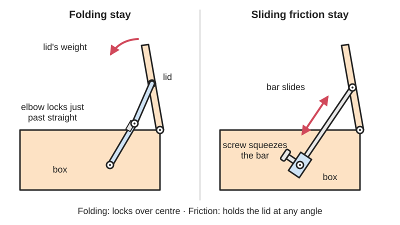

<figure class="eoc-pic eoc-pic-main"><picture><source media="(prefers-reduced-motion: reduce)" srcset="../media/drawn/lid-and-flap-stays.svg"></picture><figcaption><strong>Animation.</strong> Diagram drawn for the encyclopaedia from the research notes. ⚑ Needs confirming: a drawing can simplify or get details wrong; a real photo or a better diagram is welcome.</figcaption></figure>

A folding or sliding arm between a lid (or flap, or window) and its box or frame that holds the lid open, either by locking straight just past its [dead point](../glossary.md#dead-point) or by squeezing a sliding bar so friction holds it at any angle.

**In plain words:** An arm fitted inside a box, desk or window that props a lid or flap open so it can't fall shut: either an arm with an elbow that folds and locks when it goes straight, or a bar that slides through a clamp and holds by rubbing. **Proper term:** Lid stay (lid support, flap stay): folding stay and sliding (friction) stay.

**Also called:** lid stay / lid support / lid support hinge; flap stay / drop-front support / fall-front support / desk flap stay (holds a writing flap level); folding stay / folding lid stay / knuckle stay (two arms with an elbow joint, like a folding ruler); sliding stay / friction stay / friction lid stay / adjustable friction stay (a slotted bar sliding through a block with a screw); telescopic friction stay (tube sliding inside a tube; historically the 'Monarch casement stay'); casement stay / peg stay / peg-and-bar stay (a bar with holes dropped over a peg, for windows); window friction stay / friction hinge (a four-bar window hinge with an adjustable friction slider); restrictor stay (limits how far a window opens); soft-down stay / soft-close lid stay (with an oil or air damper); lift-assist stay / piston stay / gas strut lid support (see 'Gas spring'); [torque](../glossary.md#torque) lid stay / free-stop lid stay (friction holds the lid at any angle); locking lid stay (locks when fully open; lift the lid or press a button to release); toy box lid support / toy chest lid hinge (spring-loaded, holds the lid in any position); lid chain or cord (the simplest stay).

## How it works

Folding stay: the two arms are hinged in the middle like an elbow; as the lid opens the arm straightens, and the offset joint lets it open slightly more than 180 degrees against a stop (Whitechapel). Once just past straight, the lid's weight pushes the joint harder against its stop instead of folding it ([over-centre](../glossary.md#over-centre)), so the lid stays up until someone pushes or pulls the joint back through straight (Whitechapel; Rockler). Sliding (friction) stay: a bar fixed to the lid slides through a pivoting block on the box; a screw squeezes the bar so friction holds the lid wherever you leave it, and loosening it slightly lets the lid sink slowly (Rockler); a stop rivet at the bar's end sets the maximum opening. Window friction stays work the same way, with a screw in the slider setting the friction (Era).

## Parts

A few parts. Folding stay: two flat arms riveted together at an offset 'elbow' joint, with a swivelling mounting foot at each end (Whitechapel). Sliding stay: a bar (often slotted) with a pivoting foot at one end and a stop rivet at the other, plus a second pivoting foot that the bar slides through, with a friction screw or thumbscrew (Whitechapel; Rockler). Telescopic stay: a tube sliding in a tube, held by friction blocks (Wikipedia 'Casement stay'). Window friction stay: a track, several arms, and a plastic slider shoe with a friction adjustment screw (Era; Mila). Soft-down and lift-assist stays add a rotary damper, a spring or a gas strut (Sugatsune catalogue; Rockler).

## Everyday examples

- Toy chests and blanket chests with a support that stops the lid falling (CPSC; Rockler)
- Drop-front (secretary) desks whose writing flap is held level by stays (Rockler; Whitechapel)
- Upward-opening kitchen cabinet doors held open by a stay (Rockler)
- Casement windows held open by a peg stay or a friction stay (Wikipedia 'Casement stay'; Era)
- 3D-printer enclosure lids propped open by a folding stay (Printables 'Creality K1 MAX folding lid support')

## When to use it

Use a stay when a hinged lid, flap or window must stay open by itself and must not fall: chest and toy-box lids (so they can't drop on hands or heads), drop-front desk flaps that must hold weight level, overhead cabinet doors, printer-enclosure lids, tool-case lids and casement windows. Choose a folding stay for a compact, positive lock at one opening, especially where space inside is tight (fall-front desks; Whitechapel). Choose a friction (sliding or telescopic) stay to hold any angle and let the lid down softly, which is the safer choice around children (Whitechapel; CPSC). Choose a soft-down or lift-assist stay for heavier lids, and a gas stay for large overhead doors (Rockler).

## When not to use it

Avoid folding stays where small children could release them by accident and have the lid fall (Whitechapel); use a friction stay or a spring-loaded lid support that holds at any position (CPSC). Avoid lockable sliding stays on chest lids (Whitechapel). Don't use a stay alone for very heavy lids or overhead doors that could lift out of reach; use gas stays or lift-assist hardware (Rockler). For small jewellery boxes, a 90-degree stop hinge or quadrant hinge is simpler (Rockler). If the lid should hold at any angle with no visible arm, use a friction (torque) hinge instead; if it should close by itself, use a self-closing hinge or a soft-down stay.

## Details

- **What it does (jobs):**
  - lock, and release by hand: a folding stay locks the lid open until you nudge the joint; locking stays release when you lift the lid, press a button or slide a lever (Whitechapel; Sugatsune catalogue)
  - slow it, stop it or keep its speed steady: friction stays hold a lid at any angle and let it down gently; soft-down stays use a damper to stop slamming (Rockler; Sugatsune catalogue)
  - click into set positions: peg-and-bar casement stays hold a window at a few set openings (Wikipedia 'Casement stay')
  - store energy: lift-assist stays use a spring or gas strut to help lift the lid (Rockler)
- **Movement:** multiple: the arms turn at their pivots and, in sliding stays, the bar also slides (rotate+slide). The lid itself turns on its own hinges, typically to a little more than 90 degrees for a chest lid or to level for a desk flap (Whitechapel); bent-arm window friction stays can let a window open to 180 degrees (Wikipedia 'Casement stay')
- **Directions it can move (degrees of freedom):** Installed with the lid's hinges, the lid, stay and box move together with 1 degree of freedom (the lid's swing); a locked folding stay or a tightened friction stay takes that to 0. A sliding stay on its own has 2 (the bar slides and pivots); a folding stay's two arms have 1 between their feet
- **Special behaviour:**
  - over-centre (snaps past a point and stays): a folding stay opens slightly past straight so the lid's weight holds it locked (Whitechapel; Rockler)
  - hand-release only (locks under load, releases when a person operates it): folding stays and locking lid stays hold until you push the joint, lift the lid, press a button or slide a lever (Whitechapel; Sugatsune catalogue pp. 143-145)
  - torque-limiting (slips or clicks at a set force/torque): a friction stay is a slip joint; it holds until pushed harder than its set friction, then slides smoothly (Rockler)
  - one-way (moves freely one way, locks the other): some torque lid stays have friction only in the closing direction, so the lid opens freely but stays where it is left (Sugatsune catalogue p. 136); they resist rather than lock
  - indexing (clicks into set positions): peg-and-bar window stays set a few fixed openings (Wikipedia 'Casement stay')
- **How it holds:**
  - shape ([form-fit](../glossary.md#form-fit--force-fit--material-bond)): a locked folding stay holds because its joint sits against a stop just past straight; peg stays hold by a peg in a hole
  - friction or clamping (force-fit): sliding, telescopic and window friction stays hold by a screw or friction blocks squeezing the sliding part (Rockler; Wikipedia 'Casement stay'; Era)
  - spring force (a spring or springy part presses it in place): spring-loaded toy-box lid supports and lift-assist stays (CPSC; Rockler)
- **Input and output:** not applicable
- **Power:** passive (no power needed)
- **Load:** light to medium. Chosen by the lid's turning load (moment): lid depth x lid weight / 2, in inch-pounds (Rockler), e.g. a 25 in deep, 14 lb lid needs about 175 in-lb (HingeOutlet); Sugatsune writes the same formula as door height x 1/2 x door weight, and one friction lid stay holds 0 to 71 kgf-cm (0 to 61.7 lbf-in) per piece (Sugatsune catalogue pp. 111 and 136). The arm is strong along its length (propping the lid) but weak sideways and in twist, and folding stays can be released by a bump; heavy lids and overhead doors need gas (piston) stays (Rockler)
- **Play and precision:** noticeable: riveted pivots have some play, and peg stays rattle in the wind (Wikipedia 'Casement stay'). A folding stay always locks at the same opening; a friction stay holds anywhere but can [creep](../glossary.md#creep) as the friction fades (Rockler). Mounting must be precise: a badly placed folding stay contorts or won't lock (Whitechapel), and stays must be square to the back and parallel to the side wall (HingeOutlet; Sugatsune catalogue p. 145)
- **Taking it apart:** removable: screwed to the underside of the lid and the inside of the box or frame (Whitechapel; HingeOutlet)
- **How often it can be reused:** many times: can be unscrewed and refitted; commercial damper stays are recognised by LGA for 30,000 to 40,000 cycles (Sugatsune catalogue pp. 106, 112 and 117)
- **Sealing:** none (telescopic tube stays do keep dirt and water out of the sliding parts; Wikipedia 'Casement stay')
- **Adjustable:** Sliding friction stays: yes, a screw sets the friction; tighten to hold the lid anywhere, loosen slightly for a slow soft-down (Rockler). Window friction stays: yes, a screw in the slider, in quarter turns (Era). Some soft-down stays have an adjustable speed (Sugatsune catalogue p. 111). Folding stays: no, they lock at one opening. Peg stays: choose a hole (Wikipedia 'Casement stay')
- **Access needed:** one side only (blind): everything is screwed on from inside the open box, desk or window
- **Materials:** Steel, brass, zinc alloy, nickel-plated and aluminium arms and bars (Wikipedia 'Casement stay'); traditional folding stays in solid or plated brass (Rockler; Whitechapel); commercial stays in zinc-alloy bodies with steel arms, or 304 stainless steel (Sugatsune catalogue pp. 136 and 143); window friction stays in steel with a plastic slider shoe (Era; Mila). Printed stays: PLA or PETG arms with a metal pin, e.g. 3.15 mm welding wire as the axle (Printables 'Creality K1 MAX folding lid support')
- **Heat, cold, water and wear:** Mostly for indoor furniture; damper (soft-down) stays are designed for 0 to 40 C (Sugatsune catalogue). Window friction stays live outdoors: lubricate the moving parts with light, non-acidic mineral oil twice a year and keep them clean (Era). Friction stays lose grip over time and need periodic tightening (Rockler; CPSC). Printed stays: PLA starts to give way at about 60 C and PETG at about 80 C (CNC Kitchen), and squeezed plastic friction parts relax, faster when warm (DuPont design guide, p. 36).

## Making it

- **Ways to make or get it:**
  - off-the-shelf part: folding, sliding, telescopic, locking, soft-down and lift-assist lid stays; window friction stays
  - woodwork: fitting stays to chests, toy boxes, desks and cabinets
  - 3D print (FDM): props, folding stays and locking stays for boxes and printer-enclosure lids (Printables)
  - laser cut: flat acrylic or plywood stay arms with a bolt pivot ⚑ [uncertain]
  - sheet metal: stamped steel arms in commercial stays ⚑ [uncertain]
- **Printing it in one piece (print in place):** no: printed stays are printed as separate arms and joined with a metal pin or screw (e.g. 'Simple Lid Stay' is split into its parts in the slicer; the K1 MAX folding lid support uses a welding-wire axle; Printables)
- **Tools:** screwdriver and drill or bradawl to fit; a combination square to line the stay up square to the back of the box (HingeOutlet); a screwdriver to adjust friction on sliding and window friction stays (Rockler; Era)
- **Difficulty:** easy to buy and fit, as long as the stay is placed precisely (Whitechapel); easy to moderate to print a simple prop or folding stay with a metal pin; moderate to make a friction stay that keeps its grip, because squeezed plastic relaxes (DuPont design guide, p. 36)

### 3D printing tips

1) Print the arms lying flat so the layers run along the arm; bending across [layer lines](../glossary.md#layer-lines) is weak (vertically printed PLA hooks held 55% and PETG 46% of the flat-printed load; CNC Kitchen). 2) Use a metal pin for every pivot (a bolt with a nylon-insert lock nut, a clevis pin or a piece of steel wire; the K1 MAX folding lid support uses 3.15 mm welding wire; Printables) and leave at least 0.3 mm [clearance](../glossary.md#clearance) for moving parts (Prusa knowledge base). 3) For a folding stay, design a stop face at the elbow so the joint stops a few degrees past straight (slightly over 180 degrees, like commercial folding stays; Whitechapel); the lid's weight then holds it locked. Test that it releases with a light push and that the stop is thick enough to take a bump. 4) For a friction (sliding) stay, don't rely on a tight printed fit: plastic held squeezed slowly relaxes (DuPont design guide, p. 36; thrinter creep test). Use a screw with a spring washer or rubber washer to keep the squeeze on, and expect to re-tighten it now and then, as with bought friction stays (Rockler; CPSC). 5) Material: printer-enclosure lids get warm; PLA starts to give way at about 60 C and PETG at about 80 C under load (CNC Kitchen), so use PETG or ASA there. 6) Size it from the lid's moment (lid depth x weight / 2, Rockler) and keep the stay's bottom pivot far enough from the lid hinge that the arm isn't nearly parallel to the lid; a longer lever means less force in the arm ⚑ [uncertain]. 7) Commercial stays are handed (left or right); mirror a printed design for the other side (Rockler; Printables 'Flashforge 5M Pro Small Folding Lid Prop'). 8) Heavier printed enclosure lids are better lifted by gas springs on printed brackets (Printables 'Hinged lid with gas spring for Original Prusa Enclosure' uses two 120 N gas springs, M6 pivot screws with nylon-insert nuts and aluminium profiles to stiffen the lid).

### Buying one (off-the-shelf parts)

Search for: 'lid stay', 'lid support', 'folding lid stay', 'sliding lid stay' or 'friction lid stay', 'telescopic friction stay', 'drop front support' or 'flap stay', 'soft-down lid stay' or 'soft close lid support', 'lift assist lid stay', 'torque lid stay' or 'free stop lid stay', 'locking lid stay', 'toy box lid support' (spring-loaded, holds the lid in any position), 'casement stay' and 'window friction stay' / 'friction hinge' (by stack height, 13 or 17 mm, and length; Mila), 'gas strut' with 'ball stud' ends. Makers a beginner may see: Sugatsune, Rockler, Whitechapel (brands)

## Rules of thumb

- Size a lid stay by the lid's moment: inch-pounds = lid depth (in) x lid weight (lb) / 2, measured front to back for a chest lid or the closed height for an upward-opening door (Rockler); e.g. 25 in x 14 lb / 2 = 175 in-lb (HingeOutlet). Sugatsune writes it as torque = door height x 1/2 x door weight (Sugatsune 'Lid Supports' catalogue, p. 111).
- A too-weak stay can't hold the lid; a too-strong one makes the lid hard to close (HingeOutlet).
- Folding stays are made to open slightly more than 180 degrees, which is what locks them (Whitechapel).
- Small folding stays should fold away from the hinges (forward-folding); on a slant-front desk a folding stay only works if the desk front is at 60 degrees or steeper (Whitechapel).
- Sliding stays need clear space inside the box for the arm's whole travel (Rockler; Whitechapel); folding stays need no more room than their closed size (Whitechapel).
- Lockable sliding stays are a poor choice for chest lids because they can release unexpectedly; use them for setting angles, e.g. drafting tables and windows (Whitechapel).
- A lid near children needs a support that holds the lid open in any position, and it must be checked and re-tightened periodically (CPSC Publication 5099).
- Window friction stays: turn the adjustment screw a quarter turn at a time, never more than three quarter turns in total, and adjust top and bottom stays equally (Era Horizon friction stay instructions); standard stack heights are 13 mm and 17 mm (Mila fitting instructions).
- Telescopic friction stays typically extend from 11 to 16 in (Wikipedia 'Casement stay').
- Commercial damper (soft-down) stays are designed for room temperature, 0 to 40 C (Sugatsune catalogue, pp. 106 and 112).
- Mount stays square to the back of the box and parallel to the side wall (HingeOutlet; Sugatsune catalogue p. 145).

## Common failures

The friction fades, so the lid drifts down or drops; re-tighten the screw regularly (Rockler; CPSC). A folding stay is fitted in slightly the wrong place, so it twists, won't lock or won't fold (Whitechapel). A sliding stay's arm hits things inside the box because there wasn't enough clearance (Rockler). The wrong hand (left or right) was bought (Rockler; Mila). The stay was undersized for the lid's weight and depth, or so strong the lid is hard to close (HingeOutlet). The stay isn't square or parallel, so it binds (HingeOutlet; Sugatsune catalogue). A window friction stay's screw is over-tightened and strips (Era). Printed versions: arms snap along layer lines, plastic pivot holes wear oval, and friction parts relax.

## Safety

Falling lids are a real hazard: the US CPSC knows of children killed or brain-damaged when toy-chest lids fell on their heads or necks, and recommends a lid support that holds the lid open in any position, checked and re-tightened regularly (CPSC Publication 5099). Folding stays have a pinch point at the elbow and can be released accidentally (Rockler; Whitechapel). Overhead doors that lift out of reach need a stay that holds the position you leave them in (Rockler). Over-turning a window friction stay's adjustment screw strips its thread and damages the hinge (Era), and replacing stays means handling heavy sashes and glass (Mila).

## Related

- Friction hinge: puts the friction inside the hinge itself, so no separate arm is needed
- Gas spring (gas strut): lifts and holds heavier lids; lockable types hold at any length
- Dampers (rotary and linear soft-close dampers): the part inside a soft-down stay that stops slamming
- Self-closing hinges: close a lid or door instead of holding it open
- Over-centre [linkage](../glossary.md#linkage) (toggle linkage): the principle that locks a folding stay just past straight
- [Detent](../glossary.md#detent) hinge: holds a lid at set click positions inside the hinge
- Telescoping tube locks (twist lock, lever lock): lock a telescoping tube at any length, like a lockable telescopic stay
- Stop hinge or quadrant hinge: a hinge with a built-in stop, enough for light jewellery-box lids (Rockler)
- [Torsion](../glossary.md#torsion) lid hinge: a hinge with a built-in spring that holds the lid where you leave it (Rockler)
- Chain or cord stay: the simplest way to stop a lid falling backwards (Whitechapel; Rockler)

## Make it yourself

- [Simple Lid Stay (Stached, Printables) (URL from Printables API, page not opened)](https://www.printables.com/model/321117-simple-lid-stay): A very simple printed stay to hold a chest or box lid open; split into its parts in the slicer; printed in PLA with 4 perimeters and 20% infill. Read through the Printables public API. *(licence: CC BY)*
- [Chest/Trunk Lid Stay (oublue, Printables) (URL from Printables API, page not opened)](https://www.printables.com/model/648577-chesttrunk-lid-stay): A pair of printed stays that stop a chest lid opening too far; one catches automatically when fully open to stop the lid falling on fingers, and is lifted to release; fixed with #6 wood screws. Read through the Printables public API. *(licence: CC BY-NC-SA)*
- [Creality K1 MAX folding lid support (Jan Kurek, Printables) (URL from Printables API, page not opened)](https://www.printables.com/model/993062-creality-k1-max-folding-lid-support): A folding support that locks a printer's lid lifted at 132 mm and flips up out of the way when closed; printed in PETG with a 3.15 mm welding-wire axle. Read through the Printables public API. *(licence: CC BY-NC)*
- [Hinged lid with gas spring for Original Prusa Enclosure (MW, Printables) (URL from Printables API, page not opened)](https://www.printables.com/model/563065-hinged-lid-with-gas-spring-for-original-prusa-encl): Printed brackets that lift an enclosure lid with two 120 N gas springs, pivoting on M6 screws with nylon-insert nuts; shows the piston-stay alternative. Read through the Printables public API. *(licence: GNU GPL v3.0)*

## Pictures, videos and models

- [Lid Support/Lid Stay Buying Guide (Rockler)](https://www.rockler.com/learn/lid-support-lid-stay-buying-guide): Photos and explanations of folding, sliding (friction) and piston lid stays, their uses on chests, drop-front desks and overhead doors, and the inch-pound sizing formula *(licence: link only)*
- [Stays (Whitechapel Ltd)](https://whitechapel-ltd.com/stays): Pictures and descriptions of folding, sliding, telescoping friction and casement (peg) stays, with safety advice for chests *(licence: link only)*
- [Folding Lid Stays: installation (Whitechapel Ltd)](https://whitechapel-ltd.com/folding-lid-stays): Installation drawings of folding stays on a chest lid and on fall-front desks, and why they lock slightly past 180 degrees *(licence: link only)*
- [Horizon Friction Stay Adjustment Instructions (ERA, PDF)](https://www.eraeverywhere.com/globalassets/era/data-sheets/10757_adjustment-instructions.pdf): Diagrams of a window friction stay with and without friction applied, and where the adjustment screw sits in the slider *(licence: link only)*
- [George H. Johnson & Fred Bottner Trunk Lid Support, 1871 patent drawing (US National Archives via Wikimedia Commons)](https://commons.wikimedia.org/wiki/File:George_H._Johnson_%26_Fred_Bottner_Trunk_Lid_Support_-_DPLA_-_c52e19270d05551ecae0e6621daffa03_(page_1).jpg): A historic US patent drawing of a trunk lid support *(licence: Public domain in the United States)*
- [Soft Close Toy Box / Chest Lid Stay Support Installation (YouTube, Two Keys Studio)](https://www.youtube.com/watch?v=j6s0zpPYchw): Installing a soft-close lid stay on a toy box or chest (title and channel confirmed via YouTube oEmbed; content not viewed) ⚑ [uncertain] *(licence: link only (standard YouTube licence))*

## Needs confirming

⚑ marks something nobody has confirmed yet: a fact the research could not confirm from a source, a finder value that is a best guess, or an open point from the research notes. Corrections are welcome (see `research/needs-confirming.md`).

- ⚑ 4 sentences on this page marked [uncertain].
- ⚑ Finder value `connects` = lid, door or cover (best guess): worked out from its name, but joining parts is not one of its two main jobs

## Sources

- <https://www.rockler.com/learn/lid-support-lid-stay-buying-guide>
- <https://whitechapel-ltd.com/stays>
- <https://whitechapel-ltd.com/folding-lid-stays>
- <https://en.wikipedia.org/wiki/Casement_stay>
- <https://en.wikipedia.org/wiki/Casement_window>
- <https://www.cpsc.gov/s3fs-public/5099.pdf>
- <https://www.hingeoutlet.com/blogs/news/how-to-install-lid-support-hinges-and-stays>
- <https://www.sugatsune.com/content/page-files/product-literature/catalog-300-099-157-lid-supports.pdf>
- <https://www.eraeverywhere.com/globalassets/era/data-sheets/10757_adjustment-instructions.pdf>
- <https://www.milasecure.com/uk/en/documents/fitting-instructions/window-hardware/friction-stay-fitting-instructions/Standard%20Friction%20Stay%20Fitting%20Instructions.pdf>
- <https://commons.wikimedia.org/wiki/File:George_H._Johnson_%26_Fred_Bottner_Trunk_Lid_Support_-_DPLA_-_c52e19270d05551ecae0e6621daffa03_(page_1).jpg>
- <https://www.youtube.com/watch?v=j6s0zpPYchw>
- <https://www.distrupol.com/General_Design_Principles_for_Engineering_Polymers.pdf>
- <http://thrinter.com/creep-abs-pla-petg-alloy-910/>
- <https://www.cnckitchen.com/blog/comparing-pla-petg-amp-asa-feat-prusament>
- <https://help.prusa3d.com/article/modeling-with-3d-printing-in-mind_164135>
- <https://api.printables.com/graphql/>
