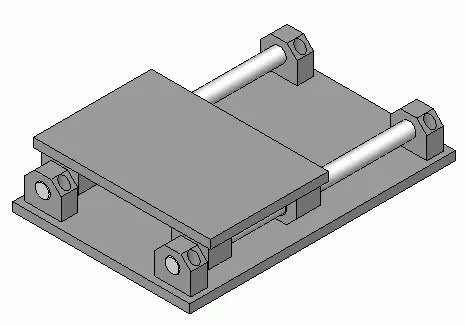

<figure class="eoc-pic eoc-pic-main"><picture><source media="(prefers-reduced-motion: reduce)" srcset="../media/linear-guides.still.webp"></picture><figcaption><strong>Animation.</strong> <a href="https://commons.wikimedia.org/wiki/File:Linear-table_animated.gif">Linear-table animated</a> by Silberwolf, <a href="https://creativecommons.org/licenses/by-sa/2.5">CC BY-SA 2.5</a>, from Wikimedia Commons.</figcaption></figure>

A guide that lets a part (the carriage) slide or roll along a straight rod, bar or rail while stopping it from wobbling, tipping or twisting, so it can only move in one straight line.

**In plain words:** The ordinary ways to make one part slide smoothly in a straight line along another: a sleeve that slides along a smooth steel rod, grooved wheels that roll along a slotted aluminium bar, or a small block that runs along a steel rail. **Proper term:** Linear guide (linear-motion bearing): bushings on round rods, V-wheels on V-slot extrusion, and profile-rail carriages.

**Also called:** linear bearing / linear-motion bearing / linear slide (Wikipedia); linear bushing / plain linear bushing / sleeve bearing on a rod; linear ball bearing / ball bushing / linear ball bushing (recirculating balls inside a sleeve); LM8UU, LM10UU, LM12UU (size codes for metric ball bushings: LM = linear motion, number = rod diameter in mm, UU = contact seals at both ends; LM8LUU is a long version, SC10UU a pillow block holding an LM10UU; RepRap wiki); smooth rods / guide rods / linear shafting / round rail; round rail guide / shaft guide (DIN 4379 plain-bearing linear table); drylin (igus, brand): dry-running plastic linear bushings and rails; profile rail / profiled rail guide / linear guideway / square rail / linear rail (block and rail); carriage / block / slider / truck (the part that runs on a profile rail); MGN7, MGN9, MGN12, MGN15 (HIWIN (brand) miniature rail sizes, widely copied and used as generic names); V-slot (OpenBuilds (brand) aluminium extrusion with V-shaped grooves) and V-wheels / V-groove wheels / Delrin wheels / POM wheels; eccentric spacer / eccentric nut (off-centre spacer that adjusts wheel tension); track rollers / cam-follower guides / roller guides; boxway / box way (sliding machine-tool guide); extrusion slide / bushing slide (FTC robotics, plastic sliders in extrusion slots); Linearführung / Profilschienenführung (German).

## How it works

The moving part hugs the track closely on several sides, so it can travel along the track but cannot move sideways, lift off or tip over. In a plain bushing (sliding contact) a low-friction sleeve simply slides on the rod; in a ball bushing or profile-rail carriage, rows of steel balls roll between the block and the track and recirculate through return channels, so travel is limited only by the track length (Wikipedia; linearmotiontips). V-wheels are small wheels with a V-shaped rim running in the V-grooves of an aluminium bar; wheels on both sides pinch the bar, and an off-centre spacer (eccentric spacer) on some wheels moves them in or out to remove play (FarmBot). One round bushing on one rod still lets the part spin around the rod, so rod guides use two parallel rods (or a rail with a flat shape) to stop rotation.

## Parts

A few parts: the fixed track (one or two smooth rods, a V-slot aluminium bar, or a steel rail), the moving part (bushings or ball bushings in a housing, three or four V-wheels on a plate, or a carriage block), end supports or screws that hold the track, and often a second parallel track. Ball bushings and carriages are small assemblies that act as one unit (sleeve, rows of recirculating steel balls, cage or retainer, end seals).

## Everyday examples

- A home 3D printer: its axes run on smooth rods with bushings, V-wheels on V-slot bars, or small steel rails (Hackaday)
- A desk or kitchen drawer running on its side runners (Slocum's classic example of a slide that jams when pulled at one corner)
- A sliding wardrobe or patio door rolling on wheels in a track
- A garden robot such as FarmBot, whose gantry rolls on V-wheels along aluminium tracks (FarmBot docs)

## When to use it

Use a linear guide whenever something must slide in a straight line accurately and repeatably: 3D printer, laser and CNC axes, camera sliders, robot lifts and extensions, sliding tables and jigs. Pick plain plastic bushings for cheap, quiet, dirt-tolerant, grease-free slides and for soft rods or tubes; ball bushings on hardened rods for low friction and smooth motion; V-wheels on V-slot for long, low-cost frames that double as structure; and profile rails for the stiffest, most precise and compact guide, especially when there are sideways loads (Hackaday; gm0).

## When not to use it

Don't use a single rod with a single bushing where the part must not rotate; use two rods or a rail. Avoid short carriages that are pushed or loaded far off-centre (they jam like a drawer); make them longer or drive both sides (Slocum; igus). Avoid steel-ball bushings on aluminium or carbon-fibre tubes (they wear grooves; use plastic bushings, gm0). Avoid unsupported rods for heavy loads over long spans (they sag; use supported rails or profile rails). For very short travel with no friction or play, a [flexure](../glossary.md#flexure) stage is better; for a [stroke](../glossary.md#stroke) that must extend out of its housing, use a telescopic drawer slide or multi-stage slide.

## Details

- **What it does (jobs):**
  - let it move (turn, slide or bend): it lets a carriage, bed, tool head, lift stage or drawer slide in a straight line
  - line parts up exactly: it keeps the moving part on a straight, repeatable path with little sideways play
- **Movement:** slide: straight-line travel along the track; travel is limited by the rod or rail length for recirculating ball bushings, plain bushings, wheels and carriages (Wikipedia); non-recirculating slides (e.g. crossed-roller slides) have a stroke limited by their own length
- **Directions it can move (degrees of freedom):** 1 for a complete guide (two parallel rods, a V-slot bar with wheels on both sides, or a profile rail): the carriage can only slide along the track. A single round bushing on a single round rod has 2 (it can slide and also spin around the rod), which is why round-rod guides use two rods or add an anti-rotation feature; gm0 notes this spin can be useful where a slide also has to rotate on the same axis.
- **Special behaviour:**
  - self-aligning or self-centring (only some versions): 'floating' plastic bushings with extra [clearance](../glossary.md#clearance) on the second rail absorb small angular [misalignment](../glossary.md#misalignment) between two rails (igus drylin fixed/floating bearings)
  - none of the holding behaviours: a linear guide does not lock, click or hold a position by itself; add a lead screw, brake, clamp or [detent](../glossary.md#detent) if the carriage must stay put
- **How it holds:**
  - not a holding joint (it moves or passes on motion): it guides movement rather than holding a position
  - shape (the parts interlock; [form-fit](../glossary.md#form-fit--force-fit--material-bond)): the bushing, wheels or carriage wrap around the rod, groove or rail profile, which is what stops sideways and tipping movement
- **Input and output:** not applicable: a linear guide only guides the motion; it is usually driven by something else, such as a timing belt, lead screw, ball screw or rack and pinion, or pushed by hand
- **Power:** passive (no power needed); the carriage is moved by hand or by a separate motor-driven belt or screw. If that motor loses power, the guide does not hold: a vertical carriage will fall unless the drive is [self-locking](../glossary.md#self-locking) or there is a brake or counterweight
- **Load:** Light to heavy depending on type and size. Plain plastic bushings on unsupported rods: light to medium, because the rods bend between their end supports (linearmotiontips). V-wheels on V-slot: light to medium (3D printers, laser cutters, FarmBot gantries). Profile rails: medium to heavy and stiff in every direction; gm0 says a pair of MGN12 rails can lift a 20 kg (40 lb) robot, and one maker lists a single LM8UU ball bushing at 274 kgf dynamic and 392 kgf static load rating (ISK Bearings data). Weak points: long unsupported rods sag in the middle, and any guide jams if it is pushed far off-centre compared with its bearing length (igus 2:1 rule; Slocum).
- **Play and precision:** Play: noticeable to small for plain bushings (they need a running clearance; printed ones loosen as they wear, UNIT3D), small for ball bushings on hardened rods, and none to very small for preloaded profile rails (HIWIN ZF has 4-10 micrometres of clearance, Z0 0-3 micrometres, Z1 is preloaded). [Repeatability](../glossary.md#repeatability--accuracy): good for all when adjusted; best for profile rails. Misalignment: low [tolerance](../glossary.md#tolerance); two rods or rails must be parallel or the carriage binds. HIWIN allows a mounting-surface error of only 0.050 mm per 200 mm for MG12 rails at ZF/Z0 [preload](../glossary.md#preload), and half that for Z1 or for two rails on the same surface; igus recommends one 'fixed' rail and one 'floating' rail with extra clearance to absorb angular misalignment.
- **Taking it apart:** removable: rods are clamped or slid out of their end supports, bushings are held in housings by clamps or snap rings (gm0; Wikipedia 'Plain bearing'), V-wheels are bolted to a plate, and rails and carriages are screwed down
- **How often it can be reused:** many times: all parts can be taken apart and reassembled; the limits are wear (plastic bushings and wheels wear, steel balls can wear soft aluminium or carbon-fibre tubes, gm0) and the risk of losing balls from cheap ball bushings or carriages slid off their rails (gm0)
- **Sealing:** none for most guides: rods, V-slot grooves and rail raceways are open to dust. Dust-resistant only where seals are added: ball bushings with two lip seals (the 'UU' in LM8UU), and profile-rail carriages with end seals (standard on HIWIN MG series except size 3) and optional bottom seals (HIWIN catalogue). Plain plastic bushings cope with dirt better than ball bearings and often need no seals (Wikipedia; igus).
- **Adjustable:** yes: the carriage can stop anywhere along the track (held by its drive); V-wheel tension is adjusted by turning eccentric spacers (FarmBot); profile-rail play is chosen when buying by preload class (HIWIN MGN: ZF slight clearance, Z0 very light preload, Z1 light preload); split or clamp-type bushing housings can be tightened slightly, but over-tightening deforms ball bushings (Prusa)
- **Access needed:** end of a tube or shaft: bushings and ball bushings slide on from the end of the rod, and carriages slide on from the end of the rail (take care: balls in cheap blocks can fall out, gm0); rails and rod supports are screwed down from their top or side; V-wheel plates are bolted on from the side and can be fitted over the bar when the eccentric spacers are loosened
- **Materials:** Rods: hardened steel shafting (ball bushings need about HRC 60; stainless shafts can be as soft as HRC 54, linearmotiontips), stainless steel, hard-anodised aluminium (paired with iglidur J200 plastic bushings, igus), or aluminium and carbon-fibre tubes with plastic bushings (gm0; humebeam). Bushings: bronze, iglidur and other bearing plastics (iglidur J friction against steel 0.06-0.18, igus), POM, PTFE, and printed nylon, PC blend, PLA or PETG. V-wheels: POM (Delrin) or polycarbonate on 6061 aluminium V-slot bar. Profile rails: bearing steel or stainless steel (HIWIN 'M' suffix). Sliding surfaces should be different materials, one harder than the other, so wear goes into the softer part (linearmotiontips).
- **Heat, cold, water and wear:** Heat: iglidur J bushings are rated -50 to +90 C long-term (igus); printed PLA carriages soften above 60 C and PETG is fine below 80 C (Prusa); ball-bushing ratings are reduced above 100 C (linearmotiontips). Dirt: rolling-element bearings handle contamination poorly and need seals, while plain bearings cope well (Wikipedia); igus says dry plastic bushings shed dirt into their grooves. Corrosion: stainless shafts resist rust but are softer, shortening ball-bushing life (linearmotiontips). Wear and [creep](../glossary.md#creep): printed bushings that fit tightly at first loosen with wear (UNIT3D), and plastic V-wheels wear and can deform if forced on too tight (FarmBot). Moisture: nylon bushings absorb water and change size slightly (EngineerDog on nylon).

## Making it

- **Ways to make or get it:**
  - off-the-shelf part: smooth rods with ball bushings or plastic bushings, V-slot extrusion with V-wheel kits, miniature and full-size profile rails with carriages
  - 3D print (FDM): bushing housings and carriages, rod clamps and end supports, and complete printed plastic bushings to replace LM8UU-style ball bushings
  - CNC: gantry plates and carriages; precision boxways and ground rails in industry
  - laser cut: flat wheel plates and carriages for V-wheels (bolted parts, no special feature)
  - woodwork: plain wooden runners and waxed slides for drawers and jigs (the simplest sliding guide; drawer jamming is Slocum's classic example)
- **Printing it in one piece (print in place):** no: printed linear guides are normally printed as separate bushings, carriages and clamps and then fitted onto metal rods, rails or aluminium extrusions
- **Tools:** Hex keys and screwdrivers for housings, clamps and rail screws; an 8 mm spanner to turn standard OpenBuilds-style eccentric spacers (FarmBot); snap-ring ([circlip](../glossary.md#circlip)) pliers where bushings are held by retaining rings (gm0); grease or light oil and a paper towel for cleaning and lubricating rods (Prusa); a hacksaw for cutting steel rods (gm0 warns not to use a bandsaw on steel shafts).
- **Difficulty:** easy to moderate: rods with ball bushings, V-wheel kits and cheap MGN rails can be bought and bolted together; printed bushings are easy but need fit tuning; the hard part is making two rods or rails straight and parallel and keeping the carriage long enough not to jam

### 3D printing tips

1) Holes print small: EngineerDog explains that printed holes shrink (cooling and polygon faceting) and suggests oversizing by about 0.13 mm (0.005 in) across the diameter or reaming. For a printed bushing on an 8 mm rod, UNIT3D supplies bores of 8.1-8.4 mm; in PC Blend at 0.15 mm layers 8.2 mm was the sweet spot, but the bushings later loosened with wear, so the designer planned to print 8.1 mm and drill out to 8 mm for more contact. Aim for a fit that does not rattle when you flick the carriage (UNIT3D). 2) Material: humebeam recommends nylon (PA) for printed bushings because it is low friction and durable on both steel and carbon-fibre rods; stevehlau's drylin-style bushing was designed for PLA with 3 [perimeters](../glossary.md#perimeters) and at least 10% [infill](../glossary.md#infill). Tune flow first, because over- or under-extrusion changes the bore (humebeam). 3) Clamp, don't crush: hold metal ball bushings in a printed clamp (BOSL2 lmXuu_housing() draws one for any LMxUU size; LM8UU is 8 mm bore, 15 mm outside, 24 mm long) and do not over-tighten, because squeezing deforms the bushing and scratches the rod (Prusa). 4) Make the carriage long: keep bearing length at least equal to the spacing between rails, 1.6:1 is very good and 3:1 'awesome' (Slocum), and keep the drive force and load within twice the bearing spacing of the driven rail (igus 2:1 rule). 5) With two rods, make one side a tight 'fixed' bushing and the other a looser 'floating' one (igus) so small parallelism errors do not bind it. 6) Hold rods firmly: clamp each rod end over a good length (Slocum suggests clamping a fixed shaft over at least 3 shaft diameters), and print both rod supports in one rigid part or use a jig so the rods stay parallel. 7) On soft tubes (aluminium, carbon fibre) use plastic bushings, not steel-ball bushings, which wear grooves into them (gm0; humebeam). 8) PLA softens above 60 C and PETG is fine below 80 C (Prusa), so avoid PLA carriages near heated beds, motors or in hot cars. 9) Lubricate and clean the rods regularly (Prusa) unless the bushings are dry-running plastic; put grease or light oil inside ball bushings (the rod wipes it off otherwise) and avoid PTFE or dry lubricants and thick high-temperature grease, which can stop the balls circulating (RepRap wiki).

### Buying one (off-the-shelf parts)

Linear ball bearings (ball bushings) in LMxUU sizes such as LM8UU (8 x 15 x 24 mm), plus long (LM8LUU) and short (LM8SUU) versions (RepRap wiki) and flanged and open types; SCxxUU pillow blocks with a bushing inside (RepRap wiki); linear bearing housings; hardened and chromed linear shafting; plain polymer linear bushings, e.g. drylin RJ4JP / RJUM (igus, brand); shaft support blocks (SK-type) and continuously supported rails (SBR-type) ⚑ [uncertain]; profile rail guides with carriages ('carriages and guide rails', e.g. MGN7/9/12/15 and HGR15/20 sizes; HIWIN (brand) and many compatible makes); V-slot aluminium extrusion (OpenBuilds, brand) with Delrin or polycarbonate V-wheels, eccentric spacers and gantry plates; track rollers; crossed-roller slides; telescoping rails and drawer slides; McMaster-Carr lists 'Linear Bearings', 'Linear Bearing Housings', 'Carriages and Guide Rails', 'Track Rollers' and 'Telescoping Rails'.

## Rules of thumb

- igus 2:1 rule: the drive force and the load should act no further from the driven ('fixed') rail than twice the length over which its bearings are spread, or the carriage binds or chatters. Example: bearings 10 in apart on the fixed rail means forces within 20 in of it. A stronger motor does not fix it; spread the bearings further apart (igus, 'The 2:1 Rule and How to Define Fixed and Floating Bearings').
- Carriage length to rail spacing (L/D): at least 1, 1.6:1 very good, 3:1 as good as it gets; if L/D is below 1, drive both sides of the slide (Slocum, FUNdaMENTALs of Design, Topic 3 p. 3-8 and Topic 10 p. 10-26).
- Friction: plain (sliding) linear guides typically 0.05-0.1, rolling-element guides 0.005-0.01 (linearmotiontips); iglidur J plastic against steel 0.06-0.18 (igus drylin R technical information).
- Ball bushings need a hard shaft: HRC 60 gives full life; at HRC 50 the life is about one eighth, and some stainless shafts are only about HRC 54 (hardness factor about 0.7) (linearmotiontips).
- Profile-rail preload (HIWIN MGN/MGW): ZF slight clearance 4-10 micrometres, Z0 0-3 micrometres, Z1 light preload 0.02C; mounting-surface error for MG12 no more than 0.050 mm per 200 mm (half that for Z1 or two rails on one surface) (HIWIN Linear Guideway catalogue G99TE24-2410, Table 2-4-6 and mounting table).
- Printed 8 mm bushings: print bores between 8.1 and 8.4 mm and test; 8.2 mm fitted best in PC Blend but wore loose, so printing 8.1 mm and drilling to 8 mm is suggested (UNIT3D, Printables model 36291).
- V-wheels: turn an eccentric spacer about 1/32 of a turn at a time with an 8 mm spanner, and set the wheels as far apart as possible without wobble; a small amount of friction is normal (FarmBot Genesis docs).
- Plastic drylin bushings go in H7 housing bores and are held by DIN 471/472 circlips like ball bushings (igus drylin R technical information).
- A pair of MGN12 rails is enough to lift a 20 kg (40 lb) competition robot; teams are advised to use only MGN7, MGN9 and MGN12 (gm0).
- Clean and re-lubricate rods and bushings every couple of hundred print hours (Prusa i3 maintenance guide).

## Common failures

1) Binding or chattering because the drive or load is too far off-centre or the carriage is too short: follow the 2:1 rule and L/D of 1.6 or more, or drive both sides (igus; Slocum). 2) Binding along the travel because two rods or rails are not parallel: use one fixed and one floating side (igus), or re-align. 3) Rattle and play from worn plastic bushings or loose V-wheels: re-print with a smaller bore, or re-tighten eccentric spacers (UNIT3D; FarmBot). 4) Stiff movement, extra friction and deformed wheels or bent plates from over-tightened V-wheels: never force the carriage on; loosen until it runs with only slight friction (FarmBot). 5) Scratched rods and rough ball bushings from over-tightened clamps or dirt: don't over-tighten, clean and lubricate (Prusa). 6) Balls falling out when a carriage is removed from its rail (gm0); HIWIN MG blocks use a retainer to prevent this, but cheap copies may not (HIWIN; gm0). 7) Grooves worn into soft aluminium or carbon-fibre tubes by steel-ball bushings (gm0). 8) Sagging, bouncing axes from long unsupported rods (linearmotiontips).

## Safety

Moving carriages and gantries create pinch and crush points at the ends of travel; keep fingers clear when a motor drives the axis. A vertical carriage can drop if the motor or belt fails, since the guide does not hold. Cheap ball bushings and carriages can spill their small steel balls when slid off the rod or rail (gm0), which are a choking hazard for small children. Cutting hardened steel rods needs eye protection; use a hacksaw or abrasive cutter, not a bandsaw (gm0).

## Related

- Drawer slide (telescopic ball-bearing slide): several nested ball-bearing slides that extend beyond the cabinet; a linear guide normally keeps the carriage on a fixed track
- Dovetail slide with gib strip (dovetail ways): a sliding guide with angled faces and an adjustable strip; very stiff and dirt-tolerant but with more friction
- Parallel leaf-spring flexure (linear flexure stage): bends instead of sliding, so there is no friction or play, but travel is only a few millimetres
- [Spline](../glossary.md#spline) shaft (sliding spline): a shaft that slides in a hub while still passing on turning force; a linear guide passes no [torque](../glossary.md#torque)
- Lead screw and nut, ball screw, rack and pinion, belt drives: these drive a carriage along; the linear guide keeps it straight
- Eccentric adjuster (eccentric nut, spacer or bushing): the off-centre spacer used to set V-wheel tension
- Aluminium-extrusion connectors (T-slot nuts and brackets): the same V-slot and T-slot bars used as the frame
- Multi-stage slide rigging: string or belt systems that extend several linear slides at once
- Plain pivot and rolling bearing: the rotating counterpart of a linear guide

## Make it yourself

- [UNIT3D's LM8UU Linear Bearing (UNIT3D, Printables)](https://www.printables.com/model/36291-unit3ds-lm8uu-linear-bearing): Printed plain bushing to replace LM8UU ball bushings on 8 mm rods, supplied with 8.1, 8.2, 8.3 and 8.4 mm bores to test the fit *(licence: CC BY)*
- [Printed Linear Bearings (humebeam, Printables) (URL from Printables API, page not opened)](https://www.printables.com/model/347549-printed-linear-bearings): igus-style printed plastic bushings in LMU8/LM8UU, LMU10 and flanged sizes, with STEP files to adjust the bore; recommended in nylon for steel or carbon-fibre rods *(licence: CC BY-NC)*
- [Linear Slide bearings (Vendicar Decarian, Printables) (URL from Printables API, page not opened)](https://www.printables.com/model/569009-linear-slide-bearings): Parametric OpenSCAD customizer for three types of ball-less printed linear slide bearings (diameter, length and screw positions set by sliders) *(licence: CC0 (public domain))*
- [V-Wheel 2020 Carriage (polykyri, Printables) (URL from Printables API, page not opened)](https://www.printables.com/model/117816-v-wheel-2020-carriage): Printed four-wheel carriage for 2020 V-slot extrusion with a hole for an eccentric nut to set wheel tension, plus belt loops *(licence: GPL v2)*
- [BOSL2 linear_bearings.scad (OpenSCAD library source)](https://raw.githubusercontent.com/BelfrySCAD/BOSL2/master/linear_bearings.scad): Parametric clamp housings (lmXuu_housing, linear_bearing_housing) and models for standard LMxUU ball bushings, with a size table from LM4UU to LM100UU *(licence: BSD 2-Clause)*

## Pictures, videos and models

- [Linear-table animated.gif (Wikimedia Commons, by Silberwolf)](https://commons.wikimedia.org/wiki/File:Linear-table_animated.gif): Animation of a simple linear table sliding on round guide rods in guide bushings (DIN 4379 shaft guide) *(licence: CC BY-SA 2.5)*
- [Linear table rail guide animated.gif (Wikimedia Commons, by Silberwolf)](https://commons.wikimedia.org/wiki/File:Linear_table_rail_guide_animated.gif): Animation of a simplified linear table running on rail guides *(licence: CC BY-SA 2.5)*
- [Linear Bearing Guide way.jpg (Wikimedia Commons, by Zdenek Vlasic)](https://commons.wikimedia.org/wiki/File:Linear_Bearing_Guide_way.jpg): Rendered profile rail with a ball carriage (block) on it *(licence: CC BY-SA 3.0 / GFDL 1.2+)*
- [Linear Bearing Slides (Game Manual 0)](https://gm0.org/en/latest/docs/common-mechanisms/linear-motion-guide/linear-bearing-slides.html): Photos of MGN rails of all sizes, round linear bearings on steel and carbon-fibre tubes, and robots using them *(licence: link only)*
- [Eccentric Spacer Adjustment (FarmBot Genesis documentation)](https://genesis.farm.bot/v1.6/extras/reference/eccentric-spacer-adjustment.html): Photos of V-wheels and eccentric spacers on aluminium extrusion, with step-by-step adjustment *(licence: link only)*

## Needs confirming

⚑ marks something nobody has confirmed yet: a fact the research could not confirm from a source, a finder value that is a best guess, or an open point from the research notes. Corrections are welcome (see `research/needs-confirming.md`).

- ⚑ 1 sentence on this page marked [uncertain].

## Sources

- <https://en.wikipedia.org/wiki/Linear-motion_bearing>
- <https://en.wikipedia.org/wiki/Plain_bearing>
- <https://commons.wikimedia.org/wiki/File:Linear-table_animated.gif>
- <https://commons.wikimedia.org/wiki/File:Linear_table_rail_guide_animated.gif>
- <https://commons.wikimedia.org/wiki/File:Linear_Bearing_Guide_way.jpg>
- <https://commons.wikimedia.org/wiki/Category:Linear_guidings>
- <https://www.igus.com/company/linear-guides-the-2-1-rule-ca?C=US&L=en>
- <https://www.youtube.com/watch?v=5qFdBvn9KL0>
- <https://www.igus.co.uk/linear-technology/wiki/technical-information>
- <http://pergatory.mit.edu/resources/FUNdaMENTALs%20Book%20pdf/FUNdaMENTALs%20Topic%203.PDF>
- <https://www-mdp.eng.cam.ac.uk/web/library/enginfo/textbooks_dvd_only/slocum/topic10.pdf>
- <https://pergatory.mit.edu/resources/FUNdaMENTALs%20Book%20pdf/FUNdaMENTALs%20Topic%205.PDF>
- <https://www.linearmotiontips.com/differences-between-plain-and-rolling-linear-guides/>
- <https://www.linearmotiontips.com/how-does-shaft-hardness-affect-the-life-of-a-linear-ball-bushing/>
- <https://www.hiwin.com/wp-content/uploads/HIWIN-Linear-Guideway-Catalog.pdf>
- <https://gm0.org/en/latest/docs/common-mechanisms/linear-motion-guide/linear-bearing-slides.html>
- <https://gm0.org/en/latest/_sources/docs/common-mechanisms/linear-motion-guide/linear-bearing-slides.rst.txt>
- <https://gm0.org/en/latest/docs/common-mechanisms/linear-motion-guide/extrusion-slides.html>
- <https://gm0.org/en/latest/docs/hardware-components/kit-and-hardware-guide/kit-glossary.html>
- <https://genesis.farm.bot/v1.6/extras/reference/eccentric-spacer-adjustment.html>
- <https://hackaday.com/2024/08/25/v-slot-wheels-or-linear-rails/>
- <https://help.prusa3d.com/article/i3-printer-regular-maintenance_2072>
- <https://help.prusa3d.com/article/pla_2062>
- <https://help.prusa3d.com/article/petg_2059>
- <https://engineerdog.com/2017/01/07/a-practical-guide-to-fdm-3d-printing-gears/>
- <https://reprap.org/wiki/Linear_bearing>
- <https://iskbearing.com/product-details/lm8uu>
- <https://www.mcmaster.com/products/linear-bearings/>
- <https://raw.githubusercontent.com/BelfrySCAD/BOSL2/master/linear_bearings.scad>
- <https://www.printables.com/model/36291-unit3ds-lm8uu-linear-bearing>
- <https://api.printables.com/graphql/>
