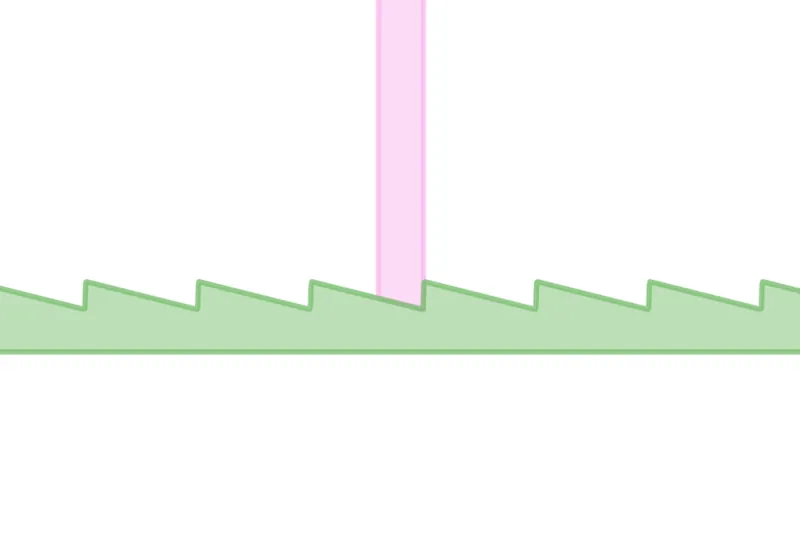
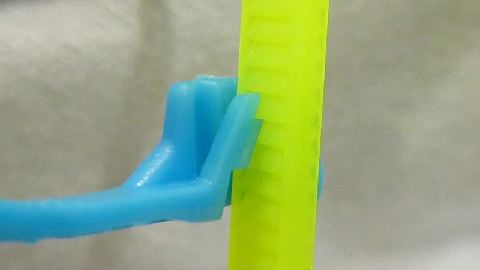

<figure class="eoc-pic eoc-pic-main"><picture><source media="(prefers-reduced-motion: reduce)" srcset="../media/linear-ratchet.still.webp"></picture><figcaption><strong>Animation.</strong> <a href="https://commons.wikimedia.org/wiki/File:Ratchet_Rack_and_Pawl.gif">Ratchet Rack and Pawl</a> by Arglin Kampling, <a href="https://creativecommons.org/licenses/by-sa/4.0">CC BY-SA 4.0</a>, from Wikimedia Commons.</figcaption></figure>
<figure class="eoc-pic"><figcaption><strong>Cross-section.</strong> <a href="https://commons.wikimedia.org/wiki/File:ZipTieCrossSection.JPG">ZipTieCrossSection</a> by Mushrooshi, Public domain, from Wikimedia Commons.</figcaption></figure>

A toothed strip or bar and a catch ([pawl](../glossary.md#pawl)) that let it slide one way only, locking at each tooth, as in a cable tie, a snowboard-binding ladder strap or a [ratchet](../glossary.md#ratchet) jack.

**In plain words:** A strip or bar with saw-like teeth and a springy catch that lets it slide through one way with a zipping or clicking sound but stops it sliding back, like a cable tie. **Proper term:** Linear ratchet (ratchet rack and pawl, toothed rack with pawl).

**Also called:** rack and pawl / ratchet rack and pawl; ratchet bar / ratchet rack; linear ratchet mechanism; cable tie ratchet / zip tie / tie wrap / wire tie / hose tie / Ty-Rap (brand, the original cable tie) (Wikipedia 'Cable tie'); ladder strap and ratchet buckle (snowboard bindings, ski boots); ratchet buckle; ratchet clamp (plastic cable and hose clamps that close in toothed steps) ⚑ [uncertain]; running ratchet acting on a rack (Durley); ratchet jack / lifting jack pawls (Machinery's Handbook, Fig. i); handle ratchet of locking forceps (haemostat or hemostat, artery forceps): a few interlocking teeth on each handle (Wikipedia 'Hemostat'); printed haemostat-style locking forceps and locking pliers are used as small hand clamps (Printables).

## How it works

The strip's teeth are lopsided, with a gentle slope on one side and a steep face on the other. Pushed or pulled the free way, the springy pawl rides up each slope and snaps behind the next tooth; pulled the other way, the pawl catches a steep face and locks (Wikipedia 'Ratchet (device)'). In a cable tie the pawl sits inside the head, so once the tip has passed the pawl the tape can't be pulled back 'unless a large amount of force is applied' (Wikipedia 'Cable tie'). To tighten repeatedly, a second pawl on a lever can push the strip on one tooth per [stroke](../glossary.md#stroke) while the fixed pawl holds it, as in a lifting jack or a snowboard ratchet buckle (Machinery's Handbook; Burton patent US7086122). The same teeth can sit on a pair of scissor-style handles: locking forceps (a haemostat) have 'a series of interlocking teeth, a few on each handle', so the handles click shut one tooth at a time and the tooth you stop at sets the clamping force; locked, the tips press together with about 40 N (9 lbf) (Wikipedia 'Hemostat').

## Parts

From a single piece to a few parts. A cable tie is one moulded piece: a flexible toothed tape and a head with a moulded-in pawl (Wikipedia 'Cable tie'). A rigid linear ratchet is a few parts: a toothed bar (rack), a pawl, a pivot and a spring, inside a guide that stops the bar wandering sideways. A ratchet buckle adds a lever that pushes the strap along and a release catch; a ratchet jack uses two pawls, one on the operating lever to lift and one fixed to hold (Machinery's Handbook).

## Everyday examples

- A cable tie (zip tie) holding cables together
- The toothed ladder strap and ratchet buckle on snowboard bindings and some ski boots
- Handcuffs, whose swinging toothed arm ratchets tighter and can't be opened back (a curved linear ratchet)
- Plastic ratchet clamps for cables and some caulking guns (many caulking guns instead use a tilting plate on a smooth rod) ⚑ [uncertain]

## When to use it

Use a linear ratchet when something must be pulled or pushed tighter in one direction and must not slip back: bundling cables, strapping a part to a frame, closing a clamp or a strap round an object of unknown size, or lifting something in steps with a lever (a ratchet jack). Cable ties are the quickest, cheapest way to hold things together in prototypes and robots. Toothed-bar ratchets also appear in linear clamps and quick-release vices (DT Online), although many quick-grip style bar clamps grip a smooth bar with tilting plates instead (see binding-plate lock). Choose releasable ties, ratchet buckles or clamps with a release tab when you need to undo and redo it. A cable tie pulled tight just behind a hose barb is a cheap, common way to stop a soft tube pulling off (Qosina lists cable ties and Oetiker (brand) ear clamps as the common retention devices); for higher pressure, or a clamp you can undo, use a hose clamp. A haemostat-style locking clamp makes a handy one-handed hobby clamp for holding small parts: one printable version clamps anything from a sheet of paper up to about 8 mm (Printables 'Wide Range Hemostat locking plier', via the Printables API).

## When not to use it

Avoid it when you need smooth, stepless adjustment (use a binding-plate lock, a cam buckle or a screw clamp), when you need to loosen as often as you tighten (use a buckle, hook-and-loop or a screw), when the load must be released gently under tension (use a screw or a winch with a brake), or for permanent structural joints (use screws or bolts). Don't use cable ties to hold heavy loads overhead, anything hot above their rating, or anything that moves and chafes the tie. For a rotating shaft use a rotary ratchet and pawl or a one-way clutch.

## Details

- **What it does (jobs):**
  - stop it moving back (one-way): the strip can go in but not come back out
  - tighten and hold tension: pull the tail of a cable tie or pump a buckle lever and it stays as tight as you left it
  - join and hold: a cable tie bundles or fixes cables and parts together
  - click into set positions: it holds at one-tooth steps along its length
  - lock, and release by hand: releasable ties, ski and snowboard buckles and ratchet clamps have a lever or tab that lifts the pawl
- **Movement:** slide: straight-line travel one way over the length of the toothed strip, in steps of one tooth; curved versions (e.g. the swinging toothed arm of handcuffs) follow an arc
- **Directions it can move (degrees of freedom):** 1: the strip can only slide along its own length, and the pawl limits that sliding to one direction
- **Special behaviour:**
  - one-way (moves freely one way, locks the other): the defining behaviour
  - tensioning (takes up slack and holds): each tooth gained is kept
  - indexing (clicks into set positions): it can only hold at tooth positions
  - hand-release only (locks under load, releases when a person operates it): releasable ties, buckles and ratchet clamps lift the pawl with a tab or lever
  - quick-release: ski-boot and snowboard ratchet buckles let go of the ladder strap with one release lever (Burton patent US7086122)
  - none for standard cable ties once tightened: they are meant to be cut off, not released
- **How it holds:**
  - shape (the parts interlock; [form-fit](../glossary.md#form-fit--force-fit--material-bond)): the pawl hooks behind a tooth
  - spring force (a spring or springy part presses it in place): the pawl is springy or spring-loaded so it always drops into the next tooth
- **Input and output:** Mostly not applicable: as a fastener it just holds. When driven (ratchet jack, ratchet buckle, ratchet feed), back-and-forth lever strokes -> step-by-step one-way linear motion, one or more teeth per stroke, with a second pawl holding during the return stroke (Machinery's Handbook, Fig. i; Burton patent US7086122). It cannot be back-driven: pulling the strip backwards only jams the pawl harder, until the pawl is lifted.
- **Power:** passive (no power needed)
- **Load:** Light to medium for plastic versions and heavy for steel jacks. The strip is strong in pull along its length; cable ties are rated by their loop tensile strength, with small ties for light bundling and heavy-duty ties for more ⚑ [uncertain] (exact ratings vary by maker). Weak points: the pawl can be pried or twisted out, the teeth can [shear](../glossary.md#peel-vs-shear) off if the tie is overloaded, the head can crack if twisted, and side loads that tilt the strip in the head reduce grip ⚑ [uncertain].
- **Play and precision:** noticeable: it can slide back up to one tooth spacing before locking (Wikipedia 'Ratchet (device)'). Two pawls offset by half a tooth halve the step (Machinery's Handbook). A flexible strap tolerates a lot of angle and [misalignment](../glossary.md#misalignment) because it bends; a rigid rack needs a guide that keeps it square to the pawl ⚑ [uncertain].
- **Taking it apart:** Standard cable tie: permanent in practice (cut it off; it can be opened by pushing a small flat object between the pawl and the teeth, but that damages it; Wikipedia 'Cable tie'). Releasable cable ties, ratchet clamps and ski or snowboard buckles: tool-free quick release. Rigid racks and pawls: removable.
- **How often it can be reused:** Standard cable tie: once. Releasable ties: a few times to many times ⚑ [uncertain]. Buckles, jacks and rigid ratchet bars: many times, limited by tooth wear.
- **Sealing:** none
- **Adjustable:** yes, in steps of one tooth: you can always tighten further; loosening needs the pawl to be released (or a new tie)
- **Access needed:** both sides: a cable tie or strap has to pass right round the object, though you tighten and cut it from one side; a rigid rack-and-pawl is built into a mechanism
- **Materials:** Cable ties: usually nylon 6,6; outdoor ties are UV-stabilised black nylon with carbon black (at least 2%, Wikipedia; available only in black, Nelco); heat-stabilised nylon, polypropylene, Tefzel and PEEK for heat or chemicals; blue ties with a metal additive for metal detectors; stainless steel ties for heat and corrosion (Wikipedia 'Cable tie'; Nelco). Buckles and ladder straps: moulded plastics with metal levers ⚑ [uncertain]. Jacks and industrial racks: steel. 3D prints: PLA+ works for light-duty printed cable ties, PETG or nylon for heavier use (Printables 'Zip/Cable Tie'). Coated stainless steel ties are made to prevent galvanic attack where they touch a different metal, such as zinc-coated cable tray (Wikipedia 'Cable tie').
- **Heat, cold, water and wear:** Standard nylon 6/6 ties are rated about -40 °C to 85 °C continuous, heat-stabilised nylon to about 104 °C (Nelco). Sunlight degrades natural (white) nylon ties; use UV-stabilised black ones outdoors (Wikipedia; Nelco). Stainless steel ties are for high heat and corrosive places (Wikipedia). Nylon ties can become [brittle](../glossary.md#brittle--ductile) in cold, dry conditions ⚑ [uncertain]. Printed PLA ties soften from about 60 °C (CNC Kitchen) and [creep](../glossary.md#creep) under constant tension (thrinter creep test), so they loosen over time.

## Making it

- **Ways to make or get it:**
  - off-the-shelf part: cable ties, releasable ties, cable tie mounts, ratchet buckles with ladder straps
  - 3D print (FDM): printable zip ties, ratchet clamps and [print-in-place](../glossary.md#print-in-place) ratcheting capos
  - laser cut: flat racks and pawls in acrylic or plywood for models ⚑ [uncertain]
  - CNC and sheet metal: steel ratchet bars and pawls for jacks and heavy clamps ⚑ [uncertain]
  - injection moulding: how commercial cable ties and ratchet clamps are made ⚑ [uncertain]
- **Printing it in one piece (print in place):** yes: a printable cable tie comes off the bed as one working piece (Printables 'Zip/Cable Tie', 7.2 inches long, about 10 minutes to print), and a ratcheting guitar capo prints in place without supports (Mikolas Zuza's remix of LoboCNC's design, via the Printables API). Designs with a pivoting pawl and a metal spring are 'partly'. Handle-ratchet clamps print in place too: a [self-locking](../glossary.md#self-locking) compliant forceps prints as one piece with a support tab to snap off (Printables 'Print in Place Self-Locking Compliant Foreceps', via the Printables API).
- **Tools:** None to fit a cable tie; side cutters or flush cutters to remove it. A cable tie tensioning tool (tie gun) pulls to a set tension and cuts the tail off flush so no sharp edge is left (Wikipedia 'Cable tie'). Rigid versions need a screwdriver or hex key for the pawl pivot.
- **Difficulty:** easy to moderate: a printed zip tie or a rack and pawl is easy to make, but printed straps are weaker and creep more than moulded nylon ties, so for real use it is easier to buy cable ties

### 3D printing tips

1) Print strips and pawls lying flat, so the strap is made of long continuous lines along its length and the springy pawl bends within the layers, not across them; prints are stronger in one direction (Prusa) and springy arms should not be built standing up in Z (Hubs). 2) Shape each tooth with a steep locking face and a gentle ramp, and angle the locking face so the pull on the strip draws the pawl deeper into the teeth; the rule from ratchet wheels applies: a line at right angles to the locking face should pass on the side that pulls the pawl in (Machinery's Handbook) ⚑ [uncertain] (rule stated for wheels). 3) Make the part that carries the pawl stiff: in the ratcheting capo remix, the original ratchet arm bent under load so the ratchet did not engage at all in the first half of its travel, which the remix fixed (Printables API, model 63610). 4) Material: PLA+ is fine for a light-duty printed cable tie; use PETG or a more flexible material such as nylon for heavier use (Printables 'Zip/Cable Tie'). A tie that holds tension all the time will creep, and PLA creeps the most (thrinter creep test), so re-tighten or use PETG or nylon. 5) Leave at least about 0.3 mm [clearance](../glossary.md#clearance) where the strip slides through the head (Prusa), but not so much that the strip can tilt and slip past the pawl ⚑ [uncertain]. 6) Keep teeth reasonably coarse: tiny teeth made of one or two layers or line widths are weak and round over quickly ⚑ [uncertain]. 7) Add a pull-tab to the pawl if you want to release and reuse it. 8) Nylon absorbs moisture and becomes tougher and more flexible when it has taken some up ⚑ [uncertain], so dry printed nylon ties may be brittle at first. 9) Printed locking forceps with flexing (compliant) joints: one single-piece design works better in PETG than PLA, prints flat side down with no supports, and survived 'over 150' open-and-close cycles; keep the layer seams off its four flexing joints, and treat it as a consumable because the joints eventually fail (Printables 'Hobby Locking Forceps - Single Piece with Compliant Joints', via the Printables API).

### Buying one (off-the-shelf parts)

Search terms: 'cable ties' (standard, miniature, heavy-duty, 'releasable' or 'reusable' cable ties, 'UV-resistant black', 'heat-stabilised', 'metal-detectable', 'stainless steel cable ties' with ball-lock heads), 'cable tie mounts' and 'push-mount cable ties', 'cable tie tensioning tool' (tie gun), 'ratchet buckle' with 'ladder strap' (snowboard binding and ski-boot spares), 'ratchet cable clamp' ⚑ [uncertain]. The common truck 'ratchet strap' is a different device: a lever ratchet that winds webbing onto a spool, covered by the rotary ratchet entry. Cable tie mounts come adhesive-backed or screw-down, or you can print one and glue it on (Printables 'Cable tie mount', via the Printables API); 'releasable' ties have a tab that lifts the pawl (Wikipedia 'Cable tie').

## Rules of thumb

- A linear ratchet that lifts step by step needs two pawls: one on the operating lever does the lifting, and a second, fixed pawl holds the load while the lever is returned (Machinery's Handbook, 27th ed., p. 2089, Fig. i, lifting jack).
- Several pawls offset by a fraction of the tooth [pitch](../glossary.md#pitch) give finer steps from strong, coarse teeth; two pawls differing by half a pitch halve the step (Machinery's Handbook p. 2089).
- The strip can slip back by up to one tooth before it locks (Wikipedia 'Ratchet (device)').
- For outdoor use choose UV-stabilised black nylon with at least 2% carbon black (Wikipedia 'Cable tie').
- Nylon 6/6 cable ties: -40 °F to 185 °F (-40 °C to 85 °C) continuous; heat-stabilised nylon 6/6 to 220 °F (about 104 °C); PEEK -76 °F to 500 °F (Nelco material specifications).
- Cut the tail flush with the head (a tensioning tool does this) so no sharp edge is left (Wikipedia 'Cable tie').
- Many one-handed bar clamps don't use teeth at all: their drive lever and brake are plates with inclined holes that grip the top and bottom edges of a smooth bar and can occasionally slip; US patent 6585243 adds teeth for a positive (ratchet) grip (Google Patents US6585243B1).
- Printed moving parts need about 0.3 mm clearance as a starting point (Prusa knowledge base); don't build springy arms standing up in Z (Hubs).
- As a hose retainer on a barbed fitting, fit the cable tie closely behind the barb; cable ties and ear clamps are the common retention devices that improve the joint's pull-off strength and pressure resistance (Qosina, barbed connector guide).
- Wikipedia's figure of at least 2% carbon black for UV-resistant nylon ties is marked 'citation needed' on that page, so check the maker's datasheet for outdoor ties (Wikipedia 'Cable tie').

## Common failures

1) The tie slips: worn or damaged teeth, a reused tie, or the tail threaded the wrong way up so the teeth miss the pawl ⚑ [uncertain]; use a new tie. 2) The tie snaps or the head cracks, often from overloading, sunlight (UV) or heat: use UV-black or heat-stabilised ties, or stainless ties. 3) Printed ties and clamps loosen over time from creep, especially in PLA: print in PETG or nylon and re-tighten. 4) The pawl doesn't engage because the part holding it bends (as in the original ratcheting capo, via the Printables API): stiffen that part. 5) Too coarse steps for a snug fit: use finer teeth or two offset pawls (Machinery's Handbook).

## Safety

Cut tails leave sharp edges that can cut hands and cables; cut flush or use a tensioning tool (Wikipedia 'Cable tie'). Never put cable ties round a person's or animal's wrist, neck or limb, as they tighten easily but can't be loosened without cutting ⚑ [uncertain]. Over-tightening can crush cables or hoses ⚑ [uncertain]. A lever-driven ratchet (jack or buckle) stores energy, so releasing it under load can let the load or lever jump ⚑ [uncertain]. Locking forceps (haemostats) are surgical instruments; printed or hobby versions are only for holding parts and must never be used on people or animals.

## Related

- Ratchet and pawl (rotary): the same mechanism on a toothed wheel, for winches, reels and wrenches
- Ratchet tie-down strap (ratchet buckle for webbing): despite the name it winds the strap onto a spool with a rotary ratchet, not a toothed strip
- Binding-plate lock (tilting friction plate): grips a smooth bar anywhere, with no teeth, as in most quick-grip bar clamps and many caulking guns; stepless but can slip
- Compliant ratchet ([flexure](../glossary.md#flexure) pawl): one-piece printed ratchets whose pawl is a springy arm, which is how a cable tie head works
- Cam buckle and cam cleat: grip a strap or rope anywhere by a toothed or smooth cam, stepless
- Ladder-lock buckle and guy-line slider: hold straps and cords by friction, easy to adjust both ways
- Hook-and-loop strap (Velcro (brand)): reusable, adjustable anywhere, much weaker
- Hose clamp: the band clamp that holds a hose on a barb; a worm-drive clamp tightens smoothly with a screw and can be loosened, where a cable tie is a one-use, light-duty stand-in
- Rope grab (ascender): a toothed cam that slides up a rope one way and grips the other

## Make it yourself

- [Zip/Cable Tie (Uglylittlebush, Printables)](https://www.printables.com/model/209087-zipcable-tie): A 7.2-inch printable cable tie that still zips like a real one; uses about 0.32 m of filament and about 10 minutes to print; PLA+ for light duty, PETG or nylon for heavier use. Details read through the Printables public API because the web page blocks automated access. *(licence: CC Public Domain)*
- [Hobby Locking Forceps - Single Piece with Compliant Joints (Rustomac, Printables) (URL from Printables API, page not opened)](https://www.printables.com/model/475661-hobby-locking-forceps-single-piece-with-compliant-): One-piece printed locking forceps with flexing (compliant) joints; prints flat with no supports in under 20 minutes and under 10 g; PETG works better than PLA; keep layer seams off the four flexing joints. Read through the Printables public API. *(licence: CC BY-NC-SA (Creative Commons Attribution-NonCommercial-ShareAlike))*
- [Print in Place Self-Locking Compliant Foreceps (PolyVF, Printables) (URL from Printables API, page not opened)](https://www.printables.com/model/1405899-print-in-place-self-locking-compliant-foreceps): Large print-in-place locking forceps inspired by haemostats, with custom supports; snap off the support tab and work the hinge before use. Read through the Printables public API. *(licence: CC BY (Creative Commons Attribution))*
- [Wide Range Hemostat locking plier (John Chiesa, Printables) (URL from Printables API, page not opened)](https://www.printables.com/model/920228-wide-range-hemostat-locking-plier): Printed haemostat-style locking clamp that holds from one sheet of paper up to about 8 mm (0-5/16 in), pivoting on a 3 mm screw. Read through the Printables public API. *(licence: CC BY (Creative Commons Attribution))*
- [Cable tie mount (SammysHP, Printables) (URL from Printables API, page not opened)](https://www.printables.com/model/227957-cable-tie-mount): A small printed cable tie mount: glue it onto a part and pull cable ties through it. Read through the Printables public API. *(licence: CC BY-NC-SA (Creative Commons Attribution-NonCommercial-ShareAlike))*

## Pictures, videos and models

- [Ratchet Rack and Pawl.gif (Wikimedia Commons, by Arglin Kampling)](https://commons.wikimedia.org/wiki/File:Ratchet_Rack_and_Pawl.gif): Animation of a toothed rack (green) moving one way while a pawl (pink) clicks over the teeth and blocks it moving back *(licence: CC BY-SA 4.0)*
- [ZipTieCrossSection.JPG (Wikimedia Commons, by Mushrooshi)](https://commons.wikimedia.org/wiki/File:ZipTieCrossSection.JPG): Photo of a cable tie cut in half, showing the pawl in the head gripping the teeth of the tape *(licence: Public domain)*
- [Linear ratchet mechanism (YouTube, thang010146 / Nguyen Duc Thang)](https://www.youtube.com/watch?v=TjOnY8tI9z8): CAD animation of a slider held at different heights by a spring-loaded pawl on a toothed runway *(licence: link only (standard YouTube licence))*
- [Cable tie (Wikipedia)](https://en.wikipedia.org/wiki/Cable_tie): Photos and explanation of cable tie types, materials, tools and history *(licence: text CC BY-SA 4.0; images per file)*
- [US7086122B2 Ratchet-type buckle and snowboard binding (Google Patents)](https://patents.google.com/patent/US7086122): Patent drawings of a ladder strap with saw-tooth teeth, the driving lever, the holding pawl and the release *(licence: link only)*

## Needs confirming

⚑ marks something nobody has confirmed yet: a fact the research could not confirm from a source, a finder value that is a best guess, or an open point from the research notes. Corrections are welcome (see `research/needs-confirming.md`).

- ⚑ 20 sentences on this page marked [uncertain].
- ⚑ Finder value `usual_process` = off-the-shelf part (best guess): first-listed process is off-the-shelf, but `print_in_place` is yes
- ⚑ Research note: *Linear ratchet*: tie-down ratchet straps wind webbing on a spool with a rotary ratchet, so they are not linear ratchets; most quick-grip bar clamps have no teeth and use a tilting binding plate (see *Binding-plate lock*). The entry explains this; the outline description should be updated to match.
- ⚑ Research note: *Linear ratchet* (8): Wikipedia marks the 2% carbon-black figure for UV-resistant ties 'citation needed' (now noted); the haemostat-style printed clamps are worded neutrally because the Printables descriptions don't say they ratchet. Wikipedia *Cable tie*'s opening names a brand that looks like vandalism; not used. *Shock-corded sectional pole* (152) and *Ratchet tie-down strap* (153) link to *Wire-rope terminations* as weak fits, with reasons that say when they apply.

## Sources

- <https://en.wikipedia.org/wiki/Ratchet_(device)>
- <https://en.wikipedia.org/wiki/Cable_tie>
- <https://en.wikipedia.org/wiki/Handcuffs>
- <https://commons.wikimedia.org/wiki/File:Ratchet_Rack_and_Pawl.gif>
- <https://commons.wikimedia.org/wiki/File:ZipTieCrossSection.JPG>
- <https://theswissbay.ch/pdf/Books/Survival/Workshop/Machining%20and%20Machinery/Machinery's%20Handbook%20(27.8)/26663_yl.pdf>
- <https://ecommons.cornell.edu/server/api/core/bitstreams/809167fc-7cef-4c99-a0a1-60a708dede4f/content>
- <https://www.nelcoproducts.com/cable-ties-materials-specifications/>
- <https://patents.google.com/patent/US7086122>
- <https://patents.google.com/patent/US6585243B1/en>
- <https://wiki.dtonline.org/index.php/Ratchet>
- <https://www.youtube.com/watch?v=TjOnY8tI9z8>
- <https://www.printables.com/model/209087-zipcable-tie>
- <https://api.printables.com/graphql/>
- <https://help.prusa3d.com/article/modeling-with-3d-printing-in-mind_164135>
- <https://www.hubs.com/knowledge-base/how-design-snap-fit-joints-3d-printing/>
- <https://www.cnckitchen.com/blog/comparing-pla-petg-amp-asa-feat-prusament>
- <http://thrinter.com/creep-abs-pla-petg-alloy-910/>
- <https://en.wikipedia.org/wiki/Hemostat>
- <https://www.qosina.com/blog/how-to-select-the-correct-barbed-connector-for-your-single-use-system>
- <https://api.printables.com/graphql/ (models 475661, 1405899, 920228 and 227957, read 2026-10-06)>
