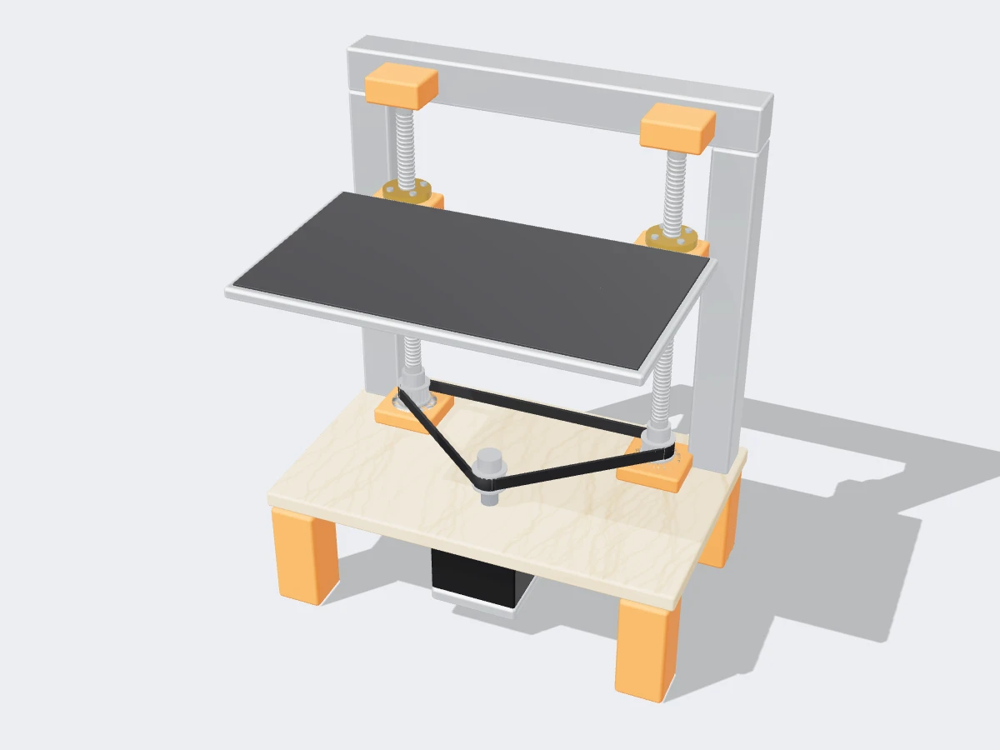

<figure class="eoc-pic eoc-pic-main"><picture><source media="(prefers-reduced-motion: reduce)" srcset="../media/drawn/linked-lead-screws.svg"></picture><figcaption><strong>Animation.</strong> Diagram drawn for the encyclopaedia from the research notes. ⚑ Needs confirming: a drawing can simplify or get details wrong; a real photo or a better diagram is welcome.</figcaption></figure>
<figure class="eoc-pic"><figcaption><strong>Render.</strong> A 3D model made for the encyclopaedia, not a photo: a stand-in until a good real photo is found. ⚑ Needs confirming: a model can simplify or get details wrong; a real photo is welcome.</figcaption></figure>

Linked lead screws are two or more screws, each with a nut fixed to the part being lifted, that are tied together by a closed toothed belt, a chain or shafts and bevel gearboxes and turned by one motor, so they can never get out of step and the bed, gantry or platform stays level as it moves.

**In plain words:** Two or more long screws that lift something, all turned together by one motor through a toothed belt loop, a chain or a line of shafts and corner gearboxes, so every corner of a printer bed, machine gantry or lifting platform goes up and down by exactly the same amount. **Proper term:** Linked lead screws (mechanically synchronised lead screws; Z sync belt; synchronised screw jack system).

**Also called:** Z sync belt, Z-sync, Z axis sync belt, dual Z belt, belt-synchronised dual Z (Printables model titles; Reddit r/3Dprinting); dual Z axis with one motor and a timing belt (Reddit r/3Dprinting 'Dual Z-Axis advice'; EEVblog forum); belt-driven dual leadscrew (Whadda forum, K8200 upgrade); mechanically synchronised screw jacks, screw jack system, multi-point lifting system, H-configuration with four screw jacks (ZIMM wiki); T-type or T-shaped bevel gearbox, right-angle gearbox, connecting shaft, line shaft (ZIMM wiki); GT2 closed (endless) timing belt, GT2 20T pulley (Printables 229071).

## How it works

Each screw turns in a nut fixed to the moving part, so one turn of the screw moves that corner by the screw's lead (see Lead screw and nut). When every screw carries a pulley with the same number of teeth and one closed toothed belt wraps them all, the belt can't slip, so every screw turns exactly the same amount and every corner moves the same distance; the motor drives either one of the screws or the belt directly (Whadda forum; LightBurn forum). In industrial screw-jack systems one central motor drives connecting shafts, and a right-angle bevel gearbox at each jack turns the drive down into the jack, so 'all gearboxes are forced to move in exact synchronism' (ZIMM wiki). This is the mechanical alternative to giving each screw its own motor, which can lose sync unless the firmware re-levels it (EEVblog forum; see Several motors driving one load).

## Parts

A small assembly that acts as one unit: two to four lead screws (or screw jacks) with their nuts and top or bottom bearings, one toothed pulley or sprocket on each screw (or a bevel gearbox at each screw), a closed timing belt or chain loop (or connecting shafts with couplings and pedestal bearings), a belt tensioner or [idler](../glossary.md#idler) pulleys, and one drive motor with its own pulley or gearbox (Printables 229071; ZIMM wiki).

## Everyday examples

- 3D printers with two Z screws joined by a belt at the top or bottom of the frame, e.g. the Creality CR-6 SE's factory Z sync belt (Reddit r/3Dprinting 'Cr6 se Z belt'), and belt-sync kits for the CR-10S Pro and Ender 3 (Printables 229071, 313565)
- laser cutters whose bed is lifted by four corner leadscrews joined by one long belt and one motor (LightBurn forum, OMTech 60 W)
- industrial lifting tables, work platforms and stage lifts raised by several screw jacks linked by shafts and bevel gearboxes (ZIMM wiki)

## When to use it

When something wide or heavy must move up and down on two or more screws and stay level: a 3D printer's X gantry or bed, a laser cutter's bed, a CNC gantry, a camera or work platform, a lifting table. One motor and a closed toothed belt is simple, needs only one motor driver and one endstop, and cannot drift out of step the way independent motors can (Whadda; EEVblog; LightBurn: a controller that 'cannot home more than a single motor' makes one strong motor more practical). Shafts and bevel gearboxes do the same job for heavy industrial lifts and keep jacks in step 'without complex electronics' (ZIMM wiki).

## When not to use it

When you want the machine to level itself: give each screw its own motor driver and use firmware levelling such as Klipper's z_tilt or quad gantry levelling, or Marlin's Z stepper auto-alignment (G34) (Reddit r/3Dprinting; see Several motors driving one load). When the screws are far apart and the load heavy, a long thin belt may stretch or skip: use a wide belt, a chain, or shafts and gearboxes (LightBurn forum; ZIMM wiki). For one short screw, a single lead screw and nut is enough. For lifting people or loads people stand under, a home-made linked-screw lift is not suitable; use certified lifting equipment ⚑ [uncertain]. Ball screws or steep-lead screws on a lift without a brake are a poor choice because the load can run down when power is off (ZIMM wiki).

## Details

- **What it does (jobs):**
  - change the kind of motion: the motor's rotation becomes straight-line lifting at every screw
  - line parts up exactly: keeps a bed, gantry or platform level by forcing all screws to turn together
  - change speed or turning force: different pulley sizes or gearbox ratios between motor and screws set the lifting speed and force (Whadda forum; ZIMM wiki)
- **Movement:** slide: the bed, gantry or platform moves in a straight line along the screws, over the length of the screws (e.g. 10 in / 254 mm of lift on a home-built laser bed, LightBurn forum)
- **Directions it can move (degrees of freedom):** 1: the whole platform moves up and down as one; the linking removes the tilt that separate screws would allow.
- **Special behaviour:**
  - motion conversion (rotary to linear): each screw turns the motor's rotation into lifting
  - [self-locking](../glossary.md#self-locking) (holds under load, won't back-drive): only if the screws have a small lead angle; trapezoidal screws below about 2.4° lead angle can stop a moving load by themselves, 2.4-4.5° only hold a load from standstill, and above about 4.5° or with ball screws the load runs back (ZIMM 'self-locking' wiki)
- **How it holds:** not a holding joint (it moves or passes on motion): the screws hold position by thread friction if they are self-locking, otherwise by the motor or a brake (ZIMM wiki)
- **Input and output:** Continuous rotation of one motor -> equal straight-line motion at two to four screws. Ratio: one screw lead of travel per screw turn, times the pulley or gearbox ratio between motor and screws (e.g. a 20-tooth motor pulley driving 24-tooth screw pulleys, Whadda forum; bevel gearboxes of 1:1, 2:1 or 3:1, ZIMM wiki). Shaft arrangement: screws parallel to each other; motor parallel (belt or chain) or at right angles (shaft and bevel gearbox). Efficiency: screw jacks 'around 30%-50%' (Wikipedia 'Jackscrew'), and every extra gearbox, shaft or bearing adds 'small efficiency losses and additional [backlash](../glossary.md#backlash)' (ZIMM wiki). Back-drivable: no for self-locking trapezoidal screws with a small lead angle (vibration can still release static self-locking); yes for steep-lead and ball screws, which need a brake (ZIMM wiki).
- **Power:** powered (needs electricity or another energy source to work or to release, e.g. electromagnet, [solenoid](../glossary.md#solenoid), motor, shape-memory alloy): one motor (or a hand [crank](../glossary.md#crank)) drives all the screws. When power is lost, self-locking screws keep their last position; steep-lead or ball screws can let the load run down unless a brake holds it (ZIMM wiki).
- **Load:** Medium to heavy, set by the screws, nuts and the belt or shafts: on small 3D printers the loads are light (a gantry or bed), while industrial screw-jack systems lift heavy platforms. Strong along the screws (lifting), weak against side loads, which need separate linear guides (see Linear guides). A narrow belt can skip teeth if the load is heavy: a single NEMA 34 motor driving four leadscrews on a laser bed needs 'a much wider belt / pulleys' than small printers and 'dramatically higher belt tension to avoid skipping' (LightBurn forum). Exact capacity depends on the parts chosen ⚑ [uncertain].
- **Play and precision:** Small play: a well-tensioned toothed belt keeps the screws in step and cannot slowly [creep](../glossary.md#creep) out of sync; a slack belt gives backlash and a skipped tooth puts one corner out by one tooth's worth of screw rotation ⚑ [uncertain]. Each added gearbox, shaft and bearing adds backlash (ZIMM wiki). Warped or bent screws make the platform wobble: on one laser the platform 'moves in a gentle 1 mm circle' as the screws turn (LightBurn forum). [Misalignment](../glossary.md#misalignment) is poorly tolerated: 'Even small misalignments lead to stresses in the system', so all parts must be mounted 'exactly at the same height and in precise alignment' (ZIMM wiki); couplings 'compensate minor misalignments' (ZIMM wiki).
- **Taking it apart:** removable: belts, pulleys, couplings and shafts come apart with hex keys; the screws must be set level again before re-tightening (EEVblog forum)
- **How often it can be reused:** many times
- **Sealing:** none
- **Adjustable:** yes: to level the platform, loosen one screw's pulley (or coupling), turn that screw alone until its corner is at the right height, then tighten again (EEVblog forum); belt tension is adjusted with a tensioner or idler (Printables 51065, 443355). Once tightened, the corners stay in that relation.
- **Access needed:** end of a tube or shaft: pulleys or gearboxes fit on the ends of the screws, usually under the bed or at the top of the frame (Printables 229071)
- **Materials:** Screws: steel trapezoidal (Acme) lead screws or ball screws with bronze, brass or plastic nuts; pulleys: aluminium (GT2) or printed; belts: rubber or polyurethane timing belts with fibre cords (Printables 229071); screw-jack systems: steel and cast-iron gearboxes and steel shafts (ZIMM wiki). The moving platform can be aluminium extrusion, steel, wood or plastic.
- **Heat, cold, water and wear:** Dust, swarf and debris in the belt teeth make it skip (LightBurn forum); cover belts on machines that make chips. Rubber belts stretch slowly and need re-tensioning, and heat near a printer's heated bed or enclosure softens printed tensioners ⚑ [uncertain]. Vibration and shock can release the static self-locking of trapezoidal screws (ZIMM wiki). Lubricate screws and nuts; dry or dirty screws raise friction and the motor may skip steps ⚑ [uncertain].

## Making it

- **Ways to make or get it:**
  - off-the-shelf part: lead screws and nuts, GT2 pulleys, closed timing belts, idlers, screw jacks, bevel gearboxes, couplings and shafts
  - 3D print (FDM): belt tensioners, idler brackets, pulley mounts and lead-screw sync indicators (Printables 51065, 443355, 313565, 145796)
  - CNC: frames, motor plates and pulley brackets for larger machines
  - sheet metal: mounting brackets for screw jacks and gearboxes
- **Printing it in one piece (print in place):** no: the screws, pulleys and belt are bought parts; only brackets, tensioners and covers are printed
- **Tools:** Hex keys for pulley grub screws, couplings and tensioner bolts; blocks or a ruler to set every corner at the same height before tightening the pulleys; a belt tensioner or idler (Printables 51065, 443355); for screw-jack systems, spanners and alignment tools to mount every gearbox, shaft and bearing at the same height (ZIMM wiki).
- **Difficulty:** moderate: a belt kit for a 3D printer is a common bolt-on upgrade, but you must set all corners level before tightening the pulleys, choose the right belt length and tension it correctly; large platforms need wider belts or industrial gearboxes and precise alignment (EEVblog; LightBurn; ZIMM wiki)

### 3D printing tips

Printed parts here are brackets and tensioners, not the screws or pulleys: print them stiff ('Print it with 4 [perimeters](../glossary.md#perimeters), 5 layers top and bottom, and at least 40% infil. These are mechanical parts for your printer and rigidity matters', Printables 313565). A printed tensioner usually carries a ball bearing (e.g. a 608) or toothless idlers pressing on the belt, held with M3 or M4 screws and T-nuts (Printables 443355, 51065). Design tensioners to adjust: one maker needed less tension than the original design and made a lower-tension version (Printables 51065). Keep the belt in one plane level with all the pulleys so it doesn't climb off; a design that mounts the pulleys on top of flipped screw brackets avoids pulling the screw tops sideways unevenly (Printables 229071). A printed pointer clipped to each 8 mm screw shows at a glance whether the screws are still in step (Printables 145796). Avoid PLA near heated beds or hot enclosures, where it creeps under belt tension ⚑ [uncertain].

### Buying one (off-the-shelf parts)

Search terms: 'Z sync belt kit', 'dual Z belt kit', 'GT2 closed loop timing belt 6 mm' in the required length (e.g. about 1200-1600 mm for a CR-10 Max layout, 760 mm for a CR-10S Pro, Printables 229071), 'GT2 20T pulley 8 mm bore' (to fit an 8 mm lead screw), 'GT2 toothless idler', 'GT2 16T toothed idler', '608 bearing' for a printed tensioner, 'T8 lead screw' or 'trapezoidal lead screw and brass nut', 'ball screw' (needs a brake for lifting), 'flexible shaft coupling', 'screw jack' (trapezoidal or ball screw), 'T-type bevel gearbox' or 'right-angle gearbox 1:1', 'connecting shaft' and 'split-shell coupling', 'pedestal bearing' (ZIMM wiki), 'motor with holding brake'. For chain linking: 'roller chain sprocket' sized to the screw shaft and an endless chain with a tensioner ⚑ [uncertain].

## Rules of thumb

- Same teeth on every screw: give every screw a pulley with the same number of teeth (or diameter) so they all turn at the same speed; the motor pulley can be different to change the speed, e.g. 20 teeth on the motor and 24 on the screws (Whadda forum, https://forum.whadda.com/t/k8200-dual-leadscrew-z-axis-upgrade/12184).
- Level first, then tighten: level the moving axis before first power-up, align and mark the couplings so you can see if one slips, power up with one coupling loose, jog 1 mm and back, then tighten it (EEVblog forum, https://www.eevblog.com/forum/3d-printing/ender-3-max-with-crealitys-dual-z-motor-upgrade-wont-home-consistently/msg3939151/). The same applies to belt pulleys.
- Why a belt: two motors on one driver can lose sync ('Any overload, excessive acceleration or binding will cause loss of sync, resulting in a Z axis jam', EEVblog forum); with one motor and a belt, 'The belt version simply and absolutely prevents this' (Whadda forum). Some makers report two motors on one driver working well (Reddit r/3Dprinting, https://www.reddit.com/r/3Dprinting/comments/1bpuytx/dual_zaxis_advice/); both are experience reports.
- Feed the drive in the middle: 'A central power input in the middle of a long shaft line is often more favourable than feeding in from just one end'; use as few gearboxes, shafts and bearings as possible, since each adds losses and backlash; mount every part at exactly the same height and in line (ZIMM, https://zimm.com/wiki/how-are-multiple-screw-jacks-mechanically-synchronised/).
- Bevel gearboxes along a shaft line: T-shaped gearboxes take the drive off the central shaft at 90° into each jack; ratios of 1:1, 2:1 and 3:1 are common, and turning a gearbox through 180° reverses the output direction (ZIMM, https://zimm.com/wiki/what-is-a-bevel-gearbox-and-where-is-it-used/).
- Holding the load without power: trapezoidal screws are dynamically self-locking below about 2.4° lead angle, only statically self-locking at about 2.4-4.5°, and not self-locking above about 4.5°; ball screws are never self-locking and 'always require an external brake'; vibration or shocks can release static self-locking, so safety-critical lifts add a motor brake, safety nut or limit switches (ZIMM, https://zimm.com/wiki/what-is-self-locking-in-screw-jacks-and-when-is-it-important/).
- Belt size for heavy platforms: a big motor driving four corner screws needs a wider belt and pulleys than a small printer's and much higher tension to stop it skipping, and swarf or debris in the belt teeth makes it skip (LightBurn forum, https://forum.lightburnsoftware.com/t/best-z-axis-setup/190040).
- Screw jacks are inefficient: 'around 30%-50%' because of thread friction (Wikipedia, https://en.wikipedia.org/wiki/Jackscrew), so size the single motor for the friction of all screws together, not just the weight.

## Common failures

(1) Corners out of level after assembly: pulleys tightened before the axis was set level; loosen one pulley, level, re-tighten (EEVblog forum). (2) Belt skips teeth: too little tension, too narrow a belt for the load, or debris in the teeth (LightBurn forum). (3) Axis jams or the motor stalls near one end: the belt too tight or out of line, binding screws, or misaligned brackets; one printer only homed with the sync belt removed (Reddit 14tvq4s); 'Even small misalignments lead to stresses in the system' (ZIMM wiki). (4) Platform wobbles in a small circle as it moves: bent or warped screws (LightBurn forum). (5) Wrong belt length, hard to buy in odd sizes: designs with adjustable idlers or a 'belt expander' accept a range of lengths (Whadda forum; Printables 229071). (6) The platform drifts down with power off: screws not self-locking and no brake (ZIMM wiki). (7) Motor too weak for several screws: jack screws are only about 30-50% efficient (Wikipedia 'Jackscrew'), and the one motor drives the friction of every screw (Whadda forum, 'Does the single Z motor cope ok with running 2 lead screws?').

## Safety

LOSS OF SYNC: a skipped belt tooth, a slipped pulley grub screw or a loose coupling leaves one corner higher than the others; the axis can then jam and strain the frame and screws ('Any overload, excessive acceleration or binding will cause loss of sync, resulting in a Z axis jam and excessive stress on the mechanism', EEVblog forum). Mark the pulleys or fit a pointer on each screw so a slip is easy to see (EEVblog; Printables 145796). A sync belt fitted badly can also jam the axis: one printer stuck when homing with a sync-belt mod and homed fine with the belt removed (Reddit r/3Dprinting 'Tronxy X5sa Pro Gets stuck when homing'). FALLING LOADS: lifting platforms need self-locking screws or a brake; ball screws and steep-lead screws are not self-locking and the load can run down when power is lost, and vibration can defeat static self-locking, so critical lifts add a motor brake, safety nut and limit switches (ZIMM 'self-locking' wiki). Never work under a raised platform held only by its screws ⚑ [uncertain]. PINCH POINTS: belts, pulleys and the moving bed or gantry trap fingers; switch off before adjusting, and guard exposed belts and shafts ⚑ [uncertain].

## Related

- Lead screw and nut (incl. anti-backlash nut): one screw on its own; this entry links several
- Ball screw: a low-friction screw that is never self-locking, so a linked ball-screw lift needs a brake
- Belt drives (timing, round and V-belt) and Belt tensioner (spring-loaded idler): the belt and tensioner that do the linking
- Chain and sprocket drive: the chain version of the link, stronger for heavy loads
- Bevel gears (incl. mitre and crown gears), and Bevel splitter and [counter-rotating](../glossary.md#counter-rotating) drive (T-gearbox): the right-angle gearboxes used in screw-jack systems
- Line shaft and power take-off: one long shaft feeding several outputs, as in a screw-jack shaft line
- Several motors driving one load (dual-motor drive, dual-motor gantry): the alternative of one motor per screw with electronic or firmware levelling
- Rack and pinion: two racks tied to pinions on one shaft keep two sides of a gantry in step
- Scissor [linkage](../glossary.md#linkage) (lazy tongs, scissor lift): another way to lift a platform level
- Linear guides: carry the side loads that lead screws should not take

## Make it yourself

- [CR-10s Pro - CR-10 Max z-sync - various belt length possible (Printables 229071; URL from Printables API, page not opened)](https://www.printables.com/model/229071-cr-10s-pro-cr-10-max-z-sync-various-belt-length-po): Printed parts and a shopping list (GT2 20T 8 mm bore pulleys, idlers, closed GT2 belt of about 1200-1600 mm) to link two Z lead screws with one belt *(licence: CC BY (Creative Commons Attribution))*
- [Dual Z Belt Tensioner - Ender CR Neptune Kobra Aquila Gemini XY (Printables 443355; URL from Printables API, page not opened)](https://www.printables.com/model/443355-dual-z-belt-tensioner-ender-cr-neptune-kobra-aquil): A printed tensioner with a 608 bearing that keeps the sync belt tight between two lead screws, for many common printers *(licence: CC BY-NC (Creative Commons Attribution-NonCommercial))*
- [Z-Sync Belt Tensioner (Printables 51065; URL from Printables API, page not opened)](https://www.printables.com/model/51065-z-sync-belt-tensioner): Adjustable printed tensioner using two GT2 toothless idlers, with a lower-tension version and Fusion 360 file *(licence: CC BY (Creative Commons Attribution))*
- [Ender 3 v2 Dual Belt Z (Printables 313565; URL from Printables API, page not opened)](https://www.printables.com/model/313565-ender-3-v2-dual-belt-z): Conversion parts that add a belt-linked second Z screw to an Ender 3 V2 *(licence: CC BY (Creative Commons Attribution))*
- [Lead Screw Arrow - Z Hight / Sync Indicator (Printables 145796; URL from Printables API, page not opened)](https://www.printables.com/model/145796-lead-screw-arrow-z-hight-sync-indicator): A pointer that clips on an 8 mm lead screw so you can see if the screws are still in step or a motor is losing steps *(licence: CC BY (Creative Commons Attribution))*

## Pictures, videos and models

- [How are multiple screw jacks mechanically synchronised? (ZIMM wiki)](https://zimm.com/wiki/how-are-multiple-screw-jacks-mechanically-synchronised/): Components of a synchronised screw-jack system (motor, jacks, bevel gearboxes, shafts, couplings, pedestal bearings) with an embedded explainer video *(licence: link only)*
- [What is a bevel gearbox and where is it used? (ZIMM wiki)](https://zimm.com/wiki/what-is-a-bevel-gearbox-and-where-is-it-used/): How T-shaped bevel gearboxes along one shaft take drive off to several screw jacks *(licence: link only)*
- [K8200 dual leadscrew Z-axis upgrade (Whadda forum)](https://forum.whadda.com/t/k8200-dual-leadscrew-z-axis-upgrade/12184): Photos of a 3D printer with two lead screws linked by a timing belt, with the belt tensioner and bearing holder assemblies *(licence: link only)*
- [Best Z-Axis Setup (LightBurn forum)](https://forum.lightburnsoftware.com/t/best-z-axis-setup/190040): Photo of a laser cutter's NEMA 34 motor driving one wide belt round four corner leadscrews, and a photo of swarf in the belt teeth *(licence: link only)*

## Needs confirming

⚑ marks something nobody has confirmed yet: a fact the research could not confirm from a source, a finder value that is a best guess, or an open point from the research notes. Corrections are welcome (see `research/needs-confirming.md`).

- ⚑ 9 sentences on this page marked [uncertain].
- ⚑ Research note: *Linked lead screws* (448): no source found for chain-linked lead screws (kept as a variant, [uncertain]). The ⚑ that K1 and Bambu printers use one motor, a belt and three screws rests on one Reddit comment and is left out. Correction to the drives scope-search write-up: Reddit post 14tvq4s does not say the belt was "too tight or misaligned", only that the printer homed fine once the belt was removed; the entry states it as the post does. Klipper's z_tilt page was cut off when fetched (cited only as a pointer).

## Sources

- <https://zimm.com/wiki/how-are-multiple-screw-jacks-mechanically-synchronised/>
- <https://zimm.com/wiki/what-is-a-bevel-gearbox-and-where-is-it-used/>
- <https://zimm.com/wiki/what-is-self-locking-in-screw-jacks-and-when-is-it-important/>
- <https://en.wikipedia.org/wiki/Jackscrew>
- <https://www.eevblog.com/forum/3d-printing/ender-3-max-with-crealitys-dual-z-motor-upgrade-wont-home-consistently/msg3939151/>
- <https://forum.whadda.com/t/k8200-dual-leadscrew-z-axis-upgrade/12184>
- <https://forum.lightburnsoftware.com/t/best-z-axis-setup/190040>
- <https://arctic-shift.photon-reddit.com/api/posts/ids?ids=1bpuytx>
- <https://arctic-shift.photon-reddit.com/api/comments/search?link_id=1bpuytx&limit=30>
- <https://www.reddit.com/r/3Dprinting/comments/1bpuytx/dual_zaxis_advice/>
- <https://arctic-shift.photon-reddit.com/api/posts/ids?ids=14tvq4s>
- <https://www.reddit.com/r/3Dprinting/comments/14tvq4s/tronxy_x5sa_pro_gets_stuck_when_homing/>
- <https://arctic-shift.photon-reddit.com/api/posts/ids?ids=1lfmebi>
- <https://www.reddit.com/r/3Dprinting/comments/1lfmebi/cr6_se_z_belt/>
- <https://www.klipper3d.org/G-Codes.html>
- <https://marlinfw.org/docs/gcode/G034-zsaa.html>
- <https://api.printables.com/graphql/>
