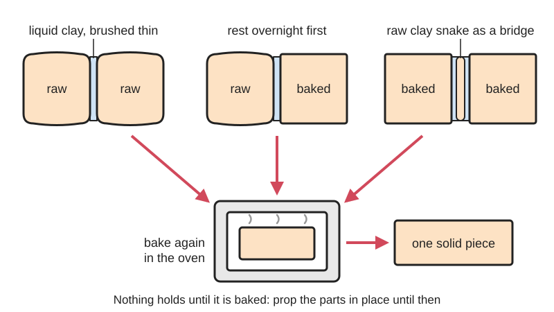

<figure class="eoc-pic eoc-pic-main"><figcaption>Diagram drawn for the encyclopaedia from the research notes. ⚑ Needs confirming: a drawing can simplify or get details wrong; a real photo or a better diagram is welcome.</figcaption></figure>

A thin layer of liquid polymer clay (the same PVC-and-plasticiser material as the clay, without the fillers) is brushed onto the joint between two polymer clay parts, and baking the piece again [cures](../glossary.md#cure) it so the parts become one solid piece.

**In plain words:** Brushing a thin coat of runny oven-bake clay between two pieces of polymer clay (soft or already baked) so that, when the piece goes back in the oven, the two pieces fuse into one. **Proper term:** Liquid-clay bond (bakeable bond with liquid polymer clay; bake-in-stages join).

**Also called:** liquid clay as glue / liquid polymer clay (Wikipedia 'Polymer clay': 'can be used as an adhesive to combine pieces'); bakeable glue, bakeable bond, baked bond, bonding agent (Blue Bottle Tree); vinyl plastisol (the material's proper name; Blue Bottle Tree); oven-bake clay adhesive; Sculpey Bake and Bond / Bake 'n Bond / Sculpey Oven-Bake Clay Adhesive / Oven Bond Adhesive (brand; the same product renamed); Translucent Liquid Sculpey (TLS), Clear Liquid Sculpey (CLS) (brand); FIMO liquid oven-bake liquid gel (brand); Kato Liquid Polyclay, Kato PolyPaste (brand); Cernit Glue, Lucy Clay Glassymer Glue and Gel, PVClay Gel (brand); Genesis Thick Medium (brand; heat-set paint medium, no longer made); raw clay bridge (a thin snake of soft clay between two baked parts); baking in stages, partial baking, rebaking (sculptors' wording) ⚑ [uncertain].

## How it works

Polymer clay is a PVC resin powder in a liquid plasticiser (a plastisol); baking at about 129 to 135 °C makes the resin take up the plasticiser and set solid (Wikipedia 'Polymer clay'). Liquid clay and the 'bakeable glues' are the same plastisol 'without the binders that turn polymer clay into a putty', so they are not real glues at all (Blue Bottle Tree). Brushed into a joint, the liquid wets both surfaces, even baked ones, and when the piece is baked again it cures together with them into one continuous plastic. Nothing holds until it is baked, so the parts have to be supported in place until then; one Sculpey designer leaves a raw-to-baked joint resting overnight first 'so that the plasticizer in all the layers could leach into each other' (Sculpey blog, Oven Bake Clay Adhesive).

## Parts

A few parts: the two polymer clay parts (raw, baked, or one of each), the bonding layer (a liquid clay, a thick bakeable paste or gel, or a thin snake of raw clay used as a bridge between baked parts), and an oven. Sometimes a temporary support (card, foil or a prop) to hold the parts together until baked.

## Everyday examples

- tiny 'salt' crystals or sprinkles fixed onto a miniature clay cracker or pastry (Sculpey blog)
- clay feet added to an already-baked clay trinket tray (Sculpey blog)
- a polymer clay figure sculpted in stages: head baked first, then the body added and baked again
- polymer clay mosaics or coasters on wood or cork bases (Sculpey blog)

## When to use it

When both parts are polymer clay and the whole piece can go back in the oven: adding small details that would otherwise fall off (Sculpey blog), joining delicate raw parts that would squash if pressed hard (Sculpey blog: 'just a drop of the liquid can be placed at the joint'), adding new raw clay to a piece that is already baked, repairing a broken baked piece, and building a big or fiddly sculpture in several bakes so finished parts are not squashed while you work on the rest. Also for covering wood, cork, cardboard or paper with polymer clay (Sculpey blog). Blue Bottle Tree recommends it whenever a strong bond is needed, especially with Premo, Souffle or Kato.

## When not to use it

When the piece cannot be baked again (it has glued-on parts, resin, a magnet or plastic decorations): use a gel superglue instead (Blue Bottle Tree), or a two-part epoxy, which 'can become [brittle](../glossary.md#brittle--ductile) with age and pop off' (Blue Bottle Tree). For metal findings (bails, posts, pins): embed them in the clay instead, because liquid clay does not bond to bare metal (Sculpey FAQ; see Baked-in findings). For air-dry or pottery clay: use the Score-and-slip join. For epoxy putty: it sets by itself without baking (see Epoxy putty). For anything that will hold food or drink: polymer clay is not recommended for food items (Wikipedia 'Polymer clay').

## Details

- **What it does (jobs):**
  - glue or bond: it fuses polymer clay parts into one piece in the oven
  - join and hold: adds small details (salt on a clay cracker, feet on a tray) and assembles a sculpture built in several bakes
- **Movement:** none
- **Directions it can move (degrees of freedom):** 0: once baked the two parts are one rigid (or slightly bendy) piece
- **Special behaviour:**
  - none: it has no lock, release, click or spring action; its only trick is that it stays wet and movable until it is baked
- **How it holds:**
  - [material bond](../glossary.md#form-fit--force-fit--material-bond) (glue, solvent or melting): the liquid clay cures in the oven together with the clay on both sides, much like a weld in plastic
  - shape (the parts interlock; form-fit): only in the raw-clay-bridge and wrap-around versions, where soft clay pressed over or between parts also grips them by shape
- **Input and output:** not applicable
- **Power:** passive (no power needed) in use; it needs an oven (heat) once to cure the joint
- **Load:** light: for jewellery, figures, miniatures and decorations. Blue Bottle Tree's hand test found joints made with a bonding agent 'strong and nearly impossible to break', while some brands' plain raw-to-raw joints could be flicked off with a finger. No published strength figures found ⚑ [uncertain]. The cured joint stays slightly flexible, so it copes with knocks better than brittle glues; FIMO liquid is 'Extremely flexible after hardening' (STAEDTLER), and thin liquid clays can cure rubbery (Blue Bottle Tree)
- **Play and precision:** not applicable
- **Taking it apart:** permanent: once baked the joint can only be broken or cut apart
- **How often it can be reused:** once
- **Sealing:** none (it is not meant as a seal), although a cured joint is waterproof: Sculpey's blog calls clay bonded to cork with it 'completely waterproof'
- **Adjustable:** yes, until it is baked: the parts can be slid into position while the liquid clay is still runny (Sculpey blog); no once baked
- **Access needed:** both sides (the two joining faces must be coated before they are pressed together)
- **Materials:** Joins PVC polymer clay to itself in every combination: raw to raw, raw to baked and baked to baked (Blue Bottle Tree; Sculpey blog). The brand matters: in Blue Bottle Tree's test Fimo Professional bonded well to itself even without liquid clay, Cernit bonded well raw to raw, and Premo, Souffle and Kato bonded poorly unless a bonding agent was used. Sculpey's oven-bake clay adhesive also bonds raw clay to porous things that can go in the oven: wood, cork, cardboard, papier-mâché and heavy paper (Sculpey blog), and bare wood should be baked first at 135 °C for 20 minutes to drive out moisture and sap (Sculpey FAQ). Does not work: smooth metal, glass and other non-porous surfaces ('Clay cannot be bonded to metal or other non-porous surfaces', Sculpey FAQ; wrap or embed instead, see Baked-in findings); air-dry clay, pottery clay or epoxy putty (different materials, see Score-and-slip join and Epoxy putty); anything that cannot take about 130 °C, such as plastic 'crystals', amber, pearls (Blue Bottle Tree) or PLA prints ⚑ [uncertain]
- **Heat, cold, water and wear:** Once cured it behaves like the clay itself: polymer clay is 'strong, durable, and waterproof', and properly baked unsealed clay buttons survive the washing machine and tumble dryer (Blue Bottle Tree, buttons). It stays a little flexible. Underbaking leaves the clay and the joint weak (Blue Bottle Tree). Heat limits are those of the clay; the safety data sheet says not to heat it above 175 °C (Premo SDS). Plasticisers stay in the cured clay and can leach out (Wikipedia 'Polymer clay').

## Making it

- **Ways to make or get it:**
  - hand work in polymer clay (sculpting, jewellery, miniatures) with a home or toaster oven
  - off-the-shelf part: liquid polymer clay or bakeable paste from a craft shop
- **Printing it in one piece (print in place):** no: this is a bond between oven-bake clay parts, not a printed joint
- **Tools:** a small brush, needle tool or toothpick to apply the liquid clay; rubbing alcohol to wipe oils off baked clay before bonding (Blue Bottle Tree); a home or toaster oven with a separate oven thermometer (Sculpey FAQ); card, foil or a prop to hold parts in place until baked; gel superglue instead for baked parts that cannot be baked again
- **Difficulty:** easy: brush, press and bake; the skill is in supporting the parts until baked and in baking fully at the right temperature

### 3D printing tips

not applicable as a printed joint. Where a maker combines prints and polymer clay: printed cutters and texture tools for clay are common, but a PLA print should not be baked with the clay, because PLA softens far below polymer clay baking temperatures ⚑ [uncertain]; bake the clay parts on their own and glue them to the print afterwards with gel superglue or epoxy (see Cyanoacrylate and Two-part epoxy).

### Buying one (off-the-shelf parts)

Liquid polymer clay (translucent, clear or coloured; e.g. Translucent Liquid Sculpey, Clear Liquid Sculpey, FIMO liquid, Kato Liquid Polyclay, PVClay Gel, brands), thick bakeable pastes (Sculpey Oven-Bake Clay Adhesive, formerly Bake and Bond; Kato PolyPaste, brands), Cernit Glue and Lucy Clay Glassymer (brands), an oven thermometer, a soft brush or needle tool, rubbing alcohol, gel superglue (e.g. Loctite Gel Control, Gorilla Glue Gel Superglue, Zap-a-Gap, brands) for parts that cannot be rebaked

## Rules of thumb

- Polymer clay cures at 129 to 135 °C (265 to 275 °F), held for 15 minutes per 6.4 mm (1/4 in) of thickness (Wikipedia 'Polymer clay'); always follow the packet for the brand you use
- Sculpey lists most of its clays at 275 °F for 15 or 30 minutes per 1/4 in, Liquid Sculpey at 275 to 300 °F (135 to 149 °C) for 15 to 30 minutes and Clear Liquid Sculpey at 300 °F (149 °C); turn the oven fan (convection) off when baking liquids (Sculpey FAQ)
- FIMO liquid: 130 °C for 20 minutes (STAEDTLER product page)
- When mixing brands or products, bake at the highest temperature and for the longest time any of them needs (Sculpey FAQ)
- Sculpey Bake and Bond 'doesn't cure fully at the regular temps. You have to heat it quite a bit hotter. Check the label' (Blue Bottle Tree, earring posts)
- Use a separate oven thermometer: oven dials are often wrong (Sculpey FAQ); do not heat polymer clay above 175 °C (350 °F) (Premo safety data sheet, Potterycrafts, March 2022)
- Raw to baked: let the joint rest overnight before baking so the plasticiser can soak across (Sculpey blog, Oven Bake Clay Adhesive); on wood or cardboard let the adhesive soak in for at least 30 minutes until it turns cloudy (same source)
- Baked to baked: rub on a 'seriously thin' layer and put a thin snake of raw clay between the parts as a bridge (Blue Bottle Tree, describing Genesis Thick Medium, no longer made)
- Wipe baked clay with alcohol to remove oils before bonding; any glue sticks only to paint, sealer or mica powder if those are on the surface, so bond bare clay (Blue Bottle Tree)
- Stir liquid clays well before use (Blue Bottle Tree)

## Common failures

1) Parts slide or drop off before the bake, because liquid clay is runny: use a thicker paste (Bake and Bond, PolyPaste) that 'stays put', or prop the parts up (Blue Bottle Tree). 2) Raw-to-baked or baked-to-baked joints pull apart after baking: wipe the baked surface with alcohol first, use a better bonding agent (Fimo Liquid gave the strongest joints in Blue Bottle Tree's test), add a raw clay bridge, or let the joint rest before baking (Sculpey blog). 3) Some brands bond poorly even raw to raw (Premo, Souffle and Kato in Blue Bottle Tree's test): add liquid clay to every joint. 4) Joint stays weak or [peels](../glossary.md#peel-vs-shear): Bake and Bond was not baked hot enough (Blue Bottle Tree), or the whole piece was underbaked; check the temperature with an oven thermometer. 5) Bonding agent put on paint, sealer or mica powder holds only to that coating (Blue Bottle Tree). 6) Ripples in liquid clay from the oven fan (Sculpey FAQ). 7) Thin liquid clays cure rubbery, which feels wrong on an earring back (Blue Bottle Tree). 8) Darkened or bubbling (burnt) clay from an oven that runs hot; white, translucent and light clays discolour most easily, so bake on card stock or parchment and check with a thermometer (Sculpey blog, 6 things to avoid). 9) Underbaked clay is 'softer and more fragile', and brittleness can also come from baking too long (same source).

## Safety

Heat joining: the hazards are the oven, not the liquid. Bake at the temperature on the packet with a separate oven thermometer and good ventilation, such as the cooker-hood fan or an open window (Sculpey FAQ). If clay is overheated or burnt it blackens and can give off hydrogen chloride (hydrochloric acid) vapour, plus carbon monoxide and carbon dioxide; turn off the oven, open the nearest window and get fresh air (Premo safety data sheet; Wikipedia 'Polymer clay'). Sculpey says overheated clay gives off fumes that are 'not acutely toxic' but irritate eyes, nose and mouth (Sculpey FAQ). Never use a microwave, and baking should be done by an adult (Sculpey FAQ). Keep clay off surfaces also used for food unless there is a barrier such as parchment or foil (Sculpey FAQ). Do not use for items that hold or serve food or drink, because plasticisers (some phthalates are endocrine disruptors) remain in the cured clay (Wikipedia 'Polymer clay'). If a joint is repaired with superglue and then rebaked, the breakdown is 'really minor' but the glue weakens; don't bake resin, not even UV resin, which is highly allergenic (Blue Bottle Tree, earring posts). Wash hands after handling clay (Premo safety data sheet).

## Related

- Score-and-slip join: the same idea for water-based pottery and air-dry clay, using the clay thinned with water instead of liquid plastic, and drying instead of baking
- Baked-in findings: how metal loops, pins and posts are held in polymer clay by shape, often with a dip of liquid clay
- Melted plastic weld: joining plastic to itself by melting it, with a soldering iron or hot air instead of an oven
- Solvent welding: joining plastic to itself by dissolving its surface rather than curing a liquid of the same plastic
- Cyanoacrylate (superglue): gel superglue is the choice for baked polymer clay that cannot be rebaked
- Two-part epoxy: an alternative cold glue for baked clay, which can turn brittle with age
- Elastomeric solvent glue (flexible craft glue): often recommended for clay, but Blue Bottle Tree finds it often does not set properly on polymer clay
- Epoxy putty: a two-part modelling putty that sets without baking
- Pinned glue joint: a wire or toothpick across the joint to stop a clay head or limb snapping off
- Wire and foil armature: the skeleton that thin clay parts are built over

## Pictures, videos and models

- [Bonding Polymer Clay to Itself – Testing Bakeable Bonds (The Blue Bottle Tree, Ginger Davis Allman)](https://thebluebottletree.com/bonding-polymer-clay-to-itself-testing-bakeable-bonds/): Photos of test tiles in five clay brands with circles bonded raw-to-raw, raw-to-baked and baked-to-baked using ten bakeable glues, and the results *(licence: link only)*
- [How to Effectively Use Oven Bake Clay Adhesive (Sculpey blog, Amy Koranek, 2022)](https://blog.sculpey.com/how-to-effectively-use-oven-bake-clay-adhesive): Photos of raw-to-raw, raw-to-baked and clay-to-wood, cork, cardboard and paper bonds with Sculpey's bakeable adhesive *(licence: link only)*
- [The Diversity of Liquid Polymer Clay (Sculpey blog, Whitney Gallina)](https://www.sculpey.com/blogs/blog/the-diversity-of-liquid-polymer-clay): Photos of liquid clay used to fix tiny details (salt on a clay cracker) and eye pins, compared with score and slip for air-dry clay *(licence: link only)*
- [What's the Best Glue for Polymer Clay? (The Blue Bottle Tree)](https://thebluebottletree.com/best-glue-for-polymer-clay/): Guide with photos comparing baked bonds (liquid clay, Bake and Bond, PolyPaste) with superglue, epoxy, PVA and E6000 on polymer clay *(licence: link only)*

## Needs confirming

⚑ marks something nobody has confirmed yet: a fact the research could not confirm from a source, a finder value that is a best guess, or an open point from the research notes. Corrections are welcome (see `research/needs-confirming.md`).

- ⚑ 4 sentences on this page marked [uncertain].
- ⚑ Finder value `glue_traits` = fills gaps (best guess): not on the glue lists in the finder tree; traits read from the text
- ⚑ Finder value `bonds_well` = PVC (source uncertain): `materials` is marked ⚑ [uncertain] here: "…as plastic 'crystals', amber, pearls (Blue Bottle Tree) or PLA prints ⚑ [uncertain]…"
- ⚑ Finder value `bonds_poorly` = PLA, wood, paper or card, metal, glass or ceramic (source uncertain): `materials` is marked ⚑ [uncertain] here: "…as plastic 'crystals', amber, pearls (Blue Bottle Tree) or PLA prints ⚑ [uncertain]…"
- ⚑ Research note: *Score-and-slip join* (429) and *Liquid-clay bond* (428): drying air-dry clay: never sun, hairdryer or oven (Art Shed) versus a 200 °F oven with a cracking warning (Sculpey FAQ). Sculpey's table prints 275 °F as 130 °C (the °F values are quoted). No strength figures for any clay join; that PLA can't survive a polymer clay bake has no tested temperature on an opened page in 428 (432 gives 60-65 °C softening from Wikipedia).

## Sources

- <https://thebluebottletree.com/bonding-polymer-clay-to-itself-testing-bakeable-bonds/>
- <https://thebluebottletree.com/best-glue-for-polymer-clay/>
- <https://thebluebottletree.com/polymer-clay-needs-flexible-glue/>
- <https://thebluebottletree.com/securing-polymer-clay-earring-post-backs-whats-the-best-way/>
- <https://thebluebottletree.com/make-polymer-clay-buttons/>
- <https://thebluebottletree.com/can-you-bake-crystals-in-clay/>
- <https://www.sculpey.com/blogs/blog/the-diversity-of-liquid-polymer-clay>
- <https://blog.sculpey.com/how-to-effectively-use-oven-bake-clay-adhesive>
- <https://www.sculpey.com/pages/faqs-1>
- <https://en.wikipedia.org/wiki/Polymer_clay>
- <https://www.staedtler.com/uk/en/products/fimo-modelling-clay-accessories/fimo-accessoires/surface-treatment/fimo-liquid-8050-oven-bake-liquid-gel-m8050/>
- <https://potterycrafts.co.uk/cdn/shop/files/Premo_Sculpey_Polymer_Clay_747a26ae-3aa8-4d8e-a413-1cfe01b669f7.pdf>
- <https://www.sculpey.com/blogs/blog/6-things-to-avoid-when-baking-polymer-clay>
