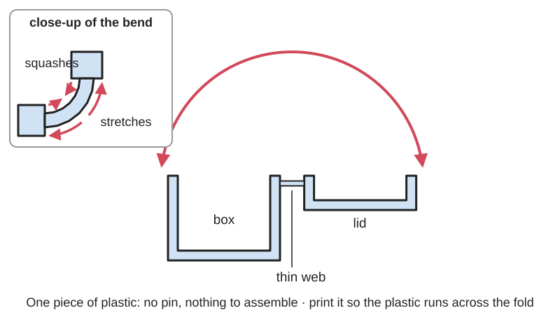
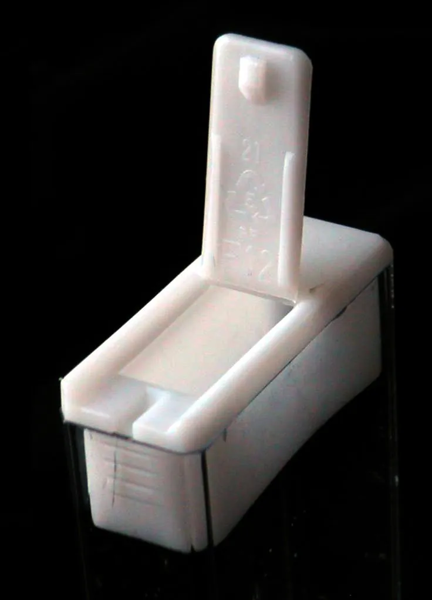
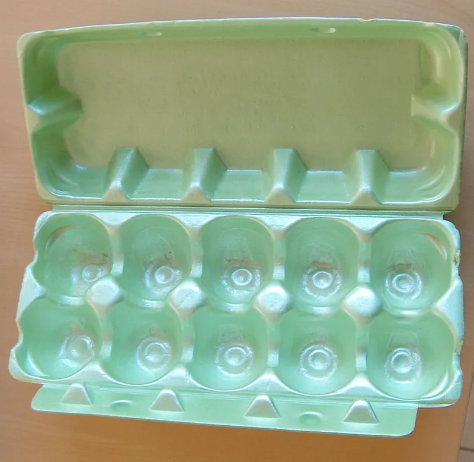
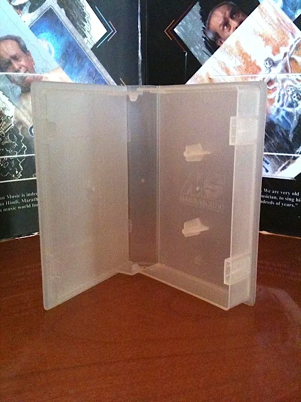

<figure class="eoc-pic eoc-pic-main"><picture><source media="(prefers-reduced-motion: reduce)" srcset="../media/drawn/living-hinge.svg"></picture><figcaption><strong>Animation.</strong> Diagram drawn for the encyclopaedia from the research notes. ⚑ Needs confirming: a drawing can simplify or get details wrong; a real photo or a better diagram is welcome.</figcaption></figure>
<figure class="eoc-pic"><figcaption><strong>How it works.</strong> <a href="https://commons.wikimedia.org/wiki/File:Mint_box_polypropylene_lid.JPG">Mint box polypropylene lid</a> by en:User:Polyparadig, Public domain, from Wikimedia Commons.</figcaption></figure>
<figure class="eoc-pic"><figcaption><strong>Photo.</strong> <a href="https://commons.wikimedia.org/wiki/File:Hartschaum-Eierkarton.jpg">Hartschaum-Eierkarton</a> by User:MarkusHagenlocher, <a href="http://creativecommons.org/licenses/by-sa/3.0/">CC BY-SA 3.0</a>, from Wikimedia Commons.</figcaption></figure>
<figure class="eoc-pic"><figcaption><strong>Photo.</strong> <a href="https://commons.wikimedia.org/wiki/File:MS_Box.jpg">MS Box</a> by Magnasound, <a href="https://creativecommons.org/licenses/by-sa/3.0">CC BY-SA 3.0</a>, from Wikimedia Commons.</figcaption></figure>

A thinned strip of the same plastic that joins two stiff parts so they fold like a hinge, with no pin, no assembly and nothing to wear out or lose.

**In plain words:** A thin, bendy strip of plastic that joins a lid to its box so the lid folds open and shut, all made as one piece with no pin, like the flip-top cap on a ketchup bottle or the lid of a Tic Tac box. **Proper term:** [Living hinge](../glossary.md#living-hinge) (integral hinge).

**Also called:** integral hinge (term used in the MIT course document 'Design Issues on Living Hinges'); live hinge (name used by the BOSL2 OpenSCAD library); [flexure](../glossary.md#flexure) bearing or flexure hinge (the wider engineering family it belongs to; Wikipedia 'Flexure bearing'); flip-top cap hinge, flip-top closure (packaging term) ⚑ [uncertain]; film hinge ⚑ [uncertain]; flat hinge, double hinge and butterfly hinge (common living-hinge shapes for 3D printing; MatterHackers names flat, butterfly and kerf-bend hinges); kerf-bend living hinge (the laser-cut plywood or acrylic version made by a pattern of cuts; covered in its own entry '[Kerf](../glossary.md#kerf) bending').

## How it works

The hinge is made so thin that folding it only stretches the outer surface of the plastic a little, so the lid can fold through up to 180 degrees and back without breaking (Protolabs 'Living Hinge Basics for Injection Molding'). In a moulded polypropylene hinge the plastic's long molecules are lined up across the hinge as the melt flows through the thin gap; flexing the hinge a few times straight after moulding stretches (cold-draws) the web two to three times, which makes it much stronger and gives it an almost unlimited fold life (MIT 'Design Issues on Living Hinges'). Because the hinge is just bent material there is nothing to rub, rattle or lose, but it only lasts in plastics that tolerate repeated bending, mainly polypropylene and polyethylene (Wikipedia 'Living hinge').

## Parts

Single piece: two stiff parts (for example a box and its lid) joined by a thin web (the hinge), often with rounded edges and small shoulders beside the web so it bends in the right place (MIT 'Design Issues on Living Hinges'). Usually paired with a snap or clip moulded into the same part to keep the lid shut.

## Everyday examples

- The lid of a Tic Tac mint box (Wikipedia 'Living hinge'; Wikimedia Commons photo)
- Flip-top caps on ketchup, shampoo and sauce bottles (Wikipedia lists bottle caps)
- Egg cartons, pill boxes with a lid for each day, and clamshell takeaway food containers (Wikipedia)
- Plastic cassette and video-tape cases (MIT guide mentions VCR cassette cases; Wikimedia Commons 'MS Box')

## When to use it

Use a living hinge when you want a lid, flap, cover or clip that folds and stays attached, made in one piece with no pins or assembly: boxes, cases, cable clips, folding packaging, origami-style folding shapes, and small covers over buttons or ports. It is ideal when you can mould in polypropylene, or print in PP, nylon, TPU or PETG, and when the part must be cheap, light, rattle-free and impossible to lose. For printed parts it suits things folded occasionally or only a few dozen times, or a part that is folded once into shape and then fixed (a 'fold-up' box).

## When not to use it

Avoid it when the hinge must carry a real load (use a pin, knuckle or piano hinge), when a printed part will be opened many times a day (use a [print-in-place](../glossary.md#print-in-place) pin hinge or a geared hinge), when the only material you can use is [brittle](../glossary.md#brittle--ductile) (PLA, standard SLA resin or filled plastics), when you need a precise, repeatable pivot for an instrument (use a flexure hinge or a bearing), or when the part will sit in strong sunlight or harsh chemicals without a UV-stabilised grade. To make stiff sheet such as plywood or acrylic bend, use kerf bending instead.

## Details

- **What it does (jobs):**
  - let it move (turn, slide or bend): folds a lid, flap or cover open and shut
  - join and hold: keeps the lid attached to the box so it can't get lost (the lid is held shut by a separate snap or latch, not by the hinge)
- **Movement:** flex: folds (rotates by bending) through anything from 1 to 180 degrees (Protolabs 'Living Hinge Basics for Injection Molding'). There is no fixed pin, so the fold line moves slightly as it bends.
- **Directions it can move (degrees of freedom):** 1 intended: folding about the hinge line. The thin web also lets the lid twist a little, which is why lids with snap latches can tear at the ends of the hinge (MIT 'Design Issues on Living Hinges').
- **Special behaviour:**
  - none: a plain living hinge simply folds; it does not lock, click or limit force
  - [over-centre](../glossary.md#over-centre) (snaps past a point and stays): only in [bistable](../glossary.md#bistable) designs, where the hinge and a springy strip are shaped to snap fully open or fully shut, as on many flip-top caps ⚑ [uncertain] (see the entry 'Bistable [compliant mechanism](../glossary.md#compliant-mechanism)')
- **How it holds:**
  - not a holding joint (it moves or passes on motion): it lets two parts fold; the lid stays attached only because it is the same piece of plastic, and a separate snap or latch holds it shut
- **Input and output:** not applicable
- **Power:** passive (no power needed)
- **Load:** light: carries the weight of a lid and the pull of opening it. Once its molecules are lined up it is strong when pulled across the hinge, but weak against tearing and twisting, which start cracks at the hinge ends (MIT 'Design Issues on Living Hinges'). Not for load-bearing doors or arms; use a pin hinge instead.
- **Play and precision:** none: there is no play or rattle because nothing slides. It is not a precise pivot, though: the fold line moves as it bends, so the lid's exact closed position is set by the rim or latch, not by the hinge ⚑ [uncertain]. It tolerates small [misalignment](../glossary.md#misalignment) because the thin web can twist slightly (MIT guide).
- **Taking it apart:** permanent: box, hinge and lid are one piece, so the lid can only be removed by cutting or tearing the hinge
- **How often it can be reused:** not applicable to taking apart (it never comes apart). Fold life ranges from effectively unlimited to a few dozen folds: tests on moulded homopolymer polypropylene hinges were stopped after about a million flexes without failure, and one hinge survived 900,000 flexes including 300,000 at -28 °C (MIT 'Design Issues on Living Hinges'); 3D-printed hinges last tens to hundreds of flexes (Fictiv), for example about 25 folds for one FDM hinge and 30-50 for SLS nylon (Hubs).
- **Sealing:** none: the hinge itself does not seal; a lid seals, if at all, with a separate rim or plug that snaps into the opening ⚑ [uncertain]
- **Adjustable:** No: [stiffness](../glossary.md#stiffness) and fold angle are fixed by the hinge's thickness, length and material. The only 'adjustment' is training it by flexing it while warm straight after moulding or printing, and cooling it in the closed position if you want it to rest closed (MIT guide; Hubs).
- **Access needed:** not applicable: it is part of the moulded or printed part
- **Materials:** Best: polypropylene (PP), especially homopolymer and random-copolymer grades, then polyethylene (PE) (Wikipedia; MIT guide; Fictiv); impact-copolymer PP is recommended for cold use. Fillers such as talc, mica and glass fibre ruin hinge life (MIT guide). Harder or clear plastics such as K-Resin (SB) can work if the hinge is bent warm as it comes off the press (Protolabs). ABS is also used for moulded hinges (Wikipedia). For 3D printing: nylon (PA12 or PA11) in SLS or MJF gives the best printed hinges (Protolabs; Hubs); FDM hinges suit nylon, PP, TPU or TPE (Hubs; MatterHackers) and PETG (BYU CMR); MatterHackers says ABS and PLA are unsuitable, but thin PLA hinges printed flat work in boxes that are opened now and then (Printables 'Book box with living hinge'; Prusa forum). Urethane casting resins made for living hinges also exist (Fictiv). Plywood and acrylic can only 'hinge' with kerf-cut patterns (Wikipedia; see 'Kerf bending').
- **Heat, cold, water and wear:** Polypropylene hinges keep working in the cold: one hinge survived 300,000 flexes at -28 °C, although impact-copolymer PP is recommended where the part must also survive knocks in the cold. Sunlight (UV) and strongly oxidising chemicals shorten a PP hinge's life because the thin, stretched web is easily attacked; parts for outdoor, hot or wet use need specially stabilised grades (MIT 'Design Issues on Living Hinges'). Printed PLA hinges soften from about 60 °C and PETG from about 80 °C (CNC Kitchen), so a PLA box in a hot car can deform. PLA [creeps](../glossary.md#creep) if left bent (thrinter creep test), so a printed lid stored open may take a set.

## Making it

- **Ways to make or get it:**
  - injection moulding: the normal way; box, hinge and lid are moulded as one piece in one shot (Wikipedia; MIT guide)
  - 3D print (FDM): fine for prototypes and boxes opened occasionally; best in PP, nylon, TPU or PETG (Hubs; BYU CMR)
  - 3D print (resin): material jetting with simulated polypropylene works (Hubs); standard SLA resins are brittle under repeated bending (Hubs snap-fit guide). Powder-bed nylon (SLS, MJF) gives the best printed hinges (Protolabs)
  - laser cut: polypropylene sheet can be cut into hinged parts (BYU FlexLinks are cut from PP sheet); plywood and acrylic need a kerf-bend cut pattern instead (Wikipedia; separate entry)
  - other: stamping, blow moulding, extrusion and machining of PP (MIT guide), thermoforming (Wikipedia) and urethane casting (Fictiv)
- **Printing it in one piece (print in place):** yes: the hinge prints as part of the box in one go, usually lying flat so the hinge is the first two thin layers and the box folds up afterwards (Printables 'Book box with living hinge'; BOSL2 living_hinge_mask), or standing up so the hinge axis is vertical (Hubs). No added parts are needed.
- **Tools:** none: it is made as part of the moulded or printed part. Warmth helps when first flexing a printed hinge: boiling water (Hubs), a warm print bed (Prusa forum) or taking the print off the bed while still warm (BYU CMR origami flasher)
- **Difficulty:** easy to moderate: a printed hinge is just a thin section and prints in one piece, but making it last more than a few dozen folds needs a bendy material (PP, nylon, TPU or PETG), the right print orientation and a few test prints; a hinge that lasts for years in daily use really needs injection-moulded polypropylene

### 3D printing tips

1) Choose the material first: polypropylene (PP) flexes best but warps badly and only sticks to a PP build sheet or PP packing tape, so use a 5-10 mm brim and an enclosure if you can (Prusa knowledge base 'Polypropylene (PP)'); nylon, TPU or TPE are the other good choices (Hubs; MatterHackers), and PETG works (BYU CMR). PLA works only for hinges folded now and then, such as a box opened occasionally (Printables 'Book box with living hinge', printed in PLA at 0.2 mm layers). 2) Never let the fold line run along a layer boundary, because the layers will [peel](../glossary.md#peel-vs-shear) apart. Either print the part flat so the hinge is the bottom one or two layers with the extrusion lines running across the fold line (BYU's printed origami flasher uses two 0.1 mm bottom layers so every fold has two crossing layers of filament to bend on; a single 0.2 mm layer broke easily), or print it standing up so the hinge's width, not its length, is built up layer by layer, i.e. the hinge axis points up (Hubs). 3) Thickness: FDM hinges about 0.4-0.6 mm and at least two layers (Hubs); start at 0.5 mm (Fictiv). The 0.25-0.38 mm used in injection moulding is too thin for FDM (MatterHackers). SLS: 0.3-0.8 mm and at least 5 mm long (Hubs); Protolabs gives 0.02 in (0.5 mm) minimum for MJF and 0.03 in (0.76 mm) for SLS. 4) Make the hinge long enough to bend in a smooth curve rather than a sharp crease: for a 180-degree fold, hinge length L = pi x R, where R is the distance from the mating face to the hinge centre line (Protolabs; Fictiv); aim for a long curved outer surface and a short inner surface (Hubs). 5) Round every corner where the hinge meets the stiff parts, and add small shoulders so it bends in the middle (MIT guide; Fictiv). 6) Leave a small gap under the fold so the two halves don't collide when folded (BOSL2 living_hinge_mask adds a hinge gap). 7) Train the hinge while warm: take the print off the bed while still warm and fold it (BYU CMR), or dip it in boiling water, work it back and forth and let it cool in the closed position (Hubs); one maker heated a PLA hinge on a 75 °C bed for about 30 seconds and flexed it as it cooled (Prusa forum). 8) Split very long hinges into sections; moulding guides split hinges over about 6 in (150 mm) (MIT guide; Fictiv). 9) Print a test piece first to find the best thickness for your printer and filament (Printables 'Living Hinge Design Test'). 10) Expect a limited life: tens to hundreds of folds (Fictiv), about 25 folds for one FDM example (Hubs), so use a printed pin hinge for anything opened many times a day.

### Buying one (off-the-shelf parts)

None are needed; the hinge is part of the plastic. Useful supplies: polypropylene (PP) filament with a PP build sheet or PP tape (Prusa knowledge base), nylon or TPU filament, and polypropylene sheet for cut hinges (BYU FlexLinks). Ready-made items to search for: 'hinged lid container', 'clamshell container', 'flip-top cap' or 'flip-top closure', 'pill box with hinged lid' ⚑ [uncertain]. For a hinge that must last under heavy daily use, search for a 'piano hinge' ('continuous hinge') or a 'print-in-place hinge' instead.

## Rules of thumb

- Injection-moulded polypropylene: start thin at 0.20-0.25 mm (0.008-0.010 in) and thicken only if needed, to at most 0.38 mm (0.015 in); keep the thin land about 1.5 mm (0.060 in) long; gate the mould so the plastic flows straight across the hinge; flex the hinge a few times straight after moulding while it is still warm (MIT course 2.75 document 'Design Issues on Living Hinges').
- Protolabs' moulding example: 0.012 in (0.3 mm) thick, about 0.060 in (1.5 mm) long, a 0.008 in (0.2 mm) recess on the side it folds towards and a 0.030 in (0.76 mm) radius on the stretched side; it can fold from 1 to 180 degrees (Protolabs 'Living Hinge Basics for Injection Molding').
- Resist tearing from twisting (e.g. at snap lids): thicken both ends of the hinge from 0.25 to 0.50 mm over 0.5-1.0 mm, or round the hinge ends (MIT guide).
- Split hinges longer than about 6 in (150 mm) into two or more sections with small gaps (MIT guide; Fictiv).
- Hinge length for a smooth bend: L = pi x R for a 180-degree fold, or L = (angle / 180) x pi x R for other angles, where R is the distance from the mating surface to the hinge centre line (Protolabs 'How to Design 3D-Printed Hinges'; Fictiv).
- 3D-printed hinge thickness: FDM 0.4-0.6 mm with at least two layers; SLS 0.3-0.8 mm and at least 5 mm long; material jetting 0.4-0.8 mm (Hubs 'How to design living hinges for 3D printing'). MJF at least 0.02 in (0.5 mm), SLS at least 0.03 in (0.76 mm) (Protolabs).
- Printed hinges last far less than moulded PP ones: about 25 folds for one FDM example and 30-50 for SLS, extended by annealing (Hubs); tens to hundreds of flexes versus millions for a well-moulded PP hinge (Fictiv).
- BOSL2's living_hinge_mask leaves hinge material 2 layer heights thick (e.g. 0.4 mm at 0.2 mm layers) at the bottom of a flat-printed plate, with a gap above it for folding (BOSL2 hinges.scad).
- Avoid filled plastics: talc, mica and glass fibre in PP give very poor hinge life (MIT guide).

## Common failures

Cracking or tearing along the fold: from a hinge that is too thick (too much strain) or too thin (tears), sharp corners, a weld line along the hinge where two flows of plastic met, or twisting forces that start a tear at the hinge ends (MIT guide; Protolabs). In 3D prints: the layers peel apart if the fold runs along a layer line, and single-layer or PLA hinges split after a few folds (BYU CMR origami flasher; Hubs, about 25 cycles for one FDM example). Warped PP prints that pop off the bed (Prusa knowledge base). The lid won't lie closed because the hinge has taken a set; fix by training it warm and cooling it closed (Hubs). Fixes: pick PP, nylon, TPU or PETG, orient the lines across the fold, keep the hinge thin with rounded edges, and test-print a few thicknesses.

## Safety

None known for the hinge itself. Take care with boiling water or a hot print bed when training printed hinges.

## Related

- Flexure hinge (notch, leaf-spring and cross-axis pivots): the same bending idea used for precise, small-angle pivots in instruments, rather than for folding lids
- Print-in-place hinge: a printed pin-and-knuckle hinge that turns rather than bends, so it lasts far longer in PLA but has a little play
- Kerf bending (laser-cut living hinge): a pattern of cuts that makes stiff plywood or acrylic bend; the laser-cutting cousin
- Bistable compliant mechanism: a living hinge plus a springy link that snaps open or shut and stays there
- [Cantilever](../glossary.md#cantilever) snap fit: often moulded next to a living hinge to hold the lid shut
- Piano hinge (continuous hinge): a metal or plastic pin hinge for heavy or frequent use
- Geared hinge: two toothed edges roll on each other; strong, printable, and not limited by material [fatigue](../glossary.md#fatigue)

## Make it yourself

- [Book box with living hinge (DrJones, Printables)](https://www.printables.com/model/295977-book-box-with-living-hinge): A small book-shaped box in several sizes (SD cards, credit cards, playing cards, batteries) whose spine is a living hinge printed flat in PLA at 0.2 mm layers, with a clasp that needs no magnet. Details read through the Printables public API. *(licence: CC BY (Creative Commons Attribution))*
- [Living Hinge Design Test (tjdesign, Printables)](https://www.printables.com/model/517584-living-hinge-design-test): A quick test print to find which layer height and gap width work best for 90-degree living hinges on your printer; Fusion 360 file included. Read through the Printables public API. *(licence: Creative Commons Public Domain)*
- [TPU/PP: little box with living hinge (flex) (3Dietrich, Printables)](https://www.printables.com/model/18192-tpupp-little-box-with-living-hinge-flex): A small closing box with a living hinge, for flexible filament only (TPU/TPE or PP), printed with no supports at 0.15 mm layers. Read through the Printables public API. *(licence: CC BY (Creative Commons Attribution))*
- [BOSL2 hinges.scad: living_hinge_mask() and apply_folding_hinges_and_snaps() (OpenSCAD library)](https://raw.githubusercontent.com/BelfrySCAD/BOSL2/master/hinges.scad): Parametric OpenSCAD modules that cut a living hinge into a flat plate (leaving 2 layer heights of material) and add snap locks, for printing flat parts that fold up into boxes or shapes *(licence: BSD 2-Clause)*

## Pictures, videos and models

- [Mint box polypropylene lid (Wikimedia Commons, by Polyparadigm)](https://commons.wikimedia.org/wiki/File:Mint_box_polypropylene_lid.JPG): Photo of an open Tic Tac box showing the polypropylene living hinge and the resin code 5; used on the Wikipedia articles 'Living hinge' and 'Flexure bearing' *(licence: Public domain (released by the author))*
- [MS Box.jpg (Wikimedia Commons, by Magnasound)](https://commons.wikimedia.org/wiki/File:MS_Box.jpg): Photo of a plastic cassette box with a living hinge *(licence: CC BY-SA 3.0 or GFDL 1.2+ (dual licensed))*
- [5 Living Hinges for Mass Production 3D Printing (YouTube, Slant 3D)](https://www.youtube.com/watch?v=TiEyFle6lTM): Video comparing several printed living-hinge shapes, including circular hinges for more range and notched patterns (as described by Hackaday, 'Hinges Live Inside 3D Prints', May 2023) *(licence: link only (standard YouTube licence))*
- [How to design living hinges for 3D printing (Hubs / Protolabs Network)](https://www.hubs.com/knowledge-base/how-design-living-hinges-3d-printing/): Illustrated guide with hinge cross-sections, print orientation and thickness rules for FDM, SLS and material jetting *(licence: link only)*
- [Living Hinge Basics for Injection Molding (Protolabs)](https://www.protolabs.com/resources/blog/living-hinge-basics-for-injection-molding/): Diagram of a moulded hinge profile with dimensions, and material and gating advice *(licence: link only)*

## Needs confirming

⚑ marks something nobody has confirmed yet: a fact the research could not confirm from a source, a finder value that is a best guess, or an open point from the research notes. Corrections are welcome (see `research/needs-confirming.md`).

- ⚑ 6 sentences on this page marked [uncertain].
- ⚑ Finder value `usual_process` = off-the-shelf part (best guess): first-listed process is off-the-shelf, but `print_in_place` is yes

## Sources

- <https://en.wikipedia.org/wiki/Living_hinge>
- <https://en.wikipedia.org/wiki/Flexure_bearing>
- <https://commons.wikimedia.org/wiki/Category:Living_hinges>
- <https://commons.wikimedia.org/wiki/File:Mint_box_polypropylene_lid.JPG>
- <https://commons.wikimedia.org/wiki/File:MS_Box.jpg>
- <https://stuff.mit.edu/afs/athena/course/2/2.75/resources/random/Living%20Hinge%20Design.pdf>
- <https://www.protolabs.com/resources/blog/living-hinge-basics-for-injection-molding/>
- <https://www.protolabs.com/resources/design-tips/how-to-design-3d-printed-hinges/>
- <https://www.hubs.com/knowledge-base/how-design-living-hinges-3d-printing/>
- <https://www.hubs.com/knowledge-base/how-design-snap-fit-joints-3d-printing/>
- <https://www.fictiv.com/articles/how-to-design-living-hinges>
- <https://www.matterhackers.com/news/living-hinge:--design-guidelines-and-material-selection>
- <https://forum.prusa3d.com/forum/original-prusa-i3-mk3s-mk3-print-tips-archive/living-hinge/>
- <https://help.prusa3d.com/article/polypropylene-pp_167126>
- <https://help.prusa3d.com/article/modeling-with-3d-printing-in-mind_164135>
- <https://hackaday.com/2023/05/01/hinges-live-inside-3d-prints/>
- <https://www.youtube.com/watch?v=TiEyFle6lTM>
- <https://www.cnckitchen.com/blog/comparing-pla-petg-amp-asa-feat-prusament>
- <http://thrinter.com/creep-abs-pla-petg-alloy-910/>
- <https://api.printables.com/graphql/>
- <https://www.printables.com/model/295977-book-box-with-living-hinge>
- <https://www.printables.com/model/517584-living-hinge-design-test>
- <https://www.printables.com/model/18192-tpupp-little-box-with-living-hinge-flex>
- <https://www.printables.com/model/569143-flexlinks-cross-axis-flexural-pivot>
- <https://raw.githubusercontent.com/BelfrySCAD/BOSL2/master/hinges.scad>
- <https://raw.githubusercontent.com/BelfrySCAD/BOSL2/master/LICENSE>
