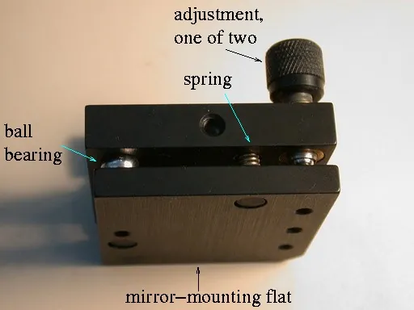

<figure class="eoc-pic eoc-pic-main"><figcaption><strong>How it works.</strong> <a href="https://commons.wikimedia.org/wiki/File:Mirrormount1.jpg">Mirrormount1</a> by No machine-readable author provided. Chaiken assumed (based on copyright claims)., <a href="http://creativecommons.org/licenses/by-sa/3.0/">CC BY-SA 3.0</a>, from Wikimedia Commons.</figcaption></figure>

Two or three screws, each opposed by a second screw, a spring or a lock nut, that set the tilt, height or end position of a plate or part and then clamp it at that exact setting, as on telescope mirror cells, 3D-printer beds and machine end stops.

**In plain words:** Screws you turn to tilt, raise or stop a part until it is just right, which then hold it there: one screw (or a spring) pushes while another screw (or the spring) pulls, so the part is squeezed between them and can't wobble or drift. **Proper term:** Locking adjustment screws (push-pull screw pairs, spring-loaded levelling screws, adjustable stop screws with lock nuts).

**Also called:** push-pull screws / push and pull screws (telescope mirror cells, e.g. the MAK150 manual); collimation screws / collimation bolts and locking screws (Newtonian telescope mirror cells); bed levelling screws / levelling knobs / bed springs (3D printers); tramming screws, bed tramming (the more exact word for 'bed levelling', Wikipedia 'Tramming'); three-point levelling / 3-point bed levelling (reference, [pitch](../glossary.md#pitch) and roll screws); kinematic mount adjusters / adjuster screws (optical mirror mounts); foot screws / levelling screws (theodolites and surveyor's levels, on the tribrach); silicone levelling columns / bed spacers (replacements for printer bed springs); adjustable stop / stop screw / setting bolt with lock nuts (fixtures, e.g. GN 251.2, Ganter brand); limit screws, H and L screws (bicycle derailleurs); jam nut / lock nut (the second nut that locks a stop screw); 'Nylock mod' (a nylon-insert nut in a printed levelling knob).

## How it works

A screw on its own can push a part away but can't hold it against being lifted, so the part can rattle, sag or drift. Here every adjusting screw has an opponent: a second screw that pulls the part towards the base (a push-pull pair), a spring that keeps the part pressed against the screw (spring-loaded), or, for a single stop screw, a thin second nut tightened against the first (a jam nut). Each turn moves that point by one thread pitch (0.7 mm for an M4 screw), and with three points (a reference, one for front-to-back tilt and one for side-to-side tilt) a flat plate can be set to any small height and tilt without being bent. Once set, the opposing forces press the threads together so friction stops them turning.

## Parts

A few parts. At each adjustment point: an adjusting screw (the push screw), plus its opponent, which is either a pull (locking) screw, a compression or extension spring (or a rubbery silicone column), or a second nut jammed against the first; a threaded hole, nut, printed knob with a nut, or threaded insert for each screw; and the plate being adjusted (mirror cell, printer bed, bracket). A plate usually has three such points. Example: 'bed plate, 3 flat-head screws, 3 springs, 3 knurled knobs with nuts'.

## Everyday examples

- the spring-loaded levelling knobs under the bed of many 'bed slinger' 3D printers (Wikipedia 'Tramming')
- the collimation screws at the back of a reflecting telescope, often in push and pull pairs (iOptron MAK150 manual)
- the H and L limit screws on a bicycle derailleur, which the derailleur's spring pulls against so the chain can't go into the spokes (Park Tool)
- the three foot screws that level a surveyor's theodolite on its tripod (NPTEL)

## When to use it

When something must be set once to an exact tilt, height or end position and then stay put: levelling (tramming) a printer bed, collimating a telescope mirror or aiming a laser mirror, squaring a sensor, camera or tool to a machine, or setting how far a part or a workpiece may travel (fixture stops, derailleur limit screws). Push-pull pairs and stiff springs are best when the part is jolted, transported or turned in different directions; spring-loaded screws are best when you adjust often and want the plate to pivot freely while you do. Use three points for anything flat.

## When not to use it

When you need large or frequent position changes, use a lead screw or a slide instead. For finer steps than a normal screw allows, use a differential screw or a micrometer head. When the part must come off and go back to exactly the same place without readjusting, use a [kinematic coupling](../glossary.md#kinematic-coupling) or locating pins. To level a whole table or machine on the floor, use levelling feet. For moving a motor or bracket sideways in slots, use a slotted mount with a jacking screw. Don't use four adjustment screws on a flat plate (it bends); and don't rely on springs alone where the part is heavy, carried around or tipped (it will sag or drift: use push-pull pairs, lock screws, or nuts once set).

## Details

- **What it does (jobs):**
  - line parts up exactly: sets a tilt, height or end position precisely (bed tramming, mirror collimation, end stops)
  - join and hold: clamps the part firmly at that setting so it can't wobble or drift
- **Movement:** none once locked; while adjusting: multiple (each screw moves its support point up or down by a few millimetres, which tilts the plate by a few degrees at most)
- **Directions it can move (degrees of freedom):** 0 once locked. While adjusting, three screws give 3 (height plus tilt in two directions, called pitch and roll); a single stop screw gives 1 (how far it sticks out).
- **Special behaviour:**
  - [self-locking](../glossary.md#self-locking) (holds under load, won't back-drive): the screw thread, loaded by the opposing screw, spring or jam nut, holds by friction, so pushing on the part does not turn the screws
  - self-aligning or self-centring: only in kinematic versions, where ball-ended screws sit in a cone, a V-groove and on a flat, so the plate returns to the same place after a knock and can grow with heat without bending (Wikipedia 'Mirror mount'; Rehorst's kinematic printer bed)
- **How it holds:** friction or clamping (force-fit): the push against the pull loads the threads so friction holds the setting; spring force (a spring or springy part presses it in place) in spring-loaded versions; shape ([form-fit](../glossary.md#form-fit--force-fit--material-bond)) where screw tips sit in cones and grooves in kinematic versions
- **Input and output:** An adjuster, not a drive: turning the screw -> a small straight movement of that support point, one thread pitch per turn (0.5 mm for M3, 0.7 mm for M4, 0.8 mm for M5 coarse threads; 0.5 mm for M4 fine), which becomes a small tilt of the plate. An optical 1/4-80 adjuster (80 threads per inch) moves about 0.32 mm per turn (arithmetic from the thread). Back-drivable: no, thread friction plus the opposing [preload](../glossary.md#preload) stops the load turning the screws; but vibration can slowly turn a screw held only by a soft spring.
- **Power:** passive (no power needed)
- **Load:** Light to heavy: printer beds, mirror cells and optical mounts carry light loads; fixture stops and setting bolts (e.g. GN 251.2 with a hardened head) take the knocks of workpieces being pushed against them ⚑ [uncertain: no load figures opened]. Strong along the screw in the push direction; in the pull direction only as strong as the spring or pull screw (a soft spring lets the part lift or sag); weak sideways, where the screws bend, unless the part is also located by cones and grooves or clamped.
- **Play and precision:** No play when properly preloaded, which is the point of opposing every push. Fine steps: 0.7 mm per turn for an M4 knob; one printed click knob claims 0.01 mm per click (Printables 422895). Repeatable while locked, but spring-only versions can drift with vibration, temperature and orientation (soft springs let a telescope mirror sag when pointed straight up, IceInSpace forum). Kinematic versions return to the same place after a shock (Wikipedia 'Mirror mount'). Corrects only small [misalignment](../glossary.md#misalignment): a few millimetres of screw travel, so a few degrees of tilt.
- **Taking it apart:** removable: unscrew it; the setting is lost unless you count turns or leave the reference screw alone
- **How often it can be reused:** effectively unlimited for metal screws in metal threads, nuts or threaded inserts; fewer for screws turned straight into printed plastic, whose threads wear (Hubs advises inserts for repeated assembly)
- **Sealing:** none
- **Adjustable:** yes: that is its purpose. Loosen the locking screw or jam nut (or just turn against the spring), set the new position, and lock again.
- **Access needed:** one side only (blind) for most: knobs under a printer bed or screws at the back of a mirror cell are turned from one side; some beds need a hand above as well to stop the screw head spinning; a stop screw with a jam nut needs room for two spanners on the nut side
- **Materials:** Steel or stainless-steel screws (flat-head screws in countersunk holes on printer beds, ball-tipped screws on kinematic mounts), steel compression or extension springs, or silicone or TPU columns instead of springs; aluminium, steel, cast tooling plate or wood for the plates and cells; nuts pressed into printed PETG or PLA knobs; heat-resistant PTFE or Torlon blocks where screws thread into plastic next to a heated bed (Rehorst); SLA resin bodies with epoxied bushings for small printed mirror mounts (MIT class guide).
- **Heat, cold, water and wear:** Vibration slowly turns knobs held only by soft springs, so the setting drifts (Printables 422895 adds click [detents](../glossary.md#detent) so the knob isn't 'vibrating out of position'). Heat: plastic knobs and blocks next to a heated bed can soften or loosen (Rehorst found one PTFE screw block 'getting wobbly' and redesigned it), and printed mirror mounts drift more with temperature than commercial ones (MIT class guide). Gravity: soft springs compress under a heavy mirror pointed straight up (IceInSpace forum). Temperature change makes a rigidly clamped plate try to bend; kinematic seats let it expand freely (Rehorst). Springs relaxing over time ⚑ [uncertain: no figures opened].

## Making it

- **Ways to make or get it:**
  - off-the-shelf part: screws, springs, knurled knobs, nyloc nuts, jam nuts, setting bolts and adjustable stops
  - 3D print (FDM): levelling knobs that hold a nut, three-point bed brackets, spacers and TPU columns
  - 3D print (resin): small kinematic mirror mounts (an MIT class guide recommends SLA over FDM)
  - CNC or drill and tap: threaded holes in metal plates and blocks
  - laser cut: flat plates and brackets with [clearance](../glossary.md#clearance) holes
  - woodwork: simple telescope mirror cells (Wikipedia: basic cells are built from wood, plastic or metal)
- **Printing it in one piece (print in place):** no: the screws, nuts and springs are separate; the printed parts are knobs, brackets, spacers or columns that are assembled with them
- **Tools:** a hex key or screwdriver for collimation screws (the MAK150 uses a 4 mm hex key); fingers for knurled levelling knobs; two spanners for a stop screw and its jam nut; a sheet of paper or feeler gauge, a dial gauge or a bubble level to check the result
- **Difficulty:** easy: ordinary screws, nuts and springs, with simple printed knobs or brackets; moderate for a kinematic version, whose cone, groove and flat seats need to be accurate

### 3D printing tips

Use three adjustment points, not four: three points define a plane, while a fourth screw just bends the bed or the carriage under it (Rehorst). Put the screws close to where the support structure is stiffest (Rehorst). Don't rely on threads printed into the part for an adjuster you will turn often: Hubs rates printed threads as unsuited to sizes under M5 and self-tapping screws as unsuited to repeated assembly, so press a nut into the printed knob, use a [captive nut](../glossary.md#captive-nut) pocket or a [heat-set insert](../glossary.md#heat-set-insert), or let the screw roll its own thread into a tougher plastic block, as Rehorst does with PTFE or Torlon blocks beside his heated bed. To stop the setting drifting, use a nylon-insert (nyloc) nut in the knob (Printables 317119), add click detents to the knob (Printables 422895 prints its snap features in PETG because PLA may become [brittle](../glossary.md#brittle--ductile) and [fatigue](../glossary.md#fatigue)), fit stiffer springs or silicone or TPU columns (Printables 577841 prints TPU columns at 20% [infill](../glossary.md#infill) and raises infill to make them stiffer), or swap the springs for nuts once the bed is set (Rehorst: 'if you allow something to move, it will!'). If you need the bed to pivot cleanly while adjusting, keep springs or use a kinematic seat (cone, slot, flat) rather than rigid lock nuts, which force something to flex (Rehorst). For a printed kinematic mirror mount, an MIT class guide uses ball-tipped M4 screws in epoxied bushings and extension springs on dowel pins, and recommends SLA over FDM; expect more thermal drift than a bought metal mount. Print knobs flat so the nut pocket is in the XY plane ⚑ [uncertain: general practice, not from an opened page].

### Buying one (off-the-shelf parts)

Search terms: 'bed levelling springs' (often sold as stiffer 'yellow springs' ⚑ [uncertain: seen only in search results]), 'silicone bed levelling column' or 'silicone spacer', 'levelling knob' or 'knurled thumb nut', 'nylon insert lock nut' (nyloc), 'jam nut' or 'thin nut', 'flat head countersunk screw', 'ball end [set screw](../glossary.md#set-screw)' or 'ball tip adjuster screw', 'fine adjustment screw' (e.g. 1/4-80 adjusters on kinematic mounts such as the Thorlabs KM100, brand), 'adjuster locking nut' for 1/4-80 adjusters (Thorlabs LN2580, brand) ⚑ [uncertain: seen only in search results], 'setting bolt' with lock nuts (GN 251.2, Ganter brand), 'adjustable stop' (AMF brand), 'adjusting stopper screw' (Misumi brand) ⚑ [uncertain: page blocked], 'heat-set threaded insert', 'kinematic mirror mount'.

## Rules of thumb

- Three points, not four: 'two points define a line and 3 points define a plane'; four levelling screws bend the bed plate, the carriage plate or both (Rehorst, https://drmrehorst.blogspot.com/2017/07/3-point-print-bed-leveling-vs-4-point.html).
- Three-point order: set the reference screw for overall height, then adjust pitch first and roll second; adjusting roll doesn't disturb pitch because the bed pivots on the other two screws (Rehorst blog, as above). The same idea on a theodolite: bring the bubble to centre by turning two foot screws together, inward or outward, then use the third foot screw for the other bubble (NPTEL, https://archive.nptel.ac.in/content/storage2/courses/105107122/modules/module6/html/54.htm).
- Push-pull pairs: turn each screw 'no more than 1/4 turn' at a time; loosen the opposing screw of the set before tightening its partner, then make the opposite change on the other two sets, keeping all screws 'not too loose and not too tight' (iOptron MAK150 manual, https://astronomics.com/cdn/shop/files/6101_MAK150_Collimation.pdf).
- Telescope cells with spring screws plus separate lock screws: use springs strong enough to carry the mirror, collimate with the spring screws, then only 'nip' the lock screws; lock screws should never be used to adjust or be done up too tight (IceInSpace forum, https://www.iceinspace.com.au/forum/showthread.php?p=15261). Often only two of the three cell screws need adjusting; leave the third in a middle position (N. O. Carlin's collimation guide, https://bbastrodesigns.com/kolli/kolli.html).
- Jam nut on a stop screw: tighten the inner nut to about a quarter to a half of the outer nut's [torque](../glossary.md#torque), hold it with a spanner, then tighten the outer nut to full torque; if the inner nut is tighter than the outer, the lock is unreliable (Wikipedia 'Jam nut', https://en.wikipedia.org/wiki/Jam_nut).
- Thread pitch sets the step size: ISO coarse pitch is 0.5 mm for M3, 0.7 mm for M4 and 0.8 mm for M5; fine M4 is 0.5 mm (Wikipedia 'ISO metric screw thread', https://en.wikipedia.org/wiki/ISO_metric_screw_thread).
- Kinematic seats: reference screw tip in a chamfered hole, pitch screw in a chamfered slot, roll screw on a flat, with springs holding the plate down, lets a heated bed expand without bending (Rehorst, https://hackaday.io/project/28933-kinematic-mount-for-3d-printer-bed). On mirror mounts, the three balls make three, two and one points of contact, exactly six (Wikipedia 'Mirror mount', https://en.wikipedia.org/wiki/Mirror_mount).
- For adjusters in printed parts, prefer metal inserts or nuts: printed threads are 'not suited for small threads (less than M5)' and self-tapping screws are 'not optimal for repeated disassembly' (Hubs, https://www.hubs.com/knowledge-base/how-assemble-3d-printed-parts-threaded-fasteners/).

## Common failures

(1) The bed or mirror slowly drifts out of adjustment because soft springs let vibration turn the knobs; fix with stiffer springs, silicone or TPU columns, nyloc nuts or click knobs (Printables 317119, 422895, 577841), lock screws, or nuts once set (Rehorst). (2) Four-point beds that never stay level because each screw bends the plate (Rehorst); convert to three points. (3) Over-tightened lock screws pulling the setting off or distorting the mirror; only nip them (IceInSpace forum). (4) A push-pull pair fighting itself when the push screw is tightened without first loosening the pull screw, so nothing moves or a thread strips ⚑ [uncertain: implied by the MAK150 sequence]. (5) The screw spinning with the knob; Printables 317119 adds a nut tightened against the bed to stop it. (6) Worn or stripped threads in printed plastic; use nuts or inserts (Hubs). (7) A jam nut that works loose because the inner nut was tightened harder than the outer (Wikipedia 'Jam nut'). (8) Running out of screw travel, or a bed that isn't flat, which three-point levelling can't correct (a commenter on Rehorst's blog had to go back to four-point adjustment for a warped bed).

## Safety

Mostly low risk. Over-tightened locking screws can distort a mirror or optic, spoiling it (IceInSpace forum; Photonic Solutions: 'Avoid over-tightening locking screws'). Stop and limit screws can be safety-critical: a derailleur limit screw set wrong lets the chain go into the spokes (Park Tool), and a machine stop that loosens lets a part over-travel, so always lock the jam nut. Printer beds can be hot, and some are mains-heated (Rehorst's 750 W line-powered heater), so adjust them cold and keep away from the heater wiring. Compressed springs can jump out when the knob comes off the end of the screw ⚑ [uncertain: general caution].

## Related

- Differential screw (fine adjustment screw): two threads of slightly different pitch for extra-fine movement; a different principle, often used inside optical adjusters
- Kinematic coupling (balls in V-grooves): the cone, groove and flat seats that adjuster tips sit in, so a plate returns exactly to place
- Exact-constraint mounting (3-2-1 locating): the rule behind using three, not four, support points
- Thread-locking hardware (nyloc nut, lock washer): keeps a single screw from turning; used inside levelling knobs
- Levelling foot (adjustable foot): one screw and pad under each leg sets a machine or table to the floor, rather than tilting a plate on its base
- Slotted adjustment with a jacking screw: pushes a motor or bracket sideways in slots, then separate bolts clamp it
- Eccentric adjuster: a turning off-centre bush that shifts a wheel or pulley, then is clamped
- Shims, spacers and standoffs: fixed packing with no adjustment; what springs are sometimes replaced with once a bed is set
- Tool-free fasteners (thumbscrew, wing nut): the knurled knobs used to turn levelling screws by hand
- Lead screw and nut: moves a part continuously rather than setting and locking it

## Make it yourself

- [Ender 3 S1/S1 pro - Locking Bed Level Knob (Printables 422895; URL from Printables API, page not opened)](https://www.printables.com/model/422895-ender-3-s1s1-pro-locking-bed-level-knob): Printed levelling knob holding a pressed-in M4 nut, with snap detents that stop vibration turning it and give clicks of about 0.01 mm (designer's figure); printed in PETG *(licence: CC BY-NC (Creative Commons Attribution-NonCommercial))*
- [Easy printed bed levelling knob with M4 nyloc nut for Ender (and more) (Printables 317119; URL from Printables API, page not opened)](https://www.printables.com/model/317119-easy-printed-bed-levelling-knob-with-m4-nyloc-nut-): Printed knob that holds a nylon-insert lock nut so the bed stops drifting; notes adding a plain nut to stop the screw turning *(licence: CC BY-NC (Creative Commons Attribution-NonCommercial))*
- [Ender3/Ender3 Pro bed levelling column / bed springs replacement (Printables 577841; URL from Printables API, page not opened)](https://www.printables.com/model/577841-ender3ender3-pro-bed-levelling-column-bed-springs-): TPU columns that replace bed springs; stiffness is tuned by infill, up to nearly solid *(licence: CC BY-NC-SA (Creative Commons Attribution-NonCommercial-ShareAlike))*
- [Anet A8 3 points bed levelling conversion (Printables 110874; URL from Printables API, page not opened)](https://www.printables.com/model/110874-anet-a8-3-points-bed-levelling-conversion): Printed parts to convert a four-screw printer bed to three-point levelling *(licence: CC BY (Creative Commons Attribution))*
- [Kinematic Mirror Mounts (Printables 1308932, LIBRE-hub project; URL from Printables API, page not opened)](https://www.printables.com/model/1308932-kinematic-mirror-mounts): Printable laser mirror mounts adjusted by three knobs (two to move, one left fixed), based on UC2 cubes *(licence: CC BY-SA (Creative Commons Attribution-ShareAlike))*
- [3D Printed Kinematic Mirror Mounts (MIT class page)](https://fab.cba.mit.edu/classes/865.24/people/max/kinematics.html): Build guide with parts list: SLA-printed body, three ball-tip M4 screws in epoxied bushings, and extension springs on dowel pins that pull the plate onto the screws *(licence: link only (licence not stated))*

## Pictures, videos and models

- [Instruction of Collimating iOptron MAK150 (manufacturer PDF)](https://astronomics.com/cdn/shop/files/6101_MAK150_Collimation.pdf): Photos of the three sets of push and pull screws on a telescope mirror cell (push screws stand higher than pull screws) and step-by-step figures of which screw to turn which way *(licence: link only (manufacturer document))*
- [Mirrormount1.jpg (Wikimedia Commons, by Alison Chaiken, 2006)](https://commons.wikimedia.org/wiki/File:Mirrormount1.jpg): Annotated photo of a kinematic optical mirror mount 'showing some of the mechanism' (Wikipedia 'Mirror mount' caption): a front plate tilted by adjustment screws in a fixed back plate *(licence: CC BY-SA 3.0 (reuse with credit))*
- [3 Point Print Bed Leveling vs 4 Point Bending (Mark Rehorst's Tech Topics blog)](https://drmrehorst.blogspot.com/2017/07/3-point-print-bed-leveling-vs-4-point.html): Diagram and photos of three-point printer bed levelling with reference, pitch and roll screws, and why four screws bend the bed *(licence: link only)*
- [Kinematic mount for 3D printer bed (Mark Rehorst, hackaday.io)](https://hackaday.io/project/28933-kinematic-mount-for-3d-printer-bed): Renders and photos of a heated bed resting on three levelling screws in a chamfered hole, a chamfered slot and on a flat, held down by springs *(licence: link only)*
- [Rear Derailleur Adjustment (Park Tool)](https://www.parktool.com/en-us/blog/repair-help/rear-derailleur-adjustment): Photos of a derailleur's H and L limit screws stopping its travel, and how to set them by quarter turns *(licence: link only)*

## Needs confirming

⚑ marks something nobody has confirmed yet: a fact the research could not confirm from a source, a finder value that is a best guess, or an open point from the research notes. Corrections are welcome (see `research/needs-confirming.md`).

- ⚑ 8 sentences on this page marked [uncertain].
- ⚑ Finder value `connects` = any solid parts (best guess): joins parts, but no specific kind of part found; set to any solid parts
- ⚑ Finder value `made_of` = 3D prints, plastic sheet, tube or moulded parts, wood, metal, glass or mirror (best guess): proposed from the words in the research text (R37); not yet checked
- ⚑ Research note: *Locking adjustment screws*: the 3doptix catalogue page gives the Thorlabs KM100's 1/4-80 screw as '80 µm per revolution', which looks wrong (one turn of a 1/4-80 thread is about 0.32 mm); the figure was not used.

## Sources

- <https://astronomics.com/cdn/shop/files/6101_MAK150_Collimation.pdf>
- <https://drmrehorst.blogspot.com/2017/07/3-point-print-bed-leveling-vs-4-point.html>
- <https://hackaday.io/project/28933-kinematic-mount-for-3d-printer-bed>
- <https://en.wikipedia.org/wiki/Tramming>
- <https://en.wikipedia.org/wiki/Mirror_mount>
- <https://en.wikipedia.org/wiki/Mirror_support_cell>
- <https://en.wikipedia.org/wiki/Jam_nut>
- <https://en.wikipedia.org/wiki/ISO_metric_screw_thread>
- <https://bbastrodesigns.com/kolli/kolli.html>
- <https://www.iceinspace.com.au/forum/showthread.php?p=15261>
- <https://fab.cba.mit.edu/classes/865.24/people/max/kinematics.html>
- <https://photonicsolutions.co.uk/the-ultimate-guide-to-kinematic-mirror-mounts/>
- <https://www.3doptix.com/catalog/optomechanics/optics-mount/thorlabs/KM100>
- <https://www.ganternorm.com/en/products/3.2-Mounting-positioning-levelling-with-screws-clamping-and-supporting-elements/Positioning-elements-Clamping-pads/GN-251.2-Setting-bolts-with-limit-switch>
- <https://www.amf.de/en_us/stop-adjustable-75663>
- <https://archive.nptel.ac.in/content/storage2/courses/105107122/modules/module6/html/39.htm>
- <https://archive.nptel.ac.in/content/storage2/courses/105107122/modules/module6/html/54.htm>
- <https://www.parktool.com/en-us/blog/repair-help/rear-derailleur-adjustment>
- <https://www.hubs.com/knowledge-base/how-assemble-3d-printed-parts-threaded-fasteners/>
- <https://commons.wikimedia.org/wiki/File:Mirrormount1.jpg>
- <https://api.printables.com/graphql/>
