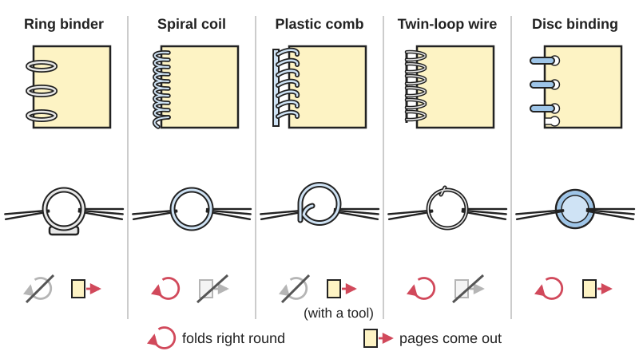
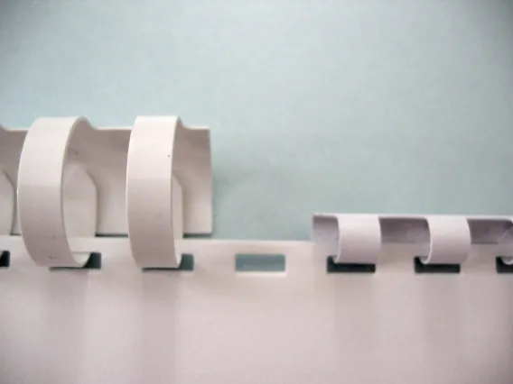
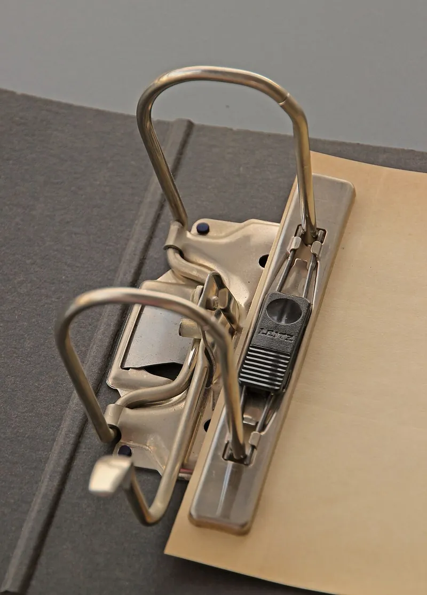

<figure class="eoc-pic eoc-pic-main"><picture><source media="(prefers-reduced-motion: reduce)" srcset="../media/drawn/loose-leaf-bindings.svg"></picture><figcaption><strong>Animation.</strong> Diagram drawn for the encyclopaedia from the research notes. ⚑ Needs confirming: a drawing can simplify or get details wrong; a real photo or a better diagram is welcome.</figcaption></figure>
<figure class="eoc-pic"><figcaption><strong>How it works.</strong> <a href="https://commons.wikimedia.org/wiki/File:Comb_bind_examples.JPG">Comb bind examples</a> by Digitalgadget, Public domain, from Wikimedia Commons.</figcaption></figure>
<figure class="eoc-pic"><figcaption><strong>Photo.</strong> <a href="https://commons.wikimedia.org/wiki/File:Ringmechanik_01_(fcm).jpg">Ringmechanik 01 (fcm)</a> by Photograph: Frank C. Müller, Frankfurt am Main, <a href="https://creativecommons.org/licenses/by-sa/4.0">CC BY-SA 4.0</a>, from Wikimedia Commons.</figcaption></figure>

Loose-leaf bindings hold punched sheets on rings, a helical coil, a curled plastic comb, a C-shaped wire closed into loops, or a stack of rimmed discs, so the pages pivot about the binding like a hinge and, for rings, combs and discs, can be opened, rearranged, added or removed.

**In plain words:** Rings, a wire or plastic spiral, a curled plastic comb or a stack of little discs threaded through a row of punched holes along the edge of the pages, so the pages swing round them like a door on a hinge and, with most types, can be taken out or added. **Proper term:** Loose-leaf and mechanical bindings (punch-and-bind): ring binder and lever arch file, spiral (coil) binding, plastic comb binding, wire (twin-loop, Wire-O) binding and disc binding.

**Also called:** ring binder, loose-leaf binder, looseleaf binder, file (UK), 3-ring binder, 2-ring and 4-ring binder, D-ring binder, lever arch file, Trio binder, multi-ring binder (Wikipedia 'Ring binder'; Wikipedia 'Hole punch'); binder ring, split binder ring, hinged ring, loose-leaf ring (Printables 735504, 998514) ⚑ [uncertain: trade names not checked in a catalogue]; spiral binding, coil binding, spiral coil, plastic coil, colour coil, Spiralastic (Wikipedia 'Coil binding'; MyBinding); comb binding, plastic comb binding, spiral comb binding, 19-ring binding, Cerlox or Surelox (brands) (Wikipedia 'Comb binding'; Wikipedia 'Bookbinding'); wire binding, twin-loop, double-loop wire, double-O, ring wire, wire comb, Wire-O (brand), wiro, wirebind (Wikipedia 'Wire binding'); disc binding, discbound, disc-bound notebook, mushroom punch; Atoma, Circa, Arc, Rollabind, TUL, Happy Planner (brands) (Wikipedia 'Disc-binding'; Wikipedia 'Loose leaf'; Printables 996453); punch and bind, mechanical binding (Wikipedia 'Bookbinding'; Mid-State Litho); VeloBind (brand): a permanent strip-and-pin bind (Wikipedia 'Bookbinding'); hole patterns to search by: ISO 838 two-hole (80 mm), '888' four-hole, US three-hole (4 1/4 in), 4:1, 3:1 and 2:1 [pitch](../glossary.md#pitch) (Wikipedia 'Hole punch'; Wikipedia 'Wire binding').

## How it works

A row of holes is punched along the binding edge and a closed loop of some kind passes through every hole, so a sheet can't come off without the loop opening or the paper tearing, but it can swing freely about the loop (Wikipedia 'Bookbinding'). Ring binders use circular or D-shaped rings that open and close on a sprung or lever mechanism (Wikipedia 'Ring binder'). A coil is wound through the holes like a spring and its ends are cut and crimped so it can't wind out; a twin-loop wire starts C-shaped and is squeezed round by a wire closer; a plastic comb's curled fingers are spread open by the binding machine, put through rectangular holes and allowed to curl back (Wikipedia 'Coil binding'; Wikipedia 'Wire binding'; Wikipedia 'Comb binding'). Disc binding uses separate discs with a raised rim; the paper's mushroom-shaped slots snap over the rim, so a page can be peeled off and pressed back on anywhere (Wikipedia 'Disc-binding'; Lazada stationery guide).

## Parts

A few parts: the punched sheets and covers, plus either a ring mechanism (rings, spring plate, often a lever), a single coil, comb or wire spine, or a set of separate discs; a matching hole punch, and for coil and wire a crimping tool or wire closer (Wikipedia 'Ring binder'; Wikipedia 'Coil binding'; Wikipedia 'Wire binding'; Wikipedia 'Disc-binding').

## Everyday examples

- A school ring binder or lever arch file (Wikipedia 'Ring binder')
- A spiral-bound notebook or atlas that folds back on itself (Wikipedia 'Coil binding'; Wikipedia 'Bookbinding')
- A comb- or wire-bound report, manual or wall calendar (Wikipedia 'Comb binding'; Mid-State Litho)
- A disc-bound planner whose pages can be moved around (Wikipedia 'Disc-binding')

## When to use it

Use a loose-leaf binding when the pages must turn freely and lie flat, and especially when pages must be added, removed or rearranged: ring binders and lever arch files for filing and course notes, disc binding for planners and notebooks you keep reorganising, comb binding for reports that may be edited (Wikipedia 'Ring binder'; Wikipedia 'Disc-binding'; MyBinding). Use coil or wire when a manual, recipe book, sketchbook or calendar must fold back on itself and stand up to heavy use: coil is the most durable for daily handling, wire looks the most polished and keeps pages lined up (Mid-State Litho). Printed binder rings and discs are handy for flash cards, swatch books and custom notebooks (Printables 735504, 1613408).

## When not to use it

For a permanent book with a proper spine use a sewn binding (Sewn book bindings) or glued (perfect) binding. For a few loose sheets that must stay in order use a screw post (Chicago screw), a staple or a split-pin paper fastener. Avoid disc binding with thin paper or in humid places, where punches wear and pages fall out (Lazada stationery guide). Avoid comb binding for books that must fold back 360° (Wikipedia 'Comb binding'), and wire or coil for documents you'll need to edit (Mid-State Litho). Printed rings are 'not as secure as metal rings' (Printables 735504).

## Details

- **What it does (jobs):**
  - let it move (turn, slide or bend): the pages pivot about the rings, coil, wire, comb or discs like a hinge (Wikipedia 'Coil binding'; Wikipedia 'Wire binding')
  - join and hold: holds a stack of punched sheets and covers together as a book (Wikipedia 'Bookbinding')
  - lock, and release by hand: ring and lever-arch mechanisms open and lock by hand, and disc-bound pages [peel](../glossary.md#peel-vs-shear) off and press back on, so pages can be added or removed (Wikipedia 'Ring binder'; Wikipedia 'Disc-binding')
- **Movement:** rotate: pages swing about the binding axis; coil, wire and disc bindings open flat and fold back 360°, comb binding lies flat but can't fold back 360°, and ring binders open flat in their covers (Wikipedia 'Coil binding'; Wikipedia 'Wire binding'; Wikipedia 'Comb binding'; Lazada stationery guide).
- **Directions it can move (degrees of freedom):** 1 for each page (turning about the binding axis), with a little extra sliding along the rings or coil where the holes are loose; coil bindings let pages 'walk' along the helix as they turn ⚑ [uncertain].
- **Special behaviour:**
  - quick-release: ring binder and lever-arch rings open by hand, combs can be reopened with a comb opener, and disc-bound pages peel off and push back on without opening any latch (Wikipedia 'Ring binder'; MyBinding; Lazada stationery guide)
  - [over-centre](../glossary.md#over-centre): a ring-binder mechanism snaps open and shut, and a lever arch file has a lever that 'can be easily opened, closed and locked' (Wikipedia 'Ring binder') ⚑ [uncertain: no opened page explains the over-centre spring plate]
  - none (for coil and wire): once crimped or closed they just hold the pages and let them turn
- **How it holds:**
  - shape (the parts interlock; [form-fit](../glossary.md#form-fit--force-fit--material-bond)): a closed ring, coil, wire loop or comb passes through every hole (Wikipedia 'Bookbinding')
  - spring force (a spring or springy part presses it in place): the ring-binder mechanism's spring holds the rings shut, and the plastic comb's fingers spring back into their curl (Wikipedia 'Ring binder', image 'Three ring binder sprung clip mechanism'; Wikipedia 'Comb binding')
  - friction or clamping (force-fit): disc-bound pages are held 'through friction and paper tension' where the mushroom slots grip the disc rims (Lazada stationery guide)
- **Input and output:** not applicable
- **Power:** passive (no power needed); electric punches, coil inserters and wire closers only help make it
- **Load:** Light: holds the weight of the paper and normal page turning. Weak points are the paper at the holes, which tears under a sideways pull or repeated removal (disc and comb), and the binding element bending or crushing (wire can 'bend if stored poorly'; cheap plastic coils crush) (Mid-State Litho; Lazada stationery guide). Capacity figures, side by side: comb about 425 sheets on a 2 in spine (Wikipedia 'Comb binding'; Mid-State Litho), coil about 400 sheets or books up to 2 in thick (Mid-State Litho; Wikipedia 'Coil binding'), wire about 300 sheets (Mid-State Litho); ring binders come with rings of 0.5-2 in in North America (Wikipedia 'Ring binder').
- **Play and precision:** Noticeable play: holes are larger than the ring or wire so pages turn freely (US punches use 1/4 to 5/16 in holes, 5/16 in 'allows for looser [tolerances](../glossary.md#tolerance)') (Wikipedia 'Hole punch'). Wire binding keeps front and back pages in 'perfect registration' (lined up), which matters for calendars (Mid-State Litho). Hole patterns must match the binding exactly: discs and pages are only interchangeable if 'the discs have the same profile and spacing' (Wikipedia 'Disc-binding').
- **Taking it apart:** tool-free quick release for ring binders and disc binding (pages come out by hand); removable for comb binding (needs a comb opener); semi-permanent for coil (the coil has to be cut or un-crimped and a new one used) and for wire binding, which is 'permanent and tamper-resistant' (Wikipedia 'Comb binding'; MyBinding; Mid-State Litho).
- **How often it can be reused:** many times for ring binders and discs (pages come out and go back again), though disc-bound paper wears at the punches after repeated removal (Lazada stationery guide); a few times for combs (they can be reopened, but the plastic 'can get [brittle](../glossary.md#brittle--ductile) over time') (MyBinding); once for coil and wire (MyBinding: 'a new binding element does need to be used'; Mid-State Litho: wire spines 'cannot be reopened').
- **Sealing:** none
- **Adjustable:** partly: ring and disc bindings accept more or fewer pages up to the ring or disc size, and a larger disc or ring can be swapped in; comb spines can be reopened and a bigger comb fitted; coil and wire are fixed once closed (Wikipedia 'Disc-binding'; MyBinding).
- **Access needed:** both sides: the ring, coil, comb or wire goes through the holes from one face to the other; for disc binding you press each page onto the discs from the edge.
- **Materials:** Rings and lever arches: steel mechanisms in board, vinyl or polypropylene covers (Wikipedia 'Ring binder'). Coil: PVC plastic or low-carbon steel (Wikipedia 'Coil binding'). Wire: metal, black, white, silver or gold (Mid-State Litho). Comb: plastic (Wikipedia 'Comb binding'). Discs: plastic or metal (search summary only) ⚑ [uncertain]. Pages: ordinary paper, card and plastic covers; disc binding needs stronger paper (Lazada suggests at least 100-120 gsm, because 70 gsm copy paper 'will tear easily at the mushroom punches') and comb punching suits tear-resistant text-weight paper (Paper Mill Store). 3D-printed rings, discs and covers in PLA, PETG or TPU (Printables 735504, 1613408, 1665899).
- **Heat, cold, water and wear:** Humidity softens paper and reduces the grip of disc-bound pages (Lazada stationery guide). Plastic combs 'can get brittle over time' (MyBinding). Wire spines bend if stored badly and cheap plastic coils can crush (Mid-State Litho; Lazada stationery guide). Binding machines should not be used where condensation forms; one wire binder's manual gives a maximum ambient temperature of about 40 °C (GBC WireBind W25E manual). Printed PLA rings or discs left in a hot car may soften and deform ⚑ [uncertain].

## Making it

- **Ways to make or get it:**
  - off-the-shelf part: ring binders, binder rings, discs, coils, combs and wires with matching punches
  - 3D print (FDM): binder rings, disc-binding discs, covers, punch guides and depth stops (Printables)
  - laser cut: covers with punched hole patterns in card, polypropylene or thin plywood ⚑ [uncertain: no laser-cut binding page opened]
  - hand punching: ordinary office punches for ring binders; special punches for comb, coil, wire and disc patterns (Wikipedia 'Hole punch')
- **Printing it in one piece (print in place):** partly: a split binder ring with a working hinge prints in place without supports, but its author says it is 'fiddly' and not as secure as metal rings (Printables 735504); discs print as one solid piece or as two parts that are assembled (Printables 1613408).
- **Tools:** A hole punch for the pattern (ordinary 2-, 3- or 4-hole office punch for ring binders; a special rectangular-hole comb punch, round-hole coil punch, round or square-hole wire punch, or mushroom disc punch); coil crimping pliers for coil; a wire closer for wire; a comb spreader for comb (Wikipedia 'Hole punch'; Wikipedia 'Coil binding'; Wikipedia 'Wire binding'; MyBinding). Manual punches take about 10-20 sheets of 20 lb (75 g/m²) paper at a time (MyBinding).
- **Difficulty:** easy: buy a binder, rings or discs and punch the paper, or print rings and discs; coil, comb and wire binding need a dedicated punch and a crimper or wire closer, which are cheap for coil and comb but a bigger purchase for wire (MyBinding; Mid-State Litho).

### 3D printing tips

1) [Print-in-place](../glossary.md#print-in-place) split binder ring (~24.5 mm diameter, ~3.6 mm thick): PLA, 0.12 mm layers, 100% [infill](../glossary.md#infill), fan 100%, slow first layer; leave 2 empty layers between the lower and upper hinge parts so they don't fuse; let the parts cool completely before closing the hinge or it tears; about 7 of 8 close without breaking; press the hinge post with hot metal to make it tighter (Printables 735504, CC BY). 2) Simple printed binder rings come in 80, 60 and 40 mm ring lengths with 80 mm hole spacing to match ISO 838 two-hole paper, with an OpenSCAD file for other spacings (Printables 998514, CC BY-NC-SA). 3) Disc-binding discs: one Atoma-style disc has a 17.25 mm outer diameter, printed either as a two-part outer ring plus centre (smoothest, needs careful assembly) or as one solid piece with or without supports (Printables 1613408, CC BY-NC-SA); another design uses smaller discs for about 50-70 pages and covers printed at 0.16 mm layers (Printables 996453, CC BY-NC-SA). 4) Flexible covers: a TPU A5 disc-notebook cover works best 1.5-2.0 mm thick (Printables 1665899, CC BY). 5) Punch depth stops: printed stops that clip magnetically onto an 11-hole mushroom punch line the holes up with commercial disc notebooks; they need build-plate supports and a 9 x 4 mm magnet, glued in (Printables 1365220, CC BY-NC-SA). 6) A printed cover for spiral binding matched the US 4:1 pitch (Printables 603337, CC BY-NC-SA). 7) Check hole spacing against a real page before printing a whole set, because patterns differ by system and country (Wikipedia 'Hole punch').

### Buying one (off-the-shelf parts)

Ring binders (2-, 3- and 4-ring, [O-ring](../glossary.md#o-ring) and D-ring), lever arch files, ring-binder mechanisms, hinged binder rings (loose-leaf rings), punched pockets (sheet protectors) (Wikipedia 'Ring binder'; Wikipedia 'Hole punch'). Plastic or metal spiral coils (4:1, 3:1, 5:1 pitch) and coil crimping pliers; plastic binding combs (19-ring letter, 21- or 23-ring A4) and comb binding machines; twin-loop wire (3:1 and 2:1 pitch) and wire closers; disc-binding discs (e.g. 3/4, 1 and 1.5 in, or 10-25 mm) and mushroom punches (Wikipedia 'Bookbinding'; Wikipedia 'Comb binding'; Wikipedia 'Wire binding'; Wikipedia 'Loose leaf'). Search terms: 'binder ring', 'lever arch mechanism', 'coil binding pliers', 'binding comb', 'twin loop wire', 'discbound discs', 'mushroom hole punch'.

## Rules of thumb

- ISO 838 two-hole filing: holes 6 ± 0.5 mm diameter, centres 80 ± 0.5 mm apart and 12 ± 1 mm from the edge; the common four-hole '888' extension adds two holes another 80 mm out (Wikipedia 'Hole punch').
- US letter three-hole: centres 4 1/4 in apart, holes 1/4-5/16 in, about 1/2 in from the edge; half-letter three-hole 2 3/4 in apart (Wikipedia 'Hole punch'; Wikipedia 'Ring binder').
- Other ring patterns: Swedish 'triohålning' 21, 70, 21 mm apart, 10.5 mm from the edge; Dutch 23-ring at 12.7 mm (1/2 in) spacing; Japanese 30-ring A4 and 26-ring B5; Filofax six holes in two groups of three (Wikipedia 'Hole punch'; Wikipedia 'Ring binder').
- Coil pitch: 4:1 (four holes per inch) is the most common, with 3:1, 5:1 and 0.400 in patterns also used; cut and crimp the coil ends 'to prevent the coil from coming loose' (Wikipedia 'Bookbinding'; Wikipedia 'Coil binding').
- Wire pitch: 3:1 for small books up to 9/16 in diameter, 2:1 for thicker books from 5/8 to 1 1/4 in (Wikipedia 'Wire binding').
- Comb: rectangular holes at 9/16 in pitch; 19 rings on US letter; for A4, Wikipedia 'Comb binding' says 21 rings but Wikipedia 'Hole punch' says 23 holes, so check the punch before buying combs.
- Comb spine size by sheet count (20 lb paper): 3/16 in (4 mm) 16 sheets, 1/4 in (6 mm) 25, 3/8 in (10 mm) 55, 1/2 in (12 mm) 85, 3/4 in (20 mm) 150, 1 in (25 mm) 200, 2 in (51 mm) 425 (Wikipedia 'Comb binding').
- Which opens how: coil and wire open flat and fold back 360°; comb lies flat but 'cannot be opened 360 degrees'; disc-bound books fold back 360°; ring binders lie open flat (Wikipedia 'Comb binding'; Wikipedia 'Wire binding'; Lazada stationery guide).
- Which can be edited: rings and discs freely; comb with a comb opener; coil only with a new coil; wire not at all (MyBinding; Mid-State Litho).
- Disc binding moves single pages easily but moving many pages at once is 'substantially more difficult' than with a ring binder (Wikipedia 'Disc-binding'); use 100-120 gsm or heavier paper so the punches don't tear (Lazada stationery guide, a retailer guide).

## Common failures

Pages tear out at the holes, especially with thin paper, heavy use or disc binding (Lazada stationery guide; Paper Mill Store); use heavier paper, hole reinforcement rings or punched pockets (Wikipedia 'Ring binder'). Disc-bound pages slip off when the punched slots wear or paper is damp (Lazada stationery guide). Coil winds out of the holes when the ends are not crimped (Wikipedia 'Coil binding'). Wire spine bent out of round, so pages snag (Mid-State Litho). Comb fingers crack after the plastic ages (MyBinding). Holes that don't match the binding pattern or are too close to the edge: use the right punch and a depth stop (Wikipedia 'Hole punch'; Printables 1365220). Printed rings fuse at the hinge or snap when closed while still warm (Printables 735504).

## Safety

Punches, wire closers and coil inserters pinch: 'Keep hair, fingers, jewelry and all loose clothing away from all moving parts' (Tamerica EZ-Wire34 manual); 'To avoid risk of injury DO NOT put your fingers into the wire binding channel', and never lift the machine by its punching handle (GBC WireBind W25E manual). Binding machines are 'not a toy', so don't let children operate them (Tamerica EZ-Wire34 manual). Ring-binder and lever-arch rings snap shut and can nip fingers ⚑ [uncertain]. Cut coil and wire ends can be sharp until crimped ⚑ [uncertain].

## Related

- Chicago screw (binding screw, screw post): bolts a stack of punched sheets together; pages can be added by unscrewing, but they don't turn as freely
- Sewn book bindings (pamphlet stitch, Coptic, kettle stitch, Japanese stab binding): permanent thread bindings; Coptic also opens 360°
- Split-pin paper fastener (brass fastener): a single prong through a hole for a few sheets or a pivot
- Staples (desk stapler and saddle stapling): the quick permanent way to hold sheets
- Spring clip clamp (binder clip, bulldog clip): clamps loose sheets with no holes at all
- Knuckle hinge (butt hinge) and Print-in-place hinge: rigid pin hinges; a ring or coil is a pin hinge with many knuckles
- [Living hinge](../glossary.md#living-hinge): a printed one-piece hinge for a cover instead of punched pages on rings
- Quick-release pin (ball-lock pin) and Tool-free fasteners: other ways to make a removable pin through holes

## Make it yourself

- [Split Binder Ring: Print in Place (Alex Gwyn, Printables) (URL from Printables API, page not opened)](https://www.printables.com/model/735504-split-binder-ring-print-in-place): A hinged split binder ring that prints in place without supports, with detailed slicer settings *(licence: Creative Commons Attribution)*
- [Paper binder ring (takara, Printables) (URL from Printables API, page not opened)](https://www.printables.com/model/998514-paper-binder-ring): Printable two-ring binder clip for 80 mm hole spacing in three ring sizes, with FreeCAD and OpenSCAD sources *(licence: Creative Commons Attribution-NonCommercial-ShareAlike)*
- [Discs for disc-bound notebooks (JR, Printables) (URL from Printables API, page not opened)](https://www.printables.com/model/1613408-discs-for-disc-bound-notebooks): Atoma-style 17.25 mm discs as a two-part or one-piece print *(licence: Creative Commons Attribution-NonCommercial-ShareAlike)*
- [Refillable Disc System Notebook (vkobz, Printables) (URL from Printables API, page not opened)](https://www.printables.com/model/996453-refillable-disc-system-notebook-discboundcircatula): Fully printable disc-bound notebook (covers and discs) for common 8-disc refill paper *(licence: Creative Commons Attribution-NonCommercial-ShareAlike)*
- [Craftelier 11-hole disc binding punch depth stops A4/A5 (WD, Printables) (URL from Printables API, page not opened)](https://www.printables.com/model/1365220-craftelier-11-hole-disc-binding-punch-depth-stops): Magnetic depth stops so punched sheets line up with commercial disc notebooks *(licence: Creative Commons Attribution-NonCommercial-ShareAlike)*

## Pictures, videos and models

- [Ringmechanik 01 (fcm).jpg (Wikimedia Commons, by Frank C. Müller)](https://commons.wikimedia.org/wiki/File:Ringmechanik_01_(fcm).jpg): The two-ring lever arch mechanism of a file, with lever and rings *(licence: CC BY-SA 4.0)*
- [Comb bind examples.JPG (Wikimedia Commons, by Digitalgadget)](https://commons.wikimedia.org/wiki/File:Comb_bind_examples.JPG): Two comb-bound documents with small and large plastic comb spines *(licence: Public domain)*
- [Wire-o.jpg (Wikimedia Commons, by Monster4711)](https://commons.wikimedia.org/wiki/File:Wire-o.jpg): A twin-loop (Wire-O) wire binding through punched holes *(licence: CC BY-SA 3.0)*
- [Binder-based and discbound loose leaf systems.jpg (Wikimedia Commons, by Υω22)](https://commons.wikimedia.org/wiki/File:Binder-based_and_discbound_loose_leaf_systems.jpg): An A5 ring binder next to a letter-size disc-bound notebook, showing rings versus discs *(licence: CC BY-SA 4.0)*
- [Filingholes2.gif (Wikimedia Commons, by Hellahulla)](https://commons.wikimedia.org/wiki/File:Filingholes2.gif): Diagram of the ISO 838 two-hole filing pattern on different paper sizes *(licence: CC BY-SA 3.0)*

## Needs confirming

⚑ marks something nobody has confirmed yet: a fact the research could not confirm from a source, a finder value that is a best guess, or an open point from the research notes. Corrections are welcome (see `research/needs-confirming.md`).

- ⚑ 8 sentences on this page marked [uncertain].
- ⚑ Finder value `connects` = any solid parts (best guess): joins parts, but no specific kind of part found; set to any solid parts
- ⚑ Research note: *Loose-leaf bindings* (418): a comb on A4 has 21 rings (Wikipedia *Comb binding*) or 23 holes (Wikipedia *Hole punch*); whether the ring mechanism is over-centre is [uncertain].

## Sources

- <https://en.wikipedia.org/wiki/Ring_binder>
- <https://en.wikipedia.org/wiki/Hole_punch>
- <https://en.wikipedia.org/wiki/Loose_leaf>
- <https://en.wikipedia.org/wiki/Disc-binding>
- <https://en.wikipedia.org/wiki/Comb_binding>
- <https://en.wikipedia.org/wiki/Coil_binding>
- <https://en.wikipedia.org/wiki/Wire_binding>
- <https://en.wikipedia.org/wiki/Bookbinding>
- <https://blog.midstatelitho.com/different-binding-elements-and-benefits/>
- <https://www.mybinding.com/blogs/binding/binding-machines-what-is-right-for-you>
- <https://stationery.lazada.com.ph/spiral-ring-or-disc-bound-organizer-notebooks-which-binding-fits-you-ph/>
- <https://blog.thepapermillstore.com/binding-methods-101-what-designers-need-to-know-about-paper-compatibility/>
- <https://media.mybinding.com/media/manuals/Tamerica-ez-wire34-manual.pdf>
- <https://justmore.dk/images/media/ProductsDocs/GBC%20WireBind%20W25E%20elektrisk%20wireindbindingsmaskine.pdf>
- <https://commons.wikimedia.org/wiki/File:Ringmechanik_01_(fcm).jpg>
- <https://commons.wikimedia.org/wiki/File:Comb_bind_examples.JPG>
- <https://commons.wikimedia.org/wiki/File:Wire-o.jpg>
- <https://commons.wikimedia.org/wiki/File:Binder-based_and_discbound_loose_leaf_systems.jpg>
- <https://commons.wikimedia.org/wiki/File:Filingholes2.gif>
- <https://api.printables.com/graphql/ (models 735504, 998514, 1613408, 996453, 1665899, 1365220, 603337, 784062; no Printables pages opened)>
