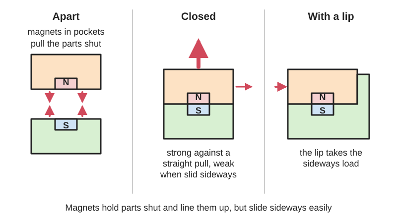
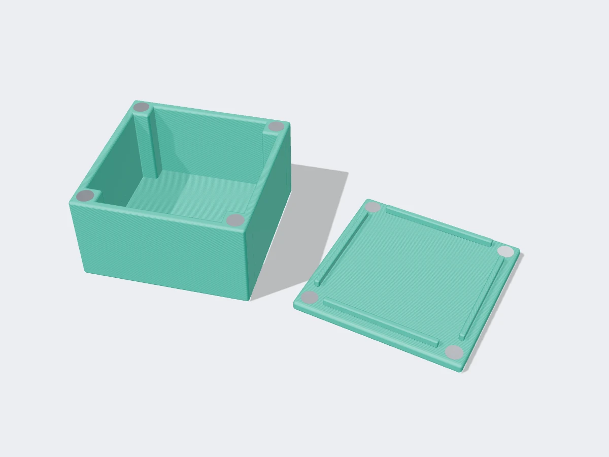
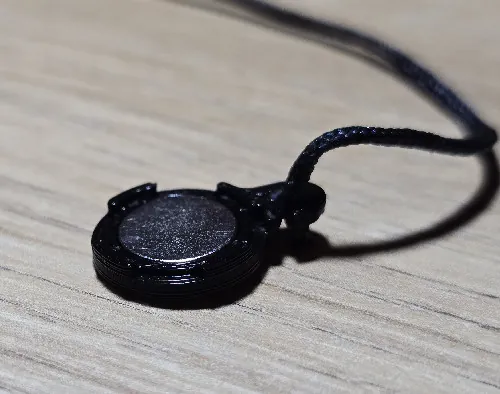
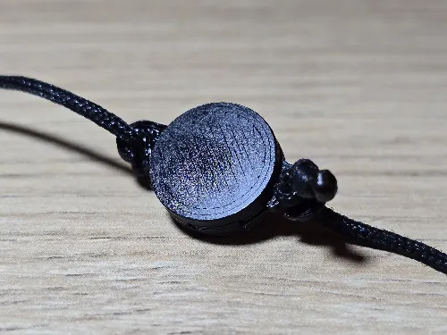

<figure class="eoc-pic eoc-pic-main"><figcaption>Diagram drawn for the encyclopaedia from the research notes. ⚑ Needs confirming: a drawing can simplify or get details wrong; a real photo or a better diagram is welcome.</figcaption></figure>
<figure class="eoc-pic"><figcaption><strong>Render.</strong> A 3D model made for the encyclopaedia, not a photo: a real photo is also shown. ⚑ Needs confirming: a model can simplify or get details wrong.</figcaption></figure>
<figure class="eoc-pic"><figcaption><strong>How it works.</strong> <a href="https://www.printables.com/model/1348108-strong-9mm-magnet-snap-joint-for-thread-wristband">Strong 9mm magnet snap joint for thread, wristband, knitting</a> by 6, <a href="https://creativecommons.org/licenses/by/4.0/">CC BY 4.0</a>, from Printables.</figcaption></figure>
<figure class="eoc-pic"><figcaption><strong>Photo.</strong> <a href="https://www.printables.com/model/1348108-strong-9mm-magnet-snap-joint-for-thread-wristband">Strong 9mm magnet snap joint for thread, wristband, knitting</a> by 6, <a href="https://creativecommons.org/licenses/by/4.0/">CC BY 4.0</a>, from Printables.</figcaption></figure>

Pairs of permanent magnets, or a magnet and a piece of steel, set into the faces of two parts so the parts pull together, roughly line themselves up and stay shut, yet can be pulled apart by hand.

**In plain words:** Small, strong magnets hidden in two parts (or a magnet facing a bit of steel) so the parts snap together with a click, line themselves up, and pull apart by hand. **Proper term:** Magnetic joint (embedded magnets; magnetic catch).

**Also called:** magnet joint or magnetic connection; embedded magnets, press-fit magnets or magnet pockets (3D printing); magnetic catch or magnetic latch (cabinet and box doors); magnetic closure or magnetic clasp (boxes, bags, cases); magnet and strike plate (magnet and steel counter plate); neodymium (rare-earth) magnet joint; magnetic breakaway connector, e.g. MagSafe (Apple, brand); magnetic plugs that also carry current through contacts have their own entry, Magnetic connector; programmable, correlated or coded magnets (patterns of magnets with alternating poles that only mate with a matching pattern); Polymagnets (brand, trademark of Correlated Magnetics Research) (Wikipedia 'Programmable magnet').

## How it works

A permanent magnet pulls hard on steel and on the opposite pole of another magnet, and the pull is strongest when the faces touch: even a gap of well under a millimetre can halve it (K&J 'How much will a magnet hold?'). Set into two mating faces, the magnets pull the parts shut and hold them there with no power. Straight pulling apart is resisted by the full magnetic force, but sliding sideways is resisted mainly by friction, which is only about 10-25 % of the pull (K&J; supermagnete). Because two magnets pull hardest towards each other when slightly offset and settle where they line up, the parts also pull themselves roughly into line as they close (K&J 'Magnet [shear](../glossary.md#peel-vs-shear) force with doors'). A cleverer version sets many small magnets side by side with their poles alternating in a planned pattern (programmable, correlated or coded magnets). Two patterns made to match pull together and lock, while a pattern that doesn't match won't: Wikipedia says they 'can be programmed to interact only with other magnetic structures that have been coded to respond', and the inventors' patent describes sets of codes that act 'as a unique identifier or key, requiring a matching part to operate the device' (Wikipedia 'Programmable magnet'; US7843297B2).

## Parts

A few parts: two magnets (or one magnet and a steel washer, plate or ball), the pockets or housings they sit in, and usually glue or a press fit to keep them there. A cabinet magnetic catch is a small ready-made unit: a plastic housing holding a flat magnet with steel plates beside it, plus a separate steel strike plate or bracket on the door (as seen in a photo of one taken apart, Wikimedia Commons 'Magnetic Catch parts').

## Everyday examples

- Fridge magnets, held on by friction against the painted door (K&J 'How much will a magnet hold?')
- Magnetic catches that hold cupboard and cabinet doors shut (Wikimedia Commons 'Magnetic Catch parts')
- Magnetic laptop chargers (MagSafe, brand) and magnetic plugs on deep fryers, which pull out safely if the cable is tugged (Wikipedia 'MagSafe')
- Boxes and cases with magnetic lids, e.g. 3D-printed magnetic boxes (Printables)
- Tabletop miniatures with swappable arms, heads and weapons, held by small magnets superglued into blind holes drilled with a pin vice (Army Painter)

## When to use it

Use it for lids, doors, covers, access panels, detachable modules, tool holders, display pieces and cosplay parts that should close with a satisfying click, stay shut against light loads and come apart by hand many times with no wear (Rapid Elevation; K&J FAQ); when parts should find their own position as they close (K&J); where a connection should break away safely instead of breaking, such as a cable or a part that could snag (Wikipedia 'MagSafe'); and where you want a hidden fastening with no visible latch. Use a coded magnet pattern when a lid or module should only fit one way round or only with its own partner, a magnetic form of [keying](../glossary.md#keying). The four jobs these patterns are designed for are 'align, attach, latch, and spring', and they 'may be constructed from discrete permanent magnets', so a simple one can be laid out from separate disc magnets in printed pockets, alternating north and south (Wikipedia 'Programmable magnet'). Wikipedia also says they give 'stronger shear resistance' than ordinary magnets, but its article is flagged as reading like a press release, so treat that as the makers' claim.

## When not to use it

Avoid it where the joint takes large sideways, peeling or twisting loads, since magnets are weak in shear (15-25 % of pull, supermagnete): add a lip or pins, or use a snap fit, bayonet or screws instead. Don't rely on it for heavy or safety-critical loads, or where the parts must stay together in a crash or drop: use a mechanical latch, or a magnetic-assisted buckle where the magnet only guides and a catch carries the load. Avoid it in hot places above about 80 °C for standard magnets (Wikipedia), outdoors or underwater without corrosion protection (K&J), near pacemakers, and in anything small children could take apart (K&J safety page).

## Details

- **What it does (jobs):**
  - join and hold: holds lids, doors, covers, panels and modules closed or in place
  - lock, and release by hand: pulls shut on its own and opens with a firm pull, no latch to operate
  - line parts up exactly: pulls mating parts roughly into line as they close; add pins or a recess for exact location (K&J 'Magnet shear force with doors')
  - slip or let go when overloaded: pulls apart instead of breaking when yanked, as in magnetic breakaway power connectors (Wikipedia 'MagSafe')
- **Movement:** none: the parts are held together; they separate completely when pulled apart
- **Directions it can move (degrees of freedom):** 0 once snapped together, but the magnets themselves mainly resist pulling straight apart; sliding sideways is resisted only by friction (about 10-25 % of the pull force) unless a lip, recess or pin stops it (K&J 'How much will a magnet hold?'; supermagnete)
- **Special behaviour:**
  - self-aligning or self-centring: two facing magnets pull towards the lined-up position; the centring force is zero when they are exactly aligned and largest when slightly offset, so a door 'bobs' before settling (K&J 'Magnet shear force with doors'); ball magnets also turn themselves to face an opposing magnet (Slant 3D, via Hackaday)
  - quick-release: pulls apart by hand with no tools or catch to operate
  - [fail-safe](../glossary.md#fail-safe--fail-secure) or breakaway: lets go instead of breaking when yanked, e.g. a magnetic laptop power connector pulls out when someone trips over the cable, without damaging the port or pulling the computer off the table (Wikipedia 'MagSafe')
- **How it holds:**
  - magnetic: the magnets pull the faces together
  - friction or clamping ([force-fit](../glossary.md#form-fit--force-fit--material-bond)): sideways loads are carried only by friction between the pressed-together faces (K&J; supermagnete)
  - shape (the parts interlock; form-fit): only if you add a lip, recess, pin or cone, which is the usual way to take sideways loads
- **Input and output:** not applicable
- **Power:** passive (no power needed): permanent magnets hold indefinitely with no power; neodymium magnets lose less than 1 % of their strength in 10 years if not overheated or damaged (K&J Magnetics FAQ)
- **Load:** light to medium. Strongest straight apart (the listed pull force, e.g. about 29 N (6.44 lb) for a 1/2 in × 1/8 in disc on thick steel); weak when slid sideways: only about 15-25 % of the pull (supermagnete) or 10-25 % for a nickel-plated magnet on steel (K&J), rising to 75 % or more with a rubber coating (K&J). Two magnets facing across a small gap need about half their pull force to be slid apart (K&J door tests: 47-70 % measured, 40-75 % simulated). Strength falls quickly with any gap, thin steel, or a plastic skin over the magnet (K&J)
- **Play and precision:** Play: none in the pulling direction when the faces touch, but sideways the parts can shift unless something locates them. Magnets pull themselves into line as they close (K&J), which gives rough alignment only; for repeatable positioning add pins, cones or a recess ⚑ [uncertain]. [Misalignment](../glossary.md#misalignment): very tolerant while closing, because the magnets pull the parts in
- **Taking it apart:** tool-free quick release
- **How often it can be reused:** effectively unlimited: the magnets don't wear out or weaken with use (under 1 % loss in 10 years, even when held attracting or repelling, K&J FAQ); only the plating or plastic faces wear, and magnets can chip if allowed to slam together (K&J safety page)
- **Sealing:** none
- **Adjustable:** not in itself, but the [holding force](../glossary.md#holding-force) can be tuned by changing the gap (a thicker plastic skin, tape or a shim weakens it), the magnet size or grade, or the steel thickness (K&J 'How much will a magnet hold?'; K&J 'Steel thickness')
- **Access needed:** one side only (blind): the parts just meet face to face, and hidden magnets can work through a thin plastic skin or panel (at reduced force)
- **Materials:** Magnets: sintered neodymium-iron-boron (NdFeB) discs or cylinders, grades N35 to N52, usually with nickel-copper-nickel plating; ferrite (ceramic) magnets are much weaker (Rapid Elevation; K&J safety page). Counterparts: ordinary low-carbon steel works best; ferritic 430 stainless steel works (about 82-99 % of the pull on plain steel) but 304 and 316 stainless steels are not magnetic (K&J 'Is stainless steel magnetic?'). Housings: 3D-printed PLA, PETG or ASA, wood, or plastic catch housings. Glues: epoxy, superglue, polyurethane glue and similar bond to magnets; polypropylene and polyethylene are almost impossible to glue (K&J 'Sticky business')
- **Heat, cold, water and wear:** Heat: standard N-grade neodymium magnets are rated to about 80 °C and lose strength above that; letter grades reach about 230 °C and all lose their magnetism near 320 °C (Wikipedia 'Neodymium magnet'; K&J safety page). The plastic around them usually fails first: PLA softens at about 60 °C, PETG about 80 °C, ASA about 110 °C (CNC Kitchen), so a press-fit magnet in PLA can loosen in a hot car. Water: plated neodymium magnets are not waterproof and corrode outdoors or when wet, losing strength (K&J safety page); badly corroded sintered magnets can crumble to powder (Wikipedia). Over time they lose less than 1 % in 10 years if not overheated (K&J FAQ), but press fits can loosen through [creep](../glossary.md#creep) (Slant 3D via Hackaday). Vibration and shocks can slide the parts apart because sideways grip is only friction ⚑ [uncertain]. Polymer clay: don't bake magnets into it. The clay [cures](../glossary.md#cure) at 129-135 °C (Wikipedia 'Polymer clay'), well above the roughly 80 °C at which a standard thin N42 disc magnet starts to lose strength for good (K&J 'Temperature and neodymium magnets'); supermagnete says magnets are demagnetised in the oven and to expect about 20% loss even at 100 °C. Bake the clay first and glue the magnet into a pocket afterwards (supermagnete), or use a high-temperature grade such as N42SH, rated to 150 °C (K&J; the real limit also depends on the magnet's shape).

## Making it

- **Ways to make or get it:**
  - 3D print (FDM): press-fit or glued magnets in printed pockets, or magnets sealed inside during a print pause (Rapid Elevation; Hackaday)
  - woodwork: magnets glued into drilled holes, or surface-mounted cabinet magnetic catches
  - off-the-shelf part: magnetic catches, countersunk ring magnets, pot (cup) magnets, adhesive-backed magnets (K&J)
  - 3D print (resin), CNC and laser cut: pockets can be cut or printed the same way ⚑ [uncertain]
- **Printing it in one piece (print in place):** partly: magnets can be sealed inside a part by pausing the print and dropping them in (see 'Mid-print embedding'), or pressed into printed pockets afterwards; the magnets themselves are always added
- **Tools:** none to open or close. To fit: glue (two-part epoxy or superglue), a vice, clamp or arbor press for press-fit pockets, a drill for wood, or a print pause to seal magnets inside a print; never use a hot-glue gun or soldering iron, whose heat can demagnetise the magnets (K&J 'Sticky business'; Hackaday 'Ways to embed magnets'; Slant 3D via Hackaday)
- **Difficulty:** easy: print or drill a pocket, press or glue in a magnet the right way round, and add a matching magnet or steel washer; the main traps are polarity, pocket size and heat (Rapid Elevation; Hackaday)

### 3D printing tips

1) Pocket size: design pockets 0.2-0.3 mm larger in diameter than the magnet and exactly the magnet's thickness deep, at least 1-2 mm from any outside wall; print a small test piece with pockets at a few sizes first (Rapid Elevation). One maker found, for 6 × 2 mm magnets in PLA on a Bambu X1C, that 0 mm [clearance](../glossary.md#clearance) needed pliers or a jig, 0.1-0.2 mm went in with finger pressure, and 0.3 mm or more was too loose (Tarrant1701, Printables). 2) Polarity: mark the north face of every magnet (e.g. with a marker dot) and test each pair in its final orientation before fitting, because a sealed or glued magnet that repels can't be fixed (Rapid Elevation). 3) Retention: a tiny drop of superglue in the pocket works; epoxy is better for parts that are pulled apart often; avoid hot glue, which doesn't bond well to PLA and whose heat can demagnetise the magnet (Rapid Elevation; K&J 'Sticky business'). Press fits loosen over time through creep; use cylindrical rather than flat magnets for more grip area, an arbor press, a small lip the magnet is pushed past, or side slots (Slant 3D, via Hackaday). 4) Don't heat magnets in like threaded inserts: a soldering iron demagnetises typical magnets, which are ruined below 200 °C (Hackaday 'Ways to embed magnets'). 5) When embedding mid-print, keep magnets away from the nozzle (some so-called brass nozzles are magnetic) and from magnetic print beds, which a strong magnet can permanently disturb; side-insertion slots avoid the nozzle pulling the magnet out (Hackaday 'Ways to embed magnets'). 6) Keep the plastic skin over a hidden magnet thin: about 0.76 mm (0.03 in) of paper halved the pull of a 1/2 in × 1/8 in disc on steel (K&J). 7) Use a steel washer or ball bearing on one side instead of a second magnet where you can: it is cheaper, has no polarity to get wrong, and is less [brittle](../glossary.md#brittle--ductile) than a magnet (Slant 3D, via Hackaday). 8) PLA softens at about 60 °C, so a press-fitted magnet in PLA can loosen in a hot car or sunny window; PETG manages about 80 °C and ASA about 110 °C (CNC Kitchen).

### Buying one (off-the-shelf parts)

Neodymium disc and cylinder magnets (6 × 2 mm and 10 × 3 mm are the common hobby sizes, in grades N35 and N52) (Rapid Elevation); countersunk ring and block magnets that screw on (K&J); pot magnets / cup magnets / mounting magnets (a magnet in a steel cup) (supermagnete; K&J); rubber-coated magnets and adhesive anti-slip pads to raise sideways grip (K&J); adhesive-backed magnets and adhesive dots (K&J); cabinet magnetic catches with a strike plate; steel washers, strike plates and steel balls as counterparts; ferritic (430) stainless parts where a rust-free counterpart is needed (K&J).

## Rules of thumb

- Sideways (shear) holding is only about 15-25 % of the listed pull force (supermagnete); assume a friction coefficient of 0.1-0.25 for a nickel-plated magnet on steel, i.e. 10-25 % of the pull, or 75 % or more with a rubber coating (K&J 'How much will a magnet hold?')
- Two magnets pulling across a gap need about half their pull force (Pull Force Case 3) to be slid apart sideways: 47-70 % measured and 40-75 % simulated (K&J 'Magnet shear force with doors')
- Air gaps cost a lot: a 1/2 in × 1/8 in (D82) disc pulling 6.44 lb on steel dropped to 3 lb with about 0.03 in (0.76 mm) of paper between (K&J 'How much will a magnet hold?')
- Steel must be thick enough: a 1/2 in × 1/4 in disc needs steel at least 0.073 in (1.85 mm) thick for its full pull; on 24-gauge (0.6 mm) fridge-door steel it gives only about 45 % (K&J 'Calculating steel thickness')
- A magnet sandwiched between two steel plates can pull far harder than on one plate, especially a thin magnet: the D82 disc goes from 6.44 lb to 16 lb (K&J 'How much will a magnet hold?')
- Two magnets attracting each other keep about 50 % of their listed pull when used to hang things, because of friction (K&J 'How much will a magnet hold?')
- Magnet pockets: 0.2-0.3 mm larger than the magnet diameter, depth equal to the magnet thickness, at least 1-2 mm from outside walls (Rapid Elevation 'Magnets in prints')
- Standard N-grade neodymium magnets are rated to about 80 °C; letter grades (M, H, SH, UH, EH, TH) go higher, up to about 230 °C (Wikipedia 'Neodymium magnet'; K&J safety page)
- Ferritic 430 stainless steel gives about 82-99 % of the pull of plain steel; 304 and 316 stainless steel is non-magnetic (K&J 'Is stainless steel magnetic?')

## Common failures

Magnets repel instead of attract because one was fitted the wrong way round: mark poles and test each pair before gluing or sealing (Rapid Elevation). Magnets pull out of their pockets (the other magnet is stronger than the press fit or glue): size pockets carefully, use epoxy, a retaining lip or a sealed pocket (Rapid Elevation; Slant 3D via Hackaday). Weak hold because of too much plastic or paint between the magnets, or steel that is too thin (K&J). Parts slide apart sideways: add a lip, recess or pins, a rubber pad, or bigger magnets (K&J; supermagnete). Chipped or cracked magnets from slamming together: use a steel counterpart on one side (Slant 3D via Hackaday; K&J). Loss of strength from heat (hot glue, soldering iron, hot environments) or corrosion (K&J; Hackaday). Press-fit magnets loosen over time through creep (Slant 3D via Hackaday). A magnet dropped in during a print jumps to a steel nozzle or spoils a magnetic print bed (Hackaday).

## Safety

Keep neodymium magnets away from children: if two or more small magnets are swallowed they can pinch the intestine between them and need emergency surgery (K&J safety page; Wikipedia), so glue or seal magnets in well. Larger magnets can pinch skin painfully or, when big, break bones; magnets that slam together can chip or shatter and throw sharp pieces, so wear eye protection (K&J safety page; Wikipedia). Strong magnets can switch off or upset pacemakers and implanted defibrillators, and can damage bank cards and magnetic media (K&J safety page). People with a nickel allergy should avoid long contact with nickel-plated magnets. Don't drill or grind magnets: the dust is flammable (K&J safety page).

## Related

- Mid-print embedding ([captive nuts](../glossary.md#captive-nut), magnets and bearings): the method for sealing magnets inside a print during a pause
- Magnetic-assisted buckle: magnets pull the halves together and line them up, but a mechanical catch carries the load
- Switchable permanent magnet (rotary magnetic base): a magnet you can turn on and off by hand for strong, removable holding
- Holding electromagnet and electro-permanent magnet: magnets switched by electricity instead of being always on
- Hidden latches (magnetic-key latch): a magnet held outside a box moves a hidden catch inside
- Snap fits and push-push latches: mechanical ways to hold a lid or door shut that take sideways loads better
- [Kinematic coupling](../glossary.md#kinematic-coupling): locates parts exactly with balls in grooves; magnets can supply the force that holds it together ⚑ [uncertain]
- Magnetic coupling and magnetic gear: magnets that pass turning force through a gap instead of holding parts together
- Magnetic connector: a magnetic plug that also carries current through spring contacts (MagSafe-style chargers, magnetic pogo connectors); this entry only holds parts together
- Keying: makes parts fit only the right way round or only with the right partner; coded magnet patterns do the same job magnetically (Wikipedia 'Programmable magnet')
- Pinned glue joint: fixes a part on for good with a hidden pin and glue; on miniatures a magnet is used instead when the part must swap
- Baked-in findings: metal loops and posts baked into polymer clay; magnets can't be baked in, so they are glued into a pocket after baking
- Elastic-strung ball joint: strung doll joints; some dolls use magnets for removable head caps, face plates and hands
- Glass door hinge: hinges for glass cupboard doors, which are often held shut by a magnetic catch

## Make it yourself

- [Tolerance test for 6x2mm magnets (Tarrant1701, Printables) (URL from Printables API, page not opened)](https://www.printables.com/model/656425-tolerance-test-for-6x2mm-magnets): Test block with 6 × 2 mm magnet holes from 0 to 0.5 mm clearance, to find your printer's best press fit *(licence: CC BY)*
- [Magnet Press Fit Tester (TastyPi, Printables) (URL from Printables API, page not opened)](https://www.printables.com/model/1718287-magnet-press-fit-tester): Compares a crush-rib pocket with plain holes from 6.0 to 6.4 mm for 6 × 2 mm magnets, with push-out holes to recover them *(licence: CC BY)*
- [Magnet Fit Gauge – 6/8/10 mm Magnet Hole Tolerance Tester (Dorian, Printables) (URL from Printables API, page not opened)](https://www.printables.com/model/1841160-magnet-fit-gauge-6810-mm-magnet-hole-tolerance-tes): Gauge with 6, 8 and 10 mm magnet holes at +0.0 to +0.4 mm clearance, 3 mm deep, with 3 mm push-out holes *(licence: CC BY-NC-ND)*
- [Magnetic Box Collection *6 Sizes* (Jallim, Printables) (URL from Printables API, page not opened)](https://www.printables.com/model/384798-magnetic-box-collection-6-sizes): Popular hinged printed boxes whose lids are held shut by four 8 × 2 mm disc magnets; STEP files included *(licence: CC BY-NC)*
- [Gridfinity Friction Fit Magnet Jig (Palm handle remix) (pyrho, Printables) (URL seen in search results; read via Printables API)](https://www.printables.com/model/595230-gridfinity-friction-fit-magnet-jig-palm-handle-rem): Hand tool for pressing magnets into printed pockets with the correct polarity every time *(licence: CC BY-SA)*
- [Magnetic Latch - added PIP-Version! (eltimbo1991, Printables) (URL from Printables API, page not opened)](https://www.printables.com/model/458683-magnetic-latch-added-pip-version): Printed door latch hook that is lifted open by repelling magnets and pulled shut by attracting ones; includes a print-in-place version *(licence: CC BY-NC)*

## Pictures, videos and models

- [Magnetic Catch parts (tony_duell, Wikimedia Commons)](https://commons.wikimedia.org/wiki/File:Magnetic_Catch_parts.jpg): Photo of a cabinet-style magnetic catch taken apart, from a VAX 11/730 computer cabinet: a plastic housing, what appears to be a flat magnet with two steel plates, and the steel strike bracket *(licence: CC BY 2.0)*
- [Magnet Shear Force with Doors (K&J Magnetics blog)](https://www.kjmagnetics.com/blog/magnet-shear-force): Photos of a door-magnet test rig, a table of measured shear forces, and a graph of the centring force as two magnets slide past each other *(licence: link only)*
- [How Much Will a Magnet Hold? (K&J Magnetics blog)](https://www.kjmagnetics.com/blog/how-much-will-a-magnet-hold): Illustrated explanation of pull force on steel, between two steel plates, between two magnets, with friction, and across a gap *(licence: link only)*
- [Stop Gluing Magnets Into Your 3D Prints (Slant 3D, YouTube)](https://www.youtube.com/watch?v=BwUzOJ8B_H0): Video of seven ways to fit magnets into 3D prints without glue, including press fits, snap-past lips, side slots and ball magnets (title and channel confirmed via YouTube oEmbed; summarised by Hackaday; video not watched) *(licence: link only)*
- [Ways To Embed Magnets In 3D Prints And Not Ruin Printers (Hackaday)](https://hackaday.com/2026/06/04/ways-to-embed-magnets-in-3d-prints-and-not-ruin-printers/): Article with photos (including the magnetic pattern of a printer bed) on fitting magnets after printing or during a pause, and the hazards to nozzles and beds *(licence: link only)*

## Needs confirming

⚑ marks something nobody has confirmed yet: a fact the research could not confirm from a source, a finder value that is a best guess, or an open point from the research notes. Corrections are welcome (see `research/needs-confirming.md`).

- ⚑ 4 sentences on this page marked [uncertain].
- ⚑ Research note: *Magnet joint* (111): K&J gives no single maximum for "N grade": a thin N42 disc reaches its limit near 80 °C, and the limit depends on the magnet's shape; the entry's 80 °C figure is from Wikipedia.

## Sources

- <https://www.kjmagnetics.com/blog/magnet-shear-force>
- <https://www.kjmagnetics.com/blog/how-much-will-a-magnet-hold>
- <https://www.kjmagnetics.com/blog/steel-thickness-and-magnetic-fields>
- <https://www.kjmagnetics.com/blog/is-stainless-steel-magnetic>
- <https://www.kjmagnetics.com/blog/sticky-business-how-to-glue-neodymium-magnets>
- <https://www.kjmagnetics.com/safety.asp>
- <https://www.kjmagnetics.com/faq.asp>
- <https://www.supermagnete.de/eng/faq/What-is-the-difference-between-adhesive-force-and-displacement-force-shear-force>
- <https://en.wikipedia.org/wiki/Neodymium_magnet>
- <https://en.wikipedia.org/wiki/MagSafe>
- <https://rapidelevation.com/article-07-magnets-in-prints.html>
- <https://hackaday.com/2026/07/19/seven-ways-to-install-magnets-into-your-3d-prints/>
- <https://hackaday.com/2026/06/04/ways-to-embed-magnets-in-3d-prints-and-not-ruin-printers/>
- <https://www.youtube.com/watch?v=BwUzOJ8B_H0>
- <https://www.cnckitchen.com/blog/comparing-pla-petg-amp-asa-feat-prusament>
- <https://commons.wikimedia.org/wiki/File:Magnetic_Catch_parts.jpg>
- <https://api.printables.com/graphql/>
- <https://en.wikipedia.org/wiki/Programmable_magnet>
- <https://patents.google.com/patent/US7843297B2/en (read via WebFetch: Google Patents blocked direct download)>
- <https://en.wikipedia.org/wiki/Polymer_clay>
- <https://www.kjmagnetics.com/blog/temperature-and-neodymium-magnets>
- <https://www.supermagnete.se/eng/Magnet-applications/Magnets-made-of-oven-hardening-modelling-clay>
- <https://thearmypainter.com/blogs/explore/how-to-use-magnets-on-your-miniature>
