<figure class="eoc-pic eoc-pic-main"><picture><source media="(prefers-reduced-motion: reduce)" srcset="../media/drawn/magnetic-assisted-buckle.svg"></picture><figcaption><strong>Animation.</strong> Diagram drawn for the encyclopaedia from the research notes. ⚑ Needs confirming: a drawing can simplify or get details wrong; a real photo or a better diagram is welcome.</figcaption></figure>

A two-part strap buckle in which magnets pull the halves together and line them up so they click shut almost by themselves, while a mechanical catch (not the magnet) takes the strap's pull until you open it with a deliberate slide, tilt or tug.

**In plain words:** A strap buckle that snaps itself shut when you bring the two halves close, because hidden magnets pull them together, but that only opens when you slide, tilt or pull it in one special direction. **Proper term:** Magnetic-mechanical buckle (magnet-assisted latching buckle).

**Also called:** magnetic buckle; magnetic quick-release buckle; magnetic snap buckle / magnetic slide-release buckle / magnetic push buckle (variants named by how they open); magnetic-mechanical fastener or connecting structure (patent wording); Magnetsteckschnalle mit mechanischer Verriegelung (German patent title: magnetic plug-in buckle with mechanical lock); self-closing buckle / self-securing buckle; magnetic helmet buckle / magnetic chin-strap buckle; Fidlock buckle (FIDLOCK is a brand, often used as a generic name; its buckle families are SNAP, SLIDER, HOOK and V-BUCKLE); Woojin magnetic push buckle (brand).

## How it works

When the halves come within a few millimetres, the magnet pulls them together and into line (self-aligning), and that pull also pushes the catch past its spring so it snaps home; the Fidlock patent WO2008006355A2 says the magnet's pull 'counteracts the locking force and thus facilitates the snapping'. Once latched, a pull on the straps is carried by the interlocking catch (a [form-fit](../glossary.md#form-fit--force-fit--material-bond)), not by the magnet; the related patent US8430434B2 says that when the closure is pulled, the locking elements are 'subjected only to [shear](../glossary.md#peel-vs-shear) forces'. Opening uses a different move from closing: you slide the halves sideways, tilt the top part up, or pull a flap, which frees the catch and moves the magnets apart until their pull is weak enough to separate by hand. On self-securing designs (V-BUCKLE) the catch grips harder as strap load rises, so it is 'harder to open the more load it is sustaining'.

## Parts

A few parts, or a small assembly that acts as one unit. Male (top or plug) half: a moulded body with a steel plate (armature) or a magnet, and a hook, tongue or snap tab. Female (bottom or socket) half: a moulded body with a sealed magnet and the matching catch (often a spring latch). A release: the sliding direction itself (SNAP, SLIDER types), a top part you tilt up (HOOK type), or a stainless-steel flap with a pull tab (V-BUCKLE type). Each half has a strap bar, split bar or ladder-lock adjuster for the webbing.

## Everyday examples

- bicycle and ski helmet chin straps that close with a click under your chin
- backpack chest straps, bag flaps and baby-carrier straps with a metal pull flap (V-BUCKLE style)
- dog collars, and some sneaker and boot straps

## When to use it

When a strap must be closed quickly with one hand, with gloves on, or without looking: helmet chin straps, bag and backpack straps, baby carriers and strollers, dog collars (after testing), sports and tactical gear, and products for people who find pinch buckles fiddly ⚑ [uncertain: no source on accessibility]. Good when you want the buckle to find its own position and close with a clear click, and when opening should need a deliberate, specific movement. Pick a self-securing type (V-BUCKLE style) where a heavier pull should make it harder, not easier, to open.

## When not to use it

Not for life-safety or human-supporting loads (climbing, fall arrest, seat belts, lifting): use rated metal hardware. Not on dog leashes (maker's warning); use a rated metal clip or side-release buckle. Not where the release direction is likely to be knocked or rubbed, for slide- or tilt-opening types; use a side-release buckle, whose two arms must be pinched together. Not where iron dust, filings or swarf would be pulled onto the magnet ⚑ [uncertain: not confirmed on an opened page], near compasses, or near magnetic cards and media (strong magnets can erase them). If the halves are held only by magnets with no catch (a magnetic snap or clasp), expect them to slide apart easily; use a real magnetic-mechanical buckle or a mechanical buckle instead.

## Details

- **What it does (jobs):**
  - join and hold: connects two strap or webbing ends
  - lock, and release by hand: strap tension alone cannot open it; you open it with a deliberate slide, tilt or pull
  - line parts up exactly: the magnets pull the halves into the right position, so it closes one-handed or without looking
- **Movement:** multiple: the halves come together in a short straight push that the magnets do for you (a few millimetres), and come apart with a different move depending on type: slide sideways (SNAP, SLIDER), tilt or lift the top part (HOOK), or pull a flap (V-BUCKLE)
- **Directions it can move (degrees of freedom):** 0 when latched (the halves are locked together). While closing, 1 (the halves approach along one line, guided by the magnets); while opening, 1 (the release slide, tilt or pull).
- **Special behaviour:**
  - self-aligning or self-centring: the magnets pull the halves into line and shut, so it can be closed with one hand, with gloves on, or under the chin where you cannot see it
  - quick-release: opens with one hand and one short movement, no tools
  - hand-release only (locks under load, releases when a person operates it): the catch, not the magnet, holds the strap load, and the release needs a specific direction of force; self-securing types (V-BUCKLE) get harder to open the more load they carry
- **How it holds:** shape (the parts interlock; form-fit): a hook, tongue or spring latch catches behind a ledge and carries the strap load; plus magnetic (the magnet pulls the halves together and helps the catch snap in, but is not meant to carry the load) and spring force (the latch spring or springy snap tab)
- **Input and output:** not applicable
- **Power:** passive (no power needed): permanent neodymium magnets and a mechanical catch. Some versions add a reed switch that senses whether the buckle is open, but the holding is still passive.
- **Load:** light to medium. Fidlock's own static breaking loads: SLIDER 25 about 245 N (25 kg), HOOK 15 helmet buckle 491 N (50 kg), SNAP helmet buckle 20 638 N (65 kg), V-BUCKLE 25 and V-BUCKLE 40 686 N (70 kg); a US reseller lists the 1-inch V-Buckle at 'Load Capacity: 70 kg (154 lbs.)'. Strong in a straight pull along the strap, which goes through the mechanical catch. Weak in the release direction by design: a sideways push opens slide-release types and a lift opens tilt types, although a reseller says 'specific directional forces are required to unlatch' so accidental opening is unlikely. A magnet on its own grips poorly sideways (sliding, or shear, force is about half its straight pull), which is why the catch is needed.
- **Play and precision:** small: a little looseness once latched is normal; the magnets centre the halves as they close and tolerate a few millimetres of [misalignment](../glossary.md#misalignment) when you bring them together ⚑ [uncertain: no measured figure found]. Not a precision locating joint.
- **Taking it apart:** tool-free quick release: the halves separate by hand; each half is sewn to its strap (semi-permanent) or threaded on with a split bar or ladder lock (removable)
- **How often it can be reused:** many times: made to be opened and closed daily; no cycle-life figure was found ⚑ [uncertain]
- **Sealing:** none
- **Adjustable:** yes on versions with a ladder-lock adjuster on one or both halves (strap length can be changed); versions with a plain bar or sewn loop are not adjustable
- **Access needed:** not applicable: it hangs on a strap; you only need one hand at the buckle to close or open it
- **Materials:** Commercial: glass-fibre reinforced nylon (PA66-GF), with PA6 carbon/glass-filled grades on helmet buckles; stainless steel for the pull flap, lever or D-ring; neodymium magnets sealed or moulded into the plastic. A reseller notes Fidlock uses nylon for the SNAP buckle and high-performance polyamides (Durethan or Grivory, brands) in SNAP helmet buckles. 3D-printed versions: PETG (magnets can press-fit) or PLA (magnets must be glued), with small neodymium blocks or discs such as 5 x 5 x 2 mm, 4 x 5 x 1.5 mm or 8 x 2.5 mm. Webbing: nylon or polyester matched to the buckle width (about 15-40 mm).
- **Heat, cold, water and wear:** Heat: standard N-grade neodymium magnets permanently lose part of their strength above 80 °C (176 °F), for example on a dashboard in a hot car; higher-temperature grades exist (K&J Magnetics). Water and salt: bare neodymium corrodes and loses pull force, so commercial buckles seal or mould the magnets into the plastic, and home-made ones should use coated magnets and keep the coating intact (K&J Magnetics). Cold: nylon and other plastics become more [brittle](../glossary.md#brittle--ductile) ⚑ [uncertain: no buckle-specific figure found]. Printed buckles: PLA [creeps](../glossary.md#creep) and softens in heat, and hot-glued magnets move when warm (Rapid Elevation). Grit or sand in the catch may stop it latching ⚑ [uncertain].

## Making it

- **Ways to make or get it:**
  - off-the-shelf part (most common)
  - 3D print (FDM): two printed halves with bought neodymium magnets pressed or glued in, or sealed in during a pause mid-print
  - injection moulding with moulded-in magnets (how commercial buckles are made; not a home process)
- **Printing it in one piece (print in place):** no: the two halves are printed separately and the magnets are added afterwards (pressed or glued into pockets) or dropped in during a mid-print pause
- **Tools:** none to use. Fitting: needle and thread or a sewing machine for sewn loops; none for split-bar versions that slip onto existing webbing. Printed versions: a drop of superglue or epoxy to fix the magnets (PLA), or none if they press-fit (PETG).
- **Difficulty:** easy to buy and fit (sold by webbing width; split-bar versions fit existing straps without sewing); moderate to 3D print: the magnet pockets must be sized right, the magnet polarity must be correct, and the catch must be strong enough, and printed ones are for light duty only

### 3D printing tips

Pockets: design each magnet pocket 0.2-0.3 mm larger in diameter than the magnet and exactly as deep as the magnet is thick for a finger-pressure press fit (Rapid Elevation). A PETG print is springy enough for 5 x 5 x 2 mm magnets to press in without glue; in PLA, which is stiffer, glue them in (Magic strap buckle, Printables 84848). Avoid hot glue: it bonds poorly to PLA and softens when warm, so magnets move (Rapid Elevation). Polarity: test the pair with loose magnets and mark which face goes up before fitting them; one designer reports a buckle that 'will refuse to close' after he fitted a magnet the wrong way round, and a magnet sealed in mid-print cannot be turned over (Magic strap buckle; Rapid Elevation). Orientation: the Magic strap buckle prints in its supplied orientation with no supports and 100% [infill](../glossary.md#infill) for strength; a small Fidlock-style buckle was printed in PLA at 0.1 mm layers with 4 x 5 x 1.5 mm magnets glued in (Tiny Magnetic Buckle, Printables 463663). Catch: treat the hook or snap tab like any printed snap fit, with about 0.5 mm [clearance](../glossary.md#clearance) for FDM, a [fillet](../glossary.md#chamfer--fillet) at the root at least half the arm's thickness, and arms that do not stand upright in Z, because [layer lines](../glossary.md#layer-lines) make them weak (Hubs/Protolabs Network). Let the printed hook carry the load; the magnet only helps close it. Strap bars: one user's strap tensioner part broke on a backpack, so the designer added an 'extra strong' version, so make bars thick. Designers warn not to use printed buckles where 'loss of life or injuries could occur'.

### Buying one (off-the-shelf parts)

Search for 'magnetic buckle' by webbing width (15, 20, 25, 38 or 40 mm; 5/8 in to 1-1/2 in). Fidlock (brand) families and how they open: SNAP buckle (slide sideways), SLIDER (slide sideways), HOOK (tilt or lift the top part), V-BUCKLE (pull the metal flap; self-securing). Variants: split bar (fits onto existing webbing), ladder lock (LL, adjustable), single bar (SB), sewable, swivel mount, helmet buckle, 'SNAP buckle with reed switch' (senses open or closed). Other makes: Woojin magnetic push buckle (brand, pinch left and right to release). For building your own: neodymium block or disc magnets (N-grade, e.g. 5 x 5 x 2 mm blocks, 4 x 5 x 1.5 mm blocks, 8 x 2.5 mm or 6 x 3 mm discs), plastic- or rubber-coated magnets for wet use. Do not confuse with a 'magnetic snap' or 'magnetic clasp' (bag and jewellery closures held by the magnet alone).

## Rules of thumb

- Let a mechanical catch carry the strap load and use the magnet only to pull the parts together and help the catch snap in: the magnet's pull 'counteracts the locking force and thus facilitates the snapping' (Fidlock patent WO2008006355A2, https://patents.google.com/patent/WO2008006355A2/en), and when the closure is pulled the locking elements are 'subjected only to shear forces' (US8430434B2, https://patents.google.com/patent/US8430434B2/en).
- A magnet's grip against sliding (shear) is only about half its straight pull; K&J Magnetics measured 47-70% and simulations gave 40-75% of the [axial](../glossary.md#axial--radial) pull force (https://www.kjmagnetics.com/blog/magnet-shear-force). So a magnet-only closure slides apart much more easily than it pulls apart.
- Typical ratings for commercial magnetic-mechanical buckles are 245-686 N static breaking load (SLIDER 25: 245 N; HOOK 15 helmet buckle: 491 N; SNAP helmet buckle 20: 638 N; V-BUCKLE 25 and 40: 686 N) (Fidlock product pages, e.g. https://www.fidlock.com/components/en/products/v-buckle?v=166 and https://www.fidlock.com/components/en/products/slider?v=53).
- Check the maker's limits: the SLIDER is 'Not suitable for safety-related applications'; the SNAP helmet buckle is not for motorcycle or equestrian helmets; the V-BUCKLE is 'Not for use on dog leashes' (Fidlock product pages, e.g. https://www.fidlock.com/components/en/products/snap-helmet-buckle?v=147); a reseller adds 'NOT for use as a seat belt buckle ... or ... to support human loads' (https://www.ahh.biz/hardware/buckles/magnetic/fidlock-25mm-v-buckle.php).
- Standard N-grade neodymium magnets lose some strength for good above 80 °C (176 °F) and all of it above 310 °C (https://www.kjmagnetics.com/faq.asp).
- Magnet pockets in prints: 0.2-0.3 mm larger in diameter than the magnet and exactly the magnet's thickness deep (Rapid Elevation, https://rapidelevation.com/article-07-magnets-in-prints.html).
- Printed snap catches: about 0.5 mm clearance for FDM, root fillet at least 0.5 x the arm's root thickness, and no arms built upright in Z (Hubs/Protolabs Network, https://www.hubs.com/knowledge-base/how-design-snap-fit-joints-3d-printing/).

## Common failures

(1) A DIY buckle refuses to close because one magnet is in the wrong way round; test and mark polarity before fitting. (2) A glued or press-fitted magnet works loose and falls out; size pockets 0.2-0.3 mm over, use suitable glue (not hot glue), or seal magnets in with a mid-print pause. (3) Printed strap bars or catches crack; print them thicker, with 100% infill, and in a tougher material (PETG or nylon). (4) It opens when knocked in its release direction (slide or tilt types) ⚑ [uncertain: not confirmed on an opened page]; choose a self-securing (pull-flap) type or a side-release buckle where that is likely. (5) The magnets weaken after overheating or corrosion, so it no longer closes by itself (K&J Magnetics). (6) It is used beyond its rating (such as on a leash) and the catch breaks; respect the maker's load and use limits.

## Safety

Small strong magnets are dangerous if swallowed: children who swallowed several magnets have had parts of the gut pinched between them, causing injury or death (Wikipedia, 'Neodymium magnet'), so keep loose magnets and broken DIY buckles away from children and pets. People with pacemakers or other implants should ask their doctor before handling strong magnets (K&J Magnetics). The halves can snap together hard and nip skin ⚑ [uncertain], although a reseller claims Fidlock helmet buckles can be used near the skin 'without fear of pinching'. Makers state these buckles are not for human-supporting loads, and printed ones are not for uses where injury could occur.

## Related

- Side-release buckle: the ordinary plastic backpack clip; two springy arms must be pinched together to release; no magnets, so you must line it up and push it home yourself
- Magnetic snap or magnetic clasp: held by the magnets alone, with no catch; very easy to use but slides apart easily under sideways load
- [Cantilever](../glossary.md#cantilever) snap fit: the springy-hook principle often used for the catch inside a magnetic buckle
- Ladder lock buckle / tri-glide: the strap-length adjuster often built into one half
- Hidden latches (magnetic-key latch): also use magnets, but to move a hidden catch rather than to pull two halves together
- Mid-print embedding: the technique for sealing magnets inside a printed part
- Holding electromagnet (maglock): a powered magnet that holds by magnetic force alone and lets go when power is cut
- Seat-belt style centre-release buckle: metal tongue and push button, for safety-rated loads

## Make it yourself

- [Magic strap buckle (magnetic) (Printables 84848, by HD_Creator; seen in search results, details read via the Printables API)](https://www.printables.com/model/84848-magic-strap-buckle-magnetic): Printable 1-inch strap buckle with one 5 x 5 x 2 mm magnet in each half and mechanical hooks that carry the pull; no supports, 100% infill; magnets press-fit in PETG or are glued in PLA; strap tensioner parts including an 'extra strong' version *(licence: CC BY-NC (Creative Commons Attribution-NonCommercial))*
- [Tiny Magnetic Buckle (Printables 463663, by tiltman; seen in search results, details read via the Printables API)](https://www.printables.com/model/463663-tiny-magnetic-buckle): Small Fidlock-style buckle printed in PLA at 0.1 mm layers, with 4 x 5 x 1.5 mm magnets glued in *(licence: CC BY-NC-SA (Creative Commons Attribution-NonCommercial-ShareAlike))*
- [Simple Magnetic Buckle (Printables 624912; URL from Printables API, page not opened)](https://www.printables.com/model/624912-simple-magnetic-buckle): Printable belt or strap buckle with two 8 x 2.5 mm disc magnets: the male end slips through the female end and rotates flat, where the magnets hold it in position; 3 x 20 mm strap slots; needs supports *(licence: CC BY-SA (Creative Commons Attribution-ShareAlike))*
- [Magnetic buckle for 1-inch webbing by mr_vinn (Thingiverse 4658320; seen in search results, page could not be read)](https://www.thingiverse.com/thing:4658320): Light-duty magnetic buckle for 1-inch webbing using 6 x 3 mm disc magnets, with fixed and adjustable versions of each half (according to the search result) *(licence: ⚑ [uncertain])*

## Pictures, videos and models

- [Get to know the FIDLOCK V-BUCKLE and the fascinating moment of opening and closing it (FIDLOCK, YouTube; title confirmed via YouTube oEmbed)](https://www.youtube.com/watch?v=7zd1MJYeSAs): Video of the V-BUCKLE snapping shut on its own as the halves are brought together, and opening with the pull flap *(licence: link only)*
- [Get to know the FIDLOCK SLIDER buckle and the genius moment of opening an closing it (FIDLOCK, YouTube; title confirmed via YouTube oEmbed)](https://www.youtube.com/watch?v=jnJbxS_e6YY): Video of a slide-to-open magnetic buckle: closes by magnetic pull, opens by sliding the halves sideways *(licence: link only)*
- [WO2008006355A2 - Magnetic quick-release buckle comprising a mechanical lock (Joachim Fiedler, Fidlock GmbH, priority 2006)](https://patents.google.com/patent/WO2008006355A2/en): Patent drawings of the male and female units, the spring-loaded locking mechanism, and the magnet and armature that help it lock *(licence: link only (patent document; drawings shown on Google Patents))*
- [US8430434B2 - Mechanical-magnetic connecting structure (Joachim Fiedler, Fidlock GmbH)](https://patents.google.com/patent/US8430434B2/en): Patent drawings of the magnet and armature modules and the spring locking element; opening by sliding sideways or rotating *(licence: link only (patent document))*
- [V-BUCKLE | self-securing magnetic fastener (FIDLOCK)](https://www.fidlock.com/components/en/v-buckle): Maker's product photos and explanation of the self-securing V-BUCKLE: magnets guide the halves shut, a pull on the flap opens it *(licence: link only (manufacturer page))*

## Needs confirming

⚑ marks something nobody has confirmed yet: a fact the research could not confirm from a source, a finder value that is a best guess, or an open point from the research notes. Corrections are welcome (see `research/needs-confirming.md`).

- ⚑ 9 sentences on this page marked [uncertain].
- ⚑ Finder value `cord_use` = a fitted part (best guess): carried over from the finder's old rule on entry names (R33), for "What do you need?" under "Hold two things together > Strap, cord, rope or fabric"
- ⚑ Finder value `cord_part` = join or grip ends (best guess): carried over from the finder's old rule on entry names (R33), for "What should the part do?" under "Hold two things together > Strap, cord, rope or fabric > Fit a part"
- ⚑ Finder value `opens_by` = catch or lever (best guess): carried over from the finder's old rule on entry names (R33), for "How should it open?" under "Hold two things together > A lid, door or cover that opens and closes"
- ⚑ Finder value `locks_out` = no (best guess): carried over from the finder's old rule on entry names (R33), for "Should it lock, so only the right person can open it?" under "Hold two things together > A lid, door or cover that opens and closes > Press, pull or flip a catch or lever"

## Sources

- <https://www.fidlock.com/components/en>
- <https://www.fidlock.com/components/en/v-buckle>
- <https://www.fidlock.com/components/en/products>
- <https://www.fidlock.com/components/en/products/v-buckle?v=166>
- <https://www.fidlock.com/components/en/products/v-buckle?v=170>
- <https://www.fidlock.com/components/en/products/slider?v=53>
- <https://www.fidlock.com/components/en/products/snap-helmet-buckle?v=147>
- <https://www.fidlock.com/components/en/products/hook?v=8>
- <https://www.fidlock.com/components/en/products/snap-buckle?v=128>
- <https://www.fidlock.com/components/en/helmet-buckles>
- <https://www.tacticaltrim.de/FIDLOCK_3>
- <https://www.ahh.biz/hardware/buckles/magnetic/fidlock-25mm-v-buckle.php>
- <https://www.ahh.biz/hardware/buckles/magnetic/fidlock-flat-snap-buckles.php>
- <https://www.aplusproducts.net/blogs/blog/fidlock-helmet-buckles-an-overview>
- <https://makeyourowngear.co.uk/products/magnetic-buckle>
- <https://patents.google.com/patent/WO2008006355A2/en>
- <https://patents.google.com/patent/US8430434B2/en>
- <https://www.kjmagnetics.com/blog/magnet-shear-force>
- <https://www.kjmagnetics.com/faq.asp>
- <https://www.kjmagnetics.com/blog/why-do-magnets-lose-strength>
- <https://en.wikipedia.org/wiki/Neodymium_magnet>
- <https://rapidelevation.com/article-07-magnets-in-prints.html>
- <https://www.hubs.com/knowledge-base/how-design-snap-fit-joints-3d-printing/>
- <https://api.printables.com/graphql/>
- <https://www.youtube.com/watch?v=7zd1MJYeSAs (verified via YouTube oEmbed)>
- <https://www.youtube.com/watch?v=jnJbxS_e6YY (verified via YouTube oEmbed)>
