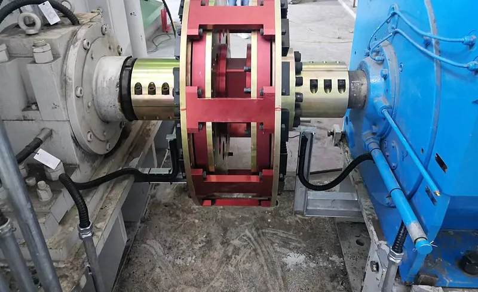
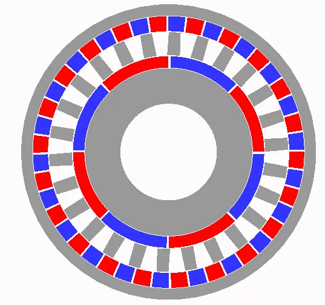

<figure class="eoc-pic eoc-pic-main"><picture><source media="(prefers-reduced-motion: reduce)" srcset="../media/drawn/magnetic-coupling-and-magnetic-gear.svg"></picture><figcaption><strong>Animation.</strong> Diagram drawn for the encyclopaedia from the research notes. ⚑ Needs confirming: a drawing can simplify or get details wrong; a real photo or a better diagram is welcome.</figcaption></figure>
<figure class="eoc-pic"><figcaption><strong>Photo.</strong> <a href="https://commons.wikimedia.org/wiki/File:Magnetic_coupling.jpg">Magnetic coupling</a> by Benzhongo, <a href="https://creativecommons.org/licenses/by-sa/4.0">CC BY-SA 4.0</a>, from Wikimedia Commons.</figcaption></figure>
<figure class="eoc-pic"><figcaption><strong>Cross-section.</strong> <a href="https://commons.wikimedia.org/wiki/File:Magnetgetriebe.png">Magnetgetriebe</a> by Petitebiscotte, <a href="https://creativecommons.org/licenses/by-sa/4.0">CC BY-SA 4.0</a>, from Wikimedia Commons.</figcaption></figure>

Rings or discs of permanent magnets on a driving part and a driven part lock together magnetically across an air gap or a thin non-magnetic wall, so turning force passes without contact (at 1:1 in a coupling, or with a speed change in a magnetic gear) and the parts slip harmlessly past each other if the load gets too high.

**In plain words:** Two spinning parts fitted with magnets, where turning one makes the other turn too without touching, even through a sealed wall, and if the other side gets stuck the magnets just slip instead of breaking anything. **Proper term:** Magnetic coupling (magnetic drive coupling) and magnetic gear.

**Also called:** magnetic drive coupling; magnetic shaft coupling; magnetic disc coupling (face-to-face type); co-axial ([radial](../glossary.md#axial--radial)) magnetic coupling, canned or containment-shell coupling; synchronous magnetic coupling; mag-drive, magnetically coupled drive, sealless drive (pumps); magnetic [torque](../glossary.md#torque) coupler; linear magnetic coupler (straight-line version); eddy-current coupling or drag cup (asynchronous version that always slips a little); magnetic gear, magnetic gearbox, magnetic transmission; [coaxial](../glossary.md#coaxial) magnetic gear, flux-modulated (flux-modulation) magnetic gear, 'vernier' magnetic gear; magnetic spur gear (magnets in place of teeth); magnetic stirrer (the best-known example); magnetic fidget gear (toy).

## How it works

Opposite poles attract, so each magnet on the driving hub pulls the nearest opposite pole on the driven hub; when the driver turns, the follower is dragged round and stays in step (synchronous), with the magnetic field reaching through air or any non-magnetic wall (Magnetic Technologies; K&J Magnetics). Under load the follower lags a few degrees behind, like a stiff spring; if the load needs more torque than the magnets can give, the poles slide past each other and the follower drops out of step and slips, protecting the motor, and a synchronous coupling usually has to be stopped and restarted to lock in again (K&J Magnetics; Michael Smith Engineers). A magnetic gear uses magnets instead of teeth: either two magnet wheels side by side like spur gears, or a coaxial design in which a ring of steel pole pieces between an inner rotor with few poles and an outer rotor with many poles 'modulates' the field so the rotors turn at different speeds (Wikipedia 'Magnetic gear'; Som et al.). A related 'eddy-current' coupling spins a magnet next to a copper or aluminium disc or cup; induced currents drag the disc along with a smooth, speed-dependent slip, as in an old car speedometer (Wikipedia 'Speedometer').

## Parts

A few parts, or a small assembly: a driving hub and a driven hub, each carrying a ring of magnets with alternating north and south poles and each turning on its own shaft and bearings; optionally a steel backing plate behind the magnets, a thrust bearing to take the magnets' pull, and a thin wall between the halves (a boat hull, a tank or pump 'can' of stainless steel, plastic or glass). A coaxial magnetic gear adds a stationary ring of steel pole pieces (bars or screws) between an inner and an outer magnet ring

## Everyday examples

- A laboratory magnetic stirrer, where a spinning magnet under the table drives a plastic-coated stir bar inside the beaker (Wikipedia 'Magnetic stirrer')
- Aquarium and garden-fountain pumps whose impeller is driven through the sealed pump body by a magnet on the motor (Wikipedia 'Magnetic coupling'; 'Centrifugal pump')
- The needle of an old mechanical car speedometer, dragged round by a spinning magnet next to an aluminium cup (an eddy-current coupling) (Wikipedia 'Speedometer')
- Magnetic gear fidget toys and desk spinners, where one magnet wheel turns another without touching (Printables magnetic gear models)

## When to use it

When you need to turn something on the other side of a wall without drilling a hole or fitting a seal: a pump or stirrer in a sealed tank, a propeller through a boat or submarine hull, a mixer in a sealed container, a fan or roller inside a filament drybox. When you want a drive that slips harmlessly on overload or a jam and never needs a part replaced. When shafts are hard to line up exactly, or you want to stop vibration and noise passing from motor to load. For quiet, contact-free, wear-free drives in dirty, wet or vacuum environments, and for magnetic gear toys and demonstrations

## When not to use it

Not for high torque in a small space: toothed gears, belts or rigid couplings carry far more for their size (use a planetary gear set, belt or jaw coupling). Not for holding a load against gravity, since it can slip and let the load drop or run back (use a worm drive or a brake). Not where the output angle must be exact under changing loads, because it winds up like a spring (use a rigid coupling or gears). Not in hot places with standard NdFeB magnets or PLA parts, near compasses, magnetic cards or steel swarf, or where small magnets could reach young children. If you need a slip clutch that re-engages by itself at speed, a friction slip clutch or ball-detent torque limiter may suit better, because a synchronous magnetic coupling usually needs stopping to re-lock

## Details

- **What it does (jobs):**
  - slip or let go when overloaded: the magnets slip past each other when the torque limit is reached, with no parts to break or wear
  - seal it, or pass cables or fluid through: passes turning motion through a sealed, unbroken wall so no shaft seal is needed (pumps, boat hulls, sealed tanks)
  - change speed or turning force: magnetic gears give a speed ratio (e.g. 3:1, 4.25:1, 12:1) without contact
  - let it move (turn, slide or bend): as a flexible, contact-free shaft coupling that tolerates [misalignment](../glossary.md#misalignment) and isolates vibration
- **Movement:** rotate: continuous rotation in either direction (linear versions slide instead)
- **Directions it can move (degrees of freedom):** Between the two halves: effectively 0 while running in step (held at a fixed angle by a magnetic 'spring'), 1 (free relative rotation) once it slips; the halves are not mechanically joined at all, so each needs its own shaft and bearings
- **Special behaviour:**
  - torque-limiting (slips or clicks at a set force/torque): slips when the load exceeds the magnetic pull-out torque, and nothing breaks (Wikipedia 'Magnetic coupling', 'Magnetic gear')
  - [fail-safe](../glossary.md#fail-safe--fail-secure) or breakaway: an overload or jam disconnects the drive instead of damaging the motor or gears; note that a synchronous coupling usually stays slipping until the motor is stopped and restarted (Michael Smith Engineers)
  - self-aligning or self-centring: accepts more shaft misalignment than mechanical couplings (Wikipedia 'Magnetic coupling') and transmits less vibration (K&J Magnetics)
  - quick-release: face-to-face types simply pull apart with no fasteners (e.g. lifting a beaker off a magnetic stirrer) ⚑ [uncertain]
- **How it holds:**
  - magnetic: attraction between opposite poles (or eddy currents induced in a conductor) carries the torque; not a holding joint in the usual sense, since it passes motion on
- **Input and output:** Continuous rotation -> continuous rotation. Coupling: 1:1, in step with no slip below the torque limit (synchronous). Magnetic gears: side-by-side 'spur' magnetic gears give small whole-number ratios (Wikipedia 'Magnetic coupling'); coaxial flux-modulated gears give ratio = number of steel pole pieces / pole pairs on the fast rotor when the outer rotor is held (e.g. 17 pieces and 4 pole pairs = 4.25:1, Som et al.), with ratios from 1.01:1 to 1000:1 reported (Wikipedia 'Magnetic coupling'); printed examples 3:1 (Forge, Printables) and 12:1 with reversal (William Fraser, via Hackaday). Efficiency: no rubbing apart from bearings, so high when running in step through air or plastic ⚑ [uncertain]; a metal wall adds eddy-current losses that rise with the square of speed and the square of the drive radius (Michael Smith Engineers); variable-ratio (field-coil) magnetic gears are below 75% (Wikipedia 'Magnetic gear'). Eddy-current couplings always slip a little, so the output runs slower than the input. Shaft arrangement: in line (face or coaxial types), parallel (spur-type magnetic gears), or at an angle (first-order gears) (Wikipedia 'Magnetic gear'). Back-drivable: yes
- **Power:** passive (no power needed) with permanent magnets. Electromagnet versions exist (e.g. variable-ratio magnetic gears and powered stirrers): they transmit nothing when power is lost
- **Load:** Light for home-made ones, up to heavy in industry. K&J Magnetics estimate a boat coupling with six 5/16 in disc magnets at a 1/8 in gap slips at about 1.08 in-lb (about 0.12 N·m). One maker's co-axial couplings range from 1 in-lb (0.11 N·m) nominal (1.75 in-lb peak) to 2,000 in-lb (about 226 N·m) nominal (Magnetic Technologies). A research coaxial magnetic gear (4.25:1) measured 82.8 N·m peak output torque, 112 N·m per litre (Som et al.). Face-type couplings also pull the two halves together hard, so the bearings must take this axial force (Wikipedia 'Magnetic coupling'). Weak spot: torque is much lower than a toothed gear or rigid coupling of the same size, and it falls quickly as the gap widens (K&J Magnetics; povsky, Printables: 'generally only used for very low torque applications')
- **Play and precision:** No hard [backlash](../glossary.md#backlash), but 'springy backlash' (Wikipedia 'Magnetic gear'): the follower winds up a few degrees behind the driver in proportion to the load until it slips, so it is poor for exact positioning under changing loads. Tolerates more shaft misalignment than mechanical couplings (Wikipedia 'Magnetic coupling'); end float changes the gap and therefore the torque. Commercial co-axial couplings run with a radial air gap of up to about 7 mm (0.275 in) (Magnetic Technologies)
- **Taking it apart:** tool-free quick release for face-to-face and stirrer types (the halves just lift apart); removable for shaft-mounted couplings (each hub comes off its shaft with the usual [set screw](../glossary.md#set-screw) or key)
- **How often it can be reused:** effectively unlimited: nothing touches, so only the bearings wear (Wikipedia 'Magnetic gear': 'wear is limited to bearings')
- **Sealing:** airtight or pressure: the big advantage is that the wall between driver and follower stays unbroken, so a pump or tank needs no rotating shaft seal and cannot leak along the shaft (Wikipedia 'Magnetic coupling'; Wikipedia 'Centrifugal pump', magnetically coupled pumps). The seal is made by the wall or 'can', not by the coupling itself
- **Adjustable:** yes, at build time or with a screw: the slip torque rises with stronger or more magnets and a smaller gap, so changing the gap or the number of magnets changes it (K&J Magnetics removed magnets from their boat coupling to reduce drag). Not usually adjustable while running
- **Access needed:** end of a tube or shaft: each half fits on the end of its own shaft. For a through-wall drive one half sits on each side of the wall, but nothing has to pass through the wall
- **Materials:** Magnets: sintered neodymium-iron-boron (NdFeB) for strength (standard grades up to about 80 °C, special grades to 230 °C) or samarium-cobalt (SmCo) for heat (Wikipedia 'Neodymium magnet'; Michael Smith Engineers). Steel backing (back iron) behind the magnets strengthens the field (K&J Magnetics). Flux-modulator pole pieces must be magnetic steel: printed magnetic gears specify steel, 'NOT STAINLESS', set screws (povsky; Forge, Printables). Walls and 'cans' between the halves must be non-magnetic: plastics (polypropylene, PVDF, PTFE, PFA), fibreglass, glass or stainless steel/Hastelloy (metal walls add eddy-current losses) (Michael Smith Engineers; Magnetic Technologies). Hobby hubs: 3D-printed PLA, PETG or ABS (Forge's gearbox tested in ABS and PLA). Eddy-current couplings use a copper or aluminium disc or cup (Wikipedia 'Speedometer')
- **Heat, cold, water and wear:** Heat: magnets weaken as they warm and can be permanently demagnetised above their rated temperature (Michael Smith Engineers); standard NdFeB grades are rated to about 80 °C, high-temperature grades to 230 °C, and samarium-cobalt higher (Wikipedia 'Neodymium magnet'). When a coupling with a metal wall slips out of step, eddy currents heat the wall (Michael Smith Engineers). Printed PLA carriers soften above about 60 °C (Prusa). Water: sintered NdFeB corrodes and can crumble unless plated or coated, so underwater couplings need coated or sealed magnets (Wikipedia 'Neodymium magnet'). Magnets pick up steel dust and swarf in the gap ⚑ [uncertain]. Vibration: the air gap isolates vibration rather than passing it on (K&J Magnetics; Wikipedia 'Magnetic coupling'). No [creep](../glossary.md#creep) or wear in the coupling itself; permanent magnets lose only a little strength over time at normal temperatures ⚑ [uncertain]

## Making it

- **Ways to make or get it:**
  - 3D print (FDM): magnet carriers, hubs and gear rings with pockets for disc or block magnets
  - off-the-shelf part: neodymium magnets, magnetic stirrer bars and drives, magnetic-drive pumps, industrial co-axial magnetic couplings
  - CNC: metal hubs and thin non-magnetic walls or cans
  - laser cut: acrylic or plywood discs holding magnets ⚑ [uncertain]
- **Printing it in one piece (print in place):** partly: the carriers and gear rings can be printed (even as a [print-in-place](../glossary.md#print-in-place) assembly), but the magnets, and steel pole pieces for a magnetic gear, must be added, e.g. by pausing the print or pressing them in afterwards; a printed 0.2 N·m magnetic torque wrench prints in place and then has two magnets inserted (Printables 587851)
- **Tools:** To build: glue (superglue or epoxy) or a press fit to fix magnets in their pockets, bearings, and the usual screwdriver or hex keys for hubs; a paperclip or rod to push out a wrongly placed magnet (Forge, Printables). To separate: none
- **Difficulty:** moderate: prints easily and uses cheap off-the-shelf magnets and bearings, but you must get the magnet polarities right, glue [brittle](../glossary.md#brittle--ductile) magnets in securely, carry the strong pull between the halves on bearings, and accept low torque; industrial through-wall couplings are bought

### 3D printing tips

Arrange the magnets in a ring with poles alternating north and south facing the other half, which K&J Magnetics found gives the most strength, and match the same pattern on the other half. Check which way each magnet faces before gluing it in (the drybox coupling designer warns that mixing them up does happen), and add small holes behind the pockets so a misplaced magnet can be pushed out with a paperclip (Forge, 3:1 Magnetic Gearbox). Fix magnets with a press fit or superglue; BYU CMR's printed magnetic gears may need superglue depending on printer [tolerance](../glossary.md#tolerance). Keep the gap as small as the wall allows, because torque falls fast with distance, and estimate slip torque before printing with the K&J method (pull force of one magnet pair at your gap x 0.44 x radius x number of magnets). A face-to-face coupling pulls the halves together: support it with a thrust bearing (Wikipedia) or use fewer magnets, as K&J did when too much attraction made their boat's propeller drag on the hull. A steel washer or plate behind the magnets boosts the field (K&J). For a coaxial magnetic gear, the pole pieces must be magnetic (plain steel, not stainless) and their number should equal the sum of the inner and outer pole pairs (Som et al.; povsky and Forge specify steel grub screws). Small magnet pockets need fine detail: povsky's mini gear needs a 0.25 mm or smaller nozzle and a brim; Forge used 3 walls, 13% [infill](../glossary.md#infill) and a 0.4 mm nozzle. For a smooth slip clutch, one maker runs magnets against an iron washer rather than against other magnets, because magnet-to-magnet gives a jerky, stepping slip (GRAVITY magnetic clutch, Printables) ⚑ [uncertain]. Keep it cool: PLA softens above about 60 °C (Prusa) and standard NdFeB magnets are rated to about 80 °C (Wikipedia), so keep motors and hot parts away. Magnets are brittle: don't file or drill them, and keep their plating intact or they corrode (drybox coupling, Printables; Wikipedia 'Neodymium magnet')

### Buying one (off-the-shelf parts)

Neodymium (NdFeB) disc, block and ring magnets (e.g. 6 x 3 mm or 5/16 in discs; nickel-plated), samarium-cobalt magnets for heat, magnetic stirrer bars (stir bars, 'fleas') and stirrer drive magnets, magnetic-drive (mag-drive, sealless) pumps, co-axial and face (disc) magnetic couplings, eddy-current and [hysteresis](../glossary.md#hysteresis) clutches and brakes, deep-groove ball bearings (608, 6082RS, 5 x 10 x 4 mm), thrust bearings, steel (not stainless) grub screws or bars as pole pieces, steel washers or plates as back iron

## Rules of thumb

- Estimate slip torque: find the straight-line pull between one magnet pair at your gap (from a pull-force calculator), multiply by 0.44 to get the sideways ([shear](../glossary.md#peel-vs-shear)) force, then by the distance from the magnet centre to the axis, then by the number of magnets on one side; e.g. two 5/16 in x 1/4 in discs 1/8 in apart pull 1.03 lb, giving about 0.45 lb x 0.4 in x 6 magnets = about 1.08 in-lb (0.12 N·m). K&J say this is only a rough starting point: test it (K&J Magnetics, 'Magnetic Couplers Powering a Boat')
- Coaxial (flux-modulated) magnetic gear: number of steel pole pieces = inner pole pairs + outer pole pairs, and with the outer rotor held, ratio = pole pieces / inner pole pairs, e.g. 4 inner pole pairs, 13 outer pole pairs and 17 pieces give 4.25:1 (Som, Li, Kadel, Wright, Modaresahmadi, Bird and Williams, 'Analysis and Testing of a Coaxial Magnetic Gearbox with Flux Concentration Halbach Rotors', OSTI 1505685)
- Using the difference of the pole pair counts as the number of pole pieces instead makes the output turn the same way as the input (Wikipedia 'Magnetic gear': 20 and 14 magnets with 17 pieces give 10:7 reversed, with 3 pieces 10:7 same direction)
- Side-by-side magnetic 'spur' gears always have ratios of small whole numbers (Wikipedia 'Magnetic coupling')
- Losses in a metal wall between the halves rise with the square of speed and the square of the drive radius, so use a non-metallic wall where you can (Michael Smith Engineers, 'Magnetic Couplings')
- If a synchronous coupling decouples, the load cannot be picked up again until the motor is stopped and restarted (Michael Smith Engineers); start stirrers slowly, since a stir bar jumps about if driven too fast (Wikipedia 'Magnetic stirrer')
- Commercial co-axial couplings work across a radial gap of up to about 7 mm (0.275 in), with peak (slip) torque roughly 1.2-1.75 times the nominal rating in one maker's table (Magnetic Technologies, MTC range; ratio derived from their table)
- Standard NdFeB grades are rated up to about 80 °C and high-temperature grades up to 230 °C; coercivity falls steeply above about 100 °C (Wikipedia 'Neodymium magnet')
- A research coaxial magnetic gear measured 112 N·m per litre, 27% below its predicted torque because its air gap ended up larger than designed, showing how sensitive torque is to the gap (Som et al., OSTI 1505685)

## Common failures

Slips too easily because the gap is too big, the magnets are too small or too few, or the start-up acceleration is too high; and then stays slipping until the motor is stopped (K&J Magnetics; Michael Smith Engineers; Wikipedia 'Magnetic stirrer'). Too much pull between face-to-face halves, so bearings or the parts rub and the motor stalls (K&J Magnetics' boat demo). One or more magnets glued in the wrong way round, which weakens and roughens the drive (drybox coupling tip, Printables). Magnets pulling out of printed pockets or cracking (they are brittle). Pole pieces made of stainless steel in a magnetic gear, which doesn't work because most stainless is not magnetic enough (povsky: use steel, 'NOT STAINLESS'). Magnets weakened by heat or corroded by water (Michael Smith Engineers; Wikipedia 'Neodymium magnet'). Printed carriers softening near a hot motor

## Safety

Strong neodymium magnets can snap together and pinch or even break fingers, and can chip or shatter, throwing sharp fragments (wear eye protection); swallowed small magnets can pinch the intestines together and have killed children, so keep them away from young children and secure them well in toys (Wikipedia 'Neodymium magnet'). Strong fields can wipe magnetic cards and upset nearby sensors (Wikipedia 'Neodymium magnet'). Because the coupling slips on overload, a motor may keep spinning while the load stops; never rely on it to hold a raised load. Pumps: a decoupled drive can overheat a metal containment shell (Michael Smith Engineers)

## Related

- Friction slip clutch (slip coupling, slipper clutch): also slips on overload, but by rubbing friction plates, which wear and heat up; it re-grips on its own as soon as the load drops
- Ball-detent torque limiter: carries more torque for its size and resets itself at a precise torque, but has contacting, wearing parts and no sealed-wall option
- Shear-pin coupling (breakaway link): breaks once at the limit and must be replaced; magnetic couplings just slip and recover
- Eddy-current brake (magnetic brake): the same eddy-current effect used to slow something down instead of drive it
- Magnet joint (embedded magnets, magnetic catch): uses magnets to hold parts together rather than to pass on turning
- Planetary gear set (epicyclic gearing): the toothed relative of the coaxial magnetic gear, much stronger for its size but with contact, wear and backlash
- Jaw coupling (spider coupling) and Oldham coupling: mechanical ways to join slightly misaligned shafts, with more torque but no gap and no slip
- Slip ring and rotary union: another way to pass something (electricity or fluid) across a rotating joint
- Series-elastic coupling: deliberately springy coupling for force control; a magnetic coupling is also springy until it slips
- Torque-limiting gear with flexing spring arms (compliant slip hub): a printable one-piece slip hub with plastic springs instead of magnets

## Make it yourself

- [Mini 3D Printed Magnetic Gear (povsky, Printables)](https://www.printables.com/model/42412-mini-3d-printed-magnetic-gear): Fully printed coaxial magnetic gear needing about 50 small 3 x 2 mm magnets, 12 steel (not stainless) set screws as pole pieces and 3 small bearings; prints without supports but needs a 0.25 mm or finer nozzle (read through the Printables public API; URL seen in search results) *(licence: CC BY)*
- [3:1 Magnetic Gearbox (Forge, Printables)](https://www.printables.com/model/276863-31-magnetic-gearbox): 3:1 'vernier flux modulation' magnetic gearbox using 6 x 3 mm magnets (24 minimum, 64 for maximum torque), steel grub screws and two 608 bearings, with optional Halbach magnet layout; tested in ABS and PLA (read through the Printables public API; URL seen in search results) *(licence: CC BY-SA)*
- [Magnetic Torque Wrench 0,2Nm (Print in place) (Matyáš Moudrý, Printables) (URL from Printables API, page not opened)](https://www.printables.com/model/587851-magnetic-torque-wrench-02nm-print-in-place): Print-in-place 0.2 N·m torque-limiting driver for 1/4 in hex bits in which two 20 x 6 x 2 mm magnets slip past each other at the set torque; a hands-on magnetic torque limiter *(licence: CC BY-SA)*
- [Magnetic coupling system for rc subs/boats (ItsRaptor59802, Printables) (URL from Printables API, page not opened)](https://www.printables.com/model/1691539-magnetic-coupling-system-for-rc-subsboats): Parametric (Onshape) through-hull magnetic coupling for RC boats and submarines, set up for 5 mm spherical magnets and a 3 mm shaft, resizable for other magnets *(licence: CC BY)*

## Pictures, videos and models

- [Magnetic coupling (Wikipedia)](https://en.wikipedia.org/wiki/Magnetic_coupling): Plain explanation of magnetic couplings, face-to-face aquarium pump couplings, overload protection and uses, with a photo of a magnetic drive coupling *(licence: text CC BY-SA 4.0 (reuse with credit); photo File:Magnetic coupling.jpg by Benzhongo, CC BY-SA 4.0)*
- [Magnetgetriebe (Wikimedia Commons, by Petitebiscotte)](https://commons.wikimedia.org/wiki/File:Magnetgetriebe.png): Cross-section diagram of a coaxial magnetic gear: inner and outer magnet rotors with the ring of ferromagnetic pole pieces between them *(licence: CC BY-SA 4.0 (reuse with credit))*
- [Magnetic Couplers Powering a Boat (K&J Magnetics blog)](https://www.kjmagnetics.com/blog/magnetic-coupling): Photos and diagrams of a 3D-printed toy boat whose motor drives the propeller through the hull with a six-magnet face coupling, plus a torque-estimate diagram *(licence: link only)*
- [Magnetic gears : Axial drivetrain proof of concept (William Fraser, YouTube)](https://www.youtube.com/watch?v=m4qPSm_8P1E): Home-made coaxial magnetic gear with a wooden stator holding twelve bolts as pole pieces, giving a 12:1 reversed ratio and slipping under heavy load (described by Hackaday; title confirmed through YouTube oEmbed; not watched) *(licence: link only (YouTube, all rights reserved))*
- [3D Printed Magnetic Gear (Andrew Lipovsky, YouTube)](https://www.youtube.com/watch?v=GbQCNUltI1g): Assembly and demonstration of a 3D-printed magnetic gear built from household magnets, bearings and screws (title and channel confirmed through YouTube oEmbed; not watched) *(licence: link only (YouTube, all rights reserved))*

## Needs confirming

⚑ marks something nobody has confirmed yet: a fact the research could not confirm from a source, a finder value that is a best guess, or an open point from the research notes. Corrections are welcome (see `research/needs-confirming.md`).

- ⚑ 6 sentences on this page marked [uncertain].
- ⚑ Finder value `connects` = shaft (best guess): worked out from its name, but joining parts is not one of its two main jobs
- ⚑ Finder value `made_of` = 3D prints, plastic sheet, tube or moulded parts, wood, metal, carbon fibre or composites, glass or mirror (best guess): proposed from the words in the research text (R37); not yet checked

## Sources

- <https://en.wikipedia.org/wiki/Magnetic_coupling>
- <https://en.wikipedia.org/wiki/Magnetic_gear>
- <https://en.wikipedia.org/wiki/Centrifugal_pump>
- <https://en.wikipedia.org/wiki/Magnetic_stirrer>
- <https://en.wikipedia.org/wiki/Speedometer>
- <https://en.wikipedia.org/wiki/Neodymium_magnet>
- <https://commons.wikimedia.org/wiki/File:Magnetic_coupling.jpg>
- <https://commons.wikimedia.org/wiki/File:Magnetgetriebe.png>
- <https://commons.wikimedia.org/wiki/File:Magnetic_Stirrer.JPG>
- <https://www.kjmagnetics.com/blog/magnetic-coupling>
- <https://www.duramag.com/techtalk/magnetic-couplers/an-overview-of-magnetic-torque-and-linear-couplers/>
- <https://magnetictech.com/magnetic-couplings-co-axial-type/>
- <https://www.michael-smith-engineers.co.uk/resources/useful-info/magnetic-couplings>
- <https://hackaday.com/2020/04/13/simple-demo-shows-the-potential-of-magnetic-gears/>
- <https://www.osti.gov/servlets/purl/1505685>
- <https://help.prusa3d.com/article/pla_2062>
- <https://www.youtube.com/watch?v=m4qPSm_8P1E>
- <https://www.youtube.com/watch?v=GbQCNUltI1g>
- <https://www.youtube.com/watch?v=nZX33zNqwGQ>
- <https://api.printables.com/graphql/>
- <https://www.printables.com/model/42412-mini-3d-printed-magnetic-gear>
- <https://www.printables.com/model/276863-31-magnetic-gearbox>
