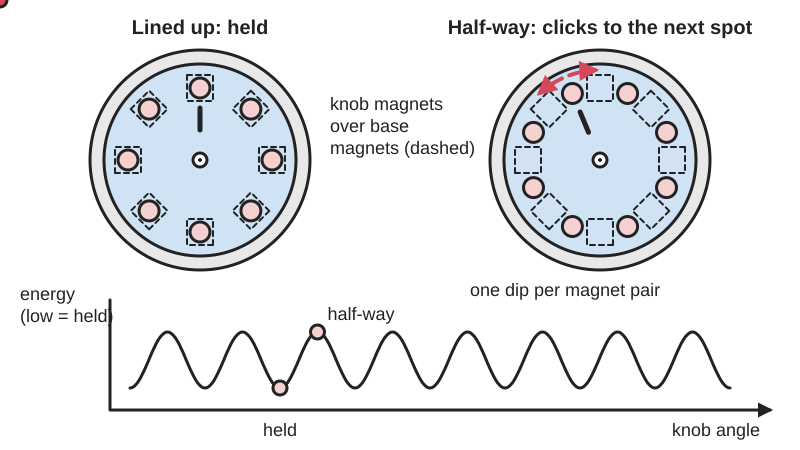
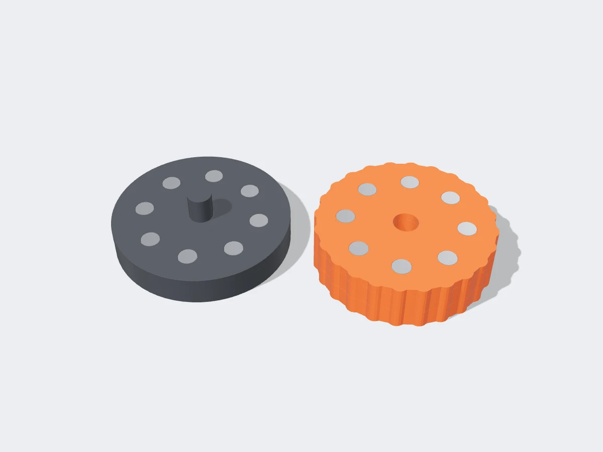

<figure class="eoc-pic eoc-pic-main"><picture><source media="(prefers-reduced-motion: reduce)" srcset="../media/drawn/magnetic-detent.svg"></picture><figcaption><strong>Animation.</strong> Diagram drawn for the encyclopaedia from the research notes. ⚑ Needs confirming: a drawing can simplify or get details wrong; a real photo or a better diagram is welcome.</figcaption></figure>
<figure class="eoc-pic"><figcaption><strong>Render.</strong> A 3D model made for the encyclopaedia, not a photo: a stand-in until a good real photo is found. ⚑ Needs confirming: a model can simplify or get details wrong; a real photo is welcome.</figcaption></figure>

Magnets placed in a moving part and in its housing attract each other (or a small piece of steel) at chosen positions, so a knob, dial, wheel or slider is pulled into and held at those positions with a clean, contact-free click that does not wear.

**In plain words:** Little magnets hidden in a knob, dial or slider and in the part it moves against, so it gets pulled into set positions and stops there with a soft 'thunk', without any springs or bumps rubbing. **Proper term:** Magnetic [detent](../glossary.md#detent) (magnet detent; magnetic indexing).

**Also called:** magnet detent; magnetic click stops / magnetic clicks; magnetic [ratchet](../glossary.md#ratchet) (in mouse scroll wheels); magnetic indexing; attracting steps / repelling steps (the Mechamagnets names for magnet detent profiles); magnetic centre detent (on flight-simulator throttles and joysticks); haptic magnetic knob / magnetic fidget detent; detent [torque](../glossary.md#torque) or cogging torque (the same effect inside stepper and brushless motors, where it is built in); MagSpeed (Logitech, brand: a mouse scroll wheel whose clicks come from a switchable magnet).

## How it works

A magnet is pulled hardest towards another magnet, or towards a small piece of steel, when the two are lined up and as close as possible. Put several magnets around a knob and matching magnets or steel pieces in its base, and every time a pair lines up the knob is pulled into that spot and held there; turning it further means pulling the pair apart until the next pair takes over, which you feel as a click (an 'attracting step'). Magnets that repel can be used the other way round, as bumps you push over (a 'repelling step') or as a magnetic spring (Zheng et al., Mechamagnets). Nothing touches except the bearing, so there is no rubbing part to wear out; Michael Gardi describes the knob or slider accelerating into each position and stopping quickly 'with a nice thunk'.

## Parts

A few parts: the moving part (knob, dial, rotor, slider or lever) with one or more small magnets, the fixed part (housing, base or track) with matching magnets or small steel pieces (screws, nuts, steel balls or steel teeth), and a bearing, shaft or track that guides the movement (often a 608 skateboard ball bearing in printed knobs). Optional: Hall-effect sensors or reed switches to read the position.

## Everyday examples

- The scroll wheel of a Logitech MX Master 3 mouse (brand), whose 'ratchet' clicks come from a magnet pulling on small teeth in the wheel as they pass, instead of a ball and spring (Bolt teardown)
- Turning the shaft of an unpowered stepper motor (for example on a 3D printer) by hand: it feels notchy because its magnets pull it into steps (detent torque; Wikipedia)
- Magnetic fidget coins, sliders and toggle switches that click with a satisfying snap (Printables)
- Printed magnetic centre detents added to flight-simulator throttles (Printables)

## When to use it

Use magnetic detents when you want clicks or set positions that never wear out or change feel, are silent or nearly silent, and need no springs: knobs, rotary switches, dials, sliders, toggles, scroll wheels, throttles and fidget toys. They are especially good in 3D-printed parts, where printed springs and bumps [creep](../glossary.md#creep), wear or break (EG3Dprinting; Gardi), and where you also want to read the position with a reed switch or Hall sensor using the same magnets (Mechamagnets). Good when the parts must work through a closed wall or be sealed, since magnetic force passes through plastic.

## When not to use it

Avoid them when the part must be locked against a real load (use a latch, pin or [self-locking](../glossary.md#self-locking) screw), when you need strong, high-torque indexing (use a ball detent / spring plunger or an indexing plunger with a notch), when the device gets hot (above about 80 °C for standard magnets, or above about 60 °C for PLA housings), near steel swarf, magnetic sensors, compasses or magnetic cards, or in products for small children who might swallow loose magnets. If you need the click strength or number of positions to change in software, use a motor-based haptic knob instead; if you need a cheap all-printed click, a compliant detent ([flexure](../glossary.md#flexure) click arm) needs no extra parts.

## Details

- **What it does (jobs):**
  - click into set positions: gives a knob, dial, wheel, lever or slider a set of stable positions you can feel
  - line parts up exactly: pulls the moving part to the same aligned spot each time (for example over a reed switch or sensor)
- **Movement:** rotate or slide (it adds stops to a part that already turns or slides): unlimited rotation in steps for a knob or fidget coin (for example 6 to 16 steps per turn), limited rotation or flipping for a lever or toggle, or a straight slide with stops for a slider or throttle
- **Directions it can move (degrees of freedom):** 1: the detent does not add or remove a way of moving; it just adds preferred positions along the one way the knob turns or the slider slides (Mechamagnets also shows 2-way planar and tilting versions, such as a joystick that springs back to centre)
- **Special behaviour:**
  - indexing (clicks into set positions): the magnet pairs give firm, repeatable stops, felt as a click or 'thunk', with no rubbing parts
  - self-aligning or self-centring: two magnets pull sideways to centre on each other (K&J Magnetics), so the part settles exactly over each position; Mechamagnets' 'attracting centre' profile uses this to return a joystick or button to centre
  - none of the other listed behaviours: it is not a lock; any push stronger than the magnetic pull moves it to the next position
- **How it holds:**
  - magnetic: the attraction between magnet pairs, or between a magnet and a small steel piece, holds each position
  - shape (the parts interlock; [form-fit](../glossary.md#form-fit--force-fit--material-bond)): a printed shaft, bearing or track guides the movement; it carries the load, not the magnets
- **Input and output:** not applicable: it does not pass motion on; it only adds stable positions to a knob, dial, wheel or slider moved by hand. It can always be pushed on to the next position by a force larger than its [holding force](../glossary.md#holding-force) (it is back-drivable by design).
- **Power:** passive (no power needed): permanent magnets hold every position with no electricity. Powered version: in the Logitech MX Master 3 scroll wheel (brand) an electropermanent magnet is switched on or off by a 25 V pulse to turn the clicks on or off; it needs power only to switch and keeps its last state when power is lost (Bolt teardown).
- **Load:** light: it only holds a hand-operated part in position against light disturbances and gives a click you can feel; it is not a structural joint. Holding force depends strongly on magnet size, grade and gap: a 1/2 in x 1/8 in (12.7 x 3.2 mm) N42 disc pulls 6.44 lb (about 29 N) straight off thick steel but only about 3 lb with a 0.03 in (0.8 mm) gap (K&J). The sideways (detent) force is a fraction of the straight pull ⚑ [uncertain: no detent-force figure found]. The guide (bearing, shaft or track) must carry all other loads.
- **Play and precision:** Play: none from the detent itself, since it has no contact; the bearing or track sets the play, and the Bolt teardown says the magnetic wheel removed the [backlash](../glossary.md#backlash) of the old mechanical detent. [Repeatability](../glossary.md#repeatability--accuracy): good, because magnet pairs pull to centre on each other (K&J), but a weak detent combined with friction can stop slightly short of centre ⚑ [uncertain]. [Misalignment](../glossary.md#misalignment): magnet pairs tolerate small offsets, but the strength falls quickly as the gap grows (K&J); if magnets sit too close together their pulls merge and the clicks blur (Mechamagnets).
- **Taking it apart:** removable: the moving part can usually be lifted off its shaft, bearing or track; the magnets themselves are press-fitted or glued into pockets (semi-permanent) or sealed inside the print during printing (permanent)
- **How often it can be reused:** effectively unlimited: the clicks come from magnetic force, not rubbing, so the click itself does not wear; the Bolt teardown notes the mechanical ball detent it replaced wears and changes feel over time, and EG3Dprinting expects its magnetic toggle to wear out 'much slower, if at all' than a printed-spring version. The bearing and any glue joints set the real limit.
- **Sealing:** none as a joint, but because magnetic force passes through plastic, the magnets can be sealed completely inside the printed parts (by pausing the print, Rapid Elevation), so the mechanism can be enclosed against dust and moisture ⚑ [uncertain: no sealed design tested]
- **Adjustable:** Limited: the click strength can be changed by changing the gap (for example a spacer, or a screw that moves the fixed magnet closer; one Printables throttle detent is designed to be 'adjustable'), the magnet size or grade, or by adding or removing magnets; the number of positions changes only by adding magnet pockets. Motor-based haptic knobs (e.g. SmartKnob) make detents fully adjustable in software, at the cost of a motor and electronics.
- **Access needed:** not applicable: the magnets are built into the knob and its housing during assembly
- **Materials:** Magnets: small sintered neodymium (NdFeB) disc or cube magnets, usually nickel-plated, grades N35 to N52 (e.g. 1/8 x 1/8 in N48 in Mechamagnets; 6 x 3 mm, 8 x 3 mm, 8 x 2 mm or 3 x 1 mm discs in printed fidgets and encoders). Targets: matching magnets, or small steel parts such as M5 nuts (Axel Åkerström's encoder), screws or the small teeth that a magnet pulls on in Logitech's wheel. Housings: printed PLA or PETG (or any non-magnetic plastic, wood or aluminium); the housing must not be steel or it pulls the magnets out of line ⚑ [uncertain]. Bearings: a 608 ball bearing is common in printed knobs.
- **Heat, cold, water and wear:** Heat: standard N-grade neodymium magnets are rated to about 80 °C and lose strength permanently above that, thin discs most of all (K&J); the plastic usually fails first: PLA softens above about 60 °C (Prusa), loosening press-fitted magnets in a hot car. Cold makes neodymium magnets slightly stronger (K&J). Water and humidity: sintered NdFeB corrodes, sometimes crumbling to powder, so plating or sealing matters (Wikipedia 'Neodymium magnet'). Over time: magnets keep their strength if not overheated, so the click does not fade with use (K&J notes no losses from repeated temperature cycles below the rating). Dirt: loose steel particles are attracted to the magnets and can build up in the gap ⚑ [uncertain]. Vibration and shocks can knock a light detent to the next position ⚑ [uncertain].

## Making it

- **Ways to make or get it:**
  - 3D print (FDM): the usual maker route; magnets are pressed or glued into printed pockets, or sealed in by pausing the print (Mechamagnets; Rapid Elevation)
  - 3D print (resin): works the same way with pockets for magnets ⚑ [uncertain: no resin example opened]
  - CNC: drilled or milled magnet pockets in wood, acrylic or aluminium ⚑ [uncertain: no example opened]
  - laser cut: stacked acrylic or plywood layers with holes for magnets ⚑ [uncertain: no example opened]
  - off-the-shelf part: neodymium magnets, ball bearings, reed switches and Hall sensors; mice with magnetic scroll-wheel detents
- **Printing it in one piece (print in place):** partly: the printed parts carry pockets, but magnets must be added, either pressed or glued in after printing or dropped into a cavity during a paused print so they are sealed inside (Rapid Elevation); the moving part usually also needs a bearing or screw
- **Tools:** None to work it. To build: a 3D printer, a drop of cyanoacrylate (super glue) or epoxy if a press fit is loose, a vice or clamp to press magnets in (Dan3A), a small screwdriver for the central screw, and a spare magnet or compass to check polarity
- **Difficulty:** easy: print a knob and base with magnet pockets and press the magnets in; the main traps are getting every magnet's polarity right and keeping the gap small

### 3D printing tips

1) Pockets: make magnet pockets 0.2-0.3 mm larger in diameter than the magnet and exactly its thickness deep for a finger-pressure press fit; keep pockets at least 1-2 mm from outer walls; print a small test piece with two or three pocket sizes first (Rapid Elevation). Mechamagnets press-fits its magnets into printed recesses. 2) Glue only if needed: a tiny drop of super glue for a loose fit, epoxy where the magnet is pulled on repeatedly, never hot glue (it softens and lets magnets creep) (Rapid Elevation; EG3Dprinting). 3) Polarity: mark the faces and test with a spare magnet before fixing anything; wrong polarity is the most common mistake, and a sealed-in magnet can't be turned round (Rapid Elevation). For even clicks, mrfox's fidget coin puts all magnets the same way round; EG3Dprinting's toggle needs the lever magnets to repel the opposite body magnets. 4) Gap: keep the wall between facing magnets as thin as possible, because strength falls fast with distance (K&J: 6.44 lb to 3 lb at 0.8 mm); Mechamagnets still got distinct steps at a gap of half the magnet diameter. 5) Spacing: with 1/8 in magnets, keep neighbouring detent magnets at least 3/8 in (about 3 magnet diameters) apart, or their fields merge and the steps flatten out (Mechamagnets). 6) Steel instead of a second magnet: small steel pieces such as M5 nuts work as targets (Axel Åkerström's encoder), but use small pieces; a magnet on a big steel plate has no centring pull (K&J). 7) Low friction matters: use a ball bearing (608) for knobs and don't overtighten the central screw (mrfox), because friction between printed parts can swamp weak magnetic forces (Mechamagnets found this ruled out some planar and tilting designs). 8) Mid-print insertion: keep magnets away from the nozzle and the magnetic print bed, since some nozzles (even some sold as brass) are magnetic enough to grab a magnet, and a strong magnet can flip the polarity of the magnetic bed's magnets; side-insertion pockets avoid this (Hackaday, 2026). Never press magnets in with a soldering iron like [heat-set inserts](../glossary.md#heat-set-insert): the heat demagnetises them (Hackaday, 2026). 9) Keep reed switches or Hall sensors far enough from the detent magnets that they aren't triggered by them (Gardi; Mechamagnets suggests 10 mm for its sensors).

### Buying one (off-the-shelf parts)

Neodymium disc magnets (NdFeB, nickel-plated; e.g. 6 x 3 mm, 8 x 3 mm, 1/8 x 1/8 in N48) or cube magnets (5 x 5 x 5 mm); steel hex nuts, screws or steel balls as targets; 608 ball bearings (608-2RS, skateboard bearings); M3 countersunk screws; reed switches (e.g. Digi-Key 2010-1087-ND, used by Michael Gardi) or Hall-effect sensors (linear: Allegro A1324 and A1308 in Mechamagnets; switching: A3144 in Axel Åkerström's encoder) to read the position. Ready-made products with magnetic detents: mice with magnetic scroll wheels such as the Logitech MX Master 3 (brand); stepper motors, which have a built-in magnetic detent (detent torque).

## Rules of thumb

- Gap kills strength: a 1/2 x 1/8 in N42 disc pulls 6.44 lb on thick steel but only about 3 lb with 0.03 in (0.8 mm) of paper in between (K&J 'How much will a magnet hold?'). Keep the plastic between magnets as thin as you can print reliably.
- Across a gap, magnet-to-magnet pulls harder than magnet-to-steel (with about a 1/16 in gap, 3 lb versus 2.3 lb for the same magnet), and only magnet pairs pull each other to centre; a magnet on a steel plate larger than itself has no centring force (K&J 'Magnets vs. steel'). For crisp detents, use magnet pairs or small steel targets.
- Mechamagnets (1/8 x 1/8 in N48 magnets in FDM parts): distinct steps remain at a gap of 0.5 x magnet diameter; at a lateral spacing of 3 x diameter (3/8 in) neighbouring magnets no longer affect each other, so keep detent magnets at least that far apart (Zheng et al., TEI 2019).
- Mechamagnets' knob felt best with 16 steps per turn ('a satisfying sequence of light bumps'); its Switch Snake modules use three steps 30 degrees apart (Zheng et al., TEI 2019).
- Magnet pockets: 0.2-0.3 mm larger in diameter than the magnet, depth equal to its thickness, at least 1-2 mm from outer walls, and 2-3 solid layers under a pocket that is sealed by a paused print (Rapid Elevation 'Magnets in prints').
- Standard N-grade neodymium magnets are rated to about 80 °C; above that they lose strength for good (a thin 1/2 x 1/8 in N42 disc kept only about 60% of its strength after reaching 100 °C), and thin N52 magnets can have an even lower limit than N42 (K&J 'Temperature and neodymium magnets'). Up to the rated temperature losses are temporary, typically 5-10%.
- Stepper motors show the same effect built in: permanent-magnet steppers have a detent torque with a stable position every step that can hold position with the power off, but it is often too weak for that job (Wikipedia 'Stepper motor').

## Common failures

1) Wrong polarity: magnets repel where they should attract, or the clicks are uneven; test with a spare magnet before gluing or sealing (Rapid Elevation; EG3Dprinting). 2) Weak or no clicks: magnets too weak (a cheap low-grade magnet failed to 'grip' at all in Dan3A's throttle detent) or the gap too big (K&J); use a higher grade, bigger magnets or thinner walls. 3) Magnets fall out or shift: fix loose press fits with a tiny drop of super glue or epoxy, not hot glue (Rapid Elevation; EG3Dprinting). 4) Blurred or merged clicks: magnets placed too close together (Mechamagnets). 5) No centring with a large steel target (K&J): use small steel pieces or magnet pairs. 6) Too much friction: an overtightened screw or rubbing printed surfaces stop the knob short of each position (mrfox; Mechamagnets). 7) Position sensors triggered by the detent magnets themselves (Gardi; Mechamagnets): separate them. 8) Magnets weakened by heat: from a soldering iron when installing (Hackaday 2026) or from a hot environment (K&J).

## Safety

Small neodymium magnets are dangerous if swallowed: two or more can pull together through the intestine walls and need emergency surgery, so glue or seal magnets in and keep loose magnets away from children and pets (K&J safety page; Wikipedia; Hackaday 2026). Magnets that snap together can pinch skin and can chip or shatter, so wear eye protection when handling them (K&J; Wikipedia). Strong magnets can affect pacemakers and other implanted devices (K&J). When inserting magnets mid-print, keep them away from the printer's nozzle and magnetic bed sheet (Hackaday 2026).

## Related

- Ball detent (spring plunger): a spring pushes a ball into dimples; stronger and adjustable, but the parts rub and wear
- Compliant detent (flexure click arm): a printed springy arm clicks into notches; no extra parts, but it wears, creeps and can break
- Detent hinge: a hinge with built-in click positions, usually by springs or cams
- Magnetic joint (embedded magnets, magnetic catch): uses the same magnets to hold two parts together, but does not give a series of positions
- Magnetic coupling and magnetic gear: magnets transmit turning force without contact and slip at a limit; the 'cogging' that magnetic detents use is a side effect there
- Electropermanent magnet: a magnet that can be switched on and off with a pulse; used to switch magnetic detents on and off (Logitech MagSpeed)
- Motor-based haptic knob (e.g. SmartKnob): a brushless motor creates 'virtual detents' whose number and strength are set in software; SmartKnob's README notes that cheap gimbal motors have unwanted cogging, which is an accidental magnetic detent
- Stepper motor detent torque: the built-in magnetic detent of permanent-magnet stepper motors (Wikipedia 'Detent')
- Indexing plunger and ratchet-and-pawl: positive, lockable indexing for real loads

## Make it yourself

- [Rotating Magnetic Detent Fidget Coin – Haptic EDC (mrfox, Printables) (URL from Printables API, page not opened)](https://www.printables.com/model/1780603-rotating-magnetic-detent-fidget-coin-haptic-edc): Two printed halves on a 608 bearing with 6 to 12 6 x 3 mm magnets that snap past each other as detents; print and assembly notes *(licence: CC BY-NC)*
- [Tactile Magnetic Rotary Encoder (Heavy Detents) (Axel Åkerström, Printables) (URL from Printables API, page not opened)](https://www.printables.com/model/1786954-tactile-magnetic-rotary-encoder-heavy-detents): Printed rotary encoder knob with twelve 8 x 2 mm magnets, M5 nuts as steel detent targets, a 608 bearing and two A3144 Hall sensors *(licence: CC BY-SA)*
- [Magnetic Fidget Toggle Switch (EG3Dprinting, Printables) (URL from Printables API, page not opened)](https://www.printables.com/model/128549-magnetic-fidget-toggle-switch): A two-position toggle that snaps over using four 8 x 3 mm magnets instead of a printed spring; notes on magnet orientation and gluing (details read via the Printables API) *(licence: CC BY-NC-SA)*
- [Magnetic tactile detent fidget toy (warewolf, Printables) (URL from Printables API, page not opened)](https://www.printables.com/model/371361-magnetic-tactile-detent-fidget-toy): Parametric rotating fidget with twelve 3 x 1 mm disc magnets facing each other across a 608 bearing *(licence: CC BY-NC-SA)*
- [Magnetic Center Detente for Thrustmaster T16000m throttle (TWCS) (ByzantineDavid, Printables) (URL from Printables API, page not opened)](https://www.printables.com/model/31219-magnetic-center-detente-for-thrustmaster-t16000m-t): A printed add-on that gives a flight-simulator throttle a magnetic centre stop using two 2 x 10 mm magnets and two M3 screws *(licence: CC Public Domain)*
- [Mechamagnets repository (Clement Zheng, GitHub), README](https://raw.githubusercontent.com/clementzheng/mechamagnets/master/README.md): STL and Fusion 360 files for the Mechamagnets taxonomy of magnet-detent knobs, buttons, sliders and joysticks, plus example devices, Hall-sensor schematics and code *(licence: no licence file found ⚑ [uncertain])*

## Pictures, videos and models

- [Mechamagnets: Designing and Fabricating Haptic and Functional Physical Inputs with Embedded Magnets (Zheng et al., TEI 2019, PDF)](https://files.cargocollective.com/c45711/Zheng_Mechamagnets.pdf): Diagrams of six magnet 'haptic profiles' (attracting and repelling centre, steps and end), force-displacement graphs, a taxonomy of 25 printed knobs, buttons, sliders and joysticks with magnet layouts, and photos of finished devices *(licence: ACM copyright; link and cite only)*
- [Making Custom 3D Printed Slide Switches (Hackaday, 2020)](https://hackaday.com/2020/01/08/making-custom-3d-printed-slide-switches/): Photos and explanation of Michael Gardi's printed slide switch, where 6 x 3 mm magnets in the track and shuttle give detents you can feel and hear *(licence: link only)*
- [Mostly 3D Printed Push Button (Michael Gardi, Hackaday.io)](https://hackaday.io/project/169563-mostly-3d-printed-push-button): Photos of printed switches using magnets as detents and as a spring, with design lessons on placing magnets and reed switches *(licence: link only)*
- [Logitech MX Master 3 vs 2S Teardown (Bolt)](https://blog.bolt.io/logitech-mx-master-3-vs-2s/): Teardown photos comparing a mouse wheel's mechanical ball detent with its replacement magnetic detent, plus the oscilloscope trace of the switching pulse *(licence: link only)*

## Needs confirming

⚑ marks something nobody has confirmed yet: a fact the research could not confirm from a source, a finder value that is a best guess, or an open point from the research notes. Corrections are welcome (see `research/needs-confirming.md`).

- ⚑ 10 sentences on this page marked [uncertain].
- ⚑ Finder value `seal` = none (source uncertain): `seal` is marked ⚑ [uncertain] here: "…levation), so the mechanism can be enclosed against dust and moisture ⚑ [uncertain:…"

## Sources

- <https://files.cargocollective.com/c45711/Zheng_Mechamagnets.pdf>
- <https://raw.githubusercontent.com/clementzheng/mechamagnets/master/README.md>
- <https://hackaday.io/project/169563-mostly-3d-printed-push-button>
- <https://hackaday.com/2020/01/08/making-custom-3d-printed-slide-switches/>
- <https://blog.bolt.io/logitech-mx-master-3-vs-2s/>
- <https://en.wikipedia.org/wiki/Detent>
- <https://en.wikipedia.org/wiki/Stepper_motor>
- <https://en.wikipedia.org/wiki/Cogging_torque>
- <https://en.wikipedia.org/wiki/Neodymium_magnet>
- <https://www.kjmagnetics.com/blog/temperature-and-neodymium-magnets>
- <https://www.kjmagnetics.com/blog/how-much-will-a-magnet-hold>
- <https://www.kjmagnetics.com/blog/magnets-vs-steel>
- <https://www.kjmagnetics.com/safety.asp>
- <https://rapidelevation.com/article-07-magnets-in-prints.html>
- <https://hackaday.com/2026/06/04/ways-to-embed-magnets-in-3d-prints-and-not-ruin-printers/>
- <https://raw.githubusercontent.com/scottbez1/smartknob/master/README.md>
- <https://help.prusa3d.com/article/pla_2062>
- <https://api.printables.com/graphql/>
- <https://www.printables.com/model/1780603-rotating-magnetic-detent-fidget-coin-haptic-edc (URL from Printables API, page not opened)>
- <https://www.printables.com/model/1786954-tactile-magnetic-rotary-encoder-heavy-detents (URL from Printables API, page not opened)>
- <https://www.printables.com/model/128549-magnetic-fidget-toggle-switch (URL from search results and Printables API, page not opened)>
- <https://www.printables.com/model/371361-magnetic-tactile-detent-fidget-toy (URL from Printables API, page not opened)>
- <https://www.printables.com/model/31219-magnetic-center-detente-for-thrustmaster-t16000m-t (URL from Printables API, page not opened)>
- <https://www.printables.com/model/188961-adjustable-magnetic-detent-for-thrustmaster-twcs-t (URL from Printables API, page not opened)>
