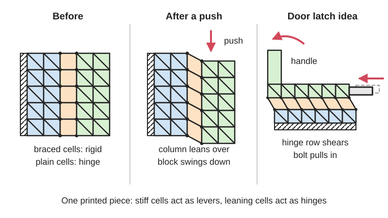

<figure class="eoc-pic eoc-pic-main"><picture><source media="(prefers-reduced-motion: reduce)" srcset="../media/drawn/mechanical-metamaterial-mechanism.svg"></picture><figcaption><strong>Animation.</strong> Diagram drawn for the encyclopaedia from the research notes. ⚑ Needs confirming: a drawing can simplify or get details wrong; a real photo or a better diagram is welcome.</figcaption></figure>

A one-piece block made of a regular grid of tiny cells, where rigid cells act as levers and cells that can [shear](../glossary.md#peel-vs-shear) act as hinges and springs, so the whole block works as a mechanism such as a latch, pliers or [linkage](../glossary.md#linkage) with no assembly.

**In plain words:** A single block of 3D-printed grid cells, some stiff and some that can lean over, laid out so that pushing or turning one part makes another part move, like a door handle and latch made from one piece of rubbery plastic. **Proper term:** Metamaterial mechanism (shear-cell mechanism with hinge arrays).

**Also called:** metamaterial mechanism; mechanical metamaterial (the wider family of materials whose behaviour comes from their inner cell structure); architected material or cellular material; shear cell or shearing cell (the cell type that lets it move); hinge array (a strip of shear cells acting as one hinge); cell-based mechanism or single-block mechanism; programmable mechanical metamaterial; digital mechanical metamaterial (versions with [bistable](../glossary.md#bistable) spring cells that pass a mechanical signal, e.g. a combination lock); metamaterial door latch (the best-known example); compliant rolling-contact architected material (CRAM, a lattice made of rolling-contact joints).

## How it works

Every cell sits on a square grid. A cell with a diagonal brace keeps its shape, while a shear cell can lean over into a parallelogram because its corners are tiny [living hinges](../glossary.md#living-hinge); its opposite sides stay parallel as it leans (Ion et al. 2016; Ion et al. 2019). Strips of shear cells (hinge arrays) placed between rigid regions let those regions turn or slide relative to each other, so the block behaves like levers joined by pins, for example a four-bar linkage. In the HPI door latch, turning the handle makes a central hinge array shear and pull the latch bolt inwards, while other cells act as the return springs (Ion et al. 2016).

## Parts

Single piece: one block of one material built from a grid of cells. Rigid cells have a diagonal brace; shear cells have no brace and are made of small bars joined by tiny living hinges; rows of shear cells form hinge arrays, and blocks of rigid cells form handles, levers and latch bolts (Ion et al. 2016).

## Everyday examples

- No common household product yet; the best-known example is HPI's one-piece 3D-printed door handle and latch (Ion et al. 2016; Hackaday 2016)
- HPI's one-piece metamaterial pliers, pantograph and walking Jansen linkage (Ion et al. 2016)
- A rubber block from a Dutch physics lab that counts to ten, one flipped beam per press (Hackaday 2023)
- Auxetic 'rotating squares' pads and sheets that get wider when stretched (a related metamaterial, not a mechanism) (Printables 850437)

## When to use it

Use a metamaterial mechanism when you want a whole mechanism, such as a latch, gripper, lever pair, linkage or toy, printed as one piece with no assembly, no pins, no [lubrication](../glossary.md#lubrication) and no play, and when the forces are small to moderate. It suits flexible-filament printing, soft robots and interactive objects, and it is a good way to explore how hinges and linkages behave, especially with HPI's editor (Ion et al. 2016).

## When not to use it

Avoid it for continuous rotation (use a shaft and bearing or gears), for heavy loads or anything security-related (use a metal latch or lock), for precise positioning (use a [flexure](../glossary.md#flexure) stage or pinned linkage), and for mechanisms that must move with a very light touch, since adding cells makes it stiffer (Ion et al. 2016). If you only need one hinge, a living hinge or flexure hinge is simpler; if you need a springy one-piece tool in PLA, a conventional [compliant mechanism](../glossary.md#compliant-mechanism) with thicker links and one flexure may work better (ProfHankD).

## Details

- **What it does (jobs):**
  - change the kind of motion: the metamaterial door latch turns the handle's rotation into the latch's sliding motion (HPI)
  - let it move (turn, slide or bend): hinges, four-bar linkages, pliers and a pantograph made only of cells (Ion et al. 2016)
  - store energy: some cells act as built-in springs that return the handle and latch (Ion et al. 2016)
  - lock, and release by hand: the door latch and the 'digital' combination-lock versions (HPI)
- **Movement:** flex: the shear cells lean and their tiny hinges bend, producing a limited turn or short slide of the rigid regions; it cannot produce continuous rotation, so a walker needs a separate axle (Ion et al. 2016)
- **Directions it can move (degrees of freedom):** Usually 1 for a finished mechanism (one input movement coupled to one output), but it depends on the cell layout: each shear cell adds freedom that neighbouring rigid cells can remove, and HPI count the freedoms with a constraint graph (Ion et al. 2019). Unwanted soft directions, such as bulging out of plane, have to be blocked with support cells (Ion et al. 2016)
- **Special behaviour:**
  - motion conversion (e.g. rotary to linear): the door latch converts handle rotation into latch sliding (Ion et al. 2016)
  - [over-centre](../glossary.md#over-centre) (snaps past a point and stays): 'digital' metamaterial cells contain a bistable spring that discharges and triggers its neighbours, used to build logic and a combination lock (Ion et al. 2017, HPI)
  - none otherwise: most metamaterial mechanisms simply spring back to their rest shape when released
- **How it holds:**
  - not a holding joint (it moves or passes on motion): it is a one-piece mechanism
  - spring force (a spring or springy part presses it in place): in the door latch, springy cells push the latch bolt out and the handle back (Ion et al. 2016)
- **Input and output:** Depends on the design: handle rotation -> latch slide (door latch); squeezing handles -> closing jaws (pliers); one pen's movement -> a copied movement (pantograph). The ratio and path are set by the cell layout. Some input energy goes into bending the hinges and adding cells makes it stiffer, so it needs a noticeable operating force (Ion et al. 2016); efficiency ⚑ [uncertain]. Back-drivable: yes, it is elastic, but pushing the output along its path does not move the input back along the same path (Ion et al. 2019)
- **Power:** passive (no power needed); even the 'digital' versions are powered only by bistable springs that the user re-cocks (HPI 2017; Hackaday 2017)
- **Load:** light: the demos are printed in soft TPU, and a PLA metamaterial-style pair of pliers is 'only useful for relatively gentle work' and easily broken by too much force (ProfHankD, Printables). Weak out of the plane of the cells, where it can buckle unless supported by extra cells (Ion et al. 2016)
- **Play and precision:** Play: none, because it has no pins or sliding parts and moves by bending with virtually no friction (Ion et al. 2016). Precision: modest; HPI's physical test mechanisms followed their simulated paths with a mean error of 8.1% (Ion et al. 2019), and very soft TPU versions flop around under load (ProfHankD). [Misalignment](../glossary.md#misalignment): forces in unintended directions and out-of-plane buckling must be resisted by padding cells (Ion et al. 2016)
- **Taking it apart:** permanent: it is a single piece, so there is nothing to take apart
- **How often it can be reused:** not applicable for assembly (single piece). As a mechanism it can be worked many times if its hinges stay within their elastic range: HPI ran a TPU (NinjaFlex) Jansen walker about 5000 times with a power drill with no visible [fatigue](../glossary.md#fatigue) (Ion et al. 2016); stiffer ABS copies cracked quickly (ProfHankD, Printables)
- **Sealing:** none
- **Adjustable:** no: behaviour is fixed by the cell layout and material; changing it means redesigning and reprinting
- **Access needed:** not applicable
- **Materials:** Flexible TPU filaments (NinjaFlex, SemiFlex) work best among common 3D-printing materials, better than PLA and some photo-curing resins; spring steel would be ideal but cannot be printed; for 2D laser-cut versions 3 mm rubber foam worked best, while ABS sheet and acrylic were not compliant enough (Ion et al. 2016). Laser-cut acrylic links with TPU hinges were used in Ion et al. 2019. PLA can work if stiff and flexible regions are designed so bending does not overstress their joints (ProfHankD HingePliers). Laser-cut PTFE (Teflon) sheet was used for rolling-contact lattices (Nature Communications 2018)
- **Heat, cold, water and wear:** Flexible TPU parts are soft and lose [stiffness](../glossary.md#stiffness) when warm; the maker cannot rely on them for load-bearing parts in hot places ⚑ [uncertain]. Thin hinges fatigue if bent beyond the elastic range (Ion et al. 2016). Plastic springs relax under steady load, so a latch held open for long periods may weaken ⚑ [uncertain]. Stiff PLA or ABS versions crack at hinge points if over-flexed (ProfHankD).

## Making it

- **Ways to make or get it:**
  - 3D print (FDM): one-piece mechanisms in flexible TPU, printed on an Ultimaker 2 in HPI's work (Ion et al. 2016)
  - 3D print (resin): possible, but some photo-curing resins are too [brittle](../glossary.md#brittle--ductile) (Ion et al. 2016); flexible resins may work ⚑ [uncertain]
  - laser cut: flat (2D) versions from 3 mm rubber foam (Ion et al. 2016), or acrylic links joined by printed TPU hinges (Ion et al. 2019)
- **Printing it in one piece (print in place):** yes: the whole mechanism prints as one working piece with no assembly (Ion et al. 2016); mechanisms that need continuous rotation, such as a walker, need a separate axle added
- **Tools:** none (a 3D printer or laser cutter to make it)
- **Difficulty:** moderate to hard: it prints in one piece with no assembly, but getting a working cell layout is unintuitive, thin hinges need a well-tuned printer, and flexible TPU is harder to print than PLA ⚑ [uncertain]; start from HPI's editor and published models (Ion et al. 2016; Ion et al. 2019)

### 3D printing tips

Use a flexible, springy filament: HPI printed all their demos in TPU (NinjaFlex) and found TPU works better than PLA or brittle resins, while ABS and acrylic sheet were too stiff (Ion et al. 2016). Shear cells work best when their internal hinges are thin, which needs a printer that can print fine detail reliably (Ion et al. 2016). Do not rely on a single thin hinge between two cells: it rips off easily, so build hinges as arrays of shear cells, and add a border of rigid cells around hinge arrays so all the little hinges share the load (a stretched array without the border broke at its central hinge) (Ion et al. 2016). Add padding cells around the moving part to stop the block buckling out of plane and to resist pushes in the wrong direction (Ion et al. 2016). Only bend the cells as far as they fully spring back: kept within its elastic range, HPI's TPU Jansen walker survived about 5000 cycles (Ion et al. 2016). If you use stiff PLA instead, design stiff regions and a separate springy flexure so bending never loads the joints between them: ProfHankD's PLA HingePliers print without supports in under an hour, use a 0.75 mm gap between the interlocking hinge surfaces, 0.25 mm layers and at least 25% [infill](../glossary.md#infill), and warn that some slicers can break the thin spring into fragments, while his ABS copy of HPI's cell pattern cracked and his NinjaFlex version was too floppy (Printables 282608 and 282587). Check your slicer preview to make sure thin hinge walls are actually printed ⚑ [uncertain].

### Buying one (off-the-shelf parts)

None needed; it is one printed part. Materials to search for: flexible TPU filament (e.g. 'NinjaFlex (brand)', 'SemiFlex (brand)', Shore 85A to 95A TPU ⚑ [uncertain]), rubber or EVA foam sheet for laser cutting ⚑ [uncertain], and a separate axle or shaft if continuous rotation is needed (Ion et al. 2016).

## Rules of thumb

- Rigid cells are made rigid by one diagonal brace; a second diagonal is possible but not necessary (Ion et al. 2016)
- Shear cells keep opposite edges parallel as they lean, and rigid cells also keep their angles, so a whole mechanism can be analysed by following these two constraints across the grid (Ion et al. 2019)
- Build hinges as arrays of shear cells with a border of rigid cells, not as a single thin living hinge (Ion et al. 2016)
- More cells make it stiffer, so metamaterial mechanisms are unsuitable for mechanisms that must work with very small forces; they also cannot rotate continuously (Ion et al. 2016)
- Keep deformation in the elastic range; a TPU walker ran about 5000 cycles at about 120 rpm without visible fatigue (Ion et al. 2016)
- Driving the output along its path does not retrace the input path, and output paths usually have about the same number of inflection points as the input path (Ion et al. 2019)
- For stiff PLA designs: 0.75 mm gap between interlocking [print-in-place](../glossary.md#print-in-place) hinge surfaces and at least 25% infill (ProfHankD, HingePliers, Printables)

## Common failures

A single thin hinge or the central hinge of an array tearing when stretched; fix with hinge arrays and rigid-cell borders (Ion et al. 2016). The block buckling out of plane or moving the wrong way; add padding and support cells (Ion et al. 2016). Stiff materials (ABS, acrylic) cracking or not moving enough, and very soft TPU flopping so the rigid parts are not really rigid (Ion et al. 2016; ProfHankD). Thin hinges printing badly on a low-resolution printer (Ion et al. 2016), or a slicer breaking thin springs into fragments (ProfHankD). The real part moving differently from the simulation, by about 8% on average in HPI's tests (Ion et al. 2019).

## Safety

None known for small demos. Do not use a printed plastic latch or combination lock to secure anything valuable; a Hackaday commenter noted a safe is 'perhaps the worst application for plastics' (Hackaday 2017).

## Related

- Compliant mechanism with flexure hinges: the same bend-instead-of-pivot idea, but designed as a few links and flexures rather than a grid of repeated cells
- Living hinge: one thin flexing strip; the naive single hinge that metamaterial hinge arrays reinforce (Ion et al. 2016)
- Bistable compliant mechanism: a single snap-through part; 'digital' metamaterials chain bistable cells to pass a signal
- Compliant gripper and force amplifier: one-piece bending tools like pliers, usually designed from beams rather than cells
- Rolling-contact joint: lattices of rolling-contact joints form compliant rolling-contact architected materials with very large, low-stress shape changes (Nature Communications 2018)
- Origami mechanisms and [kerf](../glossary.md#kerf) bending: other ways of turning a pattern in flat material into a moving mechanism
- Auxetic structures: metamaterials that expand sideways when stretched; a material property rather than a mechanism
- Lamina emergent torsional (LET) joint: a pattern of cuts in a flat sheet that lets part of it twist out of plane like a hinge

## Make it yourself

- [Metamaterial Mechanisms Editor (online)](https://jfrohnhofen.github.io/metamaterial-mechanisms/): HPI's browser-based voxel editor for placing rigid and shear cells; the force simulation only works in the downloadable Windows version (per the project README) *(licence: not stated (no licence file found in the repository) ⚑ [uncertain])*
- [metamaterial-mechanisms editor source code README (GitHub, jfrohnhofen)](https://raw.githubusercontent.com/jfrohnhofen/metamaterial-mechanisms/master/README.md): Install instructions for the editor (node.js) and the simulation (Rhino 5, Grasshopper and Karamba on Windows); links to the Thingiverse collection of printable models *(licence: not stated ⚑ [uncertain])*
- [metamaterial DOOR LATCH by HassoPlattnerInstitute_HCI (Thingiverse) (title from search results; page opened but its content did not load for the research tool)](https://www.thingiverse.com/thing:2082638): Printable files for HPI's one-piece metamaterial door latch *(licence: ⚑ [uncertain])*
- [HingePliers (a metamaterials experiment) (ProfHankD, Printables) (URL from Printables API, page not opened)](https://www.printables.com/model/282608-hingepliers-a-metamaterials-experiment): One-piece PLA long-nose pliers with a print-in-place hinge and built-in spring, plus notes on why ABS and NinjaFlex copies of HPI's cell pattern failed; print settings included *(licence: CC BY)*
- [Mini HingePliers (a metamaterials experiment) (ProfHankD, Printables) (URL from Printables API, page not opened)](https://www.printables.com/model/282587-mini-hingepliers-a-metamaterials-experiment): Smaller, beefier one-piece version of the HingePliers; prints without supports *(licence: CC BY)*
- [Auxetic structure | Metamaterial (Filip Zitko, Printables) (URL from Printables API, page not opened)](https://www.printables.com/model/850437-auxetic-structure-metamaterial): Demonstration samples of an auxetic metamaterial that gets wider when pulled; the star sample needs flexible filament. A related metamaterial rather than a mechanism *(licence: CC BY)*

## Pictures, videos and models

- [Metamaterial Mechanisms (Hasso Plattner Institute, HCI Lab)](https://hpi.de/baudisch/projects/metamaterial-mechanisms.html): Project page with pictures of the one-piece door latch, pliers, pantograph and Jansen walker, an explanation of the shear cell, and links to the paper, video, editor, source code and printable files *(licence: link only)*
- [Metamaterial Mechanisms (UIST'16) (HassoPlattnerInstitute HCI, YouTube)](https://www.youtube.com/watch?v=lsTiWYSfPck): Research video of the metamaterial mechanisms (title and channel confirmed via YouTube oEmbed; video not watched) *(licence: link only)*
- [Metamaterial Mechanisms (Ion et al., UIST 2016, authors' copy PDF)](https://hpi.de/oldsite/fileadmin/user_upload/fachgebiete/baudisch/projects/metamaterial/metamaterial-mechanisms/2016UIST_Metamaterial_Mechanisms__authors_copy_.pdf): Paper with diagrams of rigid cells, shear cells, hinge arrays with rigid borders, the door latch before and after turning, and the editor *(licence: link only (ACM copyright))*
- [3D Printed Door Latch Has One Moving Part - Itself! (Hackaday, 2016)](https://hackaday.com/2016/09/14/3d-printed-door-latch-has-one-moving-part-itself/): Article with pictures of the TPU door latch and other demos, plus reader discussion of durability and practicality *(licence: link only)*
- [Compliant rolling-contact architected materials for shape reconfigurability (Nature Communications, 2018)](https://www.nature.com/articles/s41467-018-07073-5): Open-access paper with figures comparing metamaterial building blocks (sharp-tip hinges, notch flexures, buckled beams, creases) and lattices made of rolling-contact joints, with supplementary movies *(licence: CC BY 4.0)*

## Needs confirming

⚑ marks something nobody has confirmed yet: a fact the research could not confirm from a source, a finder value that is a best guess, or an open point from the research notes. Corrections are welcome (see `research/needs-confirming.md`).

- ⚑ 11 sentences on this page marked [uncertain].
- ⚑ Finder value `connects` = lid, door or cover (best guess): worked out from its name, but joining parts is not one of its two main jobs
- ⚑ Finder value `motion_in` = steady turning (best guess): could not read both sides of `input_output`: "Depends on the design: handle rotation -> latch slide (door latch); squeezing handles -> c..."
- ⚑ Finder value `motion_out` = not applicable (best guess): could not read both sides of `input_output`: "Depends on the design: handle rotation -> latch slide (door latch); squeezing handles -> c..."
- ⚑ Finder value `shaft_layout` = not applicable (best guess): could not read both sides of `input_output`: "Depends on the design: handle rotation -> latch slide (door latch); squeezing handles -> c..."

## Sources

- <https://hpi.de/baudisch/projects/metamaterial-mechanisms.html>
- <https://hpi.de/oldsite/fileadmin/user_upload/fachgebiete/baudisch/projects/metamaterial/metamaterial-mechanisms/2016UIST_Metamaterial_Mechanisms__authors_copy_.pdf>
- <https://hpi.de/baudisch/projects/understanding-metamaterial-mechanisms.html>
- <https://hpi.de/oldsite/fileadmin/user_upload/fachgebiete/baudisch/publications/2019CHI_Understanding_Metamaterial_Mechanisms.pdf>
- <https://hpi.de/baudisch/projects/digital-mechanical-metamaterials.html>
- <https://jfrohnhofen.github.io/metamaterial-mechanisms/>
- <https://raw.githubusercontent.com/jfrohnhofen/metamaterial-mechanisms/master/README.md>
- <https://www.youtube.com/watch?v=lsTiWYSfPck>
- <https://hackaday.com/2016/09/14/3d-printed-door-latch-has-one-moving-part-itself/>
- <https://hackaday.com/2017/04/06/3d-printed-key-code-is-plastic-digital-logic/>
- <https://hackaday.com/2023/07/06/this-block-of-rubber-can-count-to-ten/>
- <https://www.thingiverse.com/thing:2082638>
- <https://www.printables.com/model/282608-hingepliers-a-metamaterials-experiment>
- <https://www.printables.com/model/282587-mini-hingepliers-a-metamaterials-experiment>
- <https://www.printables.com/model/850437-auxetic-structure-metamaterial>
- <https://api.printables.com/graphql/>
- <https://en.wikipedia.org/wiki/Mechanical_metamaterial>
- <https://www.nature.com/articles/s41467-018-07073-5>
