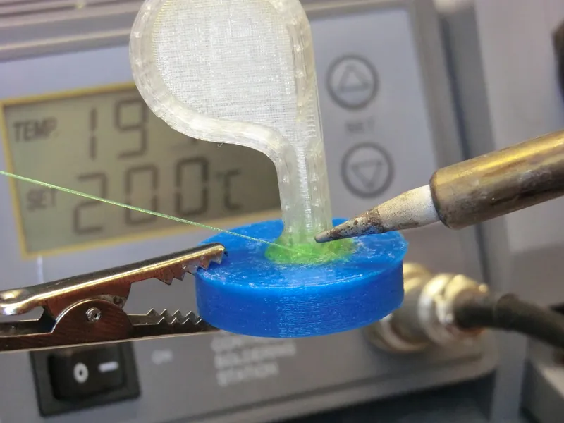
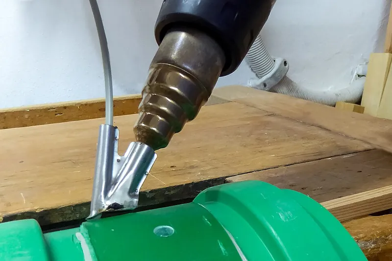

<figure class="eoc-pic eoc-pic-main"><figcaption><strong>How it works.</strong> <a href="https://www.flickr.com/photos/33907867@N02/8693068112">Two 3D printed PLA plastics parts welded together</a> by Creative Tools, <a href="https://creativecommons.org/licenses/by/2.0/">CC BY 2.0</a>, from Flickr via Openverse.</figcaption></figure>
<figure class="eoc-pic"><figcaption><strong>How it works.</strong> <a href="https://commons.wikimedia.org/wiki/File:Kunststoffziehschweissen_Schweissschuh.jpg">Kunststoffziehschweissen Schweissschuh</a> by Markus Bärlocher, <a href="http://creativecommons.org/publicdomain/zero/1.0/deed.en">CC0</a>, from Wikimedia Commons.</figcaption></figure>

Plastic welding melts the joint faces of two parts made of the same plastic and fuses in extra plastic from a rod, an offcut or 3D-printer filament, using a soldering iron, a 3D pen or a hot-air welder, so the joint becomes one continuous piece; it is the usual fix for polyethylene (PE) and polypropylene (PP), which glues and solvents can't hold.

**In plain words:** Melting the edges of two plastic parts with a hot tool and working in a strip of the same plastic as filler, so that everything cools into one solid piece: welding, but for plastic. **Proper term:** Plastic welding with filler (hot-tool, hot-air and extrusion welding of thermoplastics).

**Also called:** plastic welding, thermoplastic welding; ISO 472 calls it 'uniting softened surfaces of materials, generally with the aid of heat' (Wikipedia 'Plastic welding'); hot air welding = hot gas welding; freehand (hand) welding = fan welding; speed welding or speed-tip welding (Wikipedia 'Plastic welding', 'Hot gas welding'); airless plastic welding (a hot iron with a flat or teardrop tip melts the rod) and nitrogen plastic welding (hot nitrogen gas instead of air) (Polyvance, The Book of Plastic Repair); soldering-iron plastic welding; 'trench' welding with 3D-printer filament as filler (Hackaday 2023 reader comments); 3D pen welding; 'plastic extrusion gun' built from a printer hot-end (Hackaday 2026); PLA 'glue gun' (Hackaday 2018); extrusion welding (hand-held extruder) and injection welding, e.g. Drader injectiweld (brand) (Wikipedia 'Plastic welding'); hot stapling, crack stitching, plastic stitching (red-hot staples melted in across a crack) (Rick's Free Auto Repair Advice); welding rod, filler rod, thermoplastic welding rod; '[spline](../glossary.md#spline)' (rod sold on a spool) (Wikipedia 'Plastic welding'); contact welding, plastic 'spot welding' (heated tips pinch two sheets together) (Wikipedia; Hackaday 2018); bumper repair, kayak repair, poly tank repair (common search terms).

## How it works

Most everyday plastics are thermoplastics: they soften and melt when heated and set again when cooled, so two pieces can be melted together (Polyvance). The tool heats both the surface of the part and the filler until both are soft, and pressure pushes them together so the long plastic molecules mix across the joint before it cools; Polyvance stresses melting 'both the substrate and the plastic welding rod at the same time'. If only the filler melts and the part stays hard, the bead just sticks like hot glue (a German rule of thumb quoted by a Hackaday reader calls that 'plastic soldering'), and a 2018 Hackaday test with molten PLA showed only 'superficial' fusion. Filler and part must be the same or a very similar plastic, otherwise they don't mix (Wikipedia 'Plastic welding'). Variants: a soldering iron or airless welder melts the rod into a groove and stirs it into the part; a 3D pen or printer hot-end pushes out molten filament; a hot-air welder blows hot air on both the rod and the joint, either freehand or through a speed tip that feeds and presses the rod; an extrusion welder pushes out molten rod for thick sections; and hot staples or stainless mesh can be melted in across a crack for extra strength (Wikipedia; Polyvance; Rick's Free Auto Repair Advice).

## Parts

Single piece once made: the parts and the filler fuse into one. Making it needs: a hot tool (a spare soldering iron or an 'airless' welding iron with a flat or teardrop tip, a 3D pen, or a hot-air welder or heat gun with a speed-tip nozzle); filler of the same plastic (welding rod, strips cut from scrap, or 3D-printer filament); and optionally stainless-steel mesh or hot staples for reinforcement, aluminium tape or clamps to hold a crack closed, and a rotary tool or knife to cut a V-shaped groove along the joint (Polyvance; Wikipedia 'Plastic welding').

## Everyday examples

- a cracked plastic car bumper cover repaired with welding rod and hot staples at a body shop (Wikipedia; Rick's Free Auto Repair Advice)
- a cracked polyethylene kayak, water butt or fuel/water tank welded with a heat gun and rod (Paddling Magazine; Polyvance lists RV water tanks, kayaks and trash cans)
- the thin coloured bead along the seams of sheet vinyl flooring in kitchens and hospitals, hot-air welded with a rod (Tarkett video, 'How to hot weld vinyl flooring?')
- welded plastic chemical tanks, trays and fittings in workshops and labs (Wikipedia 'Plastic welding')

## When to use it

When you need a strong, permanent joint between parts made of the same thermoplastic, especially PE and PP, which most glues and solvents can't hold (Hackaday 2018; Structural acrylic entry). Good for: repairing cracked bumpers, bins, kayaks, tanks, toys and appliance housings (Polyvance; Rick's; Paddling Magazine); joining 3D prints that are bigger than the printer's bed, or filling seams on a printed model, using the same filament (Hackaday 2018, 2026; Scorchworks); making watertight seams on tanks and trays from PE, PP or PVC sheet (Wikipedia); and repairs where the part flexes, because a matching-plastic weld bends with the part while rigid fillers such as epoxy or body filler 'break off the instant your bumper flexes' (Rick's). Pick the tool by the job: a soldering iron or 3D pen for small printed parts and fine control; a hot-air welder with rod for long seams and sheet; hot staples or melted-in mesh for cracks in flexible parts; an extrusion welder for material over 6 mm thick (Wikipedia).

## When not to use it

When the parts must come apart again: use screws, snap fits or clips. When the plastic is unknown, mixed, or a thermoset (fibreglass, SMC, thermoset polyurethane, resin prints) or crosslinked PE: use a two-part adhesive or epoxy instead (Polyvance). When joining different plastics, or plastic to metal, wood or glass: use glue, mechanical fasteners or Heat staking. On thin-walled prints with a hot-air gun, which tends to melt the wall before the joint fuses (Hackaday 2026): use a soldering iron or pen, or Solvent welding for ABS or acrylic, or Cyanoacrylate. For large flat faces on ABS, ASA or acrylic, Solvent welding bonds the whole contact area. For quick, light, removable or cosmetic joins: Hot-melt adhesive. For anything that carries a person's weight, pressure, or a safety load: don't rely on a home-made plastic weld. Never weld PTFE or other fluoropolymers at home (TWI).

## Details

- **What it does (jobs):**
  - join and hold: permanently joins plastic parts, or repairs a cracked or broken one
  - glue or bond: a melted bond used where glue fails, especially on PE and PP (Hackaday 2018: HDPE is 'easy to cut, but not so easy to join. Conventional glues can have a hard time')
  - seal it, or pass cables or fluid through: a continuous, fully fused bead makes plastic tanks, trays and fittings watertight (Wikipedia 'Plastic welding')
- **Movement:** none
- **Directions it can move (degrees of freedom):** 0: the parts become one rigid piece.
- **Special behaviour:**
  - none: it is a plain permanent joint
- **How it holds:** material bond (glue, solvent or melting): the plastic of both parts and the filler melt and tangle together; also shape (the parts interlock; [form-fit](../glossary.md#form-fit--force-fit--material-bond)) when stainless-steel mesh or hot staples are melted in across a crack (Polyvance; Rick's Free Auto Repair Advice)
- **Input and output:** not applicable
- **Power:** passive (no power needed) once made; making it needs a mains or battery-powered hot tool (soldering iron, airless welder, 3D pen or hot-air welder)
- **Load:** Medium. A well-fused weld in matching plastic is strong: in a 2026 test a printer-hot-end welding pen gave a stronger joint than a normal 3D pen and 'a much, much stronger join than the usual superglue', and hot-air welding was stronger still (Hackaday 2026). Polyvance says a wide ribbon rod welded across a crack keeps its own extruded structure, so tearing the repaired bumper 'is like trying to tear the rod in two'. Strength depends on fusion and bead size: Paddling Magazine says a kayak weld 'should be just as thick or thicker than the original surface'. A bead laid only along the surface of a thin butt joint is weaker than the solid part, especially when bending opens the joint from the unwelded side, so weld both sides or add mesh (Polyvance) ⚑ [uncertain: no test figure for bending versus [shear](../glossary.md#peel-vs-shear)].
- **Play and precision:** No play once welded. [Accuracy](../glossary.md#repeatability--accuracy) depends on holding the parts in line while welding: Polyvance tapes the outer (show) face with aluminium tape and welds from the back, and Rick's clamps the crack closed. Heat can move the parts: Wikipedia ('Hot gas welding') warns that thermal expansion causes distortion if parts aren't secured, and a Hackaday reader notes that formed plastic has a 'memory' and changes shape when heated.
- **Taking it apart:** permanent: it can only be cut or ground apart; a poor weld can be re-melted and redone
- **How often it can be reused:** once
- **Sealing:** watertight: a continuous, fully fused bead between matching plastics seals tanks and fittings; hot-air welding is used to make chemical tanks, water tanks, heat exchangers and plumbing fittings (Wikipedia 'Plastic welding'). Gas pores and unfused spots leak (Wikipedia 'Hot gas welding'), and on 3D prints the printed walls themselves may be porous, so a reader advised coating the print with epoxy as well (Hackaday 2023 comments).
- **Adjustable:** no: once cool it is fixed, though the weld can be reheated and reshaped while soft (Polyvance reheats a weld and squeezes it flat with forming pliers)
- **Access needed:** one side only (blind) for a bead, staples or mesh on the back face of a repair; both sides for the strongest repair (Polyvance welds the back, then grooves and welds the front). Injection welding can patch a hole from one side without reaching the back (Wikipedia 'Plastic welding').
- **Materials:** Joins thermoplastics to the same or a very similar plastic (Wikipedia: PVC to acrylic is an exception; Popular Science adds PET to polycarbonate for friction welds). Works on: PE (HDPE, LDPE), PP and the PP-rubber blends used in most car bumpers (TPO, TEO), ABS, PVC, nylon (PA), polycarbonate and PC blends, PBT, PET, PPE, TPE and TPU; Polyvance sells a matching rod for each and says more than 95% of late-model bumper covers are TPO, TEO or PP. 3D-printing filaments: PLA, PETG, ABS (Hackaday 2018, 2026; Scorchworks) and printed TPU (Printables 11188). It is the usual answer for PE and PP, which glues and solvents struggle with (Hackaday 2018; Structural acrylic entry). Doesn't work on: thermosets, which bubble and smoke instead of melting: thermoset polyurethane (PUR, RIM), SMC and fibreglass (Polyvance uses adhesives or uses the rod only as a hot-melt glue on them); crosslinked PE (PEX, HDXLPE kayaks) softens but doesn't melt and its melting point is 'very close to its burning point' (Polyvance; Paddling Magazine); mismatched pairs, e.g. nylon cable ties pushed into a PP part, which don't fuse (Hackaday 2023 comments); resin (SLA) prints, which are not thermoplastics ⚑ [uncertain: not stated on an opened page]; fluoropolymers (PVDF, FEP, PFA) are welded industrially but give off fumes that cause polymer fume fever (TWI). Metal, wood and glass can't be joined this way, only embedded.
- **Heat, cold, water and wear:** A good weld has the same limits as the plastic itself. PLA softens at about 60-65 deg C (Hackaday 2018 citing the RepRap wiki), so welded PLA parts can sag in a hot car or in sun behind glass; PETG, ABS, PP and PE take more heat ⚑ [uncertain: no figures from an opened page]. PE and PP welds suit water and many chemicals (hot-air welding is used for chemical and water tanks, Wikipedia). Flexing and vibration: mismatched or poorly fused welds crack off when the part flexes (Rick's; Paddling Magazine: 'If it doesn't mix well, the weld will pop open when it cools or is under stress'). Long-term [creep](../glossary.md#creep) of welds under constant load can't be predicted from a quick tensile test (Wikipedia 'Plastic welding' describes separate creep tests).

## Making it

- **Ways to make or get it:**
  - 3D print (FDM): welding printed parts together, joining large prints made in sections, or repairing broken prints with the same filament (Scorchworks; Hackaday 2018, 2026)
  - CNC and hand-cut plastic sheet: PE, PP and PVC sheet welded into tanks and trays with hot air or, above 6 mm thick, an extrusion welder (Wikipedia 'Plastic welding')
  - off-the-shelf part: repairing moulded thermoplastic products such as bumpers, kayaks, water tanks and bins (Polyvance; Paddling Magazine)
  - 3D print (resin): not suitable, because cured resin is not a thermoplastic ⚑ [uncertain]
- **Printing it in one piece (print in place):** no: welding assembles separately printed parts after printing (for example a large hollow model printed in pieces, Hackaday 2018, or 20 printed hexagons welded into a ball, Scorchworks)
- **Tools:** A hot tool: a cheap spare soldering iron with a flat or washer-shaped tip (Hackaday 2018), an airless plastic welding iron with welding tips, a 3D pen, or a hot-air plastic welder or temperature-controlled heat gun with a reducing nozzle and speed-tip shoe (Wikipedia; Commons photo). Filler of the same plastic (welding rod, strips cut from scrap, or filament). Rotary tool or knife to cut a V-groove; coarse sandpaper (50-80 grit) and plastic cleaner to prepare the surface; aluminium body tape or clamps to hold the pieces in line; optionally stainless-steel reinforcing mesh or a hot-staple gun (Polyvance; Rick's). For HDPE sheet 'spot welds': a PTFE BBQ mat and a flat presser (Hackaday 2018). Ventilation or fume extraction.
- **Difficulty:** moderate: the tools are cheap (a spare soldering iron plus offcuts or filament of the same plastic), but you have to identify the plastic and learn to melt both the part and the filler without burning or melting through

### 3D printing tips

Filler: use the same filament the part was printed with (a short length of filament, or a printed 'glue stick'); a different plastic won't fuse (Hackaday 2023 comments; Wikipedia). Heat the part, not just the filler: the bead must melt into both faces, which is why a printer hot-end with a brass nozzle works faster and better than a commercial 3D pen with its low-conductivity tip (Hackaday 2026). A PLA bead from an 80 W high-temperature glue gun (up to about 208 deg C) only fused superficially but still held well because it filled every gap; a hobby glue gun at about 150 deg C only softened PLA, which melts around 180-220 deg C (Hackaday 2018, citing the RepRap wiki). Soldering-iron 'trench' method: push the hot iron deep into the seam between the two printed parts to make a trench with a welded bottom, then melt filament into the trench as a second pass, like multi-pass TIG welding (Hackaday 2023 reader comment). Design for welding: add bevels or a V-groove along the joint so there is room for a proper bead (Scorchworks), or design built-in 'glue channels' along interlocking tabs to fill with molten filament (Hackaday 2023). Thin walls: hot air 'can be a very dicey business' on thin-walled prints because the wall melts or sags before the joint fuses; a pen or iron gives more control (Hackaday 2026). Keep the iron moving and the temperature low on thin or flexible prints: when fusing a printed TPU lid to a TPU [actuator](../glossary.md#actuator), the designer turned a temperature-controlled iron 'all the way down' and kept it moving to avoid melting through (Printables 11188). Print parts that will be welded solid (high [infill](../glossary.md#infill)) near the joint so there is enough material to melt into ⚑ [uncertain: inferred from the friction-stir study in the Friction-welded plastic entry]. Printed tanks: weld the seams, then test for leaks and seal the walls if needed, since printed walls can be porous (Hackaday 2023 comments). Typical failures: a bead that sits on top and peels off (base not melted), melt-through and [warping](../glossary.md#warping--shrinkage) of thin walls, blobs that need sanding.

### Buying one (off-the-shelf parts)

Search terms: 'plastic welder kit' or 'plastic welding iron' (airless welder with tips), 'hot staple gun' or 'plastic stapler' with 'stitching staples' (e.g. Astro 7600 kit (brand), Rick's), 'hot air plastic welder' with 'speed welding nozzle' or 'speed tip', 'plastic extrusion welder' (thick sheet), 'plastic welding rod' by material (PP, HDPE, LDPE, ABS, PVC, nylon, PC, TPO, PET; round, triangular or flat 'ribbon' profiles), 'universal plastic welding rod' (e.g. Uni-Weld FiberFlex (brand)), 'stainless steel reinforcing mesh' or 'plastic repair mesh', 'aluminium body tape', '3D pen' and '3D pen filament'. Polyvance's rod chart (The Book of Plastic Repair, p. 9) lists rod codes for about 20 plastics: link to it rather than copying sizes.

## Rules of thumb

- Match the plastic: hot-gas welding needs parts and filler rod 'of the same or a very similar plastic' (PVC to acrylic is an exception) (Wikipedia, https://en.wikipedia.org/wiki/Plastic_welding). Find the moulded code (e.g. >PP<, >ABS<) on the back of the part; if there is none, make a small test weld with each likely rod and try to pick it off with a fingernail once cool: 'the one that sticks best is the one to use' (Polyvance, The Book of Plastic Repair, pp. 3-4, https://br.polyvance.com/wp-content/uploads/sites/3/2021/10/thebook.pdf).
- Melt both: melt the rod and the part at the same time and press them together; with an iron, lay no more than about 2 in (50 mm) of rod into the groove at a time, then go back over it and stir rod and base together (Polyvance, pp. 5 and 9, https://br.polyvance.com/wp-content/uploads/sites/3/2021/10/thebook.pdf).
- Groove: cut a V-groove about halfway through the part, weld the back, then groove and weld the front; a front groove about 1/16-3/32 in (1.5-2.5 mm) deep and about 1/8 in (3 mm) wide suits a 1/8 in round rod (Polyvance, pp. 5 and 11, https://br.polyvance.com/wp-content/uploads/sites/3/2021/10/thebook.pdf).
- Hot-gas settings ('T.F.A.P.S.': temperature, flow, angle, pressure, speed) for a nitrogen welder: about 700-1000 deg F (370-540 deg C) gas, about 700-800 deg F for PP/TPO; 10-15 L/min flow; torch at 45 deg; 1-2 lb (0.5-1 kg) down on the rod; travel 4-6 in (100-150 mm) per minute. A properly melted rod is not discoloured, except nylon, which should turn light brown (Polyvance, pp. 5 and 9, https://br.polyvance.com/wp-content/uploads/sites/3/2021/10/thebook.pdf).
- Thick material: extrusion welding is 'the preferred technique for joining material over 6 mm thick' (Wikipedia, https://en.wikipedia.org/wiki/Plastic_welding).
- Joint design for hot-gas welds: a small root gap lets hot gas escape and reduces pores; double-V joints take more welding pressure and are less prone to lack of fusion than single-V joints; too fast a travel stretches the rod, too slow overheats it (Wikipedia, https://en.wikipedia.org/wiki/Hot_gas_welding).
- Kayak (HDPE) repair: hold a heat gun 1-2 in (25-50 mm) from the surface; it is hot enough when it 'starts to get shiny and the fuzziness disappears'; carry the weld at least 1/2 in (13 mm) past the end of the crack; make it as thick or thicker than the hull; let it cool naturally, because water cooling weakens it (Paddling Magazine, https://paddlingmag.com/skills/diy-projects/kayak-repair/).
- Hot staples: heat the staple until red-hot, push it in across the crack no deeper than half the plastic's thickness while twisting slightly, alternate the twist direction along the crack, then snip off the protruding legs (Rick's Free Auto Repair Advice, https://ricksfreeautorepairadvice.com/avoid-bondo-learn-the-right-way-to-fix-a-cracked-bumper/). Stainless mesh: reinforce about an inch (25 mm) either side of the crack (Hackaday 2023 reader comment, https://hackaday.com/2023/05/15/zippy-plastic-welding/).
- PTFE release sheets (a BBQ mat under the iron, as in Hackaday's HDPE 'spot welding') must stay cool enough: TWI recommends PTFE-coated hot plates are kept below 270 deg C because overheated PTFE causes polymer fume fever (TWI, https://www.twi-global.com/technical-knowledge/faqs/faq-are-there-any-health-and-safety-implications-of-cutting-and-welding-plastics).
- Glue-gun welding of PLA needs a high-temperature gun (about 208 deg C); a hobby gun at about 150 deg C only softens PLA (Hackaday 2018, https://hackaday.com/2018/02/05/3d-printering-printing-sticks-for-a-pla-hot-glue-gun/).

## Common failures

(1) Cold weld: the filler only sits on top of an unmelted surface and peels off; a cut-through PLA test joint showed only 'superficial' fusion (Hackaday 2018); fix by heating the part until glossy and stirring rod and base together (Polyvance; Hackaday 2023 comments: 'If you just melt the filament and smush it in the gap, it won't adhere properly'). (2) Wrong filler: a different plastic (e.g. nylon cable ties in PP) doesn't fuse and cracks off; identify the plastic and test-weld first (Rick's; Polyvance; Hackaday 2023 comments). (3) Overheating: smoking, browning, a rod that folds over backwards, melt-through or sagging of thin walls (Polyvance; Hackaday 2026); keep the heat moving and lower the temperature (Printables 11188). (4) Pores and voids from trapped hot gas, a porous rod or too little pressure (Wikipedia 'Plastic welding' recommends void-free rod; 'Hot gas welding'). (5) Dirt, grease, paint, wax or mould-release in the joint: wash with soap and water, then plastic cleaner, and sand before welding (Polyvance; Paddling Magazine). (6) The crack keeps running: carry the weld past the end of the crack (Paddling Magazine) and add a cross 'tee' weld at the end (Polyvance). (7) Warping as heated plastic relaxes or expands: support and clamp the part and let it cool supported (Wikipedia 'Hot gas welding'; Paddling Magazine). (8) Smearing when finishing: sand slowly with sharp paper, because friction heat melts the plastic (Polyvance). (9) Leaks in welded printed tanks through porous printed walls: test and seal after welding (Hackaday 2023 comments).

## Safety

BURNS: soldering-iron and welder tips, molten plastic and red-hot staples cause burns; a heat gun's nozzle air can reach about 600 deg C (1100 deg F) and the nozzle 'remains hot for 30 minutes after use', so never point it at people and stand it nozzle-up on a non-flammable surface (DeWalt heat gun manual). FIRE: direct the hot-air jet away from flammable objects and let the gun cool for 30 minutes before storing it (DeWalt manual); park soldering irons in their stand. FUMES: work outdoors or with good ventilation or extraction, and stop if the plastic smokes. TWI says fumes from hot-gas welding PVC, nylon, acrylic, polycarbonate and PP are 'not normally likely to give cause for concern' except in confined spaces with the welder's head close to the work and poor ventilation, but fluoropolymers (PVDF, ECTFE, PFA, FEP, PTFE) cause polymer fume fever; keep PTFE BBQ mats and PTFE-coated tools below 270 deg C (TWI). Heated PVC gives off hydrogen chloride (TWI, for laser cutting; Wikipedia 'Polyvinyl chloride'); melting urethane 'has been known to give off toxic cyanide gasses' (Wikipedia 'Plastic welding'); thermoset polyurethane 'bubbles & smokes' instead of melting, a sign to stop (Polyvance); printed TPU degrades and fumes above about 230 deg C, so its designer works outside or with an organic-vapour mask (Printables 11188). Hackaday (2018) warns of 'the health risks present when heating up different types of plastic'. SEPARATE TIP: use a cheap spare soldering iron or a tip kept only for plastic (Hackaday 2018 recommends a cheap iron; a reader uses 'a crappy soldering iron with a flat tip'), since burnt plastic left on an electronics tip can spoil it for soldering ⚑ [uncertain: no manufacturer statement opened]. Not for parts that hold people, pressure or loads where failure is dangerous.

## Related

- Friction-welded plastic (rotary-tool friction welding, spin welding): the heat comes from rubbing instead of a hot tool; no separate heater needed, but it needs a rotary tool or drill press
- Heat-sealed seam (heat-sealed plastic film and coated fabric): the same idea for thin film and coated fabric, pressed together with no filler
- Ultrasonic weld (ultrasonic plastic welding, energy director): industrial, very fast; vibration melts a small ridge in seconds
- Heat-fused plastic pipe (socket fusion, butt fusion, electrofusion): the controlled, tool-based way to weld PE and PP pipe
- Heat staking (melted plastic rivet): melts a plastic post into a rivet head to hold another part; a mechanical lock, not fused faces, and works with dissimilar materials
- Solvent welding (solvent cement): dissolves instead of melts; good for ABS, acrylic, PVC and polystyrene but not for PE, PP or PETG
- Hot-melt adhesive (glue gun): a separate low-melting glue that sticks to the surface; quick but weaker and softens in heat
- Structural acrylic and low-surface-energy plastic adhesives (for PE and PP): special glues that can bond PE and PP without heat
- Hand-mouldable thermoplastic (polycaprolactone): a low-melting plastic moulded by hand; it doesn't fuse into other plastics
- Two-part epoxy and Epoxy putty: rigid gap-fillers across materials; crack off flexible plastics (Rick's)
- Silicone and MS-polymer adhesive sealants: a flexible sealing layer to add over a welded printed tank
- Split-part joints for large prints (dovetail keys, puzzle joints, alignment pins): mechanical ways to join printed sections, which welding can reinforce
- Heat-set threaded insert: uses the same soldering iron to melt a metal insert into a print
- Welded metal joint (fusion welding): the metal equivalent

## Make it yourself

- [Plastic Welding Coupons (Printables 875756; URL from Printables API, page not opened)](https://www.printables.com/model/875756-plastic-welding-coupons): Printable practice pieces for learning to weld plastic, with a linked video of traditional-style welding *(licence: Creative Commons Public Domain)*
- [Pillow Soft Robotic Actuator (Printables 11188; URL from Printables API, page not opened)](https://www.printables.com/model/11188-pillow-soft-robotic-actuator): Printed TPU air actuator whose separately printed lid is fused on with a temperature-controlled soldering iron turned down low; includes fume and melt-through warnings *(licence: Creative Commons Attribution)*
- [Filament Scroll - Plastic Welding Tool (Printables 856329; URL from Printables API, page not opened)](https://www.printables.com/model/856329-filament-scroll-plastic-welding-tool): A printed holder that feeds filament as filler while plastic welding (a remix of a solder scroll) *(licence: Creative Commons Attribution-NonCommercial-ShareAlike)*

## Pictures, videos and models

- [Kunststoffziehschweissen Schweissschuh.jpg (Wikimedia Commons, by Markus Baerlocher, 2025)](https://commons.wikimedia.org/wiki/File:Kunststoffziehschweissen_Schweissschuh.jpg): A temperature-controlled heat gun fitted with a reducing nozzle and a V-shaped speed-tip shoe, with 4 mm grey PP welding rod *(licence: CC0 1.0 (public domain dedication))*
- [Classification of welding methods for semi-finished polymeric materials.jpg (Wikimedia Commons, by Onur Balkan)](https://commons.wikimedia.org/wiki/File:Classification_of_welding_methods_for_semi-finished_polymeric_materials.jpg): Diagram sorting plastic welding methods into external heating (hot gas, hot tool, extrusion and others) and internal heating (friction, ultrasonic and others) *(licence: CC BY-SA 3.0 (reuse with credit))*
- [Making a 3D pen that's actually useful (half-baked-research, YouTube; title confirmed via YouTube oEmbed; reviewed by Hackaday 2026)](https://www.youtube.com/watch?v=3gL9PFk9JtA): Welding 3D prints with a normal 3D pen, a home-made welding pen built from a printer hot-end, and hot air, with strength tests from about 13:38 *(licence: link only)*
- [FiberFlex Bumper Repair (Polyvance, YouTube; title confirmed via YouTube oEmbed; embedded in Rick's Free Auto Repair Advice)](https://www.youtube.com/watch?v=AoUMDnHA8oI): Bumper crack repair: stainless mesh melted into the back with a hot iron, then a groove filled with welding rod *(licence: link only)*
- [Spot Welding Plastic (Hackaday, 2018)](https://hackaday.com/2018/08/05/spot-welding-plastic/): Photo of a cheap soldering iron with a washer-shaped tip used to 'spot weld' HDPE milk-bottle sheet through a PTFE BBQ mat *(licence: link only)*

## Needs confirming

⚑ marks something nobody has confirmed yet: a fact the research could not confirm from a source, a finder value that is a best guess, or an open point from the research notes. Corrections are welcome (see `research/needs-confirming.md`).

- ⚑ 6 sentences on this page marked [uncertain].
- ⚑ Finder value `weld_material` = plastic or film (best guess): carried over from the finder's old rule on entry names (R33), for "What are the parts made of?" under "Hold two things together > Melt them together"
- ⚑ Research note: *Melted plastic weld*: 'keep a separate iron tip for plastic' is from makers on Hackaday; the reason (residue spoils an electronics tip) is [uncertain], no maker statement found.

## Sources

- <https://en.wikipedia.org/wiki/Plastic_welding>
- <https://en.wikipedia.org/wiki/Hot_gas_welding>
- <https://en.wikipedia.org/wiki/Polyvinyl_chloride>
- <https://br.polyvance.com/wp-content/uploads/sites/3/2021/10/thebook.pdf>
- <https://ricksfreeautorepairadvice.com/avoid-bondo-learn-the-right-way-to-fix-a-cracked-bumper/>
- <https://paddlingmag.com/skills/diy-projects/kayak-repair/>
- <https://hackaday.com/2026/03/07/diy-3d-pen-is-born-to-weld/>
- <https://hackaday.com/2023/05/15/zippy-plastic-welding/>
- <https://hackaday.com/2018/08/05/spot-welding-plastic/>
- <https://hackaday.com/2018/02/05/3d-printering-printing-sticks-for-a-pla-hot-glue-gun/>
- <https://www.scorchworks.com/Blog/?p=442>
- <https://www.popsci.com/how-to-spin-weld-at-home/>
- <https://www.twi-global.com/technical-knowledge/faqs/faq-are-there-any-health-and-safety-implications-of-cutting-and-welding-plastics>
- <https://content.cmpl.org/tg/Tools/HeatGun.pdf>
- <https://commons.wikimedia.org/wiki/File:Kunststoffziehschweissen_Schweissschuh.jpg>
- <https://commons.wikimedia.org/wiki/File:Classification_of_welding_methods_for_semi-finished_polymeric_materials.jpg>
- <https://www.youtube.com/watch?v=3gL9PFk9JtA>
- <https://www.youtube.com/watch?v=AoUMDnHA8oI>
- <https://www.youtube.com/watch?v=dsoxXsksNvY>
- <https://www.youtube.com/watch?v=3XdRiVKAcUA>
- <https://api.printables.com/graphql/ (models 875756, 11188, 856329)>
