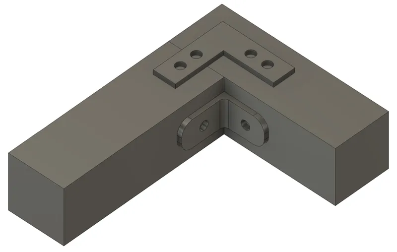

<figure class="eoc-pic eoc-pic-main"><figcaption><strong>Diagram.</strong> <a href="https://commons.wikimedia.org/wiki/File:Flat_and_bent_angle_brackets.png">Flat and bent angle brackets</a> by Sauer202, <a href="https://creativecommons.org/licenses/by/4.0">CC BY 4.0</a>, from Wikimedia Commons.</figcaption></figure>

A stamped steel bracket, strap or flat plate fixed across a joint with screws, nails or teeth so that the metal carries the load the joint itself can't, from a small corner brace that stiffens a wobbly frame to a joist hanger or truss plate that holds up a floor or roof.

**In plain words:** A piece of bent or flat steel with holes in it that you screw or nail across a corner or a joint, so the metal takes the load and stops the joint pulling apart, folding or sagging. **Proper term:** Metal bracket and plate connectors (angle bracket, corner brace, mending plate, joist hanger, framing tie, truss plate).

**Also called:** angle bracket, L-bracket, corner bracket, corner brace, angle brace, angle tie: an L-shaped bracket screwed into the inside or outside of a corner (DT Online 'Knock Down Fittings, Brackets and Plates'; Wikipedia 'Tie (engineering)', Angle tie); flat corner plate, flat angle bracket, stretcher plate (an L made from flat strip, screwed across the face of a corner) (DT Online; Wikimedia Commons 'Flat and bent angle brackets.png'); mending plate, repair plate, flat repair bracket, straight plate, T-plate, cross (X) plate (DT Online; Wikipedia 'Truss connector plate'); shelf bracket, heavy-duty shelf bracket (an angle bracket with a long arm, often with a diagonal web, that holds a shelf off a wall) (Wikimedia Commons 'Gray metallic shelf bracket'); [shrinkage](../glossary.md#warping--shrinkage) bracket, shrinkage plate, table-top fastener: a bracket with slotted holes that lets a solid-wood top swell and shrink (DT Online); joist hanger: face-mount hanger, top-mount (top-flange) hanger, concealed-flange hanger (USDA Wood Handbook ch. 8; Wikipedia 'Tie (engineering)'); framing ties and straps: hurricane tie (hurricane clip or strap), seismic tie, twist strap, rafter tie, perforated strap (Lochband in German) (Wikipedia 'Tie (engineering)'; Wikimedia Commons 'AnkerNagel&Lochband.JPG'); toothed truss plate, metal plate connector, gang plate, gang nail plate, nail plate, stud tie: punched steel plate with teeth on one side, pressed into wood (Wikipedia 'Truss connector plate'; USDA Wood Handbook ch. 8). Gang-Nail was the name of the inventor's company (Wikipedia 'Truss connector plate'); corrugated fastener, wiggle nail (also wriggly nail, dog in UK trade use): a strip of corrugated sheet steel with one sharpened wavy edge, hammered across a mitre or butt joint (Isaac Kremer glossary, after Ching 1995); furniture anti-tip kit, tip restraint, furniture anchor, wall strap: a bracket on the furniture and a bracket on the wall joined by a strap or cable (CPSC Anchor It; Consumer Reports); seismic tie: the same idea for cabinets, bookcases, appliances and machines in earthquake areas (Wikipedia 'Tie (engineering)'); box corner (suitcase corner), mirror plate (hanging plate) as decorative or hanging relatives (DT Online); Simpson Strong-Tie (brand) is the best-known maker of structural wood connectors; Strong-Tie is a common generic term in North America ⚑ [uncertain].

## How it works

The bracket bridges the joint: each leg is fixed to one part, so a force that tries to open, fold or slide the joint has to pull the metal along its length (tension) or across its fasteners ([shear](../glossary.md#peel-vs-shear)), which steel and a row of fasteners resist much better than [end grain](../glossary.md#end-grain) or glue alone (Wikipedia 'Tie (engineering)'). A joist hanger works differently from a flat plate: the joist sits in a steel seat and bears on it directly, while the hanger passes the load into the beam through its nails or screws (face-mount) or by hooking over the top of the beam (top-mount) (USDA Wood Handbook ch. 8, pp. 8-25 to 8-26). A toothed truss plate is pressed in so all its teeth enter the wood at once, and the wood squeezed between neighbouring teeth is less likely to split (Wikipedia 'Truss connector plate'). In every case the connector is only as strong as its fasteners and the wood or wall they are in, which is why makers specify the exact fastener type, size and number (Simpson Strong-Tie SE blog).

## Parts

A few parts: the steel bracket or plate itself (one stamped piece with round fastener holes, sometimes slotted or triangular holes, ribs or teeth) plus the screws or nails that fix it to each part; a furniture anti-tip kit has two brackets and a strap or cable between them; a toothed truss plate is one piece whose teeth replace the fasteners (Wikipedia 'Truss connector plate'; Simpson Strong-Tie General Notes; Consumer Reports).

## Everyday examples

- Small L-shaped corner braces screwed inside a wobbly chair, table or drawer frame (DT Online: 'to repair broken items of furniture')
- Steel shelf brackets holding a wall shelf (Wikimedia Commons 'Gray metallic shelf bracket')
- Joist hangers holding deck or floor joists against a beam (Wikipedia 'Tie (engineering)'; USDA Wood Handbook ch. 8)
- Toothed gang-nail plates at the joints of factory-made roof trusses (Wikipedia 'Truss connector plate')
- An anti-tip strap behind a bookcase, dresser or TV (CPSC Anchor It)

## When to use it

Use a bracket or plate when a joint would otherwise rely on screws or nails in end grain, or on glue alone, and you need it stiffer or stronger quickly: corner braces and flat plates to fix or strengthen frames and boxes, T and cross plates where pieces meet in a T or cross, shelf brackets to hold shelves, joist hangers instead of toe-nailing joists to a beam ('toe nailing and end nailing is nowhere near as effective as using hangers', Wikipedia 'Tie (engineering)'), hurricane ties and twist straps to tie rafters to walls against uplift, slotted shrinkage plates for solid wood tops (DT Online), and anti-tip kits for any tall or heavy furniture or TV (CPSC; Wikipedia 'Furniture screw'). They need no joinery skill, work from one side, and can be added to an existing joint as a repair (DT Online). Printed brackets suit light loads and joining printed or thin parts (Printables 420879, 1549159).

## When not to use it

Avoid visible brackets where looks matter; hidden joinery (Dowel and biscuit joints, Mortise and tenon, Pocket screws in Butt and lap wood joints) or glue usually look better ⚑ [uncertain]. Don't rely on a bracket whose screws only grip chipboard, MDF or crumbly plaster: fix to wall studs or use proper anchors (Wall plug, Hollow-wall anchors) (Printables 4623; CPSC Anchor It). Don't use light zinc-plated furniture brackets for structural jobs such as decks, floors or anything people stand on or under: use rated structural connectors with the specified fasteners (Simpson Strong-Tie SE blog). Don't use rigid steel brackets across solid wood that will swell and shrink; use slotted shrinkage plates (DT Online). Don't 3D-print brackets for heavy, permanent or safety-critical loads, or anti-tip restraints (Consumer Reports; CNC Kitchen). For T-slot aluminium frames use Aluminium-extrusion connectors instead.

## Details

- **What it does (jobs):**
  - join and hold: reinforces a corner, butt or mitre joint, carries a joist, shelf or rafter, or ties a tall piece of furniture to the wall so it can't tip
- **Movement:** none: the bracket holds the parts still (slotted shrinkage brackets let a wooden top slide a little as it swells and shrinks, by design) (DT Online).
- **Directions it can move (degrees of freedom):** 0 once fixed (a slotted shrinkage bracket deliberately leaves about 1 sliding direction so solid wood can move with humidity) (DT Online).
- **Special behaviour:**
  - none: it simply holds. (Its one clever variant is the slotted shrinkage plate, which holds a top down while letting it move across the grain.) (DT Online)
- **How it holds:**
  - shape (the parts interlock; [form-fit](../glossary.md#form-fit--force-fit--material-bond)): the joist sits in the hanger's seat, and the plate's holes lock round the nails or screws that pass through them (USDA Wood Handbook ch. 8, p. 8-25)
  - friction or clamping (force-fit): screw heads clamp the plate to the wood, and nails and truss-plate teeth are gripped by the wood fibres (USDA Wood Handbook ch. 8)
- **Input and output:** not applicable
- **Power:** passive (no power needed)
- **Load:** Light (small zinc-plated corner braces and mending plates for furniture) to heavy (structural joist hangers, hurricane ties and truss plates with published design loads). Strong: pulling along a strap or plate (tension) and sliding across its fasteners (shear); a joist resting in a hanger seat (bearing) (USDA Wood Handbook ch. 8, pp. 8-25 to 8-26). Weak: a flat plate on one face resists the joint folding about that face poorly, and an L bracket can bend open at its corner ⚑ [uncertain]. Usually the fasteners fail first: screws pull out of end grain or chipboard, or heads pull through the wood (woodgears.ca shelf bracket test: 'the screw often pull through the wood before the threads let go'); for shelf and wall brackets the wall fixing usually fails before the bracket ('Your mounting solution will probably fail before the bracket does!', Tom, Printables model 4623). Published loads are only reached with the specified fasteners: a hanger nailed with 0.148 x 2.5 in nails instead of the specified 0.148 x 3 in nails loses 15% of its capacity (Simpson Strong-Tie SE blog). Design loads for joist hangers are set at the lower of the load at 3.2 mm (0.125 in) [deflection](../glossary.md#deflection) and the average ultimate load divided by 3 (USDA Wood Handbook ch. 8, p. 8-26).
- **Play and precision:** Not a locating part: [clearance](../glossary.md#clearance) in the screw holes lets parts shift before the screws are tight, so square the joint first and then fix the bracket ⚑ [uncertain]. A rigid bracket does help hold a frame square once fixed ⚑ [uncertain]. Joist hangers need the joist cut to fit: the gap between joist end and header should be no more than 1/8 in (3 mm) unless noted (Simpson Strong-Tie General Notes).
- **Taking it apart:** removable when fixed with screws (unscrew it); nailed connectors are semi-permanent (nails can be pulled, damaging the wood), and pressed-in toothed truss plates are in practice permanent ⚑ [uncertain].
- **How often it can be reused:** a few times: a screwed bracket can be moved and refitted, but each refit wears the screw holes in the wood; nailed connectors and truss plates are once ⚑ [uncertain].
- **Sealing:** none: brackets don't seal the joint.
- **Adjustable:** no for most brackets (position is fixed by the screw holes); yes, a little, for slotted shrinkage plates and brackets with slotted holes, which can be shifted before the screws are tightened (DT Online; see Slotted adjustment with a jacking screw).
- **Access needed:** one side only (blind): fixed from the face of the parts with screws or nails; truss plates are pressed onto both faces of a truss joint (Wikipedia 'Truss connector plate'); furniture anti-tip kits need access to the back of the furniture and to a wall stud (CPSC Anchor It).
- **Materials:** Usually galvanised (zinc-coated) or zinc-plated steel; stainless steel for corrosive or outdoor places; brass or decorative finishes for box corners (Wikipedia 'Tie (engineering)'; DT Online). Truss plates are structural-quality steel to ASTM A653, A591, A792 or A167 with zinc or zinc-aluminium coatings or stainless (Wikipedia 'Truss connector plate'). Fasteners must match the connector's corrosion protection and metal: hot-dip galvanised nails with heavily galvanised connectors, stainless nails with stainless connectors, because mixed metals corrode each other faster (Simpson Strong-Tie SE blog; USDA Wood Handbook ch. 8, p. 8-5). Joins: solid wood, plywood, engineered wood and (with the right fixings) walls; small brackets also fix to chipboard, MDF and 3D prints, where the screws, not the bracket, limit strength ⚑ [uncertain]. Printed brackets: PLA for indoor static loads; PETG or other materials with good layer adhesion are also used (Printables models 4623 and 1549159).
- **Heat, cold, water and wear:** Moisture and outdoor use: plain zinc-plated steel rusts outdoors; in damp conditions treated wood corrodes fasteners and connectors, so use hot-dip galvanised or stainless parts and match the fastener metal to the connector (USDA Wood Handbook ch. 8, p. 8-5; Simpson Strong-Tie SE blog). Wood movement: wood shrinks and swells across the grain, which can loosen connections and nuts on tie rods (Simpson Strong-Tie General Notes, note k); nails in wood that goes through wet-dry cycles can lose up to 75% of their withdrawal resistance (USDA Wood Handbook ch. 8, p. 8-3). Allowable loads in catalogues assume continuously dry Douglas fir-larch unless noted (Simpson Strong-Tie General Notes, note f). Printed brackets: PLA softens with heat and [creeps](../glossary.md#creep) under constant load ⚑ [uncertain]. Plastic anti-tip restraints can become [brittle](../glossary.md#brittle--ductile) and break over time (Consumer Reports).

## Making it

- **Ways to make or get it:**
  - off-the-shelf part: stamped steel brackets, plates, hangers, ties and truss plates are bought, not made
  - woodwork: the main use, reinforcing frames, shelves, decks, sheds and furniture
  - 3D print (FDM): printed corner brackets, mending plates and shelf brackets for light loads and for joining printed parts (Printables models 420879, 1549159, 4623)
  - sheet metal: home-made brackets cut from flat bar or sheet and bent, or ordered laser-cut and bent ⚑ [uncertain]; don't re-bend structural connectors that aren't designed to be bent (Simpson Strong-Tie General Notes)
  - laser cut / CNC: plywood or acrylic gusset plates screwed across joints as a cut-from-sheet alternative ⚑ [uncertain]
- **Printing it in one piece (print in place):** no: a printed bracket is a single solid part with nothing to assemble; it is fixed with bought screws.
- **Tools:** Screwdriver or drill-driver (with a pilot drill) for screwed brackets; hammer, palm nailer or nail gun for nailed connectors; a pencil and stud finder, drill and screws for furniture anti-tip kits (CPSC Anchor It); a hydraulic press or roller for most toothed truss plates, although some can be fitted by hand (USDA Wood Handbook ch. 8, p. 8-25; Wikipedia 'Truss connector plate'); hammer (or a special driving tool) for corrugated fasteners (Isaac Kremer glossary; Wikimedia Commons patent 'Tool For Driving Corrugated Fasteners').
- **Difficulty:** easy: buy the bracket and the fasteners it specifies and screw or nail it on; the skill is choosing the right size and fasteners, and fixing into sound wood or a wall stud.

### 3D printing tips

1) Orientation decides strength: FDM layers bond at about half the in-plane strength (CNC Kitchen measured PLA at 63 MPa flat versus 31 MPa standing). For an L bracket, printing it on its side lines the layers up with the load, but then a countersunk screw hole can split along the [layer lines](../glossary.md#layer-lines); a three-sided corner bracket has no safe orientation, and printing it on its tip (about 45°) balances its legs (CNC Kitchen 'Stop Printing Flat'). 2) Designs 'specially designed for FDM' give every layer a wide area; one popular corner bracket comes in versions for countersunk screws and '_flat' versions for pan, round or truss heads, because overtightened screws break normal printed brackets (Printables 420879). 3) Prefer pan, round or washer heads to countersunk heads on prints, because a countersunk head wedges into the plastic and splits it (CNC Kitchen; Printables 420879; Printables 264348 note 'Use flat head screws so you don't split the layers' shows makers disagree ⚑ [uncertain]). 4) For mending plates, 100% [infill](../glossary.md#infill) or at least 4-5 [perimeters](../glossary.md#perimeters) round the bolt holes, and PETG or ASA for mechanical stress (Printables 1549159). 5) For shelf brackets, add a modifier with more infill round the top mounting hole, and fix to a stud or proper wall plugs (Printables 4623). 6) Plastic creeps under constant load, so for permanent or heavy loads use steel brackets ⚑ [uncertain]. 7) Never print safety brackets such as furniture anti-tip restraints: even moulded plastic tip restraints were recalled because they 'can become brittle and break over time' (Consumer Reports, 2024).

### Buying one (off-the-shelf parts)

Angle brackets and corner braces (light and heavy-duty, with or without a stiffening rib); flat corner plates; mending plates (straight, T and cross); shelf brackets; shrinkage plates (slotted table-top fasteners); joist hangers (face-mount, top-flange, concealed-flange, skewed or sloped); hurricane ties, twist straps and perforated strap (Lochband); seismic and furniture anti-tip kits (metal brackets with a nylon strap or steel cable); toothed truss plates (gang nail plates); corrugated fasteners; connector nails and connector screws made for these products (e.g. Strong-Drive SCN/SCNR connector nails and SD connector screws (brand)) (DT Online; Wikipedia 'Tie (engineering)', 'Truss connector plate'; Simpson Strong-Tie SE blog; Consumer Reports). Catalogues name the variants and give loads for each fastener schedule; read the load table rather than guessing (Simpson Strong-Tie SE blog).

## Rules of thumb

- Install every required fastener: use the right type and quantity, fill all fastener holes, don't over- or under-drive nails (including with nail guns), and drive screws fully home (Simpson Strong-Tie General Notes, rule 3).
- A connector reaches its full design value only if you use the fastener type and number in the maker's table; a 0.148 x 2.5 in nail used where a 0.148 x 3 in nail is specified cuts face-mount hanger capacity by 15%, and box or sinker nails cut it more (Simpson Strong-Tie SE blog).
- Specify nails by length AND diameter: '10d' can mean 0.148 x 3 in common, 0.128 x 3 in box or 0.120 x 2.875 in sinker nails (Simpson Strong-Tie SE blog); the Wood Handbook also calls penny sizes obsolete (USDA Wood Handbook ch. 8, p. 8-2).
- Don't mix nails and screws in one connector unless the load table allows it, and substitute screws only with the connector screws the maker lists, never ordinary screws (Simpson Strong-Tie SE blog).
- In double-shear nailing (a nail through the hanger, the joist and the hanger again) always use full-length common nails (Simpson Strong-Tie SE blog).
- Only bend products that are designed to be bent, and bend them once; field-bent steel may crack at the bend, and cracked steel 'will not carry load and must be replaced'; don't weld connectors unless the maker allows it (Simpson Strong-Tie General Notes, rule 4 and notes i and r).
- Cut joists to length: no more than a 1/8 in (3 mm) gap between joist end and header in a hanger, unless noted (Simpson Strong-Tie General Notes, rule 5).
- If nails split the wood, pre-bore holes no bigger than 0.75 of the nail diameter; a fastener that splits the wood won't take the design load (Simpson Strong-Tie General Notes, note j).
- Hanger and fastener should be the same metal type, or galvanic corrosion speeds up (USDA Wood Handbook ch. 8, p. 8-5); use hot-dip galvanised nails with heavily galvanised connectors and stainless nails with stainless connectors (Simpson Strong-Tie SE blog).
- Joist-hanger design loads come from tests (ASTM D7147): the lower of the average load at 3.2 mm deformation and the average ultimate load divided by 3; truss-plate design values are the lower of the load at 0.38 mm slip divided by 1.6 and the ultimate load divided by 3 (USDA Wood Handbook ch. 8, pp. 8-25 to 8-26).
- Face-mount hangers pass load to the header only through the sideways (lateral) loading of their nails or screws; top-mount hangers also bear on top of the header (USDA Wood Handbook ch. 8, p. 8-26).
- Solid wood tops need slotted (shrinkage) brackets so the wood can move with humidity (DT Online).
- For 3D-printed corner brackets, angling the print at 45° raised layer-direction strength by 27% over upright (40 vs 31 MPa in PLA); aim for at least 45° because the gain follows an S-curve (CNC Kitchen 'Stop Printing Flat').

## Common failures

Screws or nails pull out or the wood splits: too few, too short or wrong fasteners, screws in end grain or chipboard, or nails too near an edge; use the specified fasteners and pre-bore if the wood splits (Simpson Strong-Tie SE blog and General Notes). Screw heads pull through the wood or bracket hole: use washers or bigger heads (woodgears.ca shelf bracket test). The wall fixing fails before the bracket: fix into a stud or use proper wall plugs (Printables 4623). Joist drops or squeaks in its hanger: joist cut short (gap over 1/8 in), hanger nails missing or too short (Simpson Strong-Tie General Notes and SE blog). Bracket cracked from being bent on site (Simpson Strong-Tie General Notes, note i). Rust and corrosion from mismatched metals or plain steel outdoors (USDA Wood Handbook ch. 8). Solid-wood top splits because rigid brackets stop it moving (DT Online). Printed bracket breaks along a layer line or splits round a countersunk screw (CNC Kitchen; Printables 420879). Plastic anti-tip strap or bracket breaks with age (Consumer Reports).

## Safety

Connectors only reach their rated load with the fastener type, size and number the maker specifies; fill every hole, don't mix nails and screws, and never use drywall or other substitute screws in structural connectors (Simpson Strong-Tie SE blog and General Notes). Anything people stand on, sit under or rely on (decks, floors, roofs, child-climbable furniture) needs rated connectors fixed into sound wood. Furniture and TV tip-overs injure and kill children: anchor tall furniture to a wall stud with a metal-bracket anti-tip kit; CPSC credits its Anchor It campaign with a nearly 50% fall in tip-over injuries and deaths (CPSC 2025); Consumer Reports advises replacing plastic anchors with metal ones after millions of plastic tip-restraint kits were recalled in 2024. Check for hidden cables and pipes before drilling walls ⚑ [uncertain]. Cut steel brackets and strap ends have sharp edges and burrs ⚑ [uncertain]. Wear eye protection when hammering nails into connectors (CCOHS 'Hand Tools - Hammers').

## Related

- Wood screw (including coach screw and Confirmat screw): what usually fixes a bracket; the joint it reinforces is often a screwed butt joint
- Nails, brads and tacks: connector nails fix joist hangers and ties; toe-nailing is the weaker alternative to a hanger
- Butt and lap wood joints (screwed, pocket-hole, half-lap): the joints brackets most often reinforce, and pocket screws as a hidden alternative
- Aluminium-extrusion connectors (T-slot nuts and brackets): brackets made for T-slot bars rather than wood
- Hang-on mounts (keyhole slot, French cleat): hanging things on a wall without a visible bracket
- Knock-down cam-lock and cross-dowel connectors: hidden, take-apart corner joints for flat-pack furniture
- Dowel and biscuit joints and Mortise and tenon: wooden joinery that needs no metal showing
- Wall plug and Hollow-wall anchors: what holds a shelf bracket or anti-tip bracket to masonry or plasterboard
- Slotted adjustment with a jacking screw: slotted holes for adjustable positions
- Clamp-on tube fittings: the equivalent for joining tubes
- Welded metal joint: joining steel parts permanently without a separate bracket

## Make it yourself

- [Corner Bracket v2 (optimized for 3D printing) (3D_Workspace, Printables) (URL from Printables API, page not opened)](https://www.printables.com/model/420879-corner-bracket-v2-optimized-for-3d-printing): Printable corner brackets in two sizes and three shapes, designed with wide layer areas so they survive screw tightening, in versions for countersunk and for flat-headed screws *(licence: Creative Commons Attribution-NonCommercial)*
- [Any Size Parametric 90 Degree Shelf Bracket / Corner Bracket (Iceman, Printables) (URL from Printables API, page not opened)](https://www.printables.com/model/1003451-any-size-parametric-90-degree-shelf-bracket-corner): OpenSCAD parametric 90° bracket generator: set size, screw holes and head size, from 20 x 20 mm up to 8 x 8 in *(licence: Creative Commons Attribution-NonCommercial)*
- [Topology optimized shelf bracket - holds over 80kg each (Tom, Printables) (URL from Printables API, page not opened)](https://www.printables.com/model/4623-topology-optimized-shelf-bracket-holds-over-80kg-e): Topology-optimised printed shelf bracket for a 300 mm deep shelf, with print advice (extra infill round the upper mount) and a reminder that the wall fixing usually fails first *(licence: Creative Commons Attribution-ShareAlike)*
- [Heavy Duty Flat Mending Plates | 20x4mm (M4) (Mateusz Tokarz, Printables) (URL from Printables API, page not opened)](https://www.printables.com/model/1549159-heavy-duty-flat-mending-plates-20x4mm-m4): Set of 4 mm thick printed flat mending plates (40-100 mm long) for M4 screws, for joining printed parts and light repairs; the same designer has T-shape and cross versions *(licence: Creative Commons Attribution)*

## Pictures, videos and models

- [Flat and bent angle brackets.png (Wikimedia Commons, by Sauer202)](https://commons.wikimedia.org/wiki/File:Flat_and_bent_angle_brackets.png): Drawing of a flat angle bracket on the side of a butt joint and a bent (L) angle bracket on the inside corner *(licence: CC BY 4.0)*
- [Joist hangers.jpg (Wikimedia Commons, by Sarang)](https://commons.wikimedia.org/wiki/File:Joist_hangers.jpg): Photo of three different steel joist hangers *(licence: Public domain)*
- [Truss joint2.jpg (Wikimedia Commons, by SchwammKL)](https://commons.wikimedia.org/wiki/File:Truss_joint2.jpg): A toothed metal truss plate (gang nail plate) pressed into a joint of a wooden truss *(licence: CC BY-SA 4.0)*
- [Gray metallic shelf bracket - 20 x 12 cm - A.jpg (Wikimedia Commons, by Fructibus)](https://commons.wikimedia.org/wiki/File:Gray_metallic_shelf_bracket_-_20_x_12_cm_-_A.jpg): A heavy-duty steel shelf bracket (20 x 12 cm, 4 mm thick) with its screw holes *(licence: CC0)*
- [Knock Down Fittings, Brackets and Plates (DT Online)](https://wiki.dtonline.org/index.php/Knock_Down_Fittings,_Brackets_and_Plates): Illustrated guide to angle brackets, shrinkage brackets and plates, repair plates, corner braces, box corners and mirror plates *(licence: CC BY-NC-SA 3.0 (link only))*

## Needs confirming

⚑ marks something nobody has confirmed yet: a fact the research could not confirm from a source, a finder value that is a best guess, or an open point from the research notes. Corrections are welcome (see `research/needs-confirming.md`).

- ⚑ 15 sentences on this page marked [uncertain].
- ⚑ Research note: *Metal brackets and plates* (369): written seconds before the usage limit stopped its agent on 2026-10-05, so there is no hand-back report and nothing was flagged; the file validates and was kept. It has 11 fields marked [uncertain], more than most entries, so check it first when reviewing.

## Sources

- <https://www.fpl.fs.usda.gov/documnts/fplgtr/fplgtr282/chapter_08_fpl_gtr282.pdf>
- <https://www.cedengineering.com/userfiles/S03-019%20-%20Wood%20as%20An%20Engineering%20Material%20-%20Fastenings%20-%20US.pdf>
- <https://seblog.strongtie.com/2016/09/pick-connector-series-selecting-fasteners/>
- <https://images.thdstatic.com/catalog/pdfImages/95/957bea6f-f48a-4710-9324-7ffb089a142a.pdf>
- <https://en.wikipedia.org/wiki/Tie_(engineering)>
- <https://en.wikipedia.org/wiki/Truss_connector_plate>
- <https://en.wikipedia.org/wiki/Joist>
- <https://en.wikipedia.org/wiki/Furniture_screw>
- <https://wiki.dtonline.org/index.php/Knock_Down_Fittings,_Brackets_and_Plates>
- <https://isaackremer.com/glossary/corrugated-fastener/>
- <https://cnckitchen.com/blog/stop-printing-flat-the-45-secret-for-stronger-parts>
- <https://woodgears.ca/joint_strength/shelf_brackets.html>
- <https://www.anchorit.gov/how-to-anchor/how-to-install-a-kit/>
- <https://www.cpsc.gov/Newsroom/News-Releases/2025/CPSC-AnchorIt-Campaign-Marks-10-Years-Fewer-Furniture-Tip-Overs-Lead-to-Safer-American-Households>
- <https://advocacy.consumerreports.org/press_release/millions-of-furniture-anchor-kits-recalled-consumer-reports-advises-consumers-to-immediately-replace-plastic-anchors-to-prevent-furniture-tip-overs>
- <https://ccohs.gc.ca/oshanswers/safety_haz/hand_tools/hammers.html>
- <https://commons.wikimedia.org/wiki/File:Flat_and_bent_angle_brackets.png>
- <https://commons.wikimedia.org/wiki/File:Joist_hangers.jpg>
- <https://commons.wikimedia.org/wiki/File:Truss_joint2.jpg>
- <https://commons.wikimedia.org/wiki/File:Gray_metallic_shelf_bracket_-_20_x_12_cm_-_A.jpg>
- <https://commons.wikimedia.org/wiki/File:AnkerNagel%26Lochband.JPG>
- <https://commons.wikimedia.org/wiki/File:Tool_For_Driving_Corrugated_Fasteners._-_DPLA_-_1e91b47568517b5427a30a40f7f9ed37_(page_1).jpg>
- <https://api.printables.com/graphql/>
