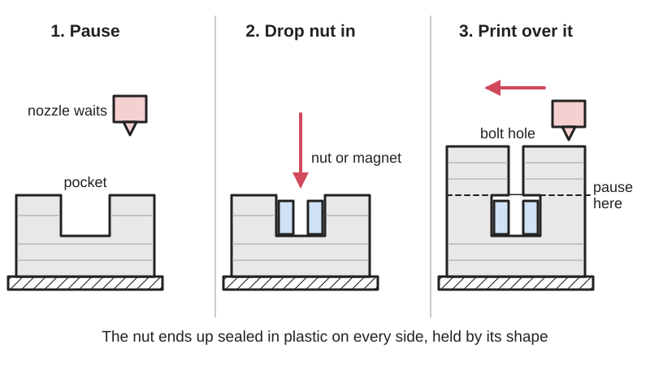

<figure class="eoc-pic eoc-pic-main"><figcaption>Diagram drawn for the encyclopaedia from the research notes. ⚑ Needs confirming: a drawing can simplify or get details wrong; a real photo or a better diagram is welcome.</figcaption></figure>

A way of trapping a nut, magnet, bearing or other metal part completely inside a 3D print by pausing the printer at the right layer, inserting the part, and printing over it.

**In plain words:** Stopping the 3D printer halfway, dropping a metal nut, magnet, bearing or steel balls into a pocket in the part, then letting it print the roof over them so they are sealed inside for good. **Proper term:** Mid-print embedding (pause-and-insert; embedded nuts, magnets and bearings).

**Also called:** pause at height, pause at layer (Cura's 'Pause at Height' post-processing script); Insert pause print (M601) (PrusaSlicer's menu item; M601 is the pause command); Add Pause (Bambu Studio's layer-slider option); embedded nut, fully [captive nut](../glossary.md#captive-nut), encapsulated nut; embedded or hidden magnets; embedded ball bearing; BB bearing (printed bearing with steel or airsoft BBs dropped in during a pause); embedding hardware, inserting hardware while printing (Hackaday; JanTec Engineering); gap-cap technique (a printed lid placed over the inserted part before printing resumes; DigiKey, Hackaday); insert moulding or overmoulding (the injection-moulding equivalent, where metal parts are placed in the mould before the plastic is injected) ⚑ [uncertain].

## How it works

The part is designed with a pocket the exact shape of the insert, whose top lines up with a layer boundary. In the slicer a pause is added at the layer that will close the pocket; the printer stops before that layer, parks the nozzle and keeps it hot (Prusa Knowledge Base). You drop the insert in and resume, and the next layers bridge over the pocket and seal it in (Prusa; Printables 'Embedded Nut Test 1'). The insert is then held by shape ([form-fit](../glossary.md#form-fit--force-fit--material-bond)) with plastic on every side, so it can't fall out or turn; a hole left in line with a nut lets a bolt reach it, and a magnet or bearing works through the thin plastic skin or through an opening.

## Parts

A few parts: the printed body with a pocket (cavity), the inserted part or parts (hex nut, disc magnet, ball bearing, steel balls, weights, rods or electronics) and, optionally, a drop of superglue or a small printed lid (gap-cap) over the insert.

## Everyday examples

- 3D-printed signs, figures and storage bins with magnets hidden inside so they stick to a fridge or baseplate (Printables models such as 'WiFi QR code sign - embedded magnet version' and 'Gridfinity embedded magnet base plates', found through the Printables API) ⚑ [uncertain]
- Magnetic building tiles for children, where the magnets are sealed inside the plastic ⚑ [uncertain]
- Plastic parts and knobs with a metal nut moulded inside (insert moulding) ⚑ [uncertain]
- Filament-spool rollers made with printed bearings whose steel BBs were dropped in during a pause (Printables '608 Bearing using BBs')

## When to use it

Use mid-print embedding when an insert must never fall out or be seen: hidden magnets for lids, catches and wall mounts; nuts deep inside a part where a side slot would weaken it or where there is no room for a [heat-set insert](../glossary.md#heat-set-insert); ball bearings or balls that must be trapped in a printed wheel or race; weights, steel rods or carbon-fibre rods to make a print heavier or stronger (JanTec Engineering reports up to 10 times stronger prints, via Hackaday); and LEDs or small electronics sealed into a shape. It gives strong metal threads without the weak slot of an ordinary nut trap (Thomas Sanladerer).

## When not to use it

Avoid it when you can't stay with the printer, when printing many copies or a whole plate at once (each pause needs a person), when the insert may need replacing (electronics, batteries) or when the part may be recycled; use a captive nut pocket with a side slot, a heat-set insert, a press-fit or glued magnet pocket (e.g. crush ribs) instead. Don't embed strong magnets if your nozzle or hotend is magnetic or your print sheet is magnetic without testing. Don't use it for parts that must survive high heat, because the magnet or the plastic may give up first.

## Details

- **What it does (jobs):**
  - join and hold: a sealed-in nut gives strong metal threads for a bolt; a sealed-in magnet makes a hidden magnetic catch or mount
  - let it move (turn, slide or bend): a bearing or ring of steel balls trapped in a printed wheel or race lets it spin (Printables '608 Bearing using BBs')
- **Movement:** none for embedded nuts, magnets and weights; rotate (unlimited) for embedded bearings and ball races
- **Directions it can move (degrees of freedom):** 0 for a sealed-in nut or magnet (it is locked in place); 1 (turning) for an embedded bearing or ball race
- **Special behaviour:**
  - none: the technique simply traps the part; any clever behaviour comes from what is embedded, e.g. a magnet that makes a hidden catch
- **How it holds:**
  - shape (the parts interlock; form-fit): the insert is completely surrounded by plastic, so it is held by shape, not friction
  - magnetic: when magnets are embedded, the resulting joint between two parts holds magnetically
- **Input and output:** not applicable (an embedded bearing lets a part spin but does not change speed or motion)
- **Power:** passive (no power needed)
- **Load:** medium: a nut backed by solid plastic resists being pulled out far better than threads in plastic. In CNC Kitchen's M3 tests in PETG (4 [perimeters](../glossary.md#perimeters), 100% [infill](../glossary.md#infill)) a nut seated in a pocket and loaded against the plastic (pushed in, not embedded mid-print, but loaded the same way as an embedded nut) held about 166 kg before tearing a crater out, against 86 kg for a nut in a side slot and 118 kg for a screw straight into plastic; turning force was limited to about 2 N m by the plastic crushing. Magnets hold only as hard as the magnet allows, weakened by the plastic skin between them; bearings carry what the plastic housing allows.
- **Play and precision:** small: the pocket needs about 0.1-0.3 mm of [clearance](../glossary.md#clearance) so the insert drops in (Hubs; DPHacks; Rapid Elevation), so the insert can rattle slightly unless it is a tight fit or glued; its position is otherwise set as accurately as the printer prints the pocket
- **Taking it apart:** permanent: the insert can only be removed by cutting or breaking the print; parts with embedded electronics can't be recovered if the electronics fail (Additive Inn). A bolt screwed into an embedded nut can still be undone.
- **How often it can be reused:** once for the embedding itself; a bolt in an embedded nut can be undone many times because the threads are metal on metal (Thomas Sanladerer rates inserted nuts 5 of 5 for durability)
- **Sealing:** none: it is not a sealing method; the insert is covered but the part is only as watertight as the print itself ⚑ [uncertain]
- **Adjustable:** no: position is fixed by the pocket once printed over
- **Access needed:** not applicable for fitting (it is done during printing, from above); in use, a bolt reaches an embedded nut from one side only (blind)
- **Materials:** Printed body: any FDM filament (PLA, PETG, ABS/ASA, nylon). Inserts: steel hex and square nuts, neodymium (NdFeB) disc and cylinder magnets such as 6 x 2 mm and 10 x 3 mm (Rapid Elevation), ball bearings, steel BBs (4.4 mm) or 6 mm airsoft BBs, carbon-fibre rods, bolts, weights, and small electronics such as LEDs, PCBs and sensors (Additive Inn; JanTec via Hackaday). Avoid magnets if your nozzle or hotend is ferromagnetic (e.g. hardened steel), because the magnet may jump to it (Hackaday/Lost In Tech).
- **Heat, cold, water and wear:** The plastic around the insert limits it: PLA begins to soften at about 60 °C, PETG at 80 °C and ASA at 110 °C (CNC Kitchen oven test), so an embedded nut in PLA can pull or twist loose in a hot car. N-grade neodymium magnets start to lose strength permanently above about 80 °C and corrode if exposed (Wikipedia 'Neodymium magnet'); sealing them in plastic may protect them from moisture ⚑ [uncertain]. Steel and plastic expand differently with temperature, so repeated heating and cooling can loosen inserts ⚑ [uncertain].

## Making it

- **Ways to make or get it:**
  - 3D print (FDM): the usual method; any printer whose firmware can pause (e.g. M601 on Prusa, M0 on Marlin) (Prusa; Cura PauseAtHeight script)
  - 3D print (resin): not normally practical, because the part hangs upside down in the resin vat ⚑ [uncertain]
  - other: insert moulding in injection moulding does the same job in mass production ⚑ [uncertain]
- **Printing it in one piece (print in place):** partly: the part prints around an added part (nut, magnet, bearing or balls) that you insert during a pause
- **Tools:** a slicer that can insert a pause (PrusaSlicer, Cura, Bambu Studio); tweezers or pliers to place parts; a marker to mark magnet poles (Rapid Elevation); optionally superglue (cyanoacrylate) to hold inserts still (Prusa; Hubs); a bolt to screw into the finished nut
- **Difficulty:** easy to moderate: adding a pause is a right-click in the slicer, but you must design the pocket depth to match a layer boundary, pick the right layer, and be at the printer when it pauses

### 3D printing tips

1) Design the pocket: make it the insert's shape plus clearance, about 0.2 mm on the width for a nut (0.1 mm each side), more for nuts over M12 (Hubs); for magnets start around 0.1 mm (DPHacks) to 0.2-0.3 mm on the diameter (Rapid Elevation). A snug pocket stops magnets being pulled out by the nozzle (Prusa). 2) Depth: make the pocket top a whole number of layer heights from the bed and put the insert's top at or slightly below it, never sticking up, or the nozzle will hit it (DPHacks; FettesPS). E.g. with 0.2 mm layers, sit the magnet 0.4 mm below the top surface so two layers cover it (DPHacks); Hackaday/Lost In Tech advise at least 2 layers (0.4-0.6 mm) over magnets. 3) Leave 2-3 solid layers under the pocket and keep it 1-2 mm from outside walls (Rapid Elevation). 4) Choose the pause layer carefully: PrusaSlicer and Bambu Studio pause before the layer you select, so select the first layer that covers the pocket (Prusa Knowledge Base; FettesPS); Cura's 'Pause at Height' script set 'By Layer' asks for the last layer to finish before the pause, and 'By Height' pauses at the start of the layer at or above that height (Cura PauseAtHeight.py). Check the preview. Several pauses can go in one print (Prusa). 5) At the pause the hotend stays hot and the nozzle parks (Prusa); drop the insert in, press it flat, check it is below the surface, and resume. A drop of superglue on the back of a nut or magnet keeps it still (Hubs; Prusa). 6) Magnets: mark the north face of every magnet and test pairs before sealing them in, because a reversed magnet can't be fixed (Rapid Elevation; DPHacks); make sure the nozzle and hotend are not magnetic, and keep strong magnets away from a magnetic print sheet, which they can damage or which can push them out of the pocket (Hackaday/Lost In Tech; DPHacks). Neodymium N-grade magnets lose strength above about 80 °C (Wikipedia), so they must never touch the hot nozzle. 7) Covering the insert: the first layer over metal is a bridge because plastic doesn't stick to metal; small nuts bridge fine, but for large or uneven inserts press a small pre-printed lid (gap-cap) flush into the pocket so the printer has a flat plastic surface to print on (DigiKey 'Embedding objects inside a 3D print'; Hackaday). 8) Keep the pause short: long pauses let the part cool, which may weaken the layer bond at the pause line (JanTec Engineering via Hackaday) or let the part lift off the bed ⚑ [uncertain]. 9) Bambu Studio can't add a pause when the print sequence is 'by object' ⚑ [uncertain]. 10) Try a test piece first, such as a nut test block (Printables 'Embedded Nut Test 1', pause at layers 51 and 54 with 0.2 mm layers; 'Vertically inserted M6 hex nut test piece', pause at layer 63 = 12.6 mm).

### Buying one (off-the-shelf parts)

Hex nuts (ISO 4032 / DIN 934) and thin square nuts; neodymium disc or cylinder magnets (N35, N52 grades; common sizes 6 x 2 mm and 10 x 3 mm) (Rapid Elevation); deep-groove ball bearings such as 608 (22 mm outside, 8 mm bore, 7 mm thick); steel BBs (4.4 mm) or 6 mm airsoft BBs for printed ball races (Printables '608 Bearing using BBs'); carbon-fibre rods, bolts and steel weights for reinforcement or ballast (JanTec via Hackaday); cyanoacrylate glue.

## Rules of thumb

- Pick the layer that closes the cavity; PrusaSlicer pauses before the selected layer, with the hotend kept hot (Prusa Knowledge Base 'Insert pause or custom G-code at layer').
- Cura's Pause at Height script 'By Layer' takes the number of the last layer to finish before the pause, not the covering layer (Cura PauseAtHeight.py, UltiMaker).
- Nut pocket clearance: about 0.2 mm on the nut's size (0.1 mm per side) as a starting loose fit, more for nuts larger than M12; a drop of superglue holds the nut (Hubs 'How to assemble 3D printed parts with threaded fasteners').
- Magnet pockets: 0.2-0.3 mm larger than the magnet diameter, 2-3 solid layers below, 1-2 mm from outer walls (Rapid Elevation 'Magnets in prints'); with 0.2 mm layers put the magnet top 0.4 mm below the surface so 2 layers cover it (DPHacks).
- Cover embedded magnets with at least 2 layers (0.4-0.6 mm) of plastic (Hackaday 'Ways to embed magnets in 3D prints and not ruin printers', 2026, on Lost In Tech's video).
- Standard N-grade neodymium magnets work up to about 80 °C; M, H, SH, UH and EH grades up to 230 °C; they lose all magnetism near 320 °C (Wikipedia 'Neodymium magnet').
- M3 nut in PETG: nut seated in a pocket and loaded against the plastic about 166 kg pull-out; nut in a side slot about 86 kg; screw directly into plastic about 118 kg; nut [torque](../glossary.md#torque) limit about 2 N m (CNC Kitchen 'Helicoils, threaded inserts and embedded nuts').
- Printed 608-size BB bearing: 10 Daisy BBs (4.40 mm), pause at 4.60 mm for the tight version or 4.80 mm for the loose one; grease quietens it (Printables '608 Bearing using BBs', breeden).

## Common failures

Nozzle hits an insert that sits proud of the layer and knocks it out or causes a layer shift: make the pocket deeper than the insert and a whole number of layers deep. Pause in the wrong place: one layer too late and the pocket is already covered, too early and the insert sticks up; remember that PrusaSlicer and Bambu pause before the chosen layer while Cura's layer setting means the last layer before the pause. Magnet pulled out by the nozzle: tighter pocket or glue (Prusa). Magnet sealed in backwards: mark and test poles first. First layer over the insert sags or doesn't stick: use a flat gap-cap or keep the span small (DigiKey). Weak line where the print paused, or part lifted from the bed during a long pause: keep pauses short ⚑ [uncertain]. Forgetting to insert the part before resuming. Insert rattles: pocket too loose; glue it.

## Safety

The nozzle and bed stay hot during the pause (Prusa), so use tweezers and keep fingers clear. Small neodymium magnets are dangerous if swallowed, especially two or more, and strong magnets can pinch skin or shatter when they snap together (Wikipedia 'Neodymium magnet'); keep loose magnets away from children and seal them in well. A magnet that jumps onto a steel nozzle or a strong magnet near a magnetic bed can damage the printer (Hackaday/Lost In Tech).

## Related

- Captive nut pocket (nut trap): a hex pocket or side slot the nut is pushed into after printing; no pause needed and the nut can be replaced, but a side slot is a weak spot (Thomas Sanladerer)
- Heat-set threaded insert: a brass insert melted into a hole after printing; strong threads without pausing the print
- Magnet joint (embedded magnets, magnetic catch): the joint that embedded magnets are usually used to make
- Crush ribs and spring-fit features (compliant press fit): hold a magnet or bearing in an open pocket after printing, so it can be removed
- Turntable bearing (lazy-Susan bearing, slewing ring): printed versions often trap airsoft BBs with this technique
- Plain pivot and rolling bearing: the ordinary way to fit a bought bearing into a housing
- Printed screw thread: no metal part at all, but weaker for small sizes

## Make it yourself

- [Embedded Nut Test 1 (Jordy's Prints, Printables) (URL from Printables API, page not opened)](https://www.printables.com/model/173849-embedded-nut-test-1): A small test block for embedding nuts; slice at 0.2 mm layers and add pauses at layers 51 and 54, before the printer bridges over each hole *(licence: Creative Commons Public Domain)*
- [Vertically inserted M6 hex nut test piece (M601) (hmk, Printables) (URL from Printables API, page not opened)](https://www.printables.com/model/1325800-vertically-inserted-m6-hex-nut-test-piece-m601): Test piece for sealing an M6 hex nut inside a print; pause at layer 63 (12.6 mm) with 0.2 mm layers; FreeCAD model included *(licence: CC BY-SA (Creative Commons Attribution-ShareAlike))*
- [608 Bearing using BBs (breeden, Printables) (URL from Printables API, page not opened)](https://www.printables.com/model/66530-608-bearing-using-bbs): A printed 608-size ball bearing (22 x 8 x 7 mm) made by pausing at 4.60 mm (tight) or 4.80 mm (loose) and dropping in 10 steel BBs of 4.40 mm *(licence: Creative Commons Public Domain)*
- [Embedded Magnets Negative Volume Generator for PrusaSlicer: cylinder magnets (layer.works, Printables) (URL from Printables API, page not opened)](https://www.printables.com/model/222274-embedded-magnets-negative-volume-generator-for-pru): Ready-made negative-volume shapes for 12 common magnet sizes, plus the OpenSCAD script, to cut flush or embedded magnet pockets into any model in PrusaSlicer, with pause instructions *(licence: GNU GPL v2.0)*
- [Cura 'Pause at Height' post-processing script (UltiMaker Cura source)](https://raw.githubusercontent.com/Ultimaker/Cura/main/plugins/PostProcessingPlugin/scripts/PauseAtHeight.py): The script behind Cura's Extensions > Post Processing > Pause at Height: pause by layer or height, park and lift the print head, standby temperature and beep options *(licence: LGPL-3.0 or later)*

## Pictures, videos and models

- [Insert pause or custom G-code at layer (Prusa Knowledge Base)](https://help.prusa3d.com/article/insert-pause-or-custom-g-code-at-layer_120490): Screenshots of PrusaSlicer's layer slider and the 'Insert pause print (M601)' menu, with advice on choosing the layer that closes the cavity *(licence: link only)*
- [Stronger 3D Prints by Inserting Hardware While Printing (YouTube, JanTec Engineering)](https://www.youtube.com/watch?v=b1JfzW8GPZo): Video of pausing prints to insert bolts, metal shapes, carbon-fibre rods and other fillers, and testing how much stronger the parts become (summarised by Hackaday, 2025-12-21) *(licence: link only (standard YouTube licence))*
- [Magnets in 3D Prints: How to ruin your printer edition (YouTube, Lost In Tech)](https://www.youtube.com/watch?v=xTfytJBLEn4): Video on ways to embed magnets, and how magnets can stick to a ferromagnetic nozzle or damage a magnetic print bed (summarised by Hackaday, 2026-06-04) *(licence: link only (standard YouTube licence))*
- [Embedding Objects Inside a 3D Print (DigiKey Maker blog, Don Johanneck, 2025)](https://www.digikey.com/en/maker/blogs/2025/embedding-objects-inside-a-3d-print): Photos of a slot with a stepped floor, an LED strip dropped in during a pause, and the printed gap-cap pressed flush before printing resumes *(licence: link only)*
- [Use A Gap-Cap To Embed Hardware In Your Next 3D Print (Hackaday, 2026)](https://hackaday.com/2026/03/27/use-a-gap-cap-to-embed-hardware-in-your-next-3d-print/): Pictures and explanation of the gap-cap method for sealing larger or uneven inserts inside a print *(licence: link only)*

## Needs confirming

⚑ marks something nobody has confirmed yet: a fact the research could not confirm from a source, a finder value that is a best guess, or an open point from the research notes. Corrections are welcome (see `research/needs-confirming.md`).

- ⚑ 12 sentences on this page marked [uncertain].

## Sources

- <https://help.prusa3d.com/article/insert-pause-or-custom-g-code-at-layer_120490>
- <https://raw.githubusercontent.com/Ultimaker/Cura/main/plugins/PostProcessingPlugin/scripts/PauseAtHeight.py>
- <https://raw.githubusercontent.com/Ultimaker/Cura/main/LICENSE>
- <https://www.fettesps.com/how-to-add-a-pause-when-printing-in-bambu-studio/>
- <https://github.com/bambulab/BambuStudio/issues/1596>
- <https://hackaday.com/2026/06/04/ways-to-embed-magnets-in-3d-prints-and-not-ruin-printers/>
- <https://www.youtube.com/watch?v=xTfytJBLEn4>
- <https://hackaday.com/2026/03/27/use-a-gap-cap-to-embed-hardware-in-your-next-3d-print/>
- <https://www.digikey.com/en/maker/blogs/2025/embedding-objects-inside-a-3d-print>
- <https://hackaday.com/2025/12/21/pause-print-add-hardware-and-enjoy-strength/>
- <https://www.youtube.com/watch?v=b1JfzW8GPZo>
- <https://www.additiveinn.com/blog/embedding-in-3d-prints>
- <https://rapidelevation.com/article-07-magnets-in-prints.html>
- <https://dphacks.com/2025/11/02/how-to-add-hidden-magnets-to-3d-prints/>
- <https://www.hubs.com/knowledge-base/how-assemble-3d-printed-parts-threaded-fasteners/>
- <https://www.cnckitchen.com/blog/helicoils-threaded-insets-and-embedded-nuts-in-3d-prints-strength-amp-strength-assessment>
- <https://toms3d.org/2025/01/14/a-better-way-to-add-threads-to-your-3d-prints/>
- <https://hackaday.com/2025/01/11/comparing-ways-to-add-threads-to-your-3d-prints/>
- <https://en.wikipedia.org/wiki/Neodymium_magnet>
- <https://www.cnckitchen.com/blog/comparing-pla-petg-amp-asa-feat-prusament>
- <https://api.printables.com/graphql/>
