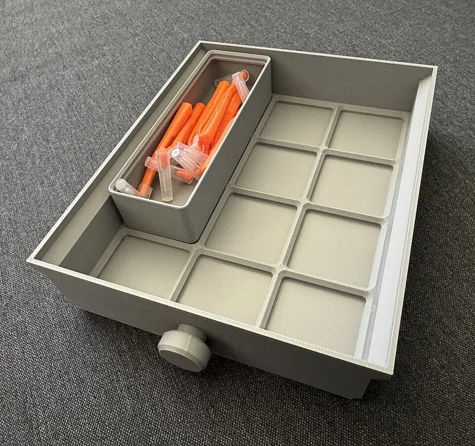
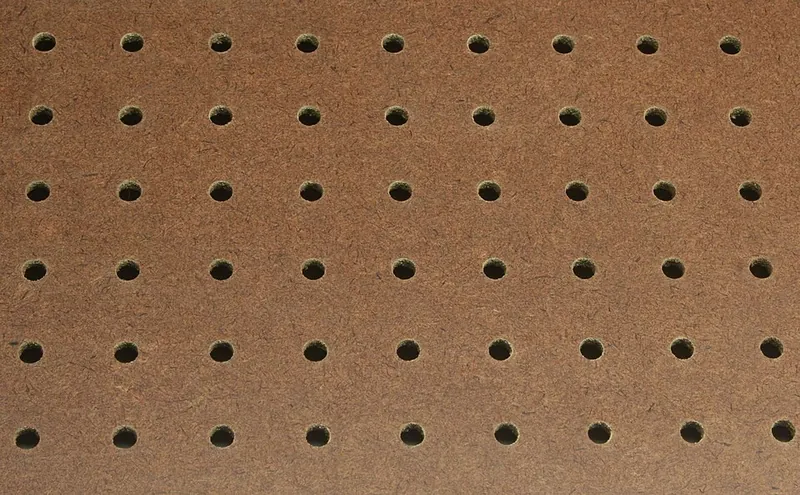

<figure class="eoc-pic eoc-pic-main"><figcaption><strong>Photo.</strong> <a href="https://commons.wikimedia.org/wiki/File:Gridfinity_drawer_and_bin.jpg">Gridfinity drawer and bin</a> by Sandstein, <a href="http://creativecommons.org/publicdomain/zero/1.0/deed.en">CC0</a>, from Wikimedia Commons.</figcaption></figure>
<figure class="eoc-pic"><figcaption><strong>Photo.</strong> <a href="https://commons.wikimedia.org/wiki/File:Pegboard.jpg">Pegboard</a> by Dave Pape, Public domain, from Wikimedia Commons.</figcaption></figure>

A board or baseplate with a regular grid of identical holes, slots or sockets, so any hook, holder or bin made to the same spacing can be hung, clicked, twisted, screwed or held by magnet in any position and moved again by hand.

**In plain words:** A board full of evenly spaced holes or sockets (or a tray with a grid of pockets) where hooks, holders and bins hang, click, twist, screw or stick by magnet into any spot, so you can rearrange them by hand without tools. **Proper term:** Modular grid mounting system (grid-pattern pegboard or baseplate storage system).

**Also called:** pegboard / peg board / perforated hardboard ('Peg-Board' began as a Masonite trademark and became a generic name; Wikipedia); pegboard hooks / peg hooks / L-hooks / J-hooks / double-prong hooks; locking pegboard hooks, peg locks, pegboard hook locks (plastic clips that stop hooks lifting out); metal pegboard / slotted pegboard / tool board (e.g. Wall Control (brand)); DuraHook (brand): screw-locked pegboard hooks; SKÅDIS (brand): IKEA pegboard with vertical slots on a 40 mm grid; Gridfinity: open grid standard by Zack Freedman, 2022 (42 x 42 x 7 mm baseplates and bins); its licence is given as MIT by gridfinity.xyz and Gridfinity Rebuilt but as Creative Commons NonCommercial by Wikipedia ⚑ [uncertain]; baseplate-and-bin system, grid drawer organiser, Clickfinity / CLICKbase (latching Gridfinity baseplates, maker names); Multiboard / MultiBuild (brand): 25 mm printed tiles with snaps and threads; Multiconnect (maker connector); openGrid: open 28 mm printed wall and desk grid with push-in snaps; Underware (cable channels for it); Honeycomb Storage Wall (HSW): printed hexagonal grid with inserts; Assortment System (Alexandre Chappel): the earlier bin system that inspired Gridfinity (gridfinity.xyz); tool wall, storage wall, modular wall organiser; slatwall / slotwall (grooved-panel version, used in shops); PALS / MOLLE webbing (textile grid version on bags and vests).

## How it works

Every hole or socket has the same shape and the same spacing (1 inch on classic pegboard, 25 mm on metric pegboard and Multiboard, 28 mm on openGrid, 40 mm on SKÅDIS, 42 mm on Gridfinity), so anything made to that spacing fits anywhere on the grid. On a pegboard, the bent top of a wire hook goes through a hole and catches behind the board, and the weight on the hook levers its lower leg against the board face; this holds by shape and leverage, but a plain hook can lift out when you pull a tool off, so locking versions add a clip across neighbouring holes (peg lock), a screw and tab in a second hole (DuraHook (brand)), or a slot shape that needs a deliberate up-and-down movement (Wall Control (brand) 'double offset'). Baseplate grids such as Gridfinity work lying down: each bin has a stepped, chamfered foot that drops into a matching socket whose walls stop it sliding, with optional 6 x 2 mm magnets or printed spring latches to stop it lifting out. 'Snap-and-thread' printed boards such as Multiboard and openGrid have holes that take push-in snaps (small [cantilever](../glossary.md#cantilever) snap fits), twist-lock snaps or printed screw threads, plus small holes for ordinary pegboard-style hooks.

## Parts

A few parts: the board or baseplate (hardboard, wood or steel pegboard, a slotted panel, or printed tiles and baseplates), the add-ons that fit it (wire or printed hooks, holders, shelves, bins, snaps, threaded bolts), optional locking parts (peg locks, screws and locking tabs, magnets, printed spring latches), and the wall fixings (screws, anchors, and furring strips or spacers that hold a pegboard off the wall).

## Everyday examples

- A garage or workshop pegboard with wire hooks holding hand tools (Wikipedia 'Perforated hardboard')
- Shop displays with long peg hooks or slatwall holding packaged goods (Wikipedia 'Perforated hardboard' and 'Slatwall')
- An IKEA SKÅDIS (brand) pegboard above a desk with clip-in hooks, cups and shelves
- A 3D-printed Gridfinity drawer insert whose bins lift out and swap around (Wikimedia Commons photo 'Gridfinity drawer and bin')

## When to use it

Use a grid system when you want to rearrange storage often without tools: tool walls, desk organisers, workbench drawers, electronics parts, craft and hobby supplies. Choose plain pegboard for a cheap, large wall of hanging tools; a locking-hook or slotted metal system if hooks keep falling out when you grab a tool; a baseplate-and-bin grid such as Gridfinity for drawers and benches where small parts live in bins you lift out and carry to the job; and a snap-and-thread printed board such as Multiboard or openGrid if you have a 3D printer and want to design your own holders that lock firmly. Following an existing open grid gives you thousands of free compatible designs.

## When not to use it

Avoid it for heavy or valuable items that must never fall (use shelf brackets, a French cleat or screwed-on mounts), for places with vibration or knocks such as vans and machines (use locked hooks, screws or a proper latch), and for oddly shaped items where a fixed grid wastes space: a review quoted by Wikipedia found Gridfinity's baseplate 'unnecessarily restrictive and material-consuming' and its fixed sizes wasteful for odd-sized objects, so use a custom-fitted insert or plain shelf instead. Large printed walls take a lot of filament and print time. Don't mix grids: SKÅDIS accessories don't fit 1/4 in pegboard, and Multiboard and openGrid parts are not interchangeable without adapters.

## Details

- **What it does (jobs):**
  - join and hold: hangs tools and holders on a wall or keeps bins in place in a drawer
  - lock, and release by hand: accessories lift, unclip or twist off and go back anywhere on the grid
  - line parts up exactly: only loosely, in that everything sits on a fixed grid so layouts line up and bins sit neatly side by side
- **Movement:** none: an accessory stays fixed once placed; you move it by hand to a new grid position
- **Directions it can move (degrees of freedom):** 0 once placed: the hook or bin is held in every direction, although plain pegboard hooks and Gridfinity bins without magnets or latches are only held down by gravity and leverage, so they can be lifted straight out
- **Special behaviour:**
  - quick-release (tool-free): hooks, holders and bins come off and go back by hand, which is the whole point of the system
  - indexing (clicks into set positions): in a loose sense, items can only sit at grid positions, e.g. every 25.4 mm on pegboard or every 42 mm on Gridfinity
  - self-aligning or self-centring: Gridfinity sockets have 45° stepped walls that guide a bin foot into place (Gridfinity Rebuilt base profile; unofficial specification)
  - hand-release only: locking hooks (peg locks, DuraHook, Wall Control slotted hooks) and latching baseplates stay put when you pull a tool off and need a deliberate movement to release (Wall Control; Ugly Duckling House)
- **How it holds:**
  - shape (the parts interlock; [form-fit](../glossary.md#form-fit--force-fit--material-bond)): hooks hook through holes, bins sit in shaped sockets, threaded bolts screw into holes
  - spring force (a spring or springy part presses it in place): push-in snaps, peg-lock clips and latching baseplates such as CLICKbase hold with springy printed or moulded parts
  - magnetic: optional 6 x 2 mm magnets in the corners of Gridfinity bin feet and baseplates (unofficial Gridfinity specification)
  - friction or clamping (force-fit): tight-fit lock plugs in SKÅDIS slots and Wall Control's bent stabilising tabs press the hook against the board
- **Input and output:** not applicable
- **Power:** passive (no power needed)
- **Load:** light to medium. Wall Control suggests 5-10 lb (about 2-4.5 kg) per single-slot hook, 10-15 lb (4.5-7 kg) per double-slot hook, 10-20 lb per shelf, and 100 lb (45 kg) per panel on drywall anchors or 200 lb (90 kg) screwed into studs; MultiBuild claims its boards support 'up to 46 kg (depending on configuration)'; a fan-made Multiboard glossary says a pegboard hole can hold up to 20 kg ⚑ [uncertain]. Strongest for downward load close to the board ([shear](../glossary.md#peel-vs-shear)); weak against pulling straight out or lifting unless the hooks are locked; long hooks put more leverage on the holes.
- **Play and precision:** noticeable on plain pegboard, where loose wire hooks wobble and can lift out (Ugly Duckling House); small on Gridfinity, where a 41.5 mm bin sits in a 42 mm socket (0.25 mm gap each side) and drops back into exactly the same place every time (Printables 'Gridfinity Specification'); printed snaps and threads are firm. Boards need to be flat, and joined tiles must keep the same spacing across the joint or accessories that span two tiles won't fit ⚑ [uncertain].
- **Taking it apart:** tool-free quick release: hooks, holders and bins come off by hand; the board itself is removable (screwed to the wall, to furring strips or to studs)
- **How often it can be reused:** effectively unlimited for hooks that simply hang in holes and bins that drop into a baseplate; many times for printed snaps and latches, which slowly wear or lose spring force (the CLICKbase designer warns PLA latches [creep](../glossary.md#creep) under constant load); hardboard holes may wear and loosen with heavy use ⚑ [uncertain]
- **Sealing:** none
- **Adjustable:** yes: any accessory can be moved to another grid position by hand, in steps of the grid spacing (1 in, 25 mm, 28 mm, 40 mm or 42 mm); SKÅDIS's tall slots let a hook sit at slightly different heights (Pegboardly); Wall Control's stabilising tabs can be bent to make a hook tighter
- **Access needed:** one side only (blind): accessories go in from the front; pegboard needs a gap of about 1/2 inch or more behind it for hook tips (Hunker; The Whittling Guide), and openGrid boards can be fixed to the wall entirely from the front (opengrid.world)
- **Materials:** Boards: tempered hardboard (classic pegboard, baked with linseed oil for water and impact resistance), perforated wood or plywood (can warp or splinter under heavy loads), or steel (metal pegboard) (Wikipedia 'Perforated hardboard'); laser-cut or CNC sheet (Boxes.py suggests 5 mm material for a SKÅDIS-style board); 3D-printed plastic tiles and baseplates (Gridfinity, Multiboard, openGrid, HSW). Hooks: bent steel wire ⚑ [uncertain] or printed plastic. Printed parts: PLA is fine for bins and plain baseplates, but use PETG, ABS, ASA or nylon for springy latches (CLICKbase notes) and for anything in a hot garage or car. Magnets: 6 x 2 mm neodymium discs (Gridfinity).
- **Heat, cold, water and wear:** Printed PLA softens from about 60 °C (PETG about 80 °C, ASA about 110 °C; CNC Kitchen), so PLA hooks and bins in a hot garage, shed or car can sag; PLA springs and latches creep under constant load and lose grip (CLICKbase notes; thrinter creep test). Standard N35 neodymium magnets are rated to about 80 °C and can corrode and crumble if their plating is damaged (Wikipedia 'Neodymium magnet'). Tempered hardboard resists water and knocks better than plain hardboard, while perforated wood can warp (Wikipedia 'Perforated hardboard'); damp garages may still swell hardboard ⚑ [uncertain]. Bumps and vibration knock unlocked hooks out (Wall Control; Wallwerx).

## Making it

- **Ways to make or get it:**
  - off-the-shelf part: hardboard, wood or metal pegboard and wire hooks; IKEA SKÅDIS (brand) boards and accessories; slatwall panels
  - 3D print (FDM): Gridfinity baseplates and bins, Multiboard, openGrid and Honeycomb Storage Wall tiles, snaps, hooks and holders
  - laser cut: SKÅDIS-style pegboards and Gridfinity bases from sheet (Boxes.py 'SkadisBoard' and 'GridfinityBase' generators)
  - CNC: drilled or routed pegboards and slotted boards ⚑ [uncertain]
  - woodwork: furring strips to hold a pegboard off the wall; drilling your own pegboard with a template ⚑ [uncertain]
  - sheet metal: steel pegboard panels with formed mounting flanges (Wall Control)
- **Printing it in one piece (print in place):** no: boards, hooks, snaps and bins are printed separately and fitted together; a few parts, such as openGrid's Lock Snap, print in place with a working rotating lock (opengrid.world), and Gridfinity magnets are pressed or glued in after printing
- **Tools:** none to place or move accessories (a coin turns an openGrid Lock Snap; pliers bend Wall Control stabilising tabs; a screwdriver fits DuraHook screws); a drill, screws and wall anchors, plus furring strips or spacers for pegboard, to mount the board; pressing or gluing magnets into Gridfinity parts
- **Difficulty:** easy: buy pegboard and hooks, or print a baseplate and bins from free files or a generator; the only fiddly steps are tuning print [tolerances](../glossary.md#tolerance) for snaps, plugs and threads, and fitting magnets

### 3D printing tips

1) Stick exactly to a published grid and profile (Gridfinity 42 x 42 x 7 mm; openGrid 28 mm; Multiboard 25 mm) and start from an existing generator or library such as Gridfinity Rebuilt in OpenSCAD or Boxes.py rather than redrawing the profile, so your parts fit everyone else's. 2) Print hooks lying on their side so the [layer lines](../glossary.md#layer-lines) run along the hook and not across its bend: upright PLA test pieces reached only 31 MPa against 63 MPa printed flat (CNC Kitchen), and the SKÅDIS lock-plug designer prints hooks on their side. 3) Big flat baseplates curl off the bed: Zack Freedman's Gridfinity tips say no brims or supports are needed, any filament with a 0.6 mm or smaller nozzle works, but wide plates can curl, so maximise bed adhesion (quoted in the 'Gridfinity Magnet Light Baseplate' remix). 4) Magnet pockets: Gridfinity uses 6 x 2 mm magnets; Gridfinity Rebuilt makes the pockets 6.5 mm across and 2.4 mm deep, or press-fit pockets with eight crush ribs (5.9 mm inner diameter); make sure bin and baseplate magnets attract rather than repel ⚑ [uncertain]. 5) Don't print springy latches or snaps in PLA: it creeps under constant load and the latch loses grip (CLICKbase notes); use PETG, ABS, ASA or nylon. 6) Tight-fit plugs and snaps are sensitive to layer height and printer tuning: the SKÅDIS lock plugs come in 'loose' and 'tight' versions and fit tighter at 0.20 mm than at 0.15 mm layers, so print a few test pieces first. 7) The squashed first layer (elephant foot) makes bin feet and tile edges slightly wide; PrusaSlicer's elephant-foot compensation of about 0.2 mm usually fixes it (Prusa). 8) Board print settings from the designers: openGrid boards at 0.2 mm layers and 15-20% [infill](../glossary.md#infill) (opengrid.world); Honeycomb Storage Wall at 0.25-0.3 mm layers with 3 or more [perimeters](../glossary.md#perimeters) (RostaP, Printables). 9) PLA softens at about 60 °C (CNC Kitchen), so print hooks for a hot garage, shed or car in PETG or ASA. 10) Printed systems use a lot of filament: lightweight 'lite' or skeletonised baseplates and boards save material (e.g. 'Gridfinity Magnet Light Baseplate' uses about 60% less filament than the weighted original).

### Buying one (off-the-shelf parts)

Search for: 'pegboard' or 'perforated hardboard' (1/8 in board with 3/16 in holes, or 1/4 in board with 1/4 in holes, both on 1 in centres; metric 25 mm), 'metal pegboard' or 'slotted pegboard', 'pegboard hooks' (L-hooks, J-hooks, double-prong hooks), 'pegboard hook locks' or 'peg locks', 'locking pegboard hooks' (e.g. DuraHook (brand)), 'pegboard spacers' or '1 x 2 furring strips', IKEA SKÅDIS (brand) boards and hooks, 'slatwall panel' and 'slatwall hooks', '6 x 2 mm neodymium disc magnets' (Gridfinity), 'M3 screws' (Gridfinity baseplate screw holes), 'M3 / M4 / M5 nuts' (Honeycomb Storage Wall inserts).

## Rules of thumb

- Pegboard holes are on 1 in (25.4 mm) centres: 1/8 in (3.2 mm) board has 3/16 in (4.8 mm) holes and 1/4 in (6.4 mm) board has 1/4 in holes; metric board uses 25 mm spacing in 4 or 6 mm board (Wikipedia 'Perforated hardboard').
- Leave a gap of 1/2 in (about 13 mm) or more behind a pegboard so hooks can go in, using 1 x 2 furring strips on the studs or spacers (Hunker 'How To Hang Pegboard'; The Whittling Guide). Wall Control's steel panels have a built-in 3/4 in mounting flange and mounting holes at 16 in stud spacing (Wall Control how-to).
- Wall Control load guidance: 5-10 lb per single-slot hook, 10-15 lb per double-slot hook, 10-20 lb per shelf, 100 lb per panel on drywall anchors, 200 lb per panel screwed into studs; 1/8 in peg hooks 'do not work well' in its combo panels (Wall Control how-to/FAQ).
- Gridfinity: 42 x 42 mm grid and 7 mm height units; bin feet are 41.5 mm square (0.25 mm gap each side); the socket wall is about 4.65 mm tall with a stepped 45° profile (Printables 'Gridfinity Specification'; Gridfinity Rebuilt constants: 0.8 mm at 45°, 1.8 mm vertical, 2.15 mm at 45°).
- Gridfinity magnets are 6 mm across and 2 mm thick, ideally in all four corners of every unit so bins fit in any rotation; M3 screws can be used instead (unofficial Gridfinity specification; Zack Freedman's tips).
- SKÅDIS: vertical slots about 5 mm wide and 15 mm tall on a 40 mm grid, with every other column dropped 20 mm, in a board about 5 mm thick (Pegboardly, community-measured); Boxes.py: 'Inner distance between slots are 35 + n * 40 mm', 'Best cut from 5mm material to match the original'.
- Multiboard: 25 mm grid; large holes take Snaps and Large Threads, small holes take Small Threads, 'Peg Click' hooks and 'non-3D-printed pegboard accessories' (MultiBuild Knowledge Hub).
- openGrid: 28 mm grid; full board 6.8 mm thick, lite board 4 mm with 3.4 mm lite snaps; board-to-board pegs are only for alignment, not strength (opengrid.world).
- Grids don't mix: SKÅDIS accessories don't fit 1/4 in pegboard (Just Hanging), and Multiboard's 25 mm grid doesn't match openGrid's 28 mm (opengrid.world); openGrid's 28 mm is two-thirds of Gridfinity's 42 mm, which is why it calls itself Gridfinity-compatible.
- PALS webbing (the textile grid on MOLLE bags): 1 in (25 mm) webbing rows 1 in apart, stitched every 1.5 in (38 mm) (Wikipedia 'MOLLE').

## Common failures

Hooks lift out or fall when a tool is pulled off, or wobble because they are too thin for the holes (Ugly Duckling House; Wall Control): fix with peg locks, screw-locked or double-prong hooks, zip ties or wire, or a slotted locking system, and match hooks to 1/8 in or 1/4 in board. Pegboard fixed flat against the wall, so hooks can't be inserted (it needs a 1/2 in gap). Board pulled off the wall by overloaded drywall fixings. Printed hooks snap along layer lines because they were printed standing up. Large printed baseplates curl or warp during printing. Printed latches and snaps loosen over time through creep (PLA). Parts from different grids, or prints that are slightly oversize, don't fit; tight plugs and snaps vary with layer height and printer tuning.

## Safety

Small neodymium magnets used in bin grids are dangerous if a child swallows more than one: they attract each other through the gut wall and can cause perforation, blockage or death (US CPSC, 2022). Hooks that lift out with a tool can drop sharp or heavy tools, so lock hooks that hold chisels, saws or heavy items. Overloaded boards can pull their fixings out of plasterboard: screw heavy boards into studs (Wall Control), and toggle bolts may pull the drywall out (The Whittling Guide). Hook ends at eye height can poke ⚑ [uncertain].

## Related

- Hang-on mounts (keyhole slot, French cleat): hang things anywhere along a bevelled rail instead of at fixed grid holes; stronger for heavy items
- Aluminium-extrusion connectors (T-slot nuts and brackets): clamp anywhere along a slot instead of into a grid of holes
- Slatwall: horizontal grooves instead of holes, so hooks slide sideways to any position (Wikipedia 'Slatwall')
- DIN-rail clip (top-hat rail snap mount): modules click onto one standard rail at any point along it
- Cantilever snap fit: the springy hook that push-in snaps on printed boards use
- Magnet joint (embedded magnets, magnetic catch): the magnets that hold Gridfinity bins down
- Printed screw thread: the threads used by Multiboard-style bolts
- Bayonet mount (push-and-twist lock): the push-then-twist idea behind twist-lock snaps
- PALS / MOLLE webbing (cord, strap, webbing & textile hardware): a fabric grid that pouches weave into (Wikipedia 'MOLLE')

## Make it yourself

- [Gridfinity Rebuilt in OpenSCAD (documentation; code by kennetek)](https://kennetek.github.io/gridfinity-rebuilt-openscad/): A parametric OpenSCAD library for Gridfinity bins and baseplates of any size, with options for magnet and screw holes, supportless magnet holes, lite and vase-mode bins *(licence: MIT (per the project README))*
- [Gridfinity Rebuilt in OpenSCAD (kennetek, Printables) (URL from Printables API, page not opened)](https://www.printables.com/model/274917-gridfinity-rebuilt-in-openscad): Printables page for the same parametric Gridfinity generator, with ready-made files *(licence: CC BY-SA (Printables listing))*
- [GridfinityBase (Boxes.py online generator)](https://boxes.hackerspace-bamberg.de/GridfinityBase?language=en): Generates a laser-cut Gridfinity base of any size at the 42 mm pitch, with optional 6.5 mm magnet holes *(licence: GPL-3.0 (Boxes.py code licence; generated designs not separately licensed) ⚑ [uncertain])*
- [SkadisBoard (Boxes.py online generator)](https://boxes.hackerspace-bamberg.de/SkadisBoard?language=en): Generates a customisable IKEA-style slotted pegboard for laser cutting or CNC, best cut from 5 mm material *(licence: GPL-3.0 (Boxes.py code licence; generated designs not separately licensed) ⚑ [uncertain])*
- [openGrid - Wall/Desk mounting framework and ecosystem (David D, Printables)](https://www.printables.com/model/1214361-opengrid-walldesk-mounting-framework-and-ecosystem): The printable 28 mm openGrid boards, snaps and modelling files; read through the Printables public API *(licence: CC BY (Printables listing))*
- [Honeycomb storage wall (RostaP, Printables) (URL from Printables API, page not opened)](https://www.printables.com/model/152592-honeycomb-storage-wall): Hexagonal printed wall tiles with inserts, hooks, boxes and holders; some hooks screw into inserts with M3 or M4 screws *(licence: CC BY-NC (Printables listing))*
- [IKEA Skadis pegboard - Lock plugs and secure hooks (JayKeyStk, Printables) (URL from Printables API, page not opened)](https://www.printables.com/model/52120-ikea-skadis-pegboard-lock-plugs-and-secure-hooks): Printed plugs that lock the original metal SKÅDIS hooks in place, in loose-fit and tight-fit versions, plus printed secure hooks and a removal tool *(licence: CC BY-NC-SA (Printables listing))*
- [CLICKbase: a no-magnet, latching Gridfinity baseplate (John Hall, Printables) (URL from Printables API, page not opened)](https://www.printables.com/model/982173-clickbase-a-no-magnet-latching-gridfinity-baseplat): Gridfinity baseplates with printed spring latches instead of magnets, joined with small clips; the designer advises PETG, ABS, ASA or nylon rather than PLA because PLA springs creep *(licence: CC BY-NC-SA (Printables listing))*

## Pictures, videos and models

- [Pegboard.jpg (Wikimedia Commons, Dave Pape)](https://commons.wikimedia.org/wiki/File:Pegboard.jpg): Close-up of pegboard (perforated hardboard) with 1/4 in holes on 1 in spacing *(licence: public domain (released by the author))*
- [Gridfinity drawer and bin (Wikimedia Commons, Sandstein, 2026)](https://commons.wikimedia.org/wiki/File:Gridfinity_drawer_and_bin.jpg): A 3D-printed drawer with a 4 x 3 Gridfinity baseplate and a 1 x 3 Gridfinity bin holding toothpicks *(licence: CC0 1.0 (public domain dedication))*
- [Gridfinity: Your Ultimate Modular Workshop is FREE! (YouTube, Zack Freedman)](https://www.youtube.com/watch?v=ra_9zU-mnl8): The original Gridfinity video: baseplates, bins dropping into the grid, magnets and stacking *(licence: link only (standard YouTube licence))*
- [Snaps (openGrid documentation)](https://www.opengrid.world/guides/snaps/): The openGrid snap types (normal, directional, twist-to-lock Lock Snap, bare) and how they push into a 28 mm grid board *(licence: link only (licence of the page not stated) ⚑ [uncertain])*
- [Triton DuraHook: Pegboard Hooks That Screw Into Pegboard (ToolGuyd, 2015)](https://toolguyd.com/triton-durahook-pegboard-hooks/): Photos of locking pegboard hooks that use one hole for a locking tab and the next for a screw *(licence: link only)*

## Needs confirming

⚑ marks something nobody has confirmed yet: a fact the research could not confirm from a source, a finder value that is a best guess, or an open point from the research notes. Corrections are welcome (see `research/needs-confirming.md`).

- ⚑ 13 sentences on this page marked [uncertain].
- ⚑ Finder value `clicks` = clicks (best guess): one-way or indexing, but neither clicking nor silent named; defaulted to clicks

## Sources

- <https://en.wikipedia.org/wiki/Pegboard>
- <https://commons.wikimedia.org/wiki/File:Pegboard.jpg>
- <https://www.hunker.com/13715151/how-to-hang-pegboard/>
- <https://thewhittlingguide.com/guides/pegboard-furring-strips/>
- <https://wallcontrol.com/blogs/wall-storage-organization-blog/the-ultimate-beginners-guide-to-hanging-a-pegboard>
- <https://www.wallcontrol.com/pegboard-how-to>
- <https://www.wallcontrol.com/pegboard-hooks-accessories/>
- <https://toolguyd.com/triton-durahook-pegboard-hooks/>
- <https://www.uglyducklinghouse.com/tip-how-to-secure-loose-pegboard-hooks/>
- <https://www.wallwerx.com/blogs/blog-1/why-your-pegboard-hooks-keep-falling-out-and-how-to-fix-it>
- <https://pegboardly.com/skadis/skadis-sizes-and-dimensions>
- <https://www.justhangingpegboards.com/blogs/blog/ikea-skadis-vs-1-4-pegboard-which-should-you-choose>
- <https://boxes.hackerspace-bamberg.de/?language=en>
- <https://boxes.hackerspace-bamberg.de/SkadisBoard?language=en>
- <https://boxes.hackerspace-bamberg.de/GridfinityBase?language=en>
- <https://gridfinity.xyz/>
- <https://gridfinity.xyz/specification/>
- <https://raw.githubusercontent.com/gridfinity-unofficial/specification/main/README.md>
- <https://en.wikipedia.org/wiki/Gridfinity>
- <https://commons.wikimedia.org/wiki/File:Gridfinity_drawer_and_bin.jpg>
- <https://hackaday.com/2022/04/18/gridfinity-3d-printed-super-quick-tool-storage-and-retrieval/>
- <https://www.youtube.com/watch?v=ra_9zU-mnl8>
- <https://raw.githubusercontent.com/kennetek/gridfinity-rebuilt-openscad/main/README.md>
- <https://raw.githubusercontent.com/kennetek/gridfinity-rebuilt-openscad/main/src/core/standard.scad>
- <https://kennetek.github.io/gridfinity-rebuilt-openscad/>
- <https://api.printables.com/graphql/>
- <https://www.printables.com/model/417152-gridfinity-specification>
- <https://www.printables.com/model/1214361-opengrid-walldesk-mounting-framework-and-ecosystem>
- <https://docs.multibuild.io/beginner-section/core-parts-documentation>
- <http://multiboard.stonekeep.com/glossary.html>
- <https://multibuild.io/>
- <https://www.opengrid.world/>
- <https://www.opengrid.world/guides/snaps/>
- <https://www.opengrid.world/guides/board/>
- <https://en.wikipedia.org/wiki/Slatwall>
- <https://en.wikipedia.org/wiki/MOLLE>
- <https://www.cpsc.gov/Newsroom/News-Releases/2022/CPSC-Approves-New-Federal-Safety-Standard-for-Magnets-to-Prevent-Deaths-and-Serious-Injuries-from-High-Powered-Magnet-Ingestion>
- <https://en.wikipedia.org/wiki/Neodymium_magnet>
- <https://www.cnckitchen.com/blog/comparing-pla-petg-amp-asa-feat-prusament>
- <https://www.cnckitchen.com/blog/stop-printing-flat-the-45-secret-for-stronger-parts>
- <http://thrinter.com/creep-abs-pla-petg-alloy-910/>
- <https://help.prusa3d.com/article/elephant-foot-compensation_114487>
- <https://raw.githubusercontent.com/florianfesti/boxes/master/LICENSE.txt>
