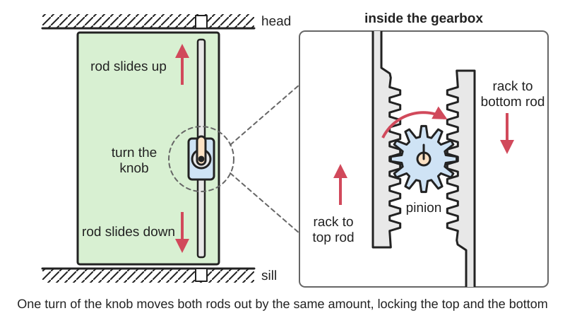
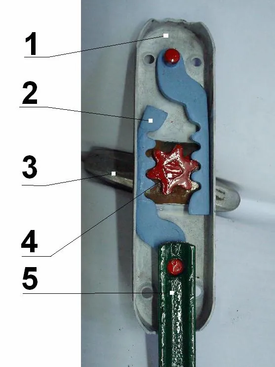
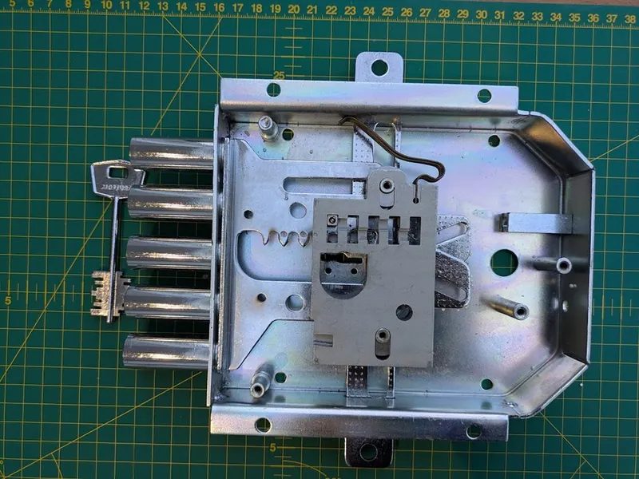
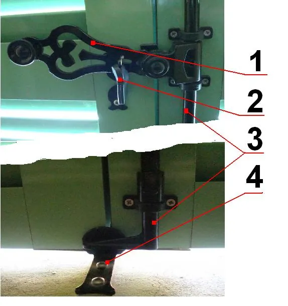

<figure class="eoc-pic eoc-pic-main"><picture><source media="(prefers-reduced-motion: reduce)" srcset="../media/drawn/multi-point-bolt.svg"></picture><figcaption><strong>Animation.</strong> Diagram drawn for the encyclopaedia from the research notes. ⚑ Needs confirming: a drawing can simplify or get details wrong; a real photo or a better diagram is welcome.</figcaption></figure>
<figure class="eoc-pic"><figcaption><strong>How it works.</strong> <a href="https://commons.wikimedia.org/wiki/File:Cr%C3%A9mone.jpg">Crémone</a> by Neri.jp, <a href="https://creativecommons.org/licenses/by-sa/3.0">CC BY-SA 3.0</a>, from Wikimedia Commons.</figcaption></figure>
<figure class="eoc-pic"><figcaption><strong>How it works.</strong> <a href="https://commons.wikimedia.org/wiki/File:Mottura_556_6l_dblebit_rim_mpl_(2).jpg">Mottura 556 6l dblebit rim mpl (2)</a> by CHUBBBRAMAH, <a href="http://creativecommons.org/publicdomain/zero/1.0/deed.en">CC0</a>, from Wikimedia Commons.</figcaption></figure>
<figure class="eoc-pic"><figcaption><strong>Photo.</strong> <a href="https://commons.wikimedia.org/wiki/File:Espagnolette.JPG">Espagnolette</a> by Nerijp, <a href="https://creativecommons.org/licenses/by-sa/3.0">CC BY-SA 3.0</a>, from Wikimedia Commons.</figcaption></figure>

A multi-point bolt ties two or more bolts to one handle, through a turning rod with hooked or cam ends or a small gear driving toothed bars, so a single movement locks a tall door, a pair of doors or a big lid at the top, the bottom and sometimes the sides.

**In plain words:** One handle that locks a tall door, a pair of doors or a big lid in two or more places at once: turning or lifting it pushes rods, bolts or hooks out at the top and bottom (and sometimes along the sides) into catches on the frame. **Proper term:** Multi-point bolt (multipoint lock): espagnolette (a turning rod with hooked ends), crémone bolt (two rods driven up and down by a rack and pinion) and lock rods (cam lock rods on trailer and container doors).

**Also called:** espagnolette, espagnolette bolt, espagnolette lock: a handle turns a full-height round rod with hooks at each end (Wikipedia 'Espagnolette'); crémone, cremone bolt, crémone bolt, 'surface bolts': a knob or lever drives two half-round rods up and down through a rack and pinion (Wikipedia 'Crémone'); Baskülgetriebe (German name for the crémone-type gear; Wikipedia 'Espagnolette'); sliding rod lock (the third historic French type; Wikipedia 'Espagnolette'); lockrod, lock rod, locking rod, cam lock rod (trailer and container doors; often confused with 'locking bars' or 'bar locks'; Wikipedia 'Lockrod'); container door locking bars with cams and keepers (Eveon Containers; USA Containers); multipoint lock, multi-point locking system (MPL): the long lock in the edge of a uPVC or composite front door, with hooks, shoot bolts or rollers plus a central latch and deadbolt (Suffolk Latch Company; Lockshop Warehouse; home-security-guide); multipoint mortice lock with vertical bolts into the head and threshold (Italian-style lever lock, e.g. Mottura (brand); Wikimedia Commons photo description); safe boltwork: an outside handle drives several bolts from the door edges through a transmission inside the door (Chubb patent GB2094390A); geared latch box, rack-and-pinion lid lock (printed boxes; Printables 1633497, 56341); keeper, keep, strike, socket, stop or stud: the fixed part on the frame that each bolt, hook or cam engages (Wikipedia 'Espagnolette', 'Lockrod'; Suffolk Latch Company).

## How it works

Every locking point is tied to the same rod or gear, so one input moves them all together. In an espagnolette the handle turns a full-height round rod, and the hooks on its ends swing behind pins at the head and sill, so 'tall sashes [are] locked at both ends simultaneously' (Wikipedia 'Espagnolette'). In a crémone bolt the knob turns a small gear (pinion) between two toothed bars (racks), so one rod slides up into the head while the other slides down into the sill by the same distance (Wikipedia 'Crémone'; 'Rack and pinion'). Trailer and container lock rods are a heavy espagnolette: swinging the handle turns a vertical tube so the cams at its top and bottom turn into keepers on the frame; 'reach/gather' cams catch the keeper and pull the door in against its seals, and 'zero-torque' cams go past the centre point so that pressure from inside only locks them tighter (Wikipedia 'Lockrod'). On a uPVC front door, lifting the handle moves hooks, bolts or rollers along the door edge into keeps in the frame, and turning the key then locks the whole mechanism (Suffolk Latch Company; Lockshop Warehouse).

## Parts

A small assembly that acts as one unit. Espagnolette: handle (paddle) on a keeper bracket, a full-height round rod held in sleeves, forged hooked ends, and pins ('stops' or 'studs') at the head and sill (Wikipedia 'Espagnolette'). Crémone bolt: knob or lever, a gearbox with one pinion and two racks, two half-round rods, end guides, and surface or mortice strikes at the head and sill (Wikipedia 'Crémone'; Kilian Hardware). Lock rod: a steel tube with top and bottom cams welded on, a handle assembly, mounting brackets, and two keepers on the frame (Wikipedia 'Lockrod'). uPVC multipoint lock: handles and spindle, a central lock case (gearbox) with latch, deadbolt and key cylinder, a long faceplate (lock strip) carrying hooks, bolts or rollers, and matching keeps in the frame (Suffolk Latch Company).

## Everyday examples

- A tall French window or pair of shutters with a long rod and a handle in the middle that locks at the top and bottom (espagnolette; Wikipedia 'Espagnolette', 'Window')
- The rear doors of a lorry trailer or shipping container, with vertical bars and handles that turn cams into keepers at the top and bottom (lock rods; Wikipedia 'Lockrod')
- A UK uPVC or composite front door: lift the handle so hooks shoot out along the edge, then turn the key (multipoint lock; Lockshop Warehouse)
- A wardrobe or cabinet whose key slides hidden rods up and down (cabinet crémone; Kilian Hardware), or a safe door with a big handle that throws bolts on several edges (Chubb patent GB2094390A)

## When to use it

Use it when one catch is not enough because the door or lid is tall, wide or flexible: a single latch in the middle lets the corners bow open, while bolts at the top and bottom hold the whole edge flat. It suits French doors and casement windows (in parts of Europe casements 'tend to use projection friction stays and espagnolette locking'; Wikipedia 'Window'), pairs of cabinet or wardrobe doors, big tool chests, printed storage boxes whose lid should lock on all four sides with one knob (Printables 56341, 1633497), and cargo doors that must hold the load and stay aligned in transit (Wikipedia 'Lockrod'). Choose it when you want one simple action and a tidy look instead of several separate bolts.

## When not to use it

Not for small doors or lids where one latch already holds the corners: use a basic latch, a cam latch or a magnetic catch. Not when the door or frame moves with the seasons or sags, unless you can adjust the keeps, because every point must line up at once (Suffolk Latch Company). For a pair of doors where only the fixed leaf needs holding, two flush bolts are simpler. For a lid that must also be pulled down tight against a gasket, use draw latches ([over-centre](../glossary.md#over-centre) latches) around the edge. Don't build your own lock for a front door, a fire door or anything that must be a certified security or escape door; buy a tested lock and have fire doors fitted by a specialist (Suffolk Latch Company). A printed box lock keeps fingers out, not thieves ⚑ [uncertain].

## Details

- **What it does (jobs):**
  - lock, and release by hand: one handle or key locks and unlocks every point at once
  - join and hold: holds a tall door, a pair of doors or a big lid against its frame at both ends, so it can't bow, twist or be levered open between distant catches
  - change the kind of motion: inside, a rack and pinion or a rotating rod turns the handle's twist into sliding bolts or swinging hooks and cams
- **Movement:** multiple: the handle or key rotates (two full key turns on one cabinet crémone; Kilian Hardware); crémone rods and shoot bolts slide in a straight line (11 mm, 7/16 in, each way on that cabinet crémone; Kilian Hardware); espagnolette rods and lock rods rotate about their own length so their hooks or cams swing. Once locked, the door itself does not move (none).
- **Directions it can move (degrees of freedom):** 0 between door and frame once locked. The mechanism has 1: a single handle input sets the position of every bolt, because they are all geared or fixed to the same rod, which is why they always move together.
- **Special behaviour:**
  - hand-release only (locks under load, releases when a person operates it): pushing or pulling the door does not open it; only the handle or key draws the bolts back. An espagnolette handle may also latch into a hook on the frame (Wikipedia 'Espagnolette'), and a uPVC multipoint lock is locked by the key after the handle is lifted (Lockshop Warehouse)
  - over-centre (snaps past a point and stays): 'zero-torque' lock-rod cams go past the centre point, so 'the more pressure that's applied from the inside of the trailer doors... the tighter the cams and keepers engage' (Wikipedia 'Lockrod')
  - motion conversion (rotary to linear): the crémone's pinion turns the knob's rotation into two straight, opposite rod movements of equal length (Wikipedia 'Crémone'; 'Rack and pinion'); an espagnolette turns rod rotation into hooks swinging behind pins
  - self-aligning or self-centring: 'reach/gather' lock-rod cams reach out, catch the keeper and draw the door closed against compression seals or a warped door (Wikipedia 'Lockrod'). Ordinary crémones and espagnolettes do not self-align and must be lined up at fitting
- **How it holds:**
  - shape (the parts interlock; [form-fit](../glossary.md#form-fit--force-fit--material-bond)): hooks catch behind pins, rods slide into sockets in the head and sill, and cams turn behind keepers, so the door can't swing open
  - friction or clamping (force-fit): on lock rods the cam pulls the door tight against its gasket, so friction and seal pressure also help hold it (Wikipedia 'Lockrod'; Eveon Containers)
- **Input and output:** Handle or key rotation -> two or more bolt movements at once. Crémone: rotation -> two opposite straight movements; a single pinion drives two parallel racks that 'will always be displaced by the same distance, only in opposite directions', and one full turn of the pinion moves each rack by the pinion's [pitch](../glossary.md#pitch) circumference (Wikipedia 'Rack and pinion'); one cabinet crémone throws each rod 11 mm (7/16 in) for two turns of its key (Kilian Hardware). Espagnolette and lock rod: handle swing -> rod rotation (in line; the rod is the shaft) -> hooks or cams swing into keepers. Shaft arrangement: pinion at right angles to the racks; the two rods in line. Efficiency: not given by the sources ⚑ [uncertain]. Back-drivable: zero-torque lock rods are designed not to be forced open from inside (Wikipedia 'Lockrod'); a plain rack and pinion can in principle be pushed back by its rods, so locks are held by a handle catch, a frame hook or a key ⚑ [uncertain].
- **Power:** passive (no power needed). Motorised multipoint locks also exist (Suffolk Latch Company); for powered versions see Servo or motorised latch.
- **Load:** Medium to heavy. Strong against the door being pushed, pulled or levered open, because each bolt is loaded sideways (in [shear](../glossary.md#peel-vs-shear)) at points far apart, so a tall door can't bow away from its frame between them. Lock rods hold the cargo leaning on trailer doors and stop the doors moving up and down in transit (racking) (Wikipedia 'Lockrod'). Heavy-duty lock rods are 1 in (25 mm) diameter steel, light-duty 3/4 in (19 mm) (Wikipedia 'Lockrod'). Weak points: screws pulling out of the frame, keeps or keepers bending, the small gearbox teeth, and printed racks shearing.
- **Play and precision:** Noticeable play: each bolt needs [clearance](../glossary.md#clearance) in its socket. On trailers, 'too much play between parts' lets the doors rack until the parts wear out and no longer secure the door (Wikipedia 'Lockrod'). It tolerates little [misalignment](../glossary.md#misalignment): a dropped door or moved keep makes the handle stiff when the door is shut but not when it is open (Suffolk Latch Company), and decorative cabinet crémones are 'prone to fall out of alignment' (Room for Tuesday). Lead-in cam shapes (reach/gather) help (Wikipedia 'Lockrod'). Not used for precise locating.
- **Taking it apart:** tool-free quick release: it is locked and unlocked by hand (or with a key) in one movement; the hardware itself is removable with a screwdriver or spanner, and trailer keepers may be welded on (Wikipedia 'Lockrod')
- **How often it can be reused:** effectively unlimited: made to be worked every day for the life of the door; wear from play between parts, a dropped door or a moved keep usually ends its life rather than the number of cycles (Wikipedia 'Lockrod'; Suffolk Latch Company)
- **Sealing:** none by itself: it relies on a separate gasket or weatherstrip, but by pulling the door evenly against the frame at several points it helps that seal work; lock-rod cams 'overcome resistance from compression seals' (Wikipedia 'Lockrod') and container cams and keepers 'ensure a tight, secure seal' with the door gasket (Eveon Containers)
- **Adjustable:** Yes, a little: keeps and strikes can be moved or adjusted to meet the bolts (their 'type, location and adjustment are system-specific'; Suffolk Latch Company), and crémone rods are cut to length when fitted (Kilian Hardware). The bolt travel itself is fixed by the gear. On a printed lid lock, one designer shims the lug gear to set how tight the lid closes (Printables 1465165).
- **Access needed:** one side only (blind) for surface-mounted espagnolettes, crémones and lock rods, which go on one face of the door plus strikes in the head and sill; both sides for a uPVC multipoint lock, which is mortised into the door edge with handles and a cylinder on both faces (Suffolk Latch Company)
- **Materials:** Bought hardware: steel, galvanised, painted or stainless steel, aluminium, brass and zinc castings. Lock rods are usually galvanised steel, sometimes aluminium on light trailers, and cams and keepers are made of the same metal as the rod to avoid corrosion between different metals (Wikipedia 'Lockrod'). Cabinet crémones are plain steel (Kilian Hardware). Printed versions use PLA or PETG for the gears, racks and pins (Printables 56341, 1633497). Fits wood, metal, uPVC, aluminium and printed doors and lids (Suffolk Latch Company: multipoint systems are used on timber, composite, uPVC and aluminium doors).
- **Heat, cold, water and wear:** Metal hardware: rust on container locking bars and dry cams make handles hard to turn, so keep them clean and oil the joints and locks (Eveon Containers). Doors can freeze shut; 'icebreaker' lock rods give extra opening leverage for this (Wikipedia 'Lockrod'). Mixed metals corrode, so cams, keepers and rod should match (Wikipedia 'Lockrod'). Door movement: a dropped door, a displaced keep or door movement makes the locking points meet resistance at the frame (Suffolk Latch Company). Use only the lubricant the lock maker specifies and don't flood the gearbox (Suffolk Latch Company). Printed parts: PLA gives at about 60 °C, PETG at 80 °C and ASA at 110 °C (CNC Kitchen), so avoid PLA lid locks in a hot car; printed racks and pins left under a constant load can [creep](../glossary.md#creep) ⚑ [uncertain].

## Making it

- **Ways to make or get it:**
  - off-the-shelf part: espagnolette and crémone bolt sets for windows, shutters, French doors and cabinets; uPVC multipoint lock strips and gearboxes; trailer and container lock-rod assemblies, cams and keepers
  - 3D print (FDM): printed rack-and-pinion lid locks for boxes, with one knob driving two to four pins (Printables 1633497, 56341, 955011)
  - woodwork: fitting crémones and espagnolettes to inset cabinet, wardrobe and French doors, which can be added after the door is made (Kilian Hardware; Room for Tuesday)
  - sheet metal: bent keepers, strikes and rod guides ⚑ [uncertain]
  - laser cut: flat racks, pinion and bolts from plywood or acrylic for a box lid ⚑ [uncertain]
- **Printing it in one piece (print in place):** yes, for some designs: Printables 1633497 is a [print-in-place](../glossary.md#print-in-place) box with a hinged lid whose knurled knob extends four rack-and-pinion locking pins, and Printables 56341 is a support-free print-in-place box whose handle turns floating gears and racks to latch all four sides of the lid. Others print the lid's gear set in place and the box separately (Printables 955011).
- **Tools:** To fit: screwdriver and drill; a hacksaw to cut rods to length (one cabinet crémone's 1500 mm rod is cut into two lengths; Kilian Hardware); a chisel or router for mortice strikes; a special bit for tamper-resistant screws (#0 square drive on that crémone; Kilian Hardware). Trailer and container keepers are welded or bolted to the end frame (Wikipedia 'Lockrod'). To use: none, or the key.
- **Difficulty:** moderate: a surface-mounted crémone or a printed rack-and-pinion lid lock is a manageable project, but rods, gear and strikes must line up at both ends of a long door or lid, and one misaligned bolt makes the whole thing bind. Hard for a full uPVC multipoint lock or trailer lock rods: buy the exact matching part, since 'the same number of hooks and rollers on another lock does not establish interchangeability' (Lockshop Warehouse; Suffolk Latch Company).

### 3D printing tips

1) Layout: put the knob on one central pinion and run two (or four) racks out to the edges. A single pinion drives two parallel racks by the same distance in opposite directions, and each full turn moves each rack by the pinion's pitch circumference (Wikipedia 'Rack and pinion'), so a pinion with a 20 mm pitch diameter throws each bolt about 63 mm per turn; use a quarter or half turn for a short, firm throw. BOSL2's rack() and spur_gear() modules make matching parts (BOSL2 gears.scad). 2) Clearance: print-in-place gears and racks need generous gaps; one designer used gaps of 'nearly 1mm' between mating pieces so the box still works when printed at 50% scale (Printables 56341). After printing, twist the gear once to break it free (Printables 955011). 3) No supports: floating gears can be printed over sacrificial bridge layers (the 'floating holes' trick); one box used 0.4 mm bridges with 0.2 mm lid layers and 0.3 mm box layers and calls it 'not an easy print' that needs a good first layer (Printables 56341). One print-in-place lid prints face down at 0.2 mm layers, 15% gyroid [infill](../glossary.md#infill) and no supports (Printables 955011). 4) Fit and tightness: a lug-gear box lid can be tightened by shimming the gear, and tree supports only in the lug slots give a good fit (Printables 1465165). 5) Bolt tips: round or [chamfer](../glossary.md#chamfer--fillet) the ends of the pins and slightly enlarge the holes they enter, so they find their holes when the lid is a little off ⚑ [uncertain]. 6) Hold it locked: add a click or [detent](../glossary.md#detent) at the knob, because a plain rack and pinion can be pushed back by its own bolts ⚑ [uncertain]. 7) Material: PLA is fine indoors; use PETG or ASA for a box that lives in a hot car or the sun, since PLA gives at about 60 °C, PETG at 80 °C and ASA at 110 °C (CNC Kitchen). 8) For a long door, print only the gearbox and guides and use metal or wooden rods for the length ⚑ [uncertain].

### Buying one (off-the-shelf parts)

Search terms: 'espagnolette bolt' or 'espagnolette lock' (windows, shutters, French doors); 'crémone bolt' or 'cremone bolt' (French doors, inset cabinets; e.g. a concealed key-operated cabinet crémone supplied with a 1500 mm rod, two end guides, two surface strikes and two mortice strikes; Kilian Hardware); 'flush bolt' (the single-point alternative for the fixed leaf of double doors); 'uPVC multipoint lock', 'multipoint lock gearbox' and 'multipoint keep' (match the maker's exact reference; Lockshop Warehouse; Suffolk Latch Company); 'lockrod' or 'lock rod assembly', 'lock rod cam' and 'keeper' (trailer and container doors; Wikipedia 'Lockrod'); 'container lock box' and 'door bar lock' (container security add-ons; USA Containers); and for building your own, 'gear rack' and 'spur gear' (pinion) of the same module or pitch.

## Rules of thumb

- Espagnolette handle height: the handle is mounted on the frame 'about a metre above the floor' (Wikipedia 'Espagnolette').
- Lock-rod size: heavy-duty lock rods are 1 in (25 mm) diameter steel, usually galvanised; light-duty utility-trailer rods are 3/4 in (19 mm), steel or aluminium (Wikipedia 'Lockrod').
- A trailer end frame typically has six to ten hinges and two to four lock rods; match the metal of cams and keepers to the rod to avoid corrosion between dissimilar metals (Wikipedia 'Lockrod').
- Shipping containers: typically two vertical locking bars per door (Eveon Containers); small Tricon and Quadcon military containers have only one locking bar per door (Wikipedia 'Intermodal container').
- Crémone throw: one cabinet crémone extends each rod 11 mm (7/16 in) for two key turns, cuts one 1500 mm rod into two lengths for openings up to 61 in (1.55 m), and suits doors up to 1-1/4 in (32 mm) thick (Kilian Hardware).
- Rack and pinion: one pinion moves two racks equal and opposite distances; one turn moves each rack by the pinion's pitch circumference (Wikipedia 'Rack and pinion').
- uPVC multipoint locks have no single set of dimensions: 92 mm PZ (spindle to cylinder) centres are common but not universal, so compare the maker's drawing (Suffolk Latch Company); one example lock has a 35 mm backset, 92 mm centres, a 16 mm faceplate and a 2285 mm long body (Lockshop Warehouse).
- Printed print-in-place gear boxes: leave gaps of up to about 1 mm between mating gear and rack parts (Printables 56341).

## Common failures

1) Misalignment: a dropped door or moved keep makes the handle stiff when the door is closed but not when it is open; get the alignment checked rather than forcing the handle (Suffolk Latch Company). Decorative cabinet crémones are 'prone to fall out of alignment' and the rods may need resetting now and then (Room for Tuesday). 2) Broken gearbox from forcing: smart-lock fitters report that a deadbolt needing 'excessive force' is a common problem on multipoint doors (home-security-guide); a replacement gearbox must be approved for that exact locking system, not just look the same (Suffolk Latch Company), and a lock with the same number of hooks and rollers is not automatically interchangeable (Lockshop Warehouse). 3) Racking and wear: too much play between lock-rod parts lets the doors move in transit until the parts wear out and fail to secure the door (Wikipedia 'Lockrod'). 4) Rust and dry cams make container handles hard to turn; clean and lubricate them (Eveon Containers). 5) Wrong lubricant, or flooding the gearbox to [cure](../glossary.md#cure) a [stiffness](../glossary.md#stiffness) that is really misalignment (Suffolk Latch Company). 6) Printed versions: print-in-place gears fused together (twist to free them; Printables 955011), warped corners when scaled down (Printables 56341), or teeth stripped by forcing a knob against a bolt that has missed its hole.

## Safety

Pinch points: where a pinion meshes with a rack is an in-running nip point that can trap fingers (OSHA Machine Guarding eTool), and rods sliding into the head and sill, cams turning into keepers and swinging handles can catch fingers, so keep hands off the rods and gearbox while someone works the handle and cover printed gears. Escape: if the door is jammed shut or prevents a safe exit, get a locksmith or the installer; 'do not force the lever or key, dismantle the gearbox, or attempt to release locking points through the door gap', and fire doors need a competent specialist (Suffolk Latch Company). Cargo doors: goods leaning on container or trailer doors can fall out when the bars are released; open the right-hand door cautiously first, check whether the load has shifted, and use a restraint such as a rope, net or barrier (SafeWork NSW); a defective door can come off its hinges, and forcing a jammed door with a crowbar has caused serious injuries (TT Club).

## Related

- Basic latches (slide bolt, tower bolt, flush bolt): one bolt at one point; two flush bolts on the fixed leaf of double doors do a similar job without a [linkage](../glossary.md#linkage)
- Rack and pinion: the gear inside a crémone bolt and most printed multi-point lid locks
- Draw latch (over-centre latch): pulls a lid down tight at one point; several around the edge are the alternative for a gasketed lid
- Rotary latch (claw latch): a rotating jaw grabs one striker, as in car doors
- Cam latch (quarter-turn cam lock): a key or knob turns one flat cam behind the frame at a single point
- Mechanical interlock: stops one action until another has happened, rather than moving several bolts at once
- Pin-tumbler lock and other tumbler locks: the key cylinder that locks a multipoint lock's gearbox
- Interrupted-screw lock (breech lock) and Bayonet mount: lugs all round a round door or lid engage with one twist, the round-lid version of locking on every side
- Servo or motorised latch: powered bolts; motorised multipoint locks also exist
- Overcentre linkage (toggle linkage): the principle behind 'zero-torque' lock-rod cams
- Castor (central locking): the same 'one control, many locks' idea used to lock every castor of a bed or cart at once

## Make it yourself

- [Print In Place Gear Lock Box (LaForest Labs, Printables) (URL from Printables API, page not opened)](https://www.printables.com/model/1633497-print-in-place-gear-lock-box): A print-in-place box with a hinged lid; a knurled knob on top extends four rack-and-pinion locking pins; OnShape source CAD linked *(licence: GNU General Public License v3.0)*
- [The Possible Print: Lockable Print-in-Place Geared Latch Box (actualSIZE, Printables) (URL from Printables API, page not opened)](https://www.printables.com/model/56341-the-possible-print-lockable-print-in-place-geared-): A support-free print-in-place parts box: one turn of the handle drives floating gears and racks that latch all four sides of the lid; SketchUp source included *(licence: CC BY-NC)*
- [Print in place Rack and Pinion Lid (SilentYetiDesigns, Printables) (URL from Printables API, page not opened)](https://www.printables.com/model/955011-print-in-place-rack-and-pinion-lid-box-file-availa): The print-in-place geared lid of a storage box (box itself not included); removable racks can be printed in other colours *(licence: CC BY-NC-ND)*
- [BOSL2 gears.scad (OpenSCAD library source)](https://raw.githubusercontent.com/BelfrySCAD/BOSL2/master/gears.scad): Parametric rack() and spur_gear() modules for designing a matching pinion and racks for your own multi-point lid lock *(licence: BSD 2-Clause)*

## Pictures, videos and models

- [File:Crémone.jpg (Wikimedia Commons, used on Wikipedia 'Crémone')](https://commons.wikimedia.org/wiki/File:Cr%C3%A9mone.jpg): Rear of a crémone bolt gearbox: the knob turns a pinion that pushes two racks and their half-round rods up and down *(licence: CC BY-SA 3.0 (Neri.jp))*
- [File:Espagnolette.JPG (Wikimedia Commons, used on Wikipedia 'Espagnolette')](https://commons.wikimedia.org/wiki/File:Espagnolette.JPG): An espagnolette on a pair of shutters: handle, full-height rod and hooked ends (Commons: 'Espagnolette, fermeture de volets') *(licence: CC BY-SA 3.0 (Nerijp))*
- [File:Diagram of a Lockrod.svg (Wikimedia Commons, used on Wikipedia 'Lockrod')](https://commons.wikimedia.org/wiki/File:Diagram_of_a_Lockrod.svg): Labelled diagram of all the parts of a typical trailer lock rod and its mounting hardware: rod, cams, handle, keepers and brackets *(licence: CC BY-SA 4.0 (A.Tajnai))*
- [File:ICR trailer end doors (cropped).jpg (Wikimedia Commons)](https://commons.wikimedia.org/wiki/File:ICR_trailer_end_doors_(cropped).jpg): Photo of trailer rear doors with their vertical lock rods and handles *(licence: CC BY-SA 4.0 (Xnatedawgx))*
- [File:Mottura 556 6l dblebit rim mpl (2).jpg (Wikimedia Commons)](https://commons.wikimedia.org/wiki/File:Mottura_556_6l_dblebit_rim_mpl_(2).jpg): Italian-style multipoint lever lock that throws bolts sideways and also vertically into the door head and threshold *(licence: CC0 (CHUBBBRAMAH))*

## Needs confirming

⚑ marks something nobody has confirmed yet: a fact the research could not confirm from a source, a finder value that is a best guess, or an open point from the research notes. Corrections are welcome (see `research/needs-confirming.md`).

- ⚑ 9 sentences on this page marked [uncertain].
- ⚑ Finder value `motion_in` = steady turning (best guess): could not read both sides of `input_output`: "Handle or key rotation -> two or more bolt movements at once. Crémone: rotation -> two opp..."
- ⚑ Finder value `motion_out` = not applicable (best guess): could not read both sides of `input_output`: "Handle or key rotation -> two or more bolt movements at once. Crémone: rotation -> two opp..."
- ⚑ Finder value `shaft_layout` = not applicable (best guess): could not read both sides of `input_output`: "Handle or key rotation -> two or more bolt movements at once. Crémone: rotation -> two opp..."
- ⚑ Research note: *Multi-point bolt*: the agent added motion conversion and over-centre, toggle & cam clamps to `other_families` (the over-centre one rests on Wikipedia's 'zero-torque' lock-rod cams); keep or drop when reviewing. Google Patents and Justia were blocked, so container lock rods rest on Wikipedia *Lockrod*; the Chubb safe-boltwork patent GB2094390A was read through WebFetch.

## Sources

- <https://en.wikipedia.org/wiki/Espagnolette>
- <https://en.wikipedia.org/wiki/Cr%C3%A9mone>
- <https://en.wikipedia.org/wiki/Lockrod>
- <https://en.wikipedia.org/wiki/Rack_and_pinion>
- <https://en.wikipedia.org/wiki/Window>
- <https://en.wikipedia.org/wiki/Intermodal_container>
- <https://www.suffolklatchcompany.com/blogs/news/whats-a-multipoint-door-lock>
- <https://www.suffolklatchcompany.com/blogs/news/how-to-fix-multipoint-door-hardware>
- <https://www.lockshop-warehouse.co.uk/acatalog/gu-lever-operated-multipoint-lock-2-hook-2-roller.html>
- <https://home-security-guide.readthedocs.io/en/latest/smart-locks/17-multi-point-smart-lock-guide-uk/>
- <https://kilianhardware.com/serfa-cabinet-locking-cremone-bolt>
- <https://roomfortuesday.com/cremone-bolts-how-to-use-them/>
- <https://www.eveoncontainers.com/en-US/news/market-insights/understanding-and-maintaining-shipping-container-doors>
- <https://usacontainers.co/blogs/shipping-container-maintenance/how-to-lock-a-shipping-container-securing-the-doors-step-by-step>
- <https://www.safework.nsw.gov.au/resource-library/transport-postal-and-warehousing/guide-for-unpacking-shipping-containers/before-opening-the-container>
- <https://www.ttclub.com/news-and-resources/news/article/tt-talk-be-careful-when-opening-container-doors/>
- <https://patents.google.com/patent/GB2094390A/en>
- <https://www.osha.gov/etools/machine-guarding/introduction/hazardous-motions-actions>
- <https://www.cnckitchen.com/blog/comparing-pla-petg-amp-asa-feat-prusament>
- <https://raw.githubusercontent.com/BelfrySCAD/BOSL2/master/gears.scad>
- <https://commons.wikimedia.org/wiki/File:Cr%C3%A9mone.jpg>
- <https://commons.wikimedia.org/wiki/File:Espagnolette.JPG>
- <https://commons.wikimedia.org/wiki/File:Diagram_of_a_Lockrod.svg>
- <https://commons.wikimedia.org/wiki/File:ICR_trailer_end_doors_(cropped).jpg>
- <https://commons.wikimedia.org/wiki/File:Mottura_556_6l_dblebit_rim_mpl_(2).jpg>
- <https://commons.wikimedia.org/wiki/File:Espagnolette_(Diderot,_Encyclopedie,_Tafelbd.IX,_1771,_Tf._XXXIV).jpg>
- <https://api.printables.com/graphql/>
