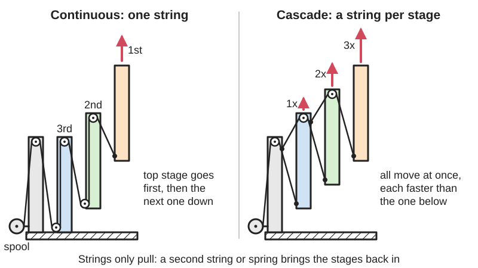
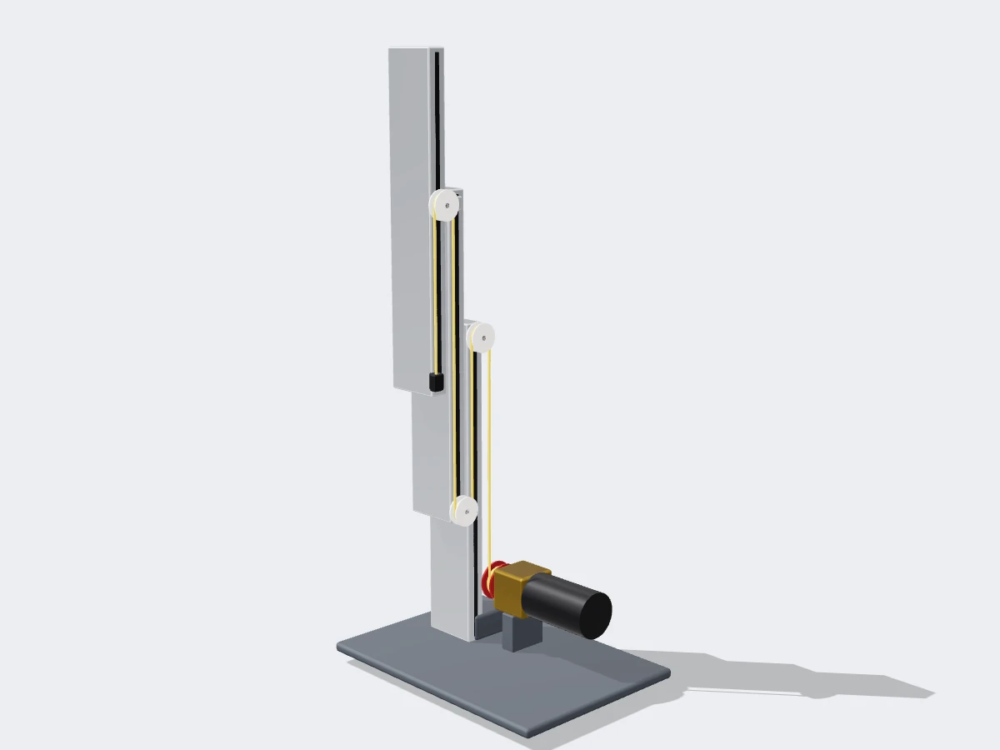
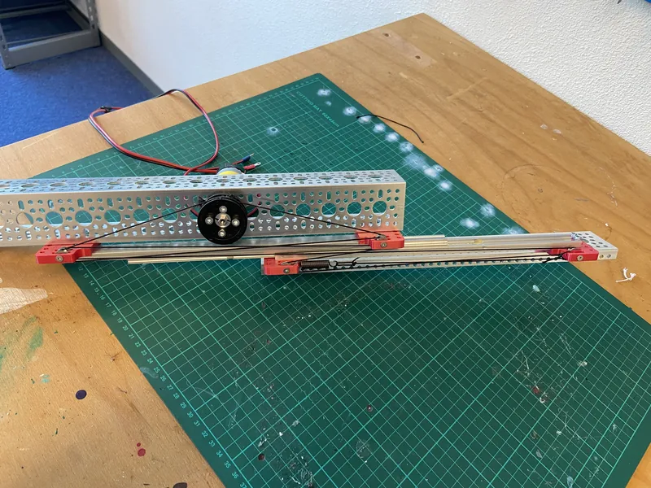
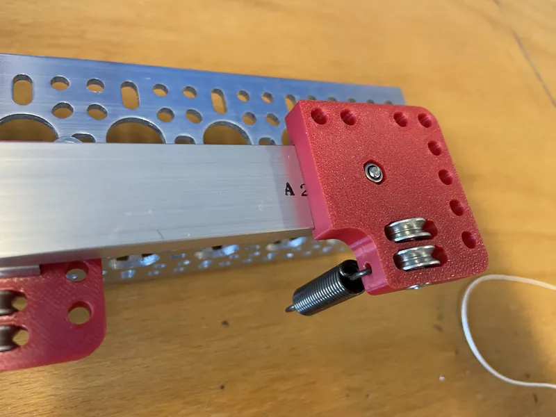

<figure class="eoc-pic eoc-pic-main"><picture><source media="(prefers-reduced-motion: reduce)" srcset="../media/drawn/multi-stage-slide-rigging.svg"></picture><figcaption><strong>Animation.</strong> Diagram drawn for the encyclopaedia from the research notes. ⚑ Needs confirming: a drawing can simplify or get details wrong; a real photo or a better diagram is welcome.</figcaption></figure>
<figure class="eoc-pic"><figcaption><strong>Render.</strong> A 3D model made for the encyclopaedia, not a photo: a real photo is also shown. ⚑ Needs confirming: a model can simplify or get details wrong.</figcaption></figure>
<figure class="eoc-pic"><figcaption><strong>How it works.</strong> <a href="https://www.printables.com/model/1063158-misumi-linear-slide-insert-for-sar-string-drive-ft">Misumi Linear Slide Insert for SAR: (String Drive) FTC Robotics</a> by Brogan Pratt, <a href="https://creativecommons.org/licenses/by-sa/4.0/">CC BY-SA 4.0</a>, from Printables.</figcaption></figure>
<figure class="eoc-pic"><figcaption><strong>Photo.</strong> <a href="https://www.printables.com/model/1063158-misumi-linear-slide-insert-for-sar-string-drive-ft">Misumi Linear Slide Insert for SAR: (String Drive) FTC Robotics</a> by Brogan Pratt, <a href="https://creativecommons.org/licenses/by-sa/4.0/">CC BY-SA 4.0</a>, from Printables.</figcaption></figure>

A way of threading strings, belts or chains over pulleys on a set of nested sliding stages so that a single motor-driven reel extends every stage, either all at once in proportion (cascade) or one stage after another (continuous), with a second string or spring to pull them back in.

**In plain words:** Strings or belts threaded over little pulleys on a stack of nested slides, so one motor winding a reel pushes the whole stack out like a telescope and pulls it back in. **Proper term:** Multi-stage linear slide rigging: cascade rigging and continuous rigging (cascade elevator / continuous elevator).

**Also called:** cascade rigging / cascading lift / cascade elevator (all stages move together); continuous rigging / continuous elevator / continuous stringing (stages move one after another); linear slide rigging, string rigging, stringing the slides (FTC robotics terms); reverse-cascade retraction, continuous retraction, elastic retraction (ways of pulling the stages back in); free-floating retraction vs 'with-slide' retraction (gm0 terms); belt-driven slides, belt or chain elevator (the same routing done with a timing belt or roller chain); multi-stage elevator / telescoping lift / multi-stage linear extension; spool and winch (the motor-driven reel the string winds onto); forklift mast lift chain (the same pulley trick: the fork carriage rises twice as far as the lift cylinder); Misumi SAR slides, REV linear motion kit, goBILDA Viper-Slide (brands of slide kits that are rigged this way).

## How it works

Continuous rigging uses one long string that runs from the spool over the top of the base, down to the bottom of stage 1, up over the top of stage 1, down to the bottom of stage 2 and so on to the last stage; winding it in shortens every loop at once, and the stage with the least friction (normally the last one) slides out first, then the next (gm0; YETI wiki). Cascade rigging uses a separate string for each stage: string 1 pulls stage 1 out of the base, and string 2 is anchored to the base, runs over a pulley on top of stage 1 and is tied to the bottom of stage 2, so as stage 1 rises it drags stage 2 out by the same amount relative to itself, and so on up the stack (gm0; REV). In cascade every stage moves at the same time and stage k moves k times as fast as stage 1, so the spool must pull harder but the top moves faster (gm0; Waffles wiki). Strings can only pull, so a second 'retraction' string wound the opposite way on a spool on the same shaft, a reversed set of cascade strings, elastic tubing, or a closed belt loop is needed to bring the stages back in (gm0).

## Parts

A small assembly that acts as one unit: a fixed base slide plus two or more nested moving stages (drawer-style slides or extrusions on bearing blocks), a pulley or bearing at the top and bottom of each stage, a motor-driven spool (winch drum), one or more extension strings (one long string for continuous; one string per stage for cascade) or a belt or chain, a retraction string on a second spool (or surgical-tubing elastic), spring tensioners, and bolt clamps or anchors at the string ends.

## Everyday examples

- A forklift truck's mast: the lift chain is anchored at one end, runs over a pulley on top of the rising cylinder and down to the fork carriage, so the forks rise twice as far as the cylinder (fork-lift-training.co.uk); triplex and quad masts add more nested stages (Logisnext)
- The telescoping lifts and reach arms on FIRST Tech Challenge and FIRST Robotics Competition robots (gm0; FRCDesign)
- Kit slide systems such as the REV DUO three-stage cascading lift (REV Robotics docs)

## When to use it

Use it when something must reach much further than the space it packs into, such as a robot lift, a reach-out arm, a camera or sensor mast, or a model crane, and you want one motor to drive every stage. Choose cascade when you want smooth, predictable motion with every stage moving together, faster top-stage speed, strong pull-down for climbing from the early stages, or easy use of constant-force springs (FRCDesign; Chief Delphi 2022). Choose continuous when you want a low centre of gravity until you really need height (the heavy lower stages only move at the end), simpler gearing, or many stages (Waffles wiki; FRCDesign). Use belts instead of string when you want no re-tensioning and better precision and have room for bigger pulleys (gm0).

## When not to use it

Avoid string rigging when the load must be pushed hard, held rigidly against side forces, or positioned precisely without a sensor: use a lead screw or ball screw, a rack and pinion, or a rigid chain [actuator](../glossary.md#actuator) (push chain) instead. For one short stage, a single belt or chain loop or a lead screw is simpler. Avoid elastic (surgical tubing) retraction if speed matters: it slows extension considerably and its force changes with extension (gm0). Avoid continuous rigging if the intermediate stages must be in a known position (Chief Delphi 2022).

## Details

- **What it does (jobs):**
  - let it move (turn, slide or bend): extends and retracts a stack of slides in a straight line, e.g. a robot lift or reach arm
  - change the kind of motion: a spinning motor spool becomes straight-line extension
  - change speed or turning force: in cascade rigging the top stage moves N times as fast as the first stage but the spool must pull about N times harder (N = number of moving stages); in continuous rigging force and speed stay 1:1 (gm0)
- **Movement:** slide: straight-line extension and retraction; total travel is roughly the number of moving stages times each stage's travel (each stage must still overlap its neighbour, about 20% of the stage length by the YETI rule of thumb)
- **Directions it can move (degrees of freedom):** 1 useful freedom (in and out along the slide). Cascade rigging ties every stage to the next, so the whole stack has exactly one position for each spool angle. Continuous rigging controls only where the last stage (the carriage) is; the in-between stages are free to move in whatever order friction allows, so they are not positively located (Chief Delphi 'Continuous vs cascade lift', 2022).
- **Special behaviour:**
  - motion conversion: the rotation of a spool or pulley is turned into straight-line extension of the stages
  - tensioning (takes up slack and holds): good rigging includes spring tensioners or spring-loaded pulleys that keep the strings tight as the string path changes length during travel; gm0 'highly encourages' at least one spring tensioner per slide set
  - none of the locking behaviours: the rigging itself does not lock; a vertical lift sinks under its own weight unless the motor, its gearbox, a brake mode or counterbalance springs hold it (Chief Delphi 2019 thread)
- **How it holds:**
  - not a holding joint (it moves or passes on motion): the strings carry pulling force (tension) from the spool to the stages; position is held only as long as the spool is held
- **Input and output:** Input: rotation of a motor-driven spool (or a belt pulley or sprocket). Output: straight-line extension. Continuous rigging: string wound in = carriage travel (1:1), and the force at the spool is roughly the load being lifted, which is why continuous spools 'can be powered by a system with a relatively low [gear ratio](../glossary.md#gear-ratio)' (gm0). Cascade rigging: the second stage moves 2 times as fast as the first, the third 3 times and so on (gm0), so the first string must pull about N times the load at the top (2x force on the first stage for a 2-stage lift: YETI; 'twice the speed and with half the force' at each stage: Waffles wiki). Adding stages to a cascade needs proportionally more gear reduction to keep the same speed, e.g. a 3:1 one-stage lift becomes 9:1 with three stages (gm0). Efficiency: every pulley and bearing block adds some friction ⚑ [uncertain: no figure found]. Shaft arrangement: the spool shaft sits across (at right angles to) the slide direction. Back-drivable: yes, a vertical lift will drop when the motor is unpowered unless brake mode, counterbalance springs or a [self-locking](../glossary.md#self-locking) gearbox holds it (Chief Delphi 2019).
- **Power:** passive (no power needed) for the rigging itself, but it is almost always driven by an electric motor turning the spool. If power is lost the motor stops pulling, so a vertical lift can slide back down under gravity; brake mode alone may not be enough to hold it (Chief Delphi 2019).
- **Load:** Light to medium (competition robots lift game pieces and sometimes the robot itself: Brogan Pratt's printed FTC slide insert is described as lifting a 20 kg robot with two motors). Strings are only strong in pull (tension) and cannot push, so every direction you drive needs its own string or elastic. Braided UHMWPE (Dyneema/Spectra) kite line rated around 800 lb has been used on FRC elevators (Chief Delphi 2012). The weak points are sideways and bending loads on the extended slides: keep enough overlap between stages (about 20% of stage length) and at least two bearing blocks per side between stages (YETI wiki).
- **Play and precision:** Noticeable. String stretches and loosens over time, and because the string path is a changing polygon the amount of string needed varies along the travel, so some slack is 'inherent in all linear extension designs using string' (gm0). If string piles up on the spool its diameter changes, the extension and retraction spools get out of step, and tension changes (gm0). Belts do not stretch and form an automatic 1:1 loop, so belt rigging is 'slightly more precise and rigid than rope' (gm0; YETI). In continuous rigging the intermediate stages are not positively located (Chief Delphi 2022). [Misalignment](../glossary.md#misalignment) [tolerance](../glossary.md#tolerance) is low: 'any amount of misalignment can lead to the string coming off of your pulley' (gm0).
- **Taking it apart:** removable: strings are anchored with knots or, better, clamped under a bolt head so they can be re-tensioned or replaced quickly (gm0); belts are clamped in belt clamps (Instructables cascading slide)
- **How often it can be reused:** many times: the slides, pulleys and spools can be re-rigged indefinitely; the strings themselves stretch, fray and are replaced as a wear item (gm0 notes that string loosens over time)
- **Sealing:** none: an open framework of slides, pulleys and strings
- **Adjustable:** Yes: string tension is adjusted at bolt clamps, spring tensioners, spring-loaded pulleys, or a pulley that slides along an extrusion (gm0); speed and pulling force can be traded by changing the spool diameter instead of the gearbox (new diameter = old diameter x old ratio / new ratio) (gm0); the number of stages can be changed.
- **Access needed:** both sides: you need to reach along the whole slide set, both ends of each stage, to thread the strings round the pulleys and fix the anchors; gm0 advises rigging extension strings with the slides retracted and retraction strings with them fully extended
- **Materials:** Strings: braided UHMWPE line (Dyneema/Spectra (brands)), kevlar, kite or braided fishing line, or kit string such as REV (brand) string; belts: timing belt (even TPU-printed belt on the XRP two-stage elevator model); chain for heavy FRC lifts (heavy but easy to tension: YETI). Slides: aluminium extrusion with bearing blocks, steel drawer slides (e.g. Misumi SAR (brand)), or fully 3D-printed stages. Pulleys: small ball bearings (REV sells 4 mm thick, 12 mm diameter pulley bearings: gm0) or printed pulleys with bearings pressed in. Elastic retraction uses surgical tubing. PTFE tube (1/8 in) with push-to-connect fittings can route string round corners (gm0).
- **Heat, cold, water and wear:** Braided UHMWPE line [creeps](../glossary.md#creep) (slowly stretches) under constant tension (Wikipedia), and string in general loosens over time (gm0), so expect to re-tension. UHMWPE fibre should not be used above about 90 °C for long periods (Wikipedia, citing DSM). Printed PLA pulleys and spools soften above about 60 °C (Prusa); PETG is fine below about 80 °C (Prusa). Dirt and grit in bearings and slide rails increase friction and change which stage moves first in continuous rigging ⚑ [uncertain]. Elastic tubing loses stretch with age ⚑ [uncertain].

## Making it

- **Ways to make or get it:**
  - 3D print (FDM): pulleys, spools, bearing blocks, string anchors, slide inserts, and even complete printed slide stages (Instructables '3D Printable Cascading Linear Slide')
  - CNC: aluminium plates and bearing blocks for FRC-scale elevators
  - laser cut: ⚑ [uncertain] flat side plates and spacers for small lifts
  - off-the-shelf part: drawer slides, linear slide kits, pulley bearings, braided line, timing belts, chain and sprockets, constant-force springs
- **Printing it in one piece (print in place):** no: the stages, pulleys and spools are printed (or bought) separately, then assembled and rigged with string or belt by hand
- **Tools:** Hex keys or a screwdriver for the anchor bolts, clamps and pulley axles, scissors or a knife for the line, and usually a way to stop braided line fraying ⚑ [uncertain]. A clamp, vice or arbor press to push bearings into printed pulleys (Instructables cascading slide).
- **Difficulty:** moderate: every part is simple, but gm0 calls rigging 'an important and time-consuming requirement', and getting even tension on both sides, the right spool sizes and a retraction path takes patience

### 3D printing tips

1) Pulleys: printed pulleys can carry a pressed-in ball bearing; press it in with a clamp, vice or arbor press rather than hammering, which can crack the pulley or damage the bearing (Instructables cascading slide). 2) Abrasive lines such as kevlar cut into plastic: tie them round a washer rather than through a hole in a printed part, so the load is spread (gm0). 3) Anchor strings by clamping them under a bolt head rather than knotting them; it makes re-tensioning quick (gm0), and slippery UHMWPE line holds knots poorly (Wikipedia 'Ultra-high-molecular-weight polyethylene'). 4) Make the spool wide enough that the string never winds over itself, or its diameter and speed change (gm0). 5) Belts: the Instructables cascading slide loops belt over printed pulleys with about 50 mm of overlap in a printed belt clamp; the XRP two-stage elevator on Printables even prints its belt in TPU (tension is taken up with extra hardware). 6) Add a spring tensioner near the end of each string run (gm0). 7) Material: PLA softens above about 60 °C (Prusa), so use PETG (fine below about 80 °C: Prusa) for pulleys, spools and slide inserts that see load, friction heat or a hot car. 8) Print bearing blocks and slide inserts with the sliding faces smooth and the bolt holes vertical so [layer lines](../glossary.md#layer-lines) are not loaded in [peel](../glossary.md#peel-vs-shear) ⚑ [uncertain: general FDM practice, not from a rigging source]. 9) Line up every pulley in one plane with the string path: 'any amount of misalignment can lead to the string coming off of your pulley' (gm0).

### Buying one (off-the-shelf parts)

Telescopic linear slides or drawer slides (ball-bearing telescopic slides; Misumi SAR two- and three-stage slides (brand); REV linear motion kit (brand)); slide inserts or pulley blocks; small ball bearings used as pulleys (e.g. 3x12x4 mm V-groove bearings in Brogan Pratt's printed insert; REV 4 mm thick, 12 mm pulley bearings); spools or winch drums; braided UHMWPE line (Dyneema/Spectra (brands)) or kevlar cord; GT2 or HTD timing belt with belt clamps and pulleys; roller chain and sprockets with inline chain tensioners; extension springs or spring-loaded pulleys as tensioners; constant-force springs for counterbalancing; surgical tubing for elastic retraction; 1/8 in PTFE tube with M5 push-to-connect fittings (John Guest (brand)) for routing string; cable carriers (drag chain, e.g. igus e-chain (brand)) or coil cord to carry wires along the extension.

## Rules of thumb

- Cascade speed: stage 2 moves 2x as fast as stage 1 relative to the base, stage 3 3x, and so on (gm0 'Rigging').
- Adding stages to a cascade needs the gear ratio multiplied by (new number of stages / old number) to keep the same speed; e.g. a 1-stage lift at 3:1 needs 9:1 as a 3-stage lift (gm0 'Rigging').
- Cascade force: roughly N times the load at the top for N moving stages; YETI gives '2x force on the first stage' for a two-stage lift (YETI Elevator Design Guide).
- Continuous rigging: the extension and retraction spools should be the same diameter, and continuous spools can use a relatively low gear ratio (gm0).
- Mixing methods: cascade extension with continuous retraction needs the extension spool N times smaller than the retraction spool; continuous extension with cascade retraction needs the extension spool N times bigger (gm0).
- Changing spool size instead of gear ratio: new spool diameter = old diameter x old ratio / new ratio, e.g. 2 in x 3.7 / 5 when going from 3.7:1 to 5:1 (gm0).
- Fit at least one spring tensioner per linear slide set, near the end of the string run (gm0).
- Rig the extension string with the slides retracted and the retraction string with them fully extended (gm0).
- Free-floating retraction (string straight from the last stage to the spool) only for purely vertical slides; keep it parallel to the slides or it bends them (gm0).
- Stage overlap about 20% of stage length (e.g. 6 in on a 30 in stage), and at least 2 bearing blocks per side between stages (YETI Elevator Design Guide).
- Cascade is considered harder to rig above about three stages, whereas adding stages to a continuous lift is 'relatively trivial' (FRCDesign cascade elevator introduction).

## Common failures

1) String jumps off a pulley because it is not pulled straight (gm0): line up pulleys and add guards or shields (a printed 'bearing shield' for line retention exists on Printables). 2) Slack from string stretch, knots slipping, and the changing string path (gm0): clamp strings under bolts and fit spring tensioners. 3) String overlapping on the spool, changing its diameter so the extension and retraction spools fight or go slack (gm0): make the spool wider. 4) Left and right slides at different tension so the stages twist and bind (racking) (gm0 'Tensioners'; Chief Delphi 2022). 5) Free-floating retraction string tangling (gm0). 6) Elastic retraction making extension slow and letting the spool unwind (gm0). 7) Intermediate stages of a continuous lift moving in an unexpected order because of uneven friction (Chief Delphi 2012; 2022). 8) Abrasive string sawing through plastic parts (gm0: use a washer). 9) Wires to the moving end snagging: use a cable carrier or coil cord (gm0).

## Safety

The sliding stages and pulleys form pinch and shear points that move quickly (in cascade the top stage moves several times faster than the first), so keep fingers clear and test at low power. A lift can drop suddenly if a string snaps, an anchor slips or the motor loses power (Chief Delphi 2019). Elastic retraction tubing and constant-force springs store energy and can snap back when unhooked ⚑ [uncertain]. A tall extended lift raises the centre of gravity, especially cascade lifts at mid height (Waffles wiki), so a robot or stand can tip. UHMWPE line carries far less snap-back energy than steel wire rope (Wikipedia), but any tensioned line can whip if it breaks.

## Related

- Drawer slide (telescopic ball-bearing slide): the nested slide hardware itself; rigging is what drives it
- Belt or chain elevator (single stage): one closed loop bolted to a carriage; simplest powered lift but only one stage (gm0)
- Forklift mast chain: a one-stage cascade (chain anchored to the fixed part, over a pulley on the moving part) that doubles lift height (fork-lift-training.co.uk)
- Block and tackle (pulley system): uses pulleys the other way round, trading speed for extra pulling force
- Lead screw or ball screw: rigid push and pull in both directions and self-holding (lead screw), but slower and single-stage
- Rigid chain actuator (push chain, zip chain): can push as well as pull and packs away small
- Rack and pinion: rigid and positive, but a single stage per rack
- Constant-force spring counterbalance: often added to a rigged lift to cancel its weight
- Telescoping tube locks (twist lock, flip lock, spring button): hold a hand-set length instead of driving the stages
- Stopper knots and cord-end anchors: ways to fix a string end to a stage or spool, such as a knot behind a hole, a knot round a washer, or string clamped under a bolt head
- Wire-rope terminations: crimped sleeves, ferrules and thimbles for ending steel cable when a lift is rigged with wire rope instead of string

## Make it yourself

- [3D Printable Cascading Linear Slide (Instructables)](https://www.instructables.com/3D-Printable-Cascading-Linear-Slide/): Six-step guide to an inexpensive, mostly printed cascading slide for FTC robots: printed pulleys with pressed-in bearings, printed pulley attachments and stages, and a belt per stage clamped to the next stage *(licence: not visible in the page data read ⚑ [uncertain])*
- [XRP Robot 2 Stage Elevator (smidgemcduff, Printables) (URL from Printables API, page not opened)](https://www.printables.com/model/1484148-xrp-robot-2-stage-elevator): Printable two-stage elevator for the XRP educational robot, driven by an N20 motor, with ~8 mm bearings and a TPU-printed belt *(licence: CC BY)*
- [Misumi Linear Slide Insert for SAR: (String Drive) FTC Robotics (Brogan Pratt, Printables) (URL from Printables API, page not opened)](https://www.printables.com/model/1063158-misumi-linear-slide-insert-for-sar-string-drive-ft): Printed pulley insert that turns two- and three-stage Misumi SAR drawer slides into string-rigged robot slides, using 3x12x4 mm V-groove bearings and M3 hardware; the description links an assembly and rigging tutorial video *(licence: CC BY-SA)*
- [Misumi Linear Slide Insert for SAR: (Belt Drive) FTC Robotics (Brogan Pratt, Printables) (URL from Printables API, page not opened)](https://www.printables.com/model/1242612-misumi-linear-slide-insert-for-sar-belt-drive-ftc): Belt-driven version of the same printed slide insert, for rigging the slides with belt instead of string *(licence: CC BY)*
- [MISUMI Cascading Slide for FTC by LawtonS (Thingiverse) (appeared in search results; page not opened)](https://www.thingiverse.com/thing:4962925): Cascading linear slide prototype for FTC teams and hobbyists, described in the search snippet as expandable to as many stages as desired *(licence: ⚑ [uncertain] not checked)*

## Pictures, videos and models

- [Rigging (Game Manual 0)](https://gm0.org/en/latest/docs/common-mechanisms/linear-motion-guide/rigging.html): Line diagrams of continuous rigging, cascade rigging, continuous retraction and cascade retraction, plus photos of FTC team lifts, belt-driven slides, string tensioners and cable carriers *(licence: CC BY-NC 2.0 (gm0 repository licence))*
- [Cascade Elevator Introduction (FRCDesign.org)](https://frcdesign.org/learning-course/stage2/2d/introduction/): Photos of a cascade elevator (team 2468) and a continuous elevator (team 4414) and a 'Cascade Motion' figure showing all stages extending together *(licence: not stated on the page (link only) ⚑ [uncertain])*
- [Understanding Linear Slide Rigging For FTC (Lawton Skaling, YouTube)](https://www.youtube.com/watch?v=Qyfs6OcRtGQ): Video explanation of how linear slides are rigged for FTC robots *(licence: link only (standard YouTube licence))*
- [Three Stage Cascading Lift (REV Robotics documentation)](https://docs.revrobotics.com/duo-build/linear-motion-kit/three-stage-cascading-lift): Step-by-step photos of stringing a four-section cascading lift, with pulleys on the stage tops and surgical-tubing elastic retraction *(licence: link only ⚑ [uncertain])*
- [Operation of the forklift mast lift cylinder (fork-lift-training.co.uk)](https://www.fork-lift-training.co.uk/m/forklifttechnical/lift-cylinder-and-chains.html): Diagram of a forklift lift chain anchored at one end, running over a pulley on the rising cylinder to the fork carriage, which lifts twice as far as the cylinder *(licence: link only ⚑ [uncertain])*

## Needs confirming

⚑ marks something nobody has confirmed yet: a fact the research could not confirm from a source, a finder value that is a best guess, or an open point from the research notes. Corrections are welcome (see `research/needs-confirming.md`).

- ⚑ 12 sentences on this page marked [uncertain].
- ⚑ Finder value `motion_in` = steady turning, straight push or pull (best guess): read from the "Input: ... Output: ..." wording of `input_output`, not the usual "in -> out" form
- ⚑ Finder value `motion_out` = straight push or pull (best guess): read from the "Input: ... Output: ..." wording of `input_output`, not the usual "in -> out" form
- ⚑ Finder value `shaft_layout` = not applicable (best guess): read from the "Input: ... Output: ..." wording of `input_output`, not the usual "in -> out" form
- ⚑ Finder value `tools` = press or vice, hand tools (source uncertain): `tools_needed` is marked ⚑ [uncertain] here: "…a knife for the line, and usually a way to stop braided line fraying ⚑ [uncertain]. A clamp, vice or arbor pres…"

## Sources

- <https://gm0.org/en/latest/docs/common-mechanisms/linear-motion-guide/rigging.html>
- <https://raw.githubusercontent.com/gamemanual0/gm0/main/source/docs/common-mechanisms/linear-motion-guide/rigging.rst>
- <https://raw.githubusercontent.com/gamemanual0/gm0/main/LICENSE>
- <https://frcdesign.org/mechanism-examples/>
- <https://frcdesign.org/learning-course/stage2/2d/introduction/>
- <https://www.chiefdelphi.com/t/cascade-vs-continuous-rigging/422878>
- <https://www.chiefdelphi.com/t/elevators-cascaded-vs-continuous/123977>
- <https://www.chiefdelphi.com/t/continuous-vs-cascade-lift/416236>
- <https://www.chiefdelphi.com/t/how-to-make-a-motor-hold-its-position/347877>
- <https://wiki.yetirobotics.org/books/design-process/page/elevator-design-guide>
- <https://wiki.wafflesrobotics.com/Mechanisms/Elevator>
- <https://docs.revrobotics.com/duo-build/linear-motion-kit/three-stage-cascading-lift>
- <https://www.fork-lift-training.co.uk/m/forklifttechnical/lift-cylinder-and-chains.html>
- <https://www.logisnextamericas.com/en/jungheinrich/blogs/forklift-mast-types>
- <https://www.youtube.com/watch?v=Qyfs6OcRtGQ>
- <https://www.instructables.com/3D-Printable-Cascading-Linear-Slide/>
- <https://api.printables.com/graphql/>
- <https://en.wikipedia.org/wiki/Ultra-high-molecular-weight_polyethylene>
- <https://help.prusa3d.com/article/pla_2062>
- <https://help.prusa3d.com/article/petg_2059>
