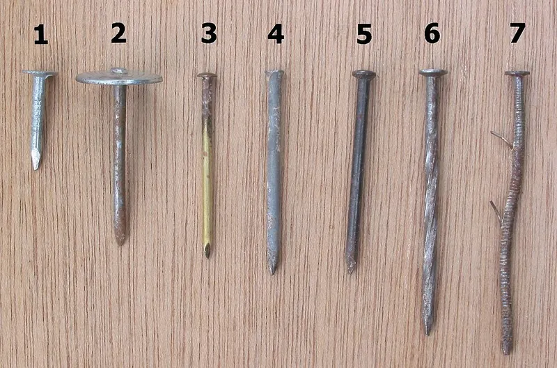
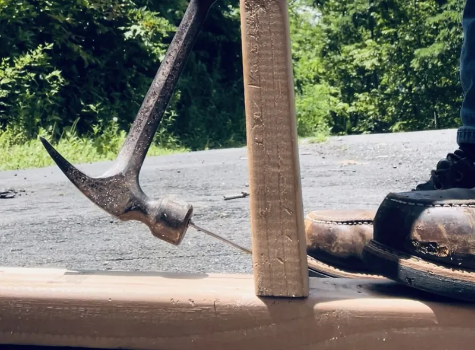

<figure class="eoc-pic eoc-pic-main"><figcaption><strong>Photo.</strong> <a href="https://commons.wikimedia.org/wiki/File:Spijkers_(Nails).jpg">Spijkers (Nails)</a> by Rasbak, <a href="http://creativecommons.org/licenses/by-sa/3.0/">CC BY-SA 3.0</a>, from Wikimedia Commons.</figcaption></figure>
<figure class="eoc-pic"><figcaption><strong>How it works.</strong> <a href="https://commons.wikimedia.org/wiki/File:Toenailing_example_with_hammer_and_nail.jpg">Toenailing example with hammer and nail</a> by Thermosking, <a href="https://creativecommons.org/licenses/by-sa/4.0">CC BY-SA 4.0</a>, from Wikimedia Commons.</figcaption></figure>

A pointed steel pin hammered or fired into wood, where the squashed wood fibres grip its shank by friction, used to fix wood to wood (and thin board, felt, fabric or leather to wood) quickly and cheaply; it carries sideways ([shear](../glossary.md#peel-vs-shear)) loads well but pulls out more easily than a screw unless it has rings or a twist, is driven at an angle, or is bent over (clinched).

**In plain words:** A thin steel spike with a head that you hammer (or fire from a nail gun) straight into wood, where the squashed wood grips it; ridged (ring) or twisted ones grip much harder, and tiny ones (panel pins, brads, tacks) fix thin boards, trim, felt and fabric. **Proper term:** Nail (driven fastener), including ring-shank (annular) and twisted (helical) nails, panel pins, brads and tacks.

**Also called:** nail, wire nail, round wire nail, French nail (Wikipedia 'Nail (fastener)'; DT Online 'Nails and Pins'); common nail (smooth shank, heavy flat head, 'the typical nail for framing'), box nail (thinner shank and head), sinker (cement-coated framing nail) (Wikipedia 'Nail (fastener)'); ring-shank nail, ring nail, annular (annular ring) nail, annularly threaded nail, improved or jagged shank nail (Wikipedia; USDA Wood Handbook ch. 8); twisted nail, helical or helically threaded nail, spiral nail, screw nail, helix or decking nail (Wikipedia; USDA Wood Handbook ch. 8); panel pin and deep-drive panel pin (thin nails with a small cone-shaped head for cabinet work), veneer pin, hardboard pin (DT Online; Wikipedia); brad: a small thin nail with a lip or very small head; in nail-gun sizes an 18-gauge (1.02 mm) fixing; pin nail or micro pin: 23 gauge (0.64 mm); floor brad: a flat stamped nail for floorboards (Wikipedia 'Nail (fastener)', 'Nail gun'; DT Online); finish nail, lost-head nail, bullet-head nail and casing nail: small heads made to be sunk below the surface and filled (Wikipedia); oval wire nail, oval brad: an oval shank that splits wood less (DT Online; Wikipedia); tack, tin tack, carpet tack, upholstery tack (large domed brass or black head), brass tack, thumbtack, drawing pin or push pin (Wikipedia; DT Online); clout nail (large-headed roofing felt nail), masonry nail (hardened, for concrete or block), duplex or double-headed (scaffold, formwork) nail for temporary work, drywall nail, roofing nail, cut nail, horseshoe nail (Wikipedia; DT Online); spike: a large nail, usually over 4 in (100 mm) long (Wikipedia; USDA Wood Handbook ch. 8); toe-nailing, toenailing, skew-nailing or slant nailing: driving a nail at about 30 degrees through the end or edge of one piece into another (Wikipedia 'Toenailing'; USDA Wood Handbook); dovetail nailing: nails driven in at opposing angles to improve their hold (DT Online); clinching or clenching (clench nail, canoe tack): bending the point over where it comes out of the far side so it bites back into the wood (USDA Wood Handbook; Wikipedia). Not the same as sheet-metal clinching (press joining), which is a separate entry; nail gun, nailer, brad nailer, pin nailer, finish nailer, framing nailer, palm nailer (Wikipedia 'Nail gun'); sizes: metric '50 x 3.0' means 50 mm long and 3 mm diameter; US penny sizes such as 8d; the Wood Handbook calls penny sizes obsolete and recommends giving length and diameter (Wikipedia; USDA Wood Handbook ch. 8).

## How it works

Driving a nail pushes the wood fibres aside; they press back on the shank, so it holds along its length by friction ('The holding power of Nails depends upon Friction', DT Online; 'friction in the [axial](../glossary.md#axial--radial) direction and shear strength laterally', Wikipedia). How hard it resists being pulled straight out (withdrawal) depends mainly on the wood's density, the nail's diameter and how deep it goes into the second piece (USDA Wood Handbook ch. 8). Rings on the shank lock behind the fibres and twisted shanks turn as they go in, so both grip far better than smooth nails, especially in wood whose moisture content changes later (USDA Wood Handbook). Sideways (shear) loads are carried by the stiff steel shank pressing on the wood and bending, which depends much less on grip, so nails are good sideways; bending the point over on the far side (clinching), angling nails in opposing pairs (toe-nailing, dovetail nailing) or using a slightly undersized lead hole adds pull-out resistance (USDA Wood Handbook; DT Online).

## Parts

Single piece: a nail has a head, a shank (smooth, ringed, twisted, barbed or coated) and a point (USDA Wood Handbook Fig. 8-1; Wikipedia 'Nail (fastener)'). The tools are separate: a hammer (claw hammer, or a light pin hammer for pins and tacks), a nail punch (nail set) to sink heads, pincers or a claw to pull nails, a bradawl for small lead holes, and optionally a nail holder or a nail gun loaded with collated strips or coils (DT Online 'Nails and Pins'; Wikipedia 'Nail gun').

## Everyday examples

- House and shed framing: wall studs toe-nailed to the sole plate, and blocking between joists (Wikipedia 'Toenailing')
- Wooden pallets and crates, often assembled with twisted (helical) nails or clinched nails (Wikipedia 'Nail (fastener)'; USDA Wood Handbook)
- The thin hardboard back of a cupboard or the mouldings on a picture frame, fixed with panel pins or brads (DT Online; Wikipedia 'Nail gun')
- Upholstery tacks with domed brass heads on a chair, carpet tacks on floorboards, and roofing felt held by large-headed clout nails (DT Online)

## When to use it

Use nails to join wood to wood quickly and cheaply where the load is mainly sideways (shear): frames, sheds, crates, boxes, jigs, fences and studwork, and anywhere many fasteners are needed fast, since a hammer or nail gun is much quicker than driving screws (Wikipedia 'Nail gun'). Nails 'bend under pressure, and rarely snap' when loaded sideways (Art of Manliness), so they suit framing. Use panel pins and brads to fix thin boards, backs, beading and mouldings, and to hold glued joints while the glue sets (DT Online; Wikipedia 'Toenailing'); use ring-shank or twisted nails where the joint must not work loose, such as floors, decking and sheet materials (Wikipedia; USDA Wood Handbook); use tacks for fabric, carpet and leather; use toe-nailing where you can't nail through the face of a piece, such as fixing an upright to a base plate (Wikipedia 'Toenailing').

## When not to use it

Not where the main load pulls the fastener straight out, such as a shelf hanging from a ceiling or a tread that must not lift: use a wood screw or coach screw, which holds better in withdrawal. Not where the part must come apart again: use screws, knock-down fittings or bolts (or duplex nails for temporary work). Not straight into [end grain](../glossary.md#end-grain) for load (only 50-75% of the side-grain hold: USDA Wood Handbook); use toe-nailing, a metal bracket, a joist hanger or a joint such as a dowel or mortise and tenon. Not into fine hardwood near edges without pre-drilling, or it splits. Not for metal connector plates unless you use the exact nails the maker specifies (Simpson Strong-Tie). Not into 3D-printed parts, acrylic or other [brittle](../glossary.md#brittle--ductile) plastics; give the printed part a hole for the nail, or use screws, [heat-set inserts](../glossary.md#heat-set-insert) or glue. Not into masonry with ordinary nails: use masonry nails or a Wall plug and screw. Not to fix mains cables: use the fixings made for them and follow local wiring rules.

## Details

- **What it does (jobs):**
  - join and hold: fixes wood to wood, and thin board, roofing felt, fabric or leather to wood; small nails or pins also hold a glued joint while the glue sets, so no clamps are needed (Wikipedia 'Toenailing')
- **Movement:** none: a nailed joint holds the parts still, though it slips slightly under sideways load (USDA Wood Handbook, load-slip curve Fig. 8-4).
- **Directions it can move (degrees of freedom):** 0 when two or more nails are used. A single nail acts like a pin, so one nail alone can let a part swing round it; use at least two nails, or nails at opposing angles, to stop that ⚑ [uncertain].
- **Special behaviour:**
  - none: it simply holds by friction and by the [stiffness](../glossary.md#stiffness) of its shank. Ring-shank nails resist 'working back out once driven in', and duplex (double-headed) nails are made to be pulled out easily for temporary work (Wikipedia), but neither is a mechanism
- **How it holds:**
  - friction or clamping ([force-fit](../glossary.md#form-fit--force-fit--material-bond)): the squeezed wood fibres grip the shank (DT Online; Wikipedia)
  - shape (the parts interlock; form-fit): rings and twists lock behind the fibres; a clinched point hooks round the far side, 'forming a rivet-like fastening' (Wikipedia, canoe tack); in sideways load the shank bears on the wood like a dowel (USDA Wood Handbook yield model)
- **Input and output:** not applicable
- **Power:** passive (no power needed) for the joint itself. It is driven by hand with a hammer or by a powered nail gun (compressed air, electric, gas or a powder-actuated cartridge) (Wikipedia 'Nail gun').
- **Load:** Light to medium per nail; many nails together carry heavy loads, as in house framing. Strongest sideways (shear): nails 'bend under pressure, and rarely snap' where a screw may snap (Art of Manliness), and the wood's condition affects pull-out far more than sideways strength (USDA Wood Handbook). Weakest pulled straight out (withdrawal), especially smooth nails, nails in end grain (50-75% of the side-grain value), in plywood (15-30% less than solid wood) and in wood that has been wetted and dried (as low as 25% of the first value) (USDA Wood Handbook ch. 8). Ring-shank nails can roughly double a smooth nail's withdrawal load, and give about four times as much where wood moisture changes (USDA Wood Handbook). Worked example, calculated here from the Wood Handbook's equations for short-term maximum loads (not safe loads): a smooth 3.33 mm common nail going 40 mm into softwood of specific gravity 0.42 gives about 0.8 kN in withdrawal, and about 0.3 kN sideways at 0.38 mm slip, rising to roughly 1 kN at failure (softwood ultimate up to 3.5 times the slip load); the Handbook takes one-sixth of the average maximum withdrawal load as the long-term allowable load, about 0.14 kN (14 kgf) here ⚑ [uncertain]. Twisting: one nail is a pivot, so use several.
- **Play and precision:** Not a locating joint. Nailed joints slip a little under side load: the Handbook's older design loads are taken at 0.38 mm slip, and the slip at maximum load is more than 20 times that (USDA Wood Handbook). A hammered nail can also wander off line in hard or knotty wood, and knots can deflect a nail out of the side of the work (OSHA/NIOSH 'Nail Gun Safety'), so use dowels or locating pins where parts must line up exactly.
- **Taking it apart:** semi-permanent: smooth nails can be pulled with a claw hammer or pincers (DT Online), usually leaving holes and dents; ring-shank nails resist backing out and twisted square-shank (helix) nails are 'very difficult to pull out' (Wikipedia); toe-nailing 'makes later dismantling difficult or destructive' (Wikipedia 'Toenailing'). Duplex nails and casing nails are made to come out more easily (Wikipedia).
- **How often it can be reused:** once: a pulled nail is usually bent and its hole is enlarged, so re-nail in a fresh spot; duplex nails can be pulled and re-driven a few times ⚑ [uncertain].
- **Sealing:** none: a nail leaves an open hole. Exception: some roofing nails for metal roofs have an umbrella-shaped head with a rubber gasket that seals the hole (Wikipedia, convex head roofing nail).
- **Adjustable:** no: once driven a nail can't be moved; pull it and re-nail. Duplex nails suit temporary jigs, formwork and scaffolding that will be changed or taken down (Wikipedia).
- **Access needed:** one side only (blind) for ordinary nailing, with the work backed up solidly; clinching needs the far side reachable to bend the point over, or a hard backing such as a clinching iron for canoe tacks (Wikipedia; USDA Wood Handbook).
- **Materials:** Nails: mostly soft low-carbon (mild) steel of about 0.1% carbon; masonry nails are tempered, higher-carbon steel (Wikipedia). Finishes: bright (uncoated, 'not recommended for weather exposure or acidic or treated lumber'), cement or resin coated, electro-, mechanically or hot-dip galvanised, phosphate coated; also 300-series stainless steel, copper, silicon bronze, aluminium and brass nails and tacks (Wikipedia; USDA Wood Handbook). Joins: softwoods (usually driven directly) and hardwoods (pre-drill), plywood (resists splitting near edges better than solid wood), hardboard and thin ply (hardboard pins), roofing felt (clout nails), fabric, carpet and leather (tacks), plasterboard to wood framing (drywall nails), and steel connector plates to wood with the maker's specified nails (DT Online; Wikipedia; USDA Wood Handbook; Simpson Strong-Tie). Not for: 3D-printed plastic as the material being nailed, glass, or metal to metal; into concrete or block only with hardened masonry nails or cut nails (Wikipedia; DT Online).
- **Heat, cold, water and wear:** Water and humidity: smooth nails in wood that is wetted and dried, or green wood that dries, can lose most of their grip, down to 25% of the value just after driving, and even in steady dry wood the grip falls slowly as the fibres relax; ring-shank and twisted nails hold about four times better under moisture changes (USDA Wood Handbook ch. 8). Cement coatings help only at first: in softwoods the gain 'drops off significantly after a month or so' (USDA Wood Handbook). Corrosion: bright nails are not for weather or treated wood (Wikipedia); in wet treated wood use 300-series stainless, copper or silicon bronze (USDA Wood Handbook), hot-dip galvanised nails with galvanised connectors, and the same metal for nail and hanger to avoid [galvanic corrosion](../glossary.md#galvanic-corrosion) (USDA Wood Handbook; Simpson Strong-Tie). Staining: steel reacts with some woods' extractives in the wet, so use stainless, aluminium or hot-dip galvanised nails on visible outdoor wood (USDA Wood Handbook); brass tacks resist sweat on furniture (Wikipedia). Drying after assembly can also loosen joints as the wood shrinks (USDA Wood Handbook, clinching).

## Making it

- **Ways to make or get it:**
  - off-the-shelf part: nails, pins, brads and tacks are bought
  - woodwork: the main use, for boxes, crates, frames, cabinet backs, framing and jigs
  - 3D print (FDM): printed clips, hooks and hangers with holes for a nail, and printed nail holders that keep fingers clear (see make_it_yourself); printed plastic is not a material to nail into
  - laser cut: plywood and hardboard parts can be pinned together with panel pins or brads, usually with glue ⚑ [uncertain]
- **Printing it in one piece (print in place):** no: nails are bought steel parts; printed parts only provide holes or guides for them.
- **Tools:** A hammer (claw hammer for general nailing, a light pin hammer for panel pins and tacks), a nail punch (nail set) to sink heads below the surface, wood filler, a bradawl or small drill for lead holes, and pincers or a claw hammer to pull nails out (DT Online 'Nails and Pins'); safety glasses or goggles (CCOHS 'Hand Tools - Hammers'). Optional: a nail holder that keeps fingers away from the blow (Printables models below), or a nail gun with the matching collated nails plus hard hat, ANSI Z87.1 eye protection and hearing protection (OSHA/NIOSH 'Nail Gun Safety').
- **Difficulty:** easy: buy them; the skills are choosing the type and length, hitting squarely, and keeping away from edges and ends so the wood doesn't split.

### 3D printing tips

1) Don't hammer a nail through solid printed plastic: it has no fibres to grip the nail and the blow can split it along a layer ⚑ [uncertain]. Print the nail hole into the part instead: printed nail-in cable clips are designed round a 2 mm nail (Printables 'Nail-in Cable Clip [3-12mm Assortment]', akimakes), and a printed wall hook takes a two-inch finishing nail 'with a girth of 2mm or less' through a bore in the part (Printables 'finishing nail wall hook', FixedWithPlastic). 2) Hole size: make the hole a little bigger than the nail so it slides in without forcing the plastic apart; an Original Prusa is accurate to about 0.2 mm and moving fits start at about 0.3 mm [clearance](../glossary.md#clearance) (Prusa 'Modeling with 3D printing in mind'), and small holes tend to print undersize, so test first ⚑ [uncertain]. 3) Angle the hole: a hook designed so the nail goes in at an upward slope, with the flat side pressed to the wall, uses the nail's sideways strength and lets the nail reinforce the hook 'to prevent bending and breakage' (Printables 'finishing nail wall hook'). 4) Orientation: 'FFF prints are stronger in one direction than another' (Prusa), so print clips and hooks so the load doesn't peel layers apart; one cable clip maker says 'Print flat on the bed for best results' (Printables 'Cable Wall Clip for Nails'). 5) Material for printed nail holders: PLA is fine, 'but PETG or ABS are recommended for better durability if you accidentally hit the plastic with the hammer', with at least 20% [infill](../glossary.md#infill) and 3 walls (Printables 'Safety Nail Holder | Finger Saver'). 6) Before nailing a printed hook or clip into a wall, check for hidden electrical wires and metal plates behind the board (Printables 'finishing nail wall hook'). 7) To fix printed parts to each other, use screws, heat-set inserts or snap fits rather than nails.

### Buying one (off-the-shelf parts)

Search by type and finish: round wire (common) nails, box nails, oval wire nails, lost-head nails, panel pins and deep-drive panel pins, veneer pins, hardboard pins, ring-shank (annular ring) nails, twisted (helical, screw-shank) nails, clout nails, masonry nails, cut nails and floor brads, duplex (double-headed) nails, drywall nails, upholstery and carpet tacks, joist-hanger (connector) nails, and collated nails for nail guns (stick or coil; pin, brad, finish and framing sizes); hot-dip galvanised or stainless versions for outdoor and treated wood (Wikipedia 'Nail (fastener)', 'Nail gun'; DT Online 'Nails and Pins'). Tools: claw hammer, pin hammer, nail punch (nail set), nail puller, pincers, bradawl, magnetic push-pin tool for small panel pins (DT Online). Specify nails by length and diameter rather than penny size (USDA Wood Handbook; Simpson Strong-Tie). Link to a supplier's nail catalogue page for sizes instead of copying tables.

## Rules of thumb

- Nail length: the piece being fixed (side member) should be about half as thick as the depth the nail goes into the holding piece (USDA Wood Handbook 2021, ch. 8, p. 8-6), which makes the nail about three times as long as the fixed piece is thick (calculated here). For full sideways strength, go into the holding piece at least 10 nail diameters in dense wood (specific gravity over 0.61) and 14 diameters in light wood (under 0.42) (p. 8-6).
- Edge and end distance: nail no closer to the edge of the side member than half its thickness, and no closer to the end than its thickness; smaller nails can go closer (USDA Wood Handbook pp. 8-7 to 8-8). Stagger nails instead of lining them up along the grain, to avoid splitting (DT Online 'Nails and Pins'; Wikimedia Commons 'Nail row unfortunate.svg').
- Lead holes of about 90% of the shank diameter give 'somewhat greater withdrawal resistance' and reduce splitting, particularly in dense woods (USDA Wood Handbook p. 8-5); pre-drill hardwoods and near ends, or use a bradawl (DT Online).
- Toe-nailing: use the largest nail that won't split the wood, start about one-third of the nail's length from the end of the attached piece, drive at 30 degrees to it, and bury the whole shank without mashing the wood with hammer blows (USDA Wood Handbook p. 8-5); drive toenails in opposing pairs where possible (Wikipedia 'Toenailing').
- Clinching: a clinched smooth nail gives 45% to 170% more withdrawal resistance than an unclinched one in dry or green wood pulled soon after driving, and 250% to 460% more in green wood that then seasons; clinching across the grain gives about 20% more than along it; it is mainly used for boxes, crates and containers (USDA Wood Handbook pp. 8-5 to 8-6).
- End grain: withdrawal is only 50% to 75% of the side-grain value (USDA Wood Handbook p. 8-5) and sideways resistance about two-thirds, with erratic results (p. 8-8), so don't rely on nails driven straight into end grain; toe-nail, or use a metal bracket or joist hanger instead (Wikipedia 'Toenailing').
- Ring-shank nails: can double the immediate withdrawal value of smooth nails and give about four times as much where wood moisture changes, but then the head can pull into or through the wood, so head size can become the limit (USDA Wood Handbook pp. 8-4, 8-26).
- Angled (stitched) nailing at alternating plus and minus 60 degrees gave 42% more peak withdrawal load per nail for 8d common nails and 24-48% more withdrawal energy for all the nail types tested (Luszczki, Clapp, Davids and Lopez-Anido 2013, Forest Products Journal 63(5/6), summary on the University of Maine Composites Center site).
- Design load: the Wood Handbook has usually taken one-sixth of the average maximum withdrawal load as the allowable long-term load (USDA Wood Handbook p. 8-6).
- Metal connectors: use exactly the nail the maker specifies, by length and diameter; in Simpson Strong-Tie's example a substituted nail cut the connector's capacity by 15%, and nails and screws must not be mixed in one connector unless the load table allows it (Simpson Strong-Tie Structural Engineering Blog, 2016).
- Fine work: drive nails to within a few millimetres of the surface, then punch them below it with a nail punch and fill the hole (DT Online).

## Common failures

Wood splits: nail too close to an end or edge, nails in a line along the grain, a sharp point in dense wood, or too big a nail; keep the edge and end distances, stagger the nails, pre-drill at about 90% of the shank diameter or blunt the point (USDA Wood Handbook; DT Online). Nail bends while driving: a dirty or glancing hammer face, or hard wood; keep the hammer face clean and strike squarely (DT Online; CCOHS), or pre-drill. Joint pulls apart: smooth nails in end grain or in wood that has been wet and dry; use ring-shank or twisted nails, toe-nail or dovetail-nail in opposing pairs, or clinch them (USDA Wood Handbook; DT Online). Head pulls through thin or soft material: ring-shank nails can out-hold their heads, so use nails with larger heads or a washer-headed or clout nail (USDA Wood Handbook p. 8-26). Rust streaks and stains outdoors: wrong finish (USDA Wood Handbook). Nail comes out of the side of the work: it deflected off a knot or missed the piece below (OSHA/NIOSH). Hammer dents round the head on show wood: stop a few millimetres short and use a nail punch (DT Online). Connector joint below rating: wrong or substituted nails (Simpson Strong-Tie).

## Safety

Wear safety glasses or goggles when hammering, strike squarely, avoid glancing blows, and never strike one hammer against another hammer or other hard metal (CCOHS 'Hand Tools - Hammers'). Masonry nails and hardened nails are brittle and can break and fly if not hit straight, so eye protection matters even more (DT Online; USDA Wood Handbook). Keep fingers clear of small nails, for example with a printed nail holder. Nail guns are a serious injury risk: they cause an estimated 37,000 emergency-room visits a year in the US (OSHA) or about 42,000 (CDC figure quoted by Wikipedia 'Nail gun'), and more than half of reported injuries are to hands and fingers (OSHA/NIOSH guide). The risk is 'twice as high' with a contact (bump) trigger as with a full sequential trigger, so use a sequential trigger; keep your other hand at least 12 inches (30 cm) from the nailing point, or use clamps; check for knots, nails and metal straps that cause blow-outs and ricochets; take extra care when toe-nailing, since the gun can slip; disconnect the air supply before clearing jams, passing the tool or leaving it; never disable the safety contact; and wear a hard hat, ANSI Z87.1 eye protection and hearing protection (OSHA/NIOSH 'Nail Gun Safety: A Guide for Construction Contractors', 2011). DT Online calls nail guns 'extremely dangerous and not suitable for school use'. Before nailing into a wall, check for hidden cables and pipes (Printables 'finishing nail wall hook').

## Related

- Wood screw (including coach screw and Confirmat screw): holds far better in pull-out and can be undone, but is slower to drive and can snap where a nail would bend
- Staples for wood and fabric: two thin legs and a [bridging](../glossary.md#overhang--bridging) crown, quicker for fabric, mesh, film and cables
- Metal brackets and plates (angle bracket, mending plate, joist hanger): steel connectors nailed or screwed across a joint so the nails work sideways instead of in end grain; also corrugated fasteners (wiggle nails)
- Butt and lap wood joints: the simple joints nails usually hold
- Dowel and biscuit joints: wooden pins that align and glue a joint with no metal
- Drive-in fixing pins (roll pin, dowel pin, [taper](../glossary.md#taper) pin): steel pins tapped into drilled holes in metal or plastic parts, not driven into raw wood
- Wall plug (expansion anchor for solid walls): the way to fix into brick or concrete without masonry nails
- Blind rivet (pop rivet): a permanent fastener whose tail is spread on the far side, like a clinched nail, for sheet metal
- Clinching (press joining without rivets): a different meaning of 'clinching', where sheet metal is pressed into itself
- Split-pin paper fastener (brass paper fastener, paper brad): not a nail despite the name 'brad'; a round-head pin whose two legs are spread behind paper or card
- Glazing in a rebated frame (glazier's points, glazing bead): panel pins hold the glazing beads that trap the glass in a frame

## Make it yourself

- [Safety Nail Holder | Finger Saver (Mateusz Tokarz, Printables) (URL from Printables API, page not opened)](https://www.printables.com/model/1507996-safety-nail-holder-finger-saver): A small printed holder that grips a nail while you start it, keeping fingers away from the hammer; no supports, PETG or ABS recommended *(licence: Creative Commons Attribution)*
- [Nail-in Cable Clip [3-12mm Assortment] (akimakes, Printables) (URL from Printables API, page not opened)](https://www.printables.com/model/633203-nail-in-cable-clip-3-12mm-assortment): Printed cable clips for 3-12 mm cables with a hole for a 2 mm nail, showing how to give a printed part a nail hole (low-voltage cables only) *(licence: Creative Commons Attribution-NonCommercial-ShareAlike)*
- [finishing nail wall hook (FixedWithPlastic, Printables) (URL from Printables API, page not opened)](https://www.printables.com/model/479047-finishing-nail-wall-hook): A wall hook held by one angled finishing nail (2 mm or thinner) that both hangs the hook and reinforces it *(licence: Creative Commons Attribution-NonCommercial-ShareAlike)*
- [Nail Holder Tool (VC Design, Printables) (URL from Printables API, page not opened)](https://www.printables.com/model/1161071-nail-holder-tool): A popular printed nail-hammering holder, 'Save your fingers with this nail hammering tool'; a V2 was tested in PETG *(licence: Standard Digital File License (Printables))*

## Pictures, videos and models

- [Spijkers (Nails).jpg (Wikimedia Commons, by Rasbak)](https://commons.wikimedia.org/wiki/File:Spijkers_(Nails).jpg): Labelled photo of nail types, including copper, flathead steel, screw-shank and ring-shank nails, used on Wikipedia 'Nail (fastener)' *(licence: CC BY-SA 3.0)*
- [Toenailing example with hammer and nail.jpg (Wikimedia Commons, by Thermosking)](https://commons.wikimedia.org/wiki/File:Toenailing_example_with_hammer_and_nail.jpg): A nail being driven in at an angle using the toe-nailing method *(licence: CC BY-SA 4.0)*
- [Nail row unfortunate.svg (Wikimedia Commons, by Westbahnhof); companion drawing 'Nail row fortunate.svg'](https://commons.wikimedia.org/wiki/File:Nail_row_unfortunate.svg): Drawing of nails in a line along the grain cracking the wood; the companion file shows a staggered row that doesn't *(licence: CC BY-SA 4.0)*
- [Corner nail row tilted.svg (Wikimedia Commons, by Westbahnhof)](https://commons.wikimedia.org/wiki/File:Corner_nail_row_tilted.svg): Nailing a corner 'in a dovetail like way', with nails at opposing angles *(licence: CC BY-SA 4.0)*
- [Nails and Pins (DT Online)](https://wiki.dtonline.org/index.php/Nails_and_Pins): School-level page with drawings of round wire and oval nails, panel pins, ring nails, tacks, clout nails and masonry nails, and a drawing of dovetail nailing and punching nails below the surface *(licence: CC BY-NC-SA (link only))*

## Needs confirming

⚑ marks something nobody has confirmed yet: a fact the research could not confirm from a source, a finder value that is a best guess, or an open point from the research notes. Corrections are welcome (see `research/needs-confirming.md`).

- ⚑ 6 sentences on this page marked [uncertain].
- ⚑ Research note: *Nails, brads and tacks*: nail-gun injuries differ (OSHA: about 37,000 emergency-room visits a year; Wikipedia quoting the CDC: about 42,000), both recorded; the worked load example is the agent's own calculation from the *Wood Handbook* equations and is marked [uncertain].

## Sources

- <https://research.fs.usda.gov/treesearch/62253>
- <https://research.fs.usda.gov/download/treesearch/62253.pdf>
- <https://en.wikipedia.org/wiki/Nail_(fastener)>
- <https://en.wikipedia.org/wiki/Toenailing>
- <https://en.wikipedia.org/wiki/Nail_gun>
- <https://wiki.dtonline.org/index.php/Nails_and_Pins>
- <https://www.osha.gov/nail-gun-safety>
- <https://www.osha.gov/Publications/NailgunFinal_508_02_optimized.pdf>
- <https://www.ccohs.ca/oshanswers/safety_haz/hand_tools/hammers.html>
- <https://seblog.strongtie.com/2016/09/pick-connector-series-selecting-fasteners/>
- <https://composites.umaine.edu/?p=38713>
- <https://www.artofmanliness.com/skills/homeownership/nails-or-screws/>
- <https://help.prusa3d.com/article/modeling-with-3d-printing-in-mind_164135>
- <https://commons.wikimedia.org/wiki/File:Spijkers_(Nails).jpg>
- <https://commons.wikimedia.org/wiki/File:Toenailing_example_with_hammer_and_nail.jpg>
- <https://commons.wikimedia.org/wiki/File:Nail_row_unfortunate.svg>
- <https://commons.wikimedia.org/wiki/File:Nail_row_fortunate.svg>
- <https://commons.wikimedia.org/wiki/File:Corner_nail_row_tilted.svg>
- <https://api.printables.com/graphql/>
