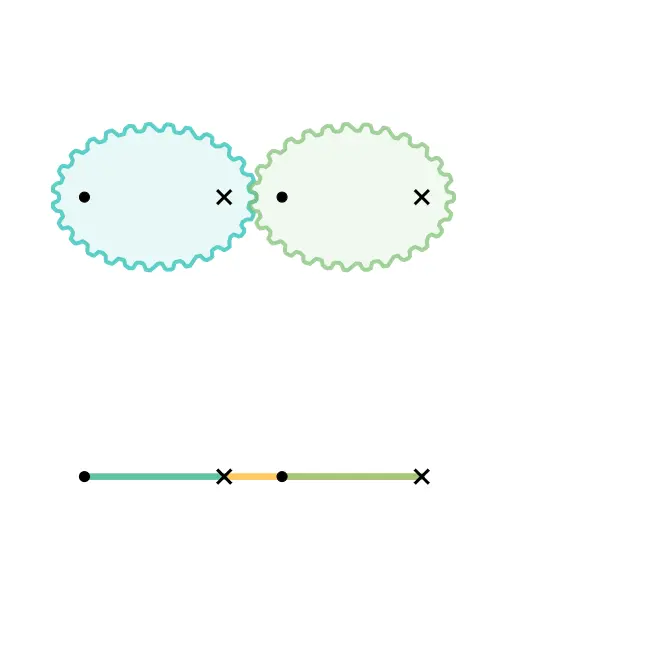
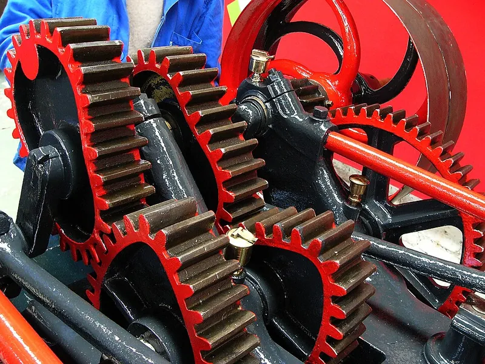
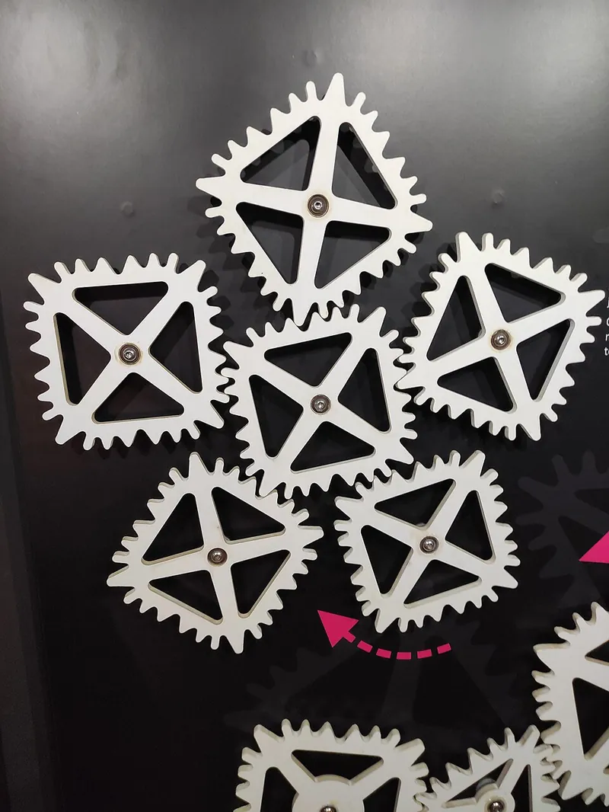

<figure class="eoc-pic eoc-pic-main"><picture><source media="(prefers-reduced-motion: reduce)" srcset="../media/non-circular-gears.still.webp"></picture><figcaption><strong>Animation.</strong> <a href="https://commons.wikimedia.org/wiki/File:Antiparallelogram_and_Elliptical_Gears.gif">Antiparallelogram and Elliptical Gears</a> by Arglin Kampling, <a href="https://creativecommons.org/licenses/by-sa/4.0">CC BY-SA 4.0</a>, from Wikimedia Commons.</figcaption></figure>
<figure class="eoc-pic"><figcaption><strong>Photo.</strong> <a href="https://commons.wikimedia.org/wiki/File:Cames_de_la_pompe_Girodias_de_l%E2%80%99ancienne_usine_Mustad_expos%C3%A9e_au_Centre_d%E2%80%99Histoire_Sociale_de_Haute-Normandie,_Expotec_103,_%C3%A0_Rouen.jpg">Cames de la pompe Girodias de l’ancienne usine Mustad exposée au Centre d’Histoire Sociale de Haute-Normandie, Expotec 103, à Rouen</a> by Frédéric BISSON from Rouen, France, <a href="https://creativecommons.org/licenses/by/2.0">CC BY 2.0</a>, from Wikimedia Commons.</figcaption></figure>
<figure class="eoc-pic"><figcaption><strong>Photo.</strong> <a href="https://commons.wikimedia.org/wiki/File:Netradi%C4%8Dn%C3%AD_ozuben%C3%A9_p%C5%99evody.jpg">Netradiční ozubené převody</a> by Fry72, <a href="https://creativecommons.org/licenses/by-sa/4.0">CC BY-SA 4.0</a>, from Wikimedia Commons.</figcaption></figure>

A pair of gears whose outlines are not circles (ovals, ellipses or lobed shapes), designed to roll on each other without slipping so that a steady input turn becomes an output that repeatedly speeds up and slows down.

**In plain words:** Oval or oddly shaped gears that stay meshed as they turn, so when you turn one at a steady speed the other speeds up and slows down during every turn. **Proper term:** Non-circular gears (noncircular gears, NCG).

**Also called:** oval gears; elliptical gears, elliptic gears, elliptical spur gears; eccentric gears (a round gear turning about an off-centre point); lobed gears (gears with two, three or more bulges); variable-ratio gears, variable-speed gears; irregular gears, odd-shaped gears (square, triangular or heart-shaped gears); oval gear meter rotors (the gears inside an oval gear flow meter); oval chainring, Biopace (Shimano brand, 1983-1993) (a non-circular bicycle sprocket); Wild Gears (brand; non-circular drawing gears).

## How it works

Each gear rolls on an imaginary outline ([pitch](../glossary.md#pitch) curve) instead of a circle. At every moment the distances from the two shafts to the point where the gears touch add up to the fixed distance between the shafts, and the output speed equals the input speed times the drive gear's distance divided by the driven gear's distance (Wikipedia 'Non-circular gear'). Because those distances change as the gears turn, the speed ratio changes all the time: where the drive gear reaches out far and the driven gear is 'short', the output races; half a turn later it crawls. The mating shape is worked out from the first gear so that the two roll together without slipping, and teeth are then added along each outline (piellardj; osamutake).

## Parts

A few parts: two gears designed as a matched pair (a drive gear and its mating gear), two shafts or pins held at a fixed distance apart, and bearings or bushings; often a base plate or frame and clips (retaining rings) to hold the gears on their pins

## Everyday examples

- Oval gear flow meters on fuel, oil and grease dispensers: two meshing oval gears pass a fixed volume of liquid per turn (Silver Automation Instruments)
- Oval bicycle chainrings such as Shimano's Biopace (brand), which change the effective gear during each pedal [stroke](../glossary.md#stroke) (Wikipedia 'Biopace')
- Spirograph-style drawing toys with non-round gears, e.g. Wild Gears (brand)
- Printing presses, packaging machines and textile machines (Maláková 2019; Wikipedia)

## When to use it

Use non-circular gears when a constant-speed motor must drive something whose speed has to rise and fall in a set pattern every turn: a slow working stroke with a quick return, matching the speed of a cutter or printing roll to a moving web, or a positive-displacement pump or flow meter (Maláková 2019; Wikipedia). They are compact, need no springs or followers, and keep an exact angle relationship. They are also great for kinetic art, desk toys and teaching models, because the changing speed is easy to see.

## When not to use it

Don't use them when you just need a constant speed change: use ordinary spur gears. If the output must stop and wait, use an intermittent gear or Geneva drive. If the ratio must be changed while running, use a friction drive or CVT. A four-bar [linkage](../glossary.md#linkage) can give a very similar varying motion with simple bars and pins (an antiparallelogram linkage behaves like a pair of elliptical gears, Wikimedia Commons animation), and a cam gives freer control of a back-and-forth output. Avoid printed non-circular gears for heavy or fast-running loads, because the output speeds up and slows down every turn, which shakes heavy parts ⚑ [uncertain].

## Details

- **What it does (jobs):**
  - change speed or turning force: the speed ratio (and so the turning force) changes in a set pattern during every turn
  - change the kind of motion: turns steady rotation into rotation that speeds up and slows down in a planned way, e.g. a slow working stroke and a fast return
- **Movement:** rotate: continuous rotation, unlimited range; an external pair turns in opposite directions like ordinary gears
- **Directions it can move (degrees of freedom):** 1: the output angle is fixed by the input angle through the gears' shapes
- **Special behaviour:**
  - motion conversion: steady rotation in, non-steady (varying-speed) rotation out. Engineers use pairs designed for a chosen 'law of motion' so a machine part follows a set speed pattern (Maláková 2019; Litvin et al.)
  - none of the locking, slipping or indexing behaviours: it does not slip, lock or stop; for stop-and-go motion use an intermittent gear or Geneva drive instead
- **How it holds:**
  - not a holding joint (it moves or passes on motion): it transmits rotation
  - shape (the parts interlock; [form-fit](../glossary.md#form-fit--force-fit--material-bond)): the teeth mesh, so the gears cannot slip
- **Input and output:** Continuous rotation -> continuous rotation whose speed varies periodically. Ratio at any instant = driving radius / driven radius, with the two radii always adding up to the centre distance (Wikipedia). For two identical ellipses each turning about one focus (centre distance = the ellipse's long axis, Maláková), the output speed swings between (1 - e)/(1 + e) and (1 + e)/(1 - e) times the input, where e is the ellipse's eccentricity; e.g. e = 0.5 gives one third to three times input speed (worked out from the ellipse's geometry, not quoted from a source). Over a whole turn an equal-perimeter pair averages 1:1; other pairs can be designed so the driver makes N turns while the follower makes M (Otvinta). Efficiency: ⚑ [uncertain] probably close to ordinary spur gears when accurately made, lower for printed ones; no source found. Shafts: parallel. Back-drivable: yes, like spur gears, but the turning force needed at the input changes through each turn.
- **Power:** passive (no power needed); it only passes on the motor's power. If the motor stops nothing holds the output
- **Load:** Light to medium: made accurately in metal they carry industrial loads (presses, hydraulic motors, pumps; Wikipedia), but home-made printed or laser-cut ones are for light loads, models and kinetic art. Teeth near the sharp ends of a pointed oval are small and [undercut](../glossary.md#undercut), so they are the weak spot (osamutake). Strong in twist ([torque](../glossary.md#torque)) along the direction of rotation; like other spur gears they push the shafts apart and need a stiff frame to keep the centre distance
- **Play and precision:** Small [backlash](../glossary.md#backlash), like spur gears, if made accurately. Very little [tolerance](../glossary.md#tolerance) for a wrong centre distance or phase: the shapes are matched only at one spacing and one relative angle (Wikipedia; Maláková). osamutake's printed model uses 0.15 mm [radial](../glossary.md#axial--radial) [clearance](../glossary.md#clearance) between gears and their shafts and warns that [elephant's foot](../glossary.md#elephants-foot) or stringing makes them bind. Repeatable: the output angle always returns to the same place for a given input angle
- **Taking it apart:** removable: the gears slide off their pins or shafts once clips, [set screws](../glossary.md#set-screw) or hubs are undone
- **How often it can be reused:** many times: the gears can be taken off and refitted as often as needed; refit them at the same relative angle (see tools_needed)
- **Sealing:** none: open gears. In an oval gear flow meter the gears run in a closely fitting chamber and the fluid is carried round in the pockets between gears and chamber wall, but that is the meter housing, not the gears (Silver Automation Instruments)
- **Adjustable:** no: the speed pattern is fixed by the gears' shapes and the centre distance is fixed; to change the pattern you make a new pair (or change the relative starting angle, which shifts when the fast and slow parts happen)
- **Access needed:** end of a tube or shaft: the gears slide onto pins or shafts
- **Materials:** Industrial ones are steel or other metals, usually spur gears made by moulding or electrical discharge machining rather than normal gear cutting (Wikipedia). Maker versions: PETG (osamutake recommends well-dried PETG), PLA for toys, acrylic, MDF or plywood when laser cut (MyLaserTools exports layered SVG for laser cutting as well as STL/3MF)
- **Heat, cold, water and wear:** The same limits as other gears of the same material: PLA softens and deforms above about 60 C and degrades in sunlight (Prusa); moisture in PETG filament spoils [accuracy](../glossary.md#repeatability--accuracy) (osamutake recommends well-dried filament). Plastic gears wear, and the teeth near sharp ends wear or break first. Oval gear flow meters need clean liquids, because particles damage the closely fitting gears (Silver Automation Instruments).

## Making it

- **Ways to make or get it:**
  - 3D print (FDM)
  - 3D print (resin): fine teeth for small models ⚑ [uncertain]
  - laser cut (acrylic, MDF, plywood)
  - CNC or wire EDM (industrial metal gears; Wikipedia mentions moulding and electrical discharge machining)
  - off-the-shelf part: rarely; mostly found inside products such as oval gear flow meters and oval bicycle chainrings ⚑ [uncertain]
- **Printing it in one piece (print in place):** no: the two gears are printed separately and fitted on pins or shafts, then clipped in place (osamutake's model uses snap-on retaining rings)
- **Tools:** A screwdriver or hex key for hubs, or none for gears held on pins with snap-on retaining rings (osamutake's model needs no glue). Design software or an online generator is needed to make the pair. When assembling, mesh the gears at their designed relative angle (mark matching teeth): because the two radii must always add up to the centre distance, a pair meshed one tooth off will bind or gap (follows from the fixed-centre rule in Wikipedia) ⚑ [uncertain]
- **Difficulty:** moderate: easy to make once a generator has drawn the pair (print or laser-cut it), but hard to design by hand, because every tooth is a different shape and the mate has to be calculated

### 3D printing tips

1) Use a generator: Otvinta's Non-Circular Gear Calculator takes a polar equation for gear 1, a turn ratio N/M and a tooth count and computes both outlines (N/M times the number of lobes must be a whole number, and the tooth count must divide by both N and M); MyLaserTools' free Gear Generator solves the mate of an ellipse numerically and exports SVG, STL and 3MF; piellardj's MIT-licensed web demo builds mates for ellipse, heart, triangle and other shapes. 2) Keep the shape gentle: the pitch curve should be smooth, closed and not cross itself (Otvinta); very pointed ellipses give tight curves where teeth are undercut and weak, and hollow (concave) stretches on the mate get teeth like an internal gear (osamutake). 3) Tooth shape: proper non-circular involute teeth change with the local curvature (osamutake), but for FDM Hirnschall suggests round (circular) teeth so every tooth is the same size, since printed gears are not highly loaded. 4) Print flat with the shaft axis vertical so each layer traces the full outline (Prusa's advice to orient parts for strength in the loaded direction). 5) osamutake's settings for smooth running: well-dried PETG for accuracy, 0.1 or 0.08 mm layers, slow [overhangs](../glossary.md#overhang--bridging), random seam position, and 0.15 mm radial clearance on the shafts; sand off stringing and file out elephant's foot if the gears feel tight. 6) Mark the meshing teeth before separating the gears, so you can reassemble them in phase. 7) For moving parts Prusa suggests starting at 0.3 mm clearance; PLA softens above about 60 C (Prusa).

### Buying one (off-the-shelf parts)

Mostly custom-made. Parts you can buy: steel pins or shoulder bolts as axles, ball bearings or bushings, retaining rings (e-clips), a base plate. Products that contain non-circular gears: oval gear flow meters (positive displacement meters), oval gear pumps, oval bicycle chainrings (e.g. Rotor Q-Rings, brand; Shimano Biopace, brand, discontinued), Wild Gears (brand) drawing sets

## Rules of thumb

- Fixed-shaft rule: the two contact radii always add up to the centre distance, r1 + r2 = a, and the gears roll without slipping, r1 dθ1 = r2 dθ2 (Wikipedia 'Non-circular gear').
- Identical elliptical gears turn about a focus, not the centre, and the centre distance equals the long (major) axis of the ellipse (Maláková 2019: the half major axis is half the axial distance).
- How much the speed varies is set by the ratio of the ellipse's long and short axes (507 Mechanical Movements no. 33); a rounder ellipse gives a gentler variation.
- For one turn of the driver to give exactly one turn of the follower, both pitch curves must have the same length (osamutake); more generally N/M times the number of lobes must be a whole number and the tooth count must divide by N and M (Otvinta).
- Pitch curves must be closed, smooth and non-self-intersecting (Otvinta), and should stay convex with a large enough radius of curvature to avoid undercut teeth (osamutake; Liu et al., Scientific Reports 2022, give convexity and undercut conditions for elliptical gears).
- Tooth shape depends only on the local curvature of the pitch curve, not on the distance from the shaft (osamutake).

## Common failures

1) Assembled out of phase or at the wrong centre distance: the gears bind in one place and rattle in another; keep the designed spacing and mark the meshing teeth ⚑ [uncertain]. 2) Undercut, weak teeth at the pointed ends of an oval break or skip (osamutake). 3) Printing faults: elephant's foot and stringing make gears tight on their shafts (osamutake). 4) A shape that is too extreme or has hollow sections that the generator cannot mesh properly (Otvinta requires closed, smooth, non-crossing curves). 5) Motor stalling or the output jerking because the torque needed changes through each turn ⚑ [uncertain].

## Safety

Meshing gears form in-running nip points that can trap fingers, hair or clothing (OSHA machine guarding eTool); with non-circular gears the gap between the gears also opens and closes as they turn. Guard powered gears. Small printed gears and clips are a choking hazard for small children.

## Related

- Spur gear pair and gear train: round gears with a constant speed ratio
- Intermittent gear (mutilated gear) and Geneva drive: give stop-and-go motion instead of smoothly varying speed
- Four-bar linkage (antiparallelogram): can give the same varying rotation with bars and pins (Wikimedia Commons 'Antiparallelogram and Elliptical Gears' animation)
- [Cam and follower](../glossary.md#cam-and-follower): another way to make a set motion pattern, usually back-and-forth rather than rotation
- Eccentric gear: a round gear turning off-centre, the simplest non-circular pair
- Chain and sprocket drive with an oval chainring: a non-circular sprocket gives a varying ratio through a chain
- Friction drives and CVTs: change the ratio smoothly while running, but by friction and on command rather than in a fixed pattern
- Scotch yoke and slider-crank: turn rotation into back-and-forth motion

## Make it yourself

- [Educational Model of Non-circular Gears (osamutake, Printables) (URL from Printables API, page not opened)](https://www.printables.com/model/1504479-educational-model-of-non-circular-gears): A printable 80 x 80 mm demonstration: an eccentric ellipse driving its calculated mate, with involute-style teeth, printing settings and a video (https://youtu.be/AjaNT3_8q5M) *(licence: CC BY)*
- [Elliptical gears (MarcinPaska, Printables) (URL from Printables API, page not opened)](https://www.printables.com/model/864137-elliptical-gears): A printable pair of elliptical gears *(licence: CC0 (public domain))*
- [Elliptical Gear with no center pivot (JGowins, Printables) (URL from Printables API, page not opened)](https://www.printables.com/model/1533767-elliptical-gear-with-no-center-pivot): A remix of PerryT's elliptical gear set with the gears pivoting off-centre *(licence: CC BY-SA)*
- [Non-Circular Gear Calculator (Otvinta)](https://www.otvinta.com/noncircular.html): Online calculator that computes the outlines of two meshing non-circular gears from a polar equation, turn ratio and tooth count *(licence: ⚑ [uncertain] free online tool; no licence shown)*
- [Gear Generator (MyLaserTools)](https://www.mylasertools.com/gear-generator): Free online gear generator including non-circular gears whose mate is solved numerically; exports layered SVG for laser cutting and STL/3MF for printing *(licence: ⚑ [uncertain] free online tool; no licence shown)*
- [non-circular-gears (Jérémie Piellard, GitHub)](https://github.com/piellardj/non-circular-gears): Source code of the interactive non-circular gear generator, with an explanation of the no-slip rolling principle and research references *(licence: MIT)*

## Pictures, videos and models

- [Antiparallelogram and Elliptical Gears.gif (Wikimedia Commons, Arglin Kampling)](https://commons.wikimedia.org/wiki/File:Antiparallelogram_and_Elliptical_Gears.gif): Animation of two elliptical gears turning about their foci next to the equivalent antiparallelogram four-bar linkage *(licence: CC BY-SA 4.0)*
- [EllipticalGeard.gif (Wikimedia Commons, Sababer)](https://commons.wikimedia.org/wiki/File:EllipticalGeard.gif): Animation of an elliptical gear pair and its equivalent mechanism *(licence: CC BY-SA 4.0 and GFDL 1.2 or later)*
- [507 Mechanical Movements no. 33: Elliptical spur-gears](https://507movements.com/mm_033.html): Animated historic drawing of elliptical spur gears giving rotary motion of varying speed *(licence: Book public domain (1868); website animation link only)*
- [Non-circular gears (Jérémie Piellard, interactive web demo)](https://piellardj.github.io/non-circular-gears/): Live animation of an odd-shaped gear (ellipse, heart, triangle, square and more) with mating gears generated around it; you can add gears and show teeth *(licence: MIT (code))*
- [Non-Circular Gear Basics (Wild Gears, YouTube)](https://www.youtube.com/watch?v=SQXxEbdPU1Y): Video introduction to non-circular gears *(licence: link only (standard YouTube licence))*

## Needs confirming

⚑ marks something nobody has confirmed yet: a fact the research could not confirm from a source, a finder value that is a best guess, or an open point from the research notes. Corrections are welcome (see `research/needs-confirming.md`).

- ⚑ 9 sentences on this page marked [uncertain].
- ⚑ Finder value `tools` = hand tools (source uncertain): `tools_needed` is marked ⚑ [uncertain] here: "…ff will bind or gap (follows from the fixed-centre rule in Wikipedia) ⚑ [uncertain]…"

## Sources

- <https://en.wikipedia.org/wiki/Non-circular_gear>
- <https://en.wikipedia.org/wiki/Biopace>
- <https://sjsutst.polsl.pl/archives/2019/vol104/095_SJSUTST104_2019_Malakova.htm>
- <https://pmc.ncbi.nlm.nih.gov/articles/PMC9561629/>
- <https://arxiv.org/abs/1905.02642>
- <https://books.google.com/books/about/Noncircular_Gears.html?id=8DHzDAEACAAJ>
- <https://507movements.com/mm_033.html>
- <https://www.otvinta.com/noncircular.html>
- <https://www.mylasertools.com/gear-generator>
- <https://blog.hirnschall.net/gears-for-3d-printing/>
- <https://piellardj.github.io/non-circular-gears/>
- <https://raw.githubusercontent.com/piellardj/non-circular-gears/master/README.md>
- <https://raw.githubusercontent.com/piellardj/non-circular-gears/master/LICENSE>
- <https://www.silverinstruments.com/support/oval-gear-flow-meter-working-principle.html>
- <https://commons.wikimedia.org/wiki/File:Antiparallelogram_and_Elliptical_Gears.gif>
- <https://commons.wikimedia.org/wiki/File:EllipticalGeard.gif>
- <https://www.youtube.com/watch?v=SQXxEbdPU1Y>
- <https://www.youtube.com/watch?v=AjaNT3_8q5M>
- <https://api.printables.com/graphql/>
- <https://help.prusa3d.com/article/modeling-with-3d-printing-in-mind_164135>
- <https://help.prusa3d.com/article/pla_2062>
- <https://www.osha.gov/etools/machine-guarding/introduction/hazardous-motions-actions>
