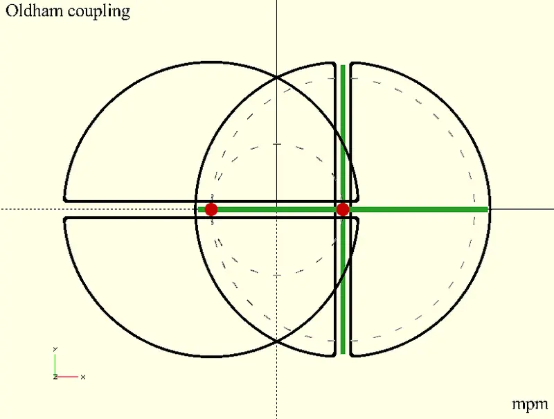
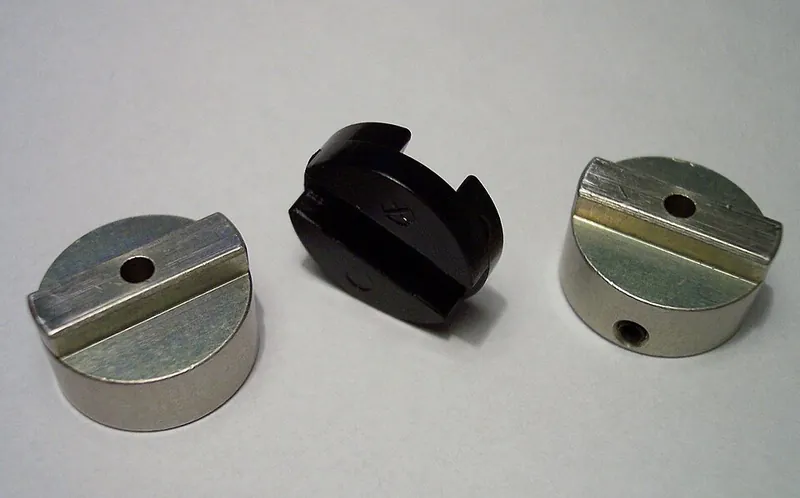
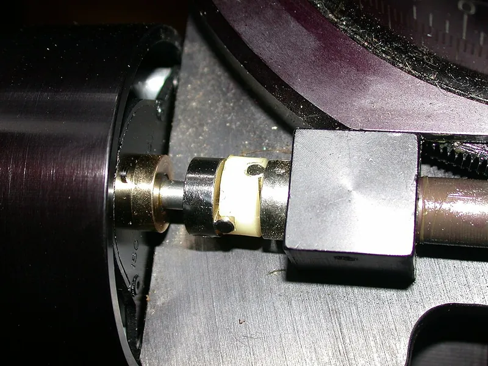

<figure class="eoc-pic eoc-pic-main"><picture><source media="(prefers-reduced-motion: reduce)" srcset="../media/oldham-coupling-f15516.still.webp"></picture><figcaption><strong>Animation.</strong> <a href="https://commons.wikimedia.org/wiki/File:Oldham_120x30.gif">Oldham 120x30</a> by Bryllig, <a href="https://creativecommons.org/licenses/by-sa/4.0">CC BY-SA 4.0</a>, from Wikimedia Commons.</figcaption></figure>
<figure class="eoc-pic"><figcaption><strong>How it works.</strong> <a href="https://commons.wikimedia.org/wiki/File:Klauenkupplung_3.jpg">Klauenkupplung 3</a> by unknown, <a href="http://creativecommons.org/licenses/by-sa/3.0/">CC BY-SA 3.0</a>, from Wikimedia Commons.</figcaption></figure>
<figure class="eoc-pic"><figcaption><strong>Photo.</strong> <a href="https://commons.wikimedia.org/wiki/File:Oldham_coupler_Losmandy_G11.jpg">Oldham coupler Losmandy G11</a> by Gn842, Public domain, from Wikimedia Commons.</figcaption></figure>

Two hubs, each with a slot (or tongue) across its face, are joined by a floating middle disc whose two tongues cross at right angles, so the disc slides to take up any sideways offset between two parallel shafts while passing turning force at exactly the same speed.

**In plain words:** A sandwich of three discs that joins two shafts which sit side by side but not quite in line: the middle disc has a ridge on each face at right angles, and it slides about in slots in the two outer discs while they all turn together. **Proper term:** Oldham coupling (Oldham coupler).

**Also called:** Oldham coupler; Oldham's coupling; Oldham clutch (older name; e.g. the Wikimedia Commons diagram title); Oldham mechanism (Nguyen Duc Thang's animation titles); Oldham ring / Oldham-type coupling (the anti-rotation ring in scroll compressors); three-piece coupling with a floating centre disc (hub, disc, hub); Z-axis Oldham coupler / leadscrew-nut Oldham adapter (3D-printer upgrade that lets the leadscrew nut float sideways); Oldham coupling disk / centre disc (the replaceable plastic middle part); Sprzęgło Oldhama (Polish; from the Commons diagram description).

## How it works

Each hub can only push the middle disc sideways across its own slot, and the two slots are at right angles, so between them the disc can slide in any sideways direction but cannot turn relative to either hub; whatever angle the input hub turns, the output hub turns by exactly the same angle (Wikipedia 'Coupling'; osamutake's educational model notes). When the shafts are offset, the centre of the middle disc travels round a small circle twice per revolution and the tongues slide back and forth in their slots by the offset each turn (Wikipedia 'Coupling'). The maximum sliding speed of each tongue is the offset times the shaft's angular speed (v = r x omega) (IIT Kharagpur Virtual Lab). In mechanism theory it is an inversion of the double-slider [crank](../glossary.md#crank) chain, the same family as the Scotch yoke and the elliptical trammel (IIT Kharagpur Virtual Lab).

## Parts

A few parts: two hubs (one clamped or set-screwed on each shaft end, each with a slot or tongue across its face) and one centre disc with a tongue or slot on each face at 90 degrees to each other; the hubs are fixed with clamp screws or [set screws](../glossary.md#set-screw).

## Everyday examples

- The Z-axis of many hobby 3D printers, where an Oldham-style adapter between the leadscrew nut and the carriage stops a bent or misaligned leadscrew wobbling the print (TH3D)
- Laser printers: Canon describes an Oldham coupling that drives the developing roller in a removable cartridge despite slight [misalignment](../glossary.md#misalignment) (patent US11662686B2)
- Home air-conditioner and heat-pump scroll compressors, where an Oldham-type coupling stops the orbiting scroll from rotating (Wikipedia 'Scroll compressor')
- Motorised telescope mounts, e.g. between the motor and the worm shaft on a Losmandy G11 (brand) mount (Wikimedia Commons photo)

## When to use it

Use it when two shafts are parallel but cannot be lined up exactly, and you want them to turn together at exactly the same speed with low sideways force on their bearings: stepper motor to leadscrew or encoder, motor to pump or feed roller, or a drive into a removable module. It is also a good choice when you want the drive to break safely at a plastic disc rather than damage gears, when the two shafts must be electrically isolated, and for teaching or fidget models that show constant-velocity drive across an offset.

## When not to use it

Avoid it for shafts meeting at an angle (use a universal joint, a double universal joint or a CV joint), for large [axial](../glossary.md#axial--radial) movement (use a [spline](../glossary.md#spline) shaft or a jaw coupling that allows end float), for heavy shocks and vibration [damping](../glossary.md#damping) (use a jaw coupling with a rubber spider), or for high-precision servo drives needing no play and high [stiffness](../glossary.md#stiffness) with angular misalignment (use a beam or bellows coupling). Avoid it at high speed with large offset, because the sliding wears the disc. For very large parallel offsets, a Schmidt (parallel-link) coupling is designed for that.

## Details

- **What it does (jobs):**
  - join and hold: connects two shafts end to end so they turn together
  - let it move (turn, slide or bend): lets the two shafts sit side-by-side out of line (parallel offset) without forcing them into line
  - slip or let go when overloaded: in commercial couplings the plastic disc acts as a 'mechanical fuse' that [shears](../glossary.md#peel-vs-shear) on overload and stops the drive (Ruland data via PIB Sales; Design World)
- **Movement:** rotate+slide: the shafts turn continuously (unlimited turns, 1:1), while inside the coupling the middle disc slides back and forth by the shaft offset once per turn in each slot
- **Directions it can move (degrees of freedom):** Between the two shafts: 0 in the turning direction (they are locked together in rotation) but 2 free sideways movements (parallel offset in any direction), plus a little end float (axial) and a very small tilt (angular) from [clearance](../glossary.md#clearance) in the slots (Ruland data via PIB Sales: about 0.5 degree angular and a few thousandths of an inch axial). As a mechanism the three rotating parts all turn at the same angular speed at every instant (IIT Kharagpur Virtual Lab).
- **Special behaviour:**
  - [fail-safe](../glossary.md#fail-safe--fail-secure) or breakaway: the plastic centre disc is the weak link; on overload or a jam it shears cleanly and the hubs stop driving each other, protecting the rest of the machine (Ruland data via PIB Sales; Design World 2007). This is the opposite of a jaw coupling, which keeps driving metal-on-metal if its spider fails
  - quick-release (partly): the hubs come apart simply by sliding the disc out of its slots, and the disc can be replaced to restore the original performance (PIB Sales; Motion+Drives)
  - none of the other behaviours: it is not [self-locking](../glossary.md#self-locking), one-way or torque-limiting at a set value
- **How it holds:**
  - shape (the parts interlock; [form-fit](../glossary.md#form-fit--force-fit--material-bond)): the tongues sit in the slots, so turning force is carried by contact, not friction
  - friction or clamping (force-fit): each hub is held on its shaft by a clamp screw or set screws; Slocum calls a circumferential clamp 'the best alternative' and warns against set screws without a keyway
- **Input and output:** Continuous rotation -> the same continuous rotation, 1:1, at constant velocity (no speed wobble in theory, unlike a single universal joint) (IIT Kharagpur Virtual Lab; osamutake). Shaft arrangement: parallel shafts, in line or offset sideways (it is especially suited to parallel offset, up to about 10% of the hub outside diameter: Ruland data via PIB Sales). Efficiency: some power is lost to sliding friction in the slots, rising with the offset ⚑ [uncertain: no figure found on an opened page]. Slocum notes that simple pin-in-slot couplings such as Oldham couplings can still add a small sinusoidal angle error in real machines, at most about the shaft offset divided by the coupling radius. Back-drivable: yes, it passes turning force equally in both directions.
- **Power:** passive (no power needed)
- **Load:** Light to medium [torque](../glossary.md#torque), limited by the plastic centre disc: small brass/nylon couplings are rated only 20-100 oz-in (about 0.14-0.7 N m) (Renbrandt TINYMITE), while larger aluminium/acetal servo couplings carry more. It handles sideways offset with low reaction forces on the shaft bearings ('large amounts of parallel misalignment with light bearing loads': Design World 2007). Weak points: angular misalignment (only about 0.5 degree), pull-apart (nothing holds the three parts together axially, so the shafts' own bearings must keep the hubs at the right distance ⚑ [uncertain: inferred from construction]) and shock overload, which shears the disc.
- **Play and precision:** Small to none: with an acetal disc Oldham couplings run with 'virtually zero [backlash](../glossary.md#backlash)' (PIB Sales on Ruland), and springs are often used to take out backlash (Wikipedia 'Coupling'); worn or loose-fitting slots add play. Misalignment [tolerance](../glossary.md#tolerance): very good for parallel (sideways) offset, up to about 10% of hub outside diameter; angular only about 0.5 degree; axial a few thousandths of an inch (Ruland data via PIB Sales). Small loose-fit nylon versions claim more angle (3-5 degrees) and 1/32-1/16 in offset (Renbrandt TINYMITE). [Repeatability](../glossary.md#repeatability--accuracy): it passes angle 1:1 in theory, but Slocum warns of a small sinusoidal following error in pin-in-slot couplings.
- **Taking it apart:** removable: loosen the hub clamp screws or set screws to slide the hubs off; the hubs separate simply by sliding the centre disc out, and discs are sold as replacement parts (PIB Sales on Ruland)
- **How often it can be reused:** many times: hubs last indefinitely; the plastic disc is a wear part that is replaced when worn or after it has sheared as a fuse (Motion+Drives: 'Disk is replaceable, restoring the original performance characteristics')
- **Sealing:** none: open sliding slots
- **Adjustable:** No adjustment once fitted, apart from the hub positions on the shafts. Behaviour is chosen by disc material: acetal for high torsional stiffness and near-zero backlash, nylon for damping and quiet running, PEEK for high temperature (up to about 300 °F / 150 °C) and cleanrooms (Ruland data via PIB Sales).
- **Access needed:** end of a tube or shaft: each hub slides onto a shaft end and is clamped from the side; the two shafts must be brought end to end with the disc between them
- **Materials:** Hubs: black-anodised aluminium, stainless steel (washdown and food machines) or nickel-plated brass; centre disc: acetal (POM), nylon, PEEK or polycarbonate (PIB Sales; Renbrandt; Motion+Drives). The plastic disc also electrically isolates the two shafts (Design World; Renbrandt quotes 6,000 V insulation). 3D-printed versions: PETG or PLA hubs, with a low-friction disc such as iglidur (brand) or nylon (PA) filament, or PETG/ABS/ASA (Printables makers michelegz and TMP NFT).
- **Heat, cold, water and wear:** The plastic disc sets the limits: nylon/brass TINYMITE couplings are rated to 175 °F (about 80 °C) (Renbrandt); PEEK discs are for high temperature to about 300 °F (PIB Sales on Ruland). Printed PLA parts soften above about 60 °C and PETG is fine below about 80 °C (Prusa). Sliding surfaces wear faster with grit and dirt; nylon absorbs moisture and can swell ⚑ [uncertain]. Plastic under constant load can [creep](../glossary.md#creep), loosening a printed hub clamp over time ⚑ [uncertain]. Stainless hubs suit washdown and food machines (PIB Sales).

## Making it

- **Ways to make or get it:**
  - 3D print (FDM): hubs and disc print flat; widely used for 3D-printer Z-axis and demonstration models
  - 3D print (resin): ⚑ [uncertain] possible for small low-torque couplings, no example found
  - CNC: hubs with milled slots or tenons and a turned or moulded disc (commercial couplings)
  - off-the-shelf part: complete couplings with clamp or set-screw hubs, replacement discs, and 3D-printer leadscrew-nut Oldham adapters
- **Printing it in one piece (print in place):** no: the two hubs and the disc are printed as separate flat parts and stacked together by hand; osamutake's and Miloslav Brozek's printable models both assemble after printing
- **Tools:** A hex key (Allen key) for the hub clamp screws or set screws; nothing to assemble the three parts, which just slide together. Grease or oil for the sliding faces is recommended on the 3D-printer leadscrew-nut version (TH3D).
- **Difficulty:** easy: three simple parts that print flat without supports and just slide together (Printables educational models), or buy one cheaply; the only fiddly part is getting a sliding fit that is free but not sloppy

### 3D printing tips

1) Print every part flat on the bed with the tongues and slots facing up; Rajkumar's and Miloslav Brozek's models print with no supports (Miloslav: 0.2 mm layers, 3+ walls, PLA is fine for a demonstrator). 2) Clearance: osamutake's educational model uses 0.15 mm radial clearance on its shaft bores and suggests sanding stringing and filing out [elephant's foot](../glossary.md#elephants-foot) if parts bind; michelegz designs 'just a little clearance' and files and sands until the parts 'move freely but without backlash'; Miloslav's OpenSCAD model makes all clearances adjustable. 3) Surface finish: use well-dried PETG, fine layers (0.08-0.1 mm) and a random seam for smoother sliding (osamutake). 4) Disc material: make the sliding middle part from a low-friction material such as iglidur (brand) or nylon (michelegz), or PETG/ABS/ASA with PLA outer parts (TMP NFT, who also uses 5 walls and about 50% [infill](../glossary.md#infill) and XY size compensation). 5) A dovetail-shaped tongue stops the parts falling apart vertically (michelegz's 'Oldham dovetail coupling'). 6) Grease the sliding faces (TH3D recommends oil or lithium grease on its leadscrew-nut version). 7) Clamp to metal shafts with metal screws and nuts, not printed threads; Slocum warns set screws need a keyway or thread-locker. 8) Keep printed Z-axis couplers away from heat: PLA softens above about 60 °C (Prusa), PETG is fine below about 80 °C (Prusa). 9) Check the tongues and slots print square (90 degrees apart and centred) or the coupling will bind once per turn ⚑ [uncertain: design reasoning].

### Buying one (off-the-shelf parts)

Oldham couplings with clamp hubs or set-screw hubs, inch or metric bores (typical ranges 1/8 in to 2 1/4 in or 3 mm to 57 mm: Design World; small brass/nylon 'TINYMITE' sizes from Renbrandt (brand)); replacement Oldham coupling discs in acetal, nylon or PEEK (Ruland (brand)); stainless-steel hub versions for washdown; 3D-printer leadscrew-nut Oldham couplers for T8 leadscrews (e.g. TH3D (brand), for Creality and Sovol (brands) printers); related off-the-shelf offset couplings such as the Schmidt coupling for larger offsets.

## Rules of thumb

- Parallel offset: up to about 10% of the coupling's outside diameter; angular up to about 0.5 degree; axial only a few thousandths of an inch (Ruland data quoted by PIB Sales).
- Speed: aluminium/acetal servo couplings are balanced for about 4,500-6,000 rpm (PIB Sales; Motion+Drives); small nylon/brass ones are limited to 2,500 rpm and 175 °F (about 80 °C) (Renbrandt TINYMITE).
- Maximum sliding speed of each tongue in its slot = shaft offset x angular speed (IIT Kharagpur Virtual Lab), so bigger offsets and higher speeds mean more wear.
- The middle disc's centre orbits a small circle twice per shaft revolution (Wikipedia 'Coupling').
- Choose acetal for stiffness and zero backlash, nylon for damping and quiet running, PEEK for heat (to about 300 °F) or cleanrooms (Ruland data quoted by PIB Sales).
- Largest angle error in pin-in-slot couplings is about the shaft offset divided by the coupling radius (Slocum, FUNdaMENTALs of Design, Topic 5, p. 5-28).
- Attach hubs with a circumferential clamp; avoid set screws, or use a keyway with them (Slocum, Topic 5, p. 5-28).
- Printed demonstrator: about 0.15 mm radial clearance on shaft bores (osamutake, Printables).

## Common failures

1) Disc wear from sliding, worst with large offset and high speed (sliding speed = offset x angular speed: IIT Kharagpur Virtual Lab): keep offset small and lubricate. 2) Disc shearing on a jam or shock load, by design (PIB Sales): find the jam, fit a new disc. 3) Binding from too tight a printed fit, stringing or elephant's foot (osamutake): sand or file and allow ~0.15 mm clearance. 4) Backlash and rattle from a loose or worn fit (michelegz aims for 'freely but without backlash'; springs can remove it: Wikipedia). 5) Hubs slipping on shafts when held only by set screws (Slocum): use clamp hubs or a flat or keyway. 6) Parts pulling apart or the disc falling out when the shafts move apart axially (michelegz uses a dovetail to prevent this). 7) Trying to use it for angular misalignment, which it tolerates only about 0.5 degree (PIB Sales).

## Safety

It is a rotating part with open slots and clamp screws, so keep fingers, hair and loose clothing away while it runs and fit a guard on powerful drives ⚑ [uncertain: general rotating-machinery practice]. Because the disc is designed to shear on overload, the driven side can suddenly stop being driven; on a lift or a vertical leadscrew, make sure the load cannot then fall ⚑ [uncertain]. Small printed discs are a choking hazard for young children ⚑ [uncertain].

## Related

- Jaw coupling (spider coupling): Wikipedia describes the Oldham coupler as 'a form of two-jawed jaw coupling where the centre spider is long'; the jaw coupling's rubber spider damps shocks and takes more angle but much less sideways offset
- Universal joint (Hooke's joint): for shafts at an angle, but a single one wobbles the output speed; the Oldham coupling handles offset at constant speed
- Flexible beam coupling (helical-slot coupling): one piece, zero backlash, handles angle better, but gives more side load for large offsets
- Schmidt coupling (parallel-link offset coupling): links and discs for much larger parallel offsets (Nguyen Duc Thang animation 'Schmidt coupling')
- Scotch yoke and elliptical trammel: other inversions of the same double-slider chain (IIT Kharagpur Virtual Lab)
- Dog clutch (claw clutch): face lugs that engage and disengage drive, not meant to run offset
- Rigid coupling: no misalignment allowed; Slocum warns forcing misaligned shafts together with one destroys bearings

## Make it yourself

- [Educational Model of Oldham Coupling (osamutake, Printables) (URL from Printables API, page not opened)](https://www.printables.com/model/1503524-educational-model-of-oldham-coupling): Desk demonstrator on an 80 mm base plate with a YouTube introduction video; printing notes on PETG, fine layers, random seam and 0.15 mm clearances *(licence: CC BY)*
- [Oldham Coupling Fidget - Offset-Shaft Constant-Velocity Demo Toy (Miloslav Brozek, Printables) (URL from Printables API, page not opened)](https://www.printables.com/model/1765815-oldham-coupling-fidget-offset-shaft-constant-veloc): Supportless five-part fidget showing two offset knobs turning 1:1; fully parametric in one OpenSCAD file (offset, sizes and clearances) *(licence: CC BY)*
- [Oldham dovetail coupling (plus thrust bearing) (michelegz, Printables) (URL from Printables API, page not opened)](https://www.printables.com/model/425897-oldham-dovetail-coupling-plus-thrust-bearing): Working printed Oldham coupling for 5 mm shafts with dovetail tongues that stop it coming apart, for a 3D-printer Z axis; advice on low-friction disc material and fitting *(licence: CC BY-NC)*
- [Oldham Coupling T8 Z-axis (TMP NFT, Printables) (URL from Printables API, page not opened)](https://www.printables.com/model/820386-oldham-coupling-t8-z-axis): Printed leadscrew-nut Oldham coupler for T8 leadscrews with print settings (PLA outer parts, PETG/ABS/ASA middle, 5 walls, ~50% infill) *(licence: CC BY-SA)*
- [Oldham Coupling - Compliant Mechanism - Z Wobble Reducer (PRusty, Printables) (URL from Printables API, page not opened)](https://www.printables.com/model/383091-oldham-coupling-compliant-mechanism-z-wobble-reduc): Experimental three-layer flexure version that replaces the sliding disc with springy arms so the leadscrew nut can move in X and Y; printed in PETG *(licence: CC BY)*

## Pictures, videos and models

- [Oldham coupler animated small.gif (Wikimedia Commons, by Van helsing)](https://commons.wikimedia.org/wiki/File:Oldham_coupler_animated_small.gif): Rendered animation of an Oldham coupling turning, with the middle disc sliding in its slots *(licence: CC BY-SA 3.0, GFDL 1.2+ or CC BY 2.5 (choice))*
- [Klauenkupplung 3.jpg (Wikimedia Commons, by Stahlkocher, reworked by Hohum)](https://commons.wikimedia.org/wiki/File:Klauenkupplung_3.jpg): Photo of a real Oldham coupler taken apart into its two hubs and middle disc *(licence: CC BY-SA 3.0 or GFDL 1.2+)*
- [Oldham coupler Losmandy G11.jpg (Wikimedia Commons, by Gn842)](https://commons.wikimedia.org/wiki/File:Oldham_coupler_Losmandy_G11.jpg): Photo of an Oldham coupler in a telescope mount: aluminium disc on the motor shaft, nylon centre hub, disc on the worm shaft *(licence: Public domain)*
- [Oldham clutch-diagram.png (Wikimedia Commons, by Jonasz)](https://commons.wikimedia.org/wiki/File:Oldham_clutch-diagram.png): Simple line diagram of the three parts of an Oldham coupling *(licence: GFDL 1.2+ or CC BY-SA 3.0)*
- [Oldham coupling 1 (Nguyen Duc Thang, thang010146, YouTube)](https://www.youtube.com/watch?v=VPVxy9uW45E): CAD animation of an Oldham coupling joining offset shafts; the channel also has 'Oldham coupling 2-4' variants *(licence: link only (standard YouTube licence))*

## Needs confirming

⚑ marks something nobody has confirmed yet: a fact the research could not confirm from a source, a finder value that is a best guess, or an open point from the research notes. Corrections are welcome (see `research/needs-confirming.md`).

- ⚑ 9 sentences on this page marked [uncertain].
- ⚑ Finder value `shaft_joint` = shaft to shaft (best guess): carried over from the finder's old rule on entry names (R33), for "What are you connecting?" under "Hold two things together > A wheel, gear or arm onto a shaft, or two shafts end to end"
- ⚑ Finder value `shaft_alignment` = a little out of line (best guess): carried over from the finder's old rule on entry names (R33), for "How well do the shafts line up?" under "Hold two things together > A wheel, gear or arm onto a shaft, or two shafts end to end > Two shafts end to end"

## Sources

- <https://en.wikipedia.org/wiki/Coupling>
- <https://en.wikipedia.org/wiki/Oldham_coupler>
- <https://en.wikipedia.org/wiki/John_Oldham_(engineer)>
- <https://en.wikipedia.org/wiki/Jaw_coupling>
- <https://en.wikipedia.org/wiki/Scroll_compressor>
- <https://commons.wikimedia.org/wiki/File:Oldham_coupler_animated_small.gif>
- <https://commons.wikimedia.org/wiki/File:Klauenkupplung_3.jpg>
- <https://commons.wikimedia.org/wiki/File:Oldham_coupler_Losmandy_G11.jpg>
- <https://commons.wikimedia.org/wiki/File:Oldham_clutch-diagram.png>
- <https://mr-iitkgp.vlabs.ac.in/exp/oldham-coupling-mechanism/theory.html>
- <https://pibsales.com/bearings/ruland-oldham-couplings-solutions-for-conveyors/>
- <https://www.designworldonline.com/couplings-accommodate-parallel-misalignment/>
- <https://motion-drives.com/blog/2022/09/28/oldham-couplings-for-food-and-beverage-equipment/>
- <https://renbrandt.com/tinymite-oldham-shaft-couplings/>
- <https://pergatory.mit.edu/resources/FUNdaMENTALs%20Book%20pdf/FUNdaMENTALs%20Topic%205.PDF>
- <https://www.th3dstudio.com/product/creality-leadscrew-oldham-coupler-fixes-z-wobble-binding/>
- <https://patents.google.com/patent/US11662686B2/en>
- <https://www.youtube.com/watch?v=VPVxy9uW45E>
- <https://cs448m.github.io/lectures/machines/doc/1.pdf>
- <https://www.youtube.com/watch?v=Z82Rm35zFKk>
- <https://api.printables.com/graphql/>
- <https://help.prusa3d.com/article/pla_2062>
- <https://help.prusa3d.com/article/petg_2059>
