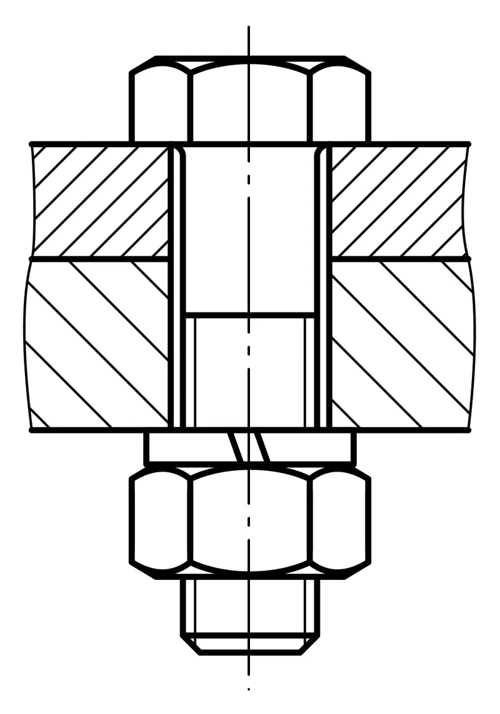
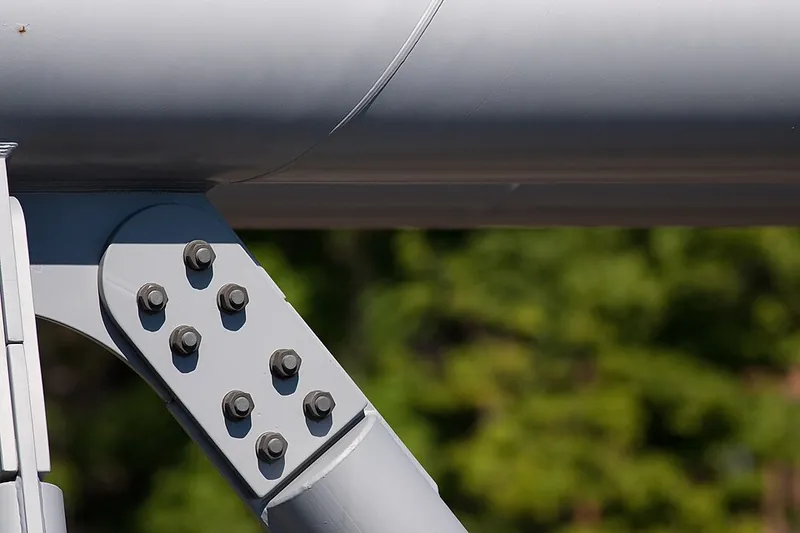

<figure class="eoc-pic eoc-pic-main"><figcaption><strong>Cross-section.</strong> <a href="https://commons.wikimedia.org/wiki/File:Bolted_joint_with_nut.svg">Bolted joint with nut</a> by Андрей Перцев, <a href="http://creativecommons.org/publicdomain/zero/1.0/deed.en">CC0</a>, from Wikimedia Commons.</figcaption></figure>
<figure class="eoc-pic"><figcaption><strong>Photo.</strong> <a href="https://commons.wikimedia.org/wiki/File:Bolted_joint_bridge.jpg">Bolted joint bridge</a> by Thermos, <a href="https://creativecommons.org/licenses/by-sa/3.0">CC BY-SA 3.0</a>, from Wikimedia Commons.</figcaption></figure>

A threaded fastener passes through [clearance](../glossary.md#clearance) holes and is tightened into a nut or a tapped hole, stretching slightly like a stiff spring so it clamps the parts together; it is the standard removable joint that other connections are compared with.

**In plain words:** A metal screw or bolt goes through holes in the parts and is tightened into a nut, or into a hole with a thread cut in it, squeezing the parts together; undo it and everything comes apart again. **Proper term:** Bolted joint (screw joint; threaded fastener joint with a bolt and nut, or a machine screw in a tapped hole).

**Also called:** bolted joint, bolted connection (Wikipedia 'Bolted joint'); screw joint, screwed joint: a screw into an internal thread in one of the parts instead of a nut (Wikipedia 'Screw joint'); nut and bolt, through-bolt joint; machine screw and nut; machine screw into a tapped (threaded) hole (Wikipedia 'Screw'); cap screw, socket-head cap screw, hex bolt, set of 'nuts, bolts and washers'; tension joint and [shear](../glossary.md#peel-vs-shear) joint (the two main engineering types: preloaded, slip-resistant or bearing type) (Wikipedia 'Bolted joint'); threaded fastener, threaded connection; carriage bolt (coach bolt, round-head square-neck bolt; cup-head bolt in Australia and New Zealand): the square neck under its domed head locks in a square hole or sinks into wood, so the nut can be done up from the other side with one spanner (Wikipedia 'Carriage bolt').

## How it works

Turning the head or nut makes the bolt climb its thread, which stretches the bolt a tiny amount and squeezes the parts together with an equal force ([preload](../glossary.md#preload) or clamp load) (Wikipedia 'Bolted joint'). The squeezed parts then hold by friction, so sideways (shear) loads are carried by friction between the faces rather than by the bolt, and pulling loads are shared between bolt and parts, with the bolt typically seeing only about 10-20% of the extra load in a well-designed joint (Wikipedia 'Bolted joint'). If the joint is not tightened much, sideways loads are carried by the bolt pressing on the sides of its holes instead (bearing-type joint). Undoing the nut or screw releases the clamp so the parts can be separated and the joint reused.

## Parts

A few parts: a bolt or machine screw (head, shank, thread), a nut or a threaded (tapped) hole in one part, and usually one or two washers; sometimes a locking part such as a nylon-insert nut or [threadlocker](../glossary.md#threadlocker) (Wikipedia 'Bolted joint'; Wikipedia 'Washer (hardware)').

## Everyday examples

- Meccano (brand) and similar construction sets, whose metal strips and plates are joined with small nuts and bolts through holes at a standard 1/2 in (12.7 mm) spacing (Wikipedia 'Meccano')
- Car wheel nuts, tightened to a set [torque](../glossary.md#torque) (Wikipedia 'Bolted joint')
- Steel structures and machines, where bolted joints are 'one of the most common elements' (Wikipedia 'Bolted joint')
- Flat-pack furniture, bicycles and 3D printers held together with hex-key machine screws ⚑ [uncertain]
- Robot building kits with a fixed grid of holes, such as goBILDA (brand), with 4 mm holes on an 8 mm grid for M4 screws, and its inch-based relative Actobotics (brand) (Game Manual 0)

## When to use it

Use it whenever parts must be strong, easy to make and able to come apart again for repair, adjustment or transport: frames, brackets, enclosures, robot and 3D-printer parts, jigs and prototypes. Parts are cheap and standard, the clamping force can be set with a torque tool, positions can be adjusted before tightening, and the joint can be undone and redone many times (Wikipedia 'Bolted joint'). It is the baseline to compare every other connection against. Use a carriage bolt through wood or a square-holed metal strap when you can only turn the nut: the square neck stops the bolt turning, and because its smooth domed head can't be gripped from outside, it is used in locks and hinges that must only be undone from one side (Wikipedia 'Carriage bolt').

## When not to use it

Avoid it when you can't reach both sides and have no threaded hole (use a blind rivet, rivet nut or well nut instead); when you need tool-free, very fast assembly (use a snap fit, cam lock or quick-release pin); when parts must line up exactly every time (add dowel pins); when heavy vibration is expected without proper preload or locking (use locknuts, threadlocker or rivets) (Bolt Science); when the joint must seal without extra parts (add a gasket); or in thin, soft material that crushes under the head (use large washers, inserts or glue) (Hubs; filamentspecs). For permanent, cheap mass production, rivets, welding, clinching or snap fits are faster.

## Details

- **What it does (jobs):**
  - join and hold: the general-purpose way to fasten parts so they can be taken apart again
  - lock, and release by hand: undone with a screwdriver, hex key or spanner rather than by hand alone
  - tighten and hold tension: the tightening torque sets the clamping force (Wikipedia 'Bolted joint')
- **Movement:** none: a tightened bolted joint doesn't move. A loosely fitted bolt can also act as a pivot pin (e.g. a clevis [linkage](../glossary.md#linkage)), which is then a bearing-type joint (Wikipedia 'Bolted joint').
- **Directions it can move (degrees of freedom):** 0 when tightened. A loose bolt used as a pivot leaves 1 (rotation about the bolt).
- **Special behaviour:**
  - none: it simply clamps. (Tightened to the right preload it resists loosening and [fatigue](../glossary.md#fatigue) much better, but that is good practice rather than a special behaviour) (Wikipedia 'Bolted joint'; Bolt Science)
- **How it holds:**
  - friction or clamping ([force-fit](../glossary.md#form-fit--force-fit--material-bond)): the preload squeezes the parts so friction carries sideways loads (slip-resistant joint) (Wikipedia 'Bolted joint')
  - shape (the parts interlock; form-fit): the thread flanks lock bolt and nut together, and in a bearing-type joint the bolt shank bears on the hole walls (Wikipedia 'Bolted joint')
- **Input and output:** not applicable
- **Power:** passive (no power needed)
- **Load:** Medium to heavy, depending on bolt size and grade (e.g. ISO property classes 5.8, 8.8, 10.9 give tensile strengths of 500, 800 and 1000 MPa) (Wikipedia 'Screw'). Strong in shear when preloaded (friction grip) and in tension as long as the preload exceeds the pulling load; once the parts separate the bolt carries all the load (Wikipedia 'Bolted joint'). Weak points: the threads (strip in soft materials if too short), fatigue under repeated loads if not tight enough, and the clamped material itself when it is soft plastic or wood (Wikipedia 'Bolted joint'; CNC Kitchen).
- **Play and precision:** Before tightening there is play equal to the clearance hole minus the bolt, e.g. an M3 screw in a 3.2 / 3.4 / 3.6 mm hole for close / normal / loose fit (ISO 273) (Engineering Hardware). Once tightened, friction removes the play, but the parts will not return to exactly the same spot after reassembly unless dowel pins or fitted (close-tolerance) bolts locate them ⚑ [uncertain]. Tolerates sideways [misalignment](../glossary.md#misalignment) up to the hole clearance; the clamped faces should be kept close to parallel; NASA RP-1228 says this is normally better than using costly self-aligning (conical) washers and nuts.
- **Taking it apart:** removable: undone with the same tool used to tighten it.
- **How often it can be reused:** many times: a steel bolt and nut can be undone and refitted many times; a thread tapped straight into a soft part (aluminium, plastic) wears with repeated reuse, so fit a threaded insert if it will be undone often (Wikipedia 'Screw joint'; Hubs). An all-metal deformed-thread locknut can be reused about 10 times before it loses its locking grip (NASA RP-1228), and it is good practice to replace old fasteners with new ones of the same grade (Wikipedia 'Bolted joint').
- **Sealing:** none: the joint does not seal by itself; add a gasket, [O-ring](../glossary.md#o-ring) or sealant between the faces, and a sealing washer or thread sealant on the bolt, if it must be watertight ⚑ [uncertain].
- **Adjustable:** yes: the parts can be shifted within the clearance of the holes (or along slotted holes) before tightening, and the clamping force is set by how tight it is done up (Wikipedia 'Bolted joint').
- **Access needed:** both sides for a bolt and nut (one side to hold the head, one to turn the nut); one side only (blind) when the screw goes into a tapped hole, threaded insert or [captive nut](../glossary.md#captive-nut) (Wikipedia 'Screw joint').
- **Materials:** Bolts, screws and nuts are usually steel (plain, zinc-plated or stainless) (Wikipedia 'Screw'); brass, aluminium and nylon versions exist for light or non-magnetic uses ⚑ [uncertain]. They can clamp almost any rigid material: metal, wood, plywood, plastics, 3D prints, acrylic and composites. Soft or [brittle](../glossary.md#brittle--ductile) clamped materials (plastic, wood, acrylic) need washers to spread the load and should not be over-tightened (Wikipedia 'Washer (hardware)'; filamentspecs). A thread tapped directly in the part needs a strong material (steel, aluminium) or a longer thread (Nord-Lock).
- **Heat, cold, water and wear:** Vibration and small sideways slips are the main cause of loosening; keep the preload high enough to stop the joint slipping (Bolt Science). Differences in temperature or between clamped materials also cause slip and loosening (Bolt Science). Corrosion, especially steel against aluminium or in damp conditions, and 'embedding' (the surfaces settling) lose preload over time (Wikipedia 'Bolted joint'). Plastic clamped parts [creep](../glossary.md#creep): 3% loss for PLA and 11.5% for PETG in one week at room temperature in one test, more after UV ageing for PETG (Amza et al. 2021); PLA softens above about 60 °C (Prusa).

## Making it

- **Ways to make or get it:**
  - off-the-shelf part: bolts, machine screws, nuts and washers are bought, not made
  - 3D print (FDM): print clearance holes, [counterbores](../glossary.md#counterbore--countersink) and nut pockets into the part (Hubs; BOSL2)
  - 3D print (resin): same, holes are usually more accurate than FDM ⚑ [uncertain]
  - CNC: drilled and tapped holes in metal or plastic
  - laser cut: clearance holes and slots in sheet parts, often with a nut held in a T-slot
  - woodwork: through-bolts, or machine screws into threaded inserts or cross dowels
  - sheet metal: drilled or punched holes; self-clinching or rivet nuts give a thread in thin sheet
- **Printing it in one piece (print in place):** no: the screw and nut are separate metal parts added after printing (they can be embedded mid-print, but that is a separate technique).
- **Tools:** screwdriver, hex (Allen) key or Torx driver for machine screws; spanner (wrench) or socket for hex bolts and nuts, often a second one to hold the nut; a torque wrench or torque screwdriver when the clamping force matters (Wikipedia 'Bolted joint'); a drill and tap to cut threads in a part instead of using a nut.
- **Difficulty:** easy: buy standard screws, nuts and washers and drill clearance holes; tapping threads needs a tap set and a little care (Hubs).

### 3D printing tips

1) Holes: vertical holes print undersized; print them slightly small and drill to size if [accuracy](../glossary.md#repeatability--accuracy) matters (Hubs 'How to design parts for FDM 3D printing'). Print a hole test (see make_it_yourself) to find your printer's clearance sizes. 2) Horizontal holes droop at the top; use a teardrop or octagonal shape (BOSL2 screw_hole() has a teardrop option). 3) Counterbores for screw heads that start in mid-air can be printed without supports by a few layers of [bridging](../glossary.md#overhang--bridging), or by a thin sacrificial layer drilled out afterwards (Hackaday 'Look Ma, No Support For My Floating Holes!'). 4) Walls around a threaded hole should be at least as thick as the screw diameter (e.g. 5 mm for M5), or the part may bulge, split or delaminate (Hubs). 5) Nut pockets: 0.2 mm larger than the nut (0.1 mm per side) is a starting point (Hubs); a nut pocket where the screw pulls the nut against solid plastic (bottom pocket) held 166 kg in CNC Kitchen's PETG tests versus 86 kg for a side pocket. 6) Don't over-tighten: plastic under the head creeps and the clamp loosens over time; an M6 bolt through PLA lost about 3% and through PETG about 11.5% of its undoing torque in a week (Amza et al. 2021). Use large washers to spread the load (filamentspecs). 7) For parts that will be taken apart often, use [heat-set inserts](../glossary.md#heat-set-insert) or nuts rather than screwing into plastic (Hubs; CNC Kitchen). 8) PLA softens above about 60 °C, so clamped PLA parts may loosen in a hot place (Prusa knowledge base).

### Buying one (off-the-shelf parts)

Hex bolts, socket-head cap screws (SHCS), button-head and countersunk (flat-head) screws, pan-head and cheese-head machine screws; hex nuts, nylon-insert lock nuts (nyloc), flange nuts, square nuts, thin jam nuts; flat washers, fender (penny) washers, conical (Belleville) washers; threadlocker; threaded rod and studs. Metric sizes (M2, M2.5, M3, M4, M5, M6...) and ISO property classes (e.g. 8.8, A2-70 stainless) are the terms used in catalogues (Wikipedia 'Screw'; Wikipedia 'Nut (hardware)'; NASA RP-1228). Washers by job (Wikipedia 'Washer (hardware)'): plain (flat) washers spread the load and cover a hole bigger than the nut; fender, penny or repair washers have a large outside diameter for thin sheet metal and for holes enlarged by rust or wear; hardened steel washers keep the preload in high-quality joints by stopping the surface under the nut from being dented (brinelling); insulating and shoulder washers (often nylon) keep steel screws off aluminium to prevent galvanic corrosion and isolate the screw electrically; a torque washer with a square hole and teeth stops a carriage bolt spinning in wood. Carriage (coach) bolts, with a square neck under a domed head (Wikipedia 'Carriage bolt').

## Rules of thumb

- Clearance holes (ISO 273, fine / medium / coarse): M2 2.2/2.4/2.6 mm, M2.5 2.7/2.9/3.1, M3 3.2/3.4/3.6, M4 4.3/4.5/4.8, M5 5.3/5.5/5.8, M6 6.4/6.6/7.0, M8 8.4/9.0/10.0 (Engineering Hardware 'Clearance Hole Sizes (ISO 273)').
- Thread engagement in a tapped hole: at least about 1 x the screw diameter in steel and 2 x in aluminium (Nord-Lock 'The Experts: Thread engagement in a tapped hole'); at least 1-1.5 x diameter even in steel, and more in plastics (Field Fastener 'Rules of Thumb for Thread Engagement').
- The FAA generally requires at least one thread to protrude beyond the nut (Wikipedia 'Bolted joint').
- Tightening torque is roughly T = K x F x d, with the nut factor K about 0.2 for dry steel (Wikipedia 'Bolted joint'); NASA suggests 0.15 as a more realistic typical value for steel on steel (NASA RP-1228). About 50% of the torque is lost to friction under the head or nut, 40% in the threads, and only about 10% stretches the bolt; [lubrication](../glossary.md#lubrication) can cut the torque needed by 15-25% (Wikipedia 'Bolted joint').
- Preload for structural joints: at least 75% of the fastener's proof load for higher-strength fasteners, up to 90% for permanent ones (Wikipedia 'Bolted joint').
- Setting preload by feel is accurate to about +/-35%, with a torque wrench about +/-25%, and by measuring bolt stretch about +/-3-5% (Industrial Fasteners Institute table in NASA RP-1228, Table VII).
- Choose a bolt length so the threaded part does not sit in the shear plane between the parts; add washers to adjust (NASA RP-1228).
- Helical spring (split) lock washers are flat by the time the bolt is tight and give no locking; use preload, prevailing-torque nuts or threadlocker instead (NASA RP-1228; Bolt Science says spring lock washers can even aid self-loosening).
- 3D prints: wall around a threaded hole at least equal to the screw diameter (Hubs); even 1 Nm on an M3 screw gives more than 1500 N of clamping force, plenty for most printed assemblies (CNC Kitchen).

## Common failures

Loosening under vibration because the joint slips sideways; fix by tightening properly (enough preload), and use prevailing-torque locknuts or threadlocker rather than split spring washers (Bolt Science; NASA RP-1228). Stripped threads from too short an engagement or soft material; use a longer thread, a nut or an insert (Nord-Lock; Wikipedia 'Bolted joint'). Fatigue cracking of the bolt from under-tightening (Wikipedia 'Bolted joint'). Crushed or cracked plastic or wood under the head; use washers and less torque (CNC Kitchen; filamentspecs). Preload loss over time from creep and embedding; re-check torque (Wikipedia 'Bolted joint'; Amza et al. 2021). Holes out of line so the screw won't go in; use clearance holes of the right size (ISO 273).

## Safety

Over-tightening can strip threads or stretch a bolt past its limit so it loses clamping force (Wikipedia 'Bolted joint'). Use bolts of the right strength grade for anything load-bearing or overhead, and beware of counterfeit fasteners with false grade markings (Wikipedia 'Screw'). A loosened bolt in a moving machine or vehicle can let parts fall off; check critical joints. Cut bolt ends can be sharp ⚑ [uncertain].

## Related

- Self-tapping screw into plastic (thread-forming screw): no nut or tapped hole needed, but the plastic thread wears out after a few uses
- Heat-set threaded insert: a brass insert melted into a printed or moulded hole gives a durable metal thread for machine screws
- Captive nut pocket (nut trap): a printed pocket that holds a standard nut, so the screw can be tightened from one side
- Blind threaded fixings (rivet nut, well nut): give a thread in thin sheet or a hole you can only reach from one side
- Thread-locking hardware (nylon-insert nut, lock washer, split pin): stops a bolted joint from undoing itself
- Anaerobic adhesive (threadlocker): glue for threads that stops loosening and seals
- Rivet and clinching: permanent sheet joints with no thread to loosen
- Cam lock and knock-down fittings: furniture fastenings that tighten with a quarter turn instead of many turns
- Printed screw thread: threads printed into the part; fine for big coarse threads only
- Aluminium-extrusion connectors: bolts into nuts that slide in the slots of aluminium bars, so parts can be moved anywhere along a frame instead of only to drilled holes
- Wood screw: a pointed, coarse-threaded screw that cuts its own thread in wood, so no nut or tapped hole is needed
- Threaded rod and studs: a rod threaded along its length, used with nuts as a long bolt, tie rod or adjustable spacer

## Make it yourself

- [BOSL2 screws.scad (OpenSCAD library: screw(), screw_hole(), nut(), nut_trap_side())](https://raw.githubusercontent.com/BelfrySCAD/BOSL2/master/screws.scad): Parametric metric and inch screws, nuts, clearance holes (ISO fine/medium/coarse) with teardrop option for printing, counterbores and nut traps *(licence: BSD 2-Clause)*
- [Ultimate Hole-Test (M3 - M6) / pattern for hole size design (WS Design & Engineering, Printables) (URL from Printables API, page not opened)](https://www.printables.com/model/712481-ultimate-hole-test-m3-m6-pattern-for-hole-size-des): Test print with horizontal and vertical holes for M3-M6 screws, both loose-fit and thread-in sizes, to find the right hole sizes for your printer *(licence: Creative Commons Attribution-NonCommercial-NoDerivatives)*
- [M3 Hole Clearance Test (slinger, Printables) (URL from Printables API, page not opened)](https://www.printables.com/model/53614-m3-hole-clearance-test): Quick test print of holes shrinking in 0.025 mm steps, to choose how tight to make holes for M3 cap screws *(licence: Creative Commons Public Domain)*

## Pictures, videos and models

- [Bolted joint with nut.svg (Wikimedia Commons, by Андрей Перцев)](https://commons.wikimedia.org/wiki/File:Bolted_joint_with_nut.svg): Cross-section drawing of two plates clamped by a bolt, washer and nut *(licence: CC0)*
- [Bolted joint in the part body (color).svg (Wikimedia Commons, by Андрей Перцев)](https://commons.wikimedia.org/wiki/File:Bolted_joint_in_the_part_body_(color).svg): Cross-section drawing of a screw going through one part into a tapped (threaded) hole in the other *(licence: CC0)*
- [Bolted joint spring analogy.svg (Wikimedia Commons, by Duk)](https://commons.wikimedia.org/wiki/File:Bolted_joint_spring_analogy.svg): Diagram showing the bolt as a stretched spring and the clamped parts as a squeezed spring, explaining preload *(licence: CC BY-SA 3.0)*
- [Bolt-in-shear.svg (Wikimedia Commons)](https://commons.wikimedia.org/wiki/File:Bolt-in-shear.svg): Cross-sections of a bolt in single shear and in double shear *(licence: CC BY-SA 3.0)*
- [Video of a Helical Spring Washer subjected to a Junker vibration loosening test (Bolt Science)](https://www.boltscience.com/pages/junkertesthelicalspringwasher.htm): Video of a nut with a split spring washer loosening in a sideways-vibration (Junker) test machine *(licence: link only)*

## Needs confirming

⚑ marks something nobody has confirmed yet: a fact the research could not confirm from a source, a finder value that is a best guess, or an open point from the research notes. Corrections are welcome (see `research/needs-confirming.md`).

- ⚑ 6 sentences on this page marked [uncertain].
- ⚑ Finder value `connects` = any solid parts (best guess): joins parts, but no specific kind of part found; set to any solid parts

## Sources

- <https://en.wikipedia.org/wiki/Bolted_joint>
- <https://en.wikipedia.org/wiki/Screw_joint>
- <https://en.wikipedia.org/wiki/Screw>
- <https://en.wikipedia.org/wiki/Nut_(hardware)>
- <https://en.wikipedia.org/wiki/Washer_(hardware)>
- <https://en.wikipedia.org/wiki/Meccano>
- <https://ntrs.nasa.gov/api/citations/19900009424/downloads/19900009424.pdf>
- <https://engineeringhardware.com/fastener/clearance-hole-sizes/>
- <https://www.nord-lock.com/learnings/bolting-tips/2015/the-experts-thread-engagement-in-a-tapped-hole/>
- <https://www.fieldfastener.com/blog/2018/03/13/rules-of-thumb-for-thread-engagement>
- <https://www.boltscience.com/pages/vibloose.htm>
- <https://www.boltscience.com/pages/junkertesthelicalspringwasher.htm>
- <https://www.hubs.com/knowledge-base/how-assemble-3d-printed-parts-threaded-fasteners/>
- <https://www.hubs.com/knowledge-base/how-design-parts-fdm-3d-printing/>
- <https://www.cnckitchen.com/blog/helicoils-threaded-insets-and-embedded-nuts-in-3d-prints-strength-amp-strength-assessment>
- <https://www.ebi.ac.uk/europepmc/webservices/rest/PMC8659210/fullTextXML>
- <https://filamentspecs.com/creep-resistance-3d-printed-parts/>
- <https://help.prusa3d.com/article/pla_2062>
- <https://hackaday.com/2020/05/17/look-ma-no-support-for-my-floating-holes/>
- <https://raw.githubusercontent.com/BelfrySCAD/BOSL2/master/screws.scad>
- <https://commons.wikimedia.org/wiki/File:Bolted_joint_with_nut.svg>
- <https://commons.wikimedia.org/wiki/File:Bolted_joint_in_the_part_body_(color).svg>
- <https://commons.wikimedia.org/wiki/File:Bolted_joint_spring_analogy.svg>
- <https://commons.wikimedia.org/wiki/File:Bolt-in-shear.svg>
- <https://api.printables.com/graphql/>
- <https://en.wikipedia.org/wiki/Carriage_bolt>
- <https://game-manual-0.readthedocs.io/en/latest/docs/hardware-basics/kit-and-hardware-guide/gobilda.html>
