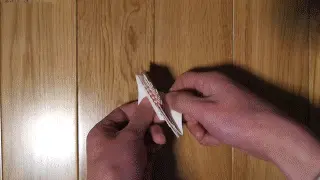

<figure class="eoc-pic eoc-pic-main"><picture><source media="(prefers-reduced-motion: reduce)" srcset="../media/origami-mechanisms.still.webp"></picture><figcaption><strong>Animation.</strong> <a href="https://commons.wikimedia.org/wiki/File:Miura-ori.gif">Miura-ori</a> by MetaNest, <a href="https://creativecommons.org/licenses/by-sa/3.0">CC BY-SA 3.0</a>, from Wikimedia Commons.</figcaption></figure>

A sheet or set of panels joined along a planned pattern of fold lines, so that it moves in one controlled way: folding flat, expanding, or shortening while it twists.

**In plain words:** A flat sheet, or a set of flat panels, with a planned pattern of folds so it can fold up small, spring open, or twist and shrink like a paper lantern; the folds themselves act as the joints. **Proper term:** Origami mechanism (origami-inspired mechanism), including the waterbomb, Kresling and Miura-ori fold patterns and thick-panel (rigid) origami.

**Also called:** origami-inspired design, origami engineering; rigid origami (flat panels that stay flat and only fold along hinge lines; Wikipedia 'Rigid origami'); thick origami, thick-panel origami (origami redesigned for panels too thick to treat as paper; Morgan et al. 2016; Liu et al. 2021); Kresling pattern, Kresling-ori, Kresling fold, twist-buckling pattern (named after Biruta Kresling; ORI*lab; Kidambi and Wang 2020); 'Kresling spring' (maker name, 3DPrint.com); waterbomb base, waterbomb pattern, waterbomb tessellation, six-crease waterbomb (Wikipedia 'Waterbomb base'; Liu et al. 2021); Miura fold, Miura-ori (Wikipedia 'Miura fold'); Yoshimura pattern (diamond-shaped buckling pattern of a squashed thin cylinder; Wikipedia 'Yoshimura buckling'); square twist and flasher (other named fold patterns used as mechanisms; Morgan et al. 2016; Ye et al. 2023); print-on-fabric origami, multiplanar origami (3D-printing methods; Printables; BYU CREATE Lab); magic ball, waterbomb tube or 'origami ball' (waterbomb tessellation rolled into a tube or ball) ⚑ [uncertain].

## How it works

Each fold line acts as a hinge, and where several folds meet at a point they behave like a small [linkage](../glossary.md#linkage), so the pattern decides how the whole sheet can move (Rigid origami is 'a type of mechanical linkage'; Wikipedia). Some patterns can fold with every panel staying flat, such as the Miura fold, which opens in one motion when you pull two ends apart (Wikipedia 'Miura fold'); others, such as the Kresling pattern, only fold because the panels bend a little, which stores spring energy and can make the tube snap between two stable lengths ([bistable](../glossary.md#bistable)) while it twists (Wikipedia 'Miura fold'; Kidambi and Wang 2020). A waterbomb pattern is made from points where six creases meet; in paper it has several ways to move, but its thick-panel version has only one, which makes it easy to drive with a single motor (Liu, Maiolino and You 2021). When the material is thick, the hinge lines are moved to the top or bottom faces of the panels, or the panels are offset, tapered or spaced apart, so thick panels do not collide as they fold (Morgan, Lang, Magleby and Howell 2016).

## Parts

Usually a single piece (one folded sheet) or a small assembly that acts as one unit: flat panels (paper, card, plastic sheet, plywood or printed plates) joined along fold lines. The folds can be thinned creases in the same material ([living hinges](../glossary.md#living-hinge)), a flexible layer such as fabric, nylon mesh, film or TPU that the panels are fixed to, or real hinges between thick panels. Robot versions add something to fold it, such as tendons pulled by a motor, or air or vacuum.

## Everyday examples

- Satellite solar panel arrays folded with the Miura fold, which opens in one pull (Wikipedia 'Miura fold'); folded road maps use the same idea ⚑ [uncertain]
- A paper shopping bag that folds flat and snaps open (Wikipedia 'Rigid origami')
- Twisting a paper tube while pushing the ends together makes the diagonal Kresling folds by themselves (ORI*lab)
- The folded paper 'water bomb' balloon, which starts from the waterbomb base ⚑ [uncertain]

## When to use it

Use an origami mechanism when something must pack flat and open out, collapse and expand, or shorten while twisting, all in one planned movement: deployable covers and lampshades, collapsible tubes, bellows, grippers that close around objects, pop-up models, and folding boxes or cases. It is good when you want one printed or cut piece instead of many hinges and pins, when a single motor or pull should drive many joints at once (a one-degree-of-freedom pattern), or when you want a spring that snaps between two shapes (Kresling). Printing a flat sheet that folds into a 3D shape is also much quicker than printing the finished 3D shape (Hackaday 2024).

## When not to use it

Avoid it for parts that carry heavy or shock loads, need precise positioning, or must fold thousands of times with thin printed plastic creases (use real pin hinges, a [print-in-place](../glossary.md#print-in-place) hinge or a thick-panel design on metal hinges instead). If you only need one fold, a single living hinge or ordinary hinge is simpler. For something that simply extends in a straight line, a scissor linkage or telescoping tube is easier to design and stiffer. For a pattern that needs bending panels (Kresling), don't use thick rigid panels; choose a rigid-foldable pattern such as the Miura fold instead.

## Details

- **What it does (jobs):**
  - let it move (turn, slide or bend): panels swing about fold lines so a flat sheet folds up, opens out or changes shape in one planned way
  - change the kind of motion: a Kresling tube turns a push along its length into a twist, and a twist into a change of length (Kidambi and Wang 2020; ORI*lab)
  - store energy: bistable patterns such as the Kresling tube or a paper bag snap between two stable shapes and push back like a spring (Wikipedia 'Rigid origami')
  - click into set positions: a bistable pattern rests only in its folded or its opened state ⚑ [uncertain for patterns other than Kresling and the paper bag]
- **Movement:** multiple: every fold is a small bend (flex) or pivot (rotate), and together they make the whole sheet fold flat, expand, or shorten while it twists; a single fold can travel through up to 180 degrees from flat to fully folded, and some thick-panel methods keep that full 180 degrees (Morgan et al. 2016)
- **Directions it can move (degrees of freedom):** Often 1 by design: a Miura fold opens and closes in one motion (Wikipedia 'Miura fold'), and a thick-panel waterbomb has one degree of freedom while the paper version has several (Liu et al. 2021). A Kresling tube moves mainly along one path, shortening as it twists, but it can also wobble sideways; research models treat it with six [degrees of freedom](../glossary.md#degrees-of-freedom) (Kidambi and Wang 2020). Complex paper patterns with many creases can have many degrees of freedom and need guiding.
- **Special behaviour:**
  - motion conversion (e.g. rotary to linear): a Kresling tube couples shortening with twisting; ORI*lab describes one form that 'acts like a screw mechanism' and another that gives net-zero rotation during compression
  - [over-centre](../glossary.md#over-centre) (snaps past a point and stays): the Kresling pattern can be bistable, resting at two lengths (Kidambi and Wang 2020), and a paper shopping bag snaps into its flat and its open state because its sides bend while folding (Wikipedia 'Rigid origami')
  - [self-locking](../glossary.md#self-locking) (holds under load, won't back-drive): only in special designs; two thick-panel Miura sheets stacked into a 'self-locking' unit carried over 11,000 times their own weight (Ye et al. 2023), and printed stoppers or latches can lock a folded shape (Hackaday 2024)
  - none of the other behaviours: plain fold patterns are free to fold back the way they came
- **How it holds:**
  - not a holding joint (it moves or passes on motion): the folds are joints that let the sheet move, not fasteners
  - spring force (a spring or springy part presses it in place): bent panels and creases push bistable patterns such as the Kresling tube into one of their stable shapes (Kidambi and Wang 2020)
  - [material bond](../glossary.md#form-fit--force-fit--material-bond) (glue, solvent or melting): in printed and thick-panel versions the panels are fused or glued to a shared flexible layer (fabric, nylon mesh or TPU) that forms every hinge (Printables 'Popup print on fabric'; Instructables BYU CREATE Lab; Ye et al. 2023)
  - shape (the parts interlock; form-fit): self-locking designs add printed stoppers or latches (Hackaday 2024)
- **Input and output:** Mostly used as a joint rather than a transmission. Kresling tube: push or pull along the axis -> twist about the same axis (in line), and twisting it back-drives the length change (back-drivable: yes); the ratio depends on the crease geometry ⚑ [uncertain]. Waterbomb gripper: tendon pull from one motor -> four fingers close together (Liu et al. 2021). Miura sheet: pulling two opposite corners -> the whole sheet unfolds in both directions at once (Wikipedia 'Miura fold'). Efficiency: not measured in the sources found ⚑ [uncertain]; panels that must bend (Kresling) lose some energy, and printed TPU folds showed [hysteresis](../glossary.md#hysteresis) (slightly different paths opening and closing; Liu et al. 2021).
- **Power:** passive (no power needed). Robot versions add power to fold them: a motor pulling tendons (Liu et al. 2021) or vacuum pumped out of an outer skin (Botrić and Gregov 2026). If that power is lost, the mechanism relaxes towards whatever shape its springy folds prefer, usually its as-made shape ⚑ [uncertain].
- **Load:** light for paper and thin printed sheets: strong in the plane of a panel but weak at the creases. A 22 g TPU thick-panel waterbomb gripper lifted a 524 g mug (10 of 12 tries; Liu et al. 2021); a vacuum-driven paper-and-film waterbomb gripper reached a 70 N [holding force](../glossary.md#holding-force) (Botrić and Gregov 2026). Medium for engineered thick-panel structures: a stacked self-locking thick-panel Miura unit printed in PLA and TPU carried over 11,000 times its own weight and survived more than 100 cycles of 40% compression (Ye et al. 2023). Weak against loads that push the folds the way they want to fold.
- **Play and precision:** noticeable: flexible folds let panels shift. The printed TPU waterbomb gripper's fingertips were within 3 mm of the predicted positions, with small differences between opening and closing paths caused by the TPU's elastic hysteresis (Liu et al. 2021). Kresling tubes are sensitive to small changes in geometry and starting position and can wobble off-axis while deploying (Kidambi and Wang 2020). Rigid thick panels on real hinges are more precise ⚑ [uncertain].
- **Taking it apart:** permanent: the folds are part of the sheet, so it is not taken apart; the finished folded piece is fixed to other parts with ordinary fasteners. Thick-panel versions built with separate pin hinges can be unpinned.
- **How often it can be reused:** once (it is one folded piece, not something you take apart). What matters instead is how many times it can fold: paper origami is fragile and [fatigues](../glossary.md#fatigue) with repeated folding (Liu et al. 2021); 3D-printed thin-plastic living hinges usually last only a few cycles (Hubs); PLA panels wrapped in TPU survived more than 100 fold-unfold cycles without the layers separating (Ye et al. 2023).
- **Sealing:** none: creases and gaps between panels leak. To make a sealed or airtight version, the fold pattern is put inside a flexible skin, as in vacuum-driven origami grippers with an elastomer membrane (Botrić and Gregov 2026).
- **Adjustable:** Partly: the fold angle can be set anywhere if friction or a lock holds it, and actuated versions are adjusted by how far the tendon or vacuum pulls. Bistable patterns only rest in their two stable shapes. The pattern itself cannot be changed after making.
- **Access needed:** not applicable
- **Materials:** Paper and card for trying patterns; plastic sheet (polypropylene or polyester film) for durable folds ⚑ [uncertain]; rigid panels on a flexible layer: printed PLA on nylon mesh (BYU CREATE Lab), PLA printed onto fabric (Printables 'Popup print on fabric'), PLA, ABS or carbon-fibre-filled panels wrapped in TPU on a two-material printer (Ye et al. 2023), or a whole mechanism in 95A TPU with thin folds (Liu et al. 2021). Thick panels can be almost any solid material: one thick-origami sculpture used foam board for moving panels and MDF for the base, and a foldable circuit board used PCB panels and a metal plate (Morgan et al. 2016). For thin printed creases, Hubs recommends nylon or a flexible material such as TPU for the hinge.
- **Heat, cold, water and wear:** Printed versions share their plastics' limits: PLA starts to give at about 60 degrees C, PETG at 80 and ASA at 110 (CNC Kitchen oven test), so a PLA mechanism in a hot car or near a lamp can sag. TPU folds show elastic hysteresis, so opening and closing paths differ slightly (Liu et al. 2021). Paper and card fatigue with repeated folding (Liu et al. 2021) and are weakened by damp ⚑ [uncertain]. Thin printed creases fatigue and crack (Hubs; Hackaday 2025). Fabric or mesh hinges are only as good as the plastic's grip on them.

## Making it

- **Ways to make or get it:**
  - 3D print (FDM): print the panels flat onto a fabric or nylon mesh layer laid in during a pause, print thin TPU folds, or print rigid panels wrapped in TPU on a two-material printer (Instructables BYU CREATE Lab; Printables 'Popup print on fabric'; Liu et al. 2021; Ye et al. 2023)
  - laser cut: cut and score card or plastic sheet, or cut rigid panels to glue onto a fabric hinge layer ⚑ [uncertain: no laser-cutting source opened]
  - woodwork: thick panels (foam board, MDF, plywood) with hinges placed using the offset-panel method (Morgan et al. 2016)
  - 3D print (resin): multi-material jetting printers can print rigid panels with rubbery folds, but this is rare for hobbyists ⚑ [uncertain]
  - hand folding: paper, card or plastic film for trying a pattern
  - off-the-shelf part: not sold as a part; built from sheet, fabric, tape and hinges
- **Printing it in one piece (print in place):** partly: printed origami comes off the bed flat and already joined, with no assembly, but most methods need a fabric or nylon mesh layer laid in during a print pause (and Kapton tape where layers must not fuse), or a two-material printer; a single-material TPU design with thin folds prints fully in place (Liu et al. 2021)
- **Tools:** none to fold by hand. Making it: a ruler and a scoring tool or craft knife for card or plastic sheet; a 3D printer for printed versions, plus scissors, binder clips, a nylon mesh or fabric and heat-resistant Kapton tape for print-on-mesh methods (Instructables 'How to 3D Print Multiplanar Origami'); glue and fabric for panels on a fabric hinge layer; small hinges and screws for thick wooden panels.
- **Difficulty:** moderate: paper and card versions are easy, but printed or thick-panel versions need hinge design (a flexible layer, offsets or gaps so thick panels don't collide), mid-print pauses to lay in mesh or fabric or a two-material printer, and some trial and error

### 3D printing tips

1) Pick a hinge method. (a) Thin creases in one material: easiest, but Hackaday reports that on complex patterns 'crease lines become weak and overstrained to the point of failure'; Hubs says 3D-printed living hinges usually survive only a few cycles, suggests 0.4-0.6 mm thick with at least two layers, printed as one continuous strand across the hinge, and recommends nylon, or TPU on a two-material printer. (b) A flexible layer inside the print: print two or three layers, pause, lay fabric or nylon mesh flat over the bed and clip it at the corners without stretching it, then keep printing so the next layer bonds through the mesh (Instructables 'How to 3D Print Multiplanar Origami', BYU CREATE Lab, using PLA, 0.2 mm layers and 100% [infill](../glossary.md#infill) because the panels are thin). The 'Popup print on fabric' model uses only four 0.2 mm layers with fabric inserted after the second (Printables). (c) All-TPU: the thick-panel waterbomb gripper was printed in 95A TPU with 10 mm thick panels and folds only 0.2 mm thick and 1-1.2 mm wide, at 0.1 mm layers (Liu et al. 2021). (d) Two materials: wrap rigid PLA panels in TPU rather than just printing TPU on top; the wrapped version folded more than 100 times with no separation while the simply layered one delaminated (Ye et al. 2023). Placing the soft hinge material nearer one face biases that hinge to fold as a mountain or a valley (Hackaday 2024, describing Ye et al.). 2) Stop layers fusing where panels stack on top of each other: lay Kapton tape over those areas during a pause (not over the hinges), keep tape overlaps under a few millimetres and smooth out wrinkles, or print a gap filled with soluble PVA support on a multi-material printer (Instructables). A Kresling tube printed this way needs two mesh layers and one Kapton layer (Instructables). 3) Add the pauses in the slicer (e.g. PrusaSlicer's pause at layer) and make sure the print head is lifted clear and the clips won't hit the printer when it resumes (Instructables). 4) Thick panels need room to fold: put the hinge line on the top or bottom face (axis shift), offset the panels from a shared hinge plane, [taper](../glossary.md#taper) the panel edges, or leave gaps; with panels on a membrane, gaps of at least twice the panel thickness keep the full range of motion (Morgan et al. 2016, Table 1). 5) The simulation tool Origami Simulator can check how a crease pattern folds and export the folded shape as STL or OBJ before you print. 6) Remove Kapton after printing with tweezers or a dental pick, trim excess mesh with scissors or a craft knife, then work the folds gently a few times (Instructables).

### Buying one (off-the-shelf parts)

Nylon tulle or mesh, or thin woven fabric (for print-on-fabric hinges); polyimide tape, sold as Kapton (brand) tape; PVA soluble support filament; TPU flexible filament (e.g. Shore 95A); binder clips; nylon fishing line as tendons (Liu et al. 2021); small butt hinges or continuous (piano) hinges for thick wooden or plastic panels ⚑ [uncertain]; polypropylene sheet for folded plastic prototypes ⚑ [uncertain].

## Rules of thumb

- Thick-panel waterbomb printed in TPU: fold width about 0.1 times the panel side length and fold thickness about 0.02 times the panel thickness, i.e. 0.2 mm thick and 1-1.2 mm wide folds on 10 mm panels, printed at 0.1 mm layers (Liu, Maiolino and You 2021, Frontiers in Robotics and AI).
- Panels mounted on a flexible membrane keep their full range of motion only if the gaps between panels are at least twice the panel thickness (Morgan et al. 2016, Mechanical Sciences 7, Table 1).
- Choosing a thick-panel method: the offset-panel technique keeps the paper model's motion and the full 180-degree range but does not unfold flat and may need cutouts; tapered panels keep the motion but limit the range; membrane folds and axis shift keep the range but not the exact motion (Morgan et al. 2016, Table 1).
- A waterbomb pattern has several degrees of freedom in paper but only one as thick-panel origami with creases on the top and bottom faces (Liu et al. 2021).
- Only rigid-foldable patterns (e.g. Miura fold) work with truly rigid panels; Kresling and Yoshimura patterns need the panels to bend (Wikipedia 'Miura fold').
- Print-on-mesh: print 2-3 layers before pausing to lay the mesh, 0.2 mm layers, 100% infill for thin panels, and don't stretch the mesh (BYU CREATE Lab, Instructables).
- FDM living hinges: 0.4-0.6 mm thick with at least two layers, nylon recommended, or TPU in a two-material print; expect only a few cycles from simple thin strips (Hubs 'How to design living hinges for 3D printing').
- Wrap rigid panels in the soft hinge material instead of printing the soft layer on top: PLA wrapped in TPU survived over 100 fold cycles without debonding (Ye et al. 2023, Nature Communications).

## Common failures

1) Thin printed creases crack after a few folds: use a flexible layer (fabric, mesh or TPU) or a nylon or TPU hinge instead of thin PLA (Hackaday 2025; Hubs). 2) The soft hinge layer [peels](../glossary.md#peel-vs-shear) off the rigid panels: wrap the panels in the soft material, or let the plastic bond through the mesh (Ye et al. 2023; Instructables). 3) Thick panels collide and the pattern jams before it folds fully: use the offset-panel, tapered-panel or axis-shift method, or leave gaps of at least twice the thickness (Morgan et al. 2016). 4) Stacked panels fuse together: add Kapton tape or a soluble PVA gap between them, but never over a hinge (Instructables). 5) The print head catches on wrinkled mesh or tape, or on a clip: lay everything flat and watch the first layer after each pause (Instructables). 6) A Kresling tube won't stay in its second shape or deploys crookedly: its bistability and straightness are sensitive to small changes in the crease geometry, so test proportions in paper first (Kidambi and Wang 2020). 7) Positions drift or opening and closing differ slightly: a property of flexible folds (Liu et al. 2021); add stops if exact positions matter.

## Safety

Few hazards. Laying mesh or tape during a print pause puts your hands close to a hot nozzle and bed; make sure the head has moved clear and clips won't hit the printer when it resumes (Instructables). Trimming mesh and lifting Kapton uses sharp knives and picks. Bistable snap-through designs and motor- or tendon-driven versions can pinch fingers ⚑ [uncertain].

## Related

- Living hinge: a single thin fold; an origami mechanism is many living hinges arranged in a pattern
- Lamina emergent torsional (LET) joint: a cut pattern that lets a flat sheet bend where a crease would be too stiff or weak
- Self-folding print (4D printing): printed sheets that fold themselves when heated instead of being folded by hand or a motor
- Scissor linkage (lazy tongs): also expands and collapses in one motion, but with pinned bars, which are stiffer and easier to design
- Iris mechanism: another way to open and close an aperture by twisting
- Bistable [compliant mechanism](../glossary.md#compliant-mechanism) (snap-through): a [flexure](../glossary.md#flexure) designed to have two stable positions, like a bistable Kresling tube
- Print-in-place hinge: separate pin hinges for thick printed panels
- Mechanical metamaterial mechanism: grids of printed cells (shear-cell hinge arrays) that bend in planned ways
- Kirigami: cuts instead of folds; a thin perforated sheet 'can be transformed into a foldable 3D structure by simply stretching the cut material' (Harvard SEAS 2017), and a sheet cut with parallel slits curves into a 3D shape that can surround a fragile object such as an egg yolk and lift it, 'similar to the way we cup our hands around an object' (NC State 2022)
- [Kerf](../glossary.md#kerf) bending: a pattern of laser cuts that lets stiff plywood or acrylic bend round curves or fold like a hinge, using cuts where origami uses creases
- Printing onto fabric: the same pause-and-lay-in-mesh method used here for hinges, used on its own to fix cloth to a print or make flexible scale armour

## Make it yourself

- [How to 3D Print Multiplanar Origami (Instructables, BYU Create Lab)](https://www.instructables.com/How-to-3D-Print-Multiplanar-Origami/): Step-by-step guide to printing origami in stacked planes on an FDM printer: slicer pauses, laying nylon mesh, Kapton tape between layers, trimming and folding; includes the Kresling pattern. Companion video 'How To 3D Print Multiplanar Origami' (YouTube, BYU Create Lab). Read through the Instructables JSON API. *(licence: CC BY-NC 4.0)*
- [Multiplanar Kresling Pattern Origami (BYU Create Lab, Printables) (URL from Printables API, page not opened)](https://www.printables.com/model/1166979-multiplanar-kresling-pattern-origami): Printable Kresling cylinder made in stacked planes, to print with the mesh-and-Kapton method above; also on Thingiverse as thing:6928121 (seen in search results). Read through the Printables public API. *(licence: CC BY-NC (Creative Commons Attribution-NonCommercial))*
- [Popup print on fabric Spinning Origami (ateldsign, Printables) (URL from Printables API, page not opened)](https://www.printables.com/model/499094-popup-print-on-fabric-spinning-origami): Pop-up spinning origami printed in four 0.2 mm PLA layers with a fabric layer inserted after layer 2 as the hinges; fold along black lines and cut the fabric along red lines. Read through the Printables public API. *(licence: CC BY-SA (Creative Commons Attribution-ShareAlike))*
- [Origami Simulator (Amanda Ghassaei, with Erik Demaine and others)](https://origamisimulator.org/): Free browser app that folds any crease pattern (SVG or FOLD) at once, with built-in Miura-ori, waterbomb and Huffman waterbomb tessellation examples, strain view, and STL/OBJ export of the folded shape *(licence: MIT (source code, per the project's LICENSE file))*

## Pictures, videos and models

- [Miura-ori.gif (Wikimedia Commons, by MetaNest)](https://commons.wikimedia.org/wiki/File:Miura-ori.gif): Animation of a Miura-ori sheet folding and unfolding in one motion *(licence: CC BY-SA 3.0 or GFDL 1.2+ (dual licensed))*
- [I 3D Printed Origami (YouTube, matthew lim)](https://www.youtube.com/watch?v=FNVBK7-h9Fs): 3D-printed folding sheets with thinned creases, why they fail on complex patterns, and offset panels on alternate sides of the folds; twisting cylinders that contract (as described by Hackaday, December 2025); title and channel confirmed via YouTube oEmbed, video not watched *(licence: link only (standard YouTube licence))*
- [Towards developing product applications of thick origami using the offset panel technique (Morgan, Lang, Magleby and Howell, Mechanical Sciences 7, 2016)](https://langorigami.com/wp-content/uploads/2016/03/ms-7-69-2016.pdf): Figure 1 compares seven ways to fold thick panels (axis shift, membrane, tapered, offset crease, offset panel and more); photos of a thick-origami kinetic sculpture, foldable circuit board and toolbox *(licence: CC BY 3.0)*
- [Multimaterial 3D printed self-locking thick-panel origami metamaterials (Ye et al., Nature Communications, 2023)](https://www.nature.com/articles/s41467-023-37343-w): Photos of FDM-printed thick-panel Miura, Kresling and flasher patterns with rigid panels wrapped in TPU hinges, plus supplementary movies of folding and load tests *(licence: CC BY 4.0)*
- [A 3D-Printable Robotic Gripper Based on Thick Panel Origami (Liu, Maiolino and You, Frontiers in Robotics and AI, 2021)](https://www.frontiersin.org/journals/robotics-and-ai/articles/10.3389/frobt.2021.730227/full): CAD, photos and figures of a one-piece TPU gripper made of four thick-panel waterbomb units, closed by tendons from one motor *(licence: CC BY)*

## Needs confirming

⚑ marks something nobody has confirmed yet: a fact the research could not confirm from a source, a finder value that is a best guess, or an open point from the research notes. Corrections are welcome (see `research/needs-confirming.md`).

- ⚑ 15 sentences on this page marked [uncertain].
- ⚑ Finder value `connects` = boards or sheet (best guess): worked out from its name, but joining parts is not one of its two main jobs
- ⚑ Finder value `motion_in` = straight push or pull (best guess): could not read both sides of `input_output`: "Mostly used as a joint rather than a transmission. Kresling tube: push or pull along the a..."
- ⚑ Finder value `motion_out` = not applicable (best guess): could not read both sides of `input_output`: "Mostly used as a joint rather than a transmission. Kresling tube: push or pull along the a..."
- ⚑ Finder value `shaft_layout` = not applicable (best guess): could not read both sides of `input_output`: "Mostly used as a joint rather than a transmission. Kresling tube: push or pull along the a..."

## Sources

- <https://www.frontiersin.org/journals/robotics-and-ai/articles/10.3389/frobt.2021.730227/full>
- <https://www.nature.com/articles/s41467-023-37343-w>
- <https://langorigami.com/wp-content/uploads/2016/03/ms-7-69-2016.pdf>
- <https://www.instructables.com/How-to-3D-Print-Multiplanar-Origami/>
- <https://api.printables.com/graphql/>
- <https://en.wikipedia.org/wiki/Miura_fold>
- <https://en.wikipedia.org/wiki/Rigid_origami>
- <https://en.wikipedia.org/wiki/Yoshimura_buckling>
- <https://en.wikipedia.org/wiki/Waterbomb_base>
- <https://arxiv.org/abs/2003.10411>
- <https://orilab.art/natural/kresling>
- <https://hackaday.com/2025/12/21/origami-on-another-level-with-3d-printing/>
- <https://hackaday.com/2024/12/13/origami-inspired-self-locking-structures-with-3d-printing/>
- <https://3dprint.com/322905/3d-printed-origami-by-matthew-lim/>
- <https://www.hubs.com/knowledge-base/how-design-living-hinges-3d-printing/>
- <https://pmc.ncbi.nlm.nih.gov/articles/PMC13406422/>
- <https://origamisimulator.org/>
- <https://raw.githubusercontent.com/amandaghassaei/OrigamiSimulator/master/LICENSE>
- <https://commons.wikimedia.org/wiki/File:Miura-ori.gif>
- <https://www.youtube.com/watch?v=FNVBK7-h9Fs>
- <https://www.youtube.com/watch?v=9Kdw_rEk18w>
- <https://www.cnckitchen.com/blog/comparing-pla-petg-amp-asa-feat-prusament>
- <https://seas.harvard.edu/news/new-pop-strategy-inspired-cuts-not-folds>
- <https://news.ncsu.edu/2022/01/kirigami-robotic-grippers/>
