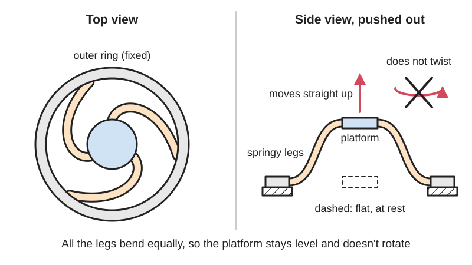

<figure class="eoc-pic eoc-pic-main"><picture><source media="(prefers-reduced-motion: reduce)" srcset="../media/drawn/ortho-planar-spring.svg"></picture><figcaption><strong>Animation.</strong> Diagram drawn for the encyclopaedia from the research notes. ⚑ Needs confirming: a drawing can simplify or get details wrong; a real photo or a better diagram is welcome.</figcaption></figure>

A flat, single-piece spring whose centre platform, held by several thin symmetric legs, moves straight in and out of the sheet it was cut from without rotating, giving a compact push-back spring that can be laser cut, stamped or 3D printed.

**In plain words:** A flat, one-piece spring cut or printed from a sheet: a middle disc joined to an outer ring by thin springy legs, so the middle can be pushed in or pulled out of the sheet and springs back, moving straight up and down without twisting. **Proper term:** Ortho-planar spring (compliant ortho-planar linear-motion spring).

**Also called:** orthoplanar spring (one-word spelling used in recent papers, e.g. Sutton et al. 2024); compliant ortho-planar spring, COPS (BYU thesis and paper abbreviation); ortho-planar linear-motion spring (Parise, Howell and Magleby 2001); planar spring or flat spring (loose general terms; a planar spring whose centre twists as it moves is a spiral or volute spring, not a true ortho-planar spring); [flexure](../glossary.md#flexure) spring, diaphragm flexure or flexure bearing spring (precision-engineering terms for similar flat multi-leg springs) ⚑ [uncertain: usage varies]; named leg layouts from the BYU patent: radial-leg, side-leg (lateral), Bi, Tri and Pent designs; Euler-spiral orthoplanar spring (a variant whose legs lie completely flat under load; Sutton et al. 2024); ortho-planar spiral spring (Riskable's OpenSCAD generator; spiral legs, 'without (much) rotation').

## How it works

The centre platform is joined to the outer ring by several identical springy legs arranged evenly around it. When you push the platform out of the sheet, every leg bends a little, and the legs together push back like a coil spring. Because the legs are symmetric, their sideways pulls cancel and only the up-and-down force is left, so the platform stays parallel to the base and does not twist as it moves (in the patent's words, the non-axial forces sum to zero and the platform keeps its orientation). This is the difference from older flat spiral (volute) springs and 'spider' springs, which need the centre to rotate a little to move (US patent 6,983,924). Each leg tends to twist about its own length; with an even number of legs, opposite legs share the same twisting tendency, so odd numbers of legs are more stable, and five legs spaced 72 degrees apart (the 'Pent' design) were the most stable (US patent 6,983,924), and the force usually rises faster than in proportion as it is pushed further, because the legs start to stretch as well as bend (the 2018 gate-valve study found [stiffness](../glossary.md#stiffness) increased with [deflection](../glossary.md#deflection)).

## Parts

Single piece: an outer base ring (frame), a centre platform and two to five thin flexible legs joining them (the patent describes two- to five-leg designs), all cut, stamped, moulded or printed from one flat sheet (BYU CMR; US patent 6,983,924). In use it is clamped at its rim, e.g. between two housing parts or with screws through the ring; two can be stacked for extra stiffness or stability.

## Everyday examples

- Rarely seen openly in household objects; most beginners meet it as a 3D-printed demonstrator or fidget from BYU's [compliant mechanisms](../glossary.md#compliant-mechanism) group (BYU CMR)
- The spring inside some valves: the BYU patent's example, a laser-cut stainless spring in a pneumatic valve controller, was used successfully in an industrial valve, and a 2018 study built a normally-closed gate valve around one (US patent 6,983,924; OpenAlex abstract)
- Push-buttons and keys: BYU lists keyboards and electrical contacts as uses, and makers print them into arcade buttons (BYU CMR; Printables 'Arcade Button with Orthoplanar Spring Concept')
- Vibration energy harvesters and force sensors in research devices (OpenAlex abstracts 2014-2026)

## When to use it

Use it when you need a short, straight push-back movement in very little height: a spring under a button or key, a valve that must lift straight off its seat, a sensor or probe that must move without twisting or rubbing, or a suspension for a small vibrating mass. It is a good choice when a coil spring would be too tall, would need a guide rod, or would rotate its end against the part it touches, and when you want to make the spring yourself on a printer or laser cutter with no assembly. Its lack of sliding parts also means no wear dust and no noise from rubbing (BYU CMR).

## When not to use it

Avoid it for long [strokes](../glossary.md#stroke) (use a coil spring), for large or constant loads in printed plastic (it [creeps](../glossary.md#creep) and relaxes; use a steel spring or a metal ortho-planar spring), where the platform must not tilt under off-centre loads (use two spaced springs, a parallel leaf-spring flexure stage or a guided coil spring), and for parts that spin fast (legs buckle sideways; BYU thesis 2005). If you only need a simple push-back arm, a printed leaf spring is easier to design and tune.

## Details

- **What it does (jobs):**
  - store energy: it is a spring that pushes the platform back to its rest position
  - let it move (turn, slide or bend): it guides a short straight in-and-out movement of the platform without rubbing parts
  - line parts up exactly: the platform returns to the same place and stays parallel to the base, which is why it is used in sensors and valves
- **Movement:** flex: the centre moves in a straight line in and out of the plane, over a short stroke (e.g. an 8 mm stroke for a pair of 48.7 mm spiral ortho-planar springs studied for energy harvesting; OpenAlex abstract, 2015); the patent's platform can even be pushed down level with the base, inside its thickness (US patent 6,983,924, claims 3-4)
- **Directions it can move (degrees of freedom):** 1 intended: in-and-out movement along the axis. In practice a single spring also tilts fairly easily (a 2014 compliance study found the ortho-planar spring 'also demonstrates large bending compliance'), so it behaves as 1 stiff-ish translation plus 2 soft tilts; two springs spaced apart on one shaft block the tilting, as in a needle-insertion force sensor that uses two planar springs in parallel (OpenAlex abstracts).
- **Special behaviour:**
  - self-aligning or self-centring: the legs always pull the platform back to its flat rest position and keep it parallel to the base, without twisting (BYU CMR; US patent 6,983,924)
  - none of the locking, one-way or clicking behaviours on its own; a buckled or prestressed pair can be made [bistable](../glossary.md#bistable) or nearly zero-stiffness, but that is a special design (OpenAlex abstracts: 2015 zero-stiffness pair; 2026 bistable harvester)
- **How it holds:**
  - spring force (a spring or springy part presses it in place): the bent legs push the platform back
  - not a holding joint (it moves or passes on motion): its job is to be a guided spring, not to fasten parts together
- **Input and output:** not applicable (it is a spring, not a transmission). Force rises with how far the platform is pushed; many designs stiffen as they deflect (2018 gate-valve study). Back-drivable: yes, it simply springs back.
- **Power:** passive (no power needed)
- **Load:** light (3D-printed plastic) to medium (stamped or cut metal) ⚑ [uncertain: no load ratings found]. Strongest and most predictable when pushed straight along its axis; soft against tilting (large bending compliance, 2014 study) and weak against sideways [shear](../glossary.md#peel-vs-shear) on the platform. Spinning springs (e.g. in a belt CVT) suffer stress stiffening and sideways buckling of the legs (BYU thesis 2005).
- **Play and precision:** none: no sliding parts, so no play, [backlash](../glossary.md#backlash) or stiction, and the platform stays parallel as it moves (BYU CMR). It returns to the same rest position unless overloaded or, in plastic, left pushed in long enough to creep (DuPont design guide p. 36; Akaki Kuumeri). A single spring tolerates tilt poorly, i.e. it lets the platform tilt under off-centre loads (2014 study); use two spaced springs for a better straight-line guide.
- **Taking it apart:** removable: the spring itself is one piece and is usually clamped at its rim or screwed through holes in its outer ring, so it can be taken out and swapped (e.g. an energy harvester designed around replaceable ortho-planar springs, 2024 abstract). If printed as part of a larger part it is permanent.
- **How often it can be reused:** many times for taking apart and refitting. The real limit is how many times it can flex: metal springs designed within their [fatigue](../glossary.md#fatigue) limit last a very long time ⚑ [uncertain: no cycle figure found for metal ortho-planar springs]; a PETG printed spiral version lasts only about 200 cycles in its designer's experience, with nylon or PCTPE lasting longer (Riskable, Printables)
- **Sealing:** none: the gaps between the legs are open. It can act as the spring of a valve, but a separate polished seat does the sealing (the 2018 gate-valve prototype needed a thoroughly polished surface to stop leaks)
- **Adjustable:** No, not after it is made: stiffness is set by the leg thickness, width, length, number of legs and material. You can change the [preload](../glossary.md#preload) by clamping it already pushed in (e.g. with a spacer), stack two for double stiffness ⚑ [uncertain], or swap in a different spring; research harvesters tune their frequency by swapping springs (2024 abstract) or by prestressing a pair (2015 abstract).
- **Access needed:** not applicable: it is a part that is clamped into a housing during assembly
- **Materials:** Prototypes have been made in stainless steel, aluminium, polypropylene and polycrystalline silicon (US patent 6,983,924); silicon micro-springs are etched for MEMS devices (2026 micro-Stirling paper). Printed versions use PLA (BYU demonstrator; a 2024 PLA energy harvester), PETG, nylon or PCTPE (Riskable). Aging tests (water and oil immersion at room temperature, 50 °C and 70 °C, and UV) left ortho-planar spring samples without significant change in performance, although tensile bars of the same material did change (Santos, PUC-Rio thesis 2021) ⚑ [uncertain: material not stated in the abstract].
- **Heat, cold, water and wear:** Printed plastic: PLA softens from about 60 °C and PETG from about 80 °C (CNC Kitchen); plastic springs creep and lose force if held deflected (DuPont p. 36; Akaki Kuumeri); PETG versions fatigue after roughly 200 cycles (Riskable). Aging by water or oil immersion (up to 70 °C) and UV did not significantly change ortho-planar spring samples in one study (Santos 2021 thesis abstract) ⚑ [uncertain: material and exposure time not given in the abstract]. Metal springs suit vacuum, dirt and wide temperatures because nothing slides, but they still fatigue if over-flexed ⚑ [uncertain: no specific data found]. Spinning applications cause stress stiffening and leg buckling (BYU thesis 2005).

## Making it

- **Ways to make or get it:**
  - 3D print (FDM): the BYU and community models print flat in one piece (BYU CMR; Printables models)
  - 3D print (resin): micro-scale versions have been 3D micro-printed for fibre-optic acoustic sensors (2025 abstract) ⚑ [uncertain: hobby resin printers not tested]
  - laser cut: from plastic or thin metal sheet; the patent's valve spring was laser cut from 0.01 in (0.25 mm) stainless steel (US patent 6,983,924)
  - CNC: milling, CNC router, water-jet cutting and wire EDM all work because it is flat (BYU CMR, Printables 'Other Materials'; US patent 6,983,924)
  - sheet metal: stamping from spring or stainless sheet (US patent 6,983,924)
  - injection moulding and micro-injection moulding for plastic springs (US patent 6,983,924; 2015 paper 'Microinjection moulding of miniaturised polymeric ortho-planar springs', title via OpenAlex); surface micromachining of polycrystalline silicon for microscopic MEMS springs (US patent 6,983,924)
- **Printing it in one piece (print in place):** yes: it prints as one flat, working spring with no assembly. Jens Willmer's model includes one version that needs supports and one that prints without (Printables).
- **Tools:** none for printed or cut springs that drop into a housing; a screwdriver if the rim is screwed down ⚑ [uncertain: depends on the housing]
- **Difficulty:** easy to moderate: it prints or laser-cuts in one piece with no assembly, and free generators and models exist, but thin legs need a good printer and plastic versions fatigue and creep, so getting a long-lasting spring takes test prints

### 3D printing tips

1) Print it flat on the bed, which is its natural orientation: the legs then bend out of plane with the strain running along each printed layer, not pulling layers apart (Hubs advises against flexing arms that are built up vertically in Z). 2) Make the print lines run lengthwise along each leg; Akaki Kuumeri's advice for flexures printed lying flat is to make sure the print lines are longitudinal, so check the slicer preview and consider legs that are only [perimeters](../glossary.md#perimeters) (no [infill](../glossary.md#infill)). 3) Check every leg layer by layer in the slicer before printing, because it is easy to design legs that are too thin for your nozzle (Riskable). 4) Material: PLA works for demonstrators (BYU; Jens Willmer printed his in PLA at 0.2 mm layers, 10% infill); PETG is springier but a PETG spiral version lasted only about 200 cycles, so use nylon or PCTPE for longer life (Riskable). 5) Don't scale the BYU design below about 20% in PLA (BYU CMR). 6) [Fillet](../glossary.md#chamfer--fillet) where the legs meet the ring and platform, keep the print seam off the legs, and avoid sharp corners; these are the usual flexure cracking points (Akaki Kuumeri; DuPont design guide p. 36). 7) Don't store it pushed in or preloaded for long: printed plastic creeps and relaxes, so the rest position moves and the force drops (DuPont p. 36; Akaki Kuumeri). 8) Add a hard stop in the housing so the platform can't be pushed past the legs' safe bend (Akaki Kuumeri's end-stop advice for flexures). 9) PLA softens at about 60 °C and PETG at about 80 °C (CNC Kitchen), so keep printed springs away from heat.

### Buying one (off-the-shelf parts)

Rarely sold as a catalogue part under this name ⚑ [uncertain]. Search for 'flexure bearing spring', 'planar spring', 'spiral flexure spring' or 'diaphragm spring' for bought metal versions ⚑ [uncertain: supplier pages not opened], or cut your own from 'spring steel shim stock', 'stainless shim' or 'polypropylene sheet' (BYU recommends polypropylene sheet for its cut compliant parts). Parametric source: Riskable's OpenSCAD module ortho_planar_spiral_spring() on Printables.

## Rules of thumb

- Use an odd number of legs: the patent reports that springs with an odd number of legs are more stable than similar even-leg designs, and its five-leg 'Pent' design was the most stable (US patent 6,983,924, Google Patents).
- The BYU printable design can be scaled down to about 20% in PLA before it stops working (BYU CMR, Printables model 596315).
- Printed PETG spiral ortho-planar springs last about 200 cycles; for longer life use nylon or PCTPE (Riskable, Printables model 24158).
- Expect a stiffening spring: a topology-optimised valve spring's stiffness increased as deflection increased (Design of Ortho-Planar Spring for a Normally-Closed Gate Valve, 2018; abstract via OpenAlex).
- A single spring is soft against tilting ('large bending compliance'), so pair two springs spaced along the axis if the platform must not tip (Six Dimensional Compliance Analysis of Ortho-Planar Springs, 2014; abstract via OpenAlex).
- Two prestressed spiral ortho-planar springs (48.7 mm diameter) cut the force needed by 74.7% over an 8 mm stroke, i.e. nearly zero stiffness (Ortho-Planar Springs: Design of a zero stiffness mechanism, 2015; abstract via OpenAlex).
- Adding a constrained viscoelastic [damping](../glossary.md#damping) layer raised damping to nearly 2.5 times the plain spring's without much change in its spring constant (Viscoelastic Damping of Ortho-Planar Springs, 2008; abstract via OpenAlex).
- Plastic springs are for intermittent action; springs under constant load or deflection should be metal because plastics creep and relax (DuPont 'General Design Principles for Engineering Polymers', p. 36).

## Common failures

Legs crack or snap at their roots after many cycles or one overload; add end stops, fillets and use a tougher material (Riskable; Akaki Kuumeri). The rest position sinks and the force drops after being held pushed in (creep and [stress relaxation](../glossary.md#stress-relaxation) in plastic; DuPont p. 36). Legs printed too thin, or with infill lines running across them, break early or come out stiff; check the slicer preview (Riskable; Akaki Kuumeri). The platform tilts or wobbles under off-centre loads because a single spring is soft in tilt (2014 study); use two springs. Even-leg designs are less stable than odd-leg ones (US patent 6,983,924). In spinning uses the legs buckle sideways (BYU thesis 2005).

## Safety

Generally low risk: it stores little energy. Printed legs can snap suddenly if pushed past their limit, and thin cut metal legs may have sharp edges ⚑ [uncertain]. Keep fingers out of any powered mechanism it is part of.

## Related

- Coil spring (helical compression spring): the baseline spring; longer travel and higher load, but taller and its end rotates slightly ⚑ [uncertain for the rotation claim]
- Printed leaf spring (flat [cantilever](../glossary.md#cantilever) spring): a single springy strip that bends; simpler, but its tip moves in an arc rather than straight
- Parallel leaf-spring flexure (linear flexure stage): springy blades arranged as a parallelogram to guide a straight sideways motion with more resistance to tilt
- Volute (conical) spring and spider (geophone) spring: older flat or flattenable springs whose centre must twist as it moves, causing rubbing, wear and extra [clearance](../glossary.md#clearance), which the ortho-planar spring avoids (US patent 6,983,924)
- Belleville (disc) spring: a dished washer that flattens under load; very stiff and compact, but its edges must slide (US patent 6,983,924)
- Wave springs: compact [axial](../glossary.md#axial--radial) springs made of wavy steel rings, stronger but not flat-cut and not printable in the same way
- Bistable compliant mechanism: a prestressed or buckled planar spring can snap between two positions instead of returning to one
- Flexure hinge: the same bend-instead-of-slide idea used for rotation instead of in-and-out motion

## Make it yourself

- [Ortho-Planar Spring (BYU CMR, Printables)](https://www.printables.com/model/596315-ortho-planar-spring): BYU's printable ortho-planar spring demonstrator; prints in one piece; notes that it can be scaled down to about 20% in PLA and can also be milled, CNC-routed or water-jet cut. Includes references to Parise et al. 2001 and the aging study. *(licence: CC BY-NC)*
- [Ortho-Planar Spring (Jens Willmer, Printables)](https://www.printables.com/model/37093-ortho-planar-spring): Two printable versions (one needs supports, one prints without), printed in PLA at 0.2 mm layers and 10% infill on a Prusa i3 MK3; the page links an Onshape source file for editing *(licence: CC BY)*
- [Parametric Ortho-Planar Spiral Spring Generator (Riskable, Printables) (URL from Printables API, page not opened)](https://www.printables.com/model/24158-parametric-ortho-planar-spiral-spring-generator): OpenSCAD library with an ortho_planar_spiral_spring() module that generates a flat spiral ortho-planar spring of any size; notes PETG lasts about 200 cycles and nylon or PCTPE last longer *(licence: CC BY-NC)*
- [Arcade Button with Orthoplanar Spring Concept (Prof.Enginerd, Printables) (URL from Printables API, page not opened)](https://www.printables.com/model/825713-arcade-button-with-orthoplanar-spring-concept): A 30 mm arcade button that adds a printed ortho-planar spring on top of a standard mechanical keyswitch; needs supports *(licence: CC0)*

## Pictures, videos and models

- [3D Printed Ortho-Planar Spring (YouTube, BYU Compliant Mechanisms Research Group)](https://www.youtube.com/watch?v=8-0Hgvv6fAk): A printed ortho-planar spring being pushed in and out, showing the platform moving straight without rotating; also embedded on BYU's page https://compliantmechanisms.byu.edu/3d-printed-ortho-planar-spring *(licence: link only (standard YouTube licence))*
- [Ortho-Planar Spring (BYU CMR, Printables)](https://www.printables.com/model/596315-ortho-planar-spring): Animated GIFs of the spring from the top and side, photos of scaled prints and of milled, routed and water-jet versions, and a picture of other ortho-planar designs (content read through the Printables public API) *(licence: CC BY-NC (model page licence; noncommercial use; commercial use needs a licence from BYU))*
- [ORTHO-PLANAR SPRING (Vimeo, Jens Willmer)](https://vimeo.com/337982520): Short 8-second clip of a printed ortho-planar spring flexing *(licence: link only ⚑ [uncertain: licence not stated])*
- [US6983924B2 Compliant, ortho-planar, linear motion spring (Google Patents)](https://patents.google.com/patent/US6983924B2/en): Patent drawings of radial-leg, side-leg and two- to five-leg designs, and a pneumatic valve application *(licence: link only ⚑ [uncertain: US patent documents are generally free of copyright, not checked for the drawings])*

## Needs confirming

⚑ marks something nobody has confirmed yet: a fact the research could not confirm from a source, a finder value that is a best guess, or an open point from the research notes. Corrections are welcome (see `research/needs-confirming.md`).

- ⚑ 15 sentences on this page marked [uncertain].
- ⚑ Finder value `tools` = none, hand tools (source uncertain): `tools_needed` is marked ⚑ [uncertain] here: "…gs that drop into a housing; a screwdriver if the rim is screwed down ⚑ [uncertain: depends on the housing]…"

## Sources

- <https://compliantmechanisms.byu.edu/3d-printed-ortho-planar-spring>
- <https://compliantmechanisms.byu.edu/maker-resources>
- <https://www.printables.com/model/596315-ortho-planar-spring>
- <https://www.printables.com/model/37093-ortho-planar-spring>
- <https://api.printables.com/graphql/>
- <https://patents.google.com/patent/US6983924B2/en>
- <https://www.freepatentsonline.com/6983924.html>
- <https://api.openalex.org/works?filter=title.search:ortho-planar%20spring&per-page=40>
- <https://api.semanticscholar.org/graph/v1/paper/DOI:10.3390/machines12040273?fields=title,abstract,year,venue,openAccessPdf>
- <https://www.youtube.com/watch?v=8-0Hgvv6fAk>
- <https://vimeo.com/337982520>
- <https://s3files.core77.com/images/c77_webinar_series/Akaki-Kuumeri-3D-printed-flexures.pdf>
- <https://www.hubs.com/knowledge-base/how-design-snap-fit-joints-3d-printing/>
- <https://www.distrupol.com/General_Design_Principles_for_Engineering_Polymers.pdf>
- <https://www.cnckitchen.com/blog/comparing-pla-petg-amp-asa-feat-prusament>
