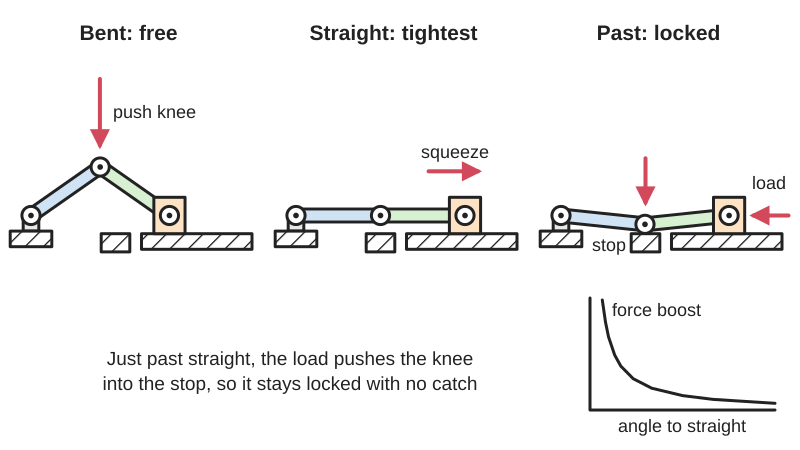
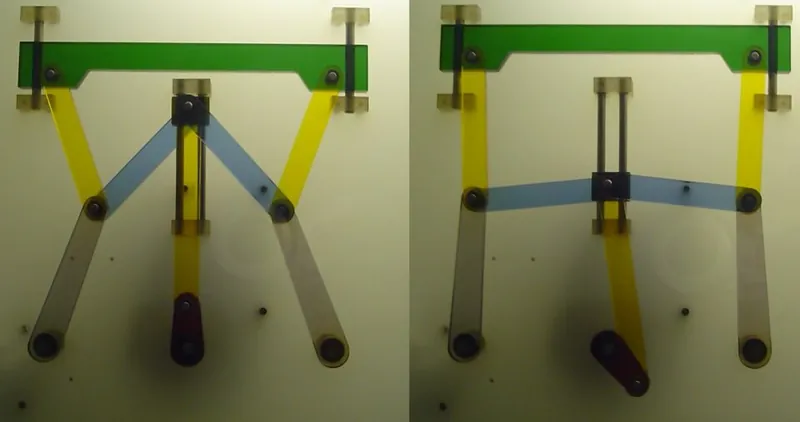
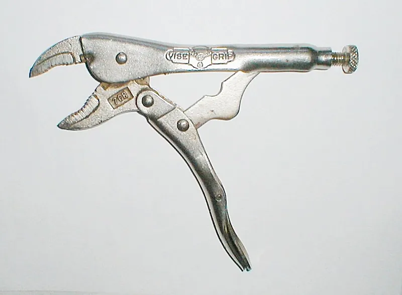

<figure class="eoc-pic eoc-pic-main"><picture><source media="(prefers-reduced-motion: reduce)" srcset="../media/drawn/over-centre-linkage.svg"></picture><figcaption><strong>Animation.</strong> Diagram drawn for the encyclopaedia from the research notes. ⚑ Needs confirming: a drawing can simplify or get details wrong; a real photo or a better diagram is welcome.</figcaption></figure>
<figure class="eoc-pic"><figcaption><strong>How it works.</strong> <a href="https://commons.wikimedia.org/wiki/File:Kniehebel.jpg">Kniehebel</a> by Kolossos, <a href="http://creativecommons.org/licenses/by-sa/3.0/">CC BY-SA 3.0</a>, from Wikimedia Commons.</figcaption></figure>
<figure class="eoc-pic"><figcaption><strong>Photo.</strong> <a href="https://commons.wikimedia.org/wiki/File:Locking_pliers.jpg">Locking pliers</a> by unknown, <a href="http://creativecommons.org/licenses/by-sa/3.0/">CC BY-SA 3.0</a>, from Wikimedia Commons.</figcaption></figure>

Two links joined by a middle hinge (the knee) are pushed just past their straight-line position and rest against a stop, so a load that tries to fold them only presses the knee harder into the stop, giving a lock that needs no spring or catch plus a very large force boost near the straight position.

**In plain words:** Two hinged bars that you push just past a straight line so they rest against a stop; a load pushing on them then only locks them tighter, and you unlock them by pulling the middle hinge back. **Proper term:** [Over-centre](../glossary.md#over-centre) [linkage](../glossary.md#linkage) (toggle linkage, toggle joint, knee lever).

**Also called:** over-center linkage (US spelling); toggle linkage; toggle mechanism; toggle joint / toggle-joint (the name used in 507 Mechanical Movements); knee lever / knee joint; Kniehebel (German); over-centre lock / over-center lock; over-centre mechanism; over-centring (the act of pushing a linkage past its centre point); [dead point](../glossary.md#dead-point) / dead centre (the straight-line position itself); over-centre folding brace (folding table legs); over-center locked strut (aircraft landing gear down-lock).

## How it works

When two hinged links are almost in a straight line, a small sideways push on the middle hinge makes a very large push along the links (toggle action); at 1 degree from straight the output force is about 29 times the input (Britannica). If you push the knee through the straight line (the dead point) and let it rest a few degrees beyond it against a stop, a load from the output side now tries to fold the knee further the same way, into the stop, instead of back the way it came, so it stays locked with no hand force (Sclater; Hackaday on locking pliers). Because the parts are squeezed slightly as they pass straight and then relax a little, opening it means pushing the knee back through that tight point, which a small, deliberate push on the knee or handle does easily (Wikipedia 'Locking pliers'; Sclater).

## Parts

A few parts: two rigid links (bars), three pin joints (one at each outer end and the knee in the middle), a fixed stop that the knee or handle rests against just past straight, and usually a handle that moves the knee. Real devices add a frame, a screw or threaded link to adjust the length, and often a release lever or a spring.

## Everyday examples

- Locking pliers (Vise-Grip (brand), Mole grips (brand)): squeeze the handles until they snap and they stay clamped on their own
- Folding table leg braces: the middle hinge of the brace sits slightly past straight to hold the leg out (EP 1044630)
- Swing-top bottles and Kilner-style jars: the wire bail snaps over to hold the lid down on its rubber seal
- Aircraft landing gear: an over-centre locked strut stops the gear folding up under landing loads (AOPA)

## When to use it

Use an over-centre linkage when something must lock firmly in one position and still open quickly by hand, with no key, spring catch or screw: folding legs, braces and stands that must not collapse, lids and doors that must be pulled tight, clamps that hold work, and robot mechanisms that should hold a position without motor power (Game Manual 0 notes over-centring makes a linkage harder to back-drive). It is also the classic way to get a very large force over the last millimetre of a [stroke](../glossary.md#stroke) from a small hand or motor force: presses, crimpers, punches and crushers.

## When not to use it

Avoid it when you need to hold at many different positions (it locks only at its end point): use a [ratchet](../glossary.md#ratchet), a friction hinge or a screw instead. Avoid it when the load can come from the opposite direction or when vibration is severe and safety matters, unless you add a secondary catch or pin (aircraft door toggle latches and folding-table braces add safety catches; US 4,925,221, EP 1044630). Where you need a long, even squeezing force, or the part thickness varies a lot, a screw clamp is easier to set. For a snap that holds in two positions with no stop, a [bistable](../glossary.md#bistable) spring (compliant) mechanism may be simpler.

## Details

- **What it does (jobs):**
  - lock, and release by hand: holds a position or a squeezing force until someone pushes the knee back past straight
  - join and hold: keeps a folding brace, strut, lid or clamp arm firmly in its open or closed position
  - change speed or turning force: multiplies force enormously at the very end of the stroke, as in toggle presses, stone crushers, riveters and clamps
- **Movement:** rotate: the links swing on their pins through a limited arc and stop a few degrees past straight against a stop; the output end usually moves a short distance in a straight line (slider-crank form) or swings a lever
- **Directions it can move (degrees of freedom):** 1 while it moves: a single input angle sets the position of the whole linkage (it is a four-bar or slider-crank chain). Effectively 0 once locked, because the load can only push it harder against its stop
- **Special behaviour:**
  - over-centre (snaps past a point and stays): the knee is pushed through the straight line and held on the far side by a stop
  - [self-locking](../glossary.md#self-locking) (holds under load, won't back-drive): a load from the output side drives the knee into the stop, so the load cannot open it (Hackaday on locking pliers; Sclater p.106, Fig. 5)
  - hand-release only (locks under load, releases when a person operates it): opening needs a push or pull on the knee or handle, back through the tight straight position
  - quick-release: one flick of the handle unlocks it
  - motion conversion (force multiplication): near straight, a large, easy input movement becomes a tiny, very forceful output movement (Britannica; Sclater p.106)
- **How it holds:**
  - shape ([form-fit](../glossary.md#form-fit--force-fit--material-bond)): the lock is geometric; the knee sits on the wrong side of the straight line and bears against a stop
  - spring force (a spring or springy part presses it in place): the clamping force it holds comes from the parts, a pad, a gasket or the workpiece being squeezed or stretched slightly (elastic [preload](../glossary.md#preload)) as the knee passes straight
- **Input and output:** Input: a swing of the handle or a sideways push on the knee -> output: a short push or pull along the links, or a small swing of an output lever. For a symmetrical toggle pushed at the knee, output force = input force / (2 x tan of each link's angle from straight) (formula from the Firgelli blog, consistent with Britannica's 'about 29 times at 1 degree'): roughly 5.7:1 at 5 degrees and 28:1 at 1 degree, rising towards infinity at straight, although friction and flexing keep real forces much lower (Sclater p.106). Rough efficiency: ⚑ [uncertain] not usually quoted; the losses are friction in the pins. Shaft arrangement: not applicable (links and pins working in one plane). Back-drivable: yes before it reaches centre; no once it is past centre and resting on its stop.
- **Power:** passive (no power needed). Powered versions exist, where an air cylinder, hydraulic ram or motor moves the knee (pneumatic toggle clamps, aircraft landing gear); because the lock is geometric, DESTACO states its pneumatic toggle clamps stay mechanically locked even with total loss of air pressure, so it keeps its last state
- **Load:** Medium to very heavy depending on size: the load runs straight along the links as a pure push or pull, which is their strong direction, and machines such as stone crushers and toggle presses use it for very large forces (Sclater p.106). Weak points: the pins (in [shear](../glossary.md#peel-vs-shear)), the stop (it takes the locking force) and any sideways or twisting load that bends the links; Firgelli lists link bending under off-axis loading as a failure mode ⚑ [uncertain]
- **Play and precision:** Small play, set by the pin [clearances](../glossary.md#clearance); the locked position is very repeatable because it always ends against the same stop. Near straight the output hardly moves, so small errors in link length change the clamping force a lot; Firgelli suggests matching press links to about +/-0.05 mm pin to pin ⚑ [uncertain]. The pin axes should be parallel; it tolerates little twist or [misalignment](../glossary.md#misalignment) ⚑ [uncertain]
- **Taking it apart:** tool-free quick release: the lock opens by hand with a flick of the handle; the linkage itself is pinned or bolted together and can be taken apart with tools
- **How often it can be reused:** effectively unlimited: locking and unlocking does not wear it out quickly; the limit is wear of the pins and holes, and [creep](../glossary.md#creep) or wear in plastic parts
- **Sealing:** none: it is a locking linkage. It only helps to seal when it squeezes a lid onto a gasket (see Draw latch)
- **Adjustable:** Usually yes: a screw or threaded link changes the effective length, which sets the clamping force and how far past centre it locks (the adjusting screw of locking pliers, Wikipedia; the spindle of a toggle clamp; the threaded hook of a draw latch). Setting it too tight can stop it passing centre or leave it sitting exactly on centre, unlocked (US patent 4,925,221)
- **Access needed:** not applicable: it is a mechanism built into a device; you only need to reach the handle or knee that operates it
- **Materials:** Steel links with hardened steel pins for tools, clamps and presses; stainless steel for wet places; for makers: aluminium, hardwood with metal-rod pivots, laser-cut acrylic or plywood plates (Teaching Tech's launcher), and 3D prints (PETG, PLA, nylon) with bolts or steel rod as pins
- **Heat, cold, water and wear:** Metal linkages are limited mainly by corrosion and pin wear: use stainless steel in wet places. Plastic and printed ones lose [holding force](../glossary.md#holding-force) over time as the squeezed parts creep and relax: printed PLA latches can loosen (zx82net), and PLA softens above about 60 °C and PETG above about 80 °C (Prusa; CNC Kitchen saw PLA start to give at 60 °C, PETG at 80 °C and ASA at 110 °C). Vibration can bump a handle that sits only just past centre back over (Roche; US 4,925,221).

## Making it

- **Ways to make or get it:**
  - 3D print (FDM): demonstration linkages, latches and light clamps, with bolts or steel rod as pins
  - laser cut: flat links from acrylic, plywood or sheet (Teaching Tech's over-centre launcher uses laser-cut 3 mm plates)
  - woodwork: hardwood links with metal-rod pivots
  - CNC and sheet metal: machined or stamped steel links for strong versions
  - off-the-shelf part: toggle clamps, draw latches and locking pliers are ready-made over-centre linkages
- **Printing it in one piece (print in place):** yes, for small demos and latches: ConceivablyEngineering's 'Sturdy [print-in-place](../glossary.md#print-in-place) draw latch' prints already assembled as a working over-centre linkage with 0.2-0.3 mm gaps. Load-bearing linkages are normally printed as separate parts and joined with metal pins or bolts (e.g. Mick Stuart's 'Over Centre Latch' uses an M5 bolt).
- **Tools:** None to operate. To build or fit: a drill, pins or shoulder bolts with lock nuts, and spanners or hex keys; often a screw or shim to set how far past centre it goes
- **Difficulty:** easy to moderate: two bars and three pins are easy to make, but placing the stop correctly (a few degrees past straight) and giving it enough springiness to hold a clamping force takes some trial and error

### 3D printing tips

1) Design the stop first. Decide the locked position a little past straight and give the knee or handle a solid surface to rest on. Sclater's sourcebook says that for positive locking the closed position should be 'slightly beyond the toggle position', and German Wikipedia notes the locking effect needs a mechanical stop. Blog guides suggest about 1-3 degrees past straight for clamps and 5-10 degrees for latches (Firgelli) ⚑ [uncertain]; make the stop adjustable (slotted hole, [set screw](../glossary.md#set-screw) or shim) so you can tune it. 2) Build in a little springiness. The lock only holds a force if something is squeezed or stretched as the knee passes straight: a TPU pad (PA1_MAKER prints the clamp pad in TPU), a slightly flexible hook or loop, or a gasket. With nothing springy it either won't pass centre or holds with no force. 3) Use metal pins. M3-M5 bolts with nyloc nuts, or steel rod (Glenn Brockett's over-centre latch uses 2.2 mm welding rod and says filament pins 'may work, not advised'); printed pins wear quickly and add play, which reduces how far past centre it sits. 4) Clearances: about 0.2-0.3 mm for print-in-place joints; slight under-extrusion on the first layer helps the joints come free (ConceivablyEngineering). 5) Orientation: the links carry push and pull along their length, so print them lying flat with the layers running along the link, and orient pin [bosses](../glossary.md#boss) so the lever's shear force doesn't split layers (PA1_MAKER). Glenn Brockett warns 'You MUST have good layer adhesion or it will break'. 6) Strength: thick walls matter more than [infill](../glossary.md#infill) (1.2 mm shells, ConceivablyEngineering; 5-7 walls, PA1_MAKER; at least 3 [perimeters](../glossary.md#perimeters) and over 30% infill for latches, zx82net). Size parts for the multiplied force at the knee, not your hand force: Mick Stuart notes his printed latch was easy to test to destruction because 'it has a fair bit of leverage'. 7) Material: use PETG (or better) for anything warm, outdoors or under constant load; PLA softens and deforms above about 60 °C and PETG is good to about 80 °C (Prusa), and printed PLA latches can creep and loosen over time (zx82net). 8) Tune by test: make sure the moving pivot really passes the line between the other two, or it won't snap closed (TECbot); scaling a printed latch by just 2% in X and Y noticeably changes its tightness (zx82net).

### Buying one (off-the-shelf parts)

Ready-made over-centre devices: toggle clamps (hold-down, push-pull, latch-action and squeeze-action), draw latches (toggle latches) with keepers, locking pliers (Vise-Grip (brand), Mole grips (brand)), and folding table leg braces. Pivot hardware for home-made linkages: shoulder bolts, clevis pins, dowel pins, nyloc (nylon-insert lock) nuts and washers.

## Rules of thumb

- Force multiplication of a symmetrical toggle pushed at the knee: F_out = F_in / (2 tan θ), where θ is each link's angle from straight; about 29 times at 1 degree (Britannica 'Toggle mechanism'; formula as given by the Firgelli blog).
- Maximum clamping force is reached when the three pivot points are in a straight line (DESTACO).
- Friction keeps real forces far below the theoretical infinity at the straight position, though they are still high (Sclater, Mechanisms and Mechanical Devices Sourcebook, 4th ed., p.106).
- For positive locking, the closed position should be slightly beyond the toggle (straight) position; a small unlatching force then opens it (Sclater, 4th ed., p.106, Fig. 5). The locking effect needs a mechanical stop (German Wikipedia 'Kniehebel').
- Keep the distance past centre small and controlled: DESTACO calls the over-centre travel of its clamps 'a carefully calculated and controlled dimension' that balances maximum holding force against positive locking (DESTACO, via M.J. Vail). Blog figures: 1-3 degrees for clamps and toggle presses; 5-10 degrees for latches, with less than about 2-3 degrees likely to shake open (Firgelli) ⚑ [uncertain].
- If a latch is adjusted too tight it can finish exactly on centre, looking closed but unlocked; too loose leaves a gap that lets vibration work on it (US patent 4,925,221, toggle latch with automatic safety catch).
- Locking pliers pass through their tightest point and then relax slightly, so to open them they have to be squeezed tighter first (Wikipedia 'Locking pliers').
- IFToMM calls the straight-line position a 'dead point': a configuration in which the input cannot move the mechanism without help from the motion of another link (IFToMM terminology 2.2.57).

## Common failures

1) Not far enough past centre: it sits on or very near centre and shakes or springs open; move the stop or adjust the length so it clearly snaps over (US 4,925,221). 2) Too tight: it cannot be pushed past centre, or forcing it bends links or cracks printed parts; back off the adjustment (Roche). 3) Worn or sloppy pins: clearance reduces the preload and how far past centre it sits; use metal pins and replace worn ones (Firgelli lists knee-pin wear first). 4) Creep: plastic parts and pads relax under constant squeeze and the lock goes slack (zx82net); use PETG or nylon, or a metal spring element. 5) Missing or weak stop: the knee over-travels and the load folds it; make the stop solid. 6) Printed parts snapping along layers under the multiplied force; print for strength and orient layers along the links.

## Safety

Pinch and crush points: the force near straight is huge (about 29 times the input at 1 degree, Britannica), so keep fingers out of the links and the jaws (Roche cites pinch points as a common hazard). Stored energy: the squeezed parts push back, so a handle can spring open when released ⚑ [uncertain]. Don't rely on a printed or unsecured over-centre lock to hold people or heavy loads (folding tables and aircraft gear add safety catches). If the stop breaks or wears away, the linkage can fold the other way and collapse.

## Related

- Toggle clamp: a ready-made over-centre linkage that presses work down or pushes it sideways
- Draw latch (over-centre latch): the same linkage used to pull a lid or door shut via a loop and keeper
- Eccentric cam lever (cam clamp, quick-release skewer): locks by turning an off-centre cam just past its high point instead of straightening two links; cheaper but with a less consistent clamping point (DESTACO)
- Bistable [compliant mechanism](../glossary.md#compliant-mechanism): a springy one-piece part that snaps between two stable positions without pins or a stop
- Spring toggle (snap-action switch): an over-centre spring that flips a lever quickly to either end, as in light switches (Sclater p.107; Thang 'Spring toggle mechanism 5')
- Ratchet and [pawl](../glossary.md#pawl): holds at many positions in one direction instead of at one locked end point
- Worm drive or lead screw: also resists being driven back, but by friction in a screw thread rather than by geometry
- Wire-bail closure (swing-top bottle, clip-top jar): a small over-centre linkage made of bent wire that snaps a stopper or lid down onto a rubber seal

## Make it yourself

- [C02 dragster / F1 in Shools launcher (TeachingTech, Printables)](https://www.printables.com/model/451928-c02-dragster-f1-in-shools-launcher): An over-centre trigger mechanism plus the other over-centre examples from the Teaching Tech video; laser-cut 3 mm plates and 3D-printed parts, with Onshape CAD source *(licence: CC BY-NC-SA)*
- [Over Centre Latch (Mick Stuart, Printables)](https://www.printables.com/model/1325355-over-centre-latch): A simple printed over-centre latch on an M5 bolt; the designer suggests experimenting with different axle placements *(licence: CC BY)*
- [Locking Pliers (Thorgraum, Printables)](https://www.printables.com/model/416707-locking-pliers): Printable self-locking pliers (an over-centre toggle) with a bolt pivot; later versions ease the release of fully closed pliers *(licence: CC BY-NC)*
- [Sturdy print-in-place draw latch (ConceivablyEngineering, Printables)](https://www.printables.com/model/130254-sturdy-print-in-place-draw-latch): An over-centre latch that prints already assembled, with no supports and 0.2-0.3 mm gaps *(licence: CC BY-SA)*
- [HUANGYAN920 Mechanical: interactive mechanism animations (entries 'TOGGLE-PRESS' no. 158 and 'TOGGLE-CLAMP' no. 36)](https://huangyan920.github.io/Mechanical/): Browser-based parametric animations of a toggle press and a toggle clamp that lock past the dead point; adjustable link lengths and pivot positions *(licence: MIT)*

## Pictures, videos and models

- [Kniehebel.jpg (Wikimedia Commons, photo by Kolossos)](https://commons.wikimedia.org/wiki/File:Kniehebel.jpg): Demonstration model at TU Chemnitz of a knee lever (toggle linkage) used to make large forces in a high-speed stamping press *(licence: CC BY-SA 3.0 / GFDL 1.2 (dual licence))*
- [Locking pliers.jpg (Wikimedia Commons, photo by Duk)](https://commons.wikimedia.org/wiki/File:Locking_pliers.jpg): Photo of locking pliers, the best-known everyday over-centre linkage *(licence: CC BY-SA 3.0 / GFDL 1.2 (dual licence))*
- [Toggle linkage 1a (Nguyen Duc Thang, YouTube thang010146)](https://www.youtube.com/watch?v=1MmgKShth7w): CAD animation of a stone crusher with two toggle linkages in series giving a very large crushing force *(licence: link only (standard YouTube licence))*
- [Snap motion 5 (Nguyen Duc Thang, YouTube thang010146)](https://www.youtube.com/watch?v=p4kDKY3UNFI): CAD animation of an over-centre lock: turning the latching lever one way cocks and locks a slide, turning it back releases it *(licence: link only (standard YouTube licence))*
- [Over centre mechanisms will make your designs more effective - Guide with examples (Teaching Tech, YouTube)](https://www.youtube.com/watch?v=NVtsrisYtUE): Real-world examples and four 3D-printed over-centre designs (basic, closing latch, cam latch, CO2 canister launcher) with a summary of their key characteristics *(licence: link only (standard YouTube licence))*

## Needs confirming

⚑ marks something nobody has confirmed yet: a fact the research could not confirm from a source, a finder value that is a best guess, or an open point from the research notes. Corrections are welcome (see `research/needs-confirming.md`).

- ⚑ 7 sentences on this page marked [uncertain].
- ⚑ Finder value `connects` = any solid parts (best guess): joins parts, but no specific kind of part found; set to any solid parts
- ⚑ Finder value `motion_in` = back-and-forth turning, straight push or pull (best guess): both sides turn, but no shaft layout named
- ⚑ Finder value `motion_out` = back-and-forth turning, straight push or pull (best guess): both sides turn, but no shaft layout named
- ⚑ Finder value `shaft_layout` = not applicable (best guess): both sides turn, but no shaft layout named

## Sources

- <https://www.britannica.com/technology/toggle-mechanism>
- <https://de.wikipedia.org/wiki/Kniehebel>
- <https://en.wikipedia.org/wiki/Locking_pliers>
- <https://en.wikipedia.org/wiki/Flip-top>
- <https://rexresearch1.com/Books/SclaterMechanismsMechanicalDevicesSourcebook.pdf>
- <https://cs448m.github.io/lectures/machines/doc/3.pdf>
- <https://iftomm-terminology.antonkb.nl/2057/02.html>
- <https://507movements.com/mm_140.html>
- <https://507movements.com/mm_164.html>
- <https://507movements.com/mm_385.html>
- <https://hackaday.com/2017/03/29/marvelous-mechanisms-the-ubiquitous-four-bar-linkage/>
- <https://gm0.org/en/latest/docs/common-mechanisms/linkages.html>
- <https://www.aopa.org/news-and-media/all-news/2018/june/flight-training-magazine/how-it-works-gear-extension>
- <https://patents.google.com/patent/EP1044630A1/en>
- <https://patents.google.com/patent/US4925221A/en>
- <https://www.destaco.com/resources/how-to-buy-guides/how-to-calculate-exerting-force-clamping-force--holding-capacity>
- <https://www.destaco.com/resources/blogs-and-insights/what-to-know-about-manual-quick-action-toggle-clamps>
- <https://www.destaco.com/clamping/Pneumatic/Pneumatic-Toggle-Clamp.html>
- <https://www.mjvail.com/destaco/intropage3.html>
- <https://mechanical-engineering.com/toggle-clamps-mechanics/>
- <https://www.firgelliauto.com/blogs/mechanisms/toggle-mechanism>
- <https://www.firgelliauto.com/blogs/mechanisms/toggle-latch>
- <https://rochehardware.com/how-to-use-toggle-clamps/>
- <https://www.rowse.co.uk/blog/post/how-to-choose-holding-toggle-clamps>
- <https://www.woodsmith.com/article/build-your-own-toggle-clamp/>
- <https://help.prusa3d.com/article/pla_2062>
- <https://help.prusa3d.com/article/petg_2059>
- <https://www.cnckitchen.com/blog/comparing-pla-petg-amp-asa-feat-prusament>
- <https://commons.wikimedia.org/wiki/File:Kniehebel.jpg>
- <https://commons.wikimedia.org/wiki/File:Locking_pliers.jpg>
- <https://commons.wikimedia.org/wiki/Category:Knee_levers>
- <https://www.youtube.com/watch?v=1MmgKShth7w>
- <https://www.youtube.com/watch?v=p4kDKY3UNFI>
- <https://www.youtube.com/watch?v=vYSJn0U0kXI>
- <https://www.youtube.com/watch?v=NVtsrisYtUE>
- <https://www.printables.com/model/451928-c02-dragster-f1-in-shools-launcher>
- <https://www.printables.com/model/1325355-over-centre-latch>
- <https://www.printables.com/model/416707-locking-pliers>
- <https://www.printables.com/model/130254-sturdy-print-in-place-draw-latch>
- <https://www.printables.com/model/476807-playing-card-sturdy-box-with-over-center-latch>
- <https://www.printables.com/model/462782-toggle-clamp>
- <https://www.printables.com/model/1548353-over-center-toggle-latch>
- <https://www.printables.com/model/49414-zx82net-customizable-rugged-waterproof-box>
- <https://api.printables.com/graphql/>
- <https://huangyan920.github.io/Mechanical/>
