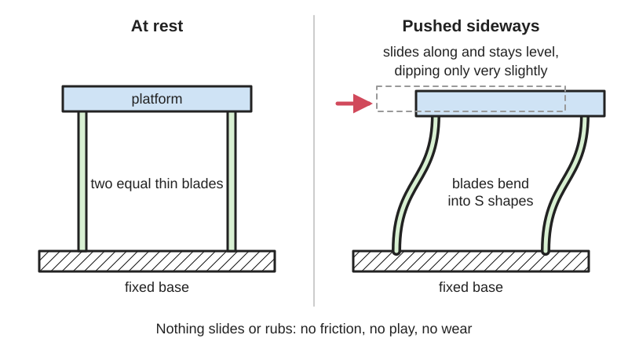

<figure class="eoc-pic eoc-pic-main"><figcaption>Diagram drawn for the encyclopaedia from the research notes. ⚑ Needs confirming: a drawing can simplify or get details wrong; a real photo or a better diagram is welcome.</figcaption></figure>

Two or more identical parallel blades join a fixed base to a moving platform, so the platform can slide a short distance in a nearly straight line with no friction, play or wear, guided and sprung by the bending blades.

**In plain words:** Two (or more) thin springy strips standing side by side like the legs of a table, holding a small platform so it can shift a short way in a straight line without tilting, rubbing or wobbling, and springs back when you let go. **Proper term:** Parallel leaf-spring [flexure](../glossary.md#flexure) (parallelogram flexure); built into a positioning stage it is a linear flexure stage.

**Also called:** parallelogram flexure (Awtar, Slocum and Sevincer); parallel leaf-spring guidance, two parallel leaf springs (Ingeniqs Engipedia); four-bar flexure or flexure four-bar [linkage](../glossary.md#linkage) (when the legs have notch hinges at each end; Sharkey et al. 2016); double parallelogram flexure or compound parallelogram (two in series, which cancels the dip; Awtar et al.; Ingeniqs); flexure stage, flexure translation stage, flexure-guided stage, piezo flexure stage (Physik Instrumente; OpenFlexure); linear flexure, compliant linear guide (maker names on Printables and Hackaday); single-point (bending-beam) load cell body: a machined parallelogram flexure used in weighing scales (Transducer Techniques).

## How it works

Two blades of equal length form a parallelogram with the base and the platform. When you push the platform sideways, both blades bend into the same S shape, so the platform stays parallel to the base and moves almost in a straight line, while the blades' resistance to being stretched, squashed and twisted holds every other direction (Awtar et al.; Ingeniqs). Because the blades cannot change length, the platform dips slightly towards the base as it moves, by about 0.6 x travel squared / blade length; putting two parallelograms in series, with the middle stage moving half as far as the platform, cancels this dip (double parallelogram) (Ingeniqs; Awtar et al.). With nothing sliding there is no friction, stiction or play, so a flexure stage can be moved in steps of micrometres or even nanometres (Physik Instrumente; Sharkey et al.).

## Parts

Single piece when printed or machined from one block (base, two blades or two notch-hinged legs, and the platform), or a few parts when spring-steel blades are clamped between a base block and a moving block ⚑ [uncertain: no metal build guide opened]. A double parallelogram adds an intermediate stage between two sets of blades. A positioning stage adds a drive, such as an M3 screw, nut and thumbwheel or a stepper motor (Sharkey et al.; OpenFlexure).

## Everyday examples

- The load cell inside kitchen, bathroom and postal scales: a metal block with four thin flexures forming a parallelogram, so the reading is the same wherever you put the item on the platform (Transducer Techniques)
- The weighing mechanism of a precision laboratory balance, guided by thin flexure hinges (German Wikipedia 'Festkoerpergelenk'; Wikimedia Commons photo of a Sartorius BP 160 P)
- The sample stage of the 3D-printed OpenFlexure microscope (openflexure.org)
- Pen or drag-knife holders on hobby CNC plotters, which use printed linear flexures to press the tool down with a steady force (Hackaday, 'Print Your Own Flexures', 2021)

## When to use it

Use a parallel leaf-spring flexure when something must move a short distance in a straight line with no play, friction or [stick-slip](../glossary.md#stick-slip): focusing and positioning microscopes, lenses, mirrors, fibres and probes; fine adjusters driven by a screw; pen or knife holders that must press down evenly; weighing and force sensing; and compact spring-loaded guides that must not rattle. It is a natural fit for 3D printing because printed sliding rails are rough and loose, whereas a printed flexure guide is one piece, prints without supports and needs no bearings (Sharkey et al.).

## When not to use it

Avoid it when you need long travel (more than a few millimetres in metal, or more than about a tenth of the blade length in plastic): use a linear rail, a dovetail slide or wheels on an extrusion. Avoid it for heavy or shock loads, for motion that must stay deflected for long periods in plastic ([creep](../glossary.md#creep)), or where the return-spring force would fight the drive. For rotation use a flexure hinge; for a perfectly straight path over a longer [stroke](../glossary.md#stroke) use a double parallelogram or a rolling-element linear guide.

## Details

- **What it does (jobs):**
  - let it move (turn, slide or bend): a short, straight, play-free slide
  - line parts up exactly: fine positioning of optics, samples, probes and pens
  - store energy: the bent blades act as a return spring that pushes the platform back to its rest position
- **Movement:** flex (slides by bending): a short, nearly straight travel. Metal flexure guides suit positioning tasks of up to several millimetres, and lever-amplified piezo stages reach up to 2 mm (Physik Instrumente); printed four-bar stages give a usable range of about 20% of the lever length (plus or minus 10%) (Sharkey et al.); OpenFlexure's printed stage moves 8 x 8 x 4 mm and zalo's printed XY stage plus or minus 14 mm.
- **Directions it can move (degrees of freedom):** 1: straight sideways travel, with the other five directions held; David Tucker's printed linear flexure was 'rigid in five of the six [degrees of freedom](../glossary.md#degrees-of-freedom)' (Hackaday, 2021). Two sets at right angles, or a table-like arrangement of parallelogram legs, give 2 (X and Y) (Sharkey et al.; zalo).
- **Special behaviour:**
  - self-aligning or self-centring: the bent blades spring the platform back to its central rest position when released
  - none of the locking, one-way or clicking behaviours: it is a smooth, spring-return straight guide
- **How it holds:**
  - not a holding joint (it moves or passes on motion): it guides a straight-line motion
  - spring force (a spring or springy part presses it in place): the blades push the platform back towards the rest position
- **Input and output:** not applicable as a transmission; it is usually driven by a screw, piezo [actuator](../glossary.md#actuator) or motor. Levers made of flexures can scale the motion: OpenFlexure's focus axis reduces screw motion 2.6 times, and with stepper motors and 1/16 microstepping it moves in steps of about 50 nm (Sharkey et al.). Back-drivable: yes, the blades are springs.
- **Power:** passive (no power needed) for the flexure itself; motorised stages need power to move, and a screw-driven stage stays where it is if power is lost
- **Load:** light to medium in the directions it holds; very light in the travel direction by design. Stiff against loads along the blades and against tilting. [Stiffness](../glossary.md#stiffness) in the travel direction is 2 x E x w x t cubed / L cubed for two blades (Ingeniqs). Holding stiffness falls as it moves: about 30% lower at a travel of one tenth of the blade length for a simple parallelogram, and about 90% lower for a double parallelogram (Awtar et al.). A pushing (compressive) load along the blades softens them towards buckling, so hang loads from the blades rather than stand them on top where possible (Awtar et al.).
- **Play and precision:** none: no [backlash](../glossary.md#backlash), stiction or play. [Repeatability](../glossary.md#repeatability--accuracy) of a printed OpenFlexure stage was under 1 micrometre for small moves and about 15 micrometres for 1 mm moves, with focus drift typically under 10 micrometres (Sharkey et al.); metal flexure-guided piezo stages reach guiding accuracy of a few nanometres or microradians (Physik Instrumente). The path is not perfectly straight: the dip is about 0.6 x travel squared / blade length (Ingeniqs; Awtar et al.), and for a four-bar of notch hinges the deviation from a straight line is about 1% of the lever length over its usable range (Sharkey et al.). Blades of unequal length make the platform tilt as it moves (Awtar et al.). Printed stages drift slowly after big moves because plastic creeps (Sharkey et al.).
- **Taking it apart:** permanent for one-piece printed or machined stages; removable when metal blades are clamped between blocks with screws ⚑ [uncertain]
- **How often it can be reused:** many times: nothing wears because nothing slides; the life limit is [fatigue](../glossary.md#fatigue) of the blades, which is long if they are bent well within the material's limit. Printed OpenFlexure stages had no flexures snap after 6 months of use (Sharkey et al.); FabianVeile's printed XY guide is designed to stay in the elastic region so it always returns to its start position (Printables)
- **Sealing:** none
- **Adjustable:** Position: yes, that is its purpose; the platform is moved by a fine screw (an M3 screw moves 0.5 mm per turn, allowing sub-micron adjustment by hand; Sharkey et al.), a piezo or a motor. Stiffness and range: no, fixed by the blade thickness, length, width and material.
- **Access needed:** not applicable: it is built into the mechanism
- **Materials:** Metal: aluminium or steel blocks with the flexures cut in, as in single-point load cells (Transducer Techniques) and wire-EDM-cut precision stages (Physik Instrumente); flexures can be made from nonmagnetic materials (Physik Instrumente). Spring-steel or beryllium-copper strip for clamped blades ⚑ [uncertain]. Plastic: PLA (OpenFlexure; zalo's XY stage), PLA+ (Akaki Kuumeri), PETG or more flexible filaments (Line Arc Line). Plastic gives a longer range than an equal-sized metal flexure but creeps (Sharkey et al.).
- **Heat, cold, water and wear:** Metal flexure guides need no lubricants or consumables, so they work in vacuum, and can be made from nonmagnetic materials (Physik Instrumente); they avoid friction, stiction and wear (Wikipedia 'Flexure'). Plastic stages: PLA softens from about 60 °C and PETG from about 80 °C (CNC Kitchen); plastic creeps, so printed stages drift after large moves, although a one-piece OpenFlexure stage moved less than 20 micrometres over a week without temperature control (Sharkey et al.) and the OpenFlexure Block Stage drifted 1.6 micrometres in 16 hours (openflexure.org). Metals fatigue if bent too far too often (Wikipedia 'Flexure bearing').

## Making it

- **Ways to make or get it:**
  - 3D print (FDM): one-piece linear and XY flexure stages (OpenFlexure; zalo; FabianVeile; BYU CMR)
  - CNC: monolithic metal stages with flexures cut by wire EDM (Physik Instrumente) and machined load-cell bodies (Transducer Techniques)
  - sheet metal: spring-steel blades clamped between blocks ⚑ [uncertain: no build guide opened]
  - off-the-shelf part: piezo flexure stages and nanopositioners (Physik Instrumente); single-point load cells (Transducer Techniques)
- **Printing it in one piece (print in place):** yes: the whole guide prints as one working piece without supports (OpenFlexure microscope and Block Stage; zalo's XY Flexure Translation Stage; FabianVeile's XY Linear Guide). A positioning stage then needs an added drive, such as an M3 screw and nut (Sharkey et al.; Printables 'High-precision Compliant XY-Positioning Device'), which makes it 'partly' [print-in-place](../glossary.md#print-in-place).
- **Tools:** none for one-piece printed stages; a knife to open a slot and a screwdriver for the M3 drive screws and nuts in some printed positioners (Printables 'High-precision Compliant XY-Positioning Device'); a hex key or screwdriver for clamped metal blades ⚑ [uncertain]
- **Difficulty:** easy to moderate: a printed parallel flexure is a simple one-piece print (FabianVeile's XY Linear Guide prints in about 45 minutes), but printing thin blades cleanly, avoiding creep and adding a fine screw drive takes some care; nanometre-grade metal stages are bought

### 3D printing tips

1) Print the blades as thin standing walls, two lines thick with a 0.4 mm nozzle (about 0.75 mm), so they bend along the printed lines; Akaki Kuumeri's 'flexure primitive' is 0.75 mm thick, at least 10 mm wide and at least 40 mm long, and his linear mechanisms are built from it; if a flexure must lie flat, make the lines run lengthwise (Akaki Kuumeri). OpenFlexure instead lays its notch hinges flat with the hinge axes horizontal, because the layer height is thinner than the line width (Sharkey et al.). 2) Use slicer settings that give exactly one or two clean lines per blade: 'Classic' perimeter generator rather than Arachne (Line Arc Line), 'detect thin walls' off and 'detect [bridging](../glossary.md#overhang--bridging) [perimeters](../glossary.md#perimeters)' on, external perimeter width 0.4 mm, and check that two lines run along each flexure (zalo). 3) Keep the print seam off the blades (paint it elsewhere or use a seam attractor) and [fillet](../glossary.md#chamfer--fillet) the corners where blades meet the blocks (Line Arc Line; Akaki Kuumeri). 4) Make the two blades identical in length and thickness, or the platform will tilt as it moves (Awtar et al.). 5) Size the travel: the peak bending stress of a guided blade is about 3 x E x t x travel / L squared (Ingeniqs), so longer, thinner blades allow more travel; printed four-bar stages use about plus or minus 10% of their lever length (Sharkey et al.). 6) Add end stops so the stage can't be pushed past its safe range; OpenFlexure only saw flexures snap in designs whose motion was not limited (Sharkey et al.; Akaki Kuumeri). 7) Don't leave it pushed to one side: plastic creeps and will not return to centre (Akaki Kuumeri); OpenFlexure stages drift more after a large move (Sharkey et al.). 8) For straighter travel, use two parallelograms in series (double parallelogram) or mirror-image pairs, as in zalo's 'mutually compensating' XY stage (zalo; Akaki Kuumeri's 'linear-er movement with two stages'). 9) For two axes, a table with parallelogram legs is stiffer out of plane than two stages stacked on each other when printed in plastic (Sharkey et al.). 10) Prefer PLA+ or PETG for light, occasional use; PLA softens from about 60 °C and PETG from about 80 °C (CNC Kitchen).

### Buying one (off-the-shelf parts)

Search for 'flexure stage', 'piezo flexure stage' or 'nanopositioner' (Physik Instrumente sells single-axis, stacked and parallel-kinematic types), 'single point load cell' or 'bending beam load cell' (Transducer Techniques), 'spring steel shim stock' or 'spring steel strip' for home-made blades ⚑ [uncertain], and for the drive an 'M3 screw' and 'M3 nut' with a printed thumbwheel, or a small '28BYJ-48' stepper motor as used by the OpenFlexure Block Stage.

## Rules of thumb

- Parasitic dip (shortening) of a simple parallelogram: about 0.6 x travel squared / blade length (Ingeniqs 'Two parallel leaf springs'; Awtar, Slocum and Sevincer, 'Characteristics of Beam-based Flexure Modules', kinematic coefficient -0.6). Example: 2 mm travel on 40 mm blades gives about 0.06 mm dip.
- Travel-direction stiffness of two blades: 2 x E x w x t cubed / L cubed; peak bending stress: 3 x E x t x travel / L squared (Ingeniqs).
- A double parallelogram cancels the dip when the middle stage moves exactly half as far as the platform (Ingeniqs), but its holding stiffness falls about 90% at a travel of one tenth of the blade length, versus about 30% for a simple parallelogram with blades 1/50 of their length thick (Awtar et al.).
- Compressive load along the blades lowers the travel stiffness, reaching zero at buckling; tension raises it (Awtar et al.).
- Printed four-bar flexure stages: usable range about 20% of lever length (plus or minus 10%) with about 1% deviation from a straight line; hinges 0.72 mm thick, 1.5 mm long, 4 mm wide, bent no more than 6 degrees (Sharkey et al., Rev. Sci. Instrum. 87, 025104, 2016).
- Printed flexure blade starting point: 0.75 mm thick (two 0.4 mm lines), at least 10 mm wide, at least 40 mm long (Akaki Kuumeri).
- Metal flexure guides suit positioning tasks up to several millimetres; lever-amplified piezo flexure stages reach up to 2 mm but simple levers lose guiding accuracy and stiffness (Physik Instrumente).
- Single-point load cells use four thin flexures (two near the top, two near the bottom) so an off-centre load moves the platform down instead of tipping it; the correction holds only up to the rated platform size (e.g. 7.87 in square for the LSP series) (Transducer Techniques).

## Common failures

Blades snap or take a permanent bend when pushed too far; add end stops (Sharkey et al.; Akaki Kuumeri). Creep: a printed stage left pushed to one side no longer returns to centre, or drifts after a big move (Akaki Kuumeri; Sharkey et al.). The platform tilts or dips because the blades are unequal or because of the natural shortening effect (Awtar et al.; Ingeniqs). The stage becomes wobbly near the ends of its travel as holding stiffness drops, especially with a double parallelogram whose middle stage is free to float (Awtar et al.). Blades buckle under a compressive load (Awtar et al.). Printing faults: gaps or single wobbly lines in thin blades, a seam blob on a blade, or poor bridges (zalo; Line Arc Line; Sharkey et al.). [Over-constraint](../glossary.md#over-constraint): adding extra parallel blades that don't match exactly makes the guide stiff or bind (Awtar et al.).

## Safety

None known for small printed stages. Printed blades pushed past their limit can snap (Sharkey et al.). If you make blades from beryllium-copper strip, do not grind or sand it: breathing its dust can cause chronic beryllium disease (Wikipedia 'Beryllium copper').

## Related

- Flexure hinge (notch, leaf-spring and cross-axis pivots): the rotating building block; a parallelogram is four flexure hinges or two blades working together
- Double parallelogram flexure: two parallelograms in series that cancel the dip and double the travel, at the cost of lower holding stiffness
- Roberts or X-Bob straight-line [compliant mechanism](../glossary.md#compliant-mechanism): a different flexure layout for longer straight travel (BYU CMR 'Linear-Motion Compliant Mechanism')
- Dovetail slide with gib strip: a sliding straight guide with long travel but friction and adjustable play
- Linear rail or linear ball bearing: long travel and high load, with bought parts and some friction
- Lead screw and nut: often used to drive a flexure stage with fine resolution
- [Living hinge](../glossary.md#living-hinge): the same bending principle used for folding lids rather than guiding motion

## Make it yourself

- [XY Flexure Translation Stage (zalo, Printables)](https://www.printables.com/model/77081-xy-flexure-translation-stage): A one-piece printed XY stage using mutually compensating flexures for nearly pure straight-line motion, plus or minus 14 mm range, in PLA with slicer settings for two-line flexures; Fusion 360 source linked. Read through the Printables public API. *(licence: CC BY (Creative Commons Attribution))*
- [XY Linear Guide (Compliant Mechanism) (FabianVeile, Printables)](https://www.printables.com/model/101320-xy-linear-guide-compliant-mechanism): A simple one-piece compliant XY guide moving about 10 mm in X and 7.5 mm in Y; prints in about 45 minutes. Read through the Printables public API. *(licence: CC BY-NC-SA)*
- [High-precision Compliant XY-Positioning Device (FabianVeile, Printables)](https://www.printables.com/model/336719-high-precision-compliant-xy-positioning-device): A one-piece flexure positioner driven by two M3 screws and nuts (about 1 mm range in X and 2 mm in Y), printed in PLA at 0.2 mm layers without supports. Read through the Printables public API. *(licence: CC BY-NC-ND)*
- [Linear-Motion Compliant Mechanism (BYU CMR, Printables)](https://www.printables.com/model/586635-linear-motion-compliant-mechanism): A printable 'X-Bob' large-displacement straight-line compliant mechanism (four Roberts mechanisms), a related straight-line flexure from BYU's research on safety-and-arming devices. Read through the Printables public API. *(licence: CC BY-NC (Creative Commons Attribution-NonCommercial))*
- [OpenFlexure Block Stage build files and instructions](https://openflexure.org/projects/blockstage/): Open-source printed three-axis flexure stage driven by M3 lead screws and gears, optionally motorised with 28BYJ-48 steppers *(licence: CC BY-SA 4.0)*

## Pictures, videos and models

- [Weird Flex But Okay: Introduction to the Parallelogram Flexure (YouTube, Precision Stuff)](https://www.youtube.com/watch?v=JGbM6qZAwQY): Video introduction to the parallelogram (parallel leaf-spring) flexure and how it guides straight-line motion *(licence: link only (standard YouTube licence))*
- [A one-piece 3D printed flexure translation stage for open-source microscopy (Sharkey, Foo, Kabla, Baumberg and Bowman; Rev. Sci. Instrum. 2016; arXiv)](https://arxiv.org/abs/1509.05394): Photos and diagrams of a printed microscope whose stage and focus move on printed parallelogram flexures, with the flexure geometry, strain estimate, drift and repeatability measurements *(licence: CC BY 3.0 for the journal article (stated in the article PDF); the arXiv page shows CC BY 4.0)*
- [OpenFlexure Block Stage (OpenFlexure project)](https://openflexure.org/projects/blockstage/): A 3D-printed three-axis flexure stage with sub-100 nm steps over 2 x 2 x 2 mm, with pictures, build instructions and files *(licence: CC BY-SA 4.0)*
- [Building Prototypes Dan Gelbart part 10 of 18 Flexures (YouTube, Dan Gelbart)](https://www.youtube.com/watch?v=PaypcVFPs48): Practical demonstrations of flexure guides and levers for precise motion *(licence: link only (standard YouTube licence))*
- [Sartorius BP 160 P 6.jpg (Wikimedia Commons, by PaulT / Gunther Tschuch)](https://commons.wikimedia.org/wiki/File:Sartorius_BP_160_P_6.jpg): Close-up of a flexure hinge in the parallel guide of a precision laboratory balance *(licence: CC BY-SA 4.0)*

## Needs confirming

⚑ marks something nobody has confirmed yet: a fact the research could not confirm from a source, a finder value that is a best guess, or an open point from the research notes. Corrections are welcome (see `research/needs-confirming.md`).

- ⚑ 6 sentences on this page marked [uncertain].
- ⚑ Finder value `tools` = none, hand tools (source uncertain): `tools_needed` is marked ⚑ [uncertain] here: "…sitioning Device'); a hex key or screwdriver for clamped metal blades ⚑ [uncertain]…"

## Sources

- <https://psdl.engin.umich.edu/pdf/J6.pdf>
- <https://ingeniqs.be/engipedia/two-parallel-leaf-springs/>
- <https://kalab.emma.cam.ac.uk/pdfs/Sharkey2016.pdf>
- <https://arxiv.org/abs/1509.05394>
- <https://arxiv.org/abs/1911.09986>
- <https://openflexure.org/projects/blockstage/>
- <https://openflexure.org/projects/microscope/>
- <https://www.physikinstrumente.com/en/expertise/technology/guiding-systems-force-transmission/flexure-stages>
- <https://www.transducertechniques.com/lsp-load-cell.aspx>
- <https://en.wikipedia.org/wiki/Flexure>
- <https://en.wikipedia.org/wiki/Flexure_bearing>
- <https://en.wikipedia.org/wiki/Beryllium_copper>
- <https://de.wikipedia.org/wiki/Festkörpergelenk>
- <https://commons.wikimedia.org/wiki/File:Sartorius_BP_160_P_6.jpg>
- <https://s3files.core77.com/images/c77_webinar_series/Akaki-Kuumeri-3D-printed-flexures.pdf>
- <https://hackaday.com/2021/06/22/print-your-own-flexures/>
- <https://hackaday.io/project/180448-putting-the-flex-on-flexures>
- <https://www.cnckitchen.com/blog/comparing-pla-petg-amp-asa-feat-prusament>
- <https://api.printables.com/graphql/>
- <https://www.printables.com/model/77081-xy-flexure-translation-stage>
- <https://www.printables.com/model/101320-xy-linear-guide-compliant-mechanism>
- <https://www.printables.com/model/336719-high-precision-compliant-xy-positioning-device>
- <https://www.printables.com/model/586635-linear-motion-compliant-mechanism>
- <https://www.youtube.com/watch?v=JGbM6qZAwQY>
- <https://www.youtube.com/watch?v=PaypcVFPs48>
