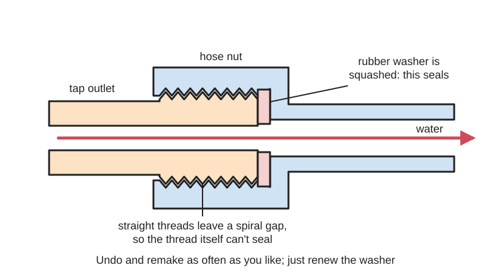

<figure class="eoc-pic eoc-pic-main"><figcaption>Diagram drawn for the encyclopaedia from the research notes. ⚑ Needs confirming: a drawing can simplify or get details wrong; a real photo or a better diagram is welcome.</figcaption></figure>

A straight screw thread holds a pipe, hose or tap fitting together and squeezes a washer, bonded seal or [O-ring](../glossary.md#o-ring) against a flat face, and that squeezed ring (not the thread) makes the joint watertight, so it can be undone and remade many times with nothing more than a new washer.

**In plain words:** Two pipe or hose parts that screw together on a straight (not tapered) thread, where the thread only pulls them together and a rubber washer, a rubber-lined metal washer or an O-ring squashed between two flat faces is what stops the leak, like a garden hose screwed onto an outdoor tap. **Proper term:** Parallel (straight) pipe thread with a face seal: BSPP / G thread (ISO 228), garden-hose thread (GHT, NH) and the pipe union.

**Also called:** BSPP = British Standard Pipe Parallel = G thread (ISO 228-1); older names BSPF (fitting thread) and BSPM (mechanical thread); 'G' originally stood for gas (Wikipedia 'British Standard Pipe'); 'longscrew' thread: a BSP parallel thread sealed by a washer or O-ring squeezed between the end face and a socket face by a backnut (Wikipedia 'British Standard Pipe'); JIS parallel pipe thread (identical to BSPP in design and size) (Swagelok MS-13-77, p. 37); garden hose thread (GHT) = 3/4-11.5 NH (National Hose); FHT and MHT (female and male hose thread); NHR (thin rolled hose couplers); 3/4-14 NPSH (a straight hose thread that mates with a tapered pipe thread) (Wikipedia 'Garden hose'); NH or NST (National Standard Thread): the US fire-hose thread, a straight thread sealed with a gasket (Wikipedia 'Hose coupling'); NPS and NPSC: US straight pipe thread series, as opposed to tapered NPT (Wikipedia 'National pipe thread'); hose union: the technical name for the male-and-female threaded garden hose joint (Wikipedia 'Garden hose'); pipe union, union fitting; ground-joint union (metal-to-metal seat), flat-face union, O-ring union; dielectric union or insulating union (Wikipedia 'Piping and plumbing fitting'; Projectmaterials); tap connector, tap tail, flexible tap connector ('flexi', UK), 'BSP female union' end (BES catalogue); hose washer, garden hose washer, tap connector washer, fibre washer, nylon washer, flat gasket, screen washer (washer with a filter mesh) (Wikipedia 'Garden hose'; RS); bonded seal = Dowty seal or Dowty washer (from the Dowty Group, which first made them), self-centring bonded washer; Usit ring (brand) (Wikipedia 'Bonded seal'; Wikimedia Commons); parallel hydraulic ports: DIN 3852 Part 2 Type A (bonded or metal washer) and Type B (metal edge), BS 5380 and SAE straight-thread O-ring [boss](../glossary.md#boss) (ORB, SAE J1926 / ISO 11926) (Swagelok MS-13-77, pp. 31, 40-42); Hozelock and Gardena (brands): click-on garden hose systems whose tap adapters screw onto a BSP tap thread (the click-on part is covered in the Push-to-connect entry).

## How it works

Because both threads are straight, they slide past each other without wedging, so the thread itself leaves a spiral leak path and cannot seal (Swagelok MS-13-77, p. 27). Instead, tightening the nut pulls a flat face on one part towards a flat face or seat on the other and squashes a soft ring between them; the squeezed washer, bonded seal or O-ring closes the gap (Wikipedia 'British Standard Pipe', 'longscrew' threads). A garden hose has a [captive nut](../glossary.md#captive-nut) on its female end with a rubber washer inside, which is pressed against the end of the tap's male thread (Wikipedia 'Garden hose'). A pipe union works the same way between two pipes that can't be turned: each pipe screws (or is soldered) into one half, and a loose nut pulls the two halves together on their seat, so the joint can be opened later without turning either pipe (Wikipedia 'Piping and plumbing fitting'; Projectmaterials).

## Parts

A few parts: a male end with a straight thread and a flat end face or shoulder, a female socket or (often) a loose swivel nut, and a separate sealing ring (rubber, fibre or nylon washer, bonded seal or O-ring). A pipe union is a small three-part assembly that acts as one unit: a male end, a female end and a loose nut, with a metal-to-metal seat, a flat gasket or an O-ring between the two ends; a dielectric union adds a plastic insulating sleeve and a rubber gasket (Boshart data sheet).

## Everyday examples

- a garden hose screwed onto an outdoor tap, with a small rubber washer inside the hose nut (Wikipedia 'Garden hose')
- a shower hose, whose ends are standard 1/2 in BSPP (Printables 556322)
- the braided flexible tap connectors under a kitchen or bathroom sink, with a 3/4 in or 1/2 in BSP female nut and washer on the tap end (BES catalogue)
- the union with a big hex nut on the pipes above a water heater, often a dielectric union between copper and steel pipe (Boshart data sheet; Wikimedia Commons photo of a dielectric union being tightened on a water heater)

## When to use it

Whenever a water, air or oil connection must come apart again and be remade without tape or paste: hoses, sprinklers and pumps, tap connectors, shower hoses, pressure gauges (gasket-sealed gauge connections, Swagelok p. 39), and hydraulic or pneumatic ports with bonded seals or O-rings. Use a pipe union where two fixed pipes must be separated for maintenance (a pump, filter, water heater or valve), because it opens without turning either pipe (Wikipedia 'Piping and plumbing fitting'). Use a dielectric union where copper or brass meets galvanised steel, to stop galvanic corrosion (Wikipedia 'Piping and plumbing fitting'). For makers it is the easy way to connect a printed or home-made device to a tap or hose: buy or print an adapter with the right thread and a flat face for a standard washer.

## When not to use it

When the fitting has a tapered thread (NPT, BSPT, R/Rc): that seals on the thread with tape or paste instead (Tapered pipe thread entry). Never join a GHT fitting to a BSP one, or a 55° BSP thread to a 60° NPT thread; use an adapter (Wikipedia 'Garden hose', 'National pipe thread'). For joints hidden in walls or that should never be opened, soldered, brazed or press joints are usual (Soldered metal joint, Compression fitting entries). For hoses you plug and unplug often, a click-on or push-to-connect coupler is faster (Push-to-connect entry). For fuel gas, steam or glycol, don't use a dielectric union (Boshart data sheet) and follow the local gas code with rated parts. Don't use a home-printed adapter on drinking water, hot water, gas or high-pressure air or oil: buy a rated metal fitting.

## Details

- **What it does (jobs):**
  - seal it, or pass cables or fluid through: carries water, air or oil across a joint that can be taken apart again
  - join and hold: the thread holds the two parts together against the water pressure and against pulling on the hose or pipe
- **Movement:** none: once tightened the parts are fixed; before tightening, a swivel nut or union nut lets the hose or pipe end sit at any angle
- **Directions it can move (degrees of freedom):** 0 when tightened. While loose, the swivel nut turns freely on the hose or fitting end, so the end can be lined up before the washer is squeezed.
- **Special behaviour:**
  - self-aligning or self-centring: only in a small way: self-centring bonded washers have an extra rubber flap on the inside edge that centres the seal on the thread (Wikipedia 'Bonded seal'); otherwise it is a plain joint with no clever behaviour. Its practical advantage is that a union or swivel nut can be undone without turning the pipe or hose (Wikipedia 'Piping and plumbing fitting')
- **How it holds:** shape (the parts interlock; [form-fit](../glossary.md#form-fit--force-fit--material-bond)): the screw threads hold the parts together; plus friction or clamping (force-fit): the thread's pull squeezes the washer or O-ring, and that clamping force is what seals
- **Input and output:** not applicable
- **Power:** passive (no power needed)
- **Load:** Medium. The thread is strong in pull (it holds the fitting against water pressure and tugs on the hose); bending is taken by the pipe or hose end. The pressure the joint can hold is set by the fitting and the washer, not the thread: e.g. a typical braided flexible tap connector with a BSP female union and a nitrile washer is rated 13 bar at 23 °C (BES catalogue); forged-steel threaded unions come in 2000, 3000 and 6000 lb pressure classes (Projectmaterials). Printed plastic adapters are much weaker and [creep](../glossary.md#creep), so keep them to low-pressure garden and hobby uses (see making tips).
- **Play and precision:** No play once tight. It tolerates very little angle between the faces: the faces must meet squarely and evenly, and [misalignment](../glossary.md#misalignment) of the pipes or dirt on the seat is a common cause of union leaks (What Is Piping, 'Pipe union'). A swivel nut takes up any twist, and the washer takes up small surface roughness. Not a locating joint.
- **Taking it apart:** removable: unscrew by hand or with a spanner; the metal parts are reused, and a hardened or squashed washer is simply replaced
- **How often it can be reused:** many times: the metal threads last for years; the washer is the part that wears out and is replaced (RS tap washers guide; Wikipedia 'Garden hose')
- **Sealing:** airtight or pressure: the squeezed washer, bonded seal or O-ring seals water at mains pressure, compressed air and, with bonded seals or O-rings in proper ports, hydraulic oil; the thread never seals ('the seal must be made with a gasket, O-ring, or some metal to metal contact', Swagelok MS-13-77, p. 27). Garden-hose and tap washers are made for water, so treat those joints as watertight rather than pressure-rated for air or oil.
- **Adjustable:** Partly: a swivel nut or union lets you choose the angle of a hose end, elbow or tap connector before tightening; once the washer is squeezed there is no adjustment except tightening a little more if it weeps (garden hose adapter instruction sheet).
- **Access needed:** end of a tube or shaft: the fitting goes on the end of the pipe, hose or tap outlet, and you need room to turn the nut by hand or with a spanner (and usually to hold the body with a second spanner)
- **Materials:** Fittings: mostly brass (cut-thread hose ends and tap outlets, rolled thin brass on cheap hoses, Wikipedia 'Garden hose'), also galvanised or black steel and malleable iron for pipe unions, stainless steel, and plastic (nylon, polypropylene) for garden fittings. Seals: rubber (EPDM, nitrile), vulcanised fibre or nylon flat washers (RS); bonded seals are a steel ring with nitrile rubber bonded to its inner edge (Wikipedia 'Bonded seal'); O-rings. Dielectric unions join copper or brass to galvanised steel using a nylon insulator and a silicone rubber gasket (Boshart data sheet). 3D-printed adapters are usually PETG; printed washers are TPU (Printables models below).
- **Heat, cold, water and wear:** Heat: most garden hoses are not rated for hot water, and even leaving a pressurised hose in the sun can make it burst (Wikipedia 'Garden hose'); a typical flexible tap connector is rated to 85 °C and 13 bar at 23 °C (BES catalogue); O-ring unions are not for high temperatures, while ground-joint metal unions go to about 500 °C (Projectmaterials). Chemicals: dielectric unions are not for steam, glycol or combustible gas, and corrosion speeds up as fluid temperature rises (Boshart data sheet). Ageing: rubber washers harden, crack and split over time and must be replaced (RS guide). Corrosion: copper joined directly to galvanised steel in tap water corrodes the steel (Wikipedia 'Piping and plumbing fitting'). Printed PLA adapters soften in summer heat (Prusa blog). Vibration and repeated movement of a hose can slowly loosen a hand-tight connection ⚑ [uncertain].

## Making it

- **Ways to make or get it:**
  - off-the-shelf part: brass and plastic hose fittings, tap connectors, unions, washers and bonded seals are cheap and standard; this is the normal choice
  - 3D print (FDM): adapters between thread standards (BSP to garden hose thread, BSP to click-on hose systems), plugs and test gauges for low-pressure garden and hobby use (Printables models below)
  - CNC: threads can be cut on a lathe in brass or aluminium for one-off adapters
- **Printing it in one piece (print in place):** no: the threaded parts are printed separately and screwed together, and the seal is a separate bought rubber washer or O-ring (or a separately printed TPU washer)
- **Tools:** None for garden hoses ('Hand tighten only', then pliers only if it still leaks, garden hose adapter instruction sheet); two spanners or adjustable wrenches for tap connectors and pipe fittings (one to hold the body, one to turn the nut); pipe wrench for unions on steel pipe (Engineer Fix); spare washers. No thread tape or paste is needed on the parallel thread itself (Swagelok MS-13-77, p. 27).
- **Difficulty:** easy to fit with bought parts (hand-tight or two spanners); moderate to 3D-print your own adapter, because the thread must be accurate, the sealing face flat and the part printed solid, and it must still use a proper rubber washer or O-ring

### 3D printing tips

1) Use a proper thread definition, not a guessed one: the OpenSCAD library threadlib has BSP parallel threads G1/16 to G6 built in with [clearances](../glossary.md#clearance) 'left for production [tolerances](../glossary.md#tolerance)' (threadlib README), and there are tested printable templates such as a G1/2 BSPP plug that 'seals against base plate, not through thread' (Printables 556322). 2) Design the seal, not the thread: give the part a flat, smooth face (or an O-ring groove) for the washer to press on, because the thread will never seal (Swagelok MS-13-77, p. 27). One designer prints his garden-hose-to-BSP adapter small end down 'so that the interior of the bigger inlet end can have a flat surface for a washer' (Printables 262817). 3) Fit a real seal: a UK garden-tap adapter designer says the rubber O-ring 'must be fitted or the part will leak' (Printables 1335440). Printed TPU hose washers work for some makers (Shore 80-85A gives a pliable washer, 95-98A a hard one that needs tightening 'mightily'; concentric top and bottom fill leaks less than cross-hatch, Printables 119622), but Prusa's watertightness tests found that their '3D-printed gaskets don't work' while O-rings in well-designed printed parts were the most reliable (Prusa blog) - so prefer a moulded rubber washer or O-ring. 4) Print threads with thin layers, about 0.15 mm, standing upright (Printables 262817; Printables 936591), and print the part solid: 100% [infill](../glossary.md#infill) is recommended for printed thread gauges (Printables 936591) and PETG adapters are 'best printed solid' (Printables 554988). 5) Material: PETG is the usual choice for water fittings; a spanner can be used on a PETG adapter if you are 'careful not to squish it too hard' (Printables 262817). PLA deforms in summer heat, e.g. in a hot car (Prusa blog). 6) Make the walls leak-proof: Prusa found untreated PETG 'leaked really quickly through the seams and contact points between [perimeters](../glossary.md#perimeters) and solid infill', recommends 2-3 mm walls and more perimeters, and says parts for 2 bar or more will probably need post-processing such as sealing with epoxy resin (Prusa blog). A tap left on with a closed hose end puts full mains pressure on the adapter. 7) Expect printed threads to be a little tight; one maker found printed BSP threads 'can be a little tight' (Printables 262817). Print a thread gauge first to check which thread your tap actually has (Printables 936591 or 766176), since a US garden-hose thread and a 3/4 in BSP thread look alike but don't mix (Wikipedia 'Garden hose'). 8) Strength data: in a lab study, printed PETG pipe couplings of an 'easy-connect' design held 4.55 MPa, about eight times the highest standard residential water pressure (Taherzadeh Fini et al., J. Manuf. Mater. Process. 2025); this was a different design from a threaded hose adapter, so test your own part. 9) Don't print fittings for drinking water, hot water, gas or compressed-air storage (see safety notes).

### Buying one (off-the-shelf parts)

Search terms: 'hose washer' or 'garden hose washer' (3/4 in), 'screen washer' (with filter mesh), 'tap connector washer' or 'fibre washer 3/4"', 'nylon washer', 'bonded seal' or 'Dowty washer' (BSP sizes, e.g. 1/4 in BSP for hydraulic and pneumatic ports), 'self-centring bonded seal', 'BSP male x male hex nipple', 'BSP female socket', 'BSP reducing bush', 'BSP to GHT adapter' or 'garden hose thread adapter', 'hose tail' (BSP to hose barb), 'tap connector' or 'hose tap connector 3/4" BSP', 'flexible tap connector' (BSP female union x compression, e.g. https://www.bes.co.uk/flexible-tap-connector-3-4in-x-15mm-x-300mm-17436), 'pipe union' (BSP female x female, ground joint or O-ring), 'dielectric union' (FPT x sweat, Boshart data sheet), 'straight thread O-ring boss fitting' (hydraulics), 'BSPP thread gauge'. Match the thread standard (G/BSPP, GHT/NH, NPS) and size before buying; size tables are in the Swagelok thread identification guide (https://www.swagelok.com.cn/downloads/webcatalogs/en/MS-13-77.pdf).

## Rules of thumb

- Don't put sealant on the thread: 'A sealant is not required or recommended on straight threads'; the seal comes from a gasket, O-ring or metal-to-metal contact (Swagelok MS-13-77 p. 27, https://www.swagelok.com.cn/downloads/webcatalogs/en/MS-13-77.pdf). 'Parallel threads may not seal effectively with or without tape, as they are intended to be sealed by a gasket' (Wikipedia, https://en.wikipedia.org/wiki/Thread_seal_tape).
- Read the letter: G (ISO 228) is a parallel thread for washer or O-ring seals; R ([taper](../glossary.md#taper) male), Rc (taper female) and Rp (parallel female) are ISO 7 'jointing' threads that seal on the thread, where a taper male always goes into a taper or parallel female; all BSP threads have a 55° thread angle (Wikipedia, https://en.wikipedia.org/wiki/British_Standard_Pipe). US NPT threads are 60° (Wikipedia, https://en.wikipedia.org/wiki/National_pipe_thread), so don't mix the families.
- US garden hose thread (GHT/NH) is 1-1/16 in (27 mm) across with 11.5 threads per inch; most other countries use 3/4 in BSP with 14 threads per inch (male outside diameter 26.441 mm). They are 'not compatible, and attempting to connect' one to the other 'will damage the threads'; use an adapter (Wikipedia, https://en.wikipedia.org/wiki/Garden_hose). Because the diameters are almost the same, the wrong one will start to screw on and then bind - stop as soon as it gets stiff (our inference from those sizes).
- Hose and tap adapters: 'Hand tighten only'; if it leaks when the water is on, tighten a little with pliers (garden hose adapter instruction sheet, https://pdf.lowes.com/productdocuments/ca85531a-52d5-441c-8b3f-c78210bc43f4/13171913.pdf); turn by hand 'until you feel resistance (do not over-tighten, as this may damage threads or the washer)' (hose fitting instructions, https://images.thdstatic.com/catalog/pdfImages/77/77312a78-07f8-4962-ab45-a732ff4b5fb7.pdf).
- Washer material: fibre washers swell when wet and are 'easier to compress', so less at risk from over-tightening; rubber is softer and seals rougher surfaces better but is 'displaced and distorted' more under high squeeze and eventually cracks or splits; nylon wears by scarring (RS tap washers guide, https://uk.rs-online.com/web/content/discovery/ideas-and-advice/tap-washers-guide).
- Union seats: ground-joint (conical metal-to-metal) for general service and steam, up to about 500 °C depending on material; flat-face for low-pressure utility service; O-ring for clean water and air but not high temperature (Projectmaterials, https://blog.projectmaterials.com/quick-answers/pipe-fittings/what-is-union/).
- Dielectric unions go between pipes of different metals (e.g. copper and galvanised steel) and are 'Not suitable for combustible gases (such as ... natural gas/propane), steam, ethylene glycol or propylene glycol' (Boshart data sheet, https://images.boshart.com/boshartimages/2024/07/DU-NL_dieelectricunion_technicalsheet.pdf). Keep soldering heat away from the plastic insulator and don't over-tighten the nut, which can crush it (Engineer Fix, https://engineerfix.com/what-is-a-dielectric-union-and-how-does-it-work/).
- Hydraulic parallel ports: DIN 3852 Part 2 Type A seals with an all-metal or bonded washer under a straight shoulder, Type B with a metal gasket on an angled shoulder, BS 5380 and SAE O-ring boss with an O-ring pressed into a taper, and BSPP hydraulic hoses seal on a 30° cone (Swagelok MS-13-77 pp. 31, 37, 40-42, https://www.swagelok.com.cn/downloads/webcatalogs/en/MS-13-77.pdf).
- Printed parts: for 2 bar and more expect to post-process (e.g. seal with epoxy) and use at least four perimeters and 60% infill; untreated PETG leaked through perimeter seams (Prusa, https://blog.prusa3d.com/watertight-3d-printing-part-2_53638/).

## Common failures

(1) Missing, flattened, hardened or cracked washer: the commonest garden-hose leak; replace it and make sure it sits flat in its groove (hose fitting instructions; RS guide). (2) PTFE tape wound on the parallel thread instead of fitting a washer: it won't seal (Wikipedia 'Thread seal tape'; Swagelok p. 27), and loose shreds of tape can 'slough off' and jam a valve seat (Wikipedia 'Thread seal tape'). (3) Mixing thread standards: a US GHT hose forced onto a BSP tap damages both threads (Wikipedia 'Garden hose'); BSP and NPT 1/2 and 3/4 in threads are so close they 'can be difficult to identify' (Swagelok p. 23), so check with a gauge. (4) Over-tightening: squashes a rubber washer out of shape (RS guide), cracks plastic nuts or printed adapters (Printables 262817), or crushes the insulator of a dielectric union (Engineer Fix). (5) Union leaks from dirt on the seat, a damaged seat, misaligned pipes, too little tightening or vibration (What Is Piping). (6) Corrosion where copper meets steel without a dielectric union (Wikipedia 'Piping and plumbing fitting'). (7) Heat from soldering the copper side of a dielectric union melting its insulator or gasket (Engineer Fix). (8) Printed adapters leaking through the layers rather than at the washer, or printed gaskets not sealing (Prusa blog).

## Safety

Stored pressure: turn the water off and open a tap or valve to release pressure before undoing a fitting, union or dielectric union (Engineer Fix); a valve that shuts suddenly causes [water hammer](../glossary.md#water-hammer), a pressure surge that 'can cause pipelines to break' (Wikipedia 'Hydraulic shock'). On hydraulic systems, never feel for leaks with your hand or loosen a fitting under pressure: hydraulic injection injury 'may occur at pressures as low as 7 bar', and replacement fittings must be 'matched and compatible' (HSE safety bulletin). Never hold stored pressure (air tanks, hydraulics, pressurised hot water) in a 3D-printed fitting. Gas: dielectric unions are not for natural gas or propane (Boshart data sheet); gas fittings are a job for a qualified fitter under local law. Drinking water: use fittings and hoses listed for drinking water (NSF-listed hose materials, Wikipedia 'Garden hose'), and fit an approved backflow preventer on a tap feeding a hose, which plumbing codes may require (Wikipedia 'Garden hose'). Water left standing in a warm hose can grow Legionella, so drain hoses after use and don't breathe the fine spray from stagnant hose water (Wikipedia 'Garden hose').

## Related

- Tapered pipe thread (NPT, BSPT; PTFE tape, pipe dope): seals on the wedging thread itself with tape or paste; no washer, but the joint can't be turned back to line up
- Compression fitting (ferrule fitting): a nut crushes a metal or plastic ring onto a plain tube, so no thread or washer is needed on the tube itself
- Flare fitting: the tube end is spread into a cone and clamped metal-to-metal; like a ground-joint union but on tube
- Push-to-connect fitting and quick couplers: click-on hose connectors (Hozelock, Gardena (brands)) that join without turning; they usually screw onto the tap with a BSP thread like this one
- Hose barb: a ridged spigot pushed inside soft tubing, often on the other end of a BSP or GHT adapter
- O-ring seal and Gasket: the sealing ring itself and how to design its groove or face
- Printed screw thread: how to model and print the thread; here the thread only holds and a separate washer seals
- Band flange clamp (tri-clamp): a gasket squeezed between two flanges by a hinged clamp instead of a nut
- Genderless connector (Storz coupling): a quarter-turn fire and garden hose coupling with a gasket, no thread
- Soldered metal joint (sweat-soldered copper pipe): the permanent way to join copper pipe; unions and dielectric unions often have one soldered end
- Cable [gland](../glossary.md#gland) and strain relief: the same 'nut squeezes a rubber seal' idea, used round a cable

## Make it yourself

- [US garden hose to BSP 0.75 sprinkler adapter (Printables 262817; URL from Printables API, page not opened)](https://www.printables.com/model/262817-us-garden-hose-to-bsp-075-sprinkler-adapter): Printable adapter with a US garden hose female thread and a 3/4 in BSP male thread, with notes on print orientation for a flat washer face and on printed BSP threads being a little tight *(licence: Public domain (Creative Commons Public Domain))*
- [G1/2" Parallel Whitworth Pipe Thread - Plug and Template (Printables 556322; URL from Printables API, page not opened)](https://www.printables.com/model/556322-g12-parallel-whitworth-pipe-thread-plug-and-templa): A G1/2 (BSPP, ISO 228) plug with FreeCAD source to build your own shower-hose adapters; it seals against a base plate, not through the thread *(licence: CC BY-NC-SA (Creative Commons Attribution-NonCommercial-ShareAlike))*
- [Garden Hose Washer - EASY TPU (Printables 119622; URL from Printables API, page not opened)](https://www.printables.com/model/119622-garden-hose-washer-easy-tpu): Printable TPU garden hose washers with tabs that stop them falling out, with advice on Shore hardness and fill pattern *(licence: Public domain (Creative Commons Public Domain))*
- [Thread Gauge Tester: A Handy Tool for Measuring BSPP Hydraulic Pipe Threads (Printables 936591; URL from Printables API, page not opened)](https://www.printables.com/model/936591-thread-gauge-tester-a-handy-tool-for-measuring-bsp): Set of printed male and female BSPP thread gauges (1/8 to 3/4 in) for identifying which thread a fitting has; 0.15 mm layers and 100% infill recommended *(licence: CC BY-NC-SA (Creative Commons Attribution-NonCommercial-ShareAlike))*
- [1 inch pipe Union Connector with female threads (Printables 1285599; URL from Printables API, page not opened)](https://www.printables.com/model/1285599-1-inch-pipe-union-connector-with-female-threads): A printed PETG pipe union with female threads on both sides and an O-ring seal, made to connect a hose to a submersible pump (the designer notes it was not yet leak-tested) *(licence: CC BY (Creative Commons Attribution))*
- [threadlib: OpenSCAD library of standard threads](https://github.com/adrianschlatter/threadlib): OpenSCAD library with built-in tables for BSP parallel threads G1/16 to G6 (and metric, UNC/UNF, PCO bottle threads), creating printable threads, bolts, nuts and tapped holes with clearances, e.g. thread("G1/2-ext", turns=10) *(licence: BSD-3-Clause)*

## Pictures, videos and models

- [Brass hose bipp with standard and GHT threads.jpg (Wikimedia Commons, by Ipab)](https://commons.wikimedia.org/wiki/File:Brass_hose_bipp_with_standard_and_GHT_threads.jpg): A brass garden tap outlet with an ISO 228-1 G1/2 parallel thread on the inlet side and a US-only garden hose thread (GHT) on the outlet: the two standards side by side *(licence: CC BY-SA 3.0 (reuse with credit))*
- [New Bonded Washer WIKIPEDIA DWG.png (Wikimedia Commons, by Brotherpete)](https://commons.wikimedia.org/wiki/File:New_Bonded_Washer_WIKIPEDIA_DWG.png): Semi-technical drawing of how a bonded seal works: a steel ring with a rubber inner lip squeezed between a bolt or fitting and a flat face *(licence: Public domain)*
- [Union (PSF).png (Wikimedia Commons, Pearson Scott Foresman)](https://commons.wikimedia.org/wiki/File:Union_(PSF).png): Line drawing of a three-piece pipe union: two threaded end pieces drawn together by a centre nut so neither pipe has to turn *(licence: Public domain)*
- [Selbstdichtenden Unterlegscheibe Usit Ring Schnitt.svg (Wikimedia Commons, by MichaelFrey)](https://commons.wikimedia.org/wiki/File:Selbstdichtenden_Unterlegscheibe_Usit_Ring_Schnitt.svg): Cross-section of a self-sealing (bonded) washer of the Usit-ring type, showing the metal ring and rubber sealing lip *(licence: CC0 (public domain dedication))*
- [Swagelok Thread and End Connection Identification Guide (MS-13-77)](https://www.swagelok.com.cn/downloads/webcatalogs/en/MS-13-77.pdf): Illustrated guide to telling thread standards apart; pp. 27 and 36-42 show where BSPP, DIN 3852, BS 5380 and gasket-sealed parallel-thread connections seal, with size tables *(licence: link only (manufacturer document))*

## Needs confirming

⚑ marks something nobody has confirmed yet: a fact the research could not confirm from a source, a finder value that is a best guess, or an open point from the research notes. Corrections are welcome (see `research/needs-confirming.md`).

- ⚑ 1 sentence on this page marked [uncertain].
- ⚑ Research note: *Parallel pipe thread with a sealing washer*: Prusa found '3D-printed gaskets don't work', while a popular Printables TPU hose washer reports success; the entry advises a moulded rubber washer. The threadlib OpenSCAD library's thread range and BSD-3 licence come from a WebFetch summary (GitHub was blocked).

## Sources

- <https://en.wikipedia.org/wiki/British_Standard_Pipe>
- <https://en.wikipedia.org/wiki/National_pipe_thread>
- <https://en.wikipedia.org/wiki/Garden_hose>
- <https://en.wikipedia.org/wiki/Bonded_seal>
- <https://en.wikipedia.org/wiki/Thread_seal_tape>
- <https://en.wikipedia.org/wiki/Piping_and_plumbing_fitting>
- <https://en.wikipedia.org/wiki/Hose_coupling>
- <https://en.wikipedia.org/wiki/Hydraulic_shock>
- <https://www.swagelok.com.cn/downloads/webcatalogs/en/MS-13-77.pdf>
- <https://blog.projectmaterials.com/quick-answers/pipe-fittings/what-is-union/>
- <https://whatispiping.com/pipe-union>
- <https://uk.rs-online.com/web/content/discovery/ideas-and-advice/tap-washers-guide>
- <https://images.boshart.com/boshartimages/2024/07/DU-NL_dieelectricunion_technicalsheet.pdf>
- <https://engineerfix.com/what-is-a-dielectric-union-and-how-does-it-work/>
- <https://www.bes.co.uk/flexible-tap-connector-3-4in-x-15mm-x-300mm-17436>
- <https://pdf.lowes.com/productdocuments/ca85531a-52d5-441c-8b3f-c78210bc43f4/13171913.pdf>
- <https://images.thdstatic.com/catalog/pdfImages/77/77312a78-07f8-4962-ab45-a732ff4b5fb7.pdf>
- <https://blog.prusa3d.com/watertight-3d-printing-part-2_53638/>
- <https://hdl.handle.net/20.500.14721/15749>
- <https://www.hse.gov.uk/safetybulletins/hydraulic-injection-injury.htm>
- <https://github.com/adrianschlatter/threadlib>
- <https://commons.wikimedia.org/wiki/File:Brass_hose_bipp_with_standard_and_GHT_threads.jpg>
- <https://commons.wikimedia.org/wiki/File:New_Bonded_Washer_WIKIPEDIA_DWG.png>
- <https://commons.wikimedia.org/wiki/File:Union_(PSF).png>
- <https://commons.wikimedia.org/wiki/File:Selbstdichtenden_Unterlegscheibe_Usit_Ring_Schnitt.svg>
- <https://commons.wikimedia.org/wiki/File:U.S._Navy_Constructionman_Jennifer_Stewart,_foreground,_attaches_a_toilet_tank_to_the_bowl_of_a_bathroom_as_Jeffery_Brown_tightens_a_dielectric_union_on_a_water_heater_at_Sheppard_Air_Force_Base,_Texas,_July_25_110725-F-NS900-013.jpg>
- <https://api.printables.com/graphql/>
