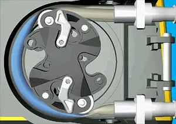

<figure class="eoc-pic eoc-pic-main"><picture><source media="(prefers-reduced-motion: reduce)" srcset="../media/peristaltic-pump.still.webp"></picture><figcaption><strong>Animation.</strong> <a href="https://commons.wikimedia.org/wiki/File:Peristaltic_pump.gif">Peristaltic pump</a> by Njmcca, <a href="https://creativecommons.org/licenses/by-sa/3.0">CC BY-SA 3.0</a>, from Wikimedia Commons.</figcaption></figure>

A rotor carrying two or more rollers squeezes a flexible tube against a curved track as it turns, so each squeezed point pushes a trapped pocket of liquid along the tube, giving a valve-free, self-priming pump in which only the tube touches the liquid and the amount pumped is set by how far the rotor turns (Wikipedia 'Peristaltic pump').

**In plain words:** A pump where little wheels on a spinning hub roll along a soft tube and squash it flat, pushing the liquid in front of them along the tube, like squeezing toothpaste along a tube with your fingers. The liquid only ever touches the inside of the tube, and every turn pushes out roughly the same amount, so it is handy for measuring out doses. **Proper term:** Peristaltic pump (roller pump, tube pump).

**Also called:** roller pump; tube pump, tubing pump (low-pressure type with unreinforced tubing and rollers); hose pump (high-pressure type with reinforced hose, sliding shoes and a lubricant-filled casing); peristaltic dosing pump, peristaltic metering pump; linear peristaltic pump, finger pump (the tube lies straight and is squeezed by a row of fingers, as in some medical infusion pumps); squeeze pump; 'sapsucker' pump (for maple sap); Masterflex (Avantor brand), Watson-Marlow (brand), Verderflex (Verder brand), Bredel (Watson-Marlow brand of hose pumps); Schlauchpumpe (German), pompe peristaltique (French).

## How it works

The tube lies in a curved channel, and the rollers on the turning rotor press it completely flat (occlusion) at two or more points at once, trapping a pocket of liquid between neighbouring rollers. As the rotor turns, the squashed points roll along the tube and push each pocket towards the outlet, while behind the last roller the springy tube pops back to round and sucks in fresh liquid from the inlet (Wikipedia; Adafruit). Because a squeezed point always blocks the tube, liquid cannot run back or siphon through when the pump stops, so no valves are needed (Wikipedia; Williamson Manufacturing). The amount pumped per turn is roughly fixed, so a stepper motor can turn it a set number of steps or part-turns to deliver a measured dose, and running the motor backwards reverses the flow (Wikipedia; Adafruit).

## Parts

A small assembly that acts as one unit: a rotor (hub) carrying 2-12 rollers, often ball bearings; a curved track or housing (the occlusion bed or stator) that the tube is pressed against; one length of soft tube (the only part the liquid touches); tube clamps or retainers at the inlet and outlet; and a drive (stepper motor, small geared DC motor, hand [crank](../glossary.md#crank) or drill), usually with a motor driver and microcontroller (Wikipedia; Nature Scientific Reports 2020; Printables 1556845). One printable design has the rollers as captive planet gears and prints as a single piece, needing only the tube (Tim's 'Parametric Peristaltic Pump').

## Everyday examples

- Hospital machines: medical infusion pumps, kidney dialysis machines and heart-lung machines move blood and drips this way (Wikipedia)
- Dosing pumps that feed detergent into commercial dishwashers and washing machines, and dosers for hydroponics and aquariums (Wikipedia)
- Drink and cheese-sauce dispensers, and the 'drink-bot' cocktail robots that makers build (Wikipedia; Adafruit; Hackaday 2014)
- Your own gut: the same squeezing wave (peristalsis) pushes food along your intestines (Wikipedia; Tim's blog)

## When to use it

Choose a peristaltic pump when the liquid must stay clean or must not touch metal or a motor (food, drinks, plant feed, lab samples, aggressive chemicals), because only the inside of the tube is wetted and the tube can be swapped or flushed (Wikipedia; Williamson Manufacturing). It is good for measured doses: a stepper motor turning a set number of steps gives a repeatable amount, so it suits plant-watering and fertiliser dosers, drink robots and lab liquid handling (Printables 63352; Nature Scientific Reports 2020). It primes itself, can run dry without damage for short periods, needs no valves, stops backflow and siphoning when off, and handles thick, gritty or shear-sensitive liquids that would jam or damage an impeller (Wikipedia; Williamson Manufacturing; Crest Pumps; Tim's blog). It is also reversible, and can recirculate liquid round a closed loop, which a syringe pump can't (Adafruit; Nature Scientific Reports 2020).

## When not to use it

Avoid it when you need smooth, pulse-free flow (choose a syringe pump or another positive-displacement pump, or add a pulsation damper), high flow at low cost (a centrifugal pump moves much more water per watt), or exact tiny doses over long periods (a syringe pump or piston pump is more precise; Hackaday 2018 comments) (Wikipedia). It is a poor choice for very high pressure or very viscous liquids (Wikipedia), and for machines that sit unused for months, because the tube takes a set where the rollers press it and sticky liquids can glue the tube shut as they dry (Hackaday 2018 comments). Small stepper motors may not have enough turning force to squash the tube; one maker switched back to a syringe design for this reason (Hackaday.io OSUG log). Never use a home-made pump on people (Masterflex: not intended for patient-connected use).

## Details

- **What it does (jobs):**
  - change the kind of motion: turns the turning of a motor shaft into a measured flow of liquid along a tube (Wikipedia; Nature Scientific Reports 2020)
  - seal it, or pass cables or fluid through: moves liquid through a closed, unbroken tube, so the liquid never touches the pump's moving parts and can't leak out round a shaft seal (Wikipedia; Williamson Manufacturing)
  - stop it moving back (one-way): while the rotor is stopped, the squeezed tube acts as a shut valve, preventing backflow and siphoning without separate [check valves](../glossary.md#check-valve) (Wikipedia; Williamson Manufacturing). It is not truly one-way: reversing the motor reverses the flow (Adafruit)
- **Movement:** rotate: the rotor turns continuously, or is stepped through part-turns for small doses (Wikipedia); the liquid moves along the tube
- **Directions it can move (degrees of freedom):** 1: only the rotor turns relative to the housing; the tube is held still in the housing
- **Special behaviour:**
  - motion conversion: rotation of the rotor becomes a flow of liquid; a fixed amount is pumped per turn, so counting turns or motor steps measures the dose (Wikipedia; Printables 63352 'Mini peristaltic pump for 28BYJ-48 stepper motor')
  - [self-locking](../glossary.md#self-locking): when the motor stops, the rollers keep the tube squeezed shut, so liquid can't flow back or siphon through the pump (Wikipedia; Williamson Manufacturing)
- **How it holds:**
  - not a holding joint (it moves or passes on motion): it moves liquid rather than holding parts together
  - friction or clamping ([force-fit](../glossary.md#form-fit--force-fit--material-bond)): the tube is held in place by clamps, retainers or barbed fittings in notches, or simply glued, so the rollers don't drag it through the pump (Nature Scientific Reports 2020; Tim's blog and its comments; Printables 1556845)
- **Input and output:** Continuous or stepped rotation -> pulsing liquid flow. Flow rises with rotor speed, tube bore (inside diameter) and pump-head diameter; adding rollers does not add flow (it slightly reduces it) but makes the pulses smaller and more frequent (Wikipedia). Examples: the open-source printed pump in Scientific Reports gave 0.46 mL/min with 0.79 mm bore tubing and 1.62 mL/min with 1 mm bore tubing at about 108 rpm, driven through a printed 4:1 gearbox (Nature Scientific Reports 2020); a Masterflex Easy-Load lab head moves about 0.06-3.8 mL per revolution depending on tube size (Masterflex manual). Pressure: printed hobby pumps are 'not designed for high-pressure applications' (Printables 1556845); a lab roller head is rated 15-40 psig (about 1-2.7 bar) depending on tube size (Masterflex Easy-Load manual); industrial roller pumps reach about 12 bar and shoe-type hose pumps about 16 bar (Wikipedia). Rough efficiency: low, because squashing the tube and the rolling friction use much of the motor's power ('added friction losses', Tim's blog) ⚑ [uncertain: no measured figure found]. Arrangement: the tube enters and leaves at the side of the rotor. Back-drivable: no while the tube is fully squeezed; pressure in the outlet line can't turn the rotor or flow back (Wikipedia).
- **Power:** powered: needs a motor (stepper, geared DC motor), a drill or a hand crank to turn the rotor (Hackaday 2018; Printables 1108179 'Drill Powered Peristaltic Pump'). When power is lost: the rotor stops and the rollers keep the tube squeezed, so flow stops and the line stays shut (keeps its last state) (Wikipedia)
- **Load:** light: hobby and printed pumps give millilitres per minute up to a few hundred millilitres per minute at low pressure; industrial hose pumps work against up to 16 bar (Wikipedia; Nature Scientific Reports 2020). The rotor needs a lot of turning force ([torque](../glossary.md#torque)) to squash the tube: one maker's own design closed the tube but stalled his stepper motors and needed a drill to turn it (Hackaday.io OSUG log)
- **Play and precision:** Dose precision is good but not exact: Wikipedia says the fixed volume per turn lets you 'roughly measure' the amount; in the printed Scientific Reports pump most of the variation between trials came from how tightly the tube was clamped, and once clamped the rate was 'highly uniform'. The delivered amount drifts as the tube ages, so recalibrate or replace the tube regularly (Hackaday 2018 comments). Output pulses at the rotor speed times the number of rollers (Nature Scientific Reports 2020). A [print-in-place](../glossary.md#print-in-place) planetary version had play in its gears that changed the squeeze as it turned, so it sealed at some angles and leaked back at others (Hackaday.io OSUG log)
- **Taking it apart:** removable: the pump head bolts onto its motor with a few screws, and the tube is a replaceable wear part that can be swapped in seconds on lab pumps (Printables 1556845; Williamson Manufacturing; Masterflex manual)
- **How often it can be reused:** many times: the pump itself can be taken apart and re-tubed again and again, but the tube is a consumable that wears out and needs replacing periodically (Wikipedia; Williamson Manufacturing)
- **Sealing:** watertight: the liquid stays inside one continuous tube and the squeezed points seal it off from the outlet; there are no shaft seals to leak (Wikipedia). It holds only modest pressure: 15-40 psig (about 1-2.7 bar) for a lab roller head (Masterflex Easy-Load manual), much less for most printed pumps (Printables 1556845)
- **Adjustable:** yes: flow is set by motor speed (stepper rate or PWM) and direction; the tube size can be changed by swapping the tube and, on printed designs, a matching stator or spacer; the squeeze (occlusion) is fixed by the roller-to-track gap or set by spring-loaded rollers (Wikipedia; Adafruit; Nature Scientific Reports 2020; Printables 1556845)
- **Access needed:** not applicable: it is a self-contained unit; you only need to reach the pump head to thread or swap the tube
- **Materials:** Housing and rotor: 3D-printed ABS, PLA, PETG or tough resin (Nature Scientific Reports 2020; Printables 1556845, 1108179); metal or engineering plastic on commercial heads. Rollers: ball bearings (608, MR93ZZ or 3x8x4 mm) or stainless-steel rollers (Printables 1556845, 11803, 63352; Masterflex). Tube (the only wetted part): silicone rubber, PVC, natural rubber, nitrile, EPDM, Hypalon, Viton, polyurethane, Santoprene or pharmaceutical-grade blends such as PharMed (brand). Natural rubber resists [fatigue](../glossary.md#fatigue) best, EPDM and Hypalon resist chemicals best, silicone suits water-based liquids, and stiff plastics such as PTFE and polyolefins can't be used alone because the tube must spring back to round (Wikipedia). The liquid can be water, slurries, viscous or shear-sensitive liquids, or aggressive chemicals, as long as the tube material suits it (Wikipedia; Williamson Manufacturing)
- **Heat, cold, water and wear:** The tube decides most limits. Chemicals: match the tube to the liquid (silicone suits water-based liquids but has limited chemical resistance; EPDM and Hypalon resist chemicals best; fuels need fluoroelastomer or lined tube) (Wikipedia). Ageing: the tube wears with every squeeze and needs periodic replacement; worn tube changes the flow rate (Wikipedia; Hackaday 2018 comments); left stopped for months the tube stays flat where the rollers pressed it, and for stop-start use silicone's low compression set makes it a good choice (Wikipedia; Hackaday 2018 comments). Dry running is fine for short periods, but long dry running heats and cracks the tube (Crest Pumps). Heat: printed PLA or PETG rotors can soften from friction if run hard (Hackaday.io OSUG log). Abrasive particles wear the tube's inside faster (Williamson Manufacturing). Sunlight (UV) ageing of silicone and PVC tube ⚑ [uncertain: not checked in a source].

## Making it

- **Ways to make or get it:**
  - 3D print (FDM): housings, rotors and stators in PLA, PETG or ABS, with ball bearings as rollers (Printables 1556845, 63352; Nature Scientific Reports 2020)
  - 3D print (resin): tight-tolerance rotors and cases, e.g. the drill-driven oil pump printed in a tough resin (Printables 1108179)
  - off-the-shelf part: ready-made 12 V and 5-6 V DC peristaltic pumps with silicone tubing (Adafruit), and lab pump heads and drives (Masterflex)
- **Printing it in one piece (print in place):** partly: most designs are printed as separate parts and assembled with bearings, screws and a motor (Printables 1556845). One OpenSCAD design based on a planetary gear bearing prints as a single, already-assembled piece with captive rollers and needs only the tube threading through it (Tim's blog; Hackaday 2014), but its gear [tolerances](../glossary.md#tolerance) must be tuned to your printer (Hackaday.io OSUG log)
- **Tools:** screwdriver or hex keys for the motor and housing screws; a vice, clamp or arbor press to press ball bearings into the rotor; a soldering iron if the design uses heat-set threaded inserts; scissors or a knife for the tube; optionally glue to stop the tube creeping; plus a motor driver and microcontroller for stepper versions (Printables 1556845, 63352 and 1108179; Nature Scientific Reports 2020)
- **Difficulty:** easy to moderate: a printed rotor with pressed-in ball bearings on a stepper motor is a popular, well-documented build, but getting the squeeze right takes trial and error (too tight stalls the motor and wears the tube, too loose lets liquid slip back), and the one-piece print-in-place version needs its tolerances tuned to your printer (Hackaday 2018; Hackaday.io OSUG log; Wikipedia)

### 3D printing tips

1) Let the bearings, not the plastic, touch the tube: press ball bearings onto the rotor as rollers, so the tube is only pressed by smooth bearings and never rubs on printed surfaces (Hackaday 2018; Nature Scientific Reports 2020). Seat the bearings flat in their pockets so they run square. 2) Print strong rotors: one popular NEMA 17 design uses 60% [infill](../glossary.md#infill) for the bearing holder and 15% for the housing at 0.2 mm layers in PLA, PETG or ABS, with no supports in the recommended orientation, and presses five 608 bearings in without glue (Printables 1556845). Small pumps for 3-4 mm tubing need a 0.25 mm nozzle and 0.1-0.15 mm layers; PETG works well with melted-in thread inserts, while PLA melts too easily around them (Printables 63352). 3) Set the squeeze: the gap between roller and track should squash the tube's two walls by about 10-20% beyond touching (occlusion; Wikipedia); a parametric printed pump used a 'squish ratio' of 0.5 with good results and suggests less squeeze if you don't need much pressure, to cut friction (Tim's blog). The tube's wall thickness, not its bore, decides whether it fits a given pump (Wikipedia). 4) Use soft tube only: hard tubing won't work (Printables 1556845); silicone tube of about 50 Shore A worked in the Scientific Reports pump. 5) Stop the tube creeping: the rollers tend to drag the tube slowly through the pump, so clamp it at both ends, lightly glue it, or use barbed unions locked into notches in the housing (Tim's blog and comments; Printables 1556845). 6) For a one-piece planetary pump, adjust the [clearance](../glossary.md#clearance) setting (default 0.15 mm) and the allowed [overhang](../glossary.md#overhang--bridging) (45-60 degrees suits most FDM printers); a thin skin may join the gears on the first layer and can be broken free by turning them (Tim's blog; Appropedia copy of the OpenSCAD file; Hackaday 2014 comments). 7) Don't run it hard: one maker's printed pump heated up from friction and deformed when he tested how far it could squirt (Hackaday.io OSUG log); test at low speed first (Printables 1556845). 8) For bigger flows, a larger pump diameter is kinder to the tube (Tim's blog; Wikipedia).

### Buying one (off-the-shelf parts)

Ready-made pumps: 'peristaltic liquid pump' with silicone tubing (12 V or 5-6 V DC, e.g. Adafruit 1150), 'peristaltic dosing pump'; lab 'pump heads' and 'pump drives' (e.g. Masterflex L/S Easy-Load, brand). Parts for printed pumps: deep-groove ball bearings (608, MR93ZZ, 3x8x4 mm), NEMA 17 or NEMA 14 stepper motor, 28BYJ-48 geared stepper with ULN2003 driver board, stepper drivers (A4988, DRV8825), M3 screws and heat-set threaded inserts, barbed tube connectors. Tubing: 'peristaltic pump tubing' in silicone, PVC, Norprene, PharMed BPT or Tygon (brands), sized by bore and wall thickness (Printables 1556845, 63352, 11803; Adafruit; Masterflex manual; Hackaday 2018 comments; Wikipedia)

## Rules of thumb

- Squeeze (occlusion) is usually 10-20% of twice the tube wall thickness: more for soft tube, less for hard tube. Too much squeeze shortens tube life sharply; too little lets liquid slip back, especially at higher pressure (Wikipedia 'Peristaltic pump', Occlusion)
- The tube's wall thickness, not its bore, decides whether it fits a pump, so several bores with the same wall can share one pump head (Wikipedia)
- Flow rises with tube bore, pump-head diameter and speed; more rollers do not add flow, they give smaller, faster pulses but squeeze the tube more often and shorten its life. A longer squeezed length adds pinch points and lets the pump push against more pressure (Wikipedia)
- The main pulse frequency equals the rotor speed times the number of rollers (Nature Scientific Reports 2020)
- Pressure limits: tube (roller) pumps up to about 12 bar; reinforced hose pumps with shoes up to about 16 bar (Wikipedia); a typical lab roller head 15-40 psig (about 1-2.7 bar), lower for the larger tube sizes (Masterflex Easy-Load manual)
- Suction lift: theoretical maximum about 33 ft (10 m) (Wikipedia); commercial pumps typically lift 8-9 m dry (Crest Pumps) or 5 m plus (Williamson Manufacturing); a small hobby DC pump self-primes about half a metre (Adafruit)
- Chemical check for a tube: soak a 1-2 inch sample in the liquid for 24-48 hours; if its weight changes by more than 10%, don't use that tube material (Wikipedia)
- For tube life, keep the tube straight where it enters and leaves the pump head, and give it a light tug to pre-stretch it when loading (Masterflex Easy-Load manual)
- Accurate dosing needs a steady inlet; heavy inlet pulsation squashes the tube oval and reduces flow, so add a pulsation damper or recalibrate (Wikipedia); recalibrate or change the tube as it ages (Hackaday 2018 comments)

## Common failures

1) Flow rate drifts as the tube wears and loses springiness: recalibrate, use a flow meter, or change the tube regularly (Hackaday 2018 comments; Wikipedia). 2) Tube stays flat after standing idle for months, and sticky liquids dry and glue it shut: flush the line after use and release or replace the tube (Hackaday 2018 comments). 3) Tube [creeps](../glossary.md#creep) or 'walks' through the pump: clamp, glue or barb-lock it at both ends, or leave extra slack upstream (Tim's blog and comments; Printables 1556845). 4) Motor stalls: too much squeeze or too weak a motor; reduce the squeeze, gear the motor down (the printed Scientific Reports pump uses a 4:1 gearbox) or run slower (Hackaday.io OSUG log; Printables 11803). 5) Too little squeeze: liquid slips back, flow falls and the fast backflow wears the tube (Wikipedia). 6) Printed parts heat up and deform from friction at high speed (Hackaday.io OSUG log). 7) Uneven squeeze from play in printed gears or a wobbly rotor, so the pump leaks back at some rotor angles (Hackaday.io OSUG log). 8) Tube burst or pinholes near the outlet from over-pressure, chemical attack or use beyond its rated life (Wikipedia). 9) Flow varies because the tube was clamped with different tension each time (Nature Scientific Reports 2020).

## Safety

Pinch and crush point: fingers or loose clothing can be caught between the rollers and the track, so stop and unplug the drive before loading or changing the tube (Masterflex Easy-Load and High-Performance manuals). A worn or chemically attacked tube can split, and a positive-displacement pump keeps pushing against a blocked outlet, so a split tube or a hose blown off its fitting can spray the liquid; use eye protection with chemicals ⚑ [uncertain: inferred from Wikipedia's tube-rupture and tube-life notes, no hobby source states it directly]. Commercial lab pumps say they are not designed for patient-connected or medical use (Masterflex), so never use a DIY pump on people. Tubing sold with cheap pumps may be dirty and not food-rated: sterilise it, and buy food-grade tube for drinks (Adafruit). Keep liquids away from the motor electronics.

## Related

- Syringe pump (syringe driver): a motor-driven screw pushes a syringe plunger; smoother and more precise for small volumes, but limited to the syringe's volume and can't recirculate (Nature Scientific Reports 2020; Hackaday 2018 comments)
- Diaphragm pump and squeeze bulb: a flexing rubber disc between two check valves; suits air and thin liquids, but needs valves that the peristaltic pump does without
- Gear pump: two meshing gears carry liquid round; smoother and higher pressure, but the liquid touches the gears and seals
- Centrifugal pump: a spinning impeller gives lots of flow at low pressure but must be primed and doesn't measure doses
- Pinch valve (covered in the Iris valve entry): squeezes a soft tube only to shut it off, rather than rolling along it to pump (Wikipedia 'Peristaltic pump' is its contrast)
- Linear peristaltic pump (finger pump): the same idea with the tube straight and a row of cams or fingers squeezing it in sequence (Wikipedia; Wikimedia Commons animation)
- Hose pump: the heavy-duty version with sliding shoes, a reinforced hose and a lubricant-filled casing, working against up to 16 bar (Wikipedia)
- Check valve (one-way valve): needed by most other pumps to stop backflow; the peristaltic pump's squeezed tube does this job itself

## Make it yourself

- [Parametric Peristaltic Pump by Drmn4ea (Thingiverse)](https://www.thingiverse.com/thing:454702): One-piece print-in-place pump adapted from emmett's planetary gear bearing, with captive rollers; needs only a length of tube (about 3/16 in OD latex surgical tubing for the default file) and an Allen key or motor to turn it. OpenSCAD source lets you set tube size, squeeze, clearance and overhang *(licence: CC BY-SA 3.0 (stated in the OpenSCAD file header, copied on Appropedia; Thingiverse page showed no licence to the fetch tool))*
- [3D printed peristaltic pump (Appropedia)](https://www.appropedia.org/3D_printed_peristaltic_pump): Copy of the full OpenSCAD source for the planetary print-in-place pump, with the tube outer diameter, wall thickness, squish ratio, clearance (tol) and overhang parameters explained in comments *(licence: CC BY-SA 3.0 (code header))*
- [V2 -- Nema 17 Peristaltic Pump / Water Pump / measuring Pump (Maximilian Puschmann, Printables)](https://www.printables.com/model/1556845-v2-nema-17-peristaltic-pump-water-pump-measuring-p (URL from Printables API, page not opened)): Popular fully printable pump for a NEMA 17 stepper with five 608 bearings and 8 mm soft silicone tubing, with print settings and assembly notes *(licence: CC BY-SA)*
- [Mini peristaltic pump for 28BYJ-48 stepper motor (Daniel, Printables)](https://www.printables.com/model/63352-mini-peristaltic-pump-for-28byj-48-stepper-motor (URL from Printables API, page not opened)): Small dosing pump for 3 or 4 mm silicone tubing driven by the cheap 28BYJ-48 geared stepper; Fusion 360 files included *(licence: GNU GPL v3.0)*
- [Drill Powered Peristaltic Pump, Gear Oil Transfer Pump (Tate S, Printables)](https://www.printables.com/model/1108179-drill-powered-peristaltic-pump-gear-oil-transfer-p (URL from Printables API, page not opened)): Resin-printed pump turned by a cordless drill, using 608 bearings and 1/4 in ID silicone tubing, for transferring gear oil *(licence: CC BY-NC)*
- [Open-source, 3D-printed Peristaltic Pumps for Small Volume Point-of-Care Liquid Handling (Scientific Reports, 2020)](https://www.nature.com/articles/s41598-020-58246-6): Open-source lab pump (about $120) with ABS-printed rotor, stator and 4:1 gearbox, three ball-bearing rollers and Arduino control; STL files and bill of materials in the supplementary files *(licence: CC BY 4.0 (article))*

## Pictures, videos and models

- [Peristaltic pump.gif (Njmcca; Wikimedia Commons)](https://commons.wikimedia.org/wiki/File:Peristaltic_pump.gif): Animation of a roller rotor squeezing a tube and pushing liquid along it (used on Wikipedia's 'Peristaltic pump' page) *(licence: CC BY-SA 3.0)*
- [Linear peristaltic pump animation (Richard Schneider; Wikimedia Commons)](https://commons.wikimedia.org/wiki/File:Schlauchpumpe-lineare-Bauart-transparant-indizert-bewegt.gif): Animation of a linear (finger) peristaltic pump, where a row of fingers squeezes a straight tube in sequence *(licence: CC BY-SA 3.0)*
- [Schlauchpumpe Funktionsprinzip (Fluidity.nonstop; Wikimedia Commons)](https://commons.wikimedia.org/wiki/File:Schlauchpumpe_Funktionsprinzip.gif): Animation of a hose pump that squeezes the hose with sliding shoes instead of rollers *(licence: CC BY-SA 4.0)*
- [How Peristaltic Metering Pumps Work - Helpful Animation by Albin Pump (Albin Pump, YouTube)](https://www.youtube.com/watch?v=zWozq_wuAx4): Animated explanation of how the rollers squeeze the tube to meter liquid (title and channel confirmed via YouTube oEmbed; video not watched) *(licence: link only)*
- [Peristaltic pump (Wikipedia)](https://en.wikipedia.org/wiki/Peristaltic_pump): Article with the animation, photos of lab pump heads and a linear-pump diagram, plus sections on occlusion, flow rate, pulsation and tubing *(licence: CC BY-SA 4.0 (text); images per file)*

## Needs confirming

⚑ marks something nobody has confirmed yet: a fact the research could not confirm from a source, a finder value that is a best guess, or an open point from the research notes. Corrections are welcome (see `research/needs-confirming.md`).

- ⚑ 3 sentences on this page marked [uncertain].
- ⚑ Finder value `connects` = tube, rod or extrusion (best guess): worked out from its name, but joining parts is not one of its two main jobs

## Sources

- <https://en.wikipedia.org/wiki/Peristaltic_pump>
- <https://hackaday.com/2018/10/27/the-bolt-on-peristaltic-pump/>
- <https://hackaday.com/2014/09/16/a-3d-printed-peristaltic-pump/>
- <https://tim.cexx.org/?p=1282>
- <https://www.appropedia.org/3D_printed_peristaltic_pump>
- <https://www.thingiverse.com/thing:454702>
- <https://hackaday.io/project/20458-osug-open-source-underwater-glider/log/66453-functional-peristaltic-pump-and-why-im-not-using-it>
- <https://www.nature.com/articles/s41598-020-58246-6>
- <https://www.wmcpumps.com/blog/peristaltic-pumps-introduction>
- <https://www.crestpumps.co.uk/resources/blog/a-guide-to-peristaltic-pumps>
- <https://www.verderliquids.com/int/en/pump-technologies/peristaltic-pump/>
- <https://www.sterlitech.com/media/wysiwyg/Masterflex-Easy-Load-Pump-Head-Manual.pdf>
- <https://lab-eu.com/ws/media-library/b4330258be3e4fc8bc95b4b1d6c7bc32/77252-xx-manual-masterflexr-l-sr-high-performance-pump-heads.pdf>
- <https://www.adafruit.com/product/1150>
- <https://api.printables.com/graphql/ (models 1556845, 63352, 11803, 1108179)>
- <https://commons.wikimedia.org/wiki/File:Peristaltic_pump.gif>
- <https://commons.wikimedia.org/wiki/File:Schlauchpumpe-lineare-Bauart-transparant-indizert-bewegt.gif>
- <https://commons.wikimedia.org/wiki/File:Schlauchpumpe_Funktionsprinzip.gif>
- <https://www.youtube.com/watch?v=zWozq_wuAx4>
