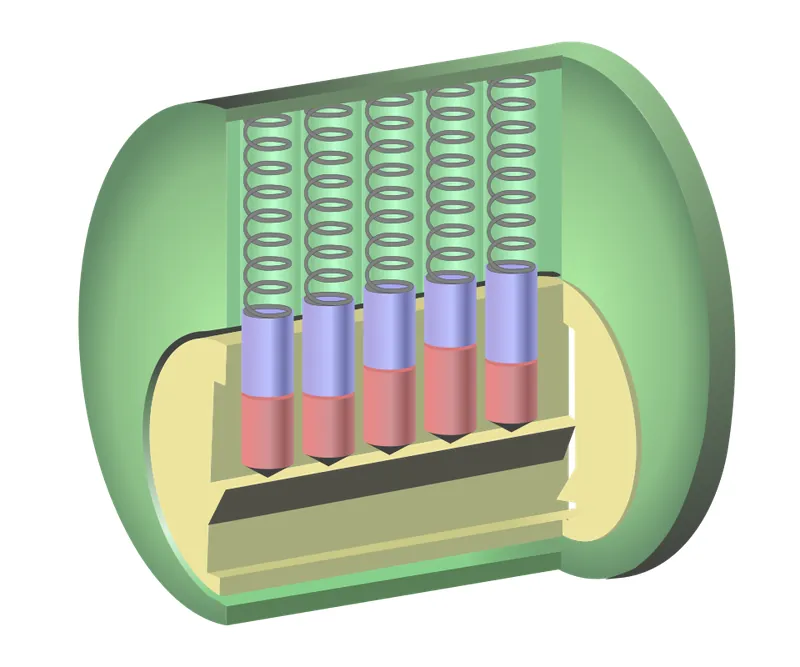

<figure class="eoc-pic eoc-pic-main"><figcaption><a href="https://commons.wikimedia.org/wiki/File:Pin_tumbler_no_key.svg">Pin tumbler no key</a> by Original: GWirken Vector: Pbroks13, <a href="http://creativecommons.org/licenses/by-sa/3.0/">CC BY-SA 3.0</a>, from Wikimedia Commons.</figcaption></figure>

A tumbler lock uses several small movable blockers (pins, wafers, levers or discs) that each have to be moved to one exact position by the matching key before the lock's core can turn or its bolt can slide.

**In plain words:** The everyday key lock: a row of little spring-loaded pins (or flat plates or levers) jams the lock until a key with the right bumps lifts every one to exactly the right height, and then the core can turn. **Proper term:** Pin-tumbler lock (cylinder lock); other tumbler locks: wafer tumbler lock, lever tumbler lock, disc-detainer lock, tubular pin-tumbler lock.

**Also called:** Yale lock (name taken from the Yale inventors and brand); cylinder lock / lock cylinder / keyed cylinder; Euro cylinder / euro-profile cylinder (DIN profile), oval cylinder, rim cylinder (night-latch cylinder), mortise cylinder, key-in-knob cylinder; tumbler lock / keyed lock; dimple lock (pin tumbler with the cuts on the flat side of the key); wafer lock / wafer tumbler lock / plate tumbler (desk, locker and car locks); lever lock / lever tumbler lock / detainer lock / mortice lock, e.g. 'five-lever lock' (UK); disc-detainer lock / disc tumbler lock / rotating-disc lock; Abloy (brand); tubular lock / circle pin tumbler / [radial](../glossary.md#axial--radial) lock; Ace lock (trade name); padlock (a portable lock that usually contains one of these mechanisms).

## How it works

In a pin-tumbler lock a plug sits inside a housing, and holes run through both. Each hole holds a key pin (touching the key) and a driver pin pushed down by a spring; with no key the driver pins sit across the join between plug and housing (the [shear](../glossary.md#peel-vs-shear) line), so the plug can't turn. The right key lifts each pin pair by exactly the amount that puts the gap between key pin and driver pin on the shear line, so the plug turns and a cam at its back moves the bolt; a wrong key leaves at least one pin straddling the line. The other tumbler locks use the same 'every blocker to exactly the right place' idea (lifting too far is as bad as not far enough): flat wafers that must sit flush with the plug, levers that must be lifted so a gate lines up with the bolt stump, or discs the key rotates until their notches line up and a sidebar can drop in.

## Parts

A small assembly that acts as one unit. Pin-tumbler: outer housing (shell or cylinder, whose top part holding the pin chambers is called the bible), rotating plug with a keyway, usually five or six pin stacks each made of a key pin, a driver pin and a spring, a retaining clip or cam at the back, and the key. Wafer lock: plug, single-piece spring-loaded wafers, housing. Lever lock: bolt with a stump, a stack of flat levers each with a gate, lever springs, case, and a bit key. Disc-detainer: stack of slotted rotating discs, sidebar, housing, key; no springs.

## Everyday examples

- a front-door cylinder lock (euro cylinder or rim cylinder) and most key padlocks: pin tumblers
- desk drawers, office cabinets, lockers, electrical panels and car locks: wafer tumbler locks
- UK wooden front doors (five-lever mortice locks) and safe-deposit boxes: lever tumbler locks
- vending machines, lifts and bike locks with a round key: tubular pin-tumbler locks

## When to use it

When something should open only for people who hold a physical key: doors, boxes, cabinets, lockers, padlocked gates and chests. Buy real locks for anything that matters. Print one to learn how locks work, as a fun lock box or puzzle, or as a teaching model; keyed-alike or master-keyed cylinders suit a workshop where one key should open several doors.

## When not to use it

Don't use a 3D-printed lock to protect anything valuable; any printed lock is weak (Hackaday) and easy to pick. Where keys get lost or shared a lot, a combination lock or an electronic keypad lock avoids handing out keys. For a child-proof cupboard that should look plain, use a hidden magnetic latch. For locks exposed to grit and harsh weather, a disc-detainer lock (no springs) or a covered keyhole copes better. If you only need to stop two actions happening together, use an interlock (a trapped-key interlock uses a keyed lock for this).

## Details

- **What it does (jobs):**
  - lock, and release by hand: keeps a door, drawer, box, padlock shackle or cabinet locked until someone turns the matching key
- **Movement:** multiple: the pins, wafers or levers slide or pivot a millimetre or so; the plug then rotates (often a quarter turn to a full turn; a disc-detainer key is turned about 90 degrees) and works a cam that slides the bolt or releases a padlock shackle
- **Directions it can move (degrees of freedom):** Locked: 0 between plug and housing. Unlocked: the plug has 1 (rotation about its own axis). Inside, each pin, wafer or lever has 1 (it slides or pivots in its own chamber).
- **Special behaviour:**
  - hand-release only (locks under load, releases when a person operates it): it stays locked however hard you push or turn without the key, and opens only when the matching key sets every tumbler
- **How it holds:** shape ([form-fit](../glossary.md#form-fit--force-fit--material-bond)): pins, wafers, levers or a sidebar physically block the plug or bolt; spring force (a small spring behind each pin or wafer) returns them to the locked position; disc-detainer locks use no springs
- **Input and output:** not applicable as a transmission; in use, turning the key rotates the plug, and a cam or tailpiece converts that into the short straight travel of the bolt or the release of a shackle
- **Power:** passive (no power needed). Electronic and motorised locks are separate entries.
- **Load:** medium: strong against turning and pulling on the plug without the key but weaker than the door or hasp around it. EN 1303 requires keys to survive 2.5 N·m of [torque](../glossary.md#torque), and plug torque resistance of 2.5 to 15 N·m depending on security grade (up to 20-30 N·m in the attack-resistance grades). Common weak points are lock snapping of euro cylinders with pliers, drilling, and, for luggage locks, thin shackles. 3D-printed locks are light-duty toys and demonstrators.
- **Play and precision:** High precision is what makes it secure. Real key cuts differ by fractions of a millimetre (e.g. Kwikset keys step in 0.023 in, about 0.58 mm); binding between the pins, plug and housing, which depends on manufacturing [tolerances](../glossary.md#tolerance), is what lets a picker set pins one at a time (Lockwiki, Binding and Pin-tumbler). Printed demonstrators are usually scaled up (SquidgyPlastic's is much larger than a real lock) and use looser [clearances](../glossary.md#clearance), so they are far less secure ⚑ [uncertain: effect on pick resistance not measured].
- **Taking it apart:** tool-free quick release for the thing it locks (just turn the key); the lock itself is removable: a euro cylinder comes out after loosening one [set screw](../glossary.md#set-screw) so it can be changed without changing the rest of the lock, and padlocks simply unhook
- **How often it can be reused:** effectively unlimited for normal use: the European cylinder standard EN 1303 grades durability at 25,000, 50,000 or 100,000 test cycles (Lockwiki summary of EN 1303). Printed locks wear much faster ⚑ [uncertain: no cycle figures for printed locks found].
- **Sealing:** none; at best dust-resistant: some padlocks have a spring-loaded cover over the keyhole to keep dirt out (Wikipedia, Padlock), and disc-detainer locks, having no springs, cope better with harsh outdoor conditions
- **Adjustable:** Yes, by rekeying: a locksmith (or a careful maker) changes the key pins (and driver or spacer pins) to suit a new key, or swaps the whole cylinder. Master [keying](../glossary.md#keying) adds spacer pins so a second key also works. Lever locks are harder to master-key; some safe lever locks can be reset with a change key.
- **Access needed:** both sides: a door cylinder goes right through the door and is fixed from the door edge or inside; a padlock needs no fitting (not applicable)
- **Materials:** Commercial locks: metal housings, plugs and pins with small coil springs ⚑ [uncertain: brass plugs and pins and steel springs are usual but not confirmed on an opened page]; lever-lock levers are usually a non-ferrous metal (Wikipedia, Lever tumbler lock); hardened steel inserts, anti-drill plates and hardened bolts in security locks; steel or brass springs. Printed demonstrators: PLA or PETG bodies and plugs, printed or metal-dowel pins (e.g. 5 mm steel dowels), ballpoint-pen springs.
- **Heat, cold, water and wear:** EN 1303 temperature grades test that a cylinder still turns with at most 1.5 N·m of key torque at -25 °C and +65 °C (Lockwiki). Water can freeze inside; regular [lubrication](../glossary.md#lubrication) helps minimise freezing, and dusty or corrosive locations need cleaning and lubricating every 3 months (Master Lock). Disc-detainer locks, having no springs, are better in harsh conditions (Wikipedia). Printed PLA locks soften above about 60 °C; PETG is fine below about 80 °C (Prusa). Plastic springs relax if held compressed, so use metal springs for pins (DuPont, p. 36).

## Making it

- **Ways to make or get it:**
  - off-the-shelf part: lock cylinders, padlocks, cabinet cam locks (often wafer locks), mortice lever locks, tubular locks
  - 3D print (FDM): scaled-up working pin-tumbler, wafer, lever and disc-detainer demonstrators and lock boxes
  - 3D print (resin): smaller, finer pins and keys ⚑ [uncertain: no resin-printed lock example opened]
  - CNC: machining plugs, housings and pins (lathe work) for metal replicas ⚑ [uncertain: no example opened]
- **Printing it in one piece (print in place):** no: the plug, housing, pins, key and springs are printed or bought separately and assembled (springs are usually metal pen springs)
- **Tools:** To use: the key. To fit a cylinder: screwdriver (a euro cylinder is held by one set screw); a mortice lock also needs a pocket cut in the door edge ⚑ [uncertain: fitting details not from an opened source]. To rekey: a plug follower and a pinning kit (locksmith tools). For printed locks: sandpaper or files, and ballpoint-pen springs or small compression springs.
- **Difficulty:** moderate: a scaled-up, 3- to 5-pin printed demonstrator works with a well-tuned printer, some sanding and pen springs; a lock that is actually secure needs precise machining and hardened parts, so buy one

### 3D printing tips

Start from a proven model and print it bigger than a real lock; real key steps are well under a millimetre, too fine for FDM. Plug and housing: one maker printed them in PLA at 0.2 mm layers with 10% [infill](../glossary.md#infill) and printed the small driver and key pins at finer 0.1 mm layers (Ceravyn's model, via 3DPrint.com). Print the plug and housing with the pin holes vertical, because the big round plug is easier to sand than the small pin holes (Spoolpin, Printables 586683). Print the key lying flat, for strength and so the [layer lines](../glossary.md#layer-lines) let it slide in smoothly (LockManipulator, Printables 975759). Clearances: start with at least 0.3 mm between parts that move (Prusa) and test-fit; one OpenSCAD model warns that it has many close-fitting parts and needs a well-tuned printer, and needed supports for the body, core and key (SquidgyPlastic, Printables 519939). Pins: metal dowels (e.g. 5 mm steel dowels of various lengths) slide far better than printed pins (Rocco's Vault with Pin Tumbler Lock). Springs: pen springs cut to length work (Ceravyn; SquidgyPlastic used 24 x 4.5 mm pen springs); weak springs are better than strong ones: Rocco's vault used springs of 4 mm outside diameter, 0.3 mm wire, 20 mm free length and 0.25 N/mm, and found most stronger springs made the key hard to insert. Lever locks: levers and spacers that have to flex should be printed in PETG (Rocco's Mini Vault with Lever Tumbler Lock). Sand or file any pin that sticks; [elephant's foot](../glossary.md#elephants-foot) on the plug or pin holes is a common cause of binding ⚑ [uncertain: general printing knowledge]. Use PETG rather than PLA for anything left in a hot car or sun, since PLA softens above about 60 °C (Prusa).

### Buying one (off-the-shelf parts)

Euro-profile cylinder (single, double, thumb-turn; anti-snap rated to TS007 3 star or Sold Secure SS312 Diamond), rim cylinder (night-latch cylinder), mortise cylinder, key-in-knob cylinder, keyed-alike and master-keyed cylinder sets, padlocks (laminated or solid body), cabinet cam lock (quarter-turn, wafer or pin cylinder), tubular (radial) cam lock, five-lever mortice deadlock to BS 3621, disc-detainer padlock, pinning kit and plug follower (for rekeying), PTFE lock lubricant, compression springs (pen springs), steel dowel pins.

## Rules of thumb

- Most pin-tumbler cylinders have five or six pin stacks (Wikipedia, Pin tumbler lock, https://en.wikipedia.org/wiki/Pin_tumbler_lock).
- EN 1303 cylinder grades: at least 5 movable detainers (pins) for key-security grades 3-4 and 6 for grades 5-6, with at least 15,000 to 100,000 effective key differs; durability grades of 25,000, 50,000 or 100,000 cycles; keys must survive 2.5 N·m; temperature grades must still turn with at most 1.5 N·m of key torque at -25 °C and +65 °C (Lockwiki summary of EN 1303, https://www.lockwiki.com/index.php/EN_1303).
- Real key cuts are tiny: a Kwikset .023 key steps its cut depths in 0.023 in (about 0.58 mm), spaces cuts 0.150 in (about 3.8 mm) apart, allows at most 4 steps between neighbouring cuts (MACS) and has a plug diameter of 0.498 in (Key Bitting Specifications, T. J. Thomas, 2025, p. 57, https://lsamichigan.org/Tech/KeyBittingSpecifications-TylerJThomas.pdf), so printed demonstrators are scaled up.
- A good tumbler must block when lifted too far as well as too little (double-acting detainer, Barron 1778; Wikipedia, Lever tumbler lock, https://en.wikipedia.org/wiki/Lever_tumbler_lock). Early single-pin locks could be opened by lifting everything high.
- UK insurers usually ask for a five-lever mortice lock to BS 3621 on wooden outside doors; BS 3621:2007 requires a 20 mm bolt throw (Wikipedia, Lever tumbler lock).
- Lubricate locks sparingly with a PTFE lock lubricant every 3-6 months (every 3 months in dusty or corrosive places) and never with dry graphite or silicone (Master Lock care guide, https://www.masterlock.com/cms/locker/care).
- For printed locks, weak springs work best: 0.25 N/mm, 4 mm OD, 20 mm free length pen-type springs worked in Rocco's printed pin-tumbler vault, while stronger ones made the key hard to insert (https://www.printables.com/model/820936-vault-with-pin-tumbler-lock, URL from Printables API, page not opened; details read via the API).
- Start with at least 0.3 mm clearance for printed parts that must move (Prusa, https://help.prusa3d.com/article/modeling-with-3d-printing-in-mind_164135).

## Common failures

(1) Key stiff or won't turn because of dirt, a worn key or frozen water: blow out the keyway and use a little PTFE lock lubricant; avoid graphite build-up and silicone (Master Lock). (2) Worn or badly copied key: get a key cut to code rather than copying a copy ⚑ [uncertain]. (3) Euro cylinder snapped with pliers: fit an anti-snap cylinder (TS007 3 star or SS312 Diamond; Wikipedia). (4) Key breaks in the lock: don't use the key as a lever; print keys flat and thick. (5) Printed lock binds: pin holes too tight, elephant's foot or rough layer lines; sand, print pins at finer layers and give more clearance. (6) Printed springs or overly strong springs make the key hard to insert: use weaker metal springs (Rocco). (7) Tumblers mis-assembled (pins in the wrong holes, wafers upside down): lay parts out in order and follow the model's diagram.

## Safety

Few physical hazards; the main risks are lockouts (keep a spare key somewhere safe) and false security. Locks can be picked, bumped, snapped or drilled, and a clear photo of a key can be enough to copy it (the TSA luggage master keys were reproduced from published images; Wikipedia, Luggage lock). Only pick locks you own or have permission to pick. Pins and springs are small parts, so keep them away from small children ⚑ [uncertain: general small-parts caution]. Don't put a lock on a door in a way that could trap someone inside without an inside release ⚑ [uncertain: general building-safety advice].

## Related

- Warded lock: an older, low-security key lock where fixed obstructions (wards) only check the key's outline; there are no movable tumblers, so a skeleton key can open it
- Combination lock (wheel pack): the same 'line every blocker up' idea but set by numbers instead of a key; nothing to lose, but the code can be forgotten or watched
- Magnetic keyed lock: tumblers moved by coded magnets in the key instead of by its shape
- Cam latch (quarter-turn cam lock): the latch that a small cabinet lock cylinder often turns
- Basic latches (spring latch, slide bolt): the bolt that a key-operated cylinder usually retracts
- Mechanical interlock: trapped-key interlocks use keyed locks to force a safe order of operations
- [Ratchet](../glossary.md#ratchet) and [pawl](../glossary.md#pawl): Reuleaux described key locks as ratchet trains in which the tumbler acts as a locking pawl (Kinematics of Machinery, pp. 466-467)
- Hidden latches (magnetic-key latch, puzzle lock): no visible keyhole at all
- [Solenoid](../glossary.md#solenoid) latch and servo or motorised latch: electrically released locks for keypads, cards and apps

## Make it yourself

- [Pin Tumbler Lock by SquidgyPlastic (Printables 519939; page appeared in search results, details read via the Printables public API)](https://www.printables.com/model/519939-pin-tumbler-lock): OpenSCAD script (Customizer settings) that generates a working, oversized pin-tumbler lock and key; needs five pen springs (24 x 4.5 mm); printed in PETG *(licence: CC BY-SA)*
- [Cutaway pin tumbler lock (easy print, no supports) by LockManipulator (Printables 975759) (URL from Printables API, page not opened)](https://www.printables.com/model/975759-cutaway-pin-tumbler-lock-easy-print-no-supports): Three-pin cutaway lock and key that prints without supports, for seeing the pins move *(licence: Public domain (CC0))*
- [Vault with Pin Tumbler Lock by Rocco's Stuff (Printables 820936) (URL from Printables API, page not opened)](https://www.printables.com/model/820936-vault-with-pin-tumbler-lock): Printed lock box with a working pin-tumbler lock using 5 mm steel dowels as pins and small compression springs; prints without supports in PLA or PETG *(licence: CC BY-NC-SA)*
- [Mini Vault with Lever Tumbler Lock by Rocco's Stuff (Printables 1059790) (URL from Printables API, page not opened)](https://www.printables.com/model/1059790-mini-vault-with-lever-tumbler-lock): All-printed lock box with a working lever tumbler lock; flexing levers and spacers printed in PETG *(licence: CC BY-NC-SA)*
- [Wafer Lock by zbzzn (Printables 576652) (URL from Printables API, page not opened)](https://www.printables.com/model/576652-wafer-lock): Printable cutaway wafer tumbler lock, with an Onshape model for making more keys *(licence: CC BY)*

## Pictures, videos and models

- [Pin tumbler no key.svg (Wikimedia Commons; original by GWirken, vector by Pbroks13)](https://commons.wikimedia.org/wiki/File:Pin_tumbler_no_key.svg): Cut-away diagram of a pin-tumbler lock with no key: driver pins pushed across the shear line block the plug *(licence: CC BY-SA 3.0 and GFDL 1.2+ (reuse with credit))*
- [Pin tumbler with key.svg (Wikimedia Commons; original by Wapcaplet, vector by Pbroks13)](https://commons.wikimedia.org/wiki/File:Pin_tumbler_with_key.svg): The same lock with the correct key inserted: every pin gap sits on the shear line *(licence: CC BY-SA 3.0 (reuse with credit))*
- [Lever tumbler lock animation.gif (Wikimedia Commons, Joram van Hartingsveldt, 2008)](https://commons.wikimedia.org/wiki/File:Lever_tumbler_lock_animation.gif): Animation of a key lifting the levers of a lever tumbler lock so the bolt stump passes through their gates *(licence: CC BY-SA 3.0 and GFDL 1.2+ (reuse with credit))*
- [Deviant's Lock Diagrams and Animations (TOOOL US)](https://toool.us/deviants-lock-diagrams-animations/): Pin-tumbler diagrams and animations: basics, security (spool and mushroom) pins, bumping, snapping, impressioning and master keying *(licence: free for non-commercial use with attribution, derivatives must keep the same freedom (Creative Commons style, variant not named))*
- [How locks work - Animation | How Pin Tumbler Locks Work (How it Works?, YouTube; title confirmed via YouTube oEmbed)](https://www.youtube.com/watch?v=oGiV0mYNk0s): 3D animation of a pin-tumbler lock with and without the right key *(licence: link only)*

## Needs confirming

⚑ marks something nobody has confirmed yet: a fact the research could not confirm from a source, a finder value that is a best guess, or an open point from the research notes. Corrections are welcome (see `research/needs-confirming.md`).

- ⚑ 10 sentences on this page marked [uncertain].
- ⚑ Finder value `connects` = lid, door or cover (best guess): worked out from its name, but joining parts is not one of its two main jobs
- ⚑ Finder value `tools` = hand tools (source uncertain): `tools_needed` is marked ⚑ [uncertain] here: "…e set screw); a mortice lock also needs a pocket cut in the door edge ⚑ [uncertain: fitting details not from an…"

## Sources

- <https://en.wikipedia.org/wiki/Pin_tumbler_lock>
- <https://en.wikipedia.org/wiki/Lever_tumbler_lock>
- <https://en.wikipedia.org/wiki/Wafer_tumbler_lock>
- <https://en.wikipedia.org/wiki/Disc_tumbler_lock>
- <https://en.wikipedia.org/wiki/Tubular_pin_tumbler_lock>
- <https://en.wikipedia.org/wiki/Warded_lock>
- <https://en.wikipedia.org/wiki/Padlock>
- <https://en.wikipedia.org/wiki/Luggage_lock>
- <https://en.wikipedia.org/wiki/Bitting_(key)>
- <https://www.lockwiki.com/index.php/Pin-tumbler>
- <https://www.lockwiki.com/index.php/Wafer>
- <https://www.lockwiki.com/index.php/Lever>
- <https://www.lockwiki.com/index.php/Binding>
- <https://www.lockwiki.com/index.php/EN_1303>
- <https://lsamichigan.org/Tech/KeyBittingSpecifications-TylerJThomas.pdf>
- <https://www.masterlock.com/cms/locker/care>
- <https://en.wikisource.org/wiki/Page:The_Kinematics_of_Machinery.djvu/488>
- <https://en.wikisource.org/wiki/Page:The_Kinematics_of_Machinery.djvu/489>
- <https://3dprint.com/76671/3d-printed-pin-tumbler-lock/>
- <https://hackaday.com/2019/03/21/3d-printing-a-combination-lock/>
- <https://help.prusa3d.com/article/modeling-with-3d-printing-in-mind_164135>
- <https://help.prusa3d.com/article/pla_2062>
- <https://help.prusa3d.com/article/petg_2059>
- <https://www.distrupol.com/General_Design_Principles_for_Engineering_Polymers.pdf>
- <https://commons.wikimedia.org/wiki/File:Pin_tumbler_no_key.svg>
- <https://commons.wikimedia.org/wiki/File:Pin_tumbler_with_key.svg>
- <https://commons.wikimedia.org/wiki/File:Lever_tumbler_lock_animation.gif>
- <https://toool.us/deviants-lock-diagrams-animations/>
- <https://www.youtube.com/watch?v=oGiV0mYNk0s (verified via YouTube oEmbed)>
- <https://www.printables.com/model/519939-pin-tumbler-lock (appeared in search results; read via https://api.printables.com/graphql/)>
- <https://www.printables.com/model/975759-cutaway-pin-tumbler-lock-easy-print-no-supports (URL from Printables API, page not opened)>
- <https://www.printables.com/model/586683-cutaway-pin-tumbler-lock (URL from Printables API, page not opened)>
- <https://www.printables.com/model/820936-vault-with-pin-tumbler-lock (URL from Printables API, page not opened)>
- <https://www.printables.com/model/1059790-mini-vault-with-lever-tumbler-lock (URL from Printables API, page not opened)>
- <https://www.printables.com/model/576652-wafer-lock (URL from Printables API, page not opened)>
- <https://api.printables.com/graphql/>
