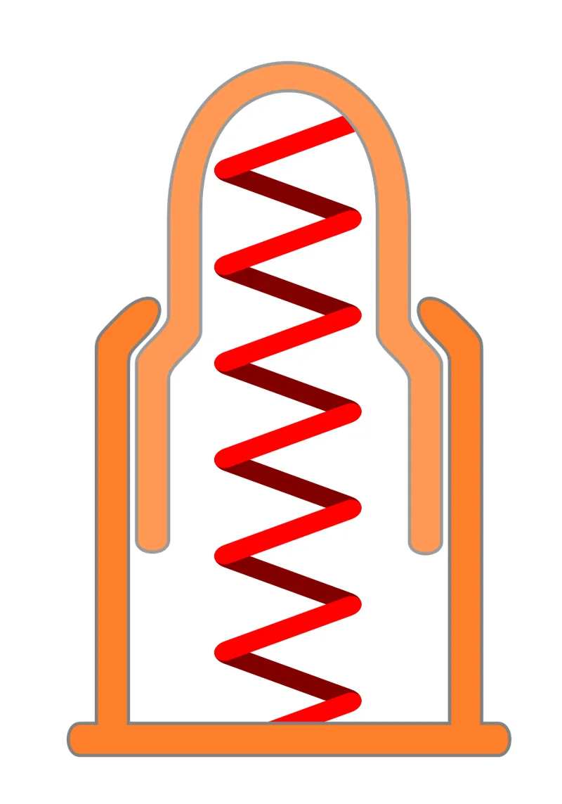
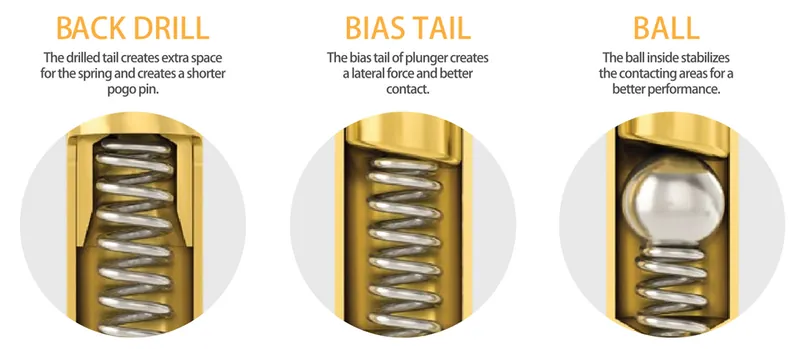
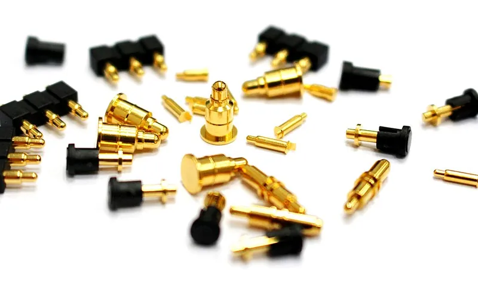

<figure class="eoc-pic eoc-pic-main"><figcaption><strong>Diagram.</strong> <a href="https://commons.wikimedia.org/wiki/File:Federkontaktstift.svg">Federkontaktstift</a> by Biezl, <a href="https://creativecommons.org/licenses/by/3.0">CC BY 3.0</a>, from Wikimedia Commons.</figcaption></figure>
<figure class="eoc-pic"><figcaption><strong>Cross-section.</strong> <a href="https://commons.wikimedia.org/wiki/File:Pogo_Types.png">Pogo Types</a> by C.C.P. Contact Probes Co. Ltd., <a href="https://creativecommons.org/licenses/by-sa/4.0">CC BY-SA 4.0</a>, from Wikimedia Commons.</figcaption></figure>
<figure class="eoc-pic"><figcaption><strong>Photo.</strong> <a href="https://commons.wikimedia.org/wiki/File:Pogo_Pin_Connectors.jpg">Pogo Pin Connectors</a> by Jole222, <a href="https://creativecommons.org/licenses/by-sa/4.0">CC BY-SA 4.0</a>, from Wikimedia Commons.</figcaption></figure>

A spring-loaded plunger in a small tube that is pressed onto a flat metal pad to carry electricity between two parts that just touch, so devices can be docked, charged, tested or programmed without a plug.

**In plain words:** A tiny gold-plated pin with a spring inside that pokes out of a tube, so when you press a part onto it the pin squashes down a little and touches a flat metal pad, making an electrical connection without plugging anything in. **Proper term:** Spring-loaded contact pin (pogo pin).

**Also called:** pogo pin (widely used as a general name, but a registered trademark of Everett Charles Technologies; Wikipedia 'Pogo pin'); spring-loaded pin, spring-loaded contact or spring-loaded connector (Wikipedia; Mill-Max); spring pin or spring probe (Tag-Connect; Same Sky); target, land or target pad (the flat or cupped metal pad the pin presses on; Wikipedia; Mill-Max 'target pins' and 'target discs'); bed-of-nails tester or test fixture (a board of many pogo pins for testing circuit boards; Wikipedia 'In-circuit testing'); pogo tower (a very dense ring of hundreds of pins; Wikipedia); programming jig, test jig or pogo jig (maker names for a holder full of pogo pins; Adafruit); Tag-Connect (brand) 'Plug-of-Nails' programming cable (pogo pins that press onto a small pad pattern instead of a header); leaf-spring contact, spring finger or SMT spring contact (a bent springy metal tab instead of a coil spring; Harwin); elastomeric connector or zebra strip (Zebra (brand), a rubber strip with conductive stripes; Wikipedia 'Elastomeric connector'); blind-mate connector (a connector that mates when a whole module is pushed home, with self-aligning features; Wikipedia); fuzz button (brand; a pad of springy gold-plated wire, mostly aerospace; Wikipedia); Omniball (Mill-Max, brand): a ball-tipped spring pin made for sideways engagement.

## How it works

The plunger slides in its tube with a coil spring behind it. When the other part is pressed against the tip, the plunger is pushed in and the spring pushes back, keeping a steady force, typically around 1 newton, on the pad so the contact doesn't break with small movements or vibration (Wikipedia 'Pogo pin'). Current flows through the gold-plated plunger and tube rather than the spring (Mill-Max FAQ; Wikipedia). Because the target is only a flat or cupped pad with no moving parts, one side of the joint can be just a patch of copper on a circuit board (Wikipedia; Mill-Max). The pin does not hold the parts together: a latch, clamp, magnets, gravity or a hand must hold them while the springs make contact. Related pressure contacts work the same way with a different spring: a bent metal tab (leaf-spring finger), a rubber strip with conductive stripes squeezed between two boards (zebra strip), or a ball of springy wire (fuzz button).

## Parts

A few parts: the pin itself is a small assembly that acts as one unit (a plunger, a barrel or tube, and a coil spring, sometimes with a ball between plunger and spring; Wikipedia, Mill-Max), plus the target (a flat or cupped plated pad, a PCB pad or a bought target pin), plus a holder (a jig, dock or connector body) and something that presses the two sides together.

## Everyday examples

- The charging contacts on smartwatches and rugged devices, which use spring-loaded pins because they can be sealed (Wikipedia 'Pogo pin', applications)
- Laptop battery terminals and the keyboard docks of 2-in-1 tablet PCs, where spring pins (often with magnets) connect the parts (Wikipedia 'Pogo pin')
- The stripy rubber strip that connects the display of a pocket calculator to its circuit board (an elastomeric 'zebra' connector; Wikipedia 'Elastomeric connector')
- Factory test and programming fixtures for circuit boards in appliances such as coffee machines and garage-door openers (bed-of-nails testers; Tag-Connect footprints; Wikipedia 'In-circuit testing')

## When to use it

Use pogo pins when parts must connect and disconnect often without wear on a plug: charging docks and cradles, robot docking stations and tool changers, battery packs that slide or drop in, modules that click or clip together, and anything that has to survive many thousands of matings. They are also the standard way to test or program circuit boards in batches: a printed or PCB jig full of pins presses onto test pads, so the board needs no connector at all (Adafruit; Tag-Connect; Wikipedia 'In-circuit testing'). They suit blind mating, where you can't see the connector, and stacks with loose height [tolerances](../glossary.md#tolerance), because the [stroke](../glossary.md#stroke) takes up the gap (Mill-Max). Use a zebra strip to connect a small display to a board, and leaf-spring fingers where space is very tight or where a part wipes or slides into place (Wikipedia; Harwin).

## When not to use it

Don't use them where nothing holds the parts together; on their own pins push the parts apart. Don't use them for mains voltage or anywhere the live contacts could be touched; use a certified plug and socket (see 'Standard plug-and-socket connector'). Avoid them where the parts slide sideways onto the pins, which bends plungers (use a ball-tipped side-load pin, a leaf-spring contact or a blind-mate connector with guides instead; Mill-Max; Harwin). For a connection that stays made for years with no need to separate, a soldered or crimped joint or a latching wire-to-board plug is simpler and cheaper. For a magnetic, self-aligning or breakaway cable use 'Magnetic connector'. For a contact that keeps turning, use a 'Slip ring'. For a single battery, use spring battery contacts (see 'Battery holder and battery contacts').

## Details

- **What it does (jobs):**
  - join and hold: makes an electrical connection when two parts are pressed together, for docking, charging, testing or programming; something else has to hold the parts against the springs
- **Movement:** none: the docked parts do not move relative to each other. Inside each pin the plunger slides in and out by its stroke (Mill-Max standard pins go up to about 3 mm) to take up gaps and uneven heights.
- **Directions it can move (degrees of freedom):** 0: once docked and held, the two parts are fixed. Before docking the contact tolerates small sideways offsets because the tip only has to land somewhere on the pad (Mill-Max 'more offset tolerance'), but it is not a moving joint.
- **Special behaviour:**
  - quick-release: no plugging in or pulling out, just set the part down or lift it away; there is only the spring force, no insertion or extraction force (Mill-Max)
  - self-aligning or self-centring: only for blind-mate connector versions, which have guiding features that accept a small [misalignment](../glossary.md#misalignment) while a whole module is slid home (Wikipedia 'Blind mate connector'); a plain pogo pin does not centre the parts, so the jig or dock must line them up
- **How it holds:**
  - spring force (a spring or springy part presses it in place): the coil spring, leaf spring or squeezed rubber keeps the contact pressed on the pad. It only presses the contact; it pushes the parts apart, so another method (latch, clamp, magnets, gravity) must hold them together.
- **Input and output:** not applicable
- **Power:** passive (no power needed). The pins carry electricity, but nothing needs power to make or hold the contact.
- **Load:** Electrical: up to about 30 A, extra-low voltage only. Most single pins carry a few amps: Mill-Max data sheets list 6.5-9 A at 30 °C temperature rise for ordinary-size pins (5.2-7.2 A after 20% derating), and Mill-Max's highest-rated single pin is 13 A (10.4 A derated); small needle-head test pins carry less ⚑ [uncertain] (for cheap hobby pins, which often have no published rating). Contact resistance is about 20-30 milliohms per pin (Mill-Max data sheets). Zebra strips carry only about 250-500 mA per conductor (Fujipoly). The contacts are exposed when apart, so they are not for mains. Mechanical: light. Each pin pushes with roughly 1 N (about 60-90 g on Mill-Max data sheets), adding up to a push-apart force across many pins; the pin is strong only along its own axis and is damaged by sideways loads, which can bend or break the plunger (Mill-Max application notes). It gives no pull-out strength at all.
- **Play and precision:** small: the tip lands on a pad rather than entering a socket, so it tolerates more sideways offset than a pin-and-socket plug (Mill-Max), but the pad must be big enough to catch every tip, so a jig needs locating features (stand-offs, registration posts or a pocket) to place the board; MacroFab made its printed pocket 0.5 mm larger than the board. Height tolerance is taken up by the stroke, ideally working near mid-stroke (Mill-Max). There is a slight gap between plunger and barrel, which is why plungers are often made to tilt slightly to keep contact (Wikipedia).
- **Taking it apart:** tool-free quick release: lift the part off the pins. The pins themselves are soldered, pressed or glued into their holder, or fitted in socket holders so worn pins can be swapped, which Adafruit suggests for jigs that clumsy people will use for a long time (Adafruit jig guide). Same Sky lists press-fit, swaged, crimped, soldered and solderless mounting.
- **How often it can be reused:** effectively unlimited: Mill-Max pins are tested to between 100,000 and 1,000,000 cycles at mid-stroke (Mill-Max FAQ), and Tag-Connect's cycle tests 'easily last for well over 100,000 operations', with the cable usually failing first (Tag-Connect). Variants differ: Harwin leaf-spring contacts are rated up to 10,000 mating cycles, and a Fujipoly gold zebra strip was tested to 500 actuations.
- **Sealing:** none: pogo pins are not sealed or IP rated; as the plunger moves it opens a path for liquid and dirt into the tube (Mill-Max FAQ). For wet use the pins are fitted in their own sealed housing with gaskets or [O-rings](../glossary.md#o-ring) (Mill-Max FAQ). Zebra strips can form a gasket-like seal around the contacts (Wikipedia 'Elastomeric connector').
- **Adjustable:** Yes, during design: the working height sets how far each pin is compressed. Raising the target with a target pin or disc, or changing a stand-off, increases compression without changing the pins (Mill-Max). After assembly, adjustment is limited to shimming the holder or swapping springs within compatible Mill-Max spring families (Mill-Max FAQ).
- **Access needed:** one side only (blind): the device is set onto the dock or pressed onto the pads from one side; the pads need no access from behind, and the board needs no connector at all (Tag-Connect: 'the PCB itself is the mating connector')
- **Materials:** Plunger and barrel are usually brass or copper alloy with nickel under a gold plating; springs are copper alloy or spring steel, sometimes stainless (Wikipedia; Mill-Max data sheets). Targets are gold-plated pads or turned brass target pins and discs (Mill-Max). Pins can mate with any conductive surface, but gold-plated targets give the best results (Mill-Max FAQ). Leaf-spring contacts come in gold or tin finish (Harwin). Zebra strips are silicone rubber with carbon, silver or gold conductors (Wikipedia). Holders and jigs can be FR4 circuit board (Adafruit uses a spare 'victim' PCB), printed PETG or PLA (Printables jigs), resin or SLS prints for fine [pitch](../glossary.md#pitch) (MacroFab), or laser-cut sheet (pogo-jig generator).
- **Heat, cold, water and wear:** Mill-Max pins are rated for -55 to +125 °C (data sheet 0981). Zebra strips are rated -20 to +125 °C and passed salt-spray, humidity and sulphide gas tests with gold contacts (Fujipoly). Pogo pins are not sealed: liquid and dirt can get in as the plunger moves (Mill-Max FAQ); mild soap and deionised water have been used for washing, but cleaners that leave a residue can stop the plunger moving (Mill-Max FAQ). Gold plating resists corrosion; the springs can weaken with age and use, as reported for early MagSafe plugs ('pin springs losing elasticity'; Wikipedia 'MagSafe'). A printed jig softens with heat: PLA gives at about 60 °C, PETG at 80 °C and ASA at 110 °C (CNC Kitchen), so keep soldering heat and hot sun away from PLA holders.

## Making it

- **Ways to make or get it:**
  - off-the-shelf part: the pins, receptacles and target pins are always bought
  - 3D print (FDM): jigs, clips and dock bodies that hold the pins and line up the board (Printables programming clips; MacroFab holder)
  - 3D print (resin): for fine pitches such as 1.27 mm (50 mil), where FDM holes are too small (MacroFab had its holder printed by a service for this reason)
  - laser cut: stacked plates with pin holes (the OpenSCAD pogo-jig generator can export DXF or SVG for laser cutting)
  - circuit board (PCB): a drilled spare or purpose-made board as the pin plate, with the pads on the target board as the other half (Adafruit; MacroFab)
- **Printing it in one piece (print in place):** partly: the jig or dock body prints in one piece with holes and locating features, and bought pogo pins are pushed, glued or soldered in afterwards (or dropped in sockets).
- **Tools:** To build a jig or dock: a soldering iron and wire to connect the pins, a drill (or a printed or laser-cut holder) for the pin holes, and often a drop of glue or press-fit sockets to hold the pins. To use it: none.
- **Difficulty:** easy: pins are cheap and fit drilled or printed holes; the fiddly parts are drilling or printing holes in exactly the right places and setting the height so the pins compress about halfway

### 3D printing tips

1) Hole size: printers usually make small holes undersized, so print a 1x2 or 2x2 test block first and adjust the hole diameter (pogo-jig OpenSCAD generator notes). One maker used 0.68 mm pins in printed holes cleaned out with a 0.7 mm drill and fixed with a drop of superglue (Printables 'Pogo-pin programming clip for Sonoff S31'); Adafruit's 1 mm-body pins fit standard 0.035 in (0.9 mm) drilled holes snugly and stand up straight (Adafruit jig guide and product page). Keep glue off the plunger end so it can't wick into the tube and stick it ⚑ [uncertain]. 2) Height: design the holder so the pins sit at about mid-stroke when the board is in place; MacroFab worked out 6.6 mm from the board to the fixture from an 8.5 mm pin with 1.4 mm stroke and a 0.5 mm round tip landing in a plated hole. Add a hard stop (stand-off or ledge) so the board can't over-compress the pins (Mill-Max). 3) Locating: make a pocket or registration posts that place the board; a pocket 0.5 mm bigger than the board allowed for routing tolerance (MacroFab). The holder should also guide the pins so they aren't side-loaded and don't jam (MacroFab; Mill-Max). 4) Pitch: pins at 2.54 mm (0.1 in) pitch are easy in FDM; 1.27 mm pitch holes were too small for an FDM printer (MacroFab). 5) Hold-down: add clips, 'little ears', a lid, a toggle clamp or magnets to keep the board pressed on the pins while testing (Adafruit 'Advanced Pogo Jigs'). 6) Material: printed jigs on Printables are commonly PETG at 0.15-0.2 mm layers (Sonoff S31 clip; 'Pogo Pin Adapter for flashing'). 7) Print the pin holes upright (along the print's Z axis) so they come out round and straight ⚑ [uncertain]. 8) Pick the head to suit the target: spear or pointed heads for holes and vias, cupped heads for pins and component legs, crown heads for leads and wires (Adafruit sells spear, cupped, crown and needle heads; head-to-target matching is general practice ⚑ [uncertain]); pins with a head larger than a plated hole won't poke through it (MacroFab).

### Buying one (off-the-shelf parts)

Search for 'spring-loaded pin', 'spring-loaded contact', 'pogo pin' or 'test probe', in through-hole, surface-mount (SMT), solder-cup and press-fit styles, and in single rows or arrays ('spring-loaded connector', 'pogo pin header') (Same Sky; Mill-Max). Hobby test pins are sold by head shape: spear, cupped, crown and needle (Adafruit, e.g. 'Pogo Pins Needle Head P75-B1', 1.0 mm body, about 3 mm travel). Socket holders (receptacles) let pins be replaced (Adafruit jig guide). Targets: 'target pins', 'target discs' and 'target connectors' (Mill-Max). Side-load versions: ball-tipped pins such as Mill-Max Omniball (brand). Ready-made programming cables: Tag-Connect (brand) 'Plug-of-Nails' cables, which need only a pad footprint on the board. Solderless GPIO pins: Pimoroni 'Pogo-a-go-go' (brand; named in a Printables jig). Leaf-spring contacts: 'SMT spring contacts' or 'spring fingers' (Harwin). Zebra strips: 'elastomeric connectors' (Fujipoly ZEBRA (brand)). Magnetic pogo connectors are covered in the separate entry 'Magnetic connector'.

## Rules of thumb

- Design for mid-stroke: aim for about 50% of the maximum stroke when docked. Less compression can reduce electrical performance; working near full compression shortens cycle life. All ratings are given at mid-stroke (Mill-Max 'Spring-Loaded General Applications').
- Push only along the pin's axis. Sideways loading can bend or break the plunger or body; use a ball-tipped side-load pin if parts slide on (Mill-Max application notes).
- Add stand-offs or a hard stop so the pins can't be over-compressed (Mill-Max application notes).
- If a finished design has too little compression, raise the target with a target disc or target pin instead of buying longer pins: in Mill-Max's example a 0.025 in target raised compression from 0.010 in to 0.035 in, past the 0.0275 in mid-stroke (Mill-Max application notes).
- Contact force is typically about 1 N per pin (Wikipedia 'Pogo pin'); Mill-Max data sheets list 60-90 g of spring force with 1.4 mm (0.055 in) maximum stroke for typical pins.
- Cycle life: spring-loaded pins are rated 100,000 to 1,000,000 cycles, while ordinary plug-and-socket connectors are typically rated for hundreds or a few thousand (Mill-Max).
- Mill-Max pins are tested to 50 g shock and 10 g vibration at mid-stroke with no contact break longer than 1 microsecond (Mill-Max application notes); with too little compression, the small gap between plunger and barrel can cause momentary disconnections under vibration (Wikipedia).
- Zebra (elastomeric) strips: squeeze them by 10-15% of their height (8-20% acceptable), make the strip about twice as tall as it is wide, and expect about 4 lb per inch of strip at 15% (Fujipoly ZEBRA Gold 8000 data sheet); hold them in a recess with a [deflection](../glossary.md#deflection) stop and alignment pins (Wikipedia).
- Leaf-spring (SMT spring) contacts tolerate wiping and sliding and are rated up to 10,000 mating cycles (Harwin, via DigiKey product page).

## Common failures

1) Intermittent contact because the pins are barely compressed: design for mid-stroke, or raise the target with a target pin or disc (Mill-Max). 2) Bent or jammed plungers from sideways loads or from parts sliding across the tips: guide the board straight down and support the pins in the holder (Mill-Max; MacroFab). 3) Pins crushed or worn early by over-compression: add a hard stop (Mill-Max). 4) Sticky plunger from dirt, flux, cleaning residue or glue that has wicked into the tube: keep pins clean and glue only at the base (Mill-Max FAQ on residues; glue point ⚑ [uncertain]). 5) Pins that miss their pads because the board isn't located: add a pocket, posts or stand-offs as registration (Adafruit; MacroFab). 6) Pins or tips that poke through plated holes: choose a head larger than the hole, or a cupped or crown head (MacroFab). 7) Weak springs after long use; MagSafe owners reported pin springs losing elasticity (Wikipedia 'MagSafe'). 8) Pins too short or too long for the stack-up: check the fit before committing (Adafruit). 9) A heavy bed-of-nails puts a lot of strain on the board under test (Wikipedia 'In-circuit testing').

## Safety

Keep to extra-low voltage, which UK Approved Document P defines as not more than 50 V AC or 120 V ripple-free DC; the contacts are bare when apart, so pogo pins must never carry mains, and any mains work must follow local law. A charging dock whose contacts are live whenever it is switched on can be shorted by a coin, key or tool lying across it; fit a fuse or current limit, or switch power on only when a device is detected, as Apple's MagSafe charger did by giving a low voltage until it saw a load (Wikipedia 'MagSafe') ⚑ [uncertain] (as general advice). Lithium batteries shorted through exposed contacts can overheat ⚑ [uncertain]. Soldering wires to pins needs the usual care with hot irons.

## Related

- Magnetic connector (magnetic pogo connector): the same pins plus magnets that pull the halves together, line them up and break away safely
- Battery holder and battery contacts: coiled and leaf springs that press on battery ends; the same pressure-contact idea for cells
- Slip ring: sliding brushes carry current across a joint that keeps turning; pogo pins only touch a still pad
- Ball [detent](../glossary.md#detent) and spring plunger: the same plunger-in-a-tube shape, but used to click and hold mechanically, not to carry current
- Wire-to-board plug connectors (pin header and crimp housing): pin-and-socket plugs that latch and hold, but wear out after far fewer matings
- Standard plug-and-socket connector (USB, barrel jack): a certified, ready-made plug; better when users plug and unplug by hand and safety rules apply
- Coil spring and printed leaf spring: the spring itself; don't use a printed plastic spring as a contact that stays pressed
- Genderless connector: identical halves that mate either way; some docking systems combine it with pogo pins ⚑ [uncertain]
- Flat flexible cable with ZIF connector: another way to connect displays and moving boards, where zebra strips are not used

## Make it yourself

- [How to Make a Pogo Pin Test Jig (Adafruit Learning System)](https://learn.adafruit.com/how-to-make-a-pogo-pin-test-jig): Illustrated step-by-step guide: drill a spare 'victim' PCB as a pin plate, use stand-offs as registration posts, solder the pins to an Arduino shield and press the board on to test it; also shows a hold-down jig and the different head types *(licence: link only)*
- [pogo-jig: OpenSCAD pogo pin jig generator (Brian Harrington; repository https://github.com/brianredbeard/pogo-jig appeared in search results, README read via raw.githubusercontent.com)](https://raw.githubusercontent.com/brianredbeard/pogo-jig/master/README.md): Parametric OpenSCAD file that makes a pin block from rows, columns, pitch and pin diameter, exporting STL for printing or DXF/SVG for laser-cut stacked plates; notes that printed holes come out undersized, so test a small block first *(licence: AGPL-3.0)*
- [Pogo-pin programming clip for Sonoff S31 modules (Tom C, Printables) (URL from Printables API, page not opened)](https://www.printables.com/model/11389-pogo-pin-programming-clip-for-sonoff-s31-modules): Printed PETG clip holding 0.68 mm x 16 mm pogo pins (holes cleaned with a 0.7 mm drill, pins fixed with superglue) to reprogram a smart plug without soldering. Details read through the Printables public API. *(licence: CC BY-NC-SA)*
- [Pogo Pin Adapter for flashing, programming (Lukas_Kvapil, Printables) (URL from Printables API, page not opened)](https://www.printables.com/model/564334-pogo-pin-adapter-for-flashing-programming): Simple printed pogo-pin programming adapter, printed in PETG at 0.15 mm layers, assembled with M2.5 screws. Details read through the Printables public API. *(licence: GPL-2.0)*
- [reMarkable 2 Pogo Pin Jig (pixelifytica, Printables) (URL from Printables API, page not opened)](https://www.printables.com/model/1238779-remarkable-2-pogo-pin-jig): A guide block that holds five solderless pogo pins against the service pads on a tablet so they stay in contact; FreeCAD source included so hole sizes can be changed. Details read through the Printables public API. *(licence: CC0 (Creative Commons Public Domain))*

## Pictures, videos and models

- [Federkontaktstift (spring contact pin) cross-section (Wikimedia Commons, by Biezl)](https://commons.wikimedia.org/wiki/File:Federkontaktstift.svg): Cut-away drawing of a pogo pin showing plunger, barrel and spring; used on Wikipedia's 'Pogo pin' article *(licence: CC BY 3.0)*
- [Pogo Types (Wikimedia Commons, by C.C.P. Contact Probes Co. Ltd.)](https://commons.wikimedia.org/wiki/File:Pogo_Types.png): Diagram of the structure of different pogo pin designs (manufacturer image) *(licence: CC BY-SA 4.0)*
- [Forwessun Test Fixture Pins (Wikimedia Commons, by Test wiz)](https://commons.wikimedia.org/wiki/File:Forwessun_Test_Fixture_Pins.webp): Close-up of the spring probes on an in-circuit (bed-of-nails) test fixture *(licence: CC BY-SA 4.0)*
- [Zebra connector (Wikimedia Commons, by Caltrop)](https://commons.wikimedia.org/wiki/File:Zebra_connector.jpg): An elastomeric (zebra) strip used to connect an LCD to a circuit board: pink insulating rubber with black conductive stripes 180 microns apart *(licence: CC BY-SA 3.0 / GFDL 1.2+)*
- [Pogo Pins - Collin's Lab Notes (YouTube, Adafruit Industries)](https://www.youtube.com/watch?v=NGZ_vd6qmeQ): Short explainer video on pogo pins, linked from Adafruit's pogo-pin jig guide; title and channel confirmed via YouTube oEmbed, video not watched *(licence: link only (standard YouTube licence))*

## Needs confirming

⚑ marks something nobody has confirmed yet: a fact the research could not confirm from a source, a finder value that is a best guess, or an open point from the research notes. Corrections are welcome (see `research/needs-confirming.md`).

- ⚑ 8 sentences on this page marked [uncertain].
- ⚑ Finder value `load_max` = light (best guess): electrical entry whose mechanical load has no light/medium/heavy band; set to light
- ⚑ Finder value `made_of` = 3D prints, metal (best guess): proposed from the words in the research text (R37); not yet checked
- ⚑ Research note: *Pogo pin*: the current rating of small hobby pogo pins is unverified (marked [uncertain]); Mill-Max's figures (6.5-9 A for ordinary pins, 13 A for the largest) are from data sheets.

## Sources

- <https://en.wikipedia.org/wiki/Pogo_pin>
- <https://en.wikipedia.org/wiki/Elastomeric_connector>
- <https://en.wikipedia.org/wiki/Fuzz_button>
- <https://en.wikipedia.org/wiki/Blind_mate_connector>
- <https://en.wikipedia.org/wiki/In-circuit_testing>
- <https://en.wikipedia.org/wiki/MagSafe>
- <https://www.mill-max.com/engineering-notebooks/spring-loaded-pogo-pins-connectors/faqs>
- <https://www.mill-max.com/engineering-notebooks/general-application-notes>
- <https://mill-max.com/products/new/maxneticr-spring-loaded-connectors>
- <https://mm.digikey.com/Volume0/opasdata/d220001/medias/docus/7171/0981-0-15-20-87-14-11-0.pdf>
- <https://mm.digikey.com/Volume0/opasdata/d220001/medias/docus/7171/2074-0-15-20-75-14-11-0.pdf>
- <https://mm.digikey.com/Volume0/opasdata/d220001/medias/docus/7172/2985-0-15-20-71-14-11-0.pdf>
- <https://www.sameskydevices.com/blog/pogo-pins-101>
- <https://www.tag-connect.com/info>
- <https://www.adafruit.com/product/2430>
- <https://learn.adafruit.com/how-to-make-a-pogo-pin-test-jig>
- <https://learn.adafruit.com/how-to-make-a-pogo-pin-test-jig?view=all>
- <https://www.macrofab.com/blog/design-build-simple-programming-fixture>
- <https://raw.githubusercontent.com/brianredbeard/pogo-jig/master/README.md>
- <https://raw.githubusercontent.com/brianredbeard/pogo-jig/master/pogo_pin_jig.scad>
- <https://raw.githubusercontent.com/brianredbeard/pogo-jig/master/LICENSE>
- <https://www.nucletron.de/files/zebra_gold_connectors.pdf>
- <https://www.digikey.at/en/product-highlight/h/harwin/ez-spring-contacts>
- <https://www.cnckitchen.com/blog/comparing-pla-petg-amp-asa-feat-prusament>
- <https://assets.publishing.service.gov.uk/government/uploads/system/uploads/attachment_data/file/441872/BR_PDF_AD_P_2013.pdf>
- <https://commons.wikimedia.org/wiki/File:Federkontaktstift.svg>
- <https://commons.wikimedia.org/wiki/File:Pogo_Types.png>
- <https://commons.wikimedia.org/wiki/File:Pogo_Pin_Connectors.jpg>
- <https://commons.wikimedia.org/wiki/File:Forwessun_Test_Fixture_Pins.webp>
- <https://commons.wikimedia.org/wiki/File:Zebra_connector.jpg>
- <https://www.youtube.com/watch?v=NGZ_vd6qmeQ>
- <https://api.printables.com/graphql/>
