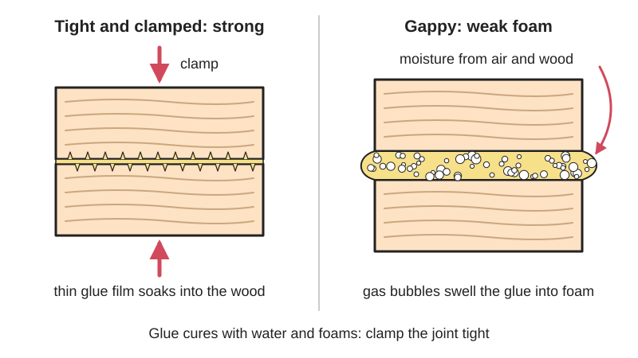

<figure class="eoc-pic eoc-pic-main"><figcaption>Diagram drawn for the encyclopaedia from the research notes. ⚑ Needs confirming: a drawing can simplify or get details wrong; a real photo or a better diagram is welcome.</figcaption></figure>

Polyurethane glue is a one-part liquid glue that [cures](../glossary.md#cure) by reacting with moisture in the air and in the materials, foaming slightly as it hardens, to give a strong, waterproof bond between wood and many other materials, provided the joint is tight and clamped.

**In plain words:** A brown, honey-like glue from a bottle that hardens by soaking up moisture, and puffs up into a foam as it sets; it sticks wood to almost anything (stone, metal, foam, ceramic, many plastics) and is waterproof, but the parts must be clamped tightly because the foam itself is weak. **Proper term:** Polyurethane glue (one-part moisture-curing polyurethane adhesive, PU glue).

**Also called:** PU glue, poly glue, polyurethane adhesive (Wikipedia; Loctite design guide); moisture-cure polyurethane, one-component (1K) polyurethane adhesive (Wikipedia 'Wood glue'); expanding glue, foaming glue (VCA Animal Hospitals; Rockler); Gorilla Glue, Original Gorilla Glue (brand; Wikipedia), Titebond Polyurethane Glue (brand; Titebond data sheet), Elmer's ProBond Polyurethane (brand; thisTOthat), Excel (brand; Wikipedia), Loctite Wood Wizard (brand; Popular Woodworking); polyurethane construction adhesive, e.g. Loctite PL Premium (brand): the same moisture-curing chemistry as a thick paste in a caulk-gun cartridge (Henkel specification); PUR hot melt (reactive polyurethane hot melt): starts like hot glue, then moisture-cures into a tough polyurethane (Loctite design guide); Note: 'Gorilla Wood Glue' is a different, PVA-type product that does not foam (woodgears.ca).

## How it works

The liquid is made of short polymer chains that end in reactive isocyanate groups (an isocyanate-terminated prepolymer). When they meet water, from the air, the wood or a dampened surface, they react and link up into a solid polyurethane plastic, which is why it is called a moisture-cure glue (Wikipedia 'Wood glue'). The same reaction with water also releases carbon dioxide gas (Wikipedia 'Isocyanate': RNCO + H2O -> RNH2 + CO2), so the glue swells into a foam, about 3 times its volume according to one maker (Gorilla Glue). In a tight, clamped joint the glue is pushed into the pores of the material and gives a strong bond, but any foam left in a gap is mostly bubbles and has almost no strength (Popular Woodworking; woodgears.ca).

## Parts

Single piece: one liquid, no mixing. In use you also need water (a damp cloth or spray bottle) to dampen one surface, clamps or weights to hold the joint tight while it foams, and gloves (Gorilla Glue directions; Titebond data sheet).

## Everyday examples

- The brown bottle of Original Gorilla Glue used for household repairs (Wikipedia 'Gorilla Glue')
- Teak outdoor furniture, where Danish polyurethane glue was used before it was sold in North America (Wikipedia 'Gorilla Glue')
- Polyurethane construction adhesive in a caulk-gun tube for gluing subfloors, foam insulation board and trim (Henkel PL Premium specification)
- Bookbinding: the spines of many paperback books are glued with reactive polyurethane (PUR) adhesive (Wikipedia 'List of polyurethane applications')

## When to use it

Use it for waterproof outdoor woodwork, for wood that is wet, oily or hard to glue, for end-grain joints, and when gluing wood to a different material such as stone, metal, ceramic, concrete or rigid foam (Woodcraft; Gorilla Glue; Popular Woodworking). It suits complicated glue-ups that need time to assemble, because it stays workable for about 15-30 minutes (Woodcraft), and it can be used down to about 40 °F (4 °C), where most PVA glues need 50 °F (10 °C) or more (Gorilla Glue; Woodcraft). In 3D printing it is useful for fixing prints to wood, stone or foam, and a polyurethane construction adhesive did best on PETG in one large test (Hackaday).

## When not to use it

Don't use it to fill gaps or rescue loose joints: the foam has almost no strength, so use two-part epoxy instead (Popular Woodworking; woodgears.ca; Woodcraft). For ordinary indoor wood-to-wood joints, PVA wood glue is as strong, cheaper, cleaner and washes up with water (Popular Woodworking; Woodcraft). Avoid it on small, precise plastic parts where foaming would push them out of line; use CA or epoxy (Snapmaker). Don't use it on polyethylene, polypropylene, PTFE, soft PVC or oily rubber (Gorilla Glue FAQ; Henkel PL Premium specification), for parts that sit underwater or below a boat's waterline (use epoxy), or for structural, load-bearing joints (Titebond data sheet; Woodcraft: 'Epoxy is the only woodworking adhesive suited for constant water contact'). Avoid it where people with isocyanate allergy or asthma would be exposed (Titebond data sheet; OSHwiki).

## Details

- **What it does (jobs):**
  - glue or bond: joins wood to wood, and wood to stone, metal, ceramic, foam, glass and many plastics, permanently and waterproof (Gorilla Glue; Woodcraft)
- **Movement:** none: a rigid joint with no movement
- **Directions it can move (degrees of freedom):** 0: the glued parts are locked together
- **Special behaviour:**
  - none: it has none of the listed behaviours. Its own tricks are curing from moisture without any mixing, and foaming up as it sets, which pushes the glue into pores and [end grain](../glossary.md#end-grain) (Popular Woodworking) but can also push parts apart if they are not clamped (Woodcraft; Snapmaker)
- **How it holds:**
  - [material bond](../glossary.md#form-fit--force-fit--material-bond) (glue, solvent or melting): the cured polyurethane sticks to both surfaces and keys into their pores
- **Input and output:** not applicable
- **Power:** passive (no power needed): it cures by itself at room temperature using moisture from the air and the materials (Wikipedia 'Wood glue'; Gorilla Glue).
- **Load:** medium to heavy on wood, if the joint is tight: Titebond reports 3,500+ psi (about 24 MPa) [shear](../glossary.md#peel-vs-shear) strength on hard maple at room temperature and 3,000 psi (about 21 MPa) after a night at 150 °F (Titebond data sheet), and Franklin International's tests quoted by Popular Woodworking found polyurethane (3,510 psi) about as strong as yellow PVA glue (3,600 psi), with the wood usually breaking first. It is claimed to beat PVA on end grain, though this was not scientifically tested (Popular Woodworking). In gappy joints it is very weak: with a 0.3 mm gap, Matthias Wandel's test joints broke at about 15 lb against about 220 lb for tight joints (woodgears.ca). Titebond says its polyurethane glue is 'not for structural applications' (Titebond data sheet). On polyethylene and polypropylene it hardly sticks at all: a two-part urethane adhesive managed only about 1.0 MPa on LDPE and 0.7 MPa on PP (Loctite design guide, pp. 51, 63).
- **Play and precision:** not applicable (nothing moves). It needs tight-fitting joints: glue experts say it can't fill a gap larger than 1-2 mm with any strength (Popular Woodworking), and a 0.3 mm gap already made joints weak in Wandel's test (woodgears.ca). The foam can lift or shift parts slightly, so clamp them or use pins and keys to hold alignment (Woodcraft; Snapmaker).
- **Taking it apart:** permanent: there is no practical solvent for the cured glue; wet glue wipes off with a dry cloth or mineral spirits (paint thinner), but once cured it has to be scraped, chiselled or sanded off (Gorilla Glue; Titebond data sheet; Rockler).
- **How often it can be reused:** once: the glue can't be reused; a failed joint has to be cleaned back to bare material and glued again
- **Sealing:** none: it is a glue, not a sealant, and its foam is full of bubbles. Polyurethane sealants in caulk tubes are a separate product made for sealing gaps against air and water (Wikipedia 'List of polyurethane applications').
- **Adjustable:** no, but it gives time to line parts up: about 15-30 minutes of [open time](../glossary.md#open-time) before assembly (Woodcraft), and 25-30 minutes at 70 °F and 50% humidity for Titebond's version (Titebond data sheet). Once it has foamed and cured, nothing can be adjusted.
- **Access needed:** not applicable: glue goes on the faces before assembly, but you need to reach both sides to clamp the joint while it foams and cures
- **Materials:** Bonds well: wood (including wet or oily wood and end grain), stone, concrete, brick, ceramic, metal, glass, rigid foams including polystyrene insulation board, fibreglass, rigid PVC, and many other plastics and composites (Gorilla Glue; Woodcraft: 'best for wet wood and bonding wood to non wood'; Wikipedia 'Wood glue'; Henkel PL Premium specification; Titebond data sheet: 'most plastics'). For 3D prints, a polyurethane construction adhesive was the overall winner on PETG in Cosel's pull test (Hackaday). Poor or not recommended: polyethylene (PE), polypropylene (PP), PTFE, flexible (soft) PVC, and rubber with a lot of oil or plasticiser (Gorilla Glue FAQ; Henkel PL Premium specification). Glass is claimed by makers, but test first ⚑ [uncertain].
- **Heat, cold, water and wear:** Heat: service temperature -40 °F to 200 °F (-40 °C to 93 °C) for Gorilla Glue, and -40 °F to 160 °F (-40 °C to 71 °C) for PL Premium construction adhesive (Gorilla Glue; Henkel PL Premium specification); Titebond keeps about 3,000 psi after a night at 150 °F (66 °C) (Titebond data sheet); polyurethanes 'typically degrade in strength after long-term exposure over 302 °F (150 °C)' (Loctite design guide). Cold: apply above 40-50 °F (4-10 °C); cold weather and dry air slow the cure a lot (Gorilla Glue; Titebond data sheet; Henkel PL Premium specification). Water: passes ANSI/HPVA Type I and II water-resistance tests and is fine outdoors (Titebond data sheet; Gorilla Glue), but it is not for constant immersion, marine use or below the waterline (Titebond data sheet; Henkel PL Premium specification), and in water-soaking tests polyurethane bonds were 'much less durable' than resorcinol bonds (Wikipedia 'Wood glue'). Sunlight (UV): no clear data found ⚑ [uncertain]. Storage: moisture that gets into the bottle cures the glue, so it keeps about a year (Gorilla Glue; Titebond data sheet).

## Making it

- **Ways to make or get it:**
  - off-the-shelf part: bottles of polyurethane glue, and polyurethane construction adhesive in caulk-gun cartridges
  - woodwork: waterproof outdoor projects, end-grain joints, oily or wet timber and wood-to-other-material joints (Woodcraft; Popular Woodworking)
  - 3D print (FDM): gluing prints to wood, stone, foam or metal, and large prints; for small precise plastic parts CA or epoxy is usually easier (Snapmaker; Hackaday)
  - 3D print (resin): possible for resin to other materials ⚑ [uncertain]: no test found
  - building and repair: subfloors, foam insulation board, trim, stone and masonry with polyurethane construction adhesive (Henkel PL Premium specification)
- **Printing it in one piece (print in place):** no: it is a glue for joining separate parts, although you can print pins, keys and flat, tight mating faces to make gluing easier.
- **Tools:** The glue, water in a spray bottle or a damp cloth, clamps (or weights, tape or rubber bands for light parts), disposable gloves, a brush or roller to spread it thinly, masking tape to catch squeeze-out, a dry cloth or mineral spirits for wet glue, and a scraper, chisel or sandpaper for cured foam (Gorilla Glue; Titebond data sheet; Popular Woodworking).
- **Difficulty:** easy to moderate: no mixing, and there is time to line parts up, but you have to dampen the surfaces, clamp firmly for 1-2 hours, wear gloves, and deal with foaming squeeze-out (Gorilla Glue; Rockler).

### 3D printing tips

1) Make the mating faces flat and tight-fitting. The foam is weak, so the glue only has real strength in a thin, closed joint; don't rely on it to fill gaps (Popular Woodworking: no more than 1-2 mm; woodgears.ca: a 0.3 mm gap made joints very weak). 2) Printed plastic is not porous, so the glue's moisture must come from outside: lightly dampen one surface with a damp cloth or spray bottle without soaking it, and put the glue on the dry surface (Gorilla Glue directions). 3) Use a thin layer (about ½ oz per square foot, Gorilla Glue; a film about 6 thousandths of an inch or 0.15 mm, Titebond data sheet), because it expands and too much gives messy squeeze-out (Rockler). 4) Clamp firmly for 1-2 hours and leave it 24 hours to cure fully (Gorilla Glue); keep clamps on until it has fully cured, or the foam can push the joint open (Woodcraft). The expansion can push unclamped parts apart and spoil the alignment (Snapmaker), so add pins, keys or a stepped joint to locate the parts. 5) Put masking tape along the seam to catch the foam, and peel it off after curing (Popular Woodworking). Wipe wet squeeze-out with a dry cloth or mineral spirits; cured foam has to be cut or sanded off (Gorilla Glue; Rockler). 6) Don't use it on PP or PE prints or on soft, plasticised flexible parts (Gorilla Glue FAQ). 7) It is most useful for joining prints to wood, stone, foam, concrete or metal, and outdoors, where it is waterproof (Woodcraft; Gorilla Glue). For PETG, a polyurethane construction adhesive gave the highest pull strength in Cosel's test of many glues, although one commenter notes that it also expands from CO2 (Hackaday). 8) Test first on scrap pieces to see how much it foams (Rockler; Gorilla Glue).

### Buying one (off-the-shelf parts)

Search for 'polyurethane glue', 'PU glue' or 'moisture-cure polyurethane adhesive' (e.g. Gorilla Glue, Titebond Polyurethane, Elmer's ProBond, brands); 'polyurethane construction adhesive' in 10 oz / 300 ml cartridges (e.g. Loctite PL Premium, brand); 'two-part polyurethane adhesive' for plastics and deep sections; 'PUR hot melt' glue sticks for a hot-glue-style polyurethane; plus bar or F-clamps, a spray bottle, nitrile gloves and mineral spirits (Gorilla Glue; Titebond data sheet; Henkel PL Premium specification; Loctite design guide).

## Rules of thumb

- Keep joints tight: polyurethane glue can't fill a gap larger than 1-2 mm with any strength, because the foam is mostly bubbles (Popular Woodworking, 'The Truth About Polyurethane Glue', p. 2). In Wandel's test a 0.3 mm gap cut joint strength to less than a tenth of a tight joint's (woodgears.ca, 'Gorilla glue sucks (at filling gaps)').
- Moisture: dampen one surface lightly, or both surfaces on dense hardwoods; spread about ½ oz of glue per square foot (Gorilla Glue directions).
- Times: about 15-30 minutes open time and 1-4 hours clamp time (Woodcraft glue chart); Gorilla says clamp for 1-2 hours and allow 24 hours to cure (Gorilla Glue); Titebond's version gives a 30-minute [working time](../glossary.md#pot-life--working-time) and a 45-minute clamp time (Titebond data sheet).
- Clamping pressure: enough to close the joint tightly; Titebond gives about 100-150 psi for softwoods, 125-175 psi for medium woods and 175-250 psi for hardwoods (Titebond data sheet).
- Temperature: apply above 40 °F (4 °C) for Gorilla Glue and above 50 °F (10 °C) for Titebond; cold thickens the glue and slows the cure (Gorilla Glue; Titebond data sheet).
- Strength on wood: about 3,500 psi (24 MPa) in hard-maple shear, about the same as yellow PVA glue (Titebond data sheet; Popular Woodworking).
- Shelf life: about 12 months (Titebond data sheet; Woodcraft), about a year after opening (Popular Woodworking); squeeze air out of the bottle before capping, because moisture gets in and cures it (Gorilla Glue).
- One-part moisture-cure polyurethanes cure through only about 9.5 mm (0.375 in) in a reasonable time, because moisture has to soak in; two-part versions have no such limit (Loctite 'Design Guide for Bonding Plastics', vol. 6, p. 10).

## Common failures

Joints that snap easily because the parts didn't fit tightly and the gap filled with weak foam; make the fit tight and clamp firmly, or use epoxy (woodgears.ca; Popular Woodworking). Joints pushed open or parts pushed out of line because the clamps came off too early, or were never used, while the glue was foaming (Woodcraft; Snapmaker). Messy foam squeeze-out that is hard to remove and can stop stain soaking in; use less glue, mask the seam, and wipe wet glue with mineral spirits or lacquer thinner (Rockler; Popular Woodworking). Slow or weak curing in cold or very dry conditions, or on dry, non-porous surfaces that weren't dampened (Gorilla Glue; Henkel PL Premium specification). Glue that has thickened or hardened in the bottle after moisture got in (Gorilla Glue). No grip on PE, PP, PTFE, soft PVC or oily rubber (Gorilla Glue FAQ; Henkel PL Premium specification).

## Safety

It contains isocyanates, which irritate the eyes and skin and can sensitise the skin and lungs, so repeated exposure can cause allergies or asthma; wear gloves and work with good ventilation (Titebond data sheet: 'potential skin and respiratory sensitizer'; Woodcraft; OSHwiki). Since 24 August 2023, EU professional and industrial users of products with more than 0.1% diisocyanates need training (OSHwiki). It stains skin brown for several days (Gorilla Glue; Titebond data sheet). Keep it away from children and pets: if swallowed, the wet glue foams in the warm, wet stomach into a hard mass that usually has to be removed by surgery, and as little as half a teaspoon can cause a blockage (VCA Animal Hospitals; Wikipedia 'Gorilla Glue'). The reaction gives off carbon dioxide, so don't seal wet glue in a closed container ⚑ [uncertain].

## Related

- PVA wood glue (white and yellow glue): about as strong on wood, cheaper, water clean-up and no foam, but most grades are less water-resistant and it is poor on non-wood materials (Popular Woodworking; Woodcraft)
- Two-part epoxy: the choice for [gap filling](../glossary.md#gap-filling), underwater use and wobbly joints; needs mixing (Popular Woodworking; Woodcraft)
- Cyanoacrylate (superglue): sets in seconds on tight-fitting plastic parts, but [brittle](../glossary.md#brittle--ductile) and not waterproof
- Polyurethane construction adhesive: the same moisture-cure chemistry as a thick, gap-bridging paste in a cartridge, curing to a rubbery solid (Henkel PL Premium specification)
- Two-part polyurethane adhesive: mixed from two parts, so it cures right through thick sections without needing moisture (Loctite design guide)
- Silicone and MS-polymer adhesive sealants: also moisture-curing and waterproof, but they stay rubbery and flexible, seal gaps, and MS polymers contain no isocyanates
- PUR hot-melt adhesive: applied with a hot-glue gun, grabs as it cools, then moisture-cures into tough polyurethane (Loctite design guide)
- Structural acrylic (MMA) adhesives: two-part plastics glues; MMA-type glues were also among the strongest on PETG in Cosel's test (Hackaday)

## Make it yourself

- [Glue strength test pieces (MethodicalMaker, Printables) (URL from Printables API, page not opened)](https://www.printables.com/model/236948-glue-strength-test-pieces): Printable specimens for comparing glues in torque, shear and tension with a hanging scale; useful to see how polyurethane glue does on your own filament, tight versus gapped. Read through the Printables public API. *(licence: CC BY (Creative Commons Attribution))*
- [Glue tensile strength test object (Patrol_maverick, Printables) (URL from Printables API, page not opened)](https://www.printables.com/model/1352973-glue-tensile-strength-test-object): Two printed tubes glued end to end over a 6 x 6 mm area, then loaded with a bucket filled slowly with water until the joint fails. Read through the Printables public API. *(licence: CC BY-SA (Creative Commons Attribution-ShareAlike))*
- [F-style Clamp / Glue clamp (MisterJ, Printables) (URL from Printables API, page not opened)](https://www.printables.com/model/1341341-f-style-clamp-glue-clamp): A fully printable F-clamp for holding glued parts together while the glue cures, which polyurethane glue needs; the designer notes a plastic clamp bends under high force. Read through the Printables public API. *(licence: CC BY-NC-SA (Creative Commons Attribution-NonCommercial-ShareAlike))*
- [Clamp to glue with rubber band (3D-Muc, Printables) (URL from Printables API, page not opened)](https://www.printables.com/model/125755-clamp-to-glue-with-rubber-band): A simple printed sliding clamp that uses a rubber band for pressure, for light parts (Gorilla suggests rubber bands for light objects). Read through the Printables public API. *(licence: CC BY (Creative Commons Attribution))*

## Pictures, videos and models

- [Gorilla glue sucks (at filling gaps) (woodgears.ca, Matthias Wandel)](https://woodgears.ca/joint_strength/gorilla_glue.html): Photos of foamed-up squeeze-out, broken gapped and tight joints showing the weak foam inside, and the home-made test rig, with a table of breaking forces *(licence: link only)*
- [Gorilla glue sucks (at filling gaps) (YouTube, MatthiasWandel)](https://www.youtube.com/watch?v=MUWu-N85oXM): Video of the same test: gapped and tight polyurethane joints compared with yellow glue (title and channel checked via YouTube oEmbed; not watched) *(licence: link only (standard YouTube licence))*
- [Original Gorilla Glue (Gorilla Glue Company product page)](https://gorillatough.com/product/original-gorilla-glue): Step-by-step directions with pictures: dampen, apply, clamp, cure; plus technical specs (service temperature, Type I, expands when cured). A brand page, used here for the type's general instructions *(licence: link only)*
- [Teardrop polyglue strength.jpg (Wikimedia Commons, by Wikiwerks at English Wikibooks)](https://commons.wikimedia.org/wiki/File:Teardrop_polyglue_strength.jpg): Photo of an author's strength test of polyurethane glue: a pine block glued to plywood, broken so that the plywood failed *(licence: Public domain)*
- [The glue we used..jpg (Wikimedia Commons, by Fissbusta)](https://commons.wikimedia.org/wiki/File:The_glue_we_used..jpg): Photo of a bottle of Gorilla (polyurethane) glue *(licence: CC BY-SA 3.0)*

## Needs confirming

⚑ marks something nobody has confirmed yet: a fact the research could not confirm from a source, a finder value that is a best guess, or an open point from the research notes. Corrections are welcome (see `research/needs-confirming.md`).

- ⚑ 4 sentences on this page marked [uncertain].
- ⚑ Finder value `bonds_well` = PETG, PVC, wood, metal, glass or ceramic, foam, stone or concrete (source uncertain): `materials` is marked ⚑ [uncertain] here: "…PL Premium specification). Glass is claimed by makers, but test first ⚑ [uncertain].…"
- ⚑ Finder value `bonds_poorly` = slippery plastics (PE or PP), rubber (source uncertain): `materials` is marked ⚑ [uncertain] here: "…PL Premium specification). Glass is claimed by makers, but test first ⚑ [uncertain].…"

## Sources

- <https://en.wikipedia.org/wiki/Gorilla_Glue>
- <https://en.wikipedia.org/wiki/Wood_glue>
- <https://en.wikipedia.org/wiki/Isocyanate>
- <https://en.wikipedia.org/wiki/List_of_polyurethane_applications>
- <https://en.wikipedia.org/wiki/Adhesive>
- <https://www.woodcraft.com/blogs/sanding-finishing/complete-guide-to-woodworking-glues>
- <https://www.rockler.com/learn/understanding-wood-glue>
- <https://gorillatough.com/product/original-gorilla-glue>
- <https://ardec.ca/media/catalog/documents/Titebond_Polyurethane_Glue_TDS.pdf>
- <https://www.popularwoodworking.com/article/the_truth_about_polyurethane_glue/>
- <https://www.popularwoodworking.com/article/the_truth_about_polyurethane_glue/2/>
- <https://woodgears.ca/joint_strength/gorilla_glue.html>
- <https://www.ellsworth.com/globalassets/literature-library/manufacturer/henkel-loctite/henkel-loctite-design-guide-plastic-bonding.pdf>
- <https://dm.henkel-dam.com/is/content/henkel/Loctite-PL-Premium>
- <https://hackaday.com/2025/01/30/comparing-adhesives-for-gluing-petg-prints/>
- <https://www.snapmaker.com/blog/best-glue-for-pla-3d-prints/>
- <https://vcahospitals.com/know-your-pet/expanding-glues>
- <https://oshwiki.osha.europa.eu/en/themes/isocyanates>
- <https://www.thistothat.com/glue/elmers_probond.shtml>
- <https://commons.wikimedia.org/wiki/File:Teardrop_polyglue_strength.jpg>
- <https://commons.wikimedia.org/wiki/File:The_glue_we_used..jpg>
- <https://www.youtube.com/watch?v=MUWu-N85oXM>
- <https://api.printables.com/graphql/>
