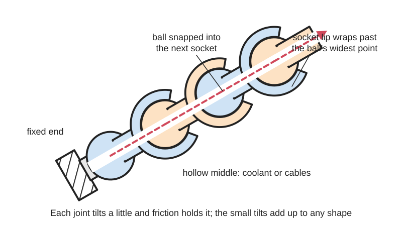
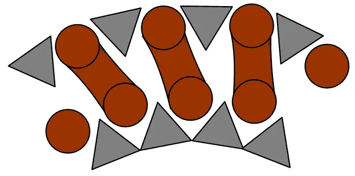

<figure class="eoc-pic eoc-pic-main"><picture><source media="(prefers-reduced-motion: reduce)" srcset="../media/drawn/posable-segmented-arm.svg"></picture><figcaption><strong>Animation.</strong> Diagram drawn for the encyclopaedia from the research notes. ⚑ Needs confirming: a drawing can simplify or get details wrong; a real photo or a better diagram is welcome.</figcaption></figure>
<figure class="eoc-pic"><figcaption><strong>Photo.</strong> <a href="https://commons.wikimedia.org/wiki/File:Detail_Schwanenhals_Leuchte_waagerecht.jpg">Detail Schwanenhals Leuchte waagerecht</a> by Phrontis, <a href="https://creativecommons.org/licenses/by-sa/3.0">CC BY-SA 3.0</a>, from Wikimedia Commons.</figcaption></figure>

A chain of identical short segments, each with a ball at one end and a socket at the other, snapped together so every joint can swivel a little and holds its angle by friction; together they make an arm you can bend into any shape and that stays put, often hollow so coolant, air or cables can pass through.

**In plain words:** A bendy arm made of many little snap-together ball joints (or a coiled metal tube) that you can bend into any shape and it stays there, like the coolant hose on a milling machine, a flexible phone holder or a desk lamp's neck. **Proper term:** Posable segmented arm (modular ball-and-socket hose; gooseneck).

**Also called:** modular hose / modular coolant hose / segmented hose; Loc-Line (brand, 'the original modular hose'); Snapline (brand, named on Printables as another system); coolant hose / coolant arm; ball-and-socket arm / ball chain arm / snake arm / articulated arm; gooseneck / gooseneck arm / gooseneck tubing / flexible gooseneck (the coiled-wire metal type); Stayput tubing (Whitehouse Flexible Tubing's name for spring-steel gooseneck); flexible arm / flexible phone holder / helping hands (soldering); flexible tripod legs, e.g. GorillaPod (brand); Schwanenhals (German); locking arm / holding arm (cable-tensioned versions in surgery).

## How it works

Each segment's ball is pushed into the next segment's socket, whose lip wraps past the ball's widest point so it snaps in and can't fall out; the fit is tight, so each joint swivels by only a limited angle and holds that angle by friction ('just enough friction to hold position once set, but it can be repositioned by hand', AIMS). Many small bends add up, so the whole arm can be curved into any shape and even turned back on itself (16 joints in Alex Rich's design). In modular hose the segments are hollow and a tapered skirt lets the ball swivel without cutting off the flow (modularhose.com). In a metal gooseneck, bending pushes the tips of the outer triangular wire between the turns of the inner round wire, and friction between them holds the bend (Wikipedia 'Gooseneck (fixture)'). In cable-locked arms, pulling the central cable tight squeezes every ball into its socket so the whole arm goes rigid at once; slackening it lets it bend again (US6730020).

## Parts

A small assembly of many identical parts: segments (ball at one end, socket at the other) plus end fittings such as a threaded or magnetic base, nozzles and device holders (Loc-Line catalogue). Variants: segments with a quarter-turn locking nut on every joint (Alex Rich's locking gooseneck); a steel cable threaded through all the segments and a knob that pulls it tight to lock the whole arm (US6730020); and the metal gooseneck, which is not segmented but made of two wires wound together, a round-section spiral inside a triangular- or D-section spiral (Wikipedia 'Gooseneck (fixture)'; Whitehouse).

## Everyday examples

- The flexible coolant hose that aims cutting fluid on lathes and milling machines (Loc-Line; Wikipedia 'Gooseneck (fixture)')
- Gooseneck desk lamps and conference microphones (Wikipedia 'Gooseneck lamp'; 'Gooseneck (fixture)')
- Flexible phone holders and soldering 'helping hands' arms (Hackaday 2018)
- Bendy tripod legs such as the original GorillaPod (brand), which had nine ball-and-socket joints per leg (webBikeWorld)
- A machinist's magnetic dial-indicator stand (articulating-arm magnetic base), whose 'Arm has 3 articulating joints that can be locked with the single hand knob' (Protool; Penn Tool): the central-locking idea with a few big joints instead of many small ones

## When to use it

Use it when something light has to be aimed or held in an awkward spot and re-aimed often: coolant, air-blast or vacuum nozzles, lights, magnifiers, webcams, phones, sensors, fans, and parts held for soldering. It routes around obstacles, carries fluid, air or cables inside, reaches in 3D without any tools, and is easy to lengthen or shorten. Printed versions are cheap to make in any colour and length. Choose a locking version (locking nuts or a tensioned cable) when it must hold something heavier or survive knocks.

## When not to use it

Avoid it for heavy loads or long reaches (use a jointed arm with lockable joints, a ball-head mount with a short arm, or a monitor arm); where the position must be exact and repeatable (use a rigid bracket or indexed joints); on machines with hot chips, which melt acetal hose (AIMS), or at high fluid pressure (use metal pipe or proper hose); and where it will be yanked lengthwise, since unlocked chains pop apart (use locking segments). For carrying cables along a machine's moving axis use a cable carrier (drag chain) instead, which bends in one plane and doesn't need to hold a shape.

## Details

- **What it does (jobs):**
  - let it move (turn, slide or bend): bend into any shape by hand
  - join and hold: holds a nozzle, lamp, phone, camera or part in the chosen position
  - seal it, or pass cables or fluid through: hollow segments carry coolant, air, vacuum or wires
  - lock, and release by hand: only locking versions (a locking nut on each joint, or a cable pulled tight by a knob)
- **Movement:** multiple: each joint swivels and tilts a limited amount (a few tens of degrees), and many joints add up to any curve, including turning back on itself (Alex Rich, hackaday.io); length changes by adding or removing segments
- **Directions it can move (degrees of freedom):** 3 per joint (each ball-and-socket joint turns about three axes), so an arm of n joints has 3n in total; in practice it behaves like a bendable rod that can take any curve. A cable-locked arm has 0 when locked. A metal gooseneck bends in any direction but hardly twists.
- **Special behaviour:**
  - none: the basic arm has no clever action; it simply holds any shape by friction in every joint and stays there 'without any spring back' (modularhose.com, a Loc-Line distributor)
  - hand-release only (locks under load, releases when a person operates it): cable-locked arms go rigid when a knob pulls the cable tight and floppy when it is released (US6730020); locking-nut arms lock each joint separately (Alex Rich)
- **How it holds:**
  - friction or clamping ([force-fit](../glossary.md#form-fit--force-fit--material-bond)): friction in every joint (or between the gooseneck's wires) holds the shape; a tensioned cable raises the friction to lock it
  - shape (the parts interlock; form-fit): each ball is trapped by its socket's lip, which holds the chain together
  - spring force (a spring or springy part presses it in place): the socket's springy walls keep pressing on the ball; spring-steel wire in goosenecks
- **Input and output:** not applicable
- **Power:** passive (no power needed)
- **Load:** light: meant for nozzles, lamps, phones, magnifiers and small parts. A printed PLA helping-hands arm with twist-lock joints was 'at the edge of that limit' holding an 83.5 g magnifying glass, although ten joints hung in a chain could carry a drill in tension (Hackaday 2018); an original GorillaPod (brand) was rated for cameras up to 275 g (webBikeWorld); a fully printed phone arm of a different, screw-tightened design holds about 500 g (FunkyArt, Printables). Longer arms move and wobble more (Mountguys), and the joint nearest the base carries the most bending, so it slips first ⚑ [uncertain]. Weak when pulled apart lengthwise: unlocked ball chains 'pop apart too easily' (Alex Rich).
- **Play and precision:** noticeable: it is for rough aiming, not precise positioning. Maker claims differ: Loc-Line says it 'stays in position' and '[creep](../glossary.md#creep) due to machine vibration is eliminated' (Loc-Line catalogue), while a distributor warns of drift and pop-off from vibration and repeated adjustment on high-cycle machines (AIMS). A heavy load at the end makes it sag slightly ⚑ [uncertain].
- **Taking it apart:** removable: segments snap apart again by hand or with assembly pliers (Loc-Line); end fittings screw on
- **How often it can be reused:** many times: can be re-shaped endlessly and taken apart and rebuilt; segments that are pulled apart and re-snapped often, or bent many times on a vibrating machine, loosen and should be replaced (AIMS)
- **Sealing:** loose: the tight ball-in-socket contact seals well enough to carry low-pressure coolant, air or vacuum (Loc-Line 1/4 in: 30-50 psi; 1/2 in: 20-30 psi; 3/4 in: 10-20 psi, Loc-Line catalogue); not for high pressure and may weep at joints ⚑ [uncertain]. Spherical pipe joints for higher pressure add a gasket (Thang, 'Pipe movable connection 1', Part 3, p. 166).
- **Adjustable:** yes: re-shape by hand at any time; length adjusted by adding or removing segments ('fully hand adjustable in both position and length', Loc-Line); [stiffness](../glossary.md#stiffness) by choosing tighter or looser segments (Daniel Vitanza's 'light' and 'hard' printed versions) or by tightening locking nuts, which have several positions to take up wear (Alex Rich).
- **Access needed:** end of a tube or shaft: it attaches by its ends, screwing or snapping onto a base fitting at one end and a nozzle or holder at the other
- **Materials:** Acetal copolymer (Loc-Line; the same family as Delrin), with acid-resistant polyester versions (Loc-Line; AIMS); spring-steel D-section wire with chrome plating for goosenecks (Whitehouse); hard plastics such as polycarbonate or Ultem with elastomer-coated sockets for cable-locked surgical arms (US6730020); rubber rings on flexible tripod legs (Gizmodo); printed PETG (preferred), PLA (creeps) or TPU.
- **Heat, cold, water and wear:** Acetal modular hose: maximum operating temperature 76 °C (melts at 165 °C); not resistant to strong acids, strong bases or bleach (Loc-Line catalogue); hot chips from machining can melt it, so aim it 30-45° away from where chips fly (AIMS). Acid-resistant polyester versions exist (Loc-Line; AIMS). Vibration and repeated adjusting can make segments drift or pop off over time (AIMS), although the maker says vibration creep is eliminated (Loc-Line). Printed PLA segments creep and loosen and soften from about 60 °C (thrinter; CNC Kitchen; Jack, Printables). Flexible aluminium-core arms can snap if bent back and forth too often, while ball-joint legs are very hard to break (Gizmodo on GorillaPod redesign).

## Making it

- **Ways to make or get it:**
  - off-the-shelf part: modular coolant hose kits and nozzles, gooseneck tubing, flexible phone and lamp arms
  - 3D print (FDM): snap-together ball-and-socket segments, modular hose segments, locking-nut arms, parametric OpenSCAD hose libraries
  - injection moulding: commercial modular hose segments (acetal) ⚑ [uncertain]
  - sheet metal / wire forming: coiled-wire goosenecks (made by specialist manufacturers)
- **Printing it in one piece (print in place):** no: segments are printed separately (usually one per part or many on one plate) and snapped together; Printables also has [print-in-place](../glossary.md#print-in-place) articulated toy animals with ball-socket joints, but posable arms are normally assembled
- **Tools:** none for small (1/4 in) segments and most printed ones; hose assembly pliers for 1/2 in and especially 3/4 in modular hose (AIMS; Loc-Line catalogue); a spanner for locking-nut joints
- **Difficulty:** easy: segments print without supports and snap together; moderate to get the friction right for a heavier load, which usually means printing test versions or adding locking nuts or a cable

### 3D printing tips

1) Material: use PETG, not PLA. PLA creeps and 'will creep and get loose over time' in ball-socket tubing (Jack, Printables 'Ball-Socket joint tubing'); PLA showed the most creep in a clip test (thrinter) and softens from about 60 °C (CNC Kitchen). PETG also flexes more than PLA, which helps the segments bend slightly as they snap together (bulbasaur0), and printed PETG links are 'plenty sturdy' (nickcin). 2) Orientation: print each segment standing up with the ball down and the socket up, so the ball is round and supports don't end up inside the socket; add a small brim or brace if tall segments might break off the bed (nickcin 'Snap Ball Socket Joint Link'; Alex Rich). 3) Settings from working designs: 0.2 mm layers, 2 [perimeters](../glossary.md#perimeters), 100% [infill](../glossary.md#infill), no supports, random seam (Daniel Vitanza 'Modular Hoses (Loc-line like)'); walls two perimeters thick (0.8 mm with a 0.4 mm nozzle) for hollow hose segments (bulbasaur0). 4) Tune the friction by printing versions: Vitanza offers 'light' segments that are easy to bend but hold only light electronics and 'hard' ones that hold more but are tougher to move, because grease or lubricant didn't work well for printed segments. 5) Assembly: line the two segments up on the same axis and press hard until the ball is fully inside, then bend each joint once to break in the rough printed surface (Vitanza). For big segments use pliers or a clamp. 6) If it keeps popping apart, add a locking nut on each joint: Alex Rich's design uses a quarter-turn twist-lock nut over a slotted socket, with several lock positions to take up wear (Printables 'Locking ball and socket arm'; hackaday.io). Don't overtighten printed lock rings with tools: one PLA socket cracked (Hackaday 2018). 7) For a whole arm that locks at once, thread a strong cord or cable through a central hole and tighten it with a knob or screw; tension squeezes every joint (US6730020); a 4 mm hole in each segment also lets you run wires for a lamp (nickcin). 8) Keep the arm as short as the job allows and put the heaviest segment size at the base, because the base joint carries the most turning load (Mountguys) ⚑ [uncertain] (general advice from ball mounts, not tested on printed chains).

### Buying one (off-the-shelf parts)

Search for: 'modular hose', 'modular coolant hose', 'coolant hose kit', 'hose assembly pliers', 'flare nozzle', 'round nozzle' and 'hose segments' in 1/4 in, 1/2 in, 3/4 in or 2.5 in (vacuum) sizes (Loc-Line (brand) and compatible brands); 'gooseneck tubing', 'flexible gooseneck', 'stayput tubing'; 'flexible arm phone holder', 'magnetic base flexible arm', 'articulating arm magnetic base' (a dial-indicator stand whose joints all lock with one knob; Protool), 'helping hands'; 'flexible tripod' (GorillaPod (brand)); 'articulated arm' with a single central lock ('magic arm') for camera gear ⚑ [uncertain]. Note that cheap copies may use incompatible connectors (AIMS).

## Rules of thumb

- Modular coolant hose sizes and working pressures: 1/4 in system 30-50 psi; 1/2 in 20-30 psi; 3/4 in 10-20 psi (Loc-Line catalogue, RS Components copy, p. 1).
- Acetal modular hose: melting point 165 °C, maximum operating temperature 76 °C (Loc-Line catalogue p. 1).
- Acetal hose resists oils, petrol, greases, alcohol and acetone, but not acids, strong bases or hypochlorite (bleach) solutions (Loc-Line catalogue p. 1).
- Hand assembly gets harder with size: 1/4 in segments snap together fairly easily, 3/4 in is very difficult without pliers (AIMS).
- With about 16 joints a ball-socket arm can turn right back on itself (Alex Rich, hackaday.io).
- A printed PLA ball-and-socket helping-hands arm was at the edge of its limit holding an 83.5 g magnifier, even though ten joints hung in a line held a drill in tension (Hackaday 2018): printed chains are strong when pulled but weak at holding weight out sideways, so plan for tens of grams unless they lock.
- Keep arms short and balls big for stability: 'The longer the arm, the more movement you introduce' (Mountguys).
- Metal gooseneck tubing: spring-steel D-section wire, sizes from 4 mm to 19 mm outside diameter, up to 1 m long (Whitehouse 'Stayput & Gooseneck Tubing').

## Common failures

Joints wear or creep loose so the arm sags or drifts (replace segments, print 'hard' versions, or use PETG instead of PLA; AIMS; Vitanza; Jack). Segments pop apart when pulled or knocked (add locking nuts; Alex Rich). Sockets crack during assembly or when a lock ring is overtightened, especially in PLA (Hackaday 2018). The arm is too long or the load too heavy, so the base joint slips (shorter arm, bigger size; Mountguys). Hot chips melt segments, or long swarf wraps round the hose and pulls it loose (AIMS). Cheap copies don't fit genuine fittings (AIMS). Goosenecks lose stiffness after heavy use as the wires wear ⚑ [uncertain].

## Safety

An unlocked arm can pop apart or sag and drop what it holds (Alex Rich, hackaday.io), so don't hang anything heavy, hot or sharp over people or delicate work. On machine tools, keep the hose clear of the cutter and chips; acetal hose won't damage a cutter if touched, unlike metal hose (Loc-Line catalogue), but hot chips melt it (AIMS). Releasing a cable-locked arm frees every joint at once, so support the load first ⚑ [uncertain]. Snapping large segments together pinches fingers; use the assembly pliers (AIMS). Small printed segments are a choking hazard for young children ⚑ [uncertain].

## Related

- Ball-and-socket joint (lockable ball head): a single joint of the same kind, usually lockable
- Gooseneck (coiled-wire tube): holds any shape by friction between wound wires rather than separate joints (covered in this entry)
- Bendable wire core (e.g. aluminium-core tripod legs): simpler and grippier, but can snap after repeated bending (Gizmodo)
- Cable-locked holding arm: the same ball chain with a central cable that locks every joint at once (covered in this entry)
- Articulated arm with lockable hinge joints: fewer, bigger joints that lock firmly, for heavier devices (e.g. HardwareLab's printed arm)
- Locking profile snake (contour gauge chain): links that go rigid when pressed together on tapered posts (LoboCNC, Printables)
- Cable carrier (drag chain, energy chain): links that bend in one plane to guide moving cables; it doesn't hold a shape
- Friction hinge: holds any angle about one axis only

## Make it yourself

- [Modular Hoses (Loc-line like) (Daniel Vitanza, Printables) (URL from Printables API, page not opened)](https://www.printables.com/model/73716-modular-hoses-loc-line-like): Printable modular hose segments in 'light' and 'hard' friction versions, plus nozzles and clip heads; PETG, 100% infill; not compatible with commercial hose *(licence: CC BY-NC)*
- [Snap Ball Socket Joint Link - Gooseneck Articulated Arm (nickcin, Printables) (URL from Printables API, page not opened)](https://www.printables.com/model/393094-snap-ball-socket-joint-link-gooseneck-articulated-): A small (about 16 mm) snap-together ball-and-socket link with a 4 mm hole for wires; print ball side down in PETG *(licence: Creative Commons Public Domain (Printables))*
- [Locking ball and socket arm (Alex R, Printables) (URL from Printables API, page not opened)](https://www.printables.com/model/7927-locking-ball-and-socket-arm): Ball-and-socket gooseneck with a quarter-turn twist-lock nut on each joint so it can't pop apart; project write-up at https://hackaday.io/project/5739-locking-ball-and-socket-gooseneck-system *(licence: CC BY-SA)*
- [Articulated Arm (Jack, Printables)](https://www.printables.com/model/80144-articulated-arm): Parametric OpenSCAD chain of lockable ball joints (e.g. 8 mm balls, 25 mm per link) whose threaded parts are tightened to adjust stiffness or lock them, allowing up to 90° angle; no supports; a little grease on ball and thread is suggested. Read through the Printables public API. *(licence: Creative Commons Public Domain (Printables))*
- [Ball-Socket joint tubing (Jack, Printables) (URL from Printables API, page not opened)](https://www.printables.com/model/350399-ball-socket-joint-tubing): OpenSCAD ball-socket links that chain into a jointed hose (Loc-Line style); the author warns not to use PLA because it creeps and gets loose *(licence: Creative Commons Public Domain (Printables))*
- [Segmented Modular Hose, Parametric and Customizable (bulbasaur0, Printables) (URL from Printables API, page not opened)](https://www.printables.com/model/657275-segmented-modular-hose-parametric-and-customizable): Open-source OpenSCAD library for segmented hose parts (segments, fan and vacuum connectors, magnetic bases); 0.8 mm walls, PETG recommended *(licence: CC BY-SA)*
- [Locking Profile Snake (LoboCNC, Printables)](https://www.printables.com/model/901942-locking-profile-snake): A snake-like chain that goes from floppy to rigid when the links are pressed together onto tapered posts, avoiding friction joints that loosen over time. Read through the Printables public API. *(licence: CC BY-SA)*

## Pictures, videos and models

- [Schwanenhals 2.gif: principle of a gooseneck construction, bent (Salino01, Wikimedia Commons)](https://commons.wikimedia.org/wiki/File:Schwanenhals_2.gif): Diagram of a bent gooseneck: a round-wire spiral with a triangular-wire spiral wound around it, whose tips slip between the turns when bent (a straight version is File:Schwanenhals_1.gif) *(licence: CC BY-SA 3.0 / 2.5 / 2.0 / 1.0 or GFDL 1.2+ (multi-licence))*
- [Detail of a gooseneck arm (Phrontis, Wikimedia Commons)](https://commons.wikimedia.org/wiki/File:Detail_Schwanenhals_Leuchte_waagerecht.jpg): Close-up photo of a lamp's gooseneck arm *(licence: CC BY-SA 3.0)*
- [Printed It: Do More With Lockable Ball And Socket Helping Hands (Steven Dufresne, Hackaday, 2018)](https://hackaday.com/2018/02/08/printed-lockable-ball-and-socket-helping-hands-plus/): Photos of a printed ball-and-socket arm with slotted sockets and twist-lock rings, used as soldering helping hands and a magnifier holder *(licence: link only)*
- [Pipe movable connection 1 (YouTube, Nguyen Duc Thang, thang010146)](https://www.youtube.com/watch?v=DwrlPPTBrPA): CAD animation of a spherical joint arranged for tubing, with a gasket for sealing, the principle behind swivelling hose joints (Thang, 2700 Animated Mechanical Mechanisms, Part 3, p. 166; title confirmed via YouTube oEmbed) *(licence: link only (standard YouTube licence))*
- [US6730020B2 Locking arm having ball joints for use in an organ manipulator apparatus (Google Patents)](https://patents.google.com/patent/US6730020): Patent drawings of a chain of ball joints threaded on a cable that a knob pulls tight to make the arm rigid *(licence: link only (US patent drawings are generally public domain) ⚑ [uncertain])*

## Needs confirming

⚑ marks something nobody has confirmed yet: a fact the research could not confirm from a source, a finder value that is a best guess, or an open point from the research notes. Corrections are welcome (see `research/needs-confirming.md`).

- ⚑ 10 sentences on this page marked [uncertain].
- ⚑ Finder value `connects` = any solid parts (best guess): joins parts, but no specific kind of part found; set to any solid parts

## Sources

- <https://en.wikipedia.org/wiki/Gooseneck_(fixture)>
- <https://en.wikipedia.org/wiki/Gooseneck_lamp>
- <https://commons.wikimedia.org/wiki/File:Schwanenhals_1.gif>
- <https://commons.wikimedia.org/wiki/File:Schwanenhals_2.gif>
- <https://commons.wikimedia.org/wiki/File:Detail_Schwanenhals_Leuchte_waagerecht.jpg>
- <https://flexible-tubing.com/product/stayput-gooseneck-tubing/>
- <https://www.loc-line.com/>
- <https://docs.rs-online.com/27df/0900766b80d6f905.pdf>
- <https://www.modularhose.com/loc-line-world>
- <https://aimsindustrial.com.au/blogs/product-guides/loc-line-modular-hose-guide>
- <https://hackaday.io/project/5739-locking-ball-and-socket-gooseneck-system>
- <https://hackaday.com/2018/02/08/printed-lockable-ball-and-socket-helping-hands-plus/>
- <https://patents.google.com/patent/US6730020>
- <https://www.webbikeworld.com/gorillapod/>
- <https://gizmodo.com/joby-redesigned-the-flexible-legs-on-its-iconic-gorilla-1847808657>
- <https://www.mountguys.com/ram-mounts-guide/>
- <https://www.youtube.com/watch?v=DwrlPPTBrPA>
- <http://thrinter.com/creep-abs-pla-petg-alloy-910/>
- <https://www.cnckitchen.com/blog/comparing-pla-petg-amp-asa-feat-prusament>
- <https://api.printables.com/graphql/>
- <https://www.printables.com/model/80144-articulated-arm>
- <https://www.printables.com/model/901942-locking-profile-snake>
- <https://www.printables.com/model/1114209-articulated-arm>
- <https://www.protool-ltd.co.uk/collections/asimeto-articulating-arm-magnetic-bases-602-series>
- <https://www.penntoolco.com/asimeto-articulating-arm-magnetic-base-w-176-lbs-hold-power-602-03-1/>
