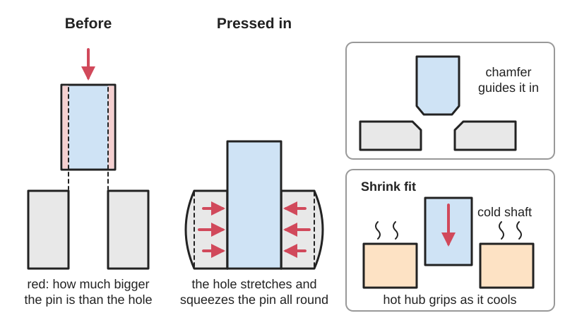
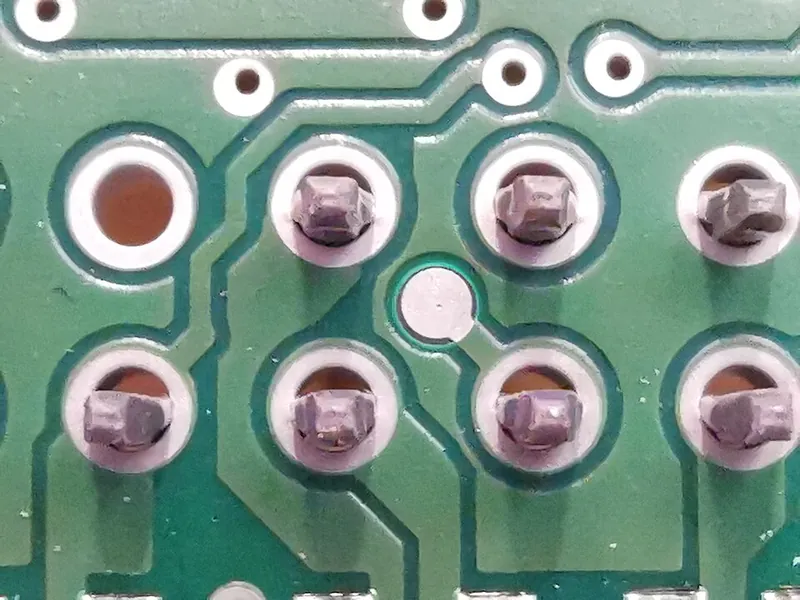
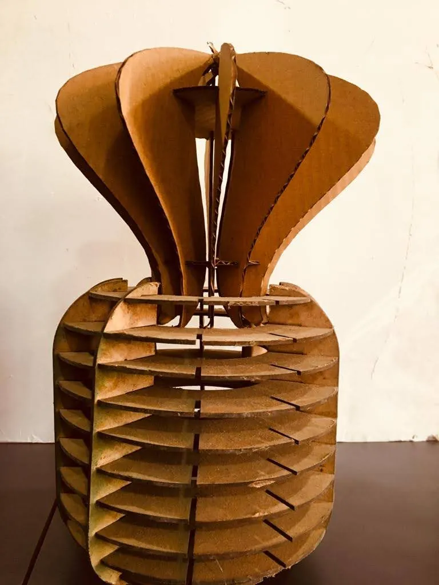

<figure class="eoc-pic eoc-pic-main"><figcaption>Diagram drawn for the encyclopaedia from the research notes. ⚑ Needs confirming: a drawing can simplify or get details wrong; a real photo or a better diagram is welcome.</figcaption></figure>
<figure class="eoc-pic"><figcaption><strong>Photo.</strong> <a href="https://commons.wikimedia.org/wiki/File:Eingepresste_Pins_in_PCB_(unten).jpg">Eingepresste Pins in PCB (unten)</a> by Laserlicht, <a href="https://creativecommons.org/licenses/by-sa/4.0">CC BY-SA 4.0</a>, from Wikimedia Commons.</figcaption></figure>
<figure class="eoc-pic"><figcaption><strong>Photo.</strong> <a href="https://commons.wikimedia.org/wiki/File:Press_fit_Flowerpot.jpg">Press fit Flowerpot</a> by जाधव प्रियांका, <a href="https://creativecommons.org/licenses/by-sa/4.0">CC BY-SA 4.0</a>, from Wikimedia Commons.</figcaption></figure>

The inner part is made slightly bigger than the hole and forced (or heat-shrunk) into it, so both materials spring back against each other and friction holds them together, centred and with no play.

**In plain words:** A pin, shaft, bearing or peg pushed into a hole that is a tiny bit too small for it, so the squeezed material grips it tightly with no glue, screws or clips. **Proper term:** Press fit ([interference fit](../glossary.md#interference-fit)).

**Also called:** interference fit; force fit, friction fit, drive fit (Wikipedia 'Interference fit'); push fit (a lighter fit that goes together by hand; Formlabs); shrink fit (the outer part is heated so it grows, slipped on, and grips as it cools), expansion fit or cold fit (the inner part is cooled instead); hydraulic dilation / oil-injection press fit (oil pumped between the parts to assemble or release them); ISO fit codes H7/p6 (press fit), H7/s6 (driving fit), H7/u6 (forced or shrink fit) (Wikipedia 'Engineering fit'); pressed-in (press-in) bearing, bushing or dowel pin; German 'Pressverband' / 'Pressfügen'.

## How it works

The inner part is made a little larger than the hole. Forcing it in stretches the hole slightly and squeezes the inner part slightly; both materials act like very stiff springs, so they keep pressing on each other, and that contact pressure times the friction coefficient over the contact area resists sliding and turning (Wikipedia 'Interference fit'; Slocum, FUNdaMENTALs of Design, Topic 5). Metal parts need only a few hundredths of a millimetre of oversize (an ISO H7/p6 fit on 50 mm gives 0.001-0.042 mm; Wikipedia 'Engineering fit'), while plastics need more because they are much less stiff (DuPont design guide). Instead of force, the outer part can be heated or the inner part cooled so they slide together and grip as the temperatures even out (a shrink fit); this keeps the surface roughness intact and gives a stronger joint than pressing, which scrapes the surfaces smoother (Wikipedia 'Interference fit'; German Wikipedia 'Pressfügen').

## Parts

Single joint of two parts: the inner part (pin, shaft, bearing, bushing, magnet, dowel) and the outer part with the hole (hub, housing, wheel, printed or wooden part); nothing else, apart from the press, vice, mallet, heat or cold used to assemble it.

## Everyday examples

- Railway wheels pressed or shrunk onto their axles (Wikipedia 'Interference fit')
- Ball bearings and bushings pressed into housings, including in 3D-printed machine and robot parts (Wikipedia 'Interference fit'; Petrović et al.)
- Wooden dowels tapped into holes in furniture (Wikipedia 'Dowel')
- A robot or toy wheel pressed onto its hub (University of Florida EML2322L)

## When to use it

Use a press fit to fix a bearing, bushing, dowel pin, magnet or peg in a hole permanently, compactly and without play, where there is no room for screws or clips and you won't need to take it apart often. In metal it is one of the strongest and most reliable ways to fix a gear or hub to a shaft, and it suits shock and alternating loads. In 3D prints it is quick and cheap for bearings, pins and magnets, as long as you test the hole size on your own printer.

## When not to use it

Avoid a press fit for parts you will take apart often (use screws, a snap fit, a [taper](../glossary.md#taper) fit or a keyless locking bush), for passing real [torque](../glossary.md#torque) through plastic (use a hex shaft, key, D-flat or clamp hub; University of Florida EML2322L), for files other people will print on different printers (use crush ribs or springy features, or a [tolerance](../glossary.md#tolerance) ring), for [brittle](../glossary.md#brittle--ductile) materials such as acrylic, resin or glass (use a [clearance](../glossary.md#clearance) fit with glue or a springy feature), and for plastic parts in hot places or under constant load, where [creep](../glossary.md#creep) loosens them. Don't press parts onto motor shafts or precision parts without supporting them, since the force can damage them (University of Florida EML2322L).

## Details

- **What it does (jobs):**
  - join and hold: fixes a bearing, bushing, pin, shaft, gear, wheel, magnet or dowel in a hole with nothing else
  - line parts up exactly: dowel pins and pressed-in bearing seats locate parts precisely with no play
- **Movement:** none: a fixed joint
- **Directions it can move (degrees of freedom):** 0: the parts cannot move relative to each other unless the friction is overcome
- **Special behaviour:**
  - self-aligning or self-centring: a round press fit centres the parts on each other with no play (German Wikipedia 'Pressfügen')
  - none of the others: an overloaded press fit will slip, but it is not a dependable torque limiter; Slocum asks students whether it is safe to rely on one as a clutch, and a university robot-design guide notes plastic press fits slip unless the torque is very low (University of Florida EML2322L)
- **How it holds:**
  - friction or clamping ([force-fit](../glossary.md#form-fit--force-fit--material-bond)): the elastic squeeze of the oversized part creates the pressure, and friction holds it
- **Input and output:** not applicable (when it fixes a gear or wheel to a shaft it simply passes the turning force on 1:1; see shaft-to-hub joints)
- **Power:** passive (no power needed)
- **Load:** Metal: medium to heavy. A well-made interference fit gives the best torque transmission of the usual ways of fixing a part to a shaft (Slocum) and copes with shock and alternating loads (German Wikipedia 'Pressfügen'). Plastic and 3D prints: light to medium; they slip unless the torque is very low (University of Florida EML2322L) and loosen over time as the plastic creeps (DuPont). Strong in twist and along the axis up to the friction limit; weak if the outer part is thin or brittle, which can split.
- **Play and precision:** none: no play at all, and it centres the parts accurately; but it needs very accurate sizes (in metal, a few hundredths of a millimetre decide between loose and cracked; Slocum) and tolerates no [misalignment](../glossary.md#misalignment) while pressing, so parts must start straight on a [chamfer](../glossary.md#chamfer--fillet) (Wikipedia 'Interference fit').
- **Taking it apart:** semi-permanent: it can be pressed or pulled out with a press or puller, but the surfaces are smoothed and grip less the next time (German Wikipedia 'Pressfügen'), and plastic or brittle parts may crack; heavy shrink and force fits are effectively permanent (Wikipedia 'Engineering fit': H7/u6 'cannot be disassembled without risking destruction').
- **How often it can be reused:** a few times: each re-pressing wears the surfaces and lowers the [holding force](../glossary.md#holding-force) (German Wikipedia 'Pressfügen'); crushable printed ribs lose grip after the first assembly (AON3D)
- **Sealing:** none: it is not a designed seal; use an [O-ring](../glossary.md#o-ring), gasket or glue where it must keep out water or hold pressure
- **Adjustable:** no: once pressed, position and grip are fixed (Slocum: 'there is no means for adjustment')
- **Access needed:** one side only (blind) to press a part into a blind hole, though the other part must be supported behind while pressing; removing a part from a blind hole needs a special puller ⚑ [uncertain]
- **Materials:** Metals: steel, aluminium, brass and bronze (bushings), cast iron (Wikipedia 'Engineering fit' notes H7/s6 is the tightest possible with cast iron). Plastics: acetal (POM) and nylon hubs are covered by DuPont's interference limits; 3D prints in PLA, PETG, ABS/ASA, nylon and TPU (Creative3DP; Kragujevac PET-G study). Wood: dowels in wood joints (Wikipedia 'Dowel'). Brittle materials (acrylic, standard resin, glass, ceramics) crack easily, since materials 'have to have significant ductility else they will crack when forced together' (Slocum).
- **Heat, cold, water and wear:** Plastic press fits creep and stress-relax, so they loosen with time, faster when warm (DuPont). Different materials expand differently with heat, so a metal pin in a plastic hub gets looser or more stressed as the temperature changes (DuPont; Slocum also lists differential thermal expansion and high-speed rotation as loads that change the fit). PLA begins to soften at about 60 C, PETG at about 80 C and ASA at about 110 C (CNC Kitchen), so printed press fits can shift in a hot car or near a motor. [Stress concentration](../glossary.md#stress-concentration) and [fretting](../glossary.md#galling--fretting) (tiny rubbing movements) at the edge of the fit reduce the strength of loaded metal press fits (German Wikipedia 'Pressfügen').

## Making it

- **Ways to make or get it:**
  - 3D print (FDM): the commonest maker use, e.g. ball bearings, magnets, pins and bushings pressed into printed parts (AON3D; Creative3DP; Kragujevac PET-G study)
  - 3D print (resin): possible for tight fits, but standard resins are brittle, so keep the interference small or use a clearance fit with glue ⚑ [uncertain]
  - CNC and lathe work: reamed or bored holes and turned shafts to ISO fit tolerances (Wikipedia 'Engineering fit')
  - woodwork: dowels pressed or tapped into drilled holes, usually with glue (Wikipedia 'Dowel')
  - off-the-shelf part: dowel pins, bushings, bearings and press-fit inserts made to standard press-fit sizes
- **Printing it in one piece (print in place):** no: the part is pushed into the printed hole after printing (to trap a part during printing instead, see mid-print embedding)
- **Tools:** a press: arbor press, hydraulic press, bench vice, or a bolt with washers as a drawbolt; a soft mallet for light fits; an oven, heat gun or induction heater for shrink fits, or a freezer for cooling the inner part; a puller to take it apart (Wikipedia 'Interference fit'; Hackaday)
- **Difficulty:** moderate: simple to design, but the size difference is tiny, so printed parts need a quick test print to tune the hole, and metal parts need a reamed hole and a press

### 3D printing tips

1) Always test first: printers and filaments differ, so print a small test coupon or gauge with a range of hole sizes and keep the numbers that work for that printer and material (Creative3DP; Hackaday 'Finding perfect part fits with the Goldilocks approach'; test models such as DrKriegerAUS's 'Simple Press Fit & Clearance Test', which steps from -0.2 mm interference to +0.55 mm clearance in 0.05 mm steps). 2) Printed holes usually come out 0.1-0.3 mm undersize and printed pins about 0.1 mm oversize (Creative3DP); in OpenSCAD, circles are polygons drawn inside the stated diameter, so holes print smaller still unless you raise $fn (Hackaday readers' comments). 3) Starting point for rigid filaments (PLA, PETG, ABS) and parts 5-25 mm across: about 0.1 mm of interference on diameter in the finished parts; TPU needs about twice as much (Creative3DP, community guidance). 4) Expect real force: PET-G bearing seats printed 0.2 mm undersize for 13 mm and 26 mm bearings needed up to about 583 N and 588 N (roughly 60 kg) to press in (Petrović et al., MVM 2024), so use a vice or arbor press, not a hammer. 5) Plain round holes can only stretch around their circumference, so tight round fits crack or split along [layer lines](../glossary.md#layer-lines); use a hexagonal or square hole or shaft, a few 0.2 mm crush ribs, or thin slots that let the wall flex (AON3D). Hex shafts also hide the Z-seam in a corner (AON3D). 6) Print holes with their axis vertical for the roundest result; horizontal holes sag at the top, more so as they get larger (Hackaday readers' comments) ⚑ [uncertain]. 7) Add a lead-in chamfer (e.g. 0.5 mm x 45 degrees) so the part starts straight and spreads the force (Creative3DP; Wikipedia 'Interference fit'). 8) Put the precision on the pin or shaft: outside sizes print more accurately and can be measured and sanded, while the inside of a small hole can't (Creative3DP). 9) Give the housing enough wall and [perimeters](../glossary.md#perimeters) around the seat so it doesn't split ⚑ [uncertain]. 10) Plastic creeps and relaxes, so a printed press fit slowly loosens, faster when warm; for lasting joints add a shoulder, a groove and snap ring, a drop of glue, or use a knurled or grooved metal pin so the plastic flows into the grooves (DuPont; Creative3DP). 11) PLA softens from about 60 C, PETG from about 80 C and ASA from about 110 C (CNC Kitchen oven test), so press-fitted parts in PLA can shift in a hot car. 12) In resin (SLA) prints, Formlabs distinguishes push, force and press fits by how much force they need; a press fit needs an arbor press or similar (Formlabs 'Understanding 3D printing tolerances for engineering fits').

### Buying one (off-the-shelf parts)

Dowel pins (hardened and ground), grooved pins and knurled pins, spring pins (roll pins, slotted spring pins), oil-impregnated sintered bronze bushings and flanged bushings, deep-groove ball bearings such as 608 (8 x 22 x 7 mm) and 623, press-fit threaded inserts and knurled inserts; tools: arbor press, bearing driver set, bearing puller, induction or oven heating for shrink fits (Wikipedia 'Interference fit'; Hackaday).

## Rules of thumb

- ISO fits (hole/shaft): H7/p6 press fit, light interference, assembled or taken apart by cold pressing (hubs, bearings, bushings); H7/s6 driving fit, medium interference, hot pressing or large cold-pressing force (permanent gears, shafts, bushes); H7/u6 forced (shrink) fit needing a large temperature difference, not removable without risk of damage. Example: H7/p6 on a 50 mm diameter gives 0.001-0.042 mm interference (Wikipedia 'Engineering fit').
- Classic workshop rule for metal force fits: interference of 0.001-0.0025 in per inch of diameter (0.1-0.25%), about 0.0015 in (0.15%) as a fair average, with less per inch on larger diameters (Wikipedia 'Interference fit', quoting Machinery's Handbook).
- A typical interference is 0.001 in per inch of diameter in a relatively soft metal like aluminium; less for steel, more for plastics (University of Florida EML2322L 'Mechanical Power Transmission').
- Chamfer the edges of both shaft and hole so the press starts straight and the force builds gradually (Wikipedia 'Interference fit').
- Plastic press fits: calculate the maximum allowable interference from the plastic's yield strength and [stiffness](../glossary.md#stiffness), then reduce it by a safety factor of 1.5-2; knurl or groove the metal part to keep the grip as the plastic relaxes, and test at the working temperatures (DuPont 'General Design Principles for Engineering Polymers', Module I, pp. 68-72).
- It only takes a little interference to make a strong joint, but only a little tolerance error to make it fail; the materials must be ductile or they crack (Slocum, FUNdaMENTALs of Design, Topic 5, 'Shafts: Interference-Fits').
- FDM: a transition fit is the tightest fit a desktop printer achieves reliably; for tighter fits use hex or square shapes, 0.2 mm crush ribs or flexing relief slots instead of a smaller round hole (AON3D 'Engineering fits').
- PET-G bearing seats: 0.1 and 0.2 mm undersize seats were tested for 13 mm and 26 mm bearings; the 0.2 mm undersize seats needed up to 583 N and 588 N to press in (Petrović et al., 'Determining 3D printed housing diameters for press-fitting standard ball bearings', MVM 2024).
- Shrink-fitting a steel tool holder: heat it to about 250-300 C, drop the tool in, and it grips as it cools (Hackaday 'Simple induction heater helps with homebrew shrink fitting').
- Pressed (longitudinal) fits should have a surface roughness of about Rz 3-10 micrometres and a generous chamfer; re-pressing lowers the torque they can carry (German Wikipedia 'Pressfügen', an article flagged as lacking citations) ⚑ [uncertain].

## Common failures

Too tight: the hub or printed part splits, often along a layer line, or the part jams halfway (AON3D; Slocum). Too loose: the part slips or falls out; in plastic it slips under torque (University of Florida EML2322L). Loosens over weeks or months as the plastic creeps, faster when warm (DuPont). Grips less each time it is pressed in again because the surfaces are smoothed (German Wikipedia 'Pressfügen'). Enters crooked and shaves material or jams: add a chamfer and press straight (Wikipedia 'Interference fit'). Shaft buckles while pressing (Slocum). A wooden dowel in a blind hole splits the wood because trapped air and glue can't escape; plane a flat or cut a groove on the dowel (Wikipedia 'Dowel'). A pressed-in ball bearing may feel tight or rough if the housing squeezes its outer ring too much ⚑ [uncertain].

## Safety

Pressing can crack the outer part suddenly and send fragments flying, especially brittle plastics, resin and acrylic; press slowly and wear eye protection ⚑ [uncertain]. Long shafts can buckle sideways while being pressed (Slocum). Shrink fitting uses parts heated to about 250-300 C (Hackaday), and cold-fitting uses a freezer or very cold substances, so wear gloves against burns and frostbite ⚑ [uncertain]. Arbor presses and hydraulic presses can crush fingers. Pressing a part onto a motor or other precision component without support can damage it (University of Florida EML2322L).

## Related

- Crush ribs and spring-fit features (compliant press fit): a few small ribs or flexing arms do the gripping, so the fit tolerates printer and material variation
- Tolerance ring (wavy-band press fit): a bought wavy spring-steel band between shaft and hole that grips over a wide range of sizes and can slip at a set torque
- Taper fit (Morse taper): a cone-shaped version that centres itself and comes apart with a knock, but comes loose completely once it moves
- Keyless locking bush (taper-lock bush, shaft locking device): clamps a hub on a shaft with screws and tapered rings; adjustable and releasable
- Shaft-to-hub joints and rigid couplings (key, [set screw](../glossary.md#set-screw), D-flat, clamp hub): positive or clamped ways to fix a hub that are easier to undo
- Press-fit and expanding inserts (tap-in insert) and heat-set threaded inserts: metal threads fixed into plastic by pressing or melting
- Mid-print embedding ([captive nuts](../glossary.md#captive-nut), magnets and bearings): traps the part inside the print instead of pressing it into a hole
- Dowel and biscuit joints: the woodworking version, usually with glue
- Annular snap fit: a ring-shaped bump that clicks into a groove, so it holds by shape rather than by squeeze
- Drive-in fixing pins: a dowel, grooved, knurled or spring pin tapped into a hole drilled through the parts; a spring (roll or coiled) pin grips by its own springiness, so it accepts looser hole sizes than a solid pin pressed in

## Make it yourself

- [Simple Press Fit & Clearance Test (DrKriegerAUS, Printables) (URL from Printables API, page not opened)](https://www.printables.com/model/547983-simple-press-fit-clearance-test): Two tiny blocks giving 16 combinations from -0.2 mm (interference) to +0.55 mm (clearance) in 0.05 mm steps; prints in under 10 minutes *(licence: CC BY-NC (Creative Commons Attribution-NonCommercial))*
- [Press/Tight/Loose-Fit Offset Gauge (0.05 mm increment) / Tolerance test (CheruTijntje, Printables) (URL from Printables API, page not opened)](https://www.printables.com/model/484641-presstightloose-fit-offset-gauge-005-mm-increment): A gauge of pins and windows in 0.05 mm steps for finding press, tight and loose fit offsets for a printer and filament *(licence: CC BY-NC-SA (Creative Commons Attribution-NonCommercial-ShareAlike))*
- [608 bearing tolerance tester (Handy Maker, Printables) (URL from Printables API, page not opened)](https://www.printables.com/model/1293573-608-bearing-tolerance-tester): Test prints for the outer and inner diameter of a 608 bearing in 0.1 mm steps; print the 0 model first, then the + or - versions *(licence: CC BY-SA (Creative Commons Attribution-ShareAlike))*
- [Snap Fit Test / Press Fit Test (Wilko, Printables) (URL from Printables API, page not opened)](https://www.printables.com/model/9185-snap-fit-test-press-fit-test): A base test piece for finding the clearance or interference your printer, material and settings need for press, sliding and snap fits *(licence: CC BY (Creative Commons Attribution))*

## Pictures, videos and models

- [Engineering Fits: How to Design for 3D Printed Assemblies (AON3D)](https://www.aon3d.com/applications/engineering-fits-how-to-design-for-3d-printed-assemblies/): Illustrated guide to clearance, transition and interference fits for FDM, with pictures of round holes stretching versus hexagonal shafts, crush ribs, relief slots and grip fins *(licence: link only)*
- [EML2322L Mechanical Power Transmission (University of Florida design lab handout)](https://web.mae.ufl.edu/designlab/Lab%20Assignments/EML2322L-Mechanical%20Power%20Transmission.pdf): Exploded view of a motor, hub and wheel where the wheel is pressed onto the hub, and an illustration of a press (interference) fit, with pros and cons *(licence: link only)*
- [Simple Induction Heater Helps With Homebrew Shrink-Fitting (Hackaday, 2020)](https://hackaday.com/2020/10/26/simple-induction-heater-helps-with-homebrew-shrink-fitting/): Article with an embedded video of a home-built induction heater expanding a tool holder so a cutter drops in and is gripped by a shrink fit *(licence: link only)*
- [DIY Tool Shrinking for less than 100€? (YouTube, Roetz 4.0)](https://www.youtube.com/watch?v=rb9rXfSn1Ak): Video of shrink-fitting milling tools into a heated holder (embedded in the Hackaday article) *(licence: link only (standard YouTube licence))*
- [Determining 3D printed housing diameters for press-fitting standard ball bearings (Petrović et al., MVM 2024, University of Kragujevac)](https://scidar.kg.ac.rs/bitstream/123456789/21632/1/Determining%203D%20Printed%20Housing%20Diameters%20For%20Press-Fitting%20Standard%20Ball%20Bearings.pdf): Short paper with force-displacement graphs for pressing 13 mm and 26 mm ball bearings into PET-G printed seats of different sizes *(licence: link only)*

## Needs confirming

⚑ marks something nobody has confirmed yet: a fact the research could not confirm from a source, a finder value that is a best guess, or an open point from the research notes. Corrections are welcome (see `research/needs-confirming.md`).

- ⚑ 8 sentences on this page marked [uncertain].

## Sources

- <https://en.wikipedia.org/wiki/Interference_fit>
- <https://en.wikipedia.org/wiki/Engineering_fit>
- <https://en.wikipedia.org/wiki/Dowel>
- <https://de.wikipedia.org/wiki/Pressf%C3%BCgen>
- <https://pergatory.mit.edu/resources/FUNdaMENTALs%20Book%20pdf/FUNdaMENTALs%20Topic%205.PDF>
- <https://www.distrupol.com/General_Design_Principles_for_Engineering_Polymers.pdf>
- <https://web.mae.ufl.edu/designlab/Lab%20Assignments/EML2322L-Mechanical%20Power%20Transmission.pdf>
- <https://www.aon3d.com/applications/engineering-fits-how-to-design-for-3d-printed-assemblies/>
- <https://tools.creative3dp.com/blog/press-fit-tolerances-3d-printing/>
- <https://formlabs.com/global/blog/3D-printing-tolerances-for-engineering-fit/>
- <https://scidar.kg.ac.rs/bitstream/123456789/21632/1/Determining%203D%20Printed%20Housing%20Diameters%20For%20Press-Fitting%20Standard%20Ball%20Bearings.pdf>
- <https://hackaday.com/2020/06/09/finding-perfect-part-fits-with-the-goldilocks-approach-and-openscad/>
- <https://hackaday.com/2020/10/26/simple-induction-heater-helps-with-homebrew-shrink-fitting/>
- <https://www.youtube.com/watch?v=rb9rXfSn1Ak>
- <https://www.cnckitchen.com/blog/comparing-pla-petg-amp-asa-feat-prusament>
- <https://api.printables.com/graphql/>
