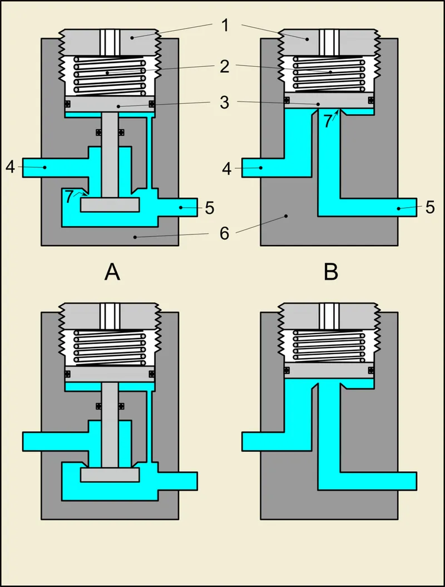
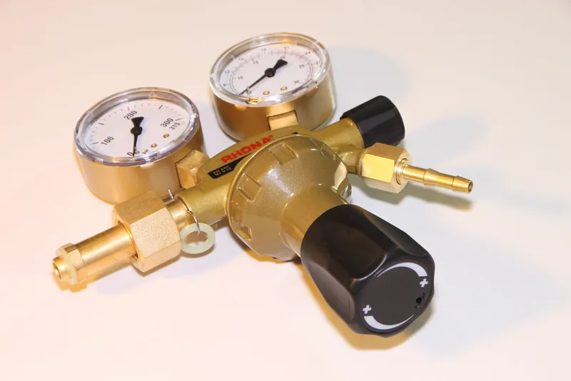

<figure class="eoc-pic eoc-pic-main"><picture><source media="(prefers-reduced-motion: reduce)" srcset="../media/drawn/pressure-regulator.svg"></picture><figcaption><strong>Animation.</strong> Diagram drawn for the encyclopaedia from the research notes. ⚑ Needs confirming: a drawing can simplify or get details wrong; a real photo or a better diagram is welcome.</figcaption></figure>
<figure class="eoc-pic"><figcaption><strong>Cross-section.</strong> <a href="https://commons.wikimedia.org/wiki/File:Single-stage-regulator.svg">Single-stage-regulator</a> by Mintrick (talk), <a href="https://creativecommons.org/licenses/by-sa/3.0">CC BY-SA 3.0</a>, from Wikimedia Commons.</figcaption></figure>
<figure class="eoc-pic"><figcaption><strong>Photo.</strong> <a href="https://www.flickr.com/photos/28958738@N06/7304227552">200bar-High-Pressure-Regulator-Argon__41749</a> by Public Domain Photos, <a href="https://creativecommons.org/licenses/by/2.0/">CC BY 2.0</a>, from Flickr via Openverse.</figcaption></figure>

A self-adjusting valve with a spring-loaded diaphragm that lowers a high supply pressure to a steady working pressure you set with a knob, opening a little more as air is used and closing as pressure builds, so tools, cylinders and soft [actuators](../glossary.md#actuator) only get the pressure they need.

**In plain words:** A knob-and-gauge valve that takes the high, falling pressure from a tank, compressor or gas bottle and lets out air (or gas, or water) at a lower, steady pressure that you choose, topping it up by itself as the air is used. **Proper term:** Pressure [regulator](../glossary.md#regulator) (pressure-reducing regulator, pressure-reducing valve, PRV).

**Also called:** pressure-reducing valve (PRV) or pressure reducer; Tameson notes that 'reducer' is often used for liquids and 'regulator' for gases, but the naming is not consistent; air regulator, air compressor regulator, compressed-air regulator, pneumatic pressure regulator (Tameson); filter-regulator (FR) and filter-regulator-lubricator (FRL) set, when combined with an air filter and an oiler (HSE HSG39 para 109); gas regulator, gas governor (natural-gas industry), propane or LP-gas regulator, cylinder regulator, welding regulator (Wikipedia); water pressure-reducing valve, water pressure regulator, RV (camper) water regulator (Wikipedia; Tameson); single-stage and two-stage (double-stage) regulator; direct-operated (self-operated) and pilot-operated regulator (Wikipedia; Tameson); relieving (self-relieving) and non-relieving regulator (Tameson; FIRST pneumatics manual); diving regulator first stage, which reduces tank pressure to an 'interstage' pressure (Wikipedia 'Diving regulator'); 'primary regulator' (FIRST Robotics Competition rules); not to be confused with: pressure relief valve (safety valve), back-pressure regulator (pressure-sustaining valve) or flow control valve.

## How it works

Three parts do the job: a restricting element (the poppet valve), a loading element (the adjusting spring) and a measuring element (the diaphragm) (Wikipedia). With no pressure, the adjusting spring pushes the diaphragm down and holds the poppet open (it is a normally-open valve), so air flows through; as the outlet pressure builds it pushes up on the diaphragm against the spring and lets the poppet close until the forces balance (Wikipedia; Tameson). When air is used downstream the outlet pressure dips, the spring wins and the poppet opens a little more, so the flow matches the demand while the pressure stays nearly steady (negative feedback; Wikipedia). Turning the knob compresses the spring more, so a higher outlet pressure is needed to balance it (Wikipedia).

## Parts

A small assembly that acts as one unit: a body with inlet and outlet ports (and usually a gauge port), a small valve (poppet) and its seat, a light poppet spring, a diaphragm or piston that senses the outlet pressure, a large adjusting (loading) spring, and an adjusting knob or screw, often with a lock (Wikipedia; Tameson). Relieving types have a small vent through the middle of the diaphragm to a weep hole (Tameson). A two-stage regulator is two of these in series in one body (Wikipedia).

## Everyday examples

- The knob and small gauge on a workshop air compressor that you set for a nail gun or tyre inflator (Tameson)
- The regulator on a barbecue or camping-gas bottle, which delivers about 28 mbar (butane) or 37 mbar (propane) whatever the bottle pressure (Wikipedia)
- The pressure-reducing valve where the water main enters a house, or the screw-on hose regulator for a camper van (Wikipedia; Tameson)
- A scuba diver's first stage, and the two-gauge regulator on a welding-gas, oxygen or CO2 bottle (Wikipedia)

## When to use it

Whenever the supply pressure is higher than what the thing you are driving needs or can survive: running air tools, airbrushes and paint guns from a compressor (Tameson); feeding robot cylinders from a high-pressure storage tank (FIRST stores at 120 psi and works at 60 psi); taking gas from a CO2, welding or propane bottle (Wikipedia); protecting soft actuators, balloons and plastic parts from full tank pressure; setting how hard a cylinder pushes or clamps without changing the cylinder (FIRST); giving each machine or actuator its own pressure from a shared line, such as a gentle clamp next to a hard-pushing drill feed (HSE HSG39 para 109; LibreTexts 20.1); and holding a steady pressure as a tank empties (Wikipedia; Tameson).

## When not to use it

It is not a safety device: if it fails, sticks open or [creeps](../glossary.md#creep), the full supply pressure reaches everything downstream (Tameson), so also fit a pressure relief valve set below the weakest part (HSE HSG39 paras 91 and 112). To cap the maximum pressure of a pump or tank, use a relief valve; to keep the pressure upstream of a point steady, use a back-pressure regulator (pressure-sustaining valve) (Wikipedia). To set how fast a cylinder moves while keeping its full force, use a speed-control (flow control) valve; lowering the pressure slows it too, but also cuts its force (FIRST pneumatics manual). It can't raise pressure: that needs a pump or booster (Tameson). For pressures that must change quickly under program control, a pressure sensor with switching valves suits better (Programmable-Air README). Don't 3D print one for compressor or bottle pressures (CVRA).

## Details

- **What it does (jobs):**
  - change speed or turning force: lowering the pressure lowers the push of every air cylinder and soft actuator after it, because cylinder force = piston area x pressure (FIRST pneumatics manual)
  - seal it, or pass cables or fluid through: passes air, gas or water on at a steady, lower pressure (Wikipedia)
  - slow it, stop it or keep its speed steady: a lower pressure also slows cylinders and saves air, though a speed-control valve slows them while keeping full force (FIRST pneumatics manual)
- **Movement:** multiple: you turn the knob (rotate) to set it; inside, the diaphragm flexes and the poppet slides a fraction of a millimetre by itself, all the time, to hold the pressure (Wikipedia)
- **Directions it can move (degrees of freedom):** 1: the diaphragm and poppet move together along one line to open or close the valve; the knob is a setting, not a working motion
- **Special behaviour:**
  - none: it does none of the listed mechanical tricks. Its own clever trick is self-regulation (negative feedback): the outlet pressure pushing on the diaphragm against the spring you set opens or closes the valve by itself to hold the pressure steady (Wikipedia). Relieving (self-relieving) types also let extra downstream pressure out through a weep hole, for example when you turn the setting down (Tameson), but that is not a substitute for a relief valve
- **How it holds:**
  - not a holding joint (it moves or passes on motion): it passes fluid on at a set pressure
  - spring force: the adjusting spring sets the pressure, and the outlet pressure acting on the diaphragm balances it (Wikipedia)
- **Input and output:** Not a motion converter. As a fluid device: high, varying inlet pressure -> lower, steady outlet pressure set by the knob. It can only lower pressure, never raise it, so the supply must stay above the highest pressure you need (Tameson). Example: FIRST robots store air at about 120 psi (8.3 bar) and regulate it to 60 psi (4.1 bar) or less for the actuators (FIRST pneumatics manual). Flow goes one way, inlet to outlet, but a water pressure-regulating valve does not act as a [check valve](../glossary.md#check-valve) (Wikipedia).
- **Power:** passive (no power needed): the supply pressure and the spring do all the work; if the supply fails, the outlet simply falls to zero. The powered alternative is electronic pressure control, where a microcontroller reads a pressure sensor and pulses switching valves (Programmable-Air README)
- **Load:** Pressure capacity rather than structural load: direct-operated regulators work at up to about 35 bar (500 psi) (Tameson); gas-cylinder and scuba regulators take 200 bar or more at the inlet (Wikipedia). Structurally light: support it with its bracket, not by the pipes or tubes (FIRST pneumatics manual; Tameson)
- **Play and precision:** not applicable for position. Pressure [accuracy](../glossary.md#repeatability--accuracy): the outlet pressure sags as the flow rises ('droop'), worse in an undersized regulator (Tameson); it rises slightly as the supply pressure falls ('supply pressure effect'; Tameson; Wikipedia); friction causes [hysteresis](../glossary.md#hysteresis) and too little [damping](../glossary.md#damping) causes hunting (oscillation) (Wikipedia). Simple direct-operated regulators may only be 10-20% accurate at higher pressures (Tameson); two-stage regulators hold their setting better as a tank empties (Wikipedia). A 3D-printed micro-regulator held set points of 1.1, 5.2 and 10.2 kPa with errors of 1.1-2.2% over 5 days (Nature µPR paper)
- **Taking it apart:** removable: screwed into the line with threaded ports and fittings (or push-in fittings) and mounted with a bracket or panel nut; let the pressure out before unscrewing it (FIRST pneumatics manual; Tameson)
- **How often it can be reused:** many times: it can be refitted many times and adjusts itself continuously in use; diaphragms eventually crack after many pressure changes, and small cheap regulators are usually replaced whole rather than repaired (Tameson)
- **Sealing:** airtight or pressure: [O-rings](../glossary.md#o-ring), the diaphragm and a soft-sealed poppet seal it (Tameson). A relieving regulator deliberately lets a little air out of its weep hole when the outlet is above the setting (Tameson). A dirty or worn seat lets pressure 'creep' through when no air is being used (Tameson)
- **Adjustable:** yes: turn the knob clockwise to raise and anticlockwise to lower the outlet pressure while watching the outlet gauge; many knobs pull out to unlock and push in to lock (Tameson). Some stages are preset, such as the first stage of a two-stage regulator (Wikipedia). Where over-pressure is risky, HSE recommends tamper-resistant knobs, positive internal stops or locks, or non-adjustable models (HSE HSG39 para 90)
- **Access needed:** end of a tube or shaft: fitted in line where the pipe or tube is cut, or straight onto a compressor, tank or gas-bottle outlet; leave room to reach the knob and read the gauge (Tameson; FIRST pneumatics manual)
- **Materials:** Bodies: brass (common and economical), plastic (cheap, disposable), aluminium (light) or stainless steel (corrosive, clean or hot uses) (Tameson). Seals and diaphragms: nitrile (NBR) or neoprene for about -40 to 82 °C, EPDM or FKM for higher temperatures (Tameson). Filter-regulator bowls: transparent polycarbonate or polyamide, or metal (HSE HSG39 para 89). Experimental printed regulators: gas-tight SLA resin with a 100 µm Kapton film diaphragm, a Viton O-ring on the poppet and rubber O-rings (Nature µPR paper)
- **Heat, cold, water and wear:** Seals set the temperature range: nitrile (NBR) or neoprene about -40 to 82 °C, EPDM or FKM for hotter use (Tameson). Cold: regulators fed with fast-flowing gas can freeze, a known problem for diving regulators in cold water (Wikipedia 'Diving regulator'). Dirt: small particles stop the seat closing and cause creep, so filter the supply (Tameson). Hard water: mineral deposits can block water regulators; soak the parts in limescale remover (Tameson). Oils: unsuitable lubricating oils and many pressure cycles eventually crack the diaphragm (Tameson). Chemicals: transparent polycarbonate filter-regulator bowls can be weakened by solvents, alcohols, cleaning solutions and synthetic lubricants, and a damaged bowl can explode after a minor knock (HSE HSG39 para 89). Temperature also changes the supply: propane tank pressure swings with temperature, which is why propane always needs a regulator (Wikipedia). Age: water regulators are typically replaced every 10-15 years or as needed (Tameson 'How to Install a Pressure Regulator').

## Making it

- **Ways to make or get it:**
  - off-the-shelf part: compressed-air, water and gas regulators, miniature and precision regulators, filter-regulators and FRL units (Tameson; HSE HSG39; Wikipedia)
  - 3D print (resin): research micro-regulators for very low pressures (1-10 kPa) printed on an SLA printer (Nature µPR paper)
  - 3D print (FDM): mounts, brackets, knobs and gauge guards for bought regulators (Printables models), not the parts that hold pressure
- **Printing it in one piece (print in place):** no: a regulator needs a separate diaphragm, springs, O-rings and a poppet, so printed versions are separate parts assembled with bought pieces (Nature µPR paper; Printables 'Bottle Cap Pressure Regulator')
- **Tools:** Spanners and thread sealant (if you use PTFE tape, leave the last one or two threads bare so tape can't get inside); hold the regulator in one hand while screwing a fitting in with the other so it isn't strained; the bracket and nut kit for mounting; no tools to adjust: pull the knob out to unlock it, turn it, push it in to lock (Tameson; FIRST pneumatics manual)
- **Difficulty:** easy to buy and fit: screw an off-the-shelf regulator with a gauge after the tank or compressor. Hard to make: it must seal at a tiny seat and diaphragm and its inlet sees the full supply pressure, so home-made printed regulators are only for very low pressures, such as 1-10 kPa from a small battery air pump (Nature µPR paper)

### 3D printing tips

1) Don't print the pressure-holding parts of a regulator for compressor, tank or gas-bottle pressures. A printed PLA air tank burst 'centimeters' from its maker's face at 5.5 bar, and he warns that 2 bar is enough to do nasty damage (CVRA); even the author of an open-source PETG regulator (printed at 100% [infill](../glossary.md#infill), max input 150 psi) warns never to stand within 100 ft of it while it is pressurised above 14.7 psi (Matt-Aero DIY-Pressure-Reg). Buy a metal regulator for those. 2) For very low pressures (microfluidics, small soft actuators) a printed regulator can work: the Nature µPR was printed in gas-impermeable SLA resin (Formlabs Dental SG, brand), with a 100 µm Kapton diaphragm, a Viton O-ring on the poppet, printed [cantilever](../glossary.md#cantilever) springs (0.5 x 0.5 x 5 mm) instead of coil springs, an M2 bolt as the adjusting knob with a 24-position dial, and printed clamps squeezing O-rings to seal the stack; it turned a 41 kPa mini pump into an adjustable 1-10 kPa (Nature µPR paper). 3) The spring sets the range and sensitivity: longer, thinner printed springs make it more sensitive, and a fine thread gives fine adjustment (Nature µPR paper). 4) Resin printing suits the small sliding and sealing surfaces: one printed bottle-cap regulator is described as 'only suited for resin printers' and uses a rubber membrane cut from a bike inner tube and a pen spring (Printables 'Bottle Cap Pressure Regulator'); treat such designs as study models, because the printed cap holds the bottle's stored pressure. 5) The safe, useful prints are mounts and guards for bought regulators: one regulator mount is printed in PETG at 100% infill (Printables 'Air Pressure Regulator Mount'). 6) On the vacuum side, an adjustable printed leak that lets a little air into the line can set the vacuum level; its maker sands the mating faces flat with 400-grit paper on a mirror and greases them to seal (Printables 'Vaccum Pump Pressure Regulator').

### Buying one (off-the-shelf parts)

Compressed-air pressure regulators (relieving or non-relieving) with 1/8 in or 1/4 in ports and a gauge port; miniature, precision and inline regulators; filter-regulators (FR) and filter-regulator-lubricator (FRL) units; pressure gauges (Bourdon gauges) and port plugs; mounting brackets and panel nuts; low-pressure regulators with large diaphragms; vacuum regulators; back-pressure regulators; single- and two-stage gas-cylinder regulators (CO2, oxygen, welding gases) with inlet and outlet gauges; propane and LP-gas regulators; water pressure-reducing valves and screw-on RV hose regulators; robotics-kit 'primary' regulators (FIRST pneumatics manual; Tameson; Wikipedia; HSE HSG39). Pair it with a pressure relief valve downstream (HSE HSG39 para 91).

## Rules of thumb

- Fit a regulator wherever equipment could be damaged by over-pressure, set to a safe constant downstream pressure, with a pressure gauge on its outlet side (HSE HSG39 para 90)
- A regulator can only lower pressure: the supply must stay above the highest pressure any tool needs (Tameson 'The Basics of Pressure Regulators')
- Set the outlet no higher than about 90% of the inlet pressure, or fluctuations in the supply can reach and damage downstream parts (Tameson 'Air Pressure Regulator Troubleshooting and Replacement')
- Robot example: store at up to 120 psi, regulate to 60 psi or less for actuators; [solenoid](../glossary.md#solenoid) valves need at least 15-30 psi to work, though a second regulator after the valve can get round this (FIRST pneumatics manual)
- Around 6 bar (87 psi) is the typical maximum operating pressure of many air tools; always check the tool's own minimum and maximum (Tameson 'Adjusting an Air Compressor Pressure Regulator')
- Cylinder force = piston area x pressure, so the regulator sets the force; an extra regulator before one valve lowers both directions of that actuator, and one after the valve on a single port lowers only that direction (FIRST pneumatics manual)
- Size it for the flow: a regulator too small for the flow 'droops' (outlet pressure falls as flow rises); use the maker's flow curves (Tameson 'Air Pressure Regulator Troubleshooting and Replacement')
- From a tank or gas bottle whose pressure falls, use two regulators in series or a two-stage regulator, because a single-stage outlet pressure creeps up as the supply empties ('end-of-tank dump') (Tameson; Wikipedia)
- Put a filter upstream: small particles stop the seat closing fully and cause 'creep' (Tameson)
- Creep test: shut off downstream flow, note the outlet pressure and check again after 15 minutes; a rise means the seat is leaking (Tameson 'Air Pressure Regulator Troubleshooting and Replacement')
- Fit it the right way round (flow arrow; on robot regulators the outlet usually has the larger [boss](../glossary.md#boss) with an arrow) and plug any unused gauge port (FIRST pneumatics manual; Tameson)
- Soft-robot systems usually work between about -0.5 and +2.5 atm (Programmable-Air README), far below workshop air pressure, so regulate down and add a relief valve

## Common failures

1) Creep: the outlet pressure slowly rises to the supply pressure because dirt or a worn seat stops the poppet closing; fit a filter upstream and keep debris and sealant out when installing (Tameson). 2) A cracked diaphragm, from unsuitable oils or many pressure cycles, makes it leak constantly from the weep hole or knob and lose control (Tameson). 3) Droop: an undersized regulator lets the pressure sag when a big tool runs (Tameson). 4) Outlet rising as the tank empties (supply pressure effect, 'end-of-tank dump'); readjust, or use a two-stage regulator (Wikipedia; Tameson). 5) Fitted backwards: a relieving regulator installed backwards is a typical cause of large leaks in robot air systems (FIRST pneumatics manual). 6) An unplugged gauge port leaks (FIRST pneumatics manual). 7) Hunting ([oscillating](../glossary.md#oscillating) pressure) or sticky, stepwise adjustment from too little damping or too much friction (Wikipedia). 8) Wrong type: a back-pressure regulator fitted where a pressure-reducing one is needed, or the other way round (Tameson). 9) Mineral blockage in water regulators (Tameson). 10) Setting changed by someone else (HSE HSG39 para 165).

## Safety

1) A regulator is not a safety valve: if its seat leaks or it fails, downstream parts can see the full supply pressure (Tameson; Wikipedia 'Diving regulator' describes over-pressurised hoses when a first stage leaks), so fit a pressure relief valve set below the safe pressure of what it feeds (HSE HSG39 paras 91 and 112). 2) Gas-bottle regulators: a single-stage regulator's outlet rises as the bottle empties and can 'dump' the rest of the tank, and two-stage regulators may carry safety valves between stages (Wikipedia). 3) Some regulators should be installed with the glass case of the gauge facing away from the user, because a bad connection can let high pressure blow the case off (Tameson 'How to Install a Pressure Regulator'); shield plastic filter-regulator bowls (HSE HSG39 para 89). 4) Shut off the supply and release the trapped pressure before fitting or removing one, and wear gloves and goggles (Tameson). 5) Lock or tamper-proof the setting where an over-pressure would be dangerous, and check it hasn't been tampered with (HSE HSG39 paras 90 and 165); blow guns should be fed through a pre-set tamper-proof regulator set below the normal 80 psi line pressure (HSE HSG39 para 104). 6) Never point compressed air at anyone: even 15 psig can cause serious injury (FRC Zero). 7) Never hold stored pressure in a 3D-printed part (CVRA).

## Related

- Pressure relief valve (safety valve): normally closed and opens only when the pressure upstream gets too high, as an emergency vent; a regulator is normally open, works all the time and senses the pressure downstream (LibreTexts 20.1; Wikipedia)
- Back-pressure regulator (pressure-sustaining valve): the mirror image, which holds the pressure on its inlet side steady by letting fluid through when it rises (Wikipedia)
- Speed-control valve (flow control, needle valve): slows an actuator by limiting flow but keeps full force, while a regulator limits force (FIRST pneumatics manual)
- Air tank and hydraulic accumulator: the high-pressure store a regulator usually sits after
- Switching valve (directional control valve): turns the regulated air on and off to each actuator; a regulator can sit before or after it (FIRST pneumatics manual)
- Check valve: lets flow one way only; a water pressure-regulating valve does not work as a check valve (Wikipedia)
- Float valve (ballcock): the same 'measure and correct' idea used to hold a water level instead of a pressure
- Speed governor: the same negative-feedback idea used to hold a speed steady
- Syringe hydraulics: shows why pressure sets force (Pascal's principle)

## Make it yourself

- [A miniaturized 3D printed pressure regulator (µPR) for microfluidic cell culture applications (Scientific Reports, 2022)](https://www.nature.com/articles/s41598-022-15087-9): Open-access paper giving the design, materials and assembly steps of a resin-printed regulator that reduces a small battery air pump's 41 kPa to an adjustable 1-10 kPa; a safe, low-pressure regulator to study or copy *(licence: CC BY 4.0)*
- [Air Pressure Regulator Mount (TBatt, Printables) (URL from Printables API, page not opened)](https://www.printables.com/model/739130-air-pressure-regulator-mount): Printed bracket for mounting a bought air regulator that came without one; printed in PETG at 100% fill. The print holds no pressure *(licence: CC BY)*
- [Vaccum Pump Pressure Regulator (Martin, Printables) (URL from Printables API, page not opened)](https://www.printables.com/model/543704-vaccum-pump-pressure-regulator): Adjustable printed leak that lets a little air into a vacuum chamber or bag to set the vacuum level, used with a fridge-compressor vacuum pump and a gauge; vacuum only *(licence: CC BY-SA)*

## Pictures, videos and models

- [Pressure regulators schematic.png (Peter Southwood; Wikimedia Commons)](https://commons.wikimedia.org/wiki/File:Pressure_regulators_schematic.png): Schematic of a pressure-reducing regulator and a back-pressure regulator, showing the basic principle and the valve in its normal and activated positions *(licence: CC BY-SA 4.0)*
- [Single-stage-regulator.svg (Mintrick; Wikimedia Commons)](https://commons.wikimedia.org/wiki/File:Single-stage-regulator.svg): Cutaway of a single-stage pressure regulator, the drawing used in Wikipedia's explanation of the diaphragm, spring and poppet force balance *(licence: CC BY-SA 3.0)*
- [Depiction of a two-gauge pressure regulator connected to a cylinder (Open Critical Care and World Health Organization; Wikimedia Commons)](https://commons.wikimedia.org/wiki/File:Depiction_of_a_two-gauge_pressure_regulator_connected_to_a_cylinder.png): A gas cylinder with a regulator showing the two gauges: cylinder (inlet) pressure and delivery (outlet) pressure *(licence: CC BY 4.0)*
- [A miniaturized 3D printed pressure regulator (µPR) for microfluidic cell culture applications (Scientific Reports, 2022)](https://www.nature.com/articles/s41598-022-15087-9): Cross-section drawings of a 3D-printed regulator (high- and low-pressure chambers, poppet, diaphragm, printed cantilever springs, M2 adjusting bolt) and a four-phase figure of how the force balance regulates the pressure *(licence: CC BY 4.0)*
- [The Basics of Pressure Regulators (Tameson)](https://tameson.com/pages/pressure-regulator): Labelled schematics of single-stage and two-stage regulators (membrane, inlet, adjusting handle, outlet, poppet valve) and photos of uses *(licence: link only)*

## Needs confirming

⚑ marks something nobody has confirmed yet: a fact the research could not confirm from a source, a finder value that is a best guess, or an open point from the research notes. Corrections are welcome (see `research/needs-confirming.md`).

- ⚑ Finder value `load_max` = medium (best guess): no light/medium/heavy band in `load`; defaulted to medium

## Sources

- <https://en.wikipedia.org/wiki/Pressure_regulator>
- <https://en.wikipedia.org/wiki/Diving_regulator>
- <https://tameson.com/pages/pressure-regulator>
- <https://tameson.com/pages/air-pressure-regulator-troubleshooting-replacement>
- <https://tameson.com/pages/pressure-regulator-troubleshooting>
- <https://tameson.com/pages/air-compressor-pressure-regulator>
- <https://tameson.com/pages/pressure-controlling-devices>
- <https://tameson.com/pages/pressure-regulator-installation>
- <https://eng.libretexts.org/Courses/Northeast_Wisconsin_Technical_College/Fluids_2%3A_Basic_Hydraulics_(NWTC)/20%3A_Pressure_Reducing_Valves/20.01%3A_The_Function_of_a_Pressure_Reducing_Valve_and_Application>
- <https://eng.libretexts.org/Courses/Northeast_Wisconsin_Technical_College/Fluids_2%3A_Basic_Hydraulics_(NWTC)/20%3A_Pressure_Reducing_Valves/20.02%3A_The_Operation_of_a_Direct-Acting_Pressure_Reducing_Valve_(PRV)_and_Schematic_Symbol>
- <https://www.firstinspires.org/hubfs/web/program/frc/resources/pneumatics-manual.pdf?hsLang=en>
- <https://www.frczero.org/pneumatics/pneumatic-safety/>
- <https://www.hse.gov.uk/pubns/priced/hsg39.pdf>
- <https://www.nature.com/articles/s41598-022-15087-9>
- <https://github.com/Matt-Aero/DIY-Pressure-Reg>
- <https://cvra.ch/blog/2016/airtank>
- <https://raw.githubusercontent.com/tinkrmind/programmable-air/master/README.md>
- <https://api.printables.com/graphql/>
- <https://www.printables.com/model/739130-air-pressure-regulator-mount>
- <https://www.printables.com/model/543704-vaccum-pump-pressure-regulator>
- <https://www.printables.com/model/117756-bottle-cap-pressure-regulator>
- <https://commons.wikimedia.org/wiki/File:Pressure_regulators_schematic.png>
- <https://commons.wikimedia.org/wiki/File:Single-stage-regulator.svg>
- <https://commons.wikimedia.org/wiki/File:Depiction_of_a_two-gauge_pressure_regulator_connected_to_a_cylinder.png>
