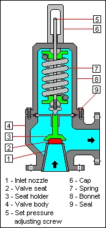
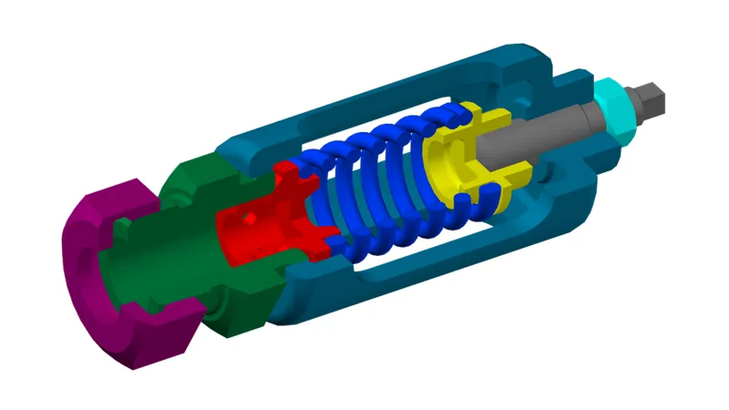
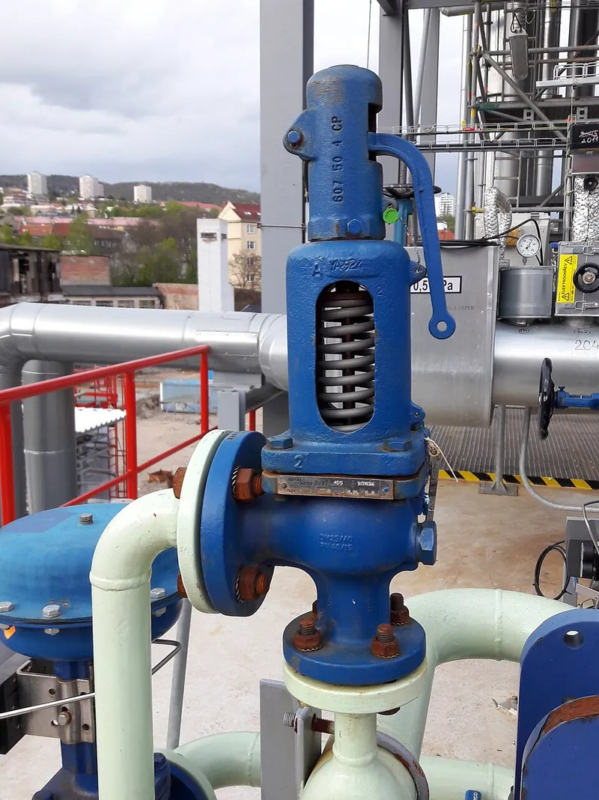

<figure class="eoc-pic eoc-pic-main"><picture><source media="(prefers-reduced-motion: reduce)" srcset="../media/drawn/pressure-relief-valve.svg"></picture><figcaption><strong>Animation.</strong> Diagram drawn for the encyclopaedia from the research notes. ⚑ Needs confirming: a drawing can simplify or get details wrong; a real photo or a better diagram is welcome.</figcaption></figure>
<figure class="eoc-pic"><figcaption><strong>Cross-section.</strong> <a href="https://commons.wikimedia.org/wiki/File:Relief_Valve.png">Relief Valve</a> by Mbeychok, <a href="https://creativecommons.org/licenses/by-sa/3.0">CC BY-SA 3.0</a>, from Wikimedia Commons.</figcaption></figure>
<figure class="eoc-pic"><figcaption><strong>Cross-section.</strong> <a href="https://commons.wikimedia.org/wiki/File:Safetyvalve.png">Safetyvalve</a> by EugeneZ, <a href="https://creativecommons.org/licenses/by-sa/3.0">CC BY-SA 3.0</a>, from Wikimedia Commons.</figcaption></figure>
<figure class="eoc-pic"><figcaption><strong>Photo.</strong> <a href="https://commons.wikimedia.org/wiki/File:Pressure_relief_valve_DN25_on_cooling_water.jpg">Pressure relief valve DN25 on cooling water</a> by RomanM82, <a href="https://creativecommons.org/licenses/by-sa/4.0">CC BY-SA 4.0</a>, from Wikimedia Commons.</figcaption></figure>

A normally-closed, spring-held valve that opens by itself when the pressure passes a set limit and lets fluid out until the pressure falls again, protecting tanks, pumps, pipes and soft [actuators](../glossary.md#actuator) from bursting; its one-shot cousin, the rupture disc, bursts instead.

**In plain words:** A spring-loaded plug on a tank, pump or pipe that stays shut in normal use but is pushed open, often with a loud pop, as soon as the pressure gets too high, letting the extra out so nothing bursts. A one-use burst disc, and a valve that lets air in so suction can't crush a container, do the same job. **Proper term:** Pressure relief valve (safety valve, PRV, PSV).

**Also called:** relief valve (RV): opens gradually in proportion to the over-pressure; the term is used mainly for liquids (Wikipedia; Tameson); safety valve (SV) or pressure safety valve (PSV): pops fully open, used for gas, steam and air; a PSV has a hand lever to open it in an emergency (Wikipedia); safety relief valve (SRV), for gas or liquid (Wikipedia); pop valve, pop-off valve, snap-acting valve (Wikipedia 'Safety valve' and 'Relief valve'); pressure release valve (note: FRC Zero uses this name for a robot's hand-operated vent valve, which is different); over-pressure relief valve (Wikipedia 'Diving [regulator](../glossary.md#regulator)'); pressure limiting valve (Tameson); bypass valve, when it returns a pump's or compressor's flow to the tank or inlet (Wikipedia 'Relief valve'); pilot-operated relief valve (POSRV, PORV, POPRV) (Wikipedia); temperature and pressure relief valve (T&P or TPR valve) on water heaters (Wikipedia 'Water heating'); thermal relief valve, for liquid-filled vessels that expand when warmed (Wikipedia 'Safety valve'); rupture disc, burst disc, bursting disc, burst diaphragm or pressure safety disc; rupture panel, vent panel, explosion vent or blowout panel (Wikipedia 'Rupture disc'); vacuum relief valve, vacuum breaker, vacuum pressure safety valve (VPSV), pressure-vacuum relief valve (PVRV) (Wikipedia 'Relief valve'; Wikipedia 'Vacuum breaker'); cyclone (dust-collector) bin relief valve (Printables); fusible plug: a low-melting plug that lets pressure out, used as a backup on pressure cookers and boilers (Wikipedia 'Pressure cooker'; Wikipedia 'Boiler explosion').

## How it works

A spring presses the disc, poppet or ball onto its seat, while the system pressure pushes back on it (Tameson; LibreTexts 13.2). Below the set pressure the spring wins and the valve stays shut; when pressure x area beats the spring, the disc lifts and fluid escapes, so the pressure stops rising, and once it has fallen by the 'blowdown' (roughly 2-20% of the set pressure) the valve reseats (Wikipedia 'Relief valve'). A relief valve opens gradually in proportion to the over-pressure; a safety ('pop') valve has a wider lip that the escaping fluid suddenly reaches, so once it cracks open the larger area throws it fully open with a pop and holds it open until the pressure has dropped below where it opened (Wikipedia 'Safety valve'; Tameson). A rupture disc is a membrane that bursts at its rated pressure and does not reseal; a vacuum relief valve works the other way round, letting air in when the inside pressure falls too far below the outside (Wikipedia).

## Parts

A few parts: a body with an inlet from the protected system and an outlet to air or back to the tank, a seat (nozzle), a disc, poppet or ball, a spring, and an adjusting screw or cap with a locknut (Tameson; LibreTexts 13.2; FIRST pneumatics manual). Safety valves add a lip around the disc and a nozzle ring, and some have a test lever (Tameson; Wikipedia). A rupture disc is a single thin, usually domed metal membrane in a holder (Wikipedia). A printed dust-bin vacuum relief valve is three printed parts, a neoprene seal disc, an M4 bolt, washers, a small spring and a nut (Printables).

## Everyday examples

- The safety valve on a workshop air-compressor tank (HSE HSG39)
- The temperature-and-pressure relief valve on top of a hot-water cylinder, with its pipe down to a drain (Wikipedia 'Water heating')
- The rocking weight and the backup safety valve or rubber plug on a pressure cooker (Wikipedia 'Pressure cooker')
- A printed pop-off valve in the bucket lid of a cyclone dust collector that stops the bucket being crushed when the hose is blocked (Printables)

## When to use it

On anything that a pump, compressor, heater or gas supply could push past its safe pressure: every compressor tank and air receiver (HSE HSG39); robot air systems, where FIRST requires one connected directly to the compressor with hard fittings (FIRST pneumatics manual); hydraulic circuits with a fixed-displacement pump (LibreTexts 13.3); after a regulator wherever its failure would damage something, and on any component that can't take the full compressor pressure (HSE HSG39 paras 91 and 112); closed hot-water and heating circuits (Wikipedia 'Water heating'); and soft actuators, bellows and inflatables fed by a pump that could over-inflate them. Use a vacuum relief valve where suction could crush a container: a cyclone dust-collector bin, a tank being emptied, or steam coils as they cool (Printables; Wikipedia 'Safety valve'; Wikipedia 'Vacuum breaker'). Use a rupture disc as a cheap, leak-tight, instant one-shot backup, or to seal a relief valve off from a corrosive fluid (Wikipedia).

## When not to use it

Not for setting a working pressure: that is a pressure regulator's job, and a valve that keeps venting wastes air or oil; Tameson describes safety valves as a last-resort safety measure and regulators as the devices for constant pressure control. Not a substitute for a strong enough vessel: a relief valve won't save a weak, corroded or 3D-printed tank (HSE HSG39; CVRA). To hold a steady upstream pressure during normal running, use a back-pressure regulator (Wikipedia 'Pressure regulator'). To limit a mechanical force, use a [torque](../glossary.md#torque) limiter or slip clutch. Don't rely on a pressure switch or software alone (FRC Zero), and don't fit a home-made or printed relief valve to a pressurised tank.

## Details

- **What it does (jobs):**
  - slip or let go when overloaded: it gives way at a set pressure, letting fluid out instead of letting the pressure (and the force it makes) keep climbing, like a torque limiter for air or oil
  - seal it, or pass cables or fluid through: stays sealed below its set pressure and vents fluid to air, a drain or back to the tank above it (Wikipedia; LibreTexts 13.3)
- **Movement:** slide: the disc, poppet or ball lifts straight off its seat and drops back again; a rupture disc instead bulges and tears (Wikipedia)
- **Directions it can move (degrees of freedom):** 1: the disc or poppet only moves along the valve's axis, guided by its stem; a rupture disc has none, it simply bursts
- **Special behaviour:**
  - torque-limiting (slips or clicks at a set force/torque): the fluid version; it holds until the set pressure, then lets go and caps the pressure, as a slip clutch caps torque
  - [fail-safe](../glossary.md#fail-safe--fail-secure) or breakaway: it is opened purely by the pressure, so it still works if the power, pressure switch or controller fails (Tameson 'safety valve'; FRC Zero: if the pressure switch fails 'there should ALWAYS be a mechanical safety valve'); a rupture disc is a sacrificial, one-shot breakaway part (Wikipedia)
  - [over-centre](../glossary.md#over-centre) (snaps past a point and stays), loosely: a snap-acting safety ('pop') valve jumps to full lift in milliseconds and stays open until the pressure has fallen below its opening point, giving built-in [hysteresis](../glossary.md#hysteresis) (Wikipedia 'Relief valve'; Wikipedia 'Safety valve')
- **How it holds:**
  - spring force: a spring holds the disc shut until the set pressure; old valves and pressure-cooker regulators use a weight instead (Wikipedia 'Safety valve'; Wikipedia 'Pressure cooker')
  - not a holding joint (it moves or passes on motion): it controls fluid, not parts
- **Input and output:** Not a motion converter. As a fluid device: inlet pressure below the set pressure -> shut, no flow; at or above it -> opens (gradually for a relief valve, fully for a safety valve) and vents until the pressure has fallen by the blowdown, then reseats (Wikipedia; Tameson). In a hydraulic circuit with a fixed-displacement pump, the whole pump flow goes through it whenever a cylinder stalls or reaches the end of its [stroke](../glossary.md#stroke) (LibreTexts 13.3).
- **Power:** passive (no power needed): opened by the system pressure itself, so it works in a power cut (Tameson 'safety valve'). Pilot-operated and solenoid-switched relief systems exist for industrial use (Tameson)
- **Load:** Pressure rather than structural load: spring safety valves are made for about 1 to 1,400 bar (Tameson); robot air systems relieve at about 125 psi (8.6 bar) (FIRST pneumatics manual); rupture discs range from 3 mm to over 1.2 m across (Wikipedia). It must be able to let out more air than the compressor can push in (HSE HSG39 para 33). Not structural: support it properly and never lift a valve by its lever (Tameson)
- **Play and precision:** not applicable for position. Pressure [accuracy](../glossary.md#repeatability--accuracy): set pressures follow codes such as ASME (Wikipedia); the blowdown before it reseats is about 2-20% of the set pressure, and some valves let you adjust it (Wikipedia 'Relief valve'); pressure in the outlet pipe (back pressure) above about 10% of the set pressure can make it chatter (Tameson)
- **Taking it apart:** removable: screwed into a port on the tank, compressor or pump, after letting the pressure out (Tameson). A rupture disc must be replaced once it has burst (Wikipedia). The printed dust-bin valve bolts through a hole in the bucket lid (Printables)
- **How often it can be reused:** effectively unlimited for a relief or safety valve, which reseats after every opening, though Tameson advises replacing one that leaks, corrodes, fails to open at its set pressure or is over 3-5 years old; once for a rupture disc (Wikipedia)
- **Sealing:** airtight or pressure below the set pressure: the spring presses the disc onto its seat; soft seats (FKM, PTFE, nitrile) seal tighter than metal-to-metal 'hard' seats but stand less heat (Tameson). Older spring valves leaked a 'feather' of steam as the pressure neared their setting (Wikipedia 'Safety valve'). Rupture discs are leak-tight until they burst and are often fitted in front of a relief valve to seal it off from the process (Wikipedia)
- **Adjustable:** Sometimes: adjustable valves have a screw or cap with a locknut; turning clockwise compresses the spring and raises the set pressure, anticlockwise lowers it; adjust with no pressure applied, no more than about one turn at a time, then retest (Tameson; FIRST pneumatics manual). Many are factory-set and non-adjustable (Tameson), and tamper-resistant designs go back to Ramsbottom's valve of the 1850s (Wikipedia 'Safety valve'). The printed dust-bin valve is set by tightening a nut on its spring (Printables)
- **Access needed:** end of a tube or shaft: screwed into a port on the tank, compressor outlet, pump outlet or pipe, as close to the pressure source as possible (Tameson; FIRST pneumatics manual); the printed dust-bin valve needs both sides of the bucket lid to bolt it together (Printables)
- **Materials:** Bodies: brass for general use, stainless steel for corrosive or hot fluids (Tameson). Seats and seals: FKM (oils, solvents and heat, but not methanol, hot water or steam), PTFE (almost all fluids, but stiff), or metal-to-metal for very high temperatures (Tameson). Rupture discs: carbon steel, stainless steel, Hastelloy, graphite and others (Wikipedia). Printed vacuum relief valves: PLA with 3-5 walls, a 3 mm neoprene seal disc, an M4 x 40 hex bolt, washers, a nut and a small compression spring (Printables 'Pressure Relief Valve for Cyclone Dust Extractor')
- **Heat, cold, water and wear:** Rain getting into the outlet can change the opening pressure, so fit discharge pipework that keeps water out (Wikipedia 'Relief valve'). Heat: FKM seats suit oils, solvents and heat but not methanol, hot water or steam; PTFE resists nearly all fluids; metal 'hard' seats suit very high temperatures (Tameson). Fluid viscosity falls as the temperature rises, which changes the capacity needed (Tameson). Corrosion and scale can stick a valve shut, and stuck safety valves were a classic cause of boiler explosions (Wikipedia 'Boiler explosion'). [Fatigue](../glossary.md#fatigue): forward-acting rupture discs weaken with pressure cycling and can burst below their marked pressure, and very thin low-pressure discs can get corrosion pinholes (Wikipedia 'Rupture disc'). Age: replace a valve that leaks, corrodes, fails its test or is over 3-5 years old (Tameson). Vibration: early weighted safety valves blew off when locomotives hit bumps, and springs are much less sensitive to shaking (Wikipedia 'Safety valve').

## Making it

- **Ways to make or get it:**
  - off-the-shelf part: rated brass or stainless relief and safety valves, factory-set or adjustable, and rupture discs in holders (Tameson; Wikipedia)
  - 3D print (FDM): vacuum relief valves for cyclone dust-collector bins (Printables models)
  - 3D print (resin): a spring relief valve built into a printed hydraulic pump block, in a low-pressure (about 1.3 bar) demonstrator (Hackaday 2024)
- **Printing it in one piece (print in place):** no: printed relief valves are separate parts assembled with a bolt, spring, washers and nut (Printables 'Pressure Relief Valve for Cyclone Dust Extractor'); the cyclone separator with a built-in valve also needs an M3 screw, nut and spring (Printables 'Cyclone Vacuum Dust Separator with Built-in Pressure Relief Valve')
- **Tools:** A spanner and thread sealant used sparingly: Tameson warns that even PTFE tape lubricates the thread and can lead to over-tightening, and to leave one or two end threads bare; an Allen key or screwdriver plus a spanner for the locknut, and a calibrated gauge, to adjust an adjustable valve (Tameson; FIRST pneumatics manual). For the printed dust-bin valve: a 32 mm hole saw, a 4 mm drill, M4 bolts and a knife (Printables)
- **Difficulty:** easy to buy and fit: screw a rated valve into the tank or compressor port. Easy to print one for the vacuum side of a dust-collector bin (Printables). Never home-make one to protect a pressurised tank or line, because if it fails nothing else stops the burst

### 3D printing tips

1) Only print relief valves for the vacuum side of things (dust-collector bins, vacuum bags) or for demonstrations. A printed part must never be the device protecting a pressurised tank or line, and never hold stored pressure in a printed part: a PLA tank burst at 5.5 bar centimetres from its maker's face (CVRA). 2) Cyclone bin relief valve (Adam Oellermann, Printables): the STLs suit a 32 mm hole saw, and the OpenSCAD file is parametric for other hole sizes and bolts; print as oriented with no supports; [infill](../glossary.md#infill) matters little but use 3-5 walls; PLA works. Glue a 3 mm neoprene disc to the closing plate for a good seal with less whistling; pass an M4 x 40 hex bolt up through it, then washer, spring, washer and nut on the outside; tightening the nut makes it need more suction to open. If the bolt sticks, grind its threads off where it slides through the plastic or paint them smooth with nail varnish. 3) A 'stronger' remix exists if the original breaks (Printables 'Pressure Relief Valve (Stronger)'). 4) Set it by testing: block the vacuum nozzle and adjust the nut so the valve opens before the bucket starts to collapse (Printables). 5) Some printed cyclone separators have the relief valve built into the lid; one prints from five files with no supports (Printables 'Cyclone Vacuum Dust Separator with Built-in Pressure Relief Valve'). 6) In printed hydraulic demonstrators a spring relief valve can be printed into the pump block in resin, but expect low pressures (about 1.3 bar in the Hackaday example, limited by leaky seals).

### Buying one (off-the-shelf parts)

Air-receiver (compressor tank) safety valves, fixed or adjustable; small adjustable pneumatic relief valves with a locknut, as used in robot kits set to 125 psi (FIRST pneumatics manual); brass and stainless pressure relief valves for liquid and gas, with fixed or adjustable set pressure ranges (e.g. 2-8 bar) (Tameson); hydraulic direct-acting and pilot-operated relief valves, internally or externally drained (LibreTexts 13.3); temperature-and-pressure (T&P) relief valves for water heaters, with a discharge pipe (Wikipedia 'Water heating'); pressure-cooker safety valves, gaskets and fusible plugs (Wikipedia 'Pressure cooker'); rupture (burst) discs with holders and burst indicators (Wikipedia); vacuum relief valves and vacuum breakers (Wikipedia); pressure switches for compressor cut-out, as the first line before the relief valve (FIRST pneumatics manual).

## Rules of thumb

- The set pressure must not exceed the maximum allowable working pressure (MAWP) of the weakest part, and the MAWP should be at least 10% above the highest normal operating pressure (Tameson 'Safety Valve and Relief Valve Selection')
- It must be able to discharge more air than the system can supply, and open as soon as the safe working pressure is exceeded (HSE HSG39 para 33)
- Robot example: the compressor switches off at about 110-120 psi, the relief valve opens at about 125 psi and must not open before the compressor shuts off; stop everything if the gauge reaches 130 psi (FIRST pneumatics manual)
- Mount it close to the pressure source (e.g. the air tank); if there is a bend or elbow in between, at least 8-10 pipe diameters away from it; stem vertical, and piping no smaller than its ports (Tameson 'Safety Valves and Pressure Relief Valves Installation')
- Point the outlet somewhere harmless: high-pressure gas to open air, through pipework that keeps rain out and doesn't endanger people (Wikipedia 'Relief valve'; HSE HSG39 para 91)
- Test it: ease compressor safety valves by hand every week where the design allows (HSE HSG39 para 152); test relief and safety valves at least once a year (Tameson); after adjusting, retest, moving the screw no more than about one turn at a time (Tameson)
- Keep back pressure in the outlet pipe below about 10% of the set pressure, or the valve may chatter (Tameson 'Safety Valve and Relief Valve Selection')
- The blowdown is roughly 2-20% of the set pressure, so leave a gap between the working pressure and the set pressure or the valve won't reseat (Wikipedia 'Relief valve')
- Hydraulics: a circuit with a fixed-displacement pump needs a relief valve, because when a cylinder stalls or reaches the end of its stroke the oil has nowhere else to go (LibreTexts 13.3)
- Forward-acting rupture discs are usually run at no more than 80% of their burst pressure; a reverse-buckling disc fitted upside down may burst far above its marked pressure (Wikipedia 'Rupture disc')
- Liquids hardly compress, so a small thermal relief valve protects a liquid-filled vessel from heat expansion, while gas systems need much larger valves (Wikipedia 'Safety valve')

## Common failures

1) Seized or stuck shut by corrosion, scale or dirt, so it doesn't open (Wikipedia 'Boiler explosion'); ease it by hand and test it regularly (HSE HSG39 para 152; Tameson). 2) Set wrongly, or the gauge used to check it is out of calibration: if it doesn't open near the right pressure, swap the valve or the gauge for a spare and retest (FIRST pneumatics manual). 3) Weeps or 'feathers' because the working pressure is too close to the set pressure, or because of dirt on the seat (Wikipedia 'Safety valve'). 4) Chatter (rapid opening and closing) from back pressure in the outlet pipe, which can damage the valve (Tameson). 5) Won't reseat when its outlet is piped and pressure builds up downstream (Wikipedia 'Relief valve'). 6) Too small to keep up with the pump or compressor (HSE HSG39 para 33; Tameson). 7) Misassembled after maintenance so it can't open fully (Wikipedia 'Boiler explosion'; Wikipedia 'Safety valve'). 8) Rupture discs bursting early from fatigue, or late if fitted upside down (Wikipedia). 9) Printed vacuum valves sticking because the bolt threads catch in the plastic: grind the threads or paint them smooth (Printables).

## Safety

1) Never block, plug, remove, weight down, tie down or screw down a relief or safety valve, or raise its setting above the rating of the weakest part. Tying down valves for more power caused boiler explosions, which is why tamper-proof designs such as Ramsbottom's were invented (Wikipedia 'Safety valve'); the 1909 Cardiff and 1921 Buxton locomotive boiler failures were caused by misassembled safety valves (Wikipedia 'Boiler explosion'). 2) Point the outlet away from people, and pipe water-heater T&P valves to a drain (HSE HSG39 para 91; Wikipedia 'Water heating'). 3) Opening is sudden and loud: 'many of these valves are fairly loud when they trigger' (FIRST pneumatics manual); wear eye protection and gloves when installing or testing (Tameson). 4) Release all pressure before fitting, removing or adjusting a valve (Tameson). 5) It must out-flow the source: a small valve on a big compressor can't stop the pressure rising (HSE HSG39 para 33). 6) A regulator is no substitute: a leaking regulator can pass the full supply pressure downstream, so a relief valve is still needed (Wikipedia 'Diving regulator'; HSE HSG39 para 91). 7) A rupture disc doesn't reseal, so the system stays open until the disc is replaced, and a reverse-buckling disc fitted upside down may burst far above its marked pressure (Wikipedia). 8) Never hold stored pressure in a 3D-printed part, and use printed relief valves only on the vacuum side (CVRA; Printables). 9) Pressure cookers: food can block the main vent, which is why they have backup valves; never overfill one, keep the vents clean, and remember that a failed cooker ejects scalding steam and water (Wikipedia 'Pressure cooker').

## Related

- Pressure regulator (pressure-reducing valve): works all the time to hold a lower outlet pressure; it is normally open and senses the pressure downstream, while a relief valve is normally closed and senses the pressure upstream (LibreTexts 20.1; Wikipedia)
- Back-pressure regulator (pressure-sustaining valve): also opens above a set inlet pressure, but is meant to keep the upstream pressure steady in normal running, not only in emergencies (Wikipedia 'Pressure regulator')
- [Check valve](../glossary.md#check-valve): also spring-loaded, but opens at a small 'cracking pressure' to let flow pass one way in normal use
- Rupture disc (covered here): a one-shot membrane that is leak-tight and instant but must be replaced after it bursts (Wikipedia)
- Shear-pin coupling (breakaway link): the mechanical one-shot equivalent of a rupture disc
- Ball-detent torque limiter and Friction slip clutch: the mechanical equivalents, which let go at a set torque and carry on afterwards
- Burn-wire and fusible-link release: one-shot heat releases, like the fusible plug used as a backup on boilers and pressure cookers (Wikipedia)
- Shut-off valve (vent or dump valve): opened by hand to let all the pressure out on purpose; robot rules call this the vent plug (FIRST pneumatics manual)
- Pressure switch: switches the compressor off at a set pressure; the relief valve is the mechanical backup if it fails (FIRST pneumatics manual; FRC Zero)
- Air tank and hydraulic accumulator: the thing it most often protects

## Make it yourself

- [Pressure Relief Valve for Cyclone Dust Extractor (Parametric) (Adam Oellermann, Printables) (URL from Printables API, page not opened)](https://www.printables.com/model/213603-pressure-relief-valve-for-cyclone-dust-extractor-p): Three-part printed vacuum relief valve for a cyclone dust-collector bucket lid, with an adjustable spring on an M4 bolt and a parametric OpenSCAD file; vacuum only *(licence: CC BY-SA)*
- [Pressure Relief Valve (Stronger) (Steven Mathiasen, Printables) (URL from Printables API, page not opened)](https://www.printables.com/model/456366-pressure-relief-valve-stronger): Stronger remix of the cyclone-bin vacuum relief valve above *(licence: CC BY-SA)*
- [Cyclone Vacuum Dust Separator with Built-in Pressure Relief Valve (pressi, Printables) (URL from Printables API, page not opened)](https://www.printables.com/model/629084-cyclone-vacuum-dust-separator-with-built-in-pressu): Printed cyclone separator for a shop vacuum with a spring-loaded vacuum relief valve built in that 'prevents your bucket from collapsing under suction' *(licence: CC BY-NC-SA)*

## Pictures, videos and models

- [Relief Valve.png (Mbeychok; Wikimedia Commons)](https://commons.wikimedia.org/wiki/File:Relief_Valve.png): Schematic cross-section of a conventional spring-loaded pressure relief valve *(licence: CC BY-SA 3.0)*
- [Proportional-Safety Valve.svg (Peppeg; Wikimedia Commons)](https://commons.wikimedia.org/wiki/File:Proportional-Safety_Valve.svg): Drawing of a proportional (gradually opening) safety valve (German labels: Proportional-Sicherheitsventil) *(licence: CC BY-SA 3.0)*
- [Pressure cooker safety valve.svg (Willy, FischX; Wikimedia Commons)](https://commons.wikimedia.org/wiki/File:Pressure_cooker_safety_valve.svg): Diagram of a pressure-cooker safety valve *(licence: CC BY-SA 3.0)*
- [Rupturedisc burst.JPG (Jens Huckauf; Wikimedia Commons)](https://commons.wikimedia.org/wiki/File:Rupturedisc_burst.JPG): Photo of a rupture (burst) disc after it has burst *(licence: CC BY-SA 3.0)*
- [Pressure Safety Valve vs Pressure Relief Valve (Tameson)](https://tameson.com/pages/relief-valve-vs-safety-valve): Photos of both valve types and a lift-versus-pressure graph showing a relief valve opening gradually and a safety valve popping open, with set pressure, blowdown and reseating pressure marked *(licence: link only)*

## Needs confirming

⚑ marks something nobody has confirmed yet: a fact the research could not confirm from a source, a finder value that is a best guess, or an open point from the research notes. Corrections are welcome (see `research/needs-confirming.md`).

- ⚑ Finder value `load_max` = medium (best guess): no light/medium/heavy band in `load`; defaulted to medium

## Sources

- <https://en.wikipedia.org/wiki/Relief_valve>
- <https://en.wikipedia.org/wiki/Safety_valve>
- <https://en.wikipedia.org/wiki/Rupture_disc>
- <https://en.wikipedia.org/wiki/Boiler_explosion>
- <https://en.wikipedia.org/wiki/Pressure_cooker>
- <https://en.wikipedia.org/wiki/Water_heating>
- <https://en.wikipedia.org/wiki/Vacuum_breaker>
- <https://en.wikipedia.org/wiki/Pressure_regulator>
- <https://en.wikipedia.org/wiki/Diving_regulator>
- <https://tameson.com/pages/pressure-relief-valve>
- <https://tameson.com/pages/relief-valve-vs-safety-valve>
- <https://tameson.com/pages/safety-valve>
- <https://tameson.com/pages/safety-valve-relief-valve-installation>
- <https://tameson.com/pages/safety-valve-relief-valve-selection>
- <https://tameson.com/pages/pressure-controlling-devices>
- <https://eng.libretexts.org/Courses/Northeast_Wisconsin_Technical_College/Fluids_2%3A_Basic_Hydraulics_(NWTC)/13%3A_Relief_Valves/13.01%3A_Function_and_Application_of_a_Relief_Valve>
- <https://eng.libretexts.org/Courses/Northeast_Wisconsin_Technical_College/Fluids_2%3A_Basic_Hydraulics_(NWTC)/13%3A_Relief_Valves/13.02%3A_Operation_of_a_Direct-Acting_Relief_Valve_and_Its_Schematic_Symbol>
- <https://eng.libretexts.org/Courses/Northeast_Wisconsin_Technical_College/Fluids_2%3A_Basic_Hydraulics_(NWTC)/13%3A_Relief_Valves/13.03%3A_The_Role_of_a_Relief_Valve_in_System_Protection>
- <https://eng.libretexts.org/Courses/Northeast_Wisconsin_Technical_College/Fluids_2%3A_Basic_Hydraulics_(NWTC)/20%3A_Pressure_Reducing_Valves/20.01%3A_The_Function_of_a_Pressure_Reducing_Valve_and_Application>
- <https://www.firstinspires.org/hubfs/web/program/frc/resources/pneumatics-manual.pdf?hsLang=en>
- <https://www.frczero.org/pneumatics/pneumatic-control/>
- <https://www.frczero.org/pneumatics/pneumatic-components/>
- <https://www.hse.gov.uk/pubns/priced/hsg39.pdf>
- <https://hackaday.com/2024/06/29/building-a-hydraulic-system-with-3d-printed-sla-resin-parts/>
- <https://cvra.ch/blog/2016/airtank>
- <https://api.printables.com/graphql/>
- <https://www.printables.com/model/213603-pressure-relief-valve-for-cyclone-dust-extractor-p>
- <https://www.printables.com/model/456366-pressure-relief-valve-stronger>
- <https://www.printables.com/model/629084-cyclone-vacuum-dust-separator-with-built-in-pressu>
- <https://commons.wikimedia.org/wiki/File:Relief_Valve.png>
- <https://commons.wikimedia.org/wiki/File:Proportional-Safety_Valve.svg>
- <https://commons.wikimedia.org/wiki/File:Pressure_cooker_safety_valve.svg>
- <https://commons.wikimedia.org/wiki/File:Rupturedisc_burst.JPG>
