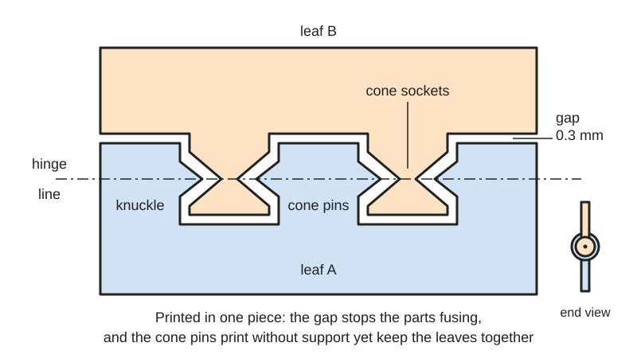
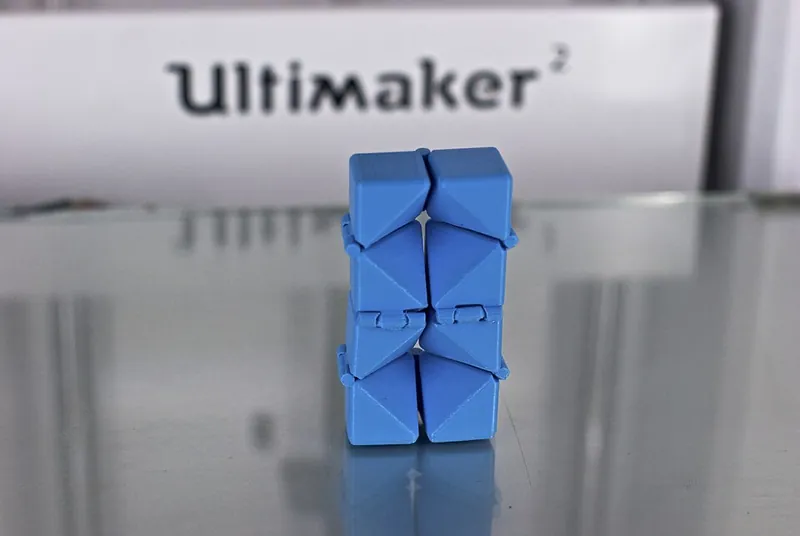
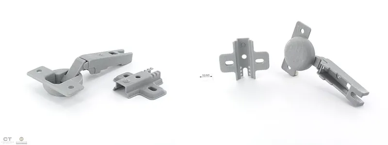

<figure class="eoc-pic eoc-pic-main"><picture><source media="(prefers-reduced-motion: reduce)" srcset="../media/drawn/print-in-place-hinge.svg"></picture><figcaption><strong>Animation.</strong> Diagram drawn for the encyclopaedia from the research notes. ⚑ Needs confirming: a drawing can simplify or get details wrong; a real photo or a better diagram is welcome.</figcaption></figure>
<figure class="eoc-pic"><figcaption><strong>Photo.</strong> <a href="https://commons.wikimedia.org/wiki/File:Print_in_place_Fidget_Cube.jpg">Print in place Fidget Cube</a> by Gary C Martin, <a href="https://creativecommons.org/licenses/by/2.0">CC BY 2.0</a>, from Wikimedia Commons.</figcaption></figure>
<figure class="eoc-pic"><figcaption><strong>Photo.</strong> <a href="https://commons.wikimedia.org/wiki/File:CreativeTools.se_-_PackshotCreator_-_Hinge_v01_(4668460409).jpg">CreativeTools.se - PackshotCreator - Hinge v01 (4668460409)</a> by Creative Tools from Halmstad, Sweden, <a href="https://creativecommons.org/licenses/by/2.0">CC BY 2.0</a>, from Wikimedia Commons.</figcaption></figure>

A hinge printed in one go with its pin already inside the knuckles and a small gap all round, so it turns as soon as it comes off the print bed with no assembly or metal pin.

**In plain words:** A hinge that comes off the 3D printer already put together and able to swing: two flaps with interleaved rings (knuckles) around a built-in pin, printed with a tiny gap between the moving surfaces so they don't stick together. **Proper term:** [Print-in-place](../glossary.md#print-in-place) hinge (non-assembly knuckle hinge, usually with cone-shaped pins).

**Also called:** print in place hinge, PIP hinge (maker shorthand; 'PIP' abbreviation) ⚑ [uncertain]; cone hinge or conical hinge (Printables 'Print-in-Place Hinge [Clearance](../glossary.md#clearance) Tester' calls them 'print-in-place conical hinges'); print-in-place knuckle hinge (BOSL2 OpenSCAD library: knuckle_hinge() with in_place=true makes 'interlocking cones instead of leaving a hole for an inserted pin'); print-in-place butt hinge (Printables 'Print In Place Butt Hinge'; rohingosling's 'Parametric Butt Hinge'); non-assembly hinge or non-assembly revolute joint (research term: Anghel et al., 'A New Approach to Optimize the Relative Clearance for Cylindrical Joints Manufactured by FDM 3D Printing', Processes 2021); integrated assembly (Formlabs' term for parts printed already assembled); ball-and-socket print-in-place hinge (a variant with balls instead of cones; Greg Zumwalt's parametric hinged container on Hackaday.io).

## How it works

The designer leaves a small, even gap (clearance), typically 0.2-0.5 mm, between every surface that must move: between neighbouring knuckles and between each pin and its socket (BOSL2; Prusa; Printables hinge models). The printer builds both leaves at the same time, and because the gap is wider than the plastic squashes out sideways, the two leaves never fuse. Cones are used instead of a straight pin because the underside of a cone slopes at about 45 degrees, which a printer can build without [support material](../glossary.md#support-material) ([overhang](../glossary.md#overhang--bridging)), whereas a straight pin inside a hole would have to be printed over thin air (BOSL2; Prusa 'Modeling with 3D printing in mind'). The cones point along the hinge line, so the leaves can turn but cannot pull apart.

## Parts

A few parts that print as one job: two leaves (flaps), each with alternating knuckles (the rings that form the barrel), and a built-in pin. In the common cone design each knuckle carries a cone-shaped bump that sits inside a cone-shaped socket in the next knuckle of the other leaf, so the two leaves are trapped together (BOSL2 hinges.scad). Other designs fuse a solid pin to one leaf and print the other leaf's knuckles around it with a gap (rohingosling's Parametric Butt Hinge), or use balls in sockets (Greg Zumwalt, Hackaday.io). Usually has screw holes in each leaf, or is printed straight onto a box and its lid.

## Everyday examples

- Printed boxes, lockets and pill boxes with a hinged lid, sold or shared as 'print-in-place' models (e.g. Printables 'Disposal Box with Print in Place Hinge', 'Secret compartment / Hex Cross Locket &lt;Print in Place Hinge>')
- Folding fidget cubes, whose cube sections are joined by print-in-place hinges (Wikimedia Commons photo 'Print in place Fidget Cube')
- Replacement doors and hinges people print for their 3D printers and cabinets (e.g. Printables 'Print In Place K1 Max 270 Door Hinges w/Door Latch')
- It looks and works like the metal door hinge (butt hinge) on a house door: two leaves, interleaved knuckles and a pin (Wikipedia 'Hinge')

## When to use it

Use it when you want a real turning hinge in a 3D-printed project without buying hardware or assembling anything: box and case lids, flaps over ports, small cabinet doors, folding stands, toys and fidgets, and prototypes. It lasts much longer than a printed [living hinge](../glossary.md#living-hinge) in stiff plastics such as PLA or PETG, because it turns instead of bending. It is ideal when the hinge can be printed as part of the object itself, so the whole thing comes off the printer ready to use.

## When not to use it

Avoid it when the hinge must be precise or free of wobble (use a metal hinge, or a printed hinge with a metal pin), when it must carry heavy or shock loads (use a metal hinge, or a print-in-place geared hinge that spreads the load), when you can't calibrate your printer or tune the clearance, when it needs to come apart for cleaning or replacement (use a snap-together or pin hinge), or when printing in resin without a way to wash liquid resin out of the joint. For a thin one-piece lid that folds only now and then in a bendy plastic, a living hinge is simpler.

## Details

- **What it does (jobs):**
  - let it move (turn, slide or bend): lets a lid, door, flap or arm swing open and shut
  - join and hold: keeps the two leaves permanently attached to each other, because the cones are trapped in their sockets
- **Movement:** rotate: usually up to about 180 degrees for a flat butt-style hinge; some designs open further, e.g. 285 degrees in total (Printables 'Parametric hinge - horizontally printed - print-in-place') or 'more than 180 degrees' (Printables 'Parametric Hinges (print in place)'). A hinge printed onto a box usually stops when the lid hits the box.
- **Directions it can move (degrees of freedom):** 1 intended: turning about the hinge line. The printed gap gives a little extra wobble and sideways shift, so in practice there is a small amount of unwanted movement in the other directions (see play_and_precision).
- **Special behaviour:**
  - none: a basic print-in-place hinge just turns freely; it does not click, lock or limit force. Variants add click positions (see the entry '[Detent](../glossary.md#detent) hinge') or gears (see 'Geared hinge')
- **How it holds:**
  - shape (the parts interlock; [form-fit](../glossary.md#form-fit--force-fit--material-bond)): the cone pins sit inside cone sockets, so the leaves cannot be pulled apart along or across the hinge line
  - not a holding joint (it moves or passes on motion): its job is to let the two parts turn
- **Input and output:** not applicable
- **Power:** passive (no power needed)
- **Load:** light to medium: fine for box lids, covers, small doors and toys. The weak points are the small printed pins or cones and the [layer lines](../glossary.md#layer-lines) through the knuckles; the gap also means the load rests on only a few small contact points. Some designs are sold as strong enough for furniture doors and chest lids when printed in PETG or ASA (designer's claim, Printables 'Print in Place Hinge - PETG/ASA - High Strength 300'), and a print-in-place geared hinge, which spreads the weight along the length of its gear teeth, held about 210 lb of dumbbells (Hackaday 'One-piece Geared Hinge Can Take The Weight'). No independent strength tests of cone hinges were found. ⚑ [uncertain]
- **Play and precision:** small to noticeable play: the leaves can wobble by about the printed gap (typically 0.2-0.5 mm), more than a metal hinge. It is not a precise pivot, and it tolerates no [misalignment](../glossary.md#misalignment) of its own parts, because they are fixed by the print. Pushing the leaves along the hinge line seats the cones in their sockets and takes up some of the play in that direction ⚑ [uncertain].
- **Taking it apart:** permanent: the two leaves are trapped together as printed and can only be separated by breaking a knuckle or pin. The hinge as a whole is fixed to a project with screws (removable) or is printed as part of the object (permanent).
- **How often it can be reused:** not applicable to taking apart (it never comes apart). No published cycle-life tests were found; one designer says PLA hinges 'deform or wear out over time' and recommends PETG or ASA (Printables 'Print in Place Hinge - PETG/ASA - High Strength 300') ⚑ [uncertain]
- **Sealing:** none: the gap around the knuckles is open; the hinge does not seal
- **Adjustable:** No: the gap is fixed when the part is designed and printed. Parametric models let you change the clearance before printing (BOSL2 gap parameter; Fusion 360 parameters in Printables 'Print-in-Place Hinge Clearance Tester' and 'Print In Place Butt Hinge').
- **Access needed:** not applicable: it is made as part of the print. If it is screwed onto something, the screws go in from the front of each leaf (one side only).
- **Materials:** Printed in the same plastic as the rest of the part. PLA is the most common for FDM (e.g. Printables 'Print in Place Hinge' by remotelove, printed in PLA; Greg Zumwalt's hinged container, PLA), but one designer warns PLA is too [brittle](../glossary.md#brittle--ductile) and wears or deforms over time and designs his strong hinges for PETG or ASA only (Printables 'LR Basics' 300-series hinge). Powder-bed nylon (SLS) suits print-in-place parts well because the loose powder supports the parts and no support structures are needed (Formlabs 'How to 3D Print Interlocking Parts and Assemblies'). Resin (SLA) print-in-place hinges are possible with a wider 0.5 mm gap so liquid resin can be washed out (Formlabs 'Beyond Build Volume'), although Formlabs does not generally recommend printed-assembled parts in SLA for that reason.
- **Heat, cold, water and wear:** Limited by the printing plastic. In an oven test under load, PLA started to give at 60 °C and failed at about 65 °C, PETG gave at 80 °C and ASA held until about 110 °C (CNC Kitchen 'Comparing PLA, PETG & ASA'), so a PLA hinge left in a hot car or in sunlight behind glass can sag or seize. PLA also [creeps](../glossary.md#creep) (slowly bends) under constant load more than PETG or ABS (thrinter creep test), so a heavy door hanging on a PLA hinge may droop over time ⚑ [uncertain for hinges specifically].

## Making it

- **Ways to make or get it:**
  - 3D print (FDM): the usual way; the hinge prints in one job with no supports
  - 3D print (resin): possible with a gap of about 0.5 mm so uncured resin can be washed out of the joint (Formlabs 'Beyond Build Volume'); Formlabs otherwise advises against printed-assembled parts in SLA because trapped resin is hard to clean (Formlabs 'How to 3D Print Interlocking Parts')
  - 3D print (SLS or MJF powder-bed nylon): well suited, because the loose powder holds the parts apart and no supports are needed (Formlabs 'How to 3D Print Interlocking Parts')
  - not suited to CNC, laser cutting or woodwork, which cannot make parts already assembled; those make separate leaves and add a pin
- **Printing it in one piece (print in place):** yes: both leaves and the pin print together and the hinge works straight off the print bed (Printables 'Print-in-Place Simple Hinge (no supports needed)': 'two parts that print in a single STL file and work right off the print bed').
- **Tools:** none to assemble. The first time, a hinge that is slightly stuck may need a firm twist or flexing back and forth to break it free ⚑ [uncertain]. A screwdriver is needed only for mounting screws.
- **Difficulty:** easy: it prints in one piece with no supports and no assembly; the catch is that it only works if the printer is well calibrated (first layer, flow) and the clearance suits your printer, so print a clearance test first

### 3D printing tips

1) Print a clearance test first. Suggested starting gaps: 0.2 or 0.3 mm (Printables 'Print-in-Place Hinge Clearance Tester'), at least 0.3 mm for moving parts on a Prusa (Prusa knowledge base 'Modeling with 3D printing in mind'), 0.2 mm (BOSL2 knuckle_hinge default gap), or 0.5 mm, which 'should work on just about any printer' (Printables 'Print In Place Butt Hinge'). 2) Don't scale a finished print-in-place model in the slicer: scaling changes the gap too, so a scaled-up hinge gets loose and a scaled-down one fuses. Change the size in the CAD model instead (Greg Zumwalt, 'Designing a Parametric Print in Place Hinged Container', Hackaday.io). 3) Use cones (or balls) rather than a straight pin so every surface can be printed without support: BOSL2's default cones slope at 45 degrees, and a steeper, pointier cone is harder to print (BOSL2 hinges.scad); printers cleanly print overhangs of 45-60 degrees (Prusa). 4) Orientation: most hinges are printed lying flat with the hinge line parallel to the bed. One guide says this makes the plastic strands run along the pin, giving the most strength, while a pin printed standing upright is a stack of thin discs that can snap along a layer line (Snapmaker blog '3D Printed Hinges'). 5) Watch the first layer: the first layer is squashed wider than designed ([elephant's foot](../glossary.md#elephants-foot)), which can close the gap at the bottom of the hinge and weld the knuckles together. Turn on elephant-foot compensation (about 0.2 mm for a 0.4 mm nozzle, Prusa knowledge base 'Elephant foot compensation'), check the nozzle height, or add a small [chamfer](../glossary.md#chamfer--fillet) to the bottom edges of the knuckles (Snapmaker blog). 6) Over-extrusion also fills the gap; lowering the flow by 2-5% is one suggested fix (Snapmaker blog). 7) Slicer settings from one tested PETG/ASA hinge: 0.4 mm nozzle, 0.2 mm layers, 3 [perimeters](../glossary.md#perimeters), 15% [infill](../glossary.md#infill), 'Fill gaps' off and 'Avoid crossing perimeters' on (Printables 'Print in Place Hinge - PETG/ASA - High Strength 300'). 8) Nozzle and layer height matter, so use the settings the designer tested: one PLA hinge was designed for a 0.6 mm nozzle at 0.2 mm layers, with 0.2 mm the likely minimum layer height (Printables 'Print in Place Hinge' by remotelove). 9) After printing, work the hinge back and forth a few times to free it and smooth the contact surfaces ⚑ [uncertain]. 10) For a stronger hinge that carries real weight, consider a print-in-place geared hinge (Hackaday).

### Buying one (off-the-shelf parts)

None needed for the hinge itself. Screws to mount it, depending on the design: M3 button-head screws (Printables, remotelove), M4 countersunk screws (Printables, Andrew Nelson), 4.5-5 mm countersunk wood screws (Printables, Metikumi), or #6/#8 screws (Printables, EcoDad). Alternatives if you'd rather assemble a hinge: print the leaves separately and use a length of 1.75 mm filament, a metal rod or a screw as the pin (BOSL2's regular knuckle hinge defaults to a 1.75 mm pin hole and can take a screw such as M3 or #6); or buy a metal 'butt hinge' or 'piano hinge' ('continuous hinge').

## Rules of thumb

- Start with a gap of at least 0.3 mm between parts that must move on a well-calibrated FDM printer (Prusa knowledge base 'Modeling with 3D printing in mind').
- BOSL2's print-in-place knuckle hinge uses a 0.2 mm default gap between hinge segments, 45-degree interlocking cones by default, and a cone base diameter 1 unit smaller than the knuckle diameter; a pointier cone gives a smaller gap for the same setting (BOSL2 hinges.scad).
- Cone-hinge clearance tests suggest starting at 0.2-0.3 mm and adjusting (Printables 'Print-in-Place Hinge Clearance Tester', Ed Johnson); a 0.5 mm gap 'should work on just about any printer', with 0.25 mm for tighter hinges (Printables 'Print In Place Butt Hinge', Andrew Nelson).
- Interlocking FDM parts in general need about 0.5 mm clearance, SLA and SLS about 0.2 mm, material jetting about 0.1 mm (Hubs 'How to design interlocking joints for 3D printed parts').
- Print-in-place clearance for SLS: 0.3 mm for small features and 0.6 mm for larger ones; SLA integrated assemblies are not recommended because resin is trapped between the parts (Formlabs 'How to 3D Print Interlocking Parts and Assemblies').
- Resin (SLA) print-in-place hinges need about 0.5 mm clearance so uncured resin can be washed out of the joint; otherwise the hinge sets solid when cured (Formlabs 'Beyond Build Volume: Designing and 3D Printing Foldable and Retractable Parts').
- FDM printers cleanly print overhangs of 45-60 degrees without supports, which is why cone pins are sloped at about 45 degrees (Prusa knowledge base 'Modeling with 3D printing in mind'; BOSL2 hinges.scad).
- Elephant-foot compensation of about 0.2 mm suits a 0.4 mm nozzle; without it the squashed first layer can fill small gaps near the bed (Prusa knowledge base 'Elephant foot compensation').
- Never scale a print-in-place model; scaling scales the clearance too (Greg Zumwalt, Hackaday.io 'Designing a Parametric Print in Place Hinged Container', which uses a 0.4 mm '[Tolerance](../glossary.md#tolerance)' parameter for most printers).

## Common failures

1) Fused solid: the gap was too small for the printer, the first layer squashed out (elephant's foot), or the printer over-extruded; fix with a larger gap, elephant-foot compensation, a chamfer on the bottom edges or slightly lower flow (Snapmaker blog; Prusa knowledge base). 2) Too loose and wobbly: the gap was too big or the model was scaled up in the slicer (Hackaday.io, Greg Zumwalt). 3) Pin or cone snaps: the hinge was printed so the pin runs up through the layers, or the material is too brittle; print it lying flat and use PETG or ASA for heavy use (Snapmaker blog; Printables 'LR Basics' hinge). 4) Rough or sticky movement from sagging overhangs and strings inside the gap: 'some roughness between the horizontal overhanging surfaces' was noted on a printed fidget cube (Wikimedia Commons 'Print in place Fidget Cube'); keep overhangs at about 45 degrees (BOSL2; Prusa). 5) Resin hinges set solid because uncured resin stayed in the joint; use at least 0.5 mm gap and wash well (Formlabs). 6) Screw holes cracking when the mounting screws are overtightened; tighten by hand (Printables 'LR Basics' hinge).

## Safety

None known beyond ordinary pinch points between the leaves when closing. Breaking a stuck hinge free by force can snap it and leave sharp edges.

## Related

- Living hinge: bends a thin strip of plastic instead of turning on a pin; no play at all, but in PLA or PETG it cracks after a few dozen folds
- Geared hinge (continuous gear hinge): two toothed edges roll on each other and can also print in place; spreads the load along its length, so it is stronger and moves both leaves evenly
- Detent hinge (click hinge): adds bumps and notches so the hinge clicks and holds at set angles
- Friction hinge ([torque](../glossary.md#torque) hinge): stays at whatever angle you leave it; a print-in-place hinge normally swings freely
- Snap-together or pin hinge printed as separate parts: leaves printed apart and joined with a snap-in pin, filament or metal rod; can be taken apart and has less play when a metal pin is used
- [Flexure](../glossary.md#flexure) hinge: a precise, play-free pivot made by bending, for small angles only
- Ball-and-socket print-in-place joint: the same trapped, printed-with-a-gap idea used for joints that swivel in several directions (e.g. articulated printed toys) ⚑ [uncertain]

## Make it yourself

- [Print-in-Place Hinge Clearance Tester (Ed Johnson, Printables)](https://www.printables.com/model/379256-print-in-place-hinge-clearance-tester): Quick test prints of print-in-place conical hinges in vertical and horizontal orientations, with Fusion 360 source whose parameters set the clearance and size; the author suggests starting at 0.2 or 0.3 mm. URL from search results; details read through the Printables public API. *(licence: Creative Commons Public Domain)*
- [BOSL2 hinges.scad: knuckle_hinge(in_place=true) (OpenSCAD library)](https://raw.githubusercontent.com/BelfrySCAD/BOSL2/master/hinges.scad): Parametric OpenSCAD module that makes a knuckle hinge; with in_place=true it builds interlocking cones for a print-in-place hinge, with adjustable gap (default 0.2 mm), cone angle (default 45 degrees) and cone diameter *(licence: BSD 2-Clause)*
- [Print In Place Butt Hinge (Fusion 360 File Included) (Andrew Nelson, Printables)](https://www.printables.com/model/484877-print-in-place-butt-hinge-fusion-360-file-included): A 40 x 50 mm print-in-place butt hinge with no supports and M4 countersunk holes, in 0.50 mm and 0.25 mm clearance versions, with a Fusion 360 file showing how to change the gap. URL from search results; details read through the Printables public API. *(licence: CC BY-SA (Creative Commons Attribution-ShareAlike))*
- [Hinge Print In Place - Parametric (VC Design, Printables) (URL from Printables API, page not opened)](https://www.printables.com/model/1074101-hinge-print-in-place-parametric): A widely downloaded print-in-place hinge supplied with a STEP file for customising; printed flat. Details read through the Printables public API. *(licence: CC BY-NC-ND (Creative Commons Attribution-NonCommercial-NoDerivatives))*
- [Parametric Hinge by rohingosling (Thingiverse; URL from search results and the author's GitHub README, page not opened)](https://www.thingiverse.com/thing:2187167): OpenSCAD parametric butt hinge that prints in one step with the pin fused to one leaf, or with a pin hole for an external pin; featured by the Raspberry Pi Official Magazine as having nearly 1000 remixes *(licence: ⚑ [uncertain])*
- [Designing a Parametric 'Print in Place' Hinged Container (Greg Zumwalt, Hackaday.io)](https://hackaday.io/project/163849-designing-a-parametric-print-in-place-hinged-con): Step-by-step Fusion 360 design of a hinged container that prints assembled, using ball-and-socket hinges and a 'Tolerance' parameter (0.4 mm suggested for most printers); explains why parametric design beats scaling *(licence: ⚑ [uncertain])*

## Pictures, videos and models

- [Print in place Fidget Cube (Wikimedia Commons, photo by Gary C Martin, 2014)](https://commons.wikimedia.org/wiki/File:Print_in_place_Fidget_Cube.jpg): Photo of a 3D-printed folding fidget cube printed on an Ultimaker 2; the author notes that the print-in-place hinges work well, with some roughness on horizontal overhanging surfaces *(licence: CC BY 2.0)*
- [Basic hinge diagram (Wikimedia Commons, by A loose necktie)](https://commons.wikimedia.org/wiki/File:Basic_hinge.svg): Simple diagram of a hinge, used on Wikipedia's 'Hinge' article to name the pin, knuckles and leaves; a print-in-place hinge has the same parts *(licence: CC0 1.0 (public domain dedication))*
- [How to design 3D Printable Hinges - Make moving parts! (YouTube, Maker's Muse)](https://www.youtube.com/watch?v=7JhjhgjchfM): Video demonstrating several printable hinge types, including snap-together, print-in-place and living hinges (as described by the Raspberry Pi Official Magazine article '3D Printed Hinges'); title and channel confirmed via YouTube oEmbed, video not watched *(licence: link only (standard YouTube licence))*
- [Learn 15 Print-in-Place Mechanisms in 15 Minutes (YouTube, Slant 3D)](https://www.youtube.com/watch?v=AAKsl8zW-Ds): Video covering printed springs, flexures and print-in-place hinges (as described by Hackaday, 11 May 2025); title and channel confirmed via YouTube oEmbed, video not watched *(licence: link only (standard YouTube licence))*
- [3D model of a hinge 3D printed on a ZPrinter (Wikimedia Commons, by Creative Tools)](https://commons.wikimedia.org/wiki/File:CreativeTools.se_-_PackshotCreator_-_Hinge_v01_(4668460409).jpg): Photo of a 3D-printed hinge made on a powder-bed ZPrinter; whether it was printed already assembled is not stated ⚑ [uncertain] *(licence: CC BY 2.0)*

## Needs confirming

⚑ marks something nobody has confirmed yet: a fact the research could not confirm from a source, a finder value that is a best guess, or an open point from the research notes. Corrections are welcome (see `research/needs-confirming.md`).

- ⚑ 11 sentences on this page marked [uncertain].
- ⚑ Finder value `tools` = none, hand tools (source uncertain): `tools_needed` is marked ⚑ [uncertain] here: "…tuck may need a firm twist or flexing back and forth to break it free ⚑ [uncertain]. A screwdriver is needed onl…"

## Sources

- <https://raw.githubusercontent.com/BelfrySCAD/BOSL2/master/hinges.scad>
- <https://raw.githubusercontent.com/BelfrySCAD/BOSL2/master/LICENSE>
- <https://help.prusa3d.com/article/modeling-with-3d-printing-in-mind_164135>
- <https://help.prusa3d.com/article/elephant-foot-compensation_114487>
- <https://www.hubs.com/knowledge-base/how-design-interlocking-joints-fastening-3d-printed-parts/>
- <https://formlabs.com/blog/how-to-3d-print-interlocking-joints/>
- <https://formlabs.com/blog/beyond-build-volume-designing-and-3d-printing-foldable-and-retractable-parts/>
- <https://www.snapmaker.com/blog/3d-printed-hinges/>
- <https://hackaday.io/project/163849-designing-a-parametric-print-in-place-hinged-con>
- <https://hackaday.com/2025/05/11/learn-15-print-in-place-mechanisms-in-15-minutes/>
- <https://hackaday.com/2022/01/24/one-piece-geared-hinge-can-take-the-weight/>
- <https://magazine.raspberrypi.com/articles/3d-printed-hinges>
- <https://en.wikipedia.org/wiki/Hinge>
- <https://commons.wikimedia.org/wiki/File:Basic_hinge.svg>
- <https://commons.wikimedia.org/wiki/File:Print_in_place_Fidget_Cube.jpg>
- <https://commons.wikimedia.org/wiki/File:CreativeTools.se_-_PackshotCreator_-_Hinge_v01_(4668460409).jpg>
- <https://www.youtube.com/watch?v=7JhjhgjchfM>
- <https://www.youtube.com/watch?v=AAKsl8zW-Ds>
- <https://api.printables.com/graphql/>
- <https://www.cnckitchen.com/blog/comparing-pla-petg-amp-asa-feat-prusament>
- <http://thrinter.com/creep-abs-pla-petg-alloy-910/>
- <https://raw.githubusercontent.com/rohingosling/OpenSCAD/master/README.md>
- <https://api.semanticscholar.org/graph/v1/paper/DOI:10.3390/pr9060925>
