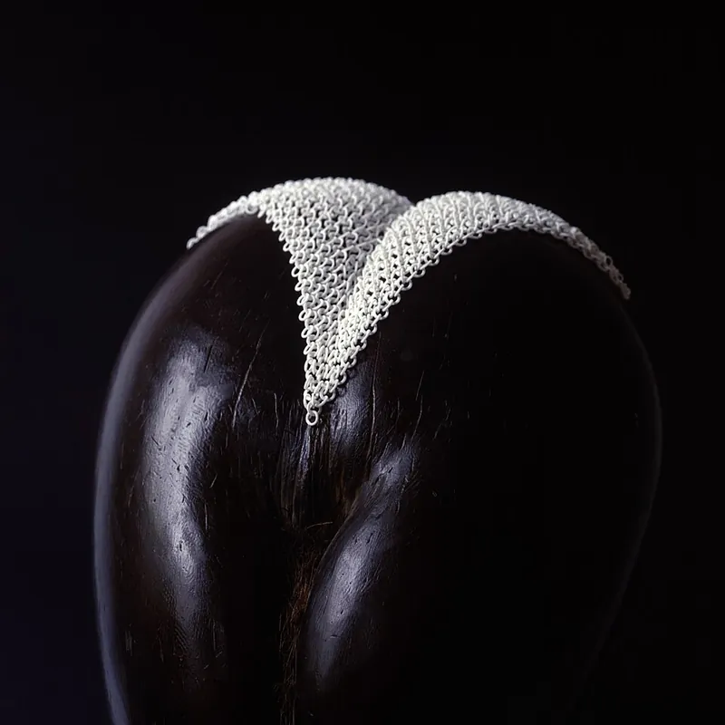

*Picture: [Ring Fabric Sample Displayed on a Coco de Mer - Jiri Evenhuis 2003.jpg](https://commons.wikimedia.org/wiki/File:Ring_Fabric_Sample_Displayed_on_a_Coco_de_Mer_-_Jiri_Evenhuis_2003.jpg) by Jiri Evenhuis, [CC BY-SA 4.0](https://creativecommons.org/licenses/by-sa/4.0), from Wikimedia Commons.*

A flat sheet of small tiles or rings printed in one go with each piece already looped through its neighbours, so the stiff pieces together behave like a flexible cloth for costumes, covers, bags and fidget toys, although it is not real armour.

**In plain words:** A sheet of tiny plastic tiles or rings that comes off the 3D printer already hooked together, so it bends, folds and drapes like a piece of cloth. **Proper term:** Printed chainmail ([print-in-place](../glossary.md#print-in-place) interlinked fabric, 3D-printed fabric or tile fabric).

**Also called:** 3D-printed chainmail; chain mail fabric; printed fabric; 3D printed fabric (Printables model titles); NASA chainmail; NASA fabric; NASA hex chainmail (maker names, after JPL's 'space fabric') (Printables 205674 and 373566; Thingiverse 'NASA Fabric Mk 3 Optimized for FDM Printing'); space fabric (JPL's 3D-printed metal tile fabric) (JPL news, 18 April 2017); dragon scale fabric; dragon scale chainmail; scale mail (Printables 851001 and 931534); tetrahedron chainmail; hex chainmail; modular chainmail (Printables 304968 and 288); ring fabric (Jiri Evenhuis's 3D-printed textile, 1999-2003) (Wikipedia 'Jiri Evenhuis'); Kinematics (Nervous System's 4D-printed folding textile of hinged triangles) (Nervous System); structured fabric; wearable structured fabric (research name for interlocked printed particles) (ScienceDaily, Nature 2021); polycatenated architected material, PAM (3D chain-mail-like research material) (ScienceDaily, Caltech 2025); mail; maille; chainmail (the traditional metal-ring armour it imitates) (Wikipedia 'Chain mail').

## How it works

Each tile has loops or rings that pass through the loops of the tiles next to it, with a small air gap ([clearance](../glossary.md#clearance)) everywhere, and the printer builds the whole interlocked sheet in one job, so the pieces are trapped together but never touch tightly (Printables 117560; Nervous System 'Kinematics'). Every piece is rigid, but because each can slide, tilt and turn a little within its gaps, the sheet as a whole bends and drapes like cloth (Nervous System 'Kinematics'; ScienceDaily 2021). How it bends depends on the link shape: NASA-style hexagons with loops on the back bend mainly one way, while smaller hexes with longer loops bend both ways (Printables 385425). If the sheet is squeezed, for example vacuum-packed in a bag, the links jam against each other and it turns stiff (ScienceDaily 2021).

## Parts

Single piece as printed, but made of many separate parts: tens to thousands of rigid tiles or links that are captive in one another (Nervous System 'Kinematics'). Typical parts: flat top plates (hexagons, squares, triangles or scales) and loops or rings underneath that pass through the neighbouring tiles' loops (Printables 1470589, 304968). Extra parts only when joining panels: connector links or glued connector pieces (Printables 724656, 304968) or wires with crimped stops for scale armour (Printables 618521).

## Everyday examples

- Costume chainmail: films often use ABS plastic rings instead of metal to save cost and weight, as in The Lord of the Rings trilogy (Wikipedia 'Chain mail')
- The metal mesh glove a butcher or oyster shucker wears (Wikipedia 'Chain mail')
- Printed 'NASA chainmail' and dragon-scale fidget sheets, coasters and ties shared on model sites (Printables 205674, 851001, 503382)
- The Kinematics Dress, a printed dress of thousands of hinged nylon triangles (Nervous System)

## When to use it

Use it when you want a flexible surface made only on a 3D printer: cosplay and costume pieces, decorative panels and covers that must wrap around curves, bags and pouches, wearable jewellery, coasters and fidget toys (Printables 117560, 503382, 851001; Nervous System 'Kinematics'). It suits large curved coverings that would be hard to print solid, because the sheet can be printed flat (or folded) and then drapes into shape (Nervous System 'Kinematics Dress').

## When not to use it

Don't use it as protection: it is not armour, and even real metal mail was pierced by thrusts when not riveted and let blows bruise or break bones underneath (Wikipedia 'Chain mail'); for protective gear buy rated products. Don't use it where it must carry load or hold a shape: use a solid part, a [living hinge](../glossary.md#living-hinge) (Living hinge) or a cable carrier (Cable carrier) for one bending direction, or a posable arm (Posable segmented arm) if it must stay where it is bent. If you want a soft fabric feel, print tiles onto real fabric instead (Printing onto fabric). For flat sheet stock, laser-cut flexible patterns are an alternative ([Kerf](../glossary.md#kerf) bending).

## Details

- **What it does (jobs):**
  - let it move (turn, slide or bend): a sheet that bends and drapes in every direction (Nervous System 'Kinematics'; Printables 304968)
  - join and hold: the links hold the tiles together permanently as one flexible panel, and connector links join panels into larger pieces (Printables 288, 724656)
- **Movement:** multiple: the sheet bends, folds and drapes over curved shapes; e.g. tetrahedron chainmail 'can effectively fold it in half' (Printables 304968), and a chiton-style scale armour allows 30° between two scales, so three scales make a 90° bend (Printables 618521). Some designs bend mainly one way (Printables 385425)
- **Directions it can move (degrees of freedom):** Many. Each tile can move in all 6 ways relative to its neighbour, but only a little, within its clearances; the sheet as a whole behaves like a cloth with very many small joints (Nervous System 'Kinematics'; ScienceDaily 2025 notes the 'coordinated [degrees of freedom](../glossary.md#degrees-of-freedom)' of interlinked rings sliding against one another).
- **Special behaviour:**
  - none of the listed behaviours in normal use: it is a flexible sheet, not a lock or clutch
  - related research behaviour (jamming): when wrapped in a plastic envelope and vacuum-packed, a printed nylon chainmail of interlocked hollow octahedrons became 25 times stiffer and held 1.5 kg, over 50 times its own weight (ScienceDaily 2021, Nature paper by Wang et al.); see Granular jamming gripper
- **How it holds:**
  - shape (the parts interlock; [form-fit](../glossary.md#form-fit--force-fit--material-bond)): each link passes through its neighbour's loop, so the pieces can't come apart without breaking (Printables 1470589; ScienceDaily 2021 calls these 'topologically interlocked structures')
  - jamming (grains or a braid lock up under load): only in the research version that is vacuum-packed to stiffen it (ScienceDaily 2021)
- **Input and output:** not applicable
- **Power:** passive (no power needed)
- **Load:** Light. It is meant to drape, not to carry load. Thicker links help: increasing the chain thickness from 1.2-1.5 mm to 1.8 mm made the NASA hex fabric 'more than twice as strong' with about the same flexibility (Printables 373566). Thin loops are the weak point and can print poorly (Printables 385425). ⚑ [uncertain: no pull-strength figures found for printed maker chainmail.] Not protective: even real metal mail could be pierced when not riveted, and blows passed through it, so a padded layer was worn underneath (Wikipedia 'Chain mail').
- **Play and precision:** Noticeable play on purpose: the clearances between links are what let it move, so it does not locate anything precisely. Typical design clearance 0.2 mm (Printables 117560); Prusa suggests at least 0.3 mm for moving parts (Prusa 'Modeling with 3D printing in mind'). Some designs tangle (links catch and twist) more easily than others (Printables 1458248, 816149).
- **Taking it apart:** permanent within one printed sheet (links can only be separated by breaking them); semi-permanent where panels are joined with printed connector links or glued connector pieces (Printables 724656, 304968); removable where modular tiles are designed to be connected or single scales added and removed (Printables 288, 931534)
- **How often it can be reused:** once for links printed in place (they are never taken apart); ⚑ [uncertain] a few times for snap-in connector links between panels. Bending and draping can be repeated indefinitely because the links slide rather than flex ⚑ [uncertain: no wear test found]
- **Sealing:** none: an open mesh with gaps between every link
- **Adjustable:** no: once printed, link size and [stiffness](../glossary.md#stiffness) are fixed. Size can be changed by joining more panels or adding and removing single scales (Printables 288, 931534, 724656)
- **Access needed:** not applicable
- **Materials:** Usually PLA (Printables 205674, 304968, 816149); PETG and ASA also used, ASA recommended for outdoor scale armour (Printables 618521); TPU 'for extra flexibility' (Printables 1470589); silk PLA for looks (Printables 304968). Research and design versions use nylon (Nervous System Kinematics Dress, 3D printed as one piece in nylon; ScienceDaily 2021), acrylic polymers and metals including aluminium (ScienceDaily 2021 and 2025; JPL news). Film costumes use ABS plastic rings instead of metal mail to save cost and weight (Wikipedia 'Chain mail'). It can be attached to fabric, elastic, cord or wire, or replaced by printing tiles directly onto fabric (see Printing onto fabric).
- **Heat, cold, water and wear:** Same as the plastic it is printed in: PLA softens and deforms above about 60 °C and degrades in UV light, so a PLA costume piece can sag in a hot car or in sun; PETG is suitable indoors and outdoors below about 80 °C (Prusa PLA and PETG guides); ASA is recommended for outdoor scale armour (Printables 618521). PLA 'breaks along layers or into shards upon impact' (Prusa PLA guide), so thin links snap rather than bend. Constant tension can make plastic [creep](../glossary.md#creep) over time (Filament Specs 'Creep Resistance') ⚑ [uncertain: not measured on chainmail].

## Making it

- **Ways to make or get it:**
  - 3D print (FDM): the usual maker method; whole sheets print in place with no supports (Printables 205674, 1470589)
  - 3D print (SLS nylon, industrial): Kinematics garments and research fabrics are printed in nylon as a single piece (Nervous System 'Kinematics Dress'; ScienceDaily 2021)
  - 3D print (metal, industrial): JPL's 'space fabric' prototypes and aluminium research chainmail (JPL news 2017; ScienceDaily 2021)
  - off-the-shelf part: traditional metal mail and ring weaves for jewellery and art (Wikipedia 'Chain mail')
- **Printing it in one piece (print in place):** yes: the sheet prints already linked and works straight off the bed, with no supports and no assembly (Printables 1458248; Nervous System 'Kinematics': 'the hinge mechanisms are 3D printed in place and work straight out of the machine'). Joining several printed panels needs separate connector links or glued pieces (Printables 724656, 304968).
- **Tools:** none to use: print it, then flex the sheet to free any links that stuck together. Superglue for glued connector pieces (Printables 304968); wire or cord, a threading aid and crimped cable stops for strung scale armour (Printables 618521); a slicer and, for custom sizes, a generator or CAD file (Actual3D generator; Printables 1526462)
- **Difficulty:** easy to moderate: free models print in one piece with no supports and no assembly (Printables 1458248, 1470589), but they need a well-tuned first layer, good bed adhesion and good [bridging](../glossary.md#overhang--bridging) (Printables 304968, 52358); designing your own that is flexible, printable and doesn't tangle is harder ('It is easy to design a 3d printed chainmail. It is hard to do it the right way', Printables 816149)

### 3D printing tips

1) Start small: print a 2x2 or 1x1 sample to test your printer's clearances before a big sheet (Printables 117560, 288). 2) Layer height 0.15-0.2 mm works for NASA-style chainmail (Printables 205674); the Actual3D generator recommends 0.2 mm for NASA chainmail and 0.16 mm for dragon scale fabric, a 0.4 mm or smaller nozzle and no supports (Actual3D generator). 3) Use 0% [infill](../glossary.md#infill): the links are thin enough to be all [perimeters](../glossary.md#perimeters) (Printables 288; Actual3D generator). 4) The first layer is critical: 'Flawless bed adhesion and calibration is crucial' (Printables 304968); a 'well calibrated first layer and clean PEI' (Printables 52358). Squashed first layers spread wider than drawn and can fill small gaps (Prusa 'Elephant foot compensation', about 0.2 mm compensation for a 0.4 mm nozzle). 5) Supportless designs rely on bridges: Tetrahedron chainmail uses two layers of 0.4 mm-thick bridges, so print at 0.2 mm layers (Printables 304968); designs with no bridges at all also exist (Printables 2566), and links shaped as distorted rings can print without support down to a 4 mm cell with a 0.4 mm nozzle (Printables 544241). 6) Make links thick enough: 1.8 mm instead of 1.2-1.5 mm doubled the strength (Printables 373566); thin loops 'don't always print the best' (Printables 385425). 7) Slow down: several designers 'slowed the printer down a bit' (Printables 816149, 851001). 8) Avoid tangling: some link shapes tangle; pick 'tangle free' designs if the sheet will be handled a lot (Printables 816149, 1458248). 9) Colour: a filament change (M600) partway up gives a two-colour sheet whose underside shows when it bends (Printables 304968). 10) Bigger than the bed: join panels with connector links (Printables 724656), print modular tiles (Printables 288), or fold the design before printing as Nervous System does (Kinematics Dress). 11) Rescaling changes the gaps: the Ideal NASA hex still printed at 70% size (Printables 373566), but most print-in-place designs should be printed at their design size ⚑ [uncertain: general print-in-place advice]. 12) For stiffer but still flexible sheets use PETG or ASA; for softer drape try TPU (Printables 618521, 1470589).

### Buying one (off-the-shelf parts)

Not usually needed. Useful extras: 'cable crimp stops' or 'wire rope stops' and thin steel cable or nylon cord for strung scale mail (Printables 618521); elastic or rubber bands to wear printed ties and panels (Printables 503382); superglue for connector pieces (Printables 304968); 'jump rings' or a 'chainmaille kit' when real metal rings are wanted for jewellery-style mail ⚑ [uncertain: search terms not checked on a supplier page]; a vacuum bag and pump to try the jamming effect (ScienceDaily 2021).

## Rules of thumb

- Moving parts need a gap: start with at least 0.3 mm on a well-tuned FDM printer (Prusa 'Modeling with 3D printing in mind'); some fabrics use 0.2 mm, so print a 2x2 test first (Printables 117560).
- Thicker links: going from 1.2-1.5 mm to 1.8 mm chain thickness made NASA hex chainmail more than twice as strong with almost the same flexibility (Printables 373566).
- Layer height 0.15-0.2 mm, 0.4 mm nozzle or smaller, 0% infill, no supports (Printables 205674 and 288; Actual3D generator).
- Walls thinner than one perimeter (about 0.45 mm with a 0.4 mm nozzle) can't print; 4 perimeters = 1.8 mm (Prusa 'Modeling with 3D printing in mind').
- Overhangs of 45-60° print cleanly without support; short horizontal bridges are fine (Prusa 'Modeling with 3D printing in mind').
- Elephant-foot compensation of about 0.2 mm suits a 0.4 mm nozzle (Prusa 'Elephant foot compensation').
- Scale armour: about 30° of movement between neighbouring scales gives a 90° bend over three scales; at about 10 mm scale size it 'feels more like cloth than armor' (Printables 618521).
- Smallest practical cell on a normal FDM printer is around 4 mm (0.4 mm nozzle, 0.2 mm layers) (Printables 544241).

## Common failures

Links fused together because the first layer was squashed too wide or the clearance was too small: calibrate the first layer, use elephant-foot compensation, print a small test (Printables 304968, 117560; Prusa 'Elephant foot compensation'). Sheet peeling off the bed mid-print: clean the bed and use good adhesion (Printables 52358, 851001). Sagging bridges or failed loops: use designs made for bridging, 0.2 mm layers and slower speeds (Printables 304968, 385425). Old designs with 12 tiny dots that 'often failed' were replaced by a coned centre section (Printables 205674). Thin links snapping: use thicker links (Printables 373566) or a tougher material such as PETG. Tangling: choose a tangle-resistant link shape (Printables 816149, 1458248). Sheet only bending one way: choose a design whose loops reach further (Printables 385425).

## Safety

Not real armour: treat it as decorative or light-duty and never rely on it to stop blades, points or impacts (Wikipedia 'Chain mail'). PLA links can break 'into shards upon impact' (Prusa PLA guide). ⚑ [uncertain: no source opened] Small loose tiles from a broken sheet could be a choking hazard for young children, and moving links can pinch skin or catch hair. Research 'stiffen on demand' and polycatenated chainmail materials are lab prototypes, not proven protective gear (ScienceDaily 2021 and 2025).

## Related

- Print-in-place hinge: a single printed hinge with one axis; chainmail is many tiny captive joints that bend in all directions
- Posable segmented arm (snap-together ball chain, gooseneck): a one-dimensional chain that holds its shape; chainmail is a two-dimensional sheet that flops
- Cable carrier (drag chain, energy chain): a chain of links that bends in one plane only
- Printing onto fabric (fabric embedded in a 3D print): printed tiles on a real fabric layer; softer and lighter, the all-printed alternative is this entry
- Multi-material interlock (co-printed rigid and flexible parts): bonds rigid and flexible printed materials into one part rather than linking separate pieces
- Living hinge and Kerf bending (laser-cut living hinge): thin flexing material instead of separate links; one bending direction at a time
- Mechanical metamaterial mechanism (shear-cell hinge arrays): printed cell arrays that move in a designed way
- Granular jamming gripper (coffee-balloon gripper): uses the same jamming effect that makes vacuum-packed chainmail go stiff
- Origami mechanisms and Self-folding print (4D printing): other ways to get a flat print to fold into a 3D shape
- Split-part joints for large prints: other ways to make something larger than the print bed

## Make it yourself

- [Nasa chainmail (4x4, 8x8, 12x16 and 32x34) (Hector, Printables) (URL from Printables API, page not opened)](https://www.printables.com/model/205674-nasa-chainmail-4x4-8x8-12x16-and-32x34): The most popular printable chainmail (about 13,000 likes), based on TurboDork's 'NASA Fabric Mk 3 Optimized for FDM Printing' on Thingiverse; several sheet sizes; 0.15 or 0.2 mm layers *(licence: CC BY (Creative Commons Attribution))*
- [Ideal NASA Chainmail Hex for FDM (STEP included) (Gamma4D, Printables) (URL from Printables API, page not opened)](https://www.printables.com/model/373566-ideal-nasa-chainmail-hex-for-fdmstep-included): Hexagonal chainmail with 1.8 mm links, more than twice as strong as the original, with editable STEP files *(licence: CC BY-SA (Creative Commons Attribution-ShareAlike))*
- [Chainmail 2.0 - Modular 3D Printable Fabric (Agustin Arroyo / Flowalistik, Printables) (URL from Printables API, page not opened)](https://www.printables.com/model/288-chainmail-20-modular-3d-printable-fabric): Modular chainmail of identical parts in 1x1 to 20x20 grids that can be printed in several colours and joined; recommended as a printer test *(licence: CC BY-NC-SA (Creative Commons Attribution-NonCommercial-ShareAlike))*
- [SNAFU Chain Mail / 'NASA Fabric' in OpenSCAD (h2odragon, Printables) (URL from Printables API, page not opened)](https://www.printables.com/model/1526462-snafu-chain-mail-nasa-fabric-in-openscad): Parametric OpenSCAD re-creation of NASA-style chainmail: any number of rows and columns, adjustable link dimensions *(licence: GNU GPL v2.0)*
- [NASA inspired chainmail generator (Actual3D / Actualizings)](https://www.generator.actual3d.com/nasa-chainmail): Online generator that downloads a STEP sheet of NASA-style chainmail in any number of rows and columns, with recommended print settings; the same site has dragon-scale and Flowalistik chainmail generators *(licence: free online tool; licence of output not stated)*
- [NASA Chainmail Hex Connector (Chainmail Weaves, Printables) (URL from Printables API, page not opened)](https://www.printables.com/model/724656-nasa-chainmail-hex-connector-for-both-fdm-optimise): A single printed connector link for joining separate sheets of NASA chainmail into larger panels *(licence: CC BY-SA (Creative Commons Attribution-ShareAlike))*

## Pictures, videos and models

- ['Space Fabric' Links Fashion and Engineering (NASA JPL news, 18 April 2017)](https://www.jpl.nasa.gov/news/space-fabric-links-fashion-and-engineering/): Photos of JPL's 3D-printed metallic 'space fabric' of small linked squares, with different functions on each side *(licence: link only (images credited NASA/JPL-Caltech))*
- [Ring Fabric Sample Displayed on a Coco de Mer - Jiri Evenhuis 2003 (Wikimedia Commons)](https://commons.wikimedia.org/wiki/File:Ring_Fabric_Sample_Displayed_on_a_Coco_de_Mer_-_Jiri_Evenhuis_2003.jpg): An early 3D-printed ring fabric sample draped over a seed, showing how linked rings drape like cloth *(licence: CC BY-SA 4.0)*
- [Kinematics Dress (Nervous System)](https://n-e-r-v-o-u-s.com/projects/kinematics/kinematics-dress/): Photos and a fold simulation of a dress of thousands of hinged triangular nylon panels printed as one folded piece *(licence: link only)*
- [The smart chain mail fabric that can stiffen on demand (nature video, YouTube)](https://www.youtube.com/watch?v=S2n9VJrra3g): Video about printed chainmail that becomes rigid when vacuum-packed (title and channel verified via YouTube oEmbed; video content not viewed) *(licence: link only (standard YouTube licence))*
- [How to Draw 3D Printable Chainmail with Fusion 360 (Poppy Mosbacher, YouTube)](https://www.youtube.com/watch?v=HsGCIl4KjGs): A CAD walkthrough for designing printable chainmail (title and channel verified via YouTube oEmbed; video content not viewed) *(licence: link only (standard YouTube licence))*

## Needs confirming

⚑ marks something nobody has confirmed yet: a fact the research could not confirm from a source, a finder value that is a best guess, or an open point from the research notes. Corrections are welcome (see `research/needs-confirming.md`).

- ⚑ 7 sentences on this page marked [uncertain].
- ⚑ Research note: *Printed chainmail*: Space.com says JPL's 2017 'space fabric' prototype was printed in plastic; JPL's own release describes metal. The entry follows JPL. Choking risk from broken tiles is unsourced ([uncertain]).

## Sources

- <https://www.space.com/36719-nasa-chain-mail-space-fabric.html>
- <https://www.jpl.nasa.gov/news/space-fabric-links-fashion-and-engineering/>
- <https://www.sciencedaily.com/releases/2021/08/210811131557.htm>
- <https://www.sciencedaily.com/releases/2025/01/250121162100.htm>
- <https://en.wikipedia.org/wiki/Chain_mail>
- <https://en.wikipedia.org/wiki/Jiri_Evenhuis>
- <https://n-e-r-v-o-u-s.com/projects/kinematics/>
- <https://n-e-r-v-o-u-s.com/projects/kinematics/kinematics-dress/>
- <https://help.prusa3d.com/article/modeling-with-3d-printing-in-mind_164135>
- <https://help.prusa3d.com/article/elephant-foot-compensation_114487>
- <https://help.prusa3d.com/article/pla_2062>
- <https://help.prusa3d.com/article/petg_2059>
- <https://filamentspecs.com/creep-resistance-3d-printed-parts/>
- <https://www.generator.actual3d.com/nasa-chainmail>
- <https://www.generator.actual3d.com/scale-fabric>
- <https://www.thingiverse.com/thing:3095799>
- <https://commons.wikimedia.org/wiki/File:Ring_Fabric_Sample_Displayed_on_a_Coco_de_Mer_-_Jiri_Evenhuis_2003.jpg>
- <https://www.youtube.com/watch?v=S2n9VJrra3g>
- <https://www.youtube.com/watch?v=HsGCIl4KjGs>
- <https://api.printables.com/graphql/>
