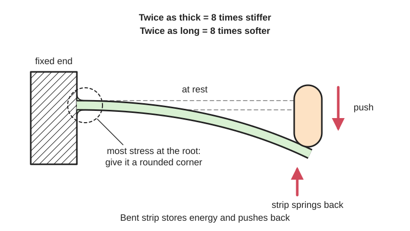
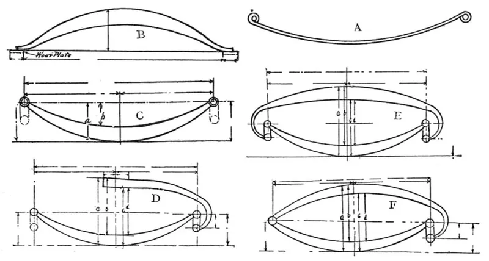

<figure class="eoc-pic eoc-pic-main"><picture><source media="(prefers-reduced-motion: reduce)" srcset="../media/drawn/printed-leaf-spring.svg"></picture><figcaption><strong>Animation.</strong> Diagram drawn for the encyclopaedia from the research notes. ⚑ Needs confirming: a drawing can simplify or get details wrong; a real photo or a better diagram is welcome.</figcaption></figure>
<figure class="eoc-pic"><figcaption><strong>Photo.</strong> <a href="https://commons.wikimedia.org/wiki/File:Duisburg,_Landschaftspark_Duisburg-Nord,_Torpedowagen_--_2016_--_1214.jpg">Duisburg, Landschaftspark Duisburg-Nord, Torpedowagen -- 2016 -- 1214</a> by Dietmar Rabich, <a href="https://creativecommons.org/licenses/by-sa/4.0">CC BY-SA 4.0</a>, from Wikimedia Commons.</figcaption></figure>

A strip of springy plastic or metal, fixed at one end or at both ends, that bends under a push and springs back, storing energy; it is the easiest spring to design into a 3D-printed part.

**In plain words:** A springy strip or arm, often printed right onto a part, that bends when pushed and pushes back when let go, like the plastic tongue that springs a button back out. **Proper term:** Leaf spring (flat spring); a [cantilever](../glossary.md#cantilever) spring when it is fixed at one end only.

**Also called:** flat spring (Wikipedia 'Flat spring' redirects to 'Leaf spring'); cantilever spring: 'a flat spring fixed only at one end like a cantilever' (Wikipedia 'Spring (device)'); integral spring, molded-in spring or cantilever spring in plastics design guides (DuPont 'General Design Principles', ch. 6); printed spring, compliant spring, spring arm, spring finger (maker terms) ⚑ [uncertain: informal usage]; [flexure](../glossary.md#flexure) or flexure primitive (compliant-mechanism term for a thin bending wall; Akaki Kuumeri); blade spring ⚑ [uncertain: informal usage]; vehicle types: laminated or carriage spring, semi-elliptic, elliptic, three-quarter and quarter-elliptic, transverse, parabolic and mono-leaf springs (Wikipedia 'Leaf spring'); constant-strength or tapered leaf (a leaf shaped so the stress is even along it; DuPont Fig. 6.01; Wikimedia Commons 'lame d'égale résistance').

## How it works

When a strip fixed at one end is pushed at its free end, it bends, and the material's elasticity pushes back with a force roughly proportional to how far it is bent (Hooke's law; Wikipedia 'Spring (device)'). Its [stiffness](../glossary.md#stiffness) is W/y = 3EI/L cubed, where L is the free length, E the material's stiffness and I = b h cubed / 12 for a strip of width b and thickness h (DuPont p. 36; Wikipedia '[Deflection](../glossary.md#deflection) (engineering)' and 'List of second moments of area'). So thickness matters most: doubling the thickness makes it 8 times stiffer, and doubling the length makes it 8 times softer. The bending stress is highest at the fixed end (the root), which is why good springs are tapered so the stress is spread evenly along the strip, and why the root needs a rounded corner (DuPont p. 36; Covestro snap-fit guide p. 8).

## Parts

Single piece when the strip is printed or moulded as part of the object (an integral spring; DuPont ch. 6). A few parts when a metal strip is screwed or clamped in place, or for vehicle springs made of a stack of leaves held by a centre bolt and clips, with eyes or shackles at the ends (Wikipedia 'Leaf spring').

## Everyday examples

- The limbs of a bow: each limb is a cantilever spring (Wikipedia 'Spring (device)')
- The leaf springs under trucks, vans and railway carriages (Wikipedia 'Leaf spring')
- Springy metal battery contacts and electrical switch contacts (Wikipedia 'Spring (device)')
- Tweezers, and the flexing plastic arm of a clip that clicks shut (Wikipedia 'Spring (device)'; Hubs snap-fit guide)

## When to use it

Use a leaf spring whenever a printed or moulded part needs a light return force: pushing a button or trigger back out, holding a latch or [pawl](../glossary.md#pawl) against a [ratchet](../glossary.md#ratchet), making a [detent](../glossary.md#detent) click, pressing a part against a stop, or as a small catapult or toy spring. It prints in place with no extra parts, costs nothing, has no play and can be tuned just by changing its length or thickness. Metal leaf springs suit heavier jobs where a flat shape fits better than a coil, such as vehicle suspensions that must also locate the axle (Wikipedia 'Leaf spring').

## When not to use it

Avoid a printed leaf spring when it must hold a force all the time (a door closer, a clamp, a balance spring or a battery contact that stays pressed): plastic [creeps](../glossary.md#creep) and relaxes, so use a steel spring instead (DuPont p. 36; Razzer09). Avoid it for long travel in little space (use a coil spring or a spiral power spring), for straight-line motion (use an ortho-planar spring or a parallel leaf-spring flexure), where it will get hot (PLA softens at about 60 °C; CNC Kitchen), and for very high cycle counts in PLA (use nylon, acetal or metal).

## Details

- **What it does (jobs):**
  - store energy: it pushes back and can return a button, lever, latch or pawl to its rest position
  - let it move (turn, slide or bend): its tip moves by bending, with no pins
  - click into set positions / stop it moving back (one-way): it is the spring inside many printed detents, ratchet pawls and snap latches (DuPont p. 47: moulded-in springs acting on a ratchet wheel)
- **Movement:** flex: the tip moves along a shallow arc; a working deflection of about a quarter of the free length appears in DuPont's worked example (y/L = 0.25 for a 50.8 mm Delrin spring), and Akaki Kuumeri's printed flexure primitive moves 5 mm at the end of a 40 mm wall
- **Directions it can move (degrees of freedom):** 1 intended: bending in its thin direction. It is stiff when bent in its wide direction and when pulled along its length, but a thin strip also twists fairly easily (Akaki Kuumeri: narrower than 10 mm 'becomes too easy to twist'), and it can buckle if pushed along its length ⚑ [uncertain for printed strips].
- **Special behaviour:**
  - self-aligning or self-centring: it always returns to its rest shape when released (unless overloaded or crept)
  - none of the other listed behaviours on its own; it supplies the spring force for parts that do index, lock or ratchet (detent arms, pawls, snap-fit hooks)
- **How it holds:**
  - spring force (a spring or springy part presses it in place)
- **Input and output:** not applicable (it is a spring, not a transmission). Force is roughly proportional to deflection for small bends; beam springs can become non-linear at larger bends (Wikipedia 'Spring (device)'). Back-drivable: yes.
- **Power:** passive (no power needed)
- **Load:** light (DuPont's worked example, a moulded Delrin arm of 0.88 N/mm bent 12.7 mm, pushes back with about 11 N) to heavy (steel vehicle leaf springs that carry and locate a truck axle; Wikipedia 'Leaf spring'). Strong when bent in its wide direction or pulled along its length; weak against twisting (Akaki Kuumeri); a printed arm built up vertically in Z is weak because layers can split (Hubs).
- **Play and precision:** none: one piece, no sliding, so no play. It returns to the same rest position unless it has been overloaded (yielded) or, in plastic, held bent long enough to creep; printed clips held open for 24 hours never fully returned to shape (Thrinter creep test), and Akaki Kuumeri warns a flexure left bent for a day won't return to centre. Its tip moves in an arc, not a straight line. Stacked metal leaves rub on each other, giving friction and stiction (Wikipedia 'Leaf spring').
- **Taking it apart:** permanent when printed or moulded as part of the object; removable when a metal or separately printed strip is screwed, clamped or slotted in
- **How often it can be reused:** many times for clamped strips; the real limit is flexing life. Plastic springs work for intermittent action but lose force if kept loaded (DuPont p. 36); steel leaf springs are hardened to last ⚑ [uncertain: no cycle figure found for small flat springs]
- **Sealing:** none
- **Adjustable:** Printed-in springs: no, stiffness is fixed by length, width, thickness and material. Clamped strips: yes, sliding the clamp to change the free length changes the stiffness strongly (stiffness is inversely proportional to length cubed; DuPont p. 36), and a screw can set the [preload](../glossary.md#preload) ⚑ [uncertain for the preload screw]. BYU's 'FlexLinks: Cantilever Beam Adjust' is an adjustable-length version (Printables).
- **Access needed:** not applicable
- **Materials:** Metal: spring steel is the usual material (about 1% carbon, alloys such as 55Si7 and 50Cr4V2 for vehicle springs; Wikipedia 'Leaf spring'); phosphor bronze and titanium where corrosion matters and beryllium copper for springs that carry current (Wikipedia 'Spring (device)'); composite (glass-fibre) leaves in some cars (Wikipedia 'Leaf spring'). Wood (yew bows; Wikipedia 'Spring (device)'). Moulded plastics: acetal (Delrin) and Hytrel are the best unreinforced spring plastics (DuPont p. 36). 3D printing: tough, ductile PETG, ABS and nylon are preferred to [brittle](../glossary.md#brittle--ductile) PLA and standard resins for flexing arms (Hubs); PLA is the stiffest common filament (bending modulus 3300 MPa, versus ASA 2300 and PETG 1900 MPa; CNC Kitchen) but brittle and prone to creep; PLA+ worked best in Akaki Kuumeri's informal flexure tests. Polypropylene sheet gives the best cut compliant parts (BYU FlexLinks).
- **Heat, cold, water and wear:** Printed plastic: PLA gives way at about 60 °C, PETG at about 80 °C and ASA at about 110 °C (CNC Kitchen); all printed plastics creep and take a set under constant load, PLA most (Thrinter creep test; Razzer09 test). DuPont notes that temperature and chemicals change a plastic spring's properties and that repeated stress must stay below the material's [fatigue](../glossary.md#fatigue) limit (p. 36). Metal: spring steel fatigues if over-stressed and rusts unless protected; stacked leaves also suffer from friction between leaves (Wikipedia 'Leaf spring'). UV and sunlight weaken many plastics ⚑ [uncertain: not checked for printed springs].

## Making it

- **Ways to make or get it:**
  - 3D print (FDM): the most common maker method; the spring prints as part of the object
  - 3D print (resin): possible, but standard resins are brittle for repeated flexing; choose a tough or durable resin (Hubs)
  - 3D print (SLS/MJF nylon): good fatigue performance for flexing arms (Hubs)
  - laser cut: flat springs cut from plastic sheet; BYU FlexLinks can also be milled, water-jet cut or CNC-routed, best from polypropylene sheet
  - CNC: milled plastic or metal springs
  - sheet metal: spring-steel, stainless or phosphor-bronze strip cut and bent, or hardened after forming (Wikipedia 'Spring (device)')
  - off-the-shelf part: flat springs, spring-steel strip and vehicle leaf springs
- **Printing it in one piece (print in place):** yes: an integral spring prints already attached to the part and working, with no assembly (e.g. the printed springs in the_ress's filament cutter, which need only an added blade; Printables via Hackaday)
- **Tools:** none for printed-in springs; a screwdriver for screwed or clamped strips; [shears](../glossary.md#peel-vs-shear) or a grinder to cut spring-steel strip ⚑ [uncertain]
- **Difficulty:** easy: it is just a thin arm drawn into the part and prints in place with no assembly; the hard part is making it last, because plastic creeps, yields and fatigues, so expect a few test prints

### 3D printing tips

1) Orientation: make the bending strain run along the printed lines, never across layer joins. Either print the arm lying flat so it bends up and down, with the print lines running lengthwise along it, or print it as a thin standing wall that bends sideways about a vertical axis (Akaki Kuumeri: 'always printed vertically', and 'if you must print flexures laying flat, make sure the print lines are longitudinal'). Avoid arms built upward in Z that bend about a horizontal axis: layer bonding is weaker and they snap (Hubs; CNC Kitchen measured layer adhesion at about 55% of flat strength for PLA and 46% for PETG). 2) Size: start from Akaki Kuumeri's flexure primitive, a wall 0.75 mm thick (exactly two lines from a 0.4 mm nozzle), at least 10 mm wide so it doesn't twist, at least 40 mm long, bent about 5 mm at the tip; thicker than three lines behaves less predictably. Hubs suggests a minimum width of 5 mm for snap-fit arms. 3) Round the root: a [fillet](../glossary.md#chamfer--fillet) of at least 0.5 x the arm's root thickness (Hubs); [stress concentration](../glossary.md#stress-concentration) keeps falling up to a radius of about 0.6 x thickness (Covestro p. 8). 4) [Taper](../glossary.md#taper) it: thinning the arm towards the tip spreads the strain; halving the thickness at the tip lets it bend more than 60% further than a straight arm (Covestro p. 12), and a constant-strength shape gives the same stiffness at two-thirds of the stress (DuPont p. 36). 5) Design it to rest unloaded and be bent only briefly: plastic springs under constant load creep and relax (DuPont p. 36-37); Akaki Kuumeri: 'Never leave under tension'. 6) Add end stops so it can't be bent past its safe range (Akaki Kuumeri). 7) Materials: PETG, nylon or ABS for durability (Hubs); PLA makes 'a very poor spring material' for sustained springing (Hackaday on neotoy's compliant toggle) but is stiff and fine for light, occasional use. 8) Keep the print seam off the spring and use fillets plus seam placement (Akaki Kuumeri). 9) Print a thickness test first, e.g. XNDR's leaf-spring thickness test at 0.15 and 0.20 mm layers (Printables). 10) Keep printed springs cool: PLA gives way at about 60 °C and PETG at about 80 °C (CNC Kitchen).

### Buying one (off-the-shelf parts)

Search for 'flat spring', 'leaf spring', 'spring steel strip' or 'spring steel shim stock' (often sold as blue-tempered spring steel) ⚑ [uncertain: supplier pages not opened], 'phosphor bronze strip' and 'beryllium copper strip' for contact springs (Wikipedia 'Spring (device)'), 'stainless steel spring clip', 'battery contact spring', and for vehicles 'leaf spring', 'parabolic leaf spring', 'leaf spring shackle' and 'centre bolt' (Wikipedia 'Leaf spring'). If a printed spring must hold a constant load, buy a metal spring instead (Razzer09's recommendation after testing printed springs; DuPont p. 36).

## Rules of thumb

- Stiffness of a strip fixed at one end and pushed at the tip: W/y = 3EI/L cubed with I = b h cubed / 12, so stiffness grows with width, with thickness cubed and falls with length cubed (DuPont 'General Design Principles', p. 36; Wikipedia 'Deflection (engineering)'; Wikipedia 'List of second moments of area').
- Worked example: a Delrin acetal spring 50.8 mm long needing 0.88 N/mm at 12.7 mm deflection works with b = 6.35 mm and h = 3.1 mm (about 46 MPa stress), or b = 12.7 mm and h = 2.4 mm (about 42 MPa); for fast repeated use (e.g. 60 times a minute) lower the stress by bending it less, making it longer relative to its thickness, or softer (DuPont p. 37).
- A constant-strength (tapered) spring gives the same spring rate at two-thirds of the stress and a quarter less weight than a straight strip (DuPont p. 36, Fig. 6.01, spring C).
- Tapering a cantilever arm's thickness to half at the tip increases the allowable deflection by more than 60% compared with a straight arm (Covestro 'Snap-Fit Joints for Plastics', p. 12).
- Root radius: at least 0.5 x root thickness for printed arms (Hubs); stress concentration drops little beyond a radius of 0.6 x thickness, and never go below 0.015 in (0.38 mm) (Covestro p. 8).
- Printed flexure starting point: 0.75 mm thick (two 0.4 mm lines), at least 10 mm wide, at least 40 mm long, 5 mm tip movement; use end stops; never leave it under tension (Akaki Kuumeri, '3D Printed Flexures' slides).
- Use plastic springs only for intermittent action; any spring under constant load or deflection, or required to store energy, should be metal (DuPont p. 36-37). Moulded-in plastic ratchet springs work if not held loaded for long periods (DuPont p. 47).
- Printed springs take a set: test coil springs held 30% stretched for 8 hours at 25-30 °C all deformed permanently, PLA worst and PETG best at about 5-10% (Razzer09, Printables 'Spring Material Test').

## Common failures

Takes a permanent set or loses force after being held bent (creep and [stress relaxation](../glossary.md#stress-relaxation); DuPont p. 36; Thrinter; Akaki Kuumeri): design it to rest unloaded. Cracks or snaps at the root (sharp corner, too thick, bent too far): add a fillet, taper it and add end stops (Hubs; Covestro; Akaki Kuumeri). Splits along [layer lines](../glossary.md#layer-lines) when the arm was printed upright in Z (Hubs). Twists or bends sideways because it is too narrow (Akaki Kuumeri). Weak or stiff patches from the print seam or stray [infill](../glossary.md#infill) on a thin arm (Akaki Kuumeri). Fatigue after many cycles, especially in PLA (Hubs). Softens and droops in a hot car or next to a heat source (CNC Kitchen).

## Safety

Low risk for small printed springs, but a spring bent past its limit can snap suddenly and throw fragments ⚑ [uncertain]; PLA is brittle (Hubs). Steel strip has sharp edges and stores more energy, so it can whip when released ⚑ [uncertain]. Vehicle leaf springs carry very high loads; don't take them apart without proper support ⚑ [uncertain].

## Related

- Coil spring (helical compression, extension or [torsion](../glossary.md#torsion) spring): the baseline; longer travel in less space and better for constant loads, but must be bought or wound
- Ortho-planar spring: several flat legs arranged around a platform so it moves straight in and out without tilting or twisting
- Flexure hinge: a very short, thin bending section used as a pivot rather than as a spring
- Parallel leaf-spring flexure (linear flexure stage): two or more leaf springs as a parallelogram, giving straight-line motion; also used as printed springs (the_ress's filament cutter)
- Cantilever snap fit: the same bending arm with a hook on the end, used to clip parts together
- Compliant detent (flexure click arm) and compliant ratchet: leaf springs used to make clicks and one-way motion
- [Living hinge](../glossary.md#living-hinge): a thin web that folds through a large angle; it is a hinge, not a spring
- Spiral power spring and constant-force spring: flat strips coiled up to store more energy or give a steady pull
- Battery holder and battery contacts: springy metal leaf (and coil) contacts that press on a cell's ends; buy metal ones, because a printed plastic spring that stays pressed relaxes
- Pogo pin: a spring-loaded contact pin, where a tiny coil spring in a tube pushes a contact out; flat leaf-spring contact fingers do the same job where there is no room for a pin

## Make it yourself

- [Material thickness leaf spring test 0.15 & 0.20mm (XNDR, Printables) (URL from Printables API, page not opened)](https://www.printables.com/model/364270-material-thickness-leaf-spring-test-015-020mm): Test print to find which leaf-spring thickness suits your filament and printer before designing thin springs into a part; print at 0.15 and 0.20 mm layer heights *(licence: CC BY-NC-SA)*
- [Flexlinks: Cantilever Beam (BYU CMR, Printables) (URL from Printables API, page not opened)](https://www.printables.com/model/569139-flexlinks-cantilever-beam): LEGO-compatible cantilever-beam building block for prototyping compliant mechanisms; can be printed, milled, water-jet or CNC-router cut, best from 1/4 in polypropylene sheet (an adjustable-length 'Cantilever Beam Adjust' version also exists) *(licence: CC BY-NC)*
- [Filament cutter with printed spring (the_ress, Printables) (URL from Printables API and linked from Hackaday, page not opened)](https://www.printables.com/model/137522-filament-cutter-with-printed-spring): Almost fully printed filament cutter whose two printed springs are compliant parallel-arm leaf springs; PETG, 0.2 mm layers, 15% infill, no supports; needs only an 18 mm blade *(licence: CC0)*
- [Flat modular spring (Adam, Printables) (URL from Printables API, page not opened)](https://www.printables.com/model/685021-flat-modular-spring): Flat printed spring that compresses up to 10 mm without damage; several can be stacked with M3 screws for more force; PLA, 0.2 mm layers, 2 perimeters, no supports *(licence: CC0)*

## Pictures, videos and models

- [Leaf spring shapes (Wikimedia Commons, from 'The Book of the Motor Car', 1912)](https://commons.wikimedia.org/wiki/File:Leaf_spring_shapes.jpg): Drawings of the classic car leaf-spring shapes: elliptic, semi-elliptic, three-quarter and quarter-elliptic *(licence: Public domain)*
- [Lame d'égale résistance à épaisseur constante (Wikimedia Commons)](https://commons.wikimedia.org/wiki/File:Lame_d%27%C3%A9gale_r%C3%A9sistance_%C3%A0_%C3%A9paisseur_constante.png): A triangular leaf of constant thickness shaped for equal bending strength along its length (the tapered, constant-strength spring idea) *(licence: GFDL, or CC BY-SA 3.0 / 2.5)*
- [Leaf spring (Wikipedia)](https://en.wikipedia.org/wiki/Leaf_spring): Diagrams and photos of multi-leaf, parabolic and transverse leaf springs and how they mount with eyes and shackles *(licence: CC BY-SA 4.0 text; images per file)*
- [Learn 15 Print-in-Place Mechanisms in 15 Minutes (YouTube, Slant 3D)](https://www.youtube.com/watch?v=AAKsl8zW-Ds): Kinds of springs and flexures that can be printed reliably and their common pitfalls, followed by print-in-place hinges and how they fail (as summarised by Hackaday, 11 May 2025) *(licence: link only (standard YouTube licence))*
- [3D printing reliable springs (YouTube, neotoy)](https://www.youtube.com/watch?v=hHZo82-PtT8): A fully printed compliant mechanism (a cord-lock toggle with a printed spiral spring) in PETG, and why PLA is a poor spring material *(licence: link only (standard YouTube licence))*

## Needs confirming

⚑ marks something nobody has confirmed yet: a fact the research could not confirm from a source, a finder value that is a best guess, or an open point from the research notes. Corrections are welcome (see `research/needs-confirming.md`).

- ⚑ 11 sentences on this page marked [uncertain].
- ⚑ Finder value `tools` = none, power tools, hand tools (source uncertain): `tools_needed` is marked ⚑ [uncertain] here: "…ewed or clamped strips; shears or a grinder to cut spring-steel strip ⚑ [uncertain]…"
- ⚑ Finder value `flex_does` = straight line or spring (best guess): carried over from the finder's old rule on entry names (R33), for "What should the bendy part do?" under "Let something move > Bend or flex"

## Sources

- <https://en.wikipedia.org/wiki/Leaf_spring>
- <https://en.wikipedia.org/wiki/Spring_(device)>
- <https://en.wikipedia.org/wiki/Deflection_(engineering)>
- <https://en.wikipedia.org/wiki/List_of_second_moments_of_area>
- <https://www.distrupol.com/General_Design_Principles_for_Engineering_Polymers.pdf>
- <https://solutions.covestro.com/-/media/covestro/solution-center/brands/downloads/imported/1557218421.pdf>
- <https://www.hubs.com/knowledge-base/how-design-snap-fit-joints-3d-printing/>
- <https://s3files.core77.com/images/c77_webinar_series/Akaki-Kuumeri-3D-printed-flexures.pdf>
- <http://thrinter.com/creep-abs-pla-petg-alloy-910/>
- <https://www.cnckitchen.com/blog/comparing-pla-petg-amp-asa-feat-prusament>
- <https://api.printables.com/graphql/>
- <https://www.printables.com/model/534644-spring-material-test>
- <https://compliantmechanisms.byu.edu/maker-resources>
- <https://hackaday.com/2026/04/27/the-challenges-of-3d-printing-reliable-springs/>
- <https://hackaday.com/2022/09/23/filament-cutter-uses-unusual-but-effective-3d-printed-spring-design/>
- <https://hackaday.com/2025/05/11/learn-15-print-in-place-mechanisms-in-15-minutes/>
- <https://commons.wikimedia.org/wiki/File:Leaf_spring_shapes.jpg>
- <https://commons.wikimedia.org/wiki/File:Lame_d%27%C3%A9gale_r%C3%A9sistance_%C3%A0_%C3%A9paisseur_constante.png>
- <https://www.youtube.com/watch?v=AAKsl8zW-Ds>
- <https://www.youtube.com/watch?v=hHZo82-PtT8>
