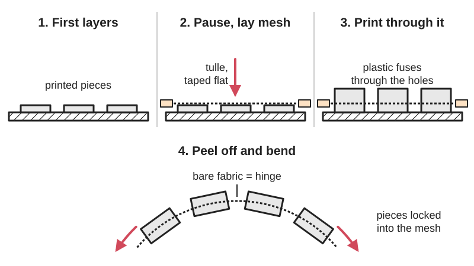

*Diagram drawn for the encyclopaedia from the research notes. ⚑ Needs confirming: a drawing can simplify or get details wrong; a real photo or a better diagram is welcome.*

A thin open mesh fabric is laid over the first few printed layers during a pause, and the rest of the print fuses through its holes, so the fabric is locked inside each printed piece and the bare fabric between pieces works as a flexible hinge.

**In plain words:** Print a few layers, pause the printer, stretch a see-through net fabric such as tulle over them, then carry on printing so the hot plastic pushes through the holes and grips the fabric, giving bendy sheets of plastic scales or panels joined by cloth. **Proper term:** Printing onto fabric (fabric-embedded 3D print, 'sandwich' or pause-and-print method).

**Also called:** printing on tulle, printing on mesh, print on fabric; pause-and-print or 'Sandwich Method' (Siraya Tech's names); sandwiching textiles in FDM printing; 3D printing on textiles (research terms, Özev and Ehrmann; Meyer et al.); 3D printed fabric, flexible armour, scale mail on fabric, dragon scales (cosplay terms); tulle hinge (a strip of fabric between two printed parts used as a hinge); floating jewellery or floating masks (shapes that seem to float on clear tulle).

## How it works

The printer lays down the bottom layers of every piece, then pauses. You lay the mesh over the bed and fix it flat, and when printing resumes the nozzle squeezes molten plastic through the openings in the mesh so it fuses with the layers below, trapping the threads between plastic above and below (a 'sandwich'). Research agrees that 'building interlocking connections between both parts of the composite by printing "through" the textile fabric is the best way to reach reliable adhesion' (Özev and Ehrmann 2023), while printing on 'closed' fabrics such as common woven cloth 'often results in a lack of adhesion' (Meyer et al. 2019). Where nothing is printed the fabric stays bare and flexible, so a 2-3 mm gap between pieces 'is where the fabric will fold, acting as a hinge' (Siraya Tech). The same trick embeds a mesh into a printed frame, for example a fan filter (Hackaday 2019).

## Parts

A small assembly that acts as one unit: printed islands (scales, tiles, spikes or panels) each with a layer of open mesh fabric (tulle, mosquito net, organza or polyester mesh) trapped inside. Making it needs the printer and a slicer pause, the mesh, and tape, binder clips or magnets to hold the mesh flat.

## Everyday examples

- Flexible 'dragon scale' or pangolin-style cosplay armour made of printed scales on tulle (Hackaday 2018; Printables 'Dragon scales')
- A computer fan filter with fine mesh embedded in a printed frame (Hackaday 2019)
- 'Floating' jewellery and masquerade masks where shapes seem to float on clear tulle (Printables 'Flexi Tulle Snake' description)
- A printed greeting card that opens and closes on a tulle hinge (Printables 'Valentine ... Card with Tulle Hinge')

## When to use it

When you want rigid printed pieces on a flexible fabric backing without sewing or glue: scale armour, spikes and patterns for costumes (Hackaday 2018; Printables), flexible toys and hinged cards (Printables 'Flexi Tulle Snake', 'Valentine ... Card'), light-up scale panels (Adafruit 'Glowing Scale Armor'), filters with a printed frame (Hackaday 2019), folding origami-style panels (see Origami mechanisms), and a fabric margin that can then be sewn onto a garment or skirt (Hackaday 2018 suggests sewing or gluing the tulle-and-scale panel onto a larger piece of fabric). Embedded fabric 'can add composite strength to large structural elements, durable flexibility to a [living hinge](../glossary.md#living-hinge), or a substrate for new kinds of jewelry' (Hackaday 2020, on Billie Ruben's Remoticon workshop).

## When not to use it

Not for pieces bigger than the print bed in one go: large garments have to be made as a 'quilt' of bed-sized panels (Hackaday 2018). Not with dense, woven or thick fabric, which bonds poorly (Meyer et al. 2019; Siraya Tech): to put printed parts on an ordinary garment, add sewing holes and sew them on (see 'Sew-on part'), or for flat graphics print flexible filament straight onto the T-shirt with higher temperature and flow, or iron on a one-layer PLA print (Prusa's T-shirt guide). Not where the part must come off later: use a sew-on part with snaps or hook-and-loop. Not for load-bearing or protective use: costume 'armour' is decorative, and research into printed-textile sandwiches for stab-resistant garments is still a proof of principle (Özev and Ehrmann 2023). For an all-plastic hinge use a living hinge; for two plastics locked together use a multi-material interlock.

## Details

- **What it does (jobs):**
  - join and hold: locks fabric and printed plastic together for good, e.g. scales onto a fabric backing, spikes onto a costume panel or a mesh into a printed frame
  - let it move (turn, slide or bend): the bare fabric between printed pieces acts as a hinge, so the sheet drapes and folds (Siraya Tech; Printables 'Flexi Tulle Snake' and 'Valentine Flower Greeting Card with Tulle Hinge')
- **Movement:** flex: each strip of bare fabric between printed pieces bends like a hinge, so the sheet drapes over curved shapes and folds; a greeting card folds flat on its tulle hinge (Printables 'Valentine ... Card with Tulle Hinge')
- **Directions it can move (degrees of freedom):** Each fabric gap is a flexible hinge, mainly bending about the line of the gap (1 per gap), with a little twist because fabric is floppy; the pieces cannot pull apart along the sheet because the mesh holds them. A grid of scales therefore drapes in two directions like cloth.
- **Special behaviour:**
  - none: it is a permanent flexible joint with no clever behaviour; the hinge action comes simply from bare fabric between printed pieces
- **How it holds:**
  - shape (the parts interlock; [form-fit](../glossary.md#form-fit--force-fit--material-bond)): plastic printed above the mesh flows through its openings and fuses with the layers below, trapping the threads (Özev and Ehrmann 2023; Siraya Tech's 'Mechanical Lock')
  - material bond (glue, solvent or melting): the hot plastic also sticks to and wraps round fibres; soft PLA can 'penetrate between the fibers and build form-locking connections around them' (Meyer et al. 2019), and hot TPU 'adheres to fibers' (Siraya Tech)
- **Input and output:** not applicable: it is a fixed, flexible joint that does not pass motion on
- **Power:** passive (no power needed)
- **Load:** Light. Good for costume scales and spikes, jewellery, decorative panels, card hinges and filters; not for structural joints. No source opened gives a [peel](../glossary.md#peel-vs-shear) or pull-out force ⚑ [uncertain]. It is strong when the fabric is pulled along its own plane (the fabric carries the load) and weakest in peel, where a piece is levered off the mesh; scales on a mesh that is too dense 'peel off' (Siraya Tech). Fabric that is not held firmly inside the sandwich can shift (Özev and Ehrmann 2023). One maker used four layers of tulle instead of one 'to give it extra durability' for a child's toy (Printables 'Flexi Tulle Snake').
- **Play and precision:** Not a locating joint. The pieces flop freely on the fabric gaps (that is the point), and their final position depends on how flat and straight the mesh was laid: Özev and Ehrmann found fabric that was not pinned by nubs varied in height and could move inside the sandwich, and most nylon meshes stretch in only one direction, so 'orientation of the mesh matters' (Printables 'How to print on fabric').
- **Taking it apart:** permanent: the mesh is fused inside the plastic and can only be cut away; Prusa notes that flexible filament printed directly onto a T-shirt well enough 'you will probably be unable to remove the print without damaging the clothes'
- **How often it can be reused:** once
- **Sealing:** none: the mesh is open and only the printed islands are solid
- **Adjustable:** no: once printed the layout is fixed
- **Access needed:** not applicable: the joint is made inside the printer during the print
- **Materials:** Fabric: thin, open mesh. Tulle (made of nylon, polyester, silk or rayon; 'Polyester is the most common fibre used for tulle', Wikipedia), mosquito netting (Printables 'Dragon scales'), organza (Prusa forum; Hackaday 2018 on RobotMama), nylon mesh 'Under 0.2mm thickness' (Printables 'How to print on fabric') and polyester mesh (Siraya Tech). Thin, even fabrics work best; thick aramid fabric was harder but possible with design changes, and cotton worked with nubs (Özev and Ehrmann 2023); closed woven fabrics adhere poorly (Meyer et al. 2019). Plastic: PLA for most decorative scales (Printables 'Dragon scales'; Adafruit 'Glowing Scale Armor'); TPU for flexible, wearable armour (Siraya Tech), and TPU gave better results than PLA in the sandwich study (Özev and Ehrmann 2023). Melting: nylon 6 melts at about 218 °C and nylon 66 at about 264 °C, polyester (PET) at about 250-260 °C (Wikipedia), while PLA prints at about 210-215 °C and flexible filaments at 230-245 °C (Prusa), so nylon tulle can soften under hotter filaments; Siraya Tech advises switching to polyester mesh or lowering the nozzle temperature if the fabric melts.
- **Heat, cold, water and wear:** Heat: PLA scales soften above about 60 °C (Prusa), so avoid hot washes and hot cars; flexible filaments are 'very resistant to wear' (Prusa 'Flexible materials') but their heat limit depends on the brand ⚑ [uncertain]. Washing: Siraya Tech (a filament maker) claims TPU printed through mesh forms 'a permanent bond that won't peel off even after washing' ⚑ [uncertain: vendor claim, not independently tested]; Prusa found a properly ironed PLA iron-on on a T-shirt survives machine washing, but that is a different method. Flexing: the fabric gaps take all the bending; one maker used four layers of tulle on a toy for durability (Printables 'Flexi Tulle Snake'). Sunlight: PLA 'degrades under UV light' (Prusa), and nylon and polyester mesh may also weaken in sun ⚑ [uncertain: no textile source opened]. Cold: flexible filaments 'stay flexible even in cold environments' (Prusa).

## Making it

- **Ways to make or get it:**
  - 3D print (FDM): the only process; any FDM printer that can pause mid-print works
  - off-the-shelf part: tulle, mosquito netting, organza or polyester mesh from a fabric shop (Hackaday 2018 notes tulle in the fabric department of a large supermarket)
- **Printing it in one piece (print in place):** partly: the fabric is laid in by hand during a pause, but the piece comes off the bed already joined and working as a flexible sheet, with nothing to assemble
- **Tools:** A 3D printer and a slicer that can pause at a set layer (PrusaSlicer 'Insert pause print (M601)'; Cura's 'Pause at Height' extension, Prusa forum), open-mesh fabric, painter's tape, binder clips or magnets outside the build area to hold it (Siraya Tech; Hackaday 2018; Prusa forum), an iron to remove creases (Printables 'How to print on fabric'), and scissors to trim the spare mesh afterwards (Printables 'Valentine ... Card').
- **Difficulty:** moderate: the model is simple, but you must set a pause at the right layer, lay the mesh flat and tight without moving the bed, keep the nozzle from snagging, and watch the first layers after resuming

### 3D printing tips

1) When to pause: sources differ, so pick by test. After the 1st layer (Printables 'Dragon scales'; 'How to print on fabric'; Fabricademy, who would 'wait another round of printing' next time), after layer 2 (Printables 'Valentine ... Card with Tulle Hinge'), 1 or 2 layers (Printables 'Scale Mail for fabric printing'), three layers (Hackaday 2018), layer 3 or 4, about 0.6-0.8 mm at 0.2 mm layers (Siraya Tech), or about 2 mm (Adafruit 'Glowing Scale Armor'). Printing a few layers before the fabric bonds better than starting on the fabric: 'Starting the print directly on the fabric may work, but the bond won't be as strong' (Printables '3D Fabric Experimentation'). In PrusaSlicer the M601 pause is inserted before the selected layer is printed (Prusa). 2) Mesh and layer height: use mesh under 0.2 mm thick and set the layer height higher than the mesh thickness (Printables 'How to print on fabric'); iron out creases first. 3) Holding the mesh: lay it over the print without moving the bed, stretch it taut and tape it to the bed edges (Siraya Tech; Hackaday 2018, which also suggests binder clips), or use magnets outside the build area (Prusa forum). Leave about 5 cm of free bed round the model for tape and clips, and check that clips can't hit the moving print head (Printables 'How to print on fabric'). Sources differ on tension: most stretch it taut, but the Origami mechanisms entry records a method that clips the mesh flat without stretching it; a stretched mesh may curl the sheet when released ⚑ [uncertain]. 4) Stop the nozzle snagging: turn on Z-hop when retracting (0.4-0.6 mm, Siraya Tech) and turn off the skirt so it doesn't stick to the fabric (Fabricademy). 5) Design: print separate islands, not one slab; leave 2-3 mm gaps between scales as hinges and keep scales under about 3-5 mm thick for flexibility (Siraya Tech); give scales a broad flat foot for bed adhesion (Printables 'Scale Mail for fabric printing'); vary the spacing, as it 'changes the properties of your fabric completely' (Printables 'How to print on fabric'). Small nubs on the lower layers pin the fabric: round or square nubs 0.8-1.5 mm across at 5-17 mm spacing, the smaller and closer the better for cotton (Özev and Ehrmann 2023). 6) Filament: PLA is easiest; TPU gives wearable, flexible pieces, printed slowly (Prusa: 'a typical speed for flexible filaments is usually 20 mm/s'; Siraya Tech's step list 20-30 mm/s) with little or no retraction. 7) Watch it: 'Resume the print and watch closely. Do not leave this print alone' (Printables 'How to print on fabric'). 8) Finish: let the bed cool completely before peeling off the sheet (Siraya Tech), then trim the spare mesh. Sheets are limited to the bed size, so sew or glue several onto a larger fabric (Hackaday 2018).

### Buying one (off-the-shelf parts)

Search for 'tulle' or 'bridal tulle' (sold for veils and tutus), 'mosquito netting', 'organza', 'polyester mesh fabric' or 'power mesh' ⚑ [uncertain: power mesh not named on an opened page], 'painter's tape' or 'blue painter's tape', 'binder clips', small magnets to hold fabric at the bed edge (Prusa forum), and flexible 'TPU filament' in 85A-95A hardness (Siraya Tech; Prusa).

## Rules of thumb

- Pause layer, side by side: after layer 1 (Printables 'Dragon scales', 'How to print on fabric'), after layer 2 (Printables 'Valentine ... Card'), three layers (Hackaday 2018), layer 3-4 or about 0.6-0.8 mm (Siraya Tech), about 2 mm (Adafruit 'Glowing Scale Armor').
- Mesh thinner than 0.2 mm, and a layer height higher than the mesh thickness (Printables 'How to print on fabric').
- Gaps of 2-3 mm between scales act as hinges; scales under about 3-5 mm thick stay flexible (Siraya Tech).
- If scales peel off, the mesh is too dense; switch to tulle or mosquito netting (Siraya Tech). Printing on closed woven fabric 'often results in a lack of adhesion' (Meyer et al. 2019).
- Z-hop of 0.4-0.6 mm stops the nozzle dragging on the mesh (Siraya Tech).
- Nubs 0.8-1.5 mm across, spaced 5-17 mm, on the lower layers hold the fabric still; 'small nubs with a small spacing are best suited for cotton fabrics' (Özev and Ehrmann 2023).
- Leave about 5 cm free round the model for tape and clips (Printables 'How to print on fabric').
- Fabric melting: nylon 6 melts at about 218 °C (Wikipedia) against 230-245 °C nozzle temperatures for flexible filaments (Prusa); use polyester mesh or lower the temperature if it melts (Siraya Tech).

## Common failures

Scales peel off the fabric: the mesh is too dense or the fabric too closed (Siraya Tech; Meyer et al. 2019), or too few layers were printed before the pause (Printables '3D Fabric Experimentation'). The nozzle snags or tears the mesh: use Z-hop (Siraya Tech) and keep the mesh tight and flat; a nozzle set too low will 'plow the fabric' (Prusa's T-shirt guide). The fabric melts: nylon mesh with a hot filament; switch to polyester mesh or lower the temperature (Siraya Tech). The skirt or purge line glues the fabric down where you don't want it: turn off the skirt (Fabricademy). Wrinkles or a slack mesh leave tilted or misplaced pieces and fabric that wanders inside the sandwich: iron the mesh, tape it taut, or add nubs (Printables 'How to print on fabric'; Özev and Ehrmann 2023). The pause lands on the wrong layer: PrusaSlicer inserts it before the selected layer (Prusa); check in the preview. The bed was moved while laying the fabric, so layers no longer line up: don't move the build plate (Siraya Tech).

## Safety

Synthetic fabric can melt or scorch under the nozzle: 'Synthetic fabrics like Nylon have low melting points' (Siraya Tech); nylon 6 melts at about 218 °C (Wikipedia), below typical TPU and PETG nozzle temperatures (Prusa). Watch the first layers after resuming, and 'do not leave this print alone, as you ask the printer to do something it is not supposed to do' (Printables 'How to print on fabric'): the nozzle can snag and drag the mesh, and loose fabric near a hot nozzle and heater is a fire risk ⚑ [uncertain: fire risk not stated by a source]. Keep tape, clips and magnets clear of the moving print head (Printables 'How to print on fabric'; Prusa's T-shirt guide). Printing gives off 'ultrafine particles and volatile organic compounds' (Wikipedia, 'Health and safety hazards of 3D printing'), so ventilate. Printed costume armour gives no real protection.

## Related

- Origami mechanisms: uses the same pause-and-lay-in-mesh method to make every fold of a folding pattern; this entry covers the method itself for armour, panels and fixing cloth to prints
- Sew-on part (sewing holes, loops and slots): attach a separately printed part to any fabric with thread instead; removable and works on closed fabrics
- Living hinge: an all-plastic thin hinge made in one material, with no fabric layer
- Multi-material interlock: locks two printed plastics (e.g. TPU and PLA) together by shape instead of locking in a fabric
- Hook-and-loop fastener and hot-melt or contact adhesive: other ways makers fix cloth to prints (r/3Dprinting discussion in the Sew-on part entry)
- [Captive nut](../glossary.md#captive-nut) pocket and other pause-and-insert tricks: the same mid-print pause is used to drop in nuts and magnets (Prusa)
- [Print-in-place](../glossary.md#print-in-place) chain mail 'fabric': interlocking printed links that drape like cloth with no textile at all (Fabricademy tried 'printing chainmail as a fabric')

## Make it yourself

- [How to print on fabric (Printables) (URL from Printables API, page not opened)](https://www.printables.com/model/359647-how-to-print-on-fabric): Stylised fish scales for learning to print onto nylon mesh, with step-by-step tips on mesh thickness, layer height, taping and mesh orientation *(licence: CC BY-NC-SA)*
- [Dragon scales (print on fabric) (Printables) (URL from Printables API, page not opened)](https://www.printables.com/model/1038289-dragon-scales-print-on-fabric): Popular PLA dragon-scale pattern printed onto mosquito net, pausing after the first layer; Blender file included for resizing *(licence: Public Domain)*
- [3D Fabric Experimentation (Printables) (URL from Printables API, page not opened)](https://www.printables.com/model/134-3d-fabric-experimentation): A collection of patterns for printing over tulle and organza for costumes and clothes *(licence: CC BY)*
- [Flexi Tulle Snake (Printables) (URL from Printables API, page not opened)](https://www.printables.com/model/502073-flexi-tulle-snake): A wriggly snake toy printed on its side with tulle laid in halfway, so the tulle acts as hinges between PLA segments *(licence: CC BY-NC-SA)*
- [3D printed Valentine Flower Greeting Card with Tulle Hinge (Printables) (URL from Printables API, page not opened)](https://www.printables.com/model/374037-3d-printed-valentine-flower-greeting-card-with-tul): A card whose two halves are joined by a tulle hinge, with a small test print; pause after layer 2 *(licence: CC BY-NC-SA)*
- [Print on Fabric Test (Long Spikes) (Printables) (URL from Printables API, page not opened)](https://www.printables.com/model/386910-print-on-fabric-test-long-spikes): Quick test print of spikes on fabric, with a short-spike version *(licence: CC BY-NC)*

## Pictures, videos and models

- [The Latest 3D Printed Fad: Flexible Armor And Pangolin Cosplay (Hackaday, 2018)](https://hackaday.com/2018/02/09/the-latest-3d-printed-fad-flexible-armor-and-pangolin-cosplay/): Photos of hexagonal printed tiles embedded in tulle and the basic pause-and-lay-in steps *(licence: Hackaday article; link only)*
- [Remoticon Video: How To 3D Print Onto Fabric With Billie Ruben (Hackaday, 2020)](https://hackaday.com/2020/12/18/remoticon-video-how-to-3d-print-onto-fabric-with-billie-ruben/): Embedded workshop video: a hands-on print onto fabric plus a lecture on scales, spikes, living hinges and jewellery made this way *(licence: Hackaday article with embedded video; link only)*
- [Glowing Scale Armor (Adafruit Learning System)](https://learn.adafruit.com/glowing-scale-armor.md?view=all): Video and photos of designing scales in Tinkercad, pausing at about 2 mm, taping mesh over the bed and fitting NeoPixel lights in the finished scales *(licence: Adafruit Learning System guide; licence not stated on the page; link only)*
- [Sandwiching textiles with FDM printing (Özev and Ehrmann, CDATP vol. 4 no. 1, 2023)](https://cdatp.publia.org/cdatp/article/view/110): Drawings and microscope cross-sections of fabric sandwiched between printed layers, with and without nubs *(licence: CC BY-NC-ND 4.0)*
- [How to 3D Print on Fabric in 5 Easy Steps (Siraya Tech, 2026)](https://siraya.tech/blogs/news/3d-printing-on-fabric): Photos and a step list for printing TPU scales onto tulle, with slicer settings and troubleshooting *(licence: Filament maker's blog; link only)*

## Needs confirming

⚑ marks something nobody has confirmed yet: a fact the research could not confirm from a source, a finder value that is a best guess, or an open point from the research notes. Corrections are welcome (see `research/needs-confirming.md`).

- ⚑ 7 sentences on this page marked [uncertain].
- ⚑ Research note: *Printing onto fabric*: when to pause for the mesh (after layer 1, layer 2, 3 layers, layers 3-4 or about 2 mm) and whether to stretch the mesh tight (most sources) or clip it flat (the method in *Origami mechanisms*) differ between sources; all are recorded. Siraya Tech's claim that the bond survives washing is a filament maker's own claim. No source measured the fabric-to-plastic bond, a sewn-on part or a knot pulled through a printed hole.

## Sources

- <https://siraya.tech/blogs/news/3d-printing-on-fabric (Siraya Tech, 'How to 3D Print on Fabric in 5 Easy Steps', 4 Feb 2026)>
- <https://cdatp.publia.org/cdatp/article/view/110 (Özev and Ehrmann, 'Sandwiching textiles with FDM printing', CDATP 4(1):88-94, 2023)>
- <https://cdatp.publia.org/cdatp/article/download/110/76 (full text PDF)>
- <https://www.hsbi.de/publikationsserver/download/631/632/_2019_Meyer_JEFF14_1558925019895257.pdf (Meyer, Döpke and Ehrmann, 'Improving adhesion of three-dimensional printed objects on textile fabrics by polymer coating', Journal of Engineered Fibers and Fabrics 14, 2019, CC BY 4.0)>
- <https://forum.prusa3d.com/forum/original-prusa-i3-mk3s-mk3-how-do-i-print-this-printing-help/printing-over-tulle-fabric>
- <https://help.prusa3d.com/article/insert-pause-or-custom-g-code-at-layer_120490>
- <https://help.prusa3d.com/article/flexible-materials_2057>
- <https://help.prusa3d.com/article/pla_2062>
- <https://help.prusa3d.com/article/petg_2059>
- <https://blog.prusa3d.com/how-to-print-on-t-shirts_55588/>
- <https://hackaday.com/2018/02/09/the-latest-3d-printed-fad-flexible-armor-and-pangolin-cosplay/>
- <https://hackaday.com/2018/01/06/3d-printing-wearables-with-a-net/>
- <https://hackaday.com/2019/08/03/3d-printed-fan-filter-takes-cues-from-costume-scene/>
- <https://hackaday.com/2020/12/18/remoticon-video-how-to-3d-print-onto-fabric-with-billie-ruben/>
- <https://hackaday.com/2021/10/15/3d-print-a-custom-t-shirt-design-step-by-step/>
- <https://learn.adafruit.com/glowing-scale-armor.md?view=all>
- <https://class.textile-academy.org/2024/ann-macara/assignments/week07/ (Fabricademy 2024 student documentation)>
- <https://en.wikipedia.org/wiki/Tulle_(netting)>
- <https://en.wikipedia.org/wiki/Nylon_6>
- <https://en.wikipedia.org/wiki/Nylon_66>
- <https://en.wikipedia.org/wiki/Polyethylene_terephthalate>
- <https://en.wikipedia.org/wiki/Health_and_safety_hazards_of_3D_printing>
- <https://api.printables.com/graphql/ (Printables models 1038289 'Dragon scales ( print on fabric )', 359647 'How to print on fabric', 134 '3D Fabric Experimentation', 502073 'Flexi Tulle Snake', 913170 'Scale Mail for fabric printing', 374037 '3D printed Valentine Flower Greeting Card with Tulle Hinge', 386910 'Print on Fabric Test (Long Spikes)'; pages not opened)>
