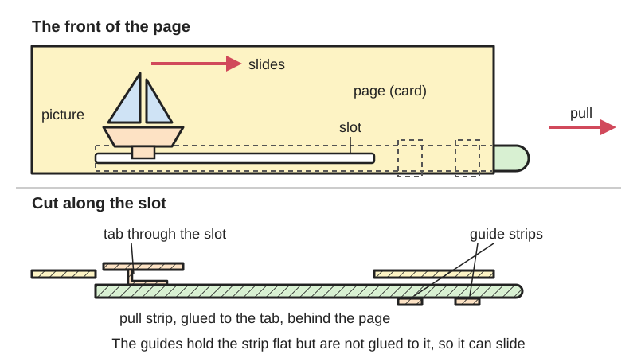
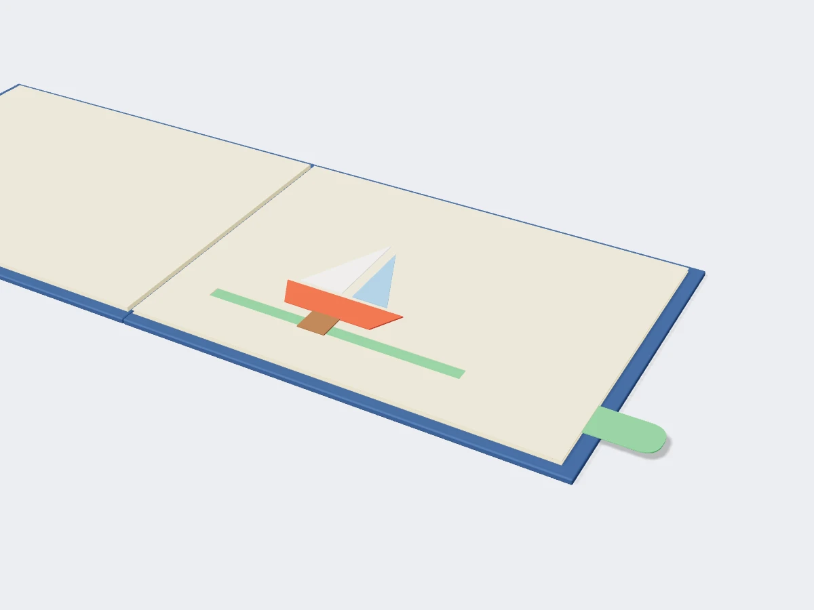

<figure class="eoc-pic eoc-pic-main"><picture><source media="(prefers-reduced-motion: reduce)" srcset="../media/drawn/pull-tab-and-slider-mechanism.svg"></picture><figcaption><strong>Animation.</strong> Diagram drawn for the encyclopaedia from the research notes. ⚑ Needs confirming: a drawing can simplify or get details wrong; a real photo or a better diagram is welcome.</figcaption></figure>
<figure class="eoc-pic"><figcaption><strong>Render.</strong> A 3D model made for the encyclopaedia, not a photo: a stand-in until a good real photo is found. ⚑ Needs confirming: a model can simplify or get details wrong; a real photo is welcome.</figcaption></figure>

A strip of card that slides in a slot or a glued channel, pulled by the reader's fingers or by the opposite page as the book opens, to move a picture across the page, swing an arm on a paper pivot, raise or flip a flap, or slide one striped picture over another.

**In plain words:** A paper strip or tab that you pull (or that the page pulls as it opens) to slide a picture along a slot, swing a paper arm, lift a flap or change one picture into another. **Proper term:** Pull-tab and slider mechanism (paper pull-tab, tab mechanism).

**Also called:** pull-tab, tab mechanical (popuplady glossary); pull slider (Warwick WMG lesson 3); slider mechanism, card slider (Oak National Academy); sliding motion, moving arm, pivoting motion (Mark Hiner's ten basic mechanisms); automatic pull-strip, across-the-gutter pull-strip (Duncan Birmingham via Cut Out + Keep; Superplexus); lever mechanism, card lever (Oak National Academy); rotating tab, finger slot (Superplexus); transformation, metamorphosis, dissolve, window-blinds (Venetian-blind) mechanism, changing-picture pull tab (Wikipedia; popuplady; Superplexus); pull-down (Wikipedia 'Pop-up book' list of features); spider web, cobweb (popuplady; Superplexus); slide switch (a paper slider that also switches a paper circuit; Chibitronics).

## How it works

In the basic slider a picture sits on the front of the page on folded tabs that pass through a slot about 5 mm wide; behind the page those tabs are glued to a long pull strip, and two more strips glued across it (but not to it) make a channel, so pulling the tab slides the picture along the slot (Warwick lesson 3; Oak: 'Sliders have a guide, which is used to keep it in place'). A lever version adds a pivot: a card arm turns on a split pin or a paper rivet, so a straight pull makes its end move in an arc (Oak 'Card lever mechanisms'; Superplexus: with levers 'pull tabs can be made to trace arcs'). In the automatic pull-strip the strip crosses the spine and is glued to the opposite page, so opening the book pulls it a set distance and drives a flap, curve or parallelogram with no tab to pull; Superplexus notes any pull-tab mechanism 'can also be made automatic by [bridging](../glossary.md#overhang--bridging) it across the gutter' (Birmingham via Cut Out + Keep; Superplexus 'Interactive and Automatic Mechanisms'). Transformations use two pictures cut into slats like Venetian blinds: pulling a tab or ribbon slides one set of slats over and under the other so the scene changes (Wikipedia 'Pop-up book'; popuplady 'metamorphosis' type 2; Superplexus 'Dissolves'). The spider web is a spiral cut in a circle, lifted by a ribbon or thread attached at its centre (popuplady; Superplexus 'Cobweb Mechanism'). Pulled strings go back to the first commercial pop-up book, Thomas Malton's 1775 treatise, whose pop-ups 'are activated by pulling string' (Wikipedia). Hiner's ten basic mechanisms include 'moving arm', 'sliding motion', 'pull-up planes' and 'pivoting motion' (Center for Book Arts record), and Thames & Hudson's Paper Engineering for Designers groups '8 tab mechanisms - 6 pivot mechanisms'. The pull-down is listed by Wikipedia among pop-up book features, but no opened source describes how it is built ⚑ [uncertain].

## Parts

A few parts: the base page with a slot (or slits); the moving picture; folded tabs that pass through the slot; the pull strip with a handle; guide strips glued across the strip to make a channel; and, for levers, a pivot (a split-pin paper fastener or split paper tabs through a hole). Transformations add two sets of slatted pictures; the automatic pull-strip adds a strip glued to the opposite page (Warwick lesson 3; Oak National Academy; Cut Out + Keep).

## Everyday examples

- children's pull-tab books where pulling a tab makes an animal move or a picture change (e.g. Chuck Murphy's Color Surprises)
- Victorian-style transformation pictures where slats slide to change one scene into another (Ernest Nister's books)
- school 'moving picture' cards with a slider or a split-pin lever
- pop-up books where a flap or figure lifts by itself as the page opens (automatic pull-strip)

## When to use it

Use it when something should move across a flat page, swing, wave or change on demand: a car driving along a road, a character waving an arm, a flap that flips, a picture that transforms, a spider web that lifts. Choose the hand-pulled tab for interaction and surprise; choose the automatic pull-strip when you want the movement every time the page opens, or to raise a flap or a parallelogram in the middle of a page away from the spine (Birmingham via Cut Out + Keep; Superplexus). Levers on a split pin are the simplest way to get an arc (Oak). It can also be a switch in a paper circuit (Chibitronics sequence slide switch).

## When not to use it

Not for something that should stand up off the page as it opens: use a parallel-fold or V-fold pop-up. Not for continuous turning: use a volvelle (paper wheel) on a centre pivot. Not for frequent rough use by small children unless it is built with stops and strong tabs (Superplexus). Avoid mechanisms that cross the gutter unless intended, since the risk of damage rises 'remarkably' (Superplexus). For rigid parts, use a real slide or [linkage](../glossary.md#linkage) (rack and pinion, slider-crank, bell [crank](../glossary.md#crank)).

## Details

- **What it does (jobs):**
  - change the kind of motion: a straight pull becomes a picture sliding, an arm swinging, a flap flipping or a scene changing
  - let it move (turn, slide or bend): the picture slides in its slot or turns on its pivot
- **Movement:** multiple: slide (the pull strip and picture move in a straight line along the slot), rotate ([lever arms](../glossary.md#lever-arm) on a pivot, flaps on a crease, up to about 180 degrees for a flap flipped right over)
- **Directions it can move (degrees of freedom):** 1: a slider moves only along its slot; a lever arm only turns about its pivot; in the automatic pull-strip the page's opening angle sets the strip's position
- **Special behaviour:**
  - motion conversion: a straight pull (by hand or by the opposite page as the book opens) becomes sliding, swinging, flipping or a change of picture
  - none of the other listed behaviours apply; well-made pull tabs have hard 'stops' that limit travel (Superplexus), but these are end limits, not indexing
- **How it holds:**
  - not a holding joint (it moves or passes on motion): it is a sliding and pivoting mechanism
  - shape (the parts interlock; [form-fit](../glossary.md#form-fit--force-fit--material-bond)): folded tabs through the slot and guide strips trap the slider; a paper rivet's split tabs hold the arm on its pivot
  - material bond (glue, solvent or melting): the picture, pull strip and guide strips are glued
- **Input and output:** Input: a straight pull (or push) on a tab by hand, or the opposite page turning as the book opens (automatic pull-strip). Output: straight sliding of a picture (1:1 with the pull), an arc swung by a lever arm, a flap rotated, or slats sliding to change a picture. Birmingham's flap rule: when the strip's attachment line on the flap gives E = F the flap flips right over; E = 2 x F makes it stand vertical (Cut Out + Keep, 'Automatic Pull Strip'). Efficiency: low and variable; paper-on-paper friction matters, and textured paper can stop a mechanism working (Superplexus 'Paper'). Arrangement: in the plane of the page; the automatic version crosses the spine. Back-drivable: yes for a simple slider (pushing the picture moves the tab back); the automatic pull-strip is tied to the page angle.
- **Power:** passive (no power needed): powered by the reader's pull or by opening the page
- **Load:** light: only the force of fingers pulling paper. Weak points are the glued ends of strips and the ends of slots; in the automatic pull-strip 'tab D takes a lot of stress when the base is opened' (Birmingham via Cut Out + Keep). Pull tabs 'must be robust to withstand the forces applied, especially if little children are involved' (Superplexus).
- **Play and precision:** Noticeable play: paper in a paper channel wobbles and can run at a slant unless the channel fits closely; a proper channel stops pieces 'wobbling or going slightly diagonally' (r/cardmaking comments). End positions are set by stops, so they repeat well. Tolerates small [misalignment](../glossary.md#misalignment), but a too-tight channel or glue on the strip jams it (Warwick: glue the guide strips 'ensuring that you don't stick them to the "pull tab"').
- **Taking it apart:** permanent: everything is glued; only a loose background or picture might be designed to come out
- **How often it can be reused:** once: it is not taken apart; it is made to be pulled and reset many times if built robustly, with stops (Superplexus)
- **Sealing:** none: nothing makes it seal
- **Adjustable:** no once glued; before gluing, the travel is set by the slot length and the flap action by where the strip is attached (E = F or E = 2 x F; Cut Out + Keep). Test the slide before gluing: 'try pulling tab D, to make sure that the strip can slide freely' (Cut Out + Keep).
- **Access needed:** both sides: the slot, tabs, pull strip and guide strips sit behind the page and the picture on the front; the back is usually covered afterwards with another page or a backing card, and pull tabs on both sides of one leaf need a thin 'slip sheet' between them (Superplexus)
- **Materials:** Made for paper and card: Warwick uses A4 card with 2 cm strips; Superplexus recommends smooth, dense card or Bristol (about 80 lb / 216 gsm), because toothy cotton-rag paper's friction stopped a student's waterfall mechanism. Smooth or slippery layers help sliding: vellum, glossy paper, or a 65 lb card frame between layers (r/cardmaking). Thin transparent plastic can replace paper for a moving layer (Superplexus 'Dissolves'; a transparent wheel in 'Interactive and Automatic Mechanisms'). Ribbon, string, thread or monofilament can be the pull (popuplady; Superplexus 'Strings and Dowels'). Not suited to rigid materials as such; the same idea in wood or plastic is a slide or linkage with real guides.
- **Heat, cold, water and wear:** Paper: humidity makes card swell and stick in channels, and textured paper adds friction (Superplexus 'Paper') ⚑ [uncertain: the humidity effect is not measured in a source]; static can make light paper layers cling (r/cardmaking comment suggesting an anti-static cloth) ⚑ [uncertain]. Too much wet glue warps paper (Superplexus 'Physical Tools'). Acidic paper yellows and goes [brittle](../glossary.md#brittle--ductile); use acid-free card if it must last (Superplexus 'Paper').

## Making it

- **Ways to make or get it:**
  - hand cutting and folding (craft knife for slots, scissors, ruler, bone folder)
  - laser cut or die-cut card (popuplady glossary)
  - off-the-shelf part (split-pin paper fasteners for pivots; ribbon or thread for pulls)
  - not 3D print (FDM), 3D print (resin), CNC, woodwork or sheet metal in its normal form
- **Printing it in one piece (print in place):** no: it is cut and glued from paper and card
- **Tools:** scissors and a craft knife for slots, cutting mat, ruler, scoring tool, glue stick or PVA; split-pin paper fasteners and a pencil point on sticky tack to make pivot holes for levers (Oak National Academy); a hole for a paper rivet (Warwick lesson 3)
- **Difficulty:** easy for a basic slider or card lever (taught to primary-school children by Oak National Academy); moderate for automatic pull-strips and transformations, which need accurate measuring and gluing (Cut Out + Keep rates the automatic pull-strip 'Tricky', about 30 minutes)

### 3D printing tips

not applicable: the mechanism is paper and card. A printed scoring board or bone folder helps make crisp tabs, and Printables has printable paper fasteners for card pivots (see the split-pin paper fastener entry). Printed sliding cards exist (e.g. a 'Word slider card' on Printables) but are rigid plastic slides, not pull-tabs in a page ⚑ [uncertain].

### Buying one (off-the-shelf parts)

Card stock or Bristol board; vellum; split-pin paper fasteners (brass fasteners, paper brads); ribbon, thread or monofilament for pulls; glue stick, PVA, double-sided tape and foam tape (foam mounting tape) for spacing layers; craft knife, cutting mat, ruler, bone folder. For light-up cards, conductive fabric tape and LED stickers turn a slider into a sequence slide switch (Chibitronics (brand)).

## Rules of thumb

- Pull slider: cut strips about 2 cm wide; cut a slot about 5 mm wide between the picture's start and end positions; fold two 2 cm tabs in half and glue them to the back of the picture; make the pull tab reach from one end of the slot to about 1 cm past the edge of the card; glue guide strips over the pull tab without gluing them to it (Warwick lesson 3).
- A slider needs a guide to keep it in place and a slot; Oak's quiz answer: 'The slot needs to be a bit longer than the slider bar'. Cut and measure accurately (Oak National Academy, 'Card slider mechanisms').
- Levers: a rigid card bar turning on a split pin; make the pivot hole by pushing a pencil through the card into sticky tack (Oak National Academy, 'Card lever mechanisms'). A pivot with no metal: split tabs on the moving disc pushed through a hole about 1 cm wide and glued to the picture (Warwick lesson 3, rotary).
- Automatic pull-strip flap: attach the strip at line D on the flap; E = F flips the flap right over, E = 2 x F stands it vertical (Birmingham, via Cut Out + Keep). Start with card about 100 mm x 254 mm; put the main crease not more than 25 mm from the spine; for the under-page version extend the slit ends about 13 mm and set crease A about 13 mm from the spine.
- Test that the strip slides freely before gluing, and let the glue on the spine tab set before opening, because it 'takes a lot of stress' (Cut Out + Keep). White glue sets in about 30 minutes; PVA [cures](../glossary.md#cure) in about 24 hours (Superplexus 'Gluing Techniques').
- Give every pull tab hard stops; make it robust for children; do not let it cross the gutter unless it is meant to be automatic; design it so forgetting to reset it does not wreck it when the page turns; use a slip sheet between pull tabs on both sides of one leaf (Superplexus 'Interactive and Automatic Mechanisms'). A finger-slot slide in Peter and the Wolf moves about 2 in between the edges of its opening (Superplexus).
- Smooth sliding: put a frame of 65 lb card between layers, or a framed piece of vellum, or space layers with foam tape and make a proper channel so pieces do not wobble (r/cardmaking comments; community advice).
- Base paper heavier than the moving parts, and smooth paper, or the mechanism tears or jams (Superplexus 'Paper').

## Common failures

Sticks or jams: guide strips glued to the pull tab, a channel that is too tight, textured paper, or layers rubbing; leave [clearance](../glossary.md#clearance), test before gluing, use smooth card, vellum or a spacer frame (Warwick; Cut Out + Keep; Superplexus; r/cardmaking). Wobbles or runs at a slant: no proper channel (r/cardmaking). Pulls right out or over-travels: no stops; design in limits to movement ('stops', Superplexus). Tears at the glued end or slot ends: glue not set, or the strip is too weak; let glue set, reinforce tabs (Cut Out + Keep; Superplexus). Crushed when the page is turned with the tab out: design it so it fits inside the closed book in any position, or remind readers to reset it (Superplexus). Flap does not flip or stand as planned: strip attached at the wrong place on the flap (E = F or E = 2 x F; Cut Out + Keep). Two mechanisms on one leaf catch each other: add a slip sheet (Superplexus).

## Safety

Craft knives for cutting slots: cut to the side of yourself, on a cutting mat, with a safety ruler, a sharp blade and eye protection when changing blades (University of Greenwich workshop guidance). Strips tear at glued ends if pulled before the glue has set (Birmingham via Cut Out + Keep). Oak National Academy flags 'Risk assessment required - equipment' for its card lever and slider lessons; split-pin legs are sharp and small parts are a choking risk for young children ⚑ [uncertain: not stated on the pages opened]. Light-up slide switches use coin cells; keep them away from young children ⚑ [uncertain].

## Related

- Volvelle (paper wheel): paper discs turning on a centre pivot; the dissolving wheel is the rotating cousin of the Venetian-blind transformation
- Split-pin paper fastener (brass fastener): the usual pivot for paper lever arms
- Parallel-fold pop-up and V-fold pop-up: stand up as the page opens instead of sliding; an automatic pull-strip can drive them from a flap
- Score-and-fold hinge (lift-the-flap): a plain flap on a crease, which pull-strips can flip
- Rack and pinion, slider-crank and bell crank: rigid versions of a slide, a push-pull rod and a lever
- Linear guides and dovetail slides: rigid slides with proper guides for real loads
- Bowden cable (push-pull cable): pulls at a distance like a paper pull-strip, but in a sheath
- Spring-powered paper pop-up: moves from stored energy rather than a pull

## Make it yourself

- [Paper Engineering, Lesson 3 (Warwick WMG)](https://warwick.ac.uk/fac/sci/wmg/about/outreach/resources/paperengineering/paper_engineering_pop-up_book_l3.pdf): A free step-by-step pull slider, lift-up flaps and rotary wheel to make from two sheets of A4 card *(licence: not stated)*
- [Card slider mechanisms, Oak National Academy](https://www.thenational.academy/teachers/lessons/card-slider-mechanisms): A primary-school lesson with slides and quizzes on making a card slider with a slot and a guide *(licence: Open Government Licence v3.0 (except where otherwise stated))*
- [Card lever mechanisms, Oak National Academy](https://www.thenational.academy/teachers/lessons/card-lever-mechanisms): A primary-school lesson on card levers turning on split pins *(licence: Open Government Licence v3.0 (except where otherwise stated))*
- [Sequence Slide Switch Pop-Up Mechanism, Chibitronics (guest educator Kristin Osiecki)](https://chibitronics.com/2025/08/28/sequence-slide-switch-pop-up-mechanism-guest-educator-kristin-osiecki/): A template combining a box-fold pop-up with a paper slide switch that lights LEDs in sequence *(licence: not stated; free template)*
- [Bone folder / Bone tool by glustik, Printables (URL from Printables API, page not opened)](https://www.printables.com/model/1070661-bone-folder-bone-tool): A printable bone folder for creasing tabs and strips; details read through the Printables public API *(licence: CC0 / public domain (Printables 'Creative Commons — Public Domain'))*

## Pictures, videos and models

- [Paper Engineering, Lesson 3 (Warwick WMG outreach, PDF)](https://warwick.ac.uk/fac/sci/wmg/about/outreach/resources/paperengineering/paper_engineering_pop-up_book_l3.pdf): Photo steps for lift-up flaps (three ways), a pull slider with a 5 mm slot and guide strips, and a rotary wheel on split paper tabs *(licence: not stated; link only)*
- [Automatic Pull Strip, extract from Duncan Birmingham's Pop-Up Design and Paper Mechanics (Cut Out + Keep, GMC Group)](https://www.cutoutandkeep.net/projects/automatic-pull-strip): 29 illustrated steps: the automatic pull-strip across the spine, running it under the page, raising a flap (E = F, E = 2 x F), building a parallelogram on the flap, and turning a flap on the opposite page *(licence: book extract posted by the publisher; link only)*
- [Interactive and Automatic Mechanisms, Superplexus (Michael McGinnis)](https://new.superplexus.com/3d-design/possible-projects/pop-up-book/concepts/automatic-versus-interactive-mechanisms): Photos and design advice for pull tabs, rotating tabs, finger slots, rotating wheels and flaps in published pop-up books, including stops and slip sheets *(licence: Copyright Michael McGinnis; link only)*
- [Dissolves, Superplexus](https://new.superplexus.com/3d-design/possible-projects/pop-up-book/mechanisms-2/dissolves): Links to video tutorials (Duncan Birmingham, Paper Paul, DIY Blaster) for flat and Venetian-blind dissolves (changing-picture pull tabs) *(licence: Copyright Michael McGinnis; videos on YouTube; link only)*
- [Glossary of Pop-Up Terms, The Popuplady](https://popuplady.com/about-pop-ups/glossary-of-pop-up-terms/): Definitions with example photos: pull-tabs, metamorphosis (dissolving wheel and Venetian-blind slats, with a Nister example), spider web (a David A. Carter spider mechanism), flaps and lift-the-flap *(licence: all rights reserved ('Any reproduction ... is expressly prohibited'); link only)*

## Needs confirming

⚑ marks something nobody has confirmed yet: a fact the research could not confirm from a source, a finder value that is a best guess, or an open point from the research notes. Corrections are welcome (see `research/needs-confirming.md`).

- ⚑ 6 sentences on this page marked [uncertain].
- ⚑ Finder value `connects` = boards or sheet (best guess): worked out from its name, but joining parts is not one of its two main jobs
- ⚑ Finder value `motion_in` = back-and-forth turning, straight push or pull (best guess): read from the "Input: ... Output: ..." wording of `input_output`, not the usual "in -> out" form; pop-up: opening the page read as a part turn, not steady turning
- ⚑ Finder value `motion_out` = straight push or pull (best guess): read from the "Input: ... Output: ..." wording of `input_output`, not the usual "in -> out" form; pop-up: opening the page read as a part turn, not steady turning
- ⚑ Finder value `shaft_layout` = not applicable (best guess): read from the "Input: ... Output: ..." wording of `input_output`, not the usual "in -> out" form; pop-up: opening the page read as a part turn, not steady turning
- ⚑ Research note: *Parallel-fold pop-up* (419), *V-fold pop-up* (420), *Pull-tab and slider mechanism* (421): lattice pop-ups have no how-to source ⚑; "a narrow V stands taller" has no source and is written from Superplexus's glue-in angle, flagged; Barton's "at 45 degrees the pop-up will not function properly" measures a different 45 degrees from Superplexus and Make: (the entry explains); construction paper allowed for beginners (Sabuda) versus never (Superplexus); paper weights are quoted as each source gives them (80 lb / 216 gsm / 10 pt; 110 lb; 65 lb; 160 g). Unsourced: how a pull-down is built, humidity and static, coin-cell risk, split-pin legs, pressing a pop-up flat.

## Sources

- <https://warwick.ac.uk/fac/sci/wmg/about/outreach/resources/paperengineering/paper_engineering_pop-up_book_l3.pdf>
- <https://www.cutoutandkeep.net/projects/automatic-pull-strip>
- <https://popuplady.com/about-pop-ups/glossary-of-pop-up-terms/>
- <https://en.wikipedia.org/wiki/Pop-up_book>
- <https://collections.centerforbookarts.org/Detail/objects/1928>
- <https://www.thamesandhudson.com/products/paper-engineering-for-designers>
- <https://arctic-shift.photon-reddit.com/api/comments/search?link_id=1vhkqv7&limit=50>
- <https://new.superplexus.com/3d-design/possible-projects/pop-up-book/concepts/automatic-versus-interactive-mechanisms>
- <https://new.superplexus.com/3d-design/possible-projects/pop-up-book/mechanisms-2/dissolves>
- <https://new.superplexus.com/3d-design/possible-projects/pop-up-book/mechanisms-2/cobweb-mechanism>
- <https://new.superplexus.com/3d-design/possible-projects/pop-up-book/mechanisms-3/strings-and-dowels>
- <https://new.superplexus.com/3d-design/possible-projects/pop-up-book/technical/paper>
- <https://new.superplexus.com/3d-design/possible-projects/pop-up-book/technical/gluing-techniques>
- <https://new.superplexus.com/3d-design/possible-projects/pop-up-book/technical/tools-and-materials>
- <https://www.thenational.academy/teachers/lessons/card-lever-mechanisms>
- <https://www.thenational.academy/teachers/lessons/card-slider-mechanisms>
- <https://chibitronics.com/2025/08/28/sequence-slide-switch-pop-up-mechanism-guest-educator-kristin-osiecki/>
- <https://blogs.gre.ac.uk/designsupport/?p=783>
- <https://www.robertsabuda.com/how-to-books.html>
- <https://api.printables.com/graphql/>
