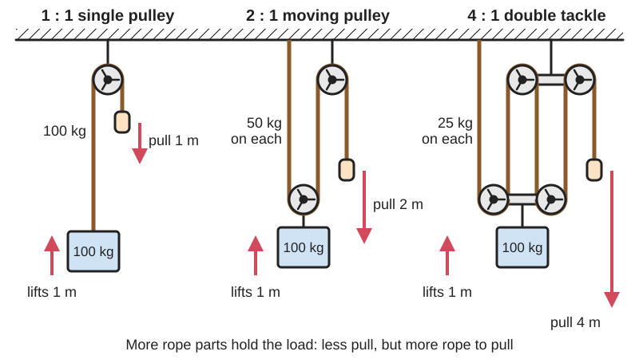
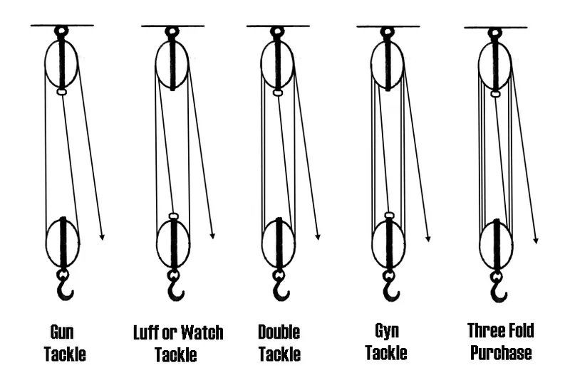
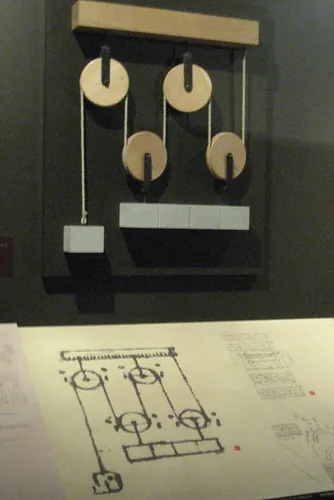
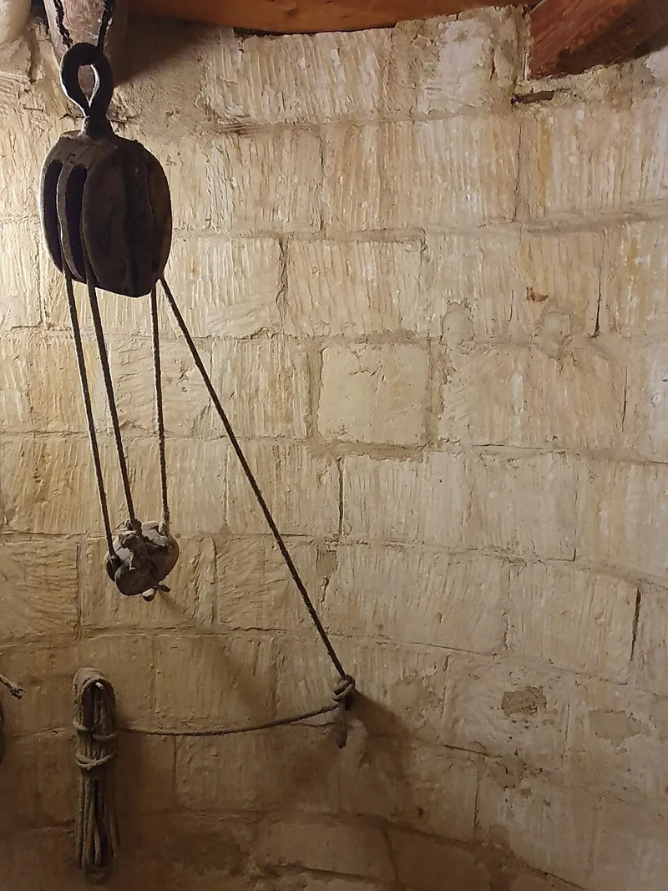

<figure class="eoc-pic eoc-pic-main"><picture><source media="(prefers-reduced-motion: reduce)" srcset="../media/drawn/pulley-system.svg"></picture><figcaption><strong>Animation.</strong> Diagram drawn for the encyclopaedia from the research notes. ⚑ Needs confirming: a drawing can simplify or get details wrong; a real photo or a better diagram is welcome.</figcaption></figure>
<figure class="eoc-pic"><figcaption><strong>Diagram.</strong> <a href="https://commons.wikimedia.org/wiki/File:Tackles.png">Tackles</a> by Welkinridge, <a href="https://creativecommons.org/licenses/by-sa/3.0">CC BY-SA 3.0</a>, from Wikimedia Commons.</figcaption></figure>
<figure class="eoc-pic"><figcaption><strong>How it works.</strong> <a href="https://www.flickr.com/photos/12595974@N00/3169924236">Pulley System</a> by schnaars, <a href="https://creativecommons.org/licenses/by-sa/2.0/">CC BY-SA 2.0</a>, from Flickr via Openverse.</figcaption></figure>
<figure class="eoc-pic"><figcaption><strong>Photo.</strong> <a href="https://commons.wikimedia.org/wiki/File:2025_Pulley_(Windmill_in_Xaghra).jpg">2025 Pulley (Windmill in Xaghra)</a> by Qasinka, <a href="http://creativecommons.org/publicdomain/zero/1.0/deed.en">CC0</a>, from Wikimedia Commons.</figcaption></figure>

Two blocks of pulleys with one rope threaded back and forth between them, so the load hangs on several rope parts and a pull of only a fraction of its weight lifts it (at the cost of pulling that many times more rope); the differential chain hoist uses two joined chain wheels of slightly different size to get a very large gain and, because its friction is high, holds the load by itself.

**In plain words:** A rope run back and forth between two sets of pulley wheels, so pulling a long length of rope gently lifts a heavy load a short way; a chain version (chain hoist) holds the load by itself when you let go. **Proper term:** Block and tackle (compound pulley system, tackle or purchase); differential chain hoist (Weston differential pulley).

**Also called:** tackle / purchase / pulley system / compound pulley (Wikipedia 'Block and tackle'); pulley block / block (a frame holding one or more pulley wheels, called sheaves); gun tackle (2:1), luff tackle (3:1), double tackle (4:1), gyn tackle (5:1), threefold purchase (6:1) (Wikipedia); haul system / [mechanical advantage](../glossary.md#mechanical-advantage) (MA) system, e.g. '3:1 haul system' (rope rescue and climbing; Petzl); snatch block / swing-cheek block (opens to take a rope in mid-line; Wikipedia); fiddle block, becket block (sailing block types) ⚑ [uncertain]; differential pulley / Weston differential pulley / differential hoist / chain fall / dumb pulley (Wikipedia 'Differential pulley'); chain hoist / chain block / manual chain hoist (today usually geared, with a load brake; Global Industrial manual); polyspast (European name, e.g. German 'Flaschenzug'; Printables 'Pulley block Z-axis (Polispast)') ⚑ [uncertain].

## How it works

The rope tension is the same all along the rope, so if the moving block and its load hang from n parts of the rope, each part carries 1/n of the load and you only need to pull with 1/n of the weight; in exchange you pull n metres of rope for every metre the load rises (Wikipedia 'Block and tackle'; Petzl). Friction in each sheave eats some of this gain, so real tackles give less than n (Wikipedia; CMC). In a differential hoist an endless chain runs round a big and a slightly smaller chain wheel fixed together and down round a hanging pulley; each turn winds in chain on the big wheel while letting out almost as much from the small one, so the load rises only by half the difference, giving a gain of 2R/(R - r) (Wikipedia 'Differential pulley'). Because this gain comes with a lot of friction (efficiency below 50%), the load can't run the hoist backwards, so it stays put when you let go (Wikipedia; NPTEL 'Reversibility of a machine'). Modern chain hoists get the same result with gears and a load brake that clamps shut and catches on a [ratchet](../glossary.md#ratchet) whenever you stop pulling (Global Industrial manual). Where weight and cost matter more than efficiency, a low-friction ring can stand in for a pulley: a smooth, grooved ring that the rope simply slides round, with no moving parts. Round a 180-degree bend Practical Sailor measured 80-83% efficiency with a small 12-plait Dyneema line but only 50-60% with a fat polyester double braid, against about 95-97% for ball-bearing blocks (Practical Sailor 'Sizing Up Improvements In Low Friction Rings').

## Parts

A small assembly: a fixed (standing) block and a moving (running) block, each with one or more sheaves (grooved pulley wheels) on an axle between side plates (cheeks), with a hook, shackle, eye or becket for tying the rope end, plus the rope itself. A differential hoist has an upper block with two chain wheels of slightly different size joined together, a lower block with one pulley and a hook, and an endless chain (Wikipedia 'Differential pulley'). A modern manual chain hoist has a hand chain and hand wheel, a gear reduction, a load-chain sprocket, welded load chain, hooks with latches, and a load brake made of friction plates, a ratchet disc and a [pawl](../glossary.md#pawl) (Global Industrial manual chain hoist manual).

## Everyday examples

- Sailing boats, where tackles trim sails and haul lines (Wikipedia 'Block and tackle')
- A garage chain hoist lifting a car engine (Wikipedia 'Differential pulley')
- A crane hook hanging from many parts of wire rope (Wikipedia 'Block and tackle': cranes and drilling rigs)
- Ceiling storage lifts and clothes airers raised by rope and pulleys (Printables 'Pulley system with drill powered winch -> ceiling storage')

## When to use it

When you need to lift or haul something much heavier than you can pull, slowly and over a short distance, and there is a strong anchor above or ahead of the load: lifting an engine, hauling a boat or a log, tensioning a line, raising storage or a hammock. Use a chain hoist when the load must stay put when you let go. Use a rope tackle with a cleat or rope grab when you want something light and portable, and ball-bearing pulleys to keep the friction low.

## When not to use it

Don't lift people or loads over people with it unless it is rated equipment used by trained people (Global Industrial manual: never lift people; Petzl: specific training required). It is a poor choice for long lifts at high gain, because the rope length multiplies (Wikipedia), and for precise positioning (use a lead screw or rack instead). For long hauls a winch or windlass that stores the rope on a drum is easier; for pulling horizontally a lever hoist (come-along) is handy; for small tension adjustments a turnbuckle or ratchet strap is simpler.

## Details

- **What it does (jobs):**
  - change speed or turning force: trades a long, light pull for a short, strong one (the 'force' version of a speed change)
  - tighten and hold tension: hauling lines and rigging tight, e.g. on boats (Wikipedia 'Block and tackle')
  - stop it moving back (one-way): a differential hoist holds its load by friction, and a chain hoist's ratchet and pawl stop the load running down (Wikipedia 'Differential pulley'; Global Industrial manual)
  - slow it, stop it or keep its speed steady: a chain hoist's load brake lets a load down under control (Global Industrial manual)
- **Movement:** rotate+slide: the sheaves (pulley wheels) turn while the rope or chain, the moving block and the load travel in straight lines; the moving block can travel until the two blocks meet
- **Directions it can move (degrees of freedom):** 1: the height of the load is tied to how much rope or chain has been pulled (ignoring rope stretch and the load swinging)
- **Special behaviour:**
  - [self-locking](../glossary.md#self-locking) (holds under load, won't back-drive): a differential hoist whose pulley sizes are close enough keeps the load in place until the chain is pulled (Wikipedia 'Differential pulley'); any lifting machine with an efficiency below 50% is self-locking (NPTEL)
  - one-way (moves freely one way, locks the other): in a geared chain hoist a pawl drops into the ratchet disc as soon as you stop pulling (Global Industrial manual)
  - hand-release only (locks under load, releases when a person operates it): to lower, you pull the hand chain the other way, which releases the ratchet and friction plates (Global Industrial manual)
  - tensioning (takes up slack and holds): a plain block and tackle only holds if the rope is tied off, cleated or caught by a rope grab ('progress capture'; Alpinesavvy)
  - quick-release: a snatch (swing-cheek) block opens so it can be put on a rope in mid-line without threading the end (Wikipedia 'Block and tackle')
- **How it holds:**
  - not a holding joint (it moves or passes on motion): it multiplies a pull
  - friction or clamping ([force-fit](../glossary.md#form-fit--force-fit--material-bond)): the rope is held by a cleat, knot or rope clamp; a chain hoist's brake uses friction plates; a differential hoist holds by its own internal friction (Global Industrial manual; Wikipedia)
  - shape (the parts interlock; form-fit): chain links sit in pockets of the chain wheels, and the pawl locks into ratchet teeth (Wikipedia 'Differential pulley'; Global Industrial manual)
- **Input and output:** Straight pull on the rope or hand chain -> straight lift or haul of the load (linear to linear). Ideal force gain = number of rope parts supporting the moving block, and the rope moves that many times faster than the load (Wikipedia 'Block and tackle'); common tackles give 2:1 to 6:1. Efficiency: every sheave loses some force; Petzl says pulley efficiencies range from about 50% to 98%, a carabiner used as a pulley is about 50% (CMC), and a 3:1 system with 85%-efficient pulleys really gives about 2.57:1 (CMC). Using Wikipedia's sheave friction factor K = 1.04 (roller-bearing sheaves) a 4:1 tackle works out about 91% efficient (real gain about 3.6); with K = 1.09 (plain-bearing sheaves, wire rope) about 81% (real gain about 3.2) (calculated from the Wikipedia formula). Differential hoist: ideal gain 2R/(R - r), e.g. 30:1 with 15- and 14-pocket chain wheels (Wikipedia 'Differential pulley'). Geared hand chain hoists: e.g. a 1 t hoist needs 310 N on the hand chain and a 5 t hoist 400 N (Global Industrial manual), an effective gain of roughly 32:1 and 120:1 (arithmetic). Shafts: not applicable; extra fixed pulleys change the direction of pull ('rove to disadvantage') at the cost of more friction (Wikipedia). Back-drivable: a plain block and tackle yes, the load runs back unless the rope is held (though a very high-friction tackle may not release easily; Wikipedia); a differential hoist no if its efficiency is below 50% (NPTEL; Wikipedia); a geared chain hoist no, its brake holds (Global Industrial manual).
- **Power:** passive (no power needed): pulled by hand; powered hoists (electric, air or hydraulic) do the same job (Wikipedia 'Hoist (device)')
- **Load:** Light to heavy. Maker-printed blocks have been tested with about 50-120 kg (Printables 'Block and Tackle': 50 kg many times, noises at 100 kg; 'Strong Single and Double Pulley': tested with 120 kg); manual chain hoists are sold from 0.5 to 20 t (Global Industrial manual). Strong only in straight tension along the rope; avoid side pulls and off-centre loads and always lift vertically (Global Industrial manual). The anchor holding the fixed block carries the load plus the hauling force: a single pulley holding 100 kg with the rope pulled downwards carries 200 kg (Petzl).
- **Play and precision:** Not a precision device. Rope stretch lets the load bounce and sink: nylon stretches a lot, polyester and high-modulus fibres much less (CERTEX), and friction makes the load stick and then jump ⚑ [uncertain]. Rope must run straight into the sheave groove: groove width at least 1.1 x rope diameter (ANSI/ASSP A10.48, via Inside Towers). On chain hoists pull the hand chain in the plane of the wheel, never at a slant, and lift vertically (Global Industrial manual).
- **Taking it apart:** removable: blocks hang from hooks, shackles, carabiners or slings and the rope is tied or clipped on, so everything comes apart; a snatch block can be taken off without unthreading the rope (Wikipedia)
- **How often it can be reused:** effectively unlimited for the blocks with inspection; ropes, chains and hooks wear and are inspected and replaced: retire a cut or heavily abraded rope (CERTEX), replace stretched, bent or worn chain and hooks, never repair the load chain (Global Industrial manual)
- **Sealing:** none: open sheaves and rope; chain hoists keep their brake dry inside a housing and oil only the chain (Global Industrial manual)
- **Adjustable:** Yes: the load height or line tension is set by how much rope is hauled in; the force gain can be changed by re-reeving with more or fewer rope parts, or swapping which block is fixed ('rove to advantage' or 'to disadvantage') (Wikipedia 'Block and tackle').
- **Access needed:** not applicable: it needs a strong anchor point above or ahead of the load and room for the rope; nothing has to reach through a panel
- **Materials:** Rope: polyester, nylon, polypropylene, aramid (Kevlar) or high-modulus polyethylene (Spectra) fibre rope, or steel wire rope (CERTEX; Mazzella). Blocks: wood, steel, aluminium or plastic, with sheaves on plain bushes or on ball or roller bearings (Wikipedia gives friction factors for both). Chain hoists: welded hardened steel load chain (Global Industrial manual). Maker versions: PLA or PETG printed blocks with 608 skate bearings and M5 or M8 bolts, with 4 mm paracord or 6-12 mm rope (Printables models).
- **Heat, cold, water and wear:** All synthetic ropes degrade in sunlight, and polypropylene far more than polyester or nylon; store ropes out of direct sun and away from strong acids and alkalis (CERTEX). Keep a chain hoist's brake dry: no oil or grease on the friction surfaces (Global Industrial manual). Printed blocks: PLA only for short loads, PETG or stronger for loads that stay on (Printables, Meister Edel). Wire rope [fatigues](../glossary.md#fatigue) on small sheaves (Mazzella). How much nylon rope loses when wet was not checked ⚑ [uncertain].

## Making it

- **Ways to make or get it:**
  - 3D print (FDM): blocks, cheeks and sheaves, usually with 608 ball bearings and steel bolts (Printables 'Block and Tackle', 'Strong Single and Double Pulley')
  - woodwork: traditional wooden blocks ⚑ [uncertain]
  - CNC: machined aluminium sheaves and side plates ⚑ [uncertain]
  - off-the-shelf part: pulley blocks, rescue pulleys, snatch blocks, manual chain hoists, lever hoists, rope and chain
- **Printing it in one piece (print in place):** partly: fully printed pulleys exist, such as a block and tackle with printed herringbone gear-bearing pulleys (Printables, DrJones) and a 100% printed pulley (Printables, Meister Edel), but they have more friction than ball-bearing sheaves; printed bearings were 'not effective for any meaningful loads' in one parametric design (Printables 'Block and Tackle'). Most designs use 608 bearings and bolts. Whether the gear bearings are printed already assembled was not checked ⚑ [uncertain]
- **Tools:** None to rig a rope tackle beyond knots (Printables 'Block and Tackle' uses a buntline hitch to tie the rope to the blocks); shackles, carabiners or slings to hang it; spanners for bolted or printed blocks; none to operate a chain hoist
- **Difficulty:** easy: printed blocks with skate bearings and bolts work well for light loads such as garage storage or demonstrations; for lifting heavy things, or anything over people, buy rated blocks or a chain hoist

### 3D printing tips

1) Use real ball bearings in the sheaves: in Vincent Sanders' parametric 'Block and Tackle' (Printables) printed bearings worked but had very high friction, while 608 bearings let a 4:1 double tackle with 4 mm paracord hold 50 kg several times. DrJones's printed gear-bearing 4:1 tackle needed 5.1 kg of pull to lift 15 kg, only about 3:1 in practice (Printables). 2) Print strong: Sanders used PLA, 0.2 mm layers, 6 [perimeters](../glossary.md#perimeters), 6 top and bottom layers and 15% cubic [infill](../glossary.md#infill); floano's pulley (PETG, 0.2 mm layers, 5 walls) was tested with 120 kg; Meister Edel suggests about 6 perimeters and 100% infill (all Printables). 3) Let steel bolts take the load and make the plastic squeeze towards the bolt rather than tear out at the end of a hole (floano, Printables); print the side plates lying flat, which needs no supports. 4) Size the groove for the rope: the rope must sit fully inside the sheave (Sanders); groove width at least 1.1 x rope diameter, and sheave diameter at least 6 x rope diameter for double-braid and kernmantle rope or 10 x for three-strand rope (ANSI/ASSP A10.48, via Inside Towers). Sanders thinks a larger bearing (6002 or 6003) suits 6 mm rope better than a 608. 5) Reeve carefully: in a threefold purchase the blocks end up at 90 degrees to each other, which avoids wear and friction when they are pulled close together (Sanders). Add a sheave guard so the rope can't jump off (an option in Sanders' design). 6) For printed plain bearings add oil holes and use oil (Meister Edel used bike chain oil). 7) PLA is fine for short loads; use PETG or a stronger material for loads that stay on (Meister Edel), because PLA [creeps](../glossary.md#creep) ⚑ [uncertain]. 8) Tie off with a secure knot such as a buntline hitch (Sanders), remembering that knots reduce rope strength (CERTEX). 9) Printed blocks come with no guarantee: test them well above your load and never use them over people (Sanders; Global Industrial manual).

### Buying one (off-the-shelf parts)

Pulley blocks (single, double and triple sheave), snatch blocks (swing-cheek blocks), fiddle and becket blocks ⚑ [uncertain], rescue or rope pulleys with ball bearings, pulleys with built-in rope grabs (progress capture pulleys), rope clamps and ascenders, cam cleats and clam cleats, manual chain hoists (chain blocks), lever hoists (come-alongs), shackles, carabiners, round slings, wire rope and wire rope clips, polyester double-braid or kernmantle rope, 608 bearings and M5 or M8 bolts for printed blocks. Low-friction rings (LFRs) as a light, cheap substitute for blocks on rarely adjusted lines (Practical Sailor).

## Rules of thumb

- Ideal force gain = number of rope parts supporting the moving block; you pull that many metres of rope for each metre of lift (Wikipedia 'Block and tackle'; Petzl: 3 m of rope for 1 m of lift on a 3:1).
- Friction adds up with every sheave: efficiency = (K^N - 1) / (K^S x N x (K - 1)), with N the ideal gain, S the number of sheaves and K about 1.04 for roller-bearing sheaves or 1.09 for plain-bearing sheaves with wire rope (Wikipedia 'Block and tackle'). Adding sheaves beyond a point doesn't help (Wikipedia).
- Real pulleys are about 50-98% efficient (Petzl); a carabiner used instead of a pulley is about 50% (CMC); a 3:1 with 85% pulleys gives 2.57:1 (CMC).
- Differential hoist gain = 2R / (R - r) = 2 x P1 / (P1 - P2), where P1 and P2 are the pocket counts of the two chain wheels; 15 and 14 pockets give 30:1 (Wikipedia 'Differential pulley').
- A lifting machine holds its load by itself (self-locking) if its efficiency is below 50%, and runs back if it is above 50% (NPTEL 'Reversibility of a machine').
- Sheave [pitch](../glossary.md#pitch) diameter at least 6 x rope diameter for double-braid and kernmantle rope, 10 x for three-strand; groove width at least 1.1 x rope diameter (ANSI/ASSP A10.48, via Inside Towers).
- Wire rope lasts much longer on bigger sheaves: raising D/d from 26 to 35 nearly doubles its bending life (relative life 17 to 32), and reverse bends between sheaves speed up fatigue (Mazzella).
- Rope safe working load = minimum breaking strength / safety factor, with factors of 5 to 12 for non-critical uses, reduced further for lifting over people, shock or sustained loads; knots lower the strength significantly (CERTEX, citing the Cordage Institute).
- The anchor for the fixed block carries the load plus your pull, e.g. 200 kg for a 100 kg load pulled down through one pulley (Petzl).
- Low-friction rings instead of sheaves: because of their friction, about 8:1 is the practical limit for a ring tackle with Dyneema line and 4:1 with polyester; for more purchase, build the first 4:1 with rings and pull its tail with a small ball-bearing tackle (Practical Sailor 'Sizing Up Improvements In Low Friction Rings'). Rings 'have no place in sheet tackles or other lines that are adjusted frequently through a wide range' (Practical Sailor 'Low-friction Rings').

## Common failures

1) Too much friction, so the real gain is far below the rope count (printed bearings, carabiners as pulleys, many sheaves): use ball-bearing sheaves (Printables; CMC; Wikipedia). 2) Rope jumping off a sheave or rubbing on the cheeks from side pulls or a groove that's too narrow: add a sheave guard and size the groove (Printables, Sanders; ANSI/ASSP A10.48). 3) Rope wear and chafe when the blocks twist or are pulled together (chocked); reeve so the blocks sit at 90 degrees (Sanders). 4) Printed blocks cracking near their limit (noises at about 100 kg with 6 mm rope; Sanders). 5) Chain hoist brake slipping because the friction plates are oily, glazed or worn: keep the brake dry and check it for slippage before each use (Global Industrial manual). 6) Twisted chain or a jammed chain wheel from off-angle pulling or letting the load touch the hoist (Global Industrial manual). 7) Stretched or cracked hooks and worn or stretched chain (Global Industrial manual). 8) Knot slipping or weakening the rope (CERTEX). 9) Anchor failure from the extra load of the hauling force (Petzl).

## Safety

Never stand or walk under a suspended load, and never lift people with a hoist (Global Industrial manual). A rope that breaks under load snaps back at high speed; stay out of its path (CERTEX). The anchor carries more than the load (Petzl), so check it. Keep fingers, gloves and hair away from where the rope runs onto a sheave (pinch point) ⚑ [uncertain]. Don't leave a load hanging in the air and check the brake before each lift (Global Industrial manual). Printed blocks carry no warranty (Printables, Sanders). Printed rope rings are 'for light rigging and organization, not life-safety loads' (MarineLab3D, Printables).

## Related

- Capstan and windlass (incl. differential windlass): wind rope onto a drum instead of multiplying rope parts; the Chinese windlass is the rope version of the differential hoist (Wikipedia 'Differential pulley')
- Belt drives: pulleys used to pass rotation between shafts rather than to multiply a pull
- Cam cleat and clam cleat: hold the tail of the rope once the load is lifted
- Rope grab and ascender (cam rope clamp): 'progress capture' so a haul system doesn't slip back (Alpinesavvy)
- Ratchet and pawl: the one-way catch inside chain hoists
- Worm drive: a self-locking gear used in some hoists and winches ⚑ [uncertain]
- Multistage slide rigging (cascade and continuous string rigging): uses the same pulley-and-cable principle to move telescoping slides
- Whippletree (load-equalising lever): shares a pull between several points, as a moving pulley shares the load between rope parts
- Spring balancer (gravity compensation): holds a load's weight with a spring instead of multiplying a pull
- Bowden cable: carries a pull round bends with a sleeve instead of pulleys
- Tensioning and adjustable hitches: the trucker's hitch ties a rope pulley into the line itself, giving a pulley-like gain with no blocks

## Make it yourself

- [Block and Tackle (Vincent Sanders, Printables) (URL from Printables API, page not opened)](https://www.printables.com/model/612084-block-and-tackle): Parametric OpenSCAD block and tackle with standing and running blocks, sheaves on 608 bearings, sheave guards and a labelled nomenclature diagram; 4:1 and 6:1 examples tested to 50 and 100 kg *(licence: CC BY)*
- [pulley system (block and tackle) with gear bearing pulleys (DrJones, Printables) (URL from Printables API, page not opened)](https://www.printables.com/model/283735-pulley-system-block-and-tackle-with-gear-bearing-p): Fully printed 4:1 block and tackle with herringbone gear-bearing pulleys and printed screw bolts; lifting 15 kg took 5.1 kg of pull *(licence: CC BY)*
- [Strong Single and Double Pulley for rope (608 bearings) (floano, Printables) (URL from Printables API, page not opened)](https://www.printables.com/model/440677-strong-single-and-double-pulley-for-rope-608-beari): Single and double pulleys for rope up to 12 mm with two 608 bearings per wheel and M8 bolts; tested with 120 kg *(licence: CC BY-NC-SA)*
- [Project: Pulley systems V2 (Michal Fanta, Printables) (URL appeared in search results; details from Printables API)](https://www.printables.com/model/6380-project-pulley-systems-v2): Classroom project: parametric single or multiple printed pulleys with a planetary gear bearing, for demonstrating how pulley blocks change the force needed *(licence: CC BY)*
- [HUANGYAN920 Mechanical: interactive mechanism library (entry ROPE-PULLEY no. 225)](https://huangyan920.github.io/Mechanical/): Browser animation of a fixed and moving pulley set lifting a load *(licence: MIT (code))*
- [Low-Friction Rope Ring / Lashing Thimble - Sized to Your Line (Parametric) (MarineLab3D, Printables) (URL from Printables API, page not opened)](https://www.printables.com/model/1772939-low-friction-rope-ring-lashing-thimble-sized-to-yo): A printable grooved low-friction ring (soft-shackle or lashing-thimble style); the default fits 4-16 mm line; the designer suggests CF-nylon or nylon PA12 (PETG for light loads), 4 or more walls, 60-100% infill and 0.2 mm layers, and notes printed rings are 'for light rigging and organization, not life-safety loads'. Read through the Printables public API. *(licence: CC BY-NC-ND (Creative Commons Attribution-NonCommercial-NoDerivatives))*

## Pictures, videos and models

- [Tackles.png (Wikimedia Commons, by Welkinridge)](https://commons.wikimedia.org/wiki/File:Tackles.png): Diagram of common ways of rigging a tackle with their names (gun, luff, double, gyn tackle, threefold purchase) *(licence: CC BY-SA 3.0 (also GFDL 1.2 or later))*
- [Chain hoist.svg (Wikimedia Commons, by Cmglee)](https://commons.wikimedia.org/wiki/File:Chain_hoist.svg): Diagram of the principle of a differential chain hoist, with the two joined chain wheels and the hanging pulley *(licence: CC BY-SA 3.0 (also GFDL 1.2 or later))*
- [Pulley system (Walter Fendt, Apps on Physics HTML5)](https://www.walter-fendt.de/html5/phen/pulleysystem_en.htm): Interactive simulation: choose the number of pulleys and the weight, raise the load with the mouse and see a spring balance show the rope tension *(licence: link only)*
- [Chain Hoists - How they work - Differential - Chain Fall - Lever/Roller Chain (Eight Wheels Rollin', YouTube)](https://www.youtube.com/watch?v=sC3jY-4E_A8): Video explaining differential chain falls and lever/roller-chain hoists (title and channel checked with YouTube oEmbed; video not watched) *(licence: link only (standard YouTube licence))*
- [Three snatch blocks.jpg (Wikimedia Commons, by DuaneDuane2)](https://commons.wikimedia.org/wiki/File:Three_snatch_blocks.jpg): Photo of three snatch blocks on the ship Star of India, one shown open to take a rope in mid-line *(licence: CC BY-SA 4.0)*

## Needs confirming

⚑ marks something nobody has confirmed yet: a fact the research could not confirm from a source, a finder value that is a best guess, or an open point from the research notes. Corrections are welcome (see `research/needs-confirming.md`).

- ⚑ 11 sentences on this page marked [uncertain].
- ⚑ Finder value `clicks` = clicks (best guess): the text uses both clicking and silent words
- ⚑ Research note: *Pulley system* (206): low-friction ring efficiency (Practical Sailor: 80-83% with Dyneema, 50-60% with polyester double braid, against 95-97% for ball-bearing blocks) recorded beside Petzl (50-98%) and CMC (about 50% for a carabiner).

## Sources

- <https://en.wikipedia.org/wiki/Block_and_tackle>
- <https://en.wikipedia.org/wiki/Pulley>
- <https://en.wikipedia.org/wiki/Differential_pulley>
- <https://en.wikipedia.org/wiki/Hoist_(device)>
- <https://www.petzl.com/US/en/Professional/How-to-calculate-mechanical-advantage?ActivityName=Technical-rescue>
- <https://www.cmcpro.com/actual-ma-systems/>
- <https://www.alpinesavvy.com/blog/introduction-to-ma-systems>
- <https://insidetowers.com/cell-tower-news-rope-and-rigging-compatibility-part-two-of-two/>
- <https://www.mazzellacompanies.com/learning-center/why-sheave-design-is-critical-to-wire-rope-service-life/>
- <https://www.certex.com/fiber-rope/general-information-rope-safety/>
- <https://static.globalindustrial.com/products/pdf/4615-global/241638_Manual.pdf>
- <https://archive.nptel.ac.in/content/storage2/courses/112103109/chap2/slides/lec3_slides/slide16.htm>
- <https://www.walter-fendt.de/html5/phen/pulleysystem_en.htm>
- <https://www.youtube.com/watch?v=sC3jY-4E_A8>
- <https://commons.wikimedia.org/wiki/File:Tackles.png>
- <https://commons.wikimedia.org/wiki/File:Chain_hoist.svg>
- <https://commons.wikimedia.org/wiki/File:Three_snatch_blocks.jpg>
- <https://www.printables.com/model/6380-project-pulley-systems-v2>
- <https://www.printables.com/model/677445-strong-pulley-100-3d-printable-scaleable-durable>
- <https://huangyan920.github.io/Mechanical/>
- <https://api.printables.com/graphql/>
- <https://www.practical-sailor.com/sails-rigging-deckgear/sizing-up-improvements-in-low-friction-rings/>
- <https://www.practical-sailor.com/sails-rigging-deckgear/low-friction-rings/>
- <https://api.printables.com/graphql/ (model 1772939, read 2026-10-06)>
