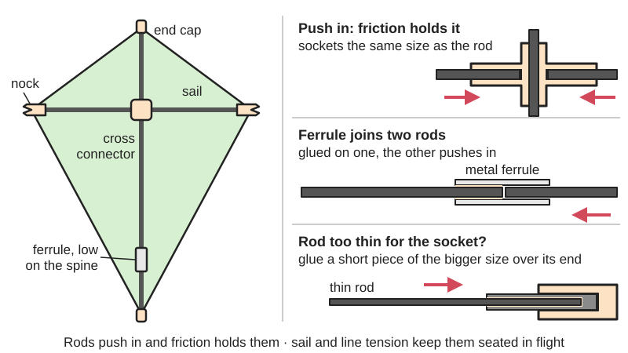
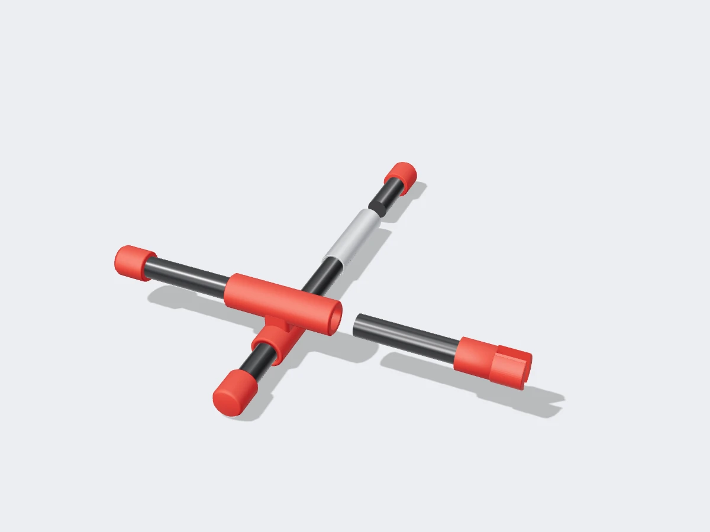
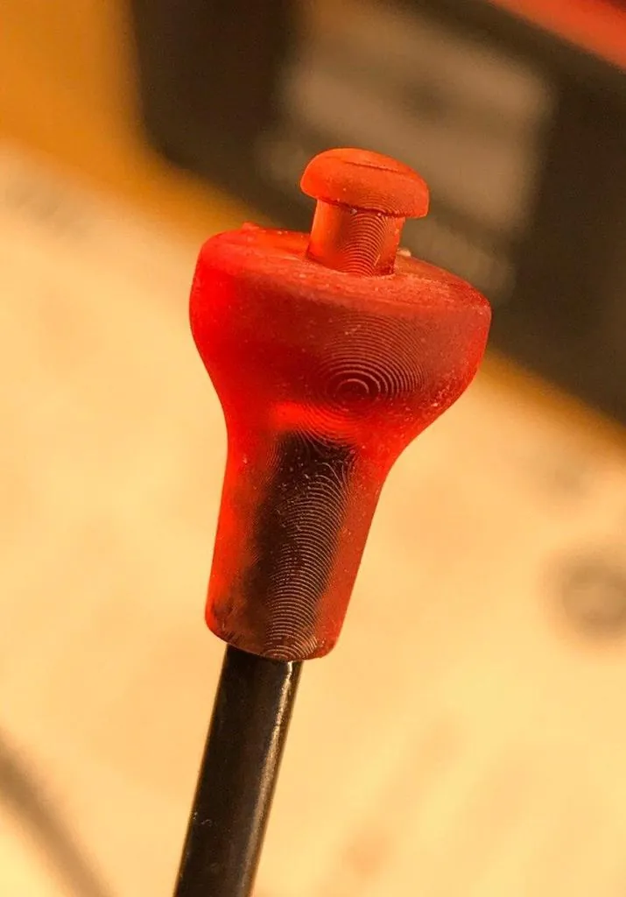
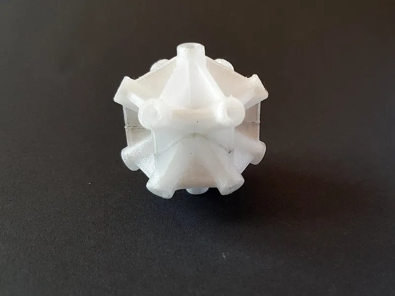

<figure class="eoc-pic eoc-pic-main"><figcaption>Diagram drawn for the encyclopaedia from the research notes. ⚑ Needs confirming: a drawing can simplify or get details wrong; a real photo or a better diagram is welcome.</figcaption></figure>
<figure class="eoc-pic"><figcaption><strong>Render.</strong> A 3D model made for the encyclopaedia, not a photo: a real one is shown below. ⚑ Needs confirming: a model can simplify or get details wrong.</figcaption></figure>
<figure class="eoc-pic"><figcaption><strong>How it works.</strong> <a href="https://www.printables.com/model/488247-stunt-kite-connector-and-end-cap">Stunt Kite Connector and end cap</a> by Wing-Art, <a href="https://creativecommons.org/licenses/by/4.0/">CC BY 4.0</a>, from Printables.</figcaption></figure>
<figure class="eoc-pic"><figcaption><strong>Photo.</strong> <a href="https://www.printables.com/model/75831-connector-for-3d-star-kite">Connector for 3D-Star Kite</a> by Tiggr, <a href="https://creativecommons.org/licenses/by-sa/4.0/">CC BY-SA 4.0</a>, from Printables.</figcaption></figure>

A small moulded, metal, vinyl-tube or 3D-printed socket that a solid or hollow carbon or fibreglass rod pushes into and is held by a snug fit, used to join rods at a fixed angle (tee, cross, dihedral), join two lengths end to end (ferrule), or finish a rod end with a cap or a slotted nock that holds a line, as on kites, model frames and other light rod structures.

**In plain words:** Little plastic, metal or printed sockets that thin carbon or fibreglass sticks push into and stay put by a tight fit, so you can join sticks in a T or a cross, join two short sticks into one long one, or finish a stick end with a cap or a slot to hook a line into, as on kites and light model frames. **Proper term:** Push-fit rod and spar fittings (kite fittings: tee and cross connectors, ferrules, nocks and end caps).

**Also called:** kite fittings, kite connectors, spar connectors, stick-to-stick fittings (kite-shop wording); T fitting, tee connector, centre T fitting (Kite Forge 'Center T Fitting'); cross connector, cross fitting, spreader connector, 'Eddy connector' (a cross fitting for a diamond / Eddy kite; kiteplans.org Eddy Variant); dihedral connector, dihedral fitting, angled connector, APA fitting ('angled fittings for the leading edge'; Kite Forge) ⚑ [uncertain: 'dihedral' wording from search results only]; leading-edge connector, stand-off fitting, tail fitting (Kite Forge); ferrule, spar ferrule, rod joiner, inner ferrule (a solid fibreglass rod inside two tube ends), outer or metal ferrule (a brass or aluminium tube over two rod ends) (Kite Forge; kiteplans.org BDub FAQ; Max-Gain Systems); arrow nock, nock, spike end cap, wing-tip spike (Kite Forge 'Spike (or "nock") end cap'; kiteplans.org Gargoyle); split cap, split end cap, slotted end cap (kiteplans.org Gargoyle; Printables 1009584); end cap, vinyl end cap, spar end cap, tip cap (Kite Forge); vinyl-tube connector, tubing joint (Dremel box-kite guide); C-clip stopper, spar stopper (Kite Forge); printed kite connector, star-kite connector, box-kite connector (Printables).

## How it works

Each fitting has a socket the same size as the rod, so the rod is pushed in until it is snug and friction holds it; in a kite the sail and line tension then push the rods into their fittings, so they stay put in flight but pull out by hand for packing ('You don't need to glue these in place, friction will hold them in place', rec.kites 1992; 'the bungee ... will hold the nock in place'). Tee, cross and angled connectors have two or more sockets at a set angle, so they also fix the angle between the rods. A ferrule joins two lengths in line: either a metal tube glued onto one rod end that the other rod pushes into (Max-Gain Systems: aluminium ferrules 'for connecting, splicing, or repairing round tube and rod'; glue it on with epoxy and keep it in line while it sets), or a solid fibreglass rod glued inside one tube end (Kite Forge 'solid fiberglass joint'). Nocks, split caps and end caps go on rod ends: the slot of a nock or split cap catches a line or bungee loop, and a plain cap stops the rod end wearing through the sail.

## Parts

Single piece per joint in most cases: one moulded tee, cross or angled fitting; one ferrule (a short metal tube or a solid fibreglass rod); one end cap, split cap or nock. A few parts where it is glued or stopped: ferrule glued to one rod end, C-clip stoppers glued on to stop a fitting sliding (Kite Forge), a sleeve of bigger rod glued over a thin rod so it fits a bigger socket (kiteplans.org Eddy Variant).

## Everyday examples

- the cross fitting where the two sticks of a shop-bought diamond kite meet
- the plastic tees and caps on a sport or stunt kite frame
- the metal or fibreglass joint in the middle of a take-apart kite spine
- the nock on the end of an archery arrow (the same part is reused on kite spars)

## When to use it

When you need a light frame of thin round rods that goes together and comes apart by hand: kites, model and display frames, light shade or sign frames, and small rod structures for photography or science projects. Good when the load mainly pushes along the rods, when something (sail, line or bungee) keeps the rods pushed into their sockets, and when you want cheap, replaceable joints that pop apart rather than break the rods.

## When not to use it

Not for anything that carries people, overhead loads or large forces: use bonded tube joints (glued sockets or lugs) or clamp-on tube fittings with screws. Not where the joint is pulled apart along the rod with nothing to push it back (use a spring button lock, a shock-corded pole or a glued joint). Not for big tubes or square tube (use clamp-on fittings or a strut hub). Avoid [set screws](../glossary.md#set-screw) or drilled pins in carbon rods, which crack or crush them; a bonded or push-fit socket is kinder.

## Details

- **What it does (jobs):**
  - join and hold: joins rods at an angle (tee, cross, dihedral) or end to end (ferrule)
  - lock, and release by hand: the rods pull out by hand so a kite or frame can be taken apart and packed, then pushed back together
  - line parts up exactly: a moulded fitting fixes the angle between rods, and a ferrule keeps two lengths in line
- **Movement:** none once pushed together; a rod can usually be twisted in its socket by hand, and some single-socket fittings slide along a rod until stopped by a glued C-clip (Kite Forge)
- **Directions it can move (degrees of freedom):** 0 in use: a snug socket stops the rod moving sideways and the sail or line tension keeps it pushed in. Under hand force a rod can still rotate in its socket and slide out along its own axis, which is what lets it be taken apart.
- **Special behaviour:**
  - quick-release: rods push in and pull out by hand with no tools, so the frame can be packed small
  - self-aligning or self-centring: the socket lines the rod up with the fitting and fixes the angle; a ferrule keeps two lengths in a straight line
  - [fail-safe](../glossary.md#fail-safe--fail-secure) or breakaway ⚑ [uncertain]: in a crash a rod often pops out of its fitting instead of breaking, though rods also snap at the end of a fitting or ferrule (r/kites threads); no opened source states breakaway as a design aim
- **How it holds:**
  - friction or clamping ([force-fit](../glossary.md#form-fit--force-fit--material-bond)): the rod is a snug push fit in the socket ('friction will hold them in place', rec.kites)
  - shape (the parts interlock; form-fit): the socket wraps round the rod so it can only come out along its own axis; a nock or split-cap slot hooks the line
  - spring force (a spring or springy part presses it in place): sail tension, bungee or bow line pushes the rods into their fittings in flight (rec.kites; kiteplans.org)
  - material bond (glue, solvent or melting): ferrules and C-clip stoppers are glued to one rod (Max-Gain Systems; Kite Forge); sleeves that size a thin rod up are glued on (kiteplans.org Eddy Variant)
- **Input and output:** not applicable
- **Power:** passive (no power needed)
- **Load:** light: made for kites and light frames. Strong in pushing (compression) along the rod and fair in bending while the rod is fully seated; weak in pulling apart (only friction and line tension hold it); the rod tends to break where it leaves a stiff fitting or ferrule (a r/kites user broke both vertical spars 'right where the ferrules join the two halves'; another rod 'snapped inside its ferrule'). Plastic tees and crosses can split in a hard crash.
- **Play and precision:** Small play when the rod and socket are matched; noticeable play when the fitting is worn or one size too big, which is why thin rods are sleeved up with a short glued piece of bigger rod (kiteplans.org Eddy Variant). Angle repeats well in a moulded fitting. Tolerates almost no size mismatch: a 4 mm rod will not hold in a 6 mm socket without a sleeve, and a printed socket may need sanding to fit (Printables 1009584: 'it is tight, maybe sanding is involved').
- **Taking it apart:** tool-free quick release: rods push in and pull out by hand; glued ferrules and sleeves are permanent on the rod they are glued to
- **How often it can be reused:** many times: fittings are pushed together at every flight; vinyl fittings slowly loosen as they stretch and moulded fittings crack in crashes, so they are cheap spares (Kite Forge sells them singly as replacement parts) ⚑ [uncertain: wear rate not stated by a source]
- **Sealing:** none
- **Adjustable:** Partly: rods can be pushed further in or out and rotated, and single-socket fittings slide along a rod until glued C-clip stoppers fix them (Kite Forge); angled fittings have a fixed angle. The overall shape is adjusted with the bridle, bow lines and bungee rather than the fittings (kiteplans.org).
- **Access needed:** end of a tube or shaft: the rod end must be free to push into the socket
- **Materials:** Fittings: moulded plastic (often flexible vinyl or nylon), vinyl tubing, aluminium or brass tube ferrules, solid fibreglass rod as inner ferrules, aluminium end caps (Kite Forge; Max-Gain Systems), and 3D-printed PLA, PETG, TPU or SLA resin (Printables models). Rods: solid or hollow carbon fibre, fibreglass, and wooden dowel for simple kites (Dremel box-kite guide). Brass ferrules are used where extra weight helps the balance (kiteplans.org BDub FAQ). Suits round rods and thin tubes; not suited to square tube, soft or crushable tube under heavy load, or anything carrying people.
- **Heat, cold, water and wear:** Vinyl and soft plastic fittings stiffen and crack in cold and soften in heat, and PLA-printed fittings soften in a hot car or in strong sun ⚑ [uncertain: no opened source gives temperatures for kite fittings]. Sunlight (UV) slowly makes plastic fittings [brittle](../glossary.md#brittle--ductile) ⚑ [uncertain]. Sand and grit in sockets wear them loose. Friction fits can loosen after many assemblies. Carbon rods are not harmed by water, but carbon and wet lines conduct electricity: never fly in electrical storms (National Kite Month safety page).

## Making it

- **Ways to make or get it:**
  - off-the-shelf part (moulded kite fittings, ferrules, nocks and end caps sold by rod diameter)
  - 3D print (FDM): tees, crosses, star and box-kite connectors, split caps and TPU end caps (Printables)
  - 3D print (resin): connectors and end caps (Printables 488247 was printed in SLA)
  - home-made from vinyl tubing: cut lengths with a cross hole (Dremel box-kite guide)
  - home-made from rod and tube offcuts: a short sleeve of bigger rod glued over a thin rod, or a drilled dowel glued into a connector (kiteplans.org Eddy Variant)
- **Printing it in one piece (print in place):** no: each fitting is a single printed part with sockets, and the rods are pushed in afterwards; some multi-way connectors are printed as two halves and glued together (Printables 75831)
- **Tools:** none to assemble or take apart. To build: a fine saw or a razor blade to cut rods (Flite Test: roll the rod under a razor blade on a wet paper towel for rods up to about 4 mm), sandpaper, glue (epoxy or thick cyanoacrylate) for ferrules and sleeves, a drill or a sharpened brass tube to punch holes in vinyl tubing, a hot knife to cut openings in the sail for fittings (kiteplans.org Gargoyle)
- **Difficulty:** easy: off-the-shelf fittings push on, vinyl-tube connectors are cut and punched with a drill, and printed connectors print in an hour; the only skill is matching the socket to the rod size (sleeve thin rods up) and gluing ferrules straight

### 3D printing tips

Match the socket to the rod: one printed split cap for 8 mm rod is 'tight, maybe sanding is involved' (Printables 1009584), so print a short test socket first and sand or ream to a snug push fit. Material: use PETG, not PLA, where line tension pulls on the part ('do not use pla because force will be exerted on it! It will snap', Printables 1009584); one designer printed a connector in PLA only because supports came off more easily and says PETG 'would be a better choice', and recommends printing it solid (Printables 877245). TPU suits soft end caps: one parametric design uses 0.8 mm walls (two 0.4 mm lines), 12 mm of rod coverage and a 2 mm tip beyond the rod end (Printables 1156457). Supports: a box-kite tee for 9 mm and 3 mm rods is printed with supports but with none inside the 3 mm socket (Printables 824733). [Warping](../glossary.md#warping--shrinkage): a star-kite connector for 3 mm carbon rods comes with round 'mouse-ear' plates to stop warping, removed before the two halves are glued together (Printables 75831). Orientation ⚑ [uncertain: general FDM practice, no opened source for kite parts]: print sockets standing upright so the holes come out round, and remember that the walls round a socket are weakest along the [layer lines](../glossary.md#layer-lines), so a socket loaded sideways may split between layers; make walls thicker or print in PETG or nylon.

### Buying one (off-the-shelf parts)

Search by rod diameter (e.g. 2, 3, 4, 5, 6, 8 mm, or 1/8 to 5/8 in): 'kite T fitting' or 'center T fitting', 'kite cross connector' or 'Eddy connector', 'dihedral connector', 'leading edge fitting', 'stand-off fitting', 'kite ferrule' (inner solid fibreglass or outer brass/aluminium), 'aluminium ferrule' for fibreglass rod and tube (Max-Gain Systems, 1/8 to 5/8 in), 'arrow nock' and 'spike end cap', 'split cap', 'vinyl end cap', 'aluminium end cap', 'C-clip stopper', and 'vinyl tubing' for home-made connectors (Kite Forge small parts; kiteplans.org parts lists). Rods: 'solid carbon rod', 'carbon tube', 'pultruded fibreglass rod'.

## Rules of thumb

- Commercial cross (Eddy) connectors usually have the same socket size both ways, so to fit a 4 mm rod into a 6 mm connector, glue a short length of 6 mm rod over its end ('this also acts as a reinforcement'); for 2 mm, step up through 4 mm then 6 mm, or glue a drilled dowel into the connector (kiteplans.org Eddy Variant).
- If a spine is split with a ferrule for transport, put the ferrule 'as far down the spine as possible, to lower the center of gravity' (kiteplans.org Eddy Variant and Gargoyle).
- Ferrule weight is part of the kite's balance: the BDub stunt kite plans a brass ferrule just below the lower spreader connector on each leading edge, 'a bit heavier than the spar material' (kiteplans.org BDub FAQ).
- Ferrule length examples from one maker: 8 cm in a leading edge and 12 cm in bottom spreaders (Kite Forge Radius ferrule); a 4 in solid fibreglass ferrule in another kite's leading edge (Kite Forge Dynamic ferrule).
- Metal ferrules are sized to the rod's outside diameter (1/8 in ferrule for 1/8 in rod, and so on); glue on with a generous layer of two-part epoxy and keep the ferrule in line with the rod while it sets (Max-Gain Systems).
- Vinyl-tube connector for a dowel box kite: cut tubing into 5 cm pieces, bore a hole through each about 2 cm from one end, 'just big enough for the dowel rod to tightly fit', and slide them on about 15 cm from each rod end (Dremel box-kite guide).
- Nocks and end caps on carbon spars are often not glued: friction plus line or bungee tension holds them, and unglued ones are easier to replace (rec.kites thread, 1992).
- Glue for ferrules (forum opinion only): thick cyanoacrylate or two-part epoxy; clean off mould-release residue first; avoid expanding polyurethane glue, which 'may crack your spar' (r/kites threads).
- Cut carbon rods up to about 4 mm by rolling them under a razor blade on a wet paper towel, then sand the end with 300 grit; avoid high-speed cutting discs, which throw out carbon dust and heat the resin (Flite Test).

## Common failures

1) Rod breaks at the end of a fitting or ferrule, where the stiff joint meets the flexible rod (r/kites: spars broke 'right where the ferrules join the two halves'; a rod 'snapped inside its ferrule'): keep ferrules no stiffer than needed and replace cracked rods. 2) Rod slips out of a worn or oversized socket in flight: match socket to rod, sleeve thin rods up with a glued piece of bigger rod (kiteplans.org Eddy Variant), or add heat-shrink tubing. 3) Glued ferrule comes loose: clean the rod first and re-glue with epoxy or thick cyanoacrylate (r/kites). 4) Plastic fitting splits in a crash or in the cold: carry spares. 5) End caps or nocks pop off when line tension is lost: refit, or hold with heat-shrink (rec.kites). 6) Printed fittings snap at layer lines or [creep](../glossary.md#creep): use PETG or nylon, not PLA, for loaded parts (Printables 1009584, 877245). 7) Rod end wears through the sail when the cap is missing: always fit end caps (Printables 1156457).

## Safety

Power lines: never fly kites near overhead lines; 'Kite lines conduct electricity' and 'Fishing rods and poles made from carbon fibre and similar materials will conduct electricity' (National Kite Month; Gloucestershire Fire and Rescue Service, which advises at least 30 m from overhead lines for carbon fishing rods). If a kite catches on a line, let go and call the electricity company; never pull it down or climb. Splinters: a broken carbon or fibreglass rod leaves sharp splinters, so handle broken ends with gloves and tape or sand them ⚑ [uncertain: no opened kite source; general carbon-fibre practice]. Dust: don't cut or sand carbon with a high-speed disc; carbon dust in the lungs 'stays there and can cause some nasty complications' (Flite Test). Hard parts on a line: 'Be wary of attaching hard items to kite line' in case it breaks (National Kite Month).

## Related

- Shock-corded sectional pole: also uses ferrules or spigots to join lengths, but an elastic cord inside pulls every joint closed; kite ferrules have no cord
- Clamp-on tube fittings (slip-on structural fittings): bigger tube fittings locked with set screws; much stronger but they can crush thin carbon tube
- Strut hub (geodesic dome hub, space-frame node): a many-way node for domes and space frames, usually bolted or clamped
- Bonded tube joint (lugged or sleeved tube joint): the permanent, glued version of a socket for carbon tubes, with set bond gaps and lengths
- Spring button lock (snap button): a push-button that clicks through a hole so a tube joint can't pull apart
- Telescoping tube twist lock and lever lock: lengthen a pole by sliding one tube inside another and clamping it
- Internal tube anchors (expansion plug, star nut): grip the inside of a tube to give a thread at its end
- Heat-shrink tubing: used on kites to hold fittings, stoppers and nocks on spars
- Stopper knots and cord-end anchors: how the line or bungee is tied to a nock or split cap
- Press fit ([interference fit](../glossary.md#interference-fit)): the permanent, tighter version of a push-fit

## Make it yourself

- [Box kite connectors (Printables) (URL from Printables API, page not opened)](https://www.printables.com/model/824733-box-kite-connectors): Printed T and cross connectors joining 9 mm main rods to 3 mm diagonal rods; print with supports but none inside the 3 mm socket *(licence: CC BY-NC-SA)*
- [Connector for 3D star kite (Printables) (URL from Printables API, page not opened)](https://www.printables.com/model/75831-connector-for-3d-star-kite): Central many-way connector for 3 mm carbon rods, printed in two halves and glued *(licence: CC BY-SA)*
- [Stunt Kite Connector and end cap (Printables) (URL from Printables API, page not opened)](https://www.printables.com/model/488247-stunt-kite-connector-and-end-cap): Printed stunt-kite connector and end cap; designer printed in SLA resin, says FDM also works *(licence: CC BY)*
- [Kite split end cap 8mm (Printables) (URL from Printables API, page not opened)](https://www.printables.com/model/1009584-kite-split-end-cap-8mm): Split cap that holds a line at the end of an 8 mm stick; print in PETG, not PLA *(licence: CC BY-NC-SA)*
- [Kite Spar End Cap - Parametric (TPU) (Printables) (URL from Printables API, page not opened)](https://www.printables.com/model/1156457-kite-spar-end-cap-parametric-tpu): Parametric Fusion 360 end cap printed in TPU for 2 and 3 mm spars, so rod ends can't wear through the sail *(licence: CC BY-NC-SA)*
- [Experimental kite connector (Printables) (URL from Printables API, page not opened)](https://www.printables.com/model/877245-experimental-kite-connector): Angled star-kite connector for 3 mm rods with an Eddy-style angle so an octagonal kite flies without a tail *(licence: CC BY-SA)*

## Pictures, videos and models

- [Kite Plan - Eddy Variant (kiteplans.org, Patrick Mann)](https://www.kiteplans.org/planos/eddyvar/plan3.html): Parts list (Eddy connectors, ferrule, end caps, split caps) and a sail-and-spar drawing (Fig. 1), with how to sleeve thin rods up to fit a 6 mm connector *(licence: link only ('Non-Commercial Use Only' plan, (c) Patrick Mann))*
- [Gargoyle kite, Fig. 3: spar diameters and connectors (kiteplans.org)](https://www.kiteplans.org/planos/gargoyle/plan2_3.gif): Hand-drawn frame diagram showing 6, 3 and 2 mm carbon and fibreglass spars and where the split caps join them *(licence: link only ((c) Patrick Mann, 1999))*
- [Small Parts (Kite Forge)](https://kiteforge.com/product-category/small-parts/): Photos of real kite fittings: centre T fitting, angled leading-edge fittings, ferrules, wing-tip spike (nock) end caps, vinyl end caps, C-clip stoppers *(licence: link only)*
- [How to Build Your Own Box Kite (Dremel)](https://www.dremel.com/gb/en/make-with-dremel/ideas--projects/build-your-own-box-kite): Step-by-step photos of making vinyl-tube joints for a dowel box kite *(licence: link only)*

## Needs confirming

⚑ marks something nobody has confirmed yet: a fact the research could not confirm from a source, a finder value that is a best guess, or an open point from the research notes. Corrections are welcome (see `research/needs-confirming.md`).

- ⚑ 7 sentences on this page marked [uncertain].
- ⚑ Finder value `special_behaviour` = quick-release, self-aligning or self-centring, fail-safe or breakaway (source uncertain): `special_behaviour` is marked ⚑ [uncertain] here: "…ick-release | self-aligning or self-centring | fail-safe or breakaway ⚑ [uncertain]…"
- ⚑ Finder value `connects` = any solid parts (best guess): joins parts, but no specific kind of part found; set to any solid parts

## Sources

- <https://www.kiteplans.org/planos/eddyvar/plan3.html>
- <https://www.kiteplans.org/planos/gargoyle/plan2.html>
- <https://www.kiteplans.org/planos/gargoyle/plan2_3.gif>
- <https://www.kiteplans.org/planos/bdub/bdubfaq.htm>
- <https://bio.nic.funet.fi/index/misc/kites/tech/arrow.nocks>
- <https://kiteforge.com/product-category/small-parts/>
- <https://kiteforge.com/product/center-t-fitting>
- <https://kiteforge.com/product/vinyl-end-caps>
- <https://mgs4u.com/product/aluminum-ferrule/>
- <https://www.dremel.com/gb/en/make-with-dremel/ideas--projects/build-your-own-box-kite>
- <https://nkm.kite.org/kite-safety/>
- <https://www.gloucestershire.gov.uk/glosfire/your-safety/safety-outdoors/safety-near-powerlines>
- <https://www.flitetest.com/articles/how-to-cut-carbon-fiber-rods>
- <https://en.wikipedia.org/wiki/Eddy_kite (redirects to 'Diamond kite'; read via the MediaWiki API)>
- <https://arctic-shift.photon-reddit.com/api/posts/ids?ids=1plmpl3 and https://arctic-shift.photon-reddit.com/api/comments/search?link_id=1plmpl3 (r/kites 'Glue recommendation for ferrule')>
- <https://arctic-shift.photon-reddit.com/api/posts/ids?ids=6lg2fq and https://arctic-shift.photon-reddit.com/api/comments/search?link_id=6lg2fq (r/kites 'Type of glue to use to attach inner ferrule to carbon spar?')>
- <https://arctic-shift.photon-reddit.com/api/posts/ids?ids=1katpd2 (r/kites 'Prism Zenith 5 broke on second day': rod snapped inside its ferrule)>
- <https://arctic-shift.photon-reddit.com/api/posts/ids?ids=bzgccc (r/kites 'Broke vertical spars on my Revolution': spars broke where the ferrules join)>
- <https://api.printables.com/graphql/ (searches 'kite connector', 'kite end cap'; details of models 824733, 75831, 488247, 1009584, 1156457, 877245)>
